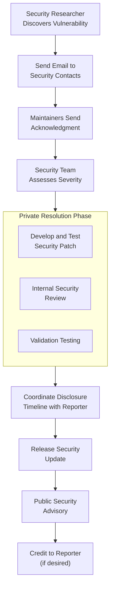
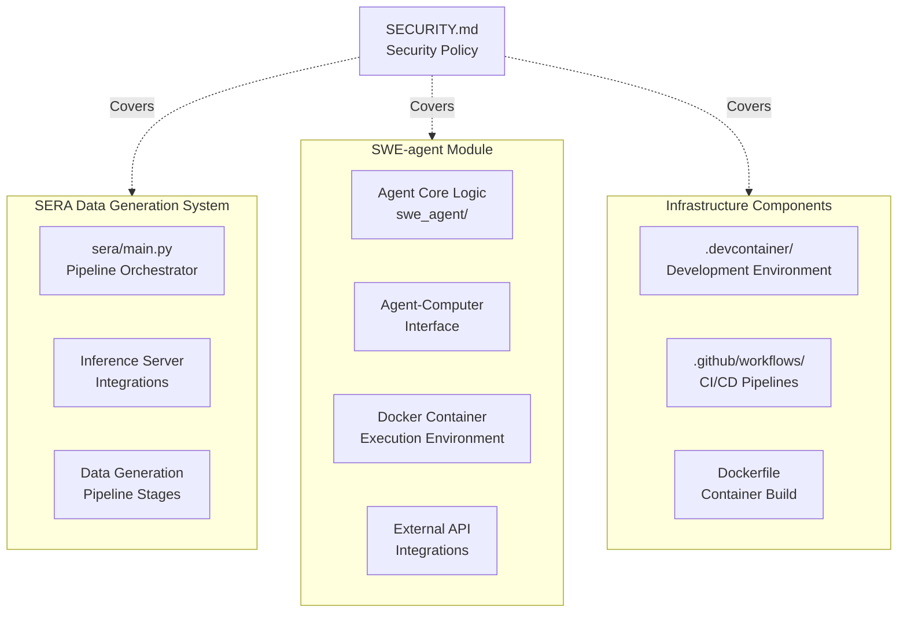
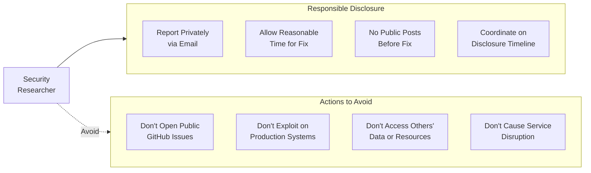
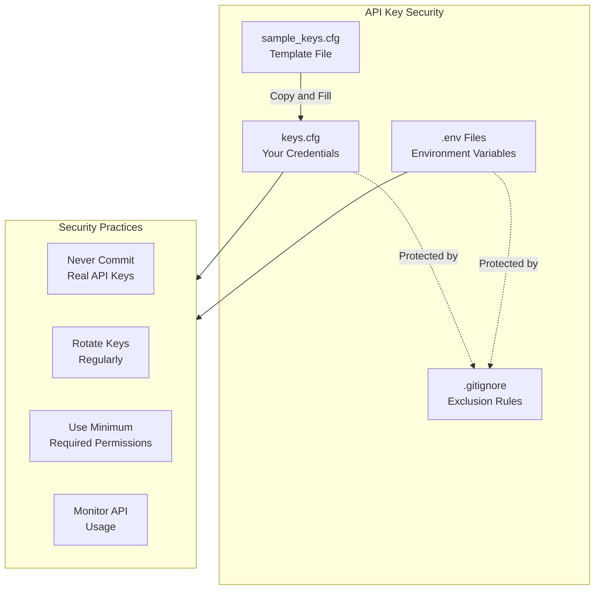

<!-- source: DeepWiki mcp.deepwiki.com · repo allenai/SERA · page 7.5 Security Policy · fetched 2026-10-26 -->

# Security Policy

Relevant source files

The following files were used as context for generating this wiki page:

- [modules/SWE-agent/SECURITY.md](modules/SWE-agent/SECURITY.md)

## Purpose and Scope

This document describes the security vulnerability reporting process for the SERA repository and its modules, including the SWE-agent system. It provides contact information for security researchers and guidelines for responsible disclosure of security issues.

For general contribution guidelines, see [Contribution Guidelines](#7.1). For behavioral standards and community enforcement, see [Code of Conduct](#7.4). This policy specifically addresses security-sensitive issues that require confidential handling before public disclosure.

**Sources:** [modules/SWE-agent/SECURITY.md:1-6]()

---

## Vulnerability Reporting Process

### Contact Information

Security vulnerabilities should be reported directly to the project maintainers via email rather than through public issue trackers. This allows the team to assess and address the vulnerability before public disclosure.

| Role | Name | Email |
|------|------|-------|
| Primary Contact | Kilian Lieret | kl5675@princeton.edu |
| Co-maintainer | John Yang | johnby@stanford.edu |
| Co-maintainer | Carlos E. Jimenez | carlosej@princeton.edu |
| Co-maintainer | Ofir Press | ofirp@princeton.edu |

**Sources:** [modules/SWE-agent/SECURITY.md:5]()

### Reporting Workflow

**Sources:** [modules/SWE-agent/SECURITY.md:1-6]()

---

## Security Scope

### Covered Components

The security policy applies to the following components within the repository:

**Sources:** [modules/SWE-agent/SECURITY.md:1-6]()

### Security Concerns by Component

| Component | Security Considerations | File References |
|-----------|------------------------|-----------------|
| **SERA Pipeline** | API key exposure, inference server access, data exfiltration | `sera/main.py`, configuration YAML files |
| **SWE-agent Core** | Code execution in containers, file system access, external API calls | `modules/SWE-agent/` |
| **Container Execution** | Container escape, privilege escalation, resource exhaustion | `Dockerfile`, `.devcontainer/` |
| **API Integrations** | Credential leakage, unauthorized API access, rate limit bypass | `keys.cfg`, `.env` files |
| **CI/CD Workflows** | Workflow injection, secret exposure, unauthorized deployments | `.github/workflows/` |
| **Dev Environment** | Malicious package installation, compromised dependencies | `.devcontainer/oncreate.sh`, `postcreate.sh` |

**Sources:** [modules/SWE-agent/SECURITY.md:1-6]()

---

## Responsible Disclosure Guidelines

### What to Include in Your Report

When reporting a security vulnerability, please provide the following information to help maintainers assess and address the issue:

| Information Type | Details to Provide |
|-----------------|-------------------|
| **Vulnerability Description** | Clear explanation of the security issue and its potential impact |
| **Affected Components** | Specific files, functions, or system components involved |
| **Reproduction Steps** | Detailed steps to reproduce the vulnerability |
| **Proof of Concept** | Code snippet or demonstration (if applicable) |
| **Severity Assessment** | Your assessment of the impact (low/medium/high/critical) |
| **Suggested Mitigation** | Proposed fix or workaround (optional but helpful) |
| **Discovery Date** | When you first discovered the vulnerability |
| **Disclosure Preference** | Whether you want public credit and your preferred timeline |

**Sources:** [modules/SWE-agent/SECURITY.md:1-6]()

### Best Practices for Security Researchers

**Sources:** [modules/SWE-agent/SECURITY.md:1-6]()

---

## Security Response Process

### Maintainer Response Timeline

Once a vulnerability report is received, the security team follows this general timeline:

| Phase | Timeframe | Actions |
|-------|-----------|---------|
| **Initial Response** | 1-3 business days | Acknowledge receipt of the report |
| **Assessment** | 3-7 days | Evaluate severity, impact, and feasibility of exploitation |
| **Patch Development** | 1-4 weeks | Develop and test security fix (varies by complexity) |
| **Disclosure Coordination** | Before release | Coordinate with reporter on disclosure timeline |
| **Public Release** | After patch ready | Release security update with advisory |

**Note:** Timelines are estimates and may vary based on vulnerability severity and complexity.

**Sources:** [modules/SWE-agent/SECURITY.md:1-6]()

### Severity Classification

The security team uses the following criteria to assess vulnerability severity:

| Severity | Description | Example Scenarios |
|----------|-------------|-------------------|
| **Critical** | Immediate risk of unauthorized access or data breach | Remote code execution, credential exposure |
| **High** | Significant security risk requiring prompt attention | Privilege escalation, authentication bypass |
| **Medium** | Moderate security concern with limited impact | Information disclosure, denial of service |
| **Low** | Minor security issue with minimal practical impact | Missing security headers, minor information leakage |

**Sources:** [modules/SWE-agent/SECURITY.md:1-6]()

---

## Out of Scope

### Non-Security Issues

The following types of issues should be reported through standard channels rather than the security contact process:

- **Bug Reports**: Functional bugs without security implications → Use [Bug Report Template](#7.2)
- **Feature Requests**: Security feature suggestions → Use [Feature Request Template](#7.2)
- **Configuration Help**: Questions about security configuration → Use [Question Template](#7.2)
- **Third-Party Dependencies**: Known vulnerabilities in dependencies (handled by Dependabot) → See [Dependency Management](#6.4)
- **Social Engineering**: Issues requiring user action outside the codebase
- **Physical Security**: Data center or hardware security concerns

**Sources:** [modules/SWE-agent/SECURITY.md:1-6]()

---

## Security Best Practices for Users

### API Key Management

Users of SERA and SWE-agent should follow these security practices when configuring the system:

**Sources:** [modules/SWE-agent/SECURITY.md:1-6]()

| Best Practice | Implementation |
|---------------|----------------|
| **Use Templates** | Copy `sample_keys.cfg` to `keys.cfg` and fill in your credentials |
| **Never Commit Secrets** | Verify that `keys.cfg` and `.env` are in `.gitignore` |
| **Rotate Credentials** | Regularly update API keys and tokens |
| **Least Privilege** | Grant only necessary permissions to API keys |
| **Monitor Usage** | Watch for unexpected API calls or rate limit hits |
| **Secure Storage** | Use system keychains or secrets managers for production |

**Sources:** [modules/SWE-agent/SECURITY.md:1-6]()

---

## Related Documentation

For additional information on project policies and processes:

- **General Contributions**: See [Contribution Guidelines](#7.1) for non-security contributions
- **Issue Reporting**: See [Issue Templates](#7.2) for standard bug and feature reporting
- **Community Standards**: See [Code of Conduct](#7.4) for behavioral expectations
- **Development Environment**: See [API Key Configuration](#4.2) for credential setup
- **External Integrations**: See [External Service Integration](#3.4) for API provider documentation

**Sources:** [modules/SWE-agent/SECURITY.md:1-6]()

---

