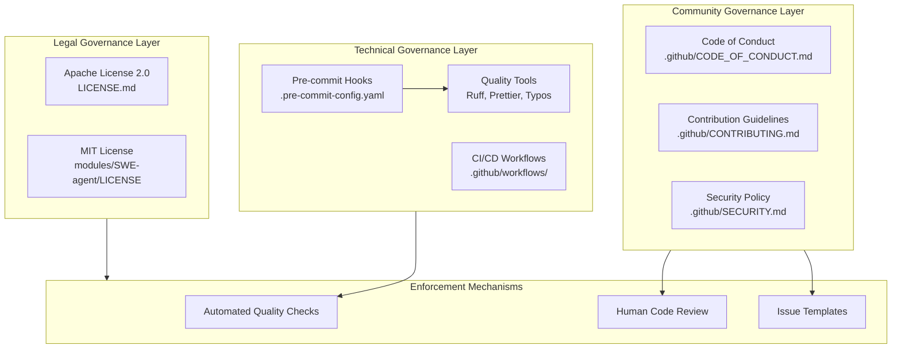
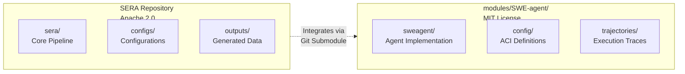
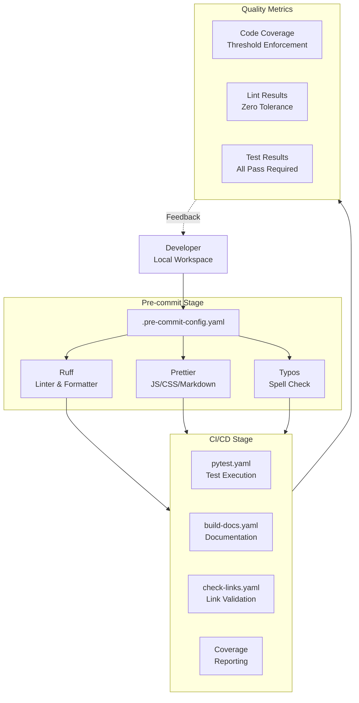
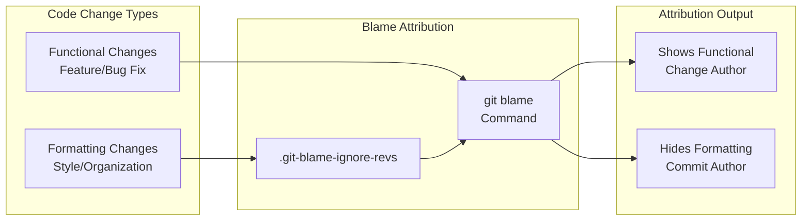
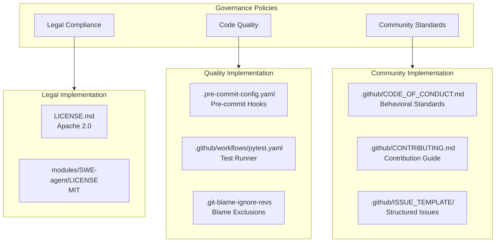

<!-- source: DeepWiki mcp.deepwiki.com · repo allenai/SERA · page 8 Project Governance · fetched 2026-10-26 -->

# Project Governance

Relevant source files

The following files were used as context for generating this wiki page:

- [LICENSE.md](LICENSE.md)
- [modules/SWE-agent/.git-blame-ignore-revs](modules/SWE-agent/.git-blame-ignore-revs)
- [modules/SWE-agent/LICENSE](modules/SWE-agent/LICENSE)

## Purpose and Scope

This document provides an overview of the governance structure for the SERA repository, including licensing models, code quality enforcement mechanisms, and development practices. Project governance encompasses the policies, standards, and automated systems that ensure code quality, legal compliance, and consistent development practices across the codebase.

For community interaction policies, behavioral standards, and contribution processes, see section [7](#7). For detailed information on specific governance topics, refer to the sub-pages:
- [8.1](#8.1) for licensing details
- [8.2](#8.2) for code quality standards and tooling

## Governance Structure

The SERA repository implements a multi-layered governance model that addresses legal, technical, and community aspects of the project. The governance framework operates through three primary mechanisms:

1. **Legal Governance**: Dual licensing structure with different licenses for different components
2. **Technical Governance**: Automated code quality enforcement through pre-commit hooks and CI/CD pipelines
3. **Community Governance**: Documented standards and processes for contribution and collaboration (see [7](#7))

**Sources:** [LICENSE.md:1-201](), [modules/SWE-agent/LICENSE:1-22]()

## Dual Licensing Model

The repository implements a dual licensing structure that recognizes the distinct origins and purposes of its two major components:

| Component | License | Location | Copyright Holder |
|-----------|---------|----------|------------------|
| SERA (root) | Apache License 2.0 | [LICENSE.md:1-201]() | Various contributors |
| SWE-agent (module) | MIT License | [modules/SWE-agent/LICENSE:1-22]() | John Yang, Carlos E. Jimenez, Alexander Wettig, Shunyu Yao, Karthik Narasimhan, Ofir Press |

This dual licensing structure reflects the modular architecture where SWE-agent is integrated as a submodule with its own independent licensing terms. The Apache License 2.0 for SERA provides patent protection and explicit trademark provisions, while the MIT License for SWE-agent offers maximum permissiveness for the autonomous agent framework.

For detailed licensing terms and implications, see section [8.1](#8.1).

**Sources:** [LICENSE.md:1-201](), [modules/SWE-agent/LICENSE:1-22]()

## Code Quality Enforcement

The project maintains code quality through a multi-stage enforcement pipeline that operates at three key intervention points: pre-commit, during development, and in CI/CD pipelines. This layered approach ensures that quality issues are caught early and consistently across all contributions.

### Quality Gate Architecture

### Git Blame Exclusions

The project maintains a git blame ignore list to exclude large-scale formatting commits from blame history, preserving meaningful attribution for functional changes. The ignored commits include:

| Commit Hash | Description |
|-------------|-------------|
| `51699eb03c3c4f36d4b5ef2725f7bd5223874da7` | Trailing whitespace & black formatting |
| `70ba97190a781705203ba838bfe0fb8be7cfa32f` | Trailing whitespace & black formatting |
| `83988093c08ab5f1cb999f97fc3745f3d3af306f` | Trailing whitespace & black formatting |
| `29a4c6dfb6cceff5e657c707ce809bc78f33b778` | PEP 585 and PEP 604 conversion |
| `f873761e6760a844c1788cb5f4e42de401ab2c38` | Sort imports |

These exclusions are configured in [modules/SWE-agent/.git-blame-ignore-revs:1-9]() and prevent code quality improvements from obscuring the git blame view.

For comprehensive documentation of code quality tools, configurations, and standards, see section [8.2](#8.2).

**Sources:** [modules/SWE-agent/.git-blame-ignore-revs:1-9]()

## Development Standards

The project enforces several development standards through automated tooling and documented guidelines:

### Code Style Standards

| Aspect | Tool/Standard | Configuration |
|--------|---------------|---------------|
| Python Linting | Ruff | `.pre-commit-config.yaml` |
| Python Formatting | Ruff | `.pre-commit-config.yaml` |
| JavaScript/CSS/Markdown | Prettier | `.pre-commit-config.yaml` |
| Spell Checking | Typos | `.pre-commit-config.yaml` |
| Import Sorting | Automated | Pre-commit hooks |

### Code Evolution Tracking

The repository uses `.git-blame-ignore-revs` to maintain meaningful git blame history while allowing large-scale refactoring. This file documents commits that should be ignored in blame views, including:

- Code formatting standardization (black, trailing whitespace removal)
- Modern Python syntax adoption (PEP 585, PEP 604)
- Import organization and sorting

This practice ensures that `git blame` reveals the developer who made functional changes rather than cosmetic reformatting.

**Sources:** [modules/SWE-agent/.git-blame-ignore-revs:1-9]()

## Relationship to CI/CD Infrastructure

Project governance is enforced through automated CI/CD workflows that validate compliance with established standards. The relationship between governance policies and enforcement mechanisms is documented in section [6](#6). Specific workflows include:

- **Testing Workflow**: Validates functional correctness (see [6.1](#6.1))
- **Documentation Build**: Ensures documentation quality (see [6.2](#6.2))
- **Code Quality Automation**: Enforces style and quality standards (see [6.3](#6.3))
- **Dependency Management**: Maintains up-to-date dependencies (see [6.4](#6.4))

These automated systems form the technical backbone of project governance, ensuring that all merged code adheres to established standards without requiring manual enforcement.

## Governance Implementation Map

The following diagram illustrates how governance policies are implemented through specific files and systems in the codebase:

This implementation map shows how abstract governance principles are translated into concrete files and automated systems that enforce compliance across the development lifecycle.

**Sources:** [LICENSE.md:1-201](), [modules/SWE-agent/LICENSE:1-22](), [modules/SWE-agent/.git-blame-ignore-revs:1-9]()

---

