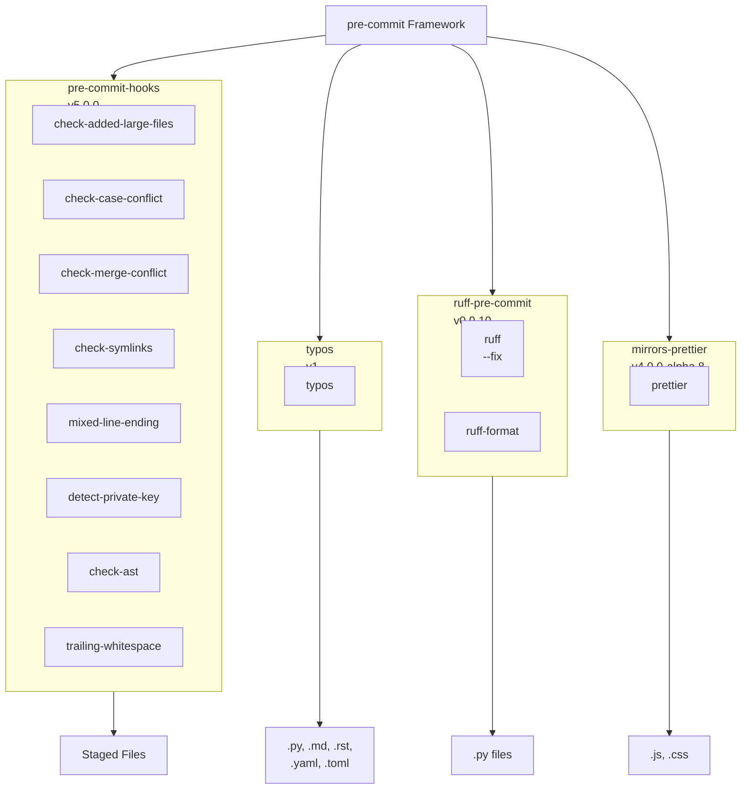
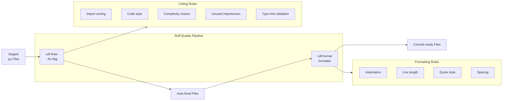
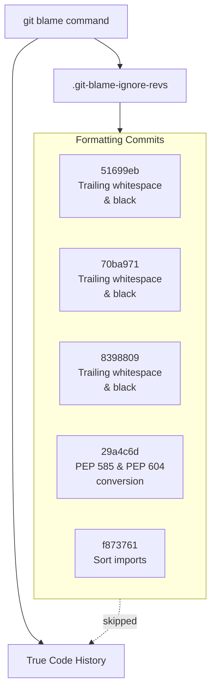
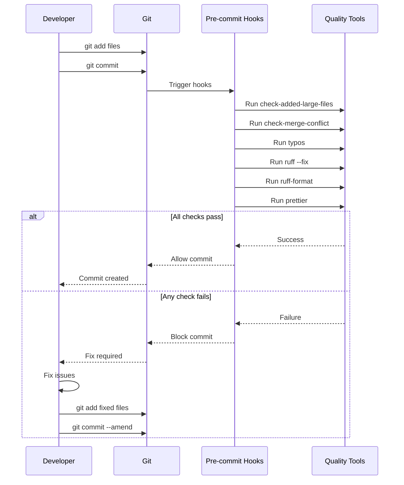

<!-- source: DeepWiki mcp.deepwiki.com · repo allenai/SERA · page 8.2 Code Quality Standards · fetched 2026-10-26 -->

# Code Quality Standards

<details>
<summary>Relevant source files</summary>

The following files were used as context for generating this wiki page:

- [modules/SWE-agent/.git-blame-ignore-revs](modules/SWE-agent/.git-blame-ignore-revs)
- [modules/SWE-agent/.pre-commit-config.yaml](modules/SWE-agent/.pre-commit-config.yaml)

</details>


## Purpose and Scope

This document describes the code quality standards, tools, and automated enforcement mechanisms used in the SERA repository. It covers linting, formatting, and validation tools that maintain consistent code quality across contributions. For information about the CI/CD workflows that execute these quality checks in automated pipelines, see [CI/CD and Automation](#6). For contribution guidelines and the review process, see [Contribution Guidelines](#7.1).

## Overview

The SERA project enforces code quality through automated tooling integrated at multiple points in the development workflow. Quality checks run both locally via pre-commit hooks and remotely through CI/CD pipelines, ensuring consistent standards before code reaches the main branch.

**Key Quality Enforcement Points:**

| Enforcement Stage | Trigger | Scope |
|------------------|---------|-------|
| Pre-commit Hooks | Before local commit | All staged files |
| CI/CD Workflows | On pull request | Full codebase |
| Automated Updates | Scheduled (via ci.ai) | Hook versions |

**Sources:** [modules/SWE-agent/.pre-commit-config.yaml:1-39]()

## Pre-commit Hook System

### Configuration Architecture

The pre-commit framework orchestrates multiple quality tools through a declarative YAML configuration. Each repository in the configuration represents a separate quality tool with its own version pinning and execution rules.



**Sources:** [modules/SWE-agent/.pre-commit-config.yaml:4-38]()

### Auto-update Configuration

The pre-commit system automatically updates hook versions through the `ci.ai` service, with custom commit message formatting for consistency.

```yaml
ci:
  autoupdate_commit_msg: "chore: update pre-commit hooks"
```

**Sources:** [modules/SWE-agent/.pre-commit-config.yaml:1-2]()

## Core Quality Tools

### File and Repository Checks

The `pre-commit-hooks` repository provides foundational repository hygiene checks that prevent common issues before they enter the codebase.

**Check Types and Purposes:**

| Hook ID | Purpose | Rationale |
|---------|---------|-----------|
| `check-added-large-files` | Blocks files exceeding size threshold | Prevents repository bloat |
| `check-case-conflict` | Detects filename case conflicts | Ensures cross-platform compatibility |
| `check-merge-conflict` | Identifies unresolved merge markers | Prevents broken commits |
| `check-symlinks` | Validates symbolic links | Ensures link targets exist |
| `mixed-line-ending` | Enforces consistent line endings | Prevents diff noise |
| `detect-private-key` | Scans for credential leaks | Security protection |
| `check-ast` | Validates Python syntax | Catches syntax errors early |
| `trailing-whitespace` | Removes trailing spaces | Maintains clean diffs |

**Sources:** [modules/SWE-agent/.pre-commit-config.yaml:5-15]()

### Typo Detection

The `typos` tool performs spell-checking across documentation and code files, catching common typographical errors.

**Configuration:**

```yaml
- repo: https://github.com/crate-ci/typos
  rev: v1
  hooks:
    - id: typos
      files: \.(py|md|rst|yaml|toml)
      exclude: pyproject.toml
```

**File Coverage:**
- Python source files (`.py`)
- Documentation files (`.md`, `.rst`)
- Configuration files (`.yaml`, `.toml`)

**Exclusions:** `pyproject.toml` is excluded, likely due to package names or technical terms that trigger false positives.

**Sources:** [modules/SWE-agent/.pre-commit-config.yaml:17-22]()

### Python Code Quality: Ruff

Ruff is an extremely fast Python linter and formatter written in Rust that replaces multiple traditional tools (flake8, isort, black, etc.).



**Hook Configuration:**

```yaml
- repo: https://github.com/astral-sh/ruff-pre-commit
  rev: v0.9.10
  hooks:
    - id: ruff
      args: ["--fix"]
    - id: ruff-format
```

**Execution Order:**
1. **`ruff` linter** runs first with `--fix` argument, automatically correcting issues where possible
2. **`ruff-format`** runs second, applying consistent code formatting

**Sources:** [modules/SWE-agent/.pre-commit-config.yaml:24-31]()

### JavaScript/CSS Formatting: Prettier

Prettier enforces consistent formatting for web assets including JavaScript and CSS files.

**Configuration:**

```yaml
- repo: https://github.com/pre-commit/mirrors-prettier
  rev: "v4.0.0-alpha.8"
  hooks:
    - id: prettier
      types_or: ["javascript", "css"]
```

**File Types Handled:**
- JavaScript files (`.js`)
- CSS stylesheets (`.css`)

**Sources:** [modules/SWE-agent/.pre-commit-config.yaml:33-37]()

## File Exclusions

Certain paths are excluded from all pre-commit hooks to avoid interfering with test data and tool internals.

**Exclusion Pattern:**

```yaml
exclude: "^tests/test_data/|^tools/.*/.*.py"
```

**Excluded Paths:**
- `tests/test_data/` - Test fixtures that may intentionally contain formatting violations
- `tools/*/*.py` - Tool-specific Python files that may have different formatting requirements

**Sources:** [modules/SWE-agent/.pre-commit-config.yaml:39]()

## Git Blame Ignore Configuration

### Purpose

The `.git-blame-ignore-revs` file lists commits that made large-scale formatting changes, allowing developers to ignore these commits in `git blame` output for clearer code history analysis.



**Ignored Commit Categories:**

| Commit SHA | Description | Type |
|------------|-------------|------|
| `51699eb`, `70ba971`, `8398809` | Trailing whitespace & black formatting | Whitespace/formatting |
| `29a4c6d` | PEP 585 and PEP 604 type hint modernization | Style upgrade |
| `f873761` | Import sorting | Import organization |

**Usage:**

To configure git to respect this ignore file:

```bash
git config blame.ignoreRevsFile .git-blame-ignore-revs
```

**Sources:** [modules/SWE-agent/.git-blame-ignore-revs:1-9]()

## Quality Standards Reference

### Python Standards

The project follows modern Python conventions, with several notable upgrades reflected in the git blame ignore list:

**PEP 585** - Type hinting generics in standard collections
- Old: `List[str]`, `Dict[str, int]`
- New: `list[str]`, `dict[str, int]`

**PEP 604** - Union operator for type hints
- Old: `Union[str, int]`
- New: `str | int`

These standards are enforced through Ruff's linting rules.

**Sources:** [modules/SWE-agent/.git-blame-ignore-revs:5-6]()

### Import Organization

Python imports are automatically sorted and organized according to standard conventions:
- Standard library imports first
- Third-party imports second
- Local application imports last
- Within each group, alphabetically sorted

**Sources:** [modules/SWE-agent/.git-blame-ignore-revs:7-8]()

### Whitespace and Formatting

- No trailing whitespace on any line
- Consistent indentation (spaces, not tabs)
- Unix-style line endings (LF, not CRLF)
- Files end with a single newline

These rules are enforced by multiple hooks: `trailing-whitespace`, `mixed-line-ending`, and `ruff-format`.

**Sources:** [modules/SWE-agent/.pre-commit-config.yaml:12-15](), [modules/SWE-agent/.git-blame-ignore-revs:1-3]()

## Integration with Development Workflow

### Local Development



**Sources:** [modules/SWE-agent/.pre-commit-config.yaml:1-39]()

### Installation and Setup

Pre-commit hooks must be installed in each developer's local repository:

```bash
# Install pre-commit framework
pip install pre-commit

# Install hooks in repository
pre-commit install

# Run manually on all files (optional)
pre-commit run --all-files
```

After installation, hooks automatically run on every commit attempt.

### CI/CD Integration

While pre-commit hooks run locally, the same quality checks also execute in CI/CD workflows to catch any issues that bypass local checks (e.g., if a contributor doesn't install pre-commit hooks). For details on CI/CD execution, see [Code Quality Automation](#6.3).

## Best Practices

### For Contributors

1. **Install pre-commit hooks immediately** after cloning the repository
2. **Run `pre-commit run --all-files`** before submitting pull requests to catch any issues
3. **Don't bypass hooks** with `--no-verify` unless absolutely necessary
4. **Keep hooks updated** by running `pre-commit autoupdate` periodically

### For Maintainers

1. **Review `.git-blame-ignore-revs`** when making large formatting changes
2. **Add formatting commits** to ignore list after mass reformatting
3. **Update hook versions** through automated PRs from `ci.ai`
4. **Monitor hook execution time** and consider removing slow hooks if they impact developer experience

### Handling Hook Failures

When hooks fail:

1. **Read the error message carefully** - most tools provide specific fix instructions
2. **Let auto-fixes work** - Ruff and Prettier automatically fix most issues
3. **Re-stage fixed files** with `git add` before re-attempting commit
4. **For typos**, either fix the typo or add legitimate terms to the typos configuration

**Sources:** [modules/SWE-agent/.pre-commit-config.yaml:1-39](), [modules/SWE-agent/.git-blame-ignore-revs:1-9]()

---

