# Page: Overview

# Overview

<details>
<summary>Relevant source files</summary>

The following files were used as context for generating this wiki page:

- [.gitignore](.gitignore)
- [README.md](README.md)
- [assets/SERA.jpg](assets/SERA.jpg)
- [modules/SWE-agent/README.md](modules/SWE-agent/README.md)

</details>


## Purpose and Scope

This document provides a high-level introduction to the SERA repository, which consists of two main systems:

1. **SERA Data Generation System** - A multi-stage pipeline for generating synthetic training data from language models
2. **SWE-agent** - An autonomous software engineering agent that uses language models to perform coding tasks

This page explains the overall architecture, repository structure, and how these systems relate to each other. For detailed information about specific subsystems, refer to:
- SERA pipeline stages and configuration: [SERA Data Generation System](#2)
- SWE-agent capabilities and usage: [SWE-agent Module](#3)
- Development environment setup: [Development Environment](#4)
- Deployment and containerization: [Docker and Containerization](#5)

## Repository Structure

The SERA repository is organized into two primary layers: the root SERA system and the SWE-agent module located in `modules/SWE-agent/`.

### Directory Organization

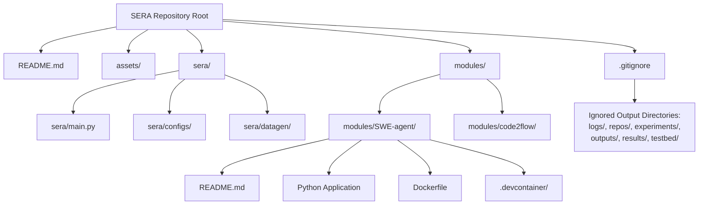

**Sources:** [.gitignore:1-227](), [README.md:1-185](), [modules/SWE-agent/README.md:1-105]()

### Key Directories and Artifacts

| Directory/File | Purpose |
|----------------|---------|
| `sera/` | SERA data generation pipeline source code |
| `sera/main.py` | Pipeline orchestrator and entry point |
| `sera/configs/` | YAML configuration files for experiments |
| `sera/datagen/` | Data generation modules and inference server scripts |
| `modules/SWE-agent/` | SWE-agent autonomous coding agent (git submodule) |
| `modules/code2flow/` | Code analysis utilities |
| `experiments/` | Generated experiment outputs (gitignored) |
| `outputs/` | Pipeline output data (gitignored) |
| `results/` | Evaluation results (gitignored) |
| `logs/` | Runtime logs (gitignored) |
| `repos/` | Cloned repository mirrors (gitignored) |

**Sources:** [.gitignore:1-10](), [.gitignore:174-178](), [README.md:7-16]()

## SERA Data Generation System

SERA (Soft-Verified Efficient Repository Agents) is a system for generating synthetic training data by having language models perform software engineering tasks on real codebases.

### Pipeline Architecture

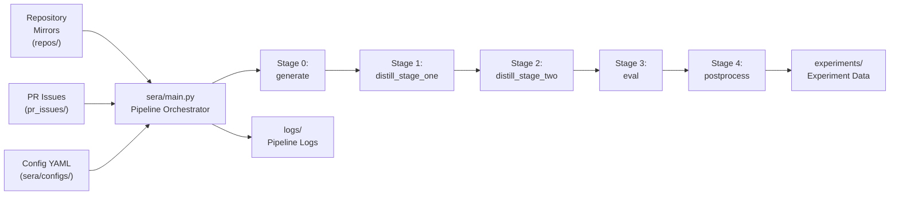

**Sources:** [README.md:130-156](), [.gitignore:1-7]()

### Inference Server Integration

SERA supports multiple inference backends for data generation:

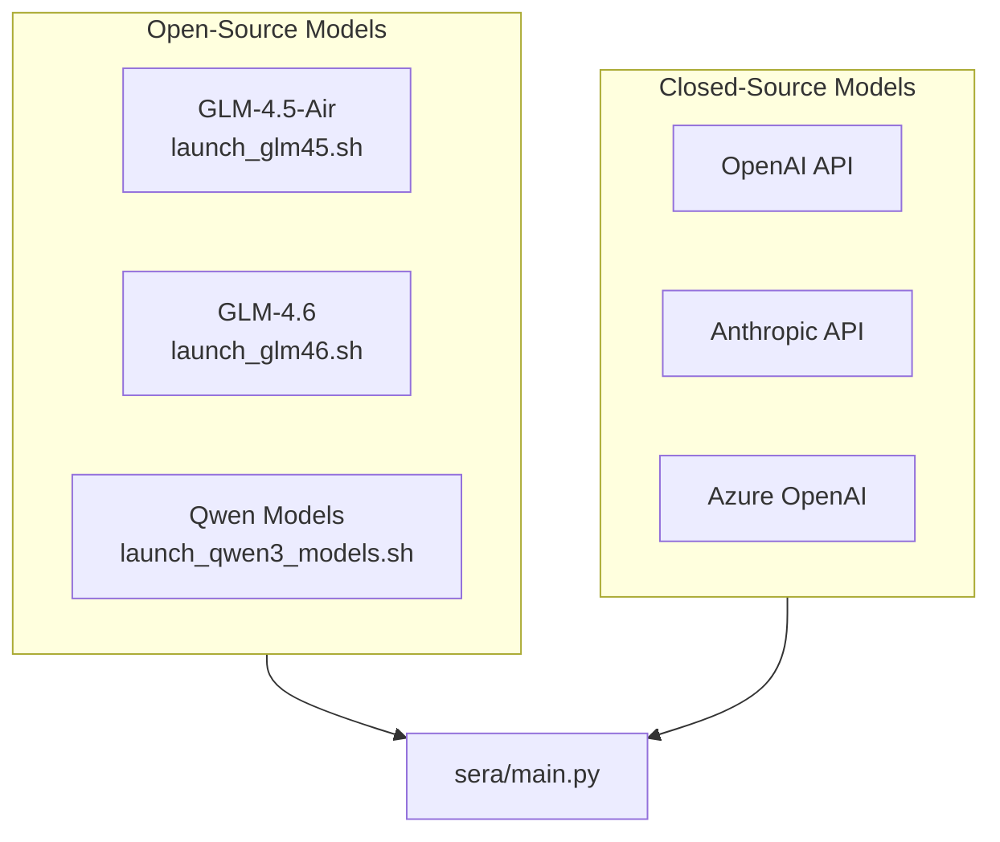

**Sources:** [README.md:18-32](), [README.md:86-94]()

### Configuration Profiles

SERA includes pre-configured experiment profiles for different use cases:

| Configuration | Purpose | Key Features |
|---------------|---------|--------------|
| `specialization_django` | Generate data for Django/Sympy repos from SWE-Bench | Uses existing SWE-Bench issues |
| `specialization_personal` | Generate data for custom repositories | Requires GitHub mirror organization |
| `specialization_anthropic` | Use closed-source models (Claude) | No inference server setup needed |
| `swesmith_scaling` | Large-scale data generation with sharding | Supports multi-server parallel execution |

**Sources:** [README.md:39-122]()

### Multi-Server Scaling

SERA supports horizontal scaling through dataset sharding across multiple inference servers:

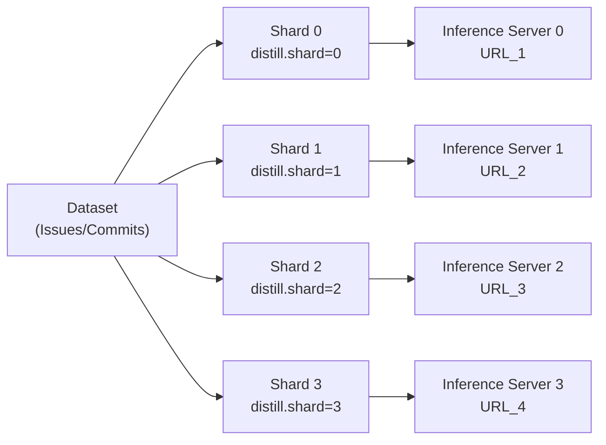

**Sources:** [README.md:96-121]()

## SWE-agent Autonomous Software Engineering Agent

SWE-agent is an autonomous agent system that enables language models to perform software engineering tasks through configurable Agent-Computer Interfaces (ACIs).

### Core Capabilities

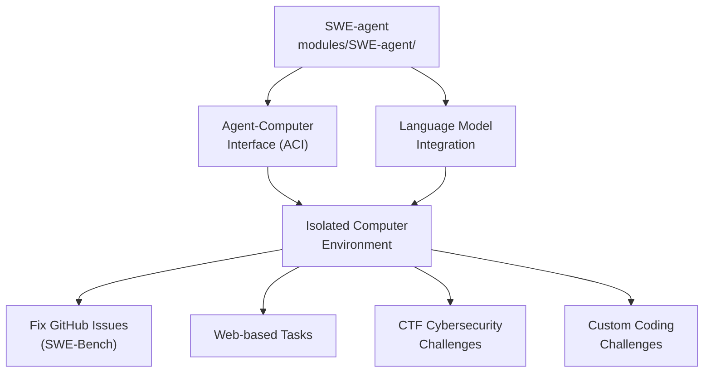

**Sources:** [modules/SWE-agent/README.md:15-22]()

### Language Model Support

SWE-agent integrates with multiple AI model providers:

| Provider | Models | Configuration |
|----------|--------|---------------|
| OpenAI | GPT-4o, GPT-4, etc. | Via OpenAI API |
| Anthropic | Claude Sonnet 3.5, 3.7 | Via Anthropic API |
| Azure | Azure-hosted OpenAI models | Via Azure OpenAI endpoint |
| Together AI | Various open models | Via Together API |
| Groq | Fast inference models | Via Groq API |
| Local/Custom | Any OpenAI-compatible server | Custom endpoint URL |

**Sources:** [modules/SWE-agent/README.md:1-45]()

### EnIGMA Cybersecurity Mode

SWE-agent includes EnIGMA mode for offensive cybersecurity (Capture The Flag) challenges, featuring:

- **Debugger**: Interactive debugging capabilities for binary analysis
- **Server Connection Tools**: Network interaction tools for CTF challenges  
- **Summarizer**: Handles long command outputs efficiently

**Sources:** [modules/SWE-agent/README.md:46-56]()

## System Integration and Data Flow

### SERA-to-SWE-agent Relationship

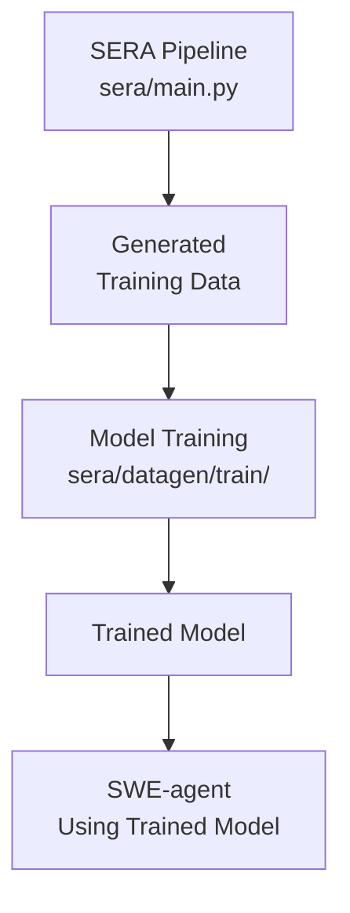

SERA generates synthetic training data by having language models solve coding tasks. This data is used to train more capable coding models, which can then be deployed in SWE-agent for autonomous software engineering.

**Sources:** [README.md:1-6](), [README.md:171-173](), [modules/SWE-agent/README.md:15-22]()

## Development and Deployment Infrastructure

### Containerization Stack

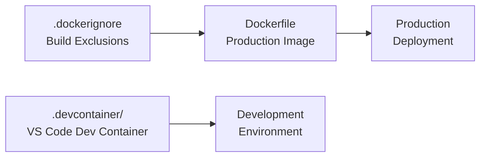

**Sources:** [.gitignore:20-32]()

### Output and Artifact Management

The repository excludes various output directories from version control to keep the codebase clean:

| Directory | Purpose | Managed By |
|-----------|---------|------------|
| `logs/` | Pipeline execution logs | SERA |
| `repos/` | Cloned repository mirrors | SERA |
| `experiments/` | Experiment output data | SERA |
| `outputs/` | Generated dataset outputs | SERA |
| `results/` | Evaluation results | SWE-agent |
| `testbed/` | Test execution environments | SWE-agent |
| `trajectories/` | Agent execution traces | SWE-agent |

**Sources:** [.gitignore:1-10](), [.gitignore:174-178](), [.gitignore:20-32]()

## Licensing

The repository uses a dual-licensing structure:

- **SERA System**: Apache License 2.0
- **SWE-agent Module**: MIT License

For licensing details, see [Licensing](#8.1).

**Sources:** [modules/SWE-agent/README.md:93-94]()

## Getting Started

### Installation

```bash
# Clone repository
git clone https://github.com/allenai/SERA

# Create conda environment
conda create -n sera python=3.12

# Install packages
pip install -e . -e modules/code2flow -e modules/SWE-agent
```

**Sources:** [README.md:7-15]()

### Quick Start Examples

1. **Generate data from Django repositories:**
   ```bash
   python sera/main.py \
       --config-name=specialization_django \
       distill.model.name=openai/GLM-4.5-Air \
       distill.model.url=http://localhost:24444/v1
   ```

2. **Use SWE-agent to fix GitHub issues:**
   See [Agent Capabilities and Usage](#3.1) for detailed instructions.

**Sources:** [README.md:39-46](), [modules/SWE-agent/README.md:33-42]()

## External Resources

- **Technical Report**: https://allenai.org/papers/opencodingagents
- **Test SERA in Claude**: https://github.com/allenai/sera-cli
- **SWE-agent Documentation**: https://swe-agent.com
- **SWE-agent Discord**: https://discord.gg/AVEFbBn2rH

**Sources:** [README.md:3-5](), [modules/SWE-agent/README.md:9-11]()

---

# Page: SERA Data Generation System

# SERA Data Generation System

<details>
<summary>Relevant source files</summary>

The following files were used as context for generating this wiki page:

- [.gitignore](.gitignore)
- [README.md](README.md)

</details>


## Purpose and Scope

The SERA Data Generation System is a multi-stage pipeline for generating software engineering training data from language models. This document covers the pipeline architecture, configuration system, inference server integration, and data generation workflows. For information about installation and environment setup, see [Installation and Setup](#2.1). For details on inference server deployment, see [Inference Servers](#2.2). For pipeline stage internals, see [Pipeline Stages](#2.4). For scaling to multiple servers, see [Multi-Server Scaling](#2.5).

The SERA system transforms GitHub repositories and pull request issues into synthetic training data through a sequence of generation, distillation, evaluation, and postprocessing stages. It supports both open-source models (via inference servers) and closed-source models (via API calls), with built-in capabilities for horizontal scaling and fault tolerance.

---

## System Architecture Overview

The SERA data generation system consists of three primary layers: the configuration layer that defines experiment parameters, the orchestration layer that manages pipeline execution, and the inference layer that provides model endpoints.

### High-Level System Architecture

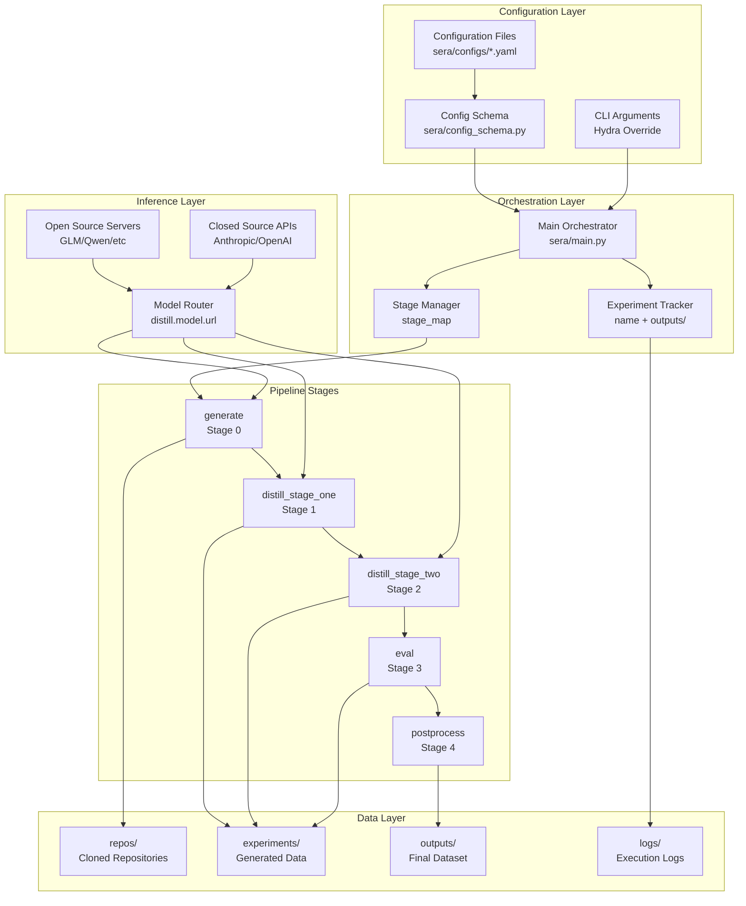

**Sources:** [README.md:1-184](), [.gitignore:1-227]()

---

## Pipeline Orchestration

The SERA pipeline is orchestrated by `sera/main.py`, which manages the sequential execution of five distinct stages. Each stage can be resumed independently, enabling fault tolerance for large-scale data generation runs.

### Stage Management System

The orchestrator uses a stage mapping system to control pipeline execution:

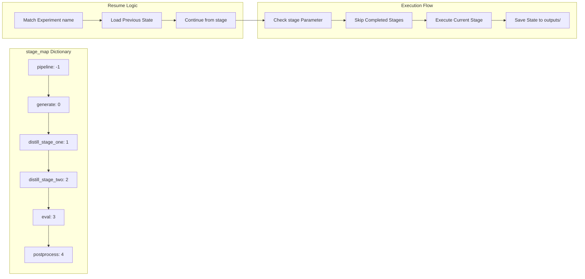

| Stage Name | Stage ID | Purpose | Output Location |
|------------|----------|---------|-----------------|
| `pipeline` | -1 | Complete pipeline execution | Full workflow |
| `generate` | 0 | Initial data generation | `repos/` directory |
| `distill_stage_one` | 1 | First distillation pass | `experiments/` directory |
| `distill_stage_two` | 2 | Second distillation pass | `experiments/` directory |
| `eval` | 3 | Evaluation of generated data | `experiments/` directory |
| `postprocess` | 4 | Final dataset creation | `outputs/` directory |

**Sources:** [README.md:130-156](), [.gitignore:1-7]()

---

## Configuration System

SERA uses Hydra for configuration management, with a base schema defined in `sera/config_schema.py` and multiple YAML configuration files for different specialization scenarios.

### Configuration Architecture

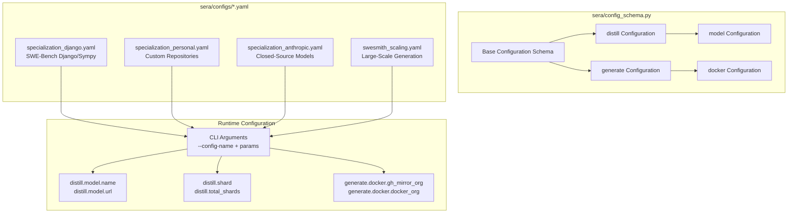

### Key Configuration Parameters

| Parameter Path | Purpose | Example Value |
|----------------|---------|---------------|
| `distill.model.name` | Model identifier for inference | `openai/GLM-4.5-Air` |
| `distill.model.url` | Inference server endpoint | `http://hostname:24444/v1` |
| `distill.shard` | Current shard index for parallel processing | `0` |
| `distill.total_shards` | Total number of shards | `4` |
| `generate.docker.gh_mirror_org` | GitHub organization for repository mirrors | `oca-repos` |
| `generate.docker.docker_org` | Docker organization for image persistence | Custom org name |
| `distill.args.pipeline_repo` | Path to PR issues for demonstration | `pr_issues/generated.json` |
| `stage` | Starting stage for resumed runs | `distill_stage_two` |
| `name` | Experiment identifier | Auto-generated or custom |

**Sources:** [README.md:37-169](), [sera/config_schema.py]()

---

## Specialization Modes

SERA supports three primary specialization modes, each tailored to different data generation scenarios. Each mode is configured through a dedicated YAML file that defines repositories, generation parameters, and model settings.

### Specialization Mode Comparison

| Mode | Config File | Target | Key Features |
|------|------------|---------|--------------|
| Django/Sympy | `specialization_django.yaml` | SWE-Bench repositories | Pre-configured for well-tested codebases |
| Personal Repos | `specialization_personal.yaml` | Custom repositories | Requires manual configuration of install commands |
| Closed-Source | `specialization_anthropic.yaml` | Anthropic/OpenAI models | No inference server required |

### Personal Repository Configuration

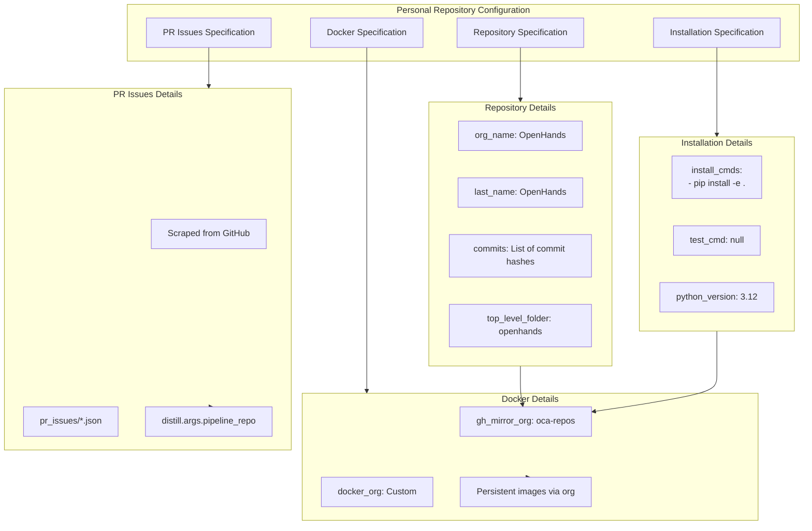

### Example Personal Repository Configuration

For personal repositories, the YAML configuration requires explicit specification of installation commands, main code folders, and Python versions:

```yaml
- org_name: OpenHands
  last_name: OpenHands
  commits:
    - 29b77be807e0e6aab380d953c0d79a166df4f0cc
    - cc8b677f3ec324fb7b9de86229f727b25741a66c
  install_cmds:
    - "pip install -e ."
  test_cmd: null
  python_version: 3.12
  top_level_folder:
    - openhands
```

**Sources:** [README.md:49-84](), [sera/configs/specialization_personal.yaml]()

---

## Data Flow and Output Structure

The SERA pipeline generates multiple types of data artifacts across different stages, each stored in dedicated directories that are excluded from version control.

### Data Flow Diagram

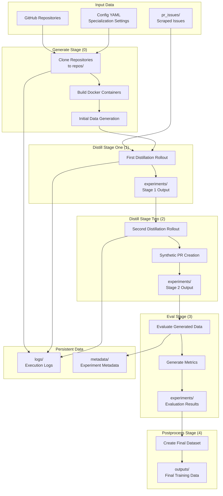

### Output Directory Structure

| Directory | Created By | Purpose | Gitignored |
|-----------|-----------|---------|------------|
| `repos/` | Generate stage | Cloned repository working copies | Yes |
| `experiments/` | Distill/Eval stages | Intermediate generation outputs | Yes |
| `outputs/` | Postprocess stage | Final training datasets | Yes |
| `logs/` | All stages | Execution logs and debugging info | Yes |
| `metadata/` | Pipeline | Experiment tracking metadata | Yes |
| `pr_issues/` | User script | Scraped GitHub issues | Yes |

**Sources:** [.gitignore:1-9](), [README.md:130-169]()

---

## Inference Server Integration

SERA supports multiple inference backends through a unified model routing system. The system can connect to open-source model servers or closed-source API endpoints.

### Inference Server Architecture

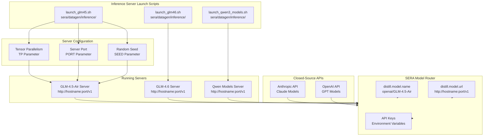

### Inference Server Launch Parameters

Launch scripts accept three parameters: tensor parallelism, port, and seed.

**Example Usage:**
```bash
# Launch GLM-4.5-Air with TP=8, port=24444, seed=42
bash launch_glm45.sh 8 24444 42
```

| Script | Model | Server Format | Example URL |
|--------|-------|--------------|-------------|
| `launch_glm45.sh` | GLM-4.5-Air | OpenAI-compatible | `http://hostname:24444/v1` |
| `launch_glm46.sh` | GLM-4.6 | OpenAI-compatible | `http://hostname:24445/v1` |
| `launch_qwen3_models.sh` | Qwen family | OpenAI-compatible | `http://hostname:24446/v1` |

**Sources:** [README.md:19-31](), [sera/datagen/inference/launch_glm45.sh](), [sera/datagen/inference/launch_glm46.sh](), [sera/datagen/inference/launch_qwen3_models.sh]()

---

## GitHub Integration and Repository Mirroring

SERA requires GitHub organization infrastructure for mirroring repositories when working with personal codebases. This enables Docker container creation and persistent repository access.

### GitHub Mirroring Architecture

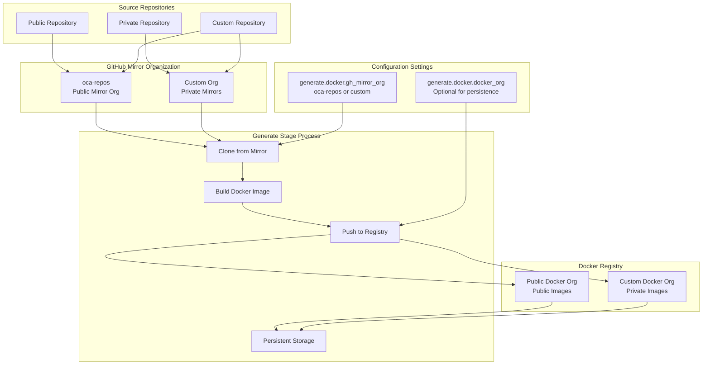

### Repository Mirroring Configuration

| Setting | Purpose | Default | Notes |
|---------|---------|---------|-------|
| `gh_mirror_org` | GitHub org for repository mirrors | `oca-repos` | Public visibility warning |
| `docker_org` | Docker org for image persistence | None | Requires push permissions |

**Important:** The `oca-repos` organization is publicly accessible. Any repositories mirrored there will be publicly viewable. For private codebases, create a custom GitHub organization.

**Sources:** [README.md:80-128](), [README.md:57-58]()

---

## PR Issues Scraping

SERA includes functionality to scrape historical pull request issues from GitHub repositories, which are then used as demonstrations in the distillation stages.

### PR Issues Scraping Workflow

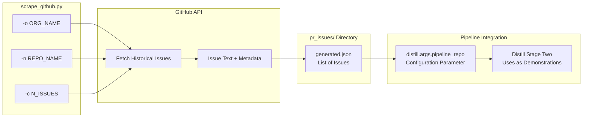

**Script Usage:**
```bash
python scrape_github.py -o ORG_NAME -n REPO_NAME -c N_ISSUES
```

**Pipeline Integration:**
```bash
python sera/main.py \
    --config-name=specialization_personal \
    distill.args.pipeline_repo=pr_issues/generated.json
```

**Sources:** [README.md:157-169](), [.gitignore:7]()

---

## Horizontal Scaling with Sharding

SERA supports horizontal scaling through dataset sharding, enabling parallel data generation across multiple inference servers. This is essential for large-scale data generation runs.

### Sharding Architecture

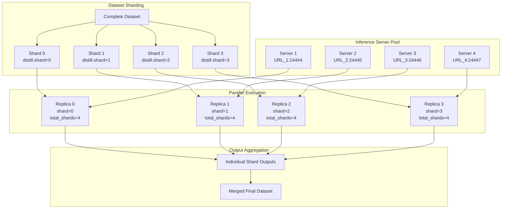

### Sharding Configuration Parameters

| Parameter | Purpose | Value Range | Example |
|-----------|---------|-------------|---------|
| `distill.shard` | Current shard index | 0 to N-1 | `0` |
| `distill.total_shards` | Total number of shards | 1 to N | `4` |
| `distill.model.url` | Server URL for this shard | Valid URL | `http://server1:24444/v1` |

**Example Multi-Server Launch:**

```bash
# Replica 0
python sera/main.py \
    --config-name=swesmith_scaling \
    distill.shard=0 \
    distill.total_shards=4 \
    distill.model.url=URL_1

# Replica 1
python sera/main.py \
    --config-name=swesmith_scaling \
    distill.shard=1 \
    distill.total_shards=4 \
    distill.model.url=URL_2
```

**Use Case:** The SERA team uses this approach to scale SWESmith data generation to create the largest datasets, distributing workload across multiple GPU servers.

**Sources:** [README.md:96-122]()

---

## Fault Tolerance and Stage Resumption

SERA implements comprehensive fault tolerance through stage-based checkpointing and resumption capabilities. This is critical for large-scale runs where occasional model stalls (< 1%) can interrupt pipeline completion.

### Stage Resumption Architecture

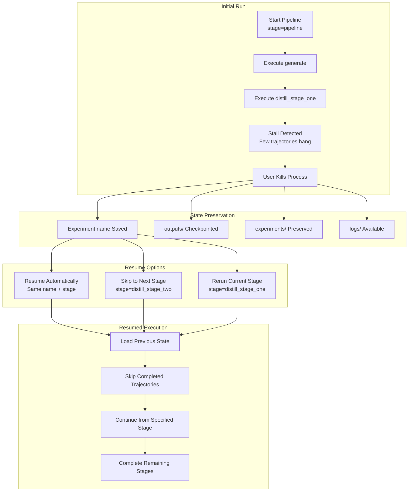

### Stage Map Reference

The `stage_map` dictionary in `sera/main.py` defines the resumption points:

```python
stage_map = {
    "pipeline": -1,           # Full pipeline execution
    "generate": 0,            # Initial generation
    "distill_stage_one": 1,   # First distillation
    "distill_stage_two": 2,   # Second distillation
    "eval": 3,                # Evaluation
    "postprocess": 4          # Final processing
}
```

### Resumption Examples

**Automatic Resume (Same Name):**
```bash
# Original run that stalled
python sera/main.py --config-name=specialization_django

# Rerun with same name - automatically resumes
python sera/main.py --config-name=specialization_django
```

**Skip to Next Stage:**
```bash
# Skip hanging trajectories, proceed to stage 2
python sera/main.py \
    --config-name=specialization_django \
    stage=distill_stage_two
```

**Resume from Specific Stage:**
```bash
# Resume from evaluation stage
python sera/main.py \
    --config-name=specialization_django \
    stage=eval
```

### Resumption Behavior

| Scenario | Behavior | Output |
|----------|----------|--------|
| Same experiment name, no stage parameter | Resume from last incomplete stage | Continue where left off |
| Same experiment name, explicit stage | Skip to specified stage | Use previous successful outputs |
| Different experiment name | Start fresh pipeline | New outputs directory |
| Hanging trajectories | Skip failed attempts | Proceed with successful ones |

**Sources:** [README.md:130-156]()

---

## Single Server Execution Modes

SERA provides pre-configured execution modes for common scenarios, each optimized for specific use cases. These modes can be run with a single inference server.

### Execution Mode Comparison

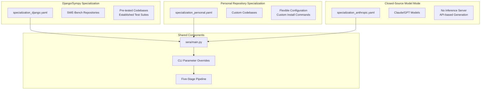

### Django/Sympy Specialization

**Purpose:** Generate data from well-established SWE-Bench repositories with existing test suites.

**Command:**
```bash
python sera/main.py \
    --config-name=specialization_django \
    distill.model.name=openai/GLM-4.5-Air \
    distill.model.url=http://server:24444/v1
```

**Characteristics:**
- Pre-configured repository settings
- Established installation procedures
- Existing test commands
- SWE-Bench compatibility

### Personal Repository Specialization

**Purpose:** Generate data from custom codebases with user-defined configurations.

**Command:**
```bash
python sera/main.py \
    --config-name=specialization_personal \
    distill.model.name=openai/GLM-4.5-Air \
    distill.model.url=http://server:24444/v1 \
    generate.docker.gh_mirror_org=oca-repos
```

**Required Configurations:**
- `org_name`: GitHub organization
- `install_cmds`: Installation commands
- `top_level_folder`: Main code directory
- `python_version`: Python version for Docker
- `commits`: Specific commit hashes

### Closed-Source Model Mode

**Purpose:** Use commercial APIs (Anthropic, OpenAI) without managing inference servers.

**Command:**
```bash
python sera/main.py \
    --config-name=specialization_anthropic \
    generate.docker.gh_mirror_org=oca-repos
```

**Characteristics:**
- No `distill.model.url` required
- API keys via environment variables
- Built-in rate limiting
- Multiple provider support

**Sources:** [README.md:38-94](), [sera/configs/specialization_django.yaml](), [sera/configs/specialization_personal.yaml](), [sera/configs/specialization_anthropic.yaml]()

---

## Output Artifacts and Data Products

The SERA pipeline produces multiple types of artifacts across different stages, each serving specific purposes in the data generation workflow.

### Artifact Generation Flow

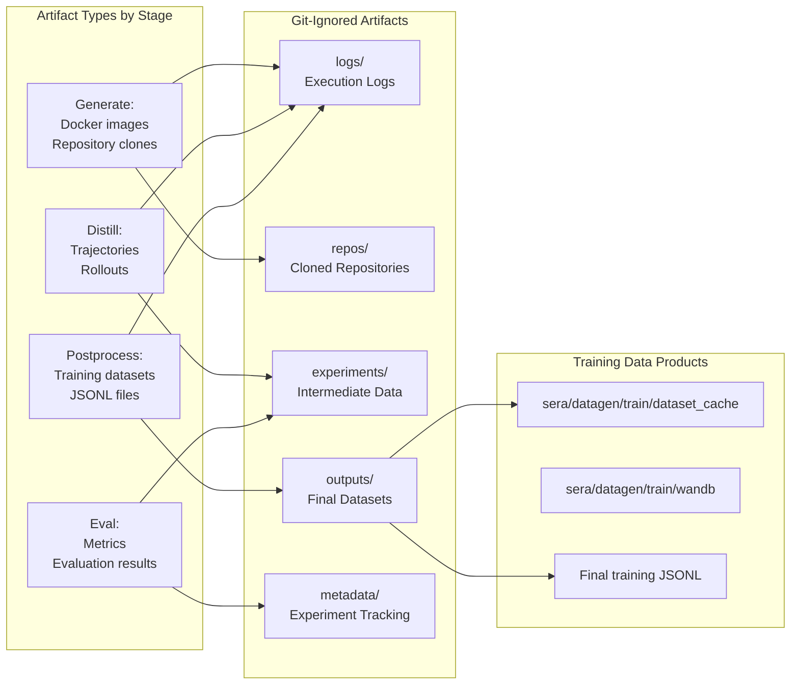

### Directory Structure and Contents

| Directory | Stage | Content Type | Example Files |
|-----------|-------|--------------|---------------|
| `logs/` | All | Execution logs, debugging info | `pipeline.log`, `stage_*.log` |
| `repos/` | Generate | Cloned Git repositories | `django/`, `sympy/` |
| `experiments/` | Distill, Eval | Intermediate generation outputs | `rollout_*.json`, `metrics_*.json` |
| `outputs/` | Postprocess | Final training datasets | `training_data.jsonl` |
| `metadata/` | All | Experiment tracking data | `experiment_*.json` |
| `pr_issues/` | User script | Scraped GitHub issues | `repo_name_issues.json` |

### Training Data Integration

The final outputs are designed for integration with the training pipeline documented in `sera/datagen/train`:

- **Dataset Cache:** Processed datasets ready for training ([sera/datagen/train/dataset_cache]())
- **Weights & Biases:** Experiment tracking logs ([sera/datagen/train/wandb]())
- **JSONL Format:** Standard training data format

**Sources:** [.gitignore:1-13](), [README.md:172-173]()

---

## Summary

The SERA Data Generation System implements a sophisticated multi-stage pipeline for creating software engineering training data from language models. Key capabilities include:

1. **Multi-Stage Pipeline:** Five sequential stages (generate, distill×2, eval, postprocess) with individual resumption points
2. **Flexible Inference:** Support for both open-source model servers and closed-source APIs
3. **Horizontal Scaling:** Sharding support for parallel processing across multiple servers
4. **Fault Tolerance:** Stage-based checkpointing and automatic resumption
5. **Multiple Specializations:** Pre-configured modes for Django/Sympy, personal repositories, and closed-source models
6. **GitHub Integration:** Repository mirroring and Docker image persistence
7. **PR Issues Scraping:** Automated collection of historical issues for demonstrations

The system is designed for large-scale data generation with robust error handling and flexible configuration, supporting both research experimentation and production data pipelines.

For detailed information on specific subsystems, see:
- [Installation and Setup](#2.1)
- [Inference Servers](#2.2)
- [Specialization Configurations](#2.3)
- [Pipeline Stages](#2.4)
- [Multi-Server Scaling](#2.5)

**Sources:** [README.md:1-184](), [.gitignore:1-227](), [sera/config_schema.py]()

---

# Page: Installation and Setup

# Installation and Setup

<details>
<summary>Relevant source files</summary>

The following files were used as context for generating this wiki page:

- [README.md](README.md)

</details>


## Purpose and Scope

This document provides instructions for installing the SERA system and its dependencies. It covers environment setup, package installation, and verification of the installation. For information about configuring inference servers after installation, see [Inference Servers](#2.2). For specialization configurations, see [Specialization Configurations](#2.3). For development environment setup including dev containers, see [Dev Container Setup](#4.1).

---

## Prerequisites

Before installing SERA, ensure the following requirements are met:

| Requirement | Version | Purpose |
|------------|---------|---------|
| Python | 3.12 | Runtime environment |
| Conda | Any recent version | Environment management |
| Git | Any recent version | Repository cloning including submodules |
| System | Linux/macOS | Primary development platforms |

---

## Installation Overview

The SERA system consists of three main components that must be installed together:

1. **SERA Core** - Main data generation pipeline located at repository root
2. **code2flow Module** - Code analysis utilities in `modules/code2flow/`
3. **SWE-agent Module** - Autonomous software engineering agent in `modules/SWE-agent/`

All three components are installed as editable packages using pip's `-e` flag, enabling development workflows where code changes take effect immediately without reinstallation.

**Installation Workflow**

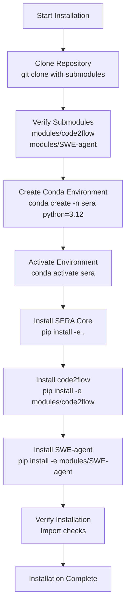

**Sources:** [README.md:7-15]()

---

## Step-by-Step Installation

### Step 1: Clone Repository

Clone the SERA repository including all submodules:

```bash
git clone --recursive https://github.com/allenai/SERA
cd SERA
```

If you cloned without `--recursive`, initialize submodules separately:

```bash
git submodule update --init --recursive
```

This ensures both `modules/code2flow/` and `modules/SWE-agent/` are properly initialized.

### Step 2: Create Conda Environment

Create a new conda environment with Python 3.12:

```bash
conda create -n sera python=3.12
```

Activate the environment:

```bash
conda activate sera
```

The environment name `sera` can be customized, but must be activated before package installation.

### Step 3: Install Packages

Install all three components as editable packages in a single command:

```bash
pip install -e . -e modules/code2flow -e modules/SWE-agent
```

The `-e` flag installs packages in editable mode, creating links to the source directories rather than copying files. This enables immediate code changes without reinstallation.

**Sources:** [README.md:11-14]()

---

## Package Structure and Dependencies

The following diagram shows the relationship between installed packages and their filesystem locations:

**Package Dependency Structure**

```mermaid
graph TB
    Root["Repository Root<br/>(SERA)"]
    
    subgraph CorePackage["SERA Core Package"]
        SeraMain["sera/<br/>Main Pipeline Code"]
        SeraConfig["sera/configs/<br/>Configuration Files"]
        SeraDatagen["sera/datagen/<br/>Data Generation Logic"]
        SeraInference["sera/datagen/inference/<br/>Server Launch Scripts"]
    end
    
    subgraph Code2FlowPackage["code2flow Module"]
        Code2FlowDir["modules/code2flow/<br/>Code Analysis Tools"]
    end
    
    subgraph SWEAgentPackage["SWE-agent Module"]
        SWEAgentDir["modules/SWE-agent/<br/>Agent Implementation"]
        SWEAgentCore["sweagent/<br/>Agent Core Code"]
        SWEAgentEnv["sweagent/environment/<br/>Execution Environment"]
    end
    
    Root --> CorePackage
    Root --> Code2FlowPackage
    Root --> SWEAgentPackage
    
    CorePackage -.->|"Uses for<br/>code analysis"| Code2FlowPackage
    CorePackage -.->|"Uses for<br/>agent execution"| SWEAgentPackage
```

**Installation Command Mapping**

| Command Argument | Package Location | Installed Name |
|-----------------|------------------|----------------|
| `-e .` | Repository root | `sera` |
| `-e modules/code2flow` | `modules/code2flow/` | `code2flow` |
| `-e modules/SWE-agent` | `modules/SWE-agent/` | `sweagent` |

**Sources:** [README.md:14]()

---

## Filesystem Structure After Installation

After successful installation, the following directory structure is present:

```mermaid
graph TB
    Root["SERA/<br/>Repository Root"]
    
    Sera["sera/<br/>Core Pipeline Code"]
    SeraConfig["sera/configs/<br/>*.yaml configurations"]
    SeraDatagen["sera/datagen/<br/>Generation Logic"]
    SeraMain["sera/main.py<br/>Pipeline Orchestrator"]
    SeraSchema["sera/config_schema.py<br/>Configuration Definitions"]
    
    Modules["modules/<br/>Submodule Directory"]
    Code2Flow["modules/code2flow/<br/>Code Analysis Submodule"]
    SWEAgent["modules/SWE-agent/<br/>Agent Submodule"]
    
    Assets["assets/<br/>Documentation Assets"]
    
    Root --> Sera
    Root --> Modules
    Root --> Assets
    
    Sera --> SeraConfig
    Sera --> SeraDatagen
    Sera --> SeraMain
    Sera --> SeraSchema
    
    Modules --> Code2Flow
    Modules --> SWEAgent
```

**Key Files and Directories**

| Path | Description |
|------|-------------|
| `sera/main.py` | Pipeline orchestrator entry point |
| `sera/config_schema.py` | Full configuration schema definitions |
| `sera/configs/` | Pre-defined experiment configurations |
| `sera/datagen/inference/` | Inference server launch scripts |
| `modules/code2flow/` | Code analysis and parsing utilities |
| `modules/SWE-agent/` | Autonomous agent implementation |

**Sources:** [README.md:7-15](), [README.md:37]()

---

## Installation Verification

After installation, verify that all packages are correctly installed and importable:

### Python Import Verification

```bash
python -c "import sera; print('SERA core imported successfully')"
python -c "import code2flow; print('code2flow imported successfully')"
python -c "import sweagent; print('sweagent imported successfully')"
```

### Pipeline Entry Point Verification

Check that the main pipeline orchestrator is accessible:

```bash
python sera/main.py --help
```

This command should display the available configuration options and command-line arguments. The help output includes references to configuration files in `sera/configs/` and schema definitions in `sera/config_schema.py`.

### Configuration File Verification

Verify that example configurations are present:

```bash
ls sera/configs/*.yaml
```

Expected configurations include:
- `specialization_django.yaml` - Django/Sympy specialization
- `specialization_personal.yaml` - Personal repository specialization  
- `specialization_anthropic.yaml` - Closed-source model configuration
- `swesmith_scaling.yaml` - Multi-server scaling configuration

**Sources:** [README.md:37](), [README.md:43-46](), [README.md:50-57](), [README.md:90-94](), [README.md:103-121]()

---

## Common Installation Issues

### Submodule Not Initialized

**Symptom:** `ModuleNotFoundError` for `code2flow` or `sweagent`

**Solution:** Initialize submodules:
```bash
git submodule update --init --recursive
```

### Wrong Python Version

**Symptom:** Dependency conflicts or import errors

**Solution:** Verify Python version is 3.12:
```bash
python --version  # Should show Python 3.12.x
```

### Editable Install Issues

**Symptom:** Code changes not taking effect

**Solution:** Verify editable installation:
```bash
pip list | grep sera
pip list | grep code2flow  
pip list | grep sweagent
```

Each should show the package location pointing to the repository directory.

---

## Next Steps After Installation

Once installation is complete, proceed with:

1. **Inference Server Setup** - Launch model inference servers for data generation. See [Inference Servers](#2.2) for GLM, Qwen, and closed-source model configurations.

2. **Specialization Configuration** - Configure the pipeline for specific repositories or domains. See [Specialization Configurations](#2.3) for Django, personal repositories, and Anthropic examples.

3. **Pipeline Execution** - Run the five-stage data generation pipeline. See [Pipeline Stages](#2.4) for details on generate, distill, eval, and postprocess stages.

4. **Multi-Server Scaling** - Scale to multiple inference servers for large-scale generation. See [Multi-Server Scaling](#2.5) for sharding configuration.

5. **Development Environment** - Set up the full development environment with dev containers. See [Dev Container Setup](#4.1) for VS Code integration.

6. **API Key Configuration** - Configure credentials for external services. See [API Key Configuration](#4.2) for setting up keys for OpenAI, Anthropic, GitHub, and other services.

**Sources:** [README.md:17-170]()

---

# Page: Inference Servers

# Inference Servers

<details>
<summary>Relevant source files</summary>

The following files were used as context for generating this wiki page:

- [README.md](README.md)
- [modules/SWE-agent/.devcontainer/sample_keys.cfg](modules/SWE-agent/.devcontainer/sample_keys.cfg)

</details>


## Purpose and Scope

This document describes the inference server infrastructure used by SERA for language model generation. It covers both open-source models that require local server deployment and closed-source API providers. For information about how these servers integrate into the multi-stage data generation pipeline, see [Pipeline Stages](#2.4). For scaling data generation across multiple servers, see [Multi-Server Scaling](#2.5).

## Inference Architecture Overview

SERA supports two categories of inference backends: self-hosted open-source models and third-party closed-source API providers. Both categories expose OpenAI-compatible APIs to maintain consistency throughout the pipeline.

```mermaid
graph TB
    subgraph OpenSource["Open-Source Models (Self-Hosted)"]
        GLM45["GLM-4.5-Air<br/>launch_glm45.sh"]
        GLM46["GLM-4.6<br/>launch_glm46.sh"]
        Qwen["Qwen Models<br/>launch_qwen3_models.sh"]
    end
    
    subgraph ClosedSource["Closed-Source Providers"]
        OpenAI["OpenAI<br/>OPENAI_API_KEY"]
        Anthropic["Anthropic<br/>ANTHROPIC_API_KEY"]
        Azure["Azure OpenAI<br/>AZURE_OPENAI_*"]
        Together["Together AI<br/>TOGETHER_API_KEY"]
        Groq["Groq<br/>GROQ_API_KEY"]
    end
    
    subgraph Pipeline["SERA Pipeline"]
        MainPy["sera/main.py<br/>Orchestrator"]
        ConfigSchema["sera/config_schema.py<br/>Model Configuration"]
    end
    
    GLM45 --> |"http://HOSTNAME:PORT/v1"| MainPy
    GLM46 --> |"http://HOSTNAME:PORT/v1"| MainPy
    Qwen --> |"http://HOSTNAME:PORT/v1"| MainPy
    
    OpenAI --> |"API Endpoint"| MainPy
    Anthropic --> |"API Endpoint"| MainPy
    Azure --> |"API Endpoint"| MainPy
    Together --> |"API Endpoint"| MainPy
    Groq --> |"API Endpoint"| MainPy
    
    ConfigSchema --> MainPy
```

**Sources:** [README.md:19-32](), [modules/SWE-agent/.devcontainer/sample_keys.cfg:1-11]()

## Open-Source Model Servers

SERA provides launch scripts for deploying open-source models as inference servers. These scripts handle tensor parallelism configuration, port assignment, and random seed initialization.

### GLM Models

Two GLM model variants are supported with dedicated launch scripts:

| Model | Launch Script | Purpose |
|-------|--------------|---------|
| GLM-4.5-Air | `sera/datagen/inference/launch_glm45.sh` | Lightweight GLM variant |
| GLM-4.6 | `sera/datagen/inference/launch_glm46.sh` | Latest GLM version |

**Launch Script Parameters**

All GLM launch scripts accept three positional arguments:

```bash
bash launch_glm45.sh <TENSOR_PARALLELISM> <PORT> <SEED>
```

| Parameter | Position | Description | Example |
|-----------|----------|-------------|---------|
| `TENSOR_PARALLELISM` | 1 | Number of GPUs for model sharding | `8` |
| `PORT` | 2 | Server listening port | `24444` |
| `SEED` | 3 | Random seed for reproducibility | `42` |

**Example Usage:**

```bash
# Launch GLM-4.5-Air with TP=8 on port 24444 with seed 42
bash sera/datagen/inference/launch_glm45.sh 8 24444 42
```

The resulting server endpoint will be: `http://HOSTNAME:24444/v1`

**Sources:** [README.md:23-29]()

### Qwen Models

The Qwen model family is supported through a unified launch script:

```bash
bash sera/datagen/inference/launch_qwen3_models.sh <TENSOR_PARALLELISM> <PORT> <SEED>
```

This script uses the same parameter structure as GLM models, maintaining consistency across open-source deployments.

**Sources:** [README.md:23]()

### Launch Script Architecture

```mermaid
graph LR
    User["User Command"] --> LaunchScript["launch_*.sh<br/>(TP, PORT, SEED)"]
    
    LaunchScript --> TPConfig["Tensor Parallelism<br/>Configuration"]
    LaunchScript --> PortBind["Port Binding<br/>Configuration"]
    LaunchScript --> SeedInit["Random Seed<br/>Initialization"]
    
    TPConfig --> Server["Model Server<br/>Process"]
    PortBind --> Server
    SeedInit --> Server
    
    Server --> Endpoint["OpenAI-Compatible<br/>Endpoint<br/>http://HOSTNAME:PORT/v1"]
```

**Sources:** [README.md:23-31]()

## Closed-Source Model Providers

SERA integrates with multiple commercial AI providers through their respective APIs. Unlike open-source models, these do not require local server deployment.

### Supported Providers

The following providers are supported through API key configuration:

| Provider | Configuration Key | Authentication Method |
|----------|------------------|----------------------|
| OpenAI | `OPENAI_API_KEY` | API key |
| Anthropic | `ANTHROPIC_API_KEY` | API key |
| Azure OpenAI | `AZURE_OPENAI_API_KEY`, `AZURE_OPENAI_ENDPOINT`, `AZURE_OPENAI_DEPLOYMENT`, `AZURE_OPENAI_API_VERSION` | Multi-parameter configuration |
| Together AI | `TOGETHER_API_KEY` | API key |
| Groq | `GROQ_API_KEY` | API key |

**Sources:** [modules/SWE-agent/.devcontainer/sample_keys.cfg:3-11]()

### API Key Configuration

API keys are configured through environment variables or the `keys.cfg` configuration file. For detailed information about API key management, see [API Key Configuration](#4.2).

```mermaid
graph TB
    subgraph ConfigSources["Configuration Sources"]
        EnvVars["Environment<br/>Variables"]
        KeysCfg["keys.cfg<br/>File"]
    end
    
    subgraph Providers["Provider APIs"]
        OPENAI["OpenAI API<br/>OPENAI_API_KEY"]
        ANTHROPIC["Anthropic API<br/>ANTHROPIC_API_KEY"]
        TOGETHER["Together API<br/>TOGETHER_API_KEY"]
        AZURE["Azure OpenAI<br/>AZURE_OPENAI_*"]
        GROQ["Groq API<br/>GROQ_API_KEY"]
    end
    
    subgraph Pipeline["SERA Components"]
        MainPy["sera/main.py"]
        ConfigSchema["sera/config_schema.py"]
    end
    
    EnvVars --> OPENAI
    EnvVars --> ANTHROPIC
    EnvVars --> TOGETHER
    EnvVars --> AZURE
    EnvVars --> GROQ
    
    KeysCfg --> OPENAI
    KeysCfg --> ANTHROPIC
    KeysCfg --> TOGETHER
    KeysCfg --> AZURE
    KeysCfg --> GROQ
    
    OPENAI --> ConfigSchema
    ANTHROPIC --> ConfigSchema
    TOGETHER --> ConfigSchema
    AZURE --> ConfigSchema
    GROQ --> ConfigSchema
    
    ConfigSchema --> MainPy
```

**Sources:** [modules/SWE-agent/.devcontainer/sample_keys.cfg:1-11]()

### Custom and Local Endpoints

For custom inference endpoints or local deployments that implement OpenAI-compatible APIs, the `OPENAI_API_BASE_URL` configuration allows specifying alternative base URLs:

```
OPENAI_API_BASE_URL: 'http://custom-endpoint:8000/v1'
```

**Sources:** [modules/SWE-agent/.devcontainer/sample_keys.cfg:10]()

## Server URL Format and Usage

### OpenAI-Compatible Endpoints

All self-hosted servers expose OpenAI-compatible endpoints following this format:

```
http://HOSTNAME:PORT/v1
```

Where:
- `HOSTNAME`: The machine's hostname or IP address where the server is running
- `PORT`: The port specified during launch (e.g., `24444`)
- `/v1`: Standard OpenAI API version path

**Sources:** [README.md:31]()

### Integration with Main Pipeline

Inference servers are specified in SERA's main pipeline through model configuration parameters:

```bash
python sera/main.py \
    --config-name=specialization_django \
    distill.model.name=openai/GLM-4.5-Air \
    distill.model.url=URL
```

| Parameter | Description | Example |
|-----------|-------------|---------|
| `distill.model.name` | Model identifier | `openai/GLM-4.5-Air` |
| `distill.model.url` | Server endpoint URL | `http://gpu-node-1:24444/v1` |

```mermaid
graph LR
    CLI["sera/main.py<br/>Command Line"] --> ConfigParams["distill.model.name<br/>distill.model.url"]
    
    ConfigParams --> ConfigSchema["sera/config_schema.py<br/>Model Configuration"]
    
    ConfigSchema --> DistillStage["Distillation Stages<br/>(Stage 1 & 2)"]
    
    InferenceServer["Inference Server<br/>http://HOSTNAME:PORT/v1"] --> DistillStage
    
    DistillStage --> DataGeneration["Generated Training<br/>Data"]
```

**Sources:** [README.md:42-46](), [README.md:37]()

## Model Selection Examples

### Using Open-Source Models

For GLM-4.5-Air deployed on a local server:

```bash
# First, launch the server
bash sera/datagen/inference/launch_glm45.sh 8 24444 42

# Then, run the pipeline pointing to the server
python sera/main.py \
    --config-name=specialization_django \
    distill.model.name=openai/GLM-4.5-Air \
    distill.model.url=http://localhost:24444/v1
```

For Qwen models on a remote server:

```bash
# On the server machine
bash sera/datagen/inference/launch_qwen3_models.sh 4 25000 100

# On the client machine
python sera/main.py \
    --config-name=specialization_personal \
    distill.model.name=openai/Qwen-VARIANT \
    distill.model.url=http://gpu-cluster-node:25000/v1 \
    generate.docker.gh_mirror_org=oca-repos
```

**Sources:** [README.md:42-58]()

### Using Closed-Source Models

When using closed-source providers, the server launch step is skipped entirely:

```bash
# No server launch needed - API keys are read from environment
python sera/main.py \
    --config-name=specialization_anthropic \
    generate.docker.gh_mirror_org=oca-repos
```

The system automatically reads the appropriate API keys from the environment or `keys.cfg` file based on the configuration name.

**Sources:** [README.md:86-94]()

## Multi-Server Configuration

SERA supports distributing inference workload across multiple servers through sharding. Each server processes a disjoint subset of the data based on shard indices.

```mermaid
graph TB
    Dataset["Full Dataset"] --> Sharding["Sharding Logic<br/>distill.shard<br/>distill.total_shards"]
    
    Sharding --> Shard0["Shard 0<br/>distill.shard=0"]
    Sharding --> Shard1["Shard 1<br/>distill.shard=1"]
    Sharding --> Shard2["Shard 2<br/>distill.shard=2"]
    Sharding --> Shard3["Shard 3<br/>distill.shard=3"]
    
    Shard0 --> Server1["Server 1<br/>URL_1"]
    Shard1 --> Server2["Server 2<br/>URL_2"]
    Shard2 --> Server3["Server 3<br/>URL_3"]
    Shard3 --> Server4["Server 4<br/>URL_4"]
    
    Server1 --> Output["Combined<br/>Output"]
    Server2 --> Output
    Server3 --> Output
    Server4 --> Output
```

### Sharding Parameters

| Parameter | Description | Example |
|-----------|-------------|---------|
| `distill.shard` | Zero-indexed shard ID for this replica | `0`, `1`, `2`, `3` |
| `distill.total_shards` | Total number of shards across all replicas | `4` |
| `distill.model.url` | Unique server URL for this shard | `URL_1`, `URL_2`, etc. |

**Example Multi-Server Deployment:**

```bash
# Replica 1 (processes shard 0 of 4)
python sera/main.py \
    --config-name=swesmith_scaling \
    distill.shard=0 \
    distill.total_shards=4 \
    distill.model.name=openai/GLM-4.5-Air \
    distill.model.url=http://server-1:24444/v1

# Replica 2 (processes shard 1 of 4)
python sera/main.py \
    --config-name=swesmith_scaling \
    distill.shard=1 \
    distill.total_shards=4 \
    distill.model.name=openai/GLM-4.5-Air \
    distill.model.url=http://server-2:24444/v1

# Replica 3 (processes shard 2 of 4)
python sera/main.py \
    --config-name=swesmith_scaling \
    distill.shard=2 \
    distill.total_shards=4 \
    distill.model.name=openai/GLM-4.5-Air \
    distill.model.url=http://server-3:24444/v1

# Replica 4 (processes shard 3 of 4)
python sera/main.py \
    --config-name=swesmith_scaling \
    distill.shard=3 \
    distill.total_shards=4 \
    distill.model.name=openai/GLM-4.5-Air \
    distill.model.url=http://server-4:24444/v1
```

For more details on scaling strategies and parallel processing, see [Multi-Server Scaling](#2.5).

**Sources:** [README.md:96-121]()

## Configuration Schema Integration

All model and server configurations are validated against the schema defined in `sera/config_schema.py`. This file contains the complete specification of available configuration options for inference servers.

```mermaid
graph TB
    CLIArgs["Command Line<br/>Arguments"] --> Hydra["Hydra Config<br/>System"]
    
    ConfigFiles["YAML Config Files<br/>sera/configs/*.yaml"] --> Hydra
    
    Hydra --> ConfigSchema["sera/config_schema.py<br/>Validation Schema"]
    
    ConfigSchema --> ModelConfig["Model Configuration<br/>name, url, api_key"]
    
    ConfigSchema --> ShardConfig["Shard Configuration<br/>shard, total_shards"]
    
    ModelConfig --> Pipeline["Pipeline Execution<br/>sera/main.py"]
    ShardConfig --> Pipeline
```

The configuration schema provides type safety and validation for all inference server parameters, ensuring that model names, URLs, and API keys are correctly specified before pipeline execution begins.

**Sources:** [README.md:37]()

---

# Page: Specialization Configurations

# Specialization Configurations

<details>
<summary>Relevant source files</summary>

The following files were used as context for generating this wiki page:

- [README.md](README.md)

</details>


## Purpose and Scope

This document explains the specialization configuration system in SERA, which allows users to customize the data generation pipeline for different target codebases and language models. Specialization configurations define what repositories to generate data from, how to set up the execution environment, and which models to use for generation.

For information about the multi-stage pipeline that these configurations drive, see [Pipeline Stages](#2.4). For details on setting up inference servers, see [Inference Servers](#2.2).

**Sources:** [README.md:39-94]()

## Overview

SERA supports three primary specialization profiles, each designed for different use cases:

1. **Django/Sympy Specialization** - Generate data for established open-source projects from SWE-Bench
2. **Personal Repository Specialization** - Generate data for custom codebases
3. **Closed-Source Model Specialization** - Use commercial APIs (Anthropic, OpenAI) instead of self-hosted inference servers

Each specialization is defined by a YAML configuration file in `sera/configs/` and can be invoked through `sera/main.py` using the `--config-name` parameter.

**Sources:** [README.md:39-94]()

---

## Configuration Architecture

```mermaid
graph TB
    subgraph ConfigFiles["Configuration Files"]
        DjangoYAML["specialization_django.yaml"]
        PersonalYAML["specialization_personal.yaml"]
        AnthropicYAML["specialization_anthropic.yaml"]
        ConfigSchema["config_schema.py<br/>Schema Definitions"]
    end
    
    subgraph MainEntry["Entry Point"]
        MainPy["sera/main.py<br/>--config-name parameter"]
    end
    
    subgraph RuntimeConfig["Runtime Configuration"]
        ModelURL["distill.model.url<br/>Inference Server"]
        ModelName["distill.model.name<br/>Model Identifier"]
        GHMirror["generate.docker.gh_mirror_org<br/>GitHub Organization"]
        DockerOrg["generate.docker.docker_org<br/>Docker Registry"]
        StageParam["stage<br/>Pipeline Resumption"]
    end
    
    subgraph Pipeline["Pipeline Execution"]
        Generate["Generate Stage"]
        DistillOne["Distill Stage One"]
        DistillTwo["Distill Stage Two"]
        Eval["Evaluation"]
        Postprocess["Postprocess"]
    end
    
    ConfigFiles --> MainPy
    ConfigSchema --> ConfigFiles
    MainPy --> RuntimeConfig
    RuntimeConfig --> Pipeline
    
    Generate --> DistillOne
    DistillOne --> DistillTwo
    DistillTwo --> Eval
    Eval --> Postprocess
```

The configuration system uses Hydra to compose configurations from YAML files with command-line overrides. All configuration options are validated against schemas defined in [sera/config_schema.py]().

**Sources:** [README.md:37-46](), [README.md:50-78]()

---

## Django/Sympy Specialization

### Overview

This specialization targets well-established open-source projects that are part of the SWE-Bench benchmark, such as Django and Sympy. These repositories have standardized structures, comprehensive test suites, and established contribution patterns.

### Configuration File

The configuration is defined in `sera/configs/specialization_django.yaml`.

### Usage

```bash
python sera/main.py \
    --config-name=specialization_django \
    distill.model.name=openai/GLM-4.5-Air \
    distill.model.url=URL
```

### Parameters

| Parameter | Description | Required |
|-----------|-------------|----------|
| `--config-name` | Must be `specialization_django` | Yes |
| `distill.model.name` | Model identifier (e.g., `openai/GLM-4.5-Air`) | Yes |
| `distill.model.url` | URL to inference server (e.g., `http://hostname:24444/v1`) | Yes |

### Characteristics

- Pre-configured for SWE-Bench repositories
- Uses existing test infrastructure from target repositories
- Docker containers built from established repository commits
- No GitHub mirror organization required (uses public repositories)

**Sources:** [README.md:39-46]()

---

## Personal Repository Specialization

### Overview

This specialization allows users to generate data from arbitrary codebases, including private repositories and custom projects. It requires additional configuration to specify repository structure, installation commands, and execution environment.

### Configuration File

The configuration is defined in `sera/configs/specialization_personal.yaml`, which defines the repository metadata that SERA needs to set up execution environments.

### Usage

```bash
python sera/main.py \
    --config-name=specialization_personal \
    distill.model.name=openai/GLM-4.5-Air \
    distill.model.url=URL \
    generate.docker.gh_mirror_org=oca-repos
```

**Sources:** [README.md:48-61]()

---

### Repository Configuration Structure

```mermaid
graph LR
    subgraph YAMLConfig["specialization_personal.yaml"]
        RepoList["Repository List"]
    end
    
    subgraph RepoMetadata["Repository Metadata"]
        OrgName["org_name<br/>Source Organization"]
        LastName["last_name<br/>Display Name"]
        Commits["commits[]<br/>Specific Commits"]
        InstallCmds["install_cmds[]<br/>Installation Commands"]
        TestCmd["test_cmd<br/>Test Command"]
        PythonVer["python_version<br/>Python Version"]
        TopFolder["top_level_folder[]<br/>Code Directories"]
    end
    
    subgraph Infrastructure["External Infrastructure"]
        GitHubMirror["GitHub Mirror Org<br/>gh_mirror_org"]
        DockerReg["Docker Registry<br/>docker_org"]
        LocalImages["Local Docker Images"]
    end
    
    RepoList --> RepoMetadata
    RepoMetadata --> GitHubMirror
    RepoMetadata --> DockerReg
    DockerReg --> LocalImages
```

**Sources:** [README.md:62-78]()

---

### Repository Metadata Fields

Each repository in `specialization_personal.yaml` must define the following fields:

```yaml
- org_name: OpenHands
  last_name: OpenHands
  commits:
    - 29b77be807e0e6aab380d953c0d79a166df4f0cc
    - cc8b677f3ec324fb7b9de86229f727b25741a66c
  install_cmds:
    - "pip install -e ."
  test_cmd: null
  python_version: 3.12
  top_level_folder:
    - openhands
```

| Field | Type | Description |
|-------|------|-------------|
| `org_name` | String | Source GitHub organization or username |
| `last_name` | String | Display name for the repository |
| `commits` | List[String] | Specific commit hashes to build containers from. If not provided, SERA automatically scrapes recent commits |
| `install_cmds` | List[String] | Shell commands to install the repository. Default: `["pip install -e ."]` |
| `test_cmd` | String or null | Command to run tests in the repository |
| `python_version` | Float | Python version for the Docker container (e.g., 3.12) |
| `top_level_folder` | List[String] | Main code directories to parse for function extraction |

**Sources:** [README.md:62-78]()

---

### GitHub Mirror Organization

```mermaid
graph TB
    subgraph SourceRepos["Source Repositories"]
        PrivateRepo["Private Repository"]
        PublicRepo["Public Repository"]
    end
    
    subgraph MirrorOrg["GitHub Mirror Organization"]
        MirrorRepo1["Mirror 1"]
        MirrorRepo2["Mirror 2"]
        PublicVisible["Public Visibility"]
    end
    
    subgraph DockerBuild["Docker Container Build"]
        Dockerfile["Dockerfile Generation"]
        ContainerBuild["Container Build"]
        ImagePush["Push to Registry"]
    end
    
    subgraph Usage["SERA Pipeline"]
        GenerateStage["Generate Stage<br/>Uses Containers"]
        DistillStage["Distill Stages<br/>Executes in Containers"]
    end
    
    PrivateRepo --> MirrorOrg
    PublicRepo --> MirrorOrg
    MirrorOrg --> Dockerfile
    Dockerfile --> ContainerBuild
    ContainerBuild --> ImagePush
    ImagePush --> GenerateStage
    GenerateStage --> DistillStage
```

Personal repository specialization requires a **GitHub mirror organization** to host repository mirrors that Docker can access during container builds. SERA provides a public organization `oca-repos` that anyone can use, but repositories mirrored there will be publicly viewable.

**Creating a Mirror Organization:**

1. Create a GitHub organization: [GitHub Org Creation Guide](https://docs.github.com/en/organizations/collaborating-with-groups-in-organizations/creating-a-new-organization-from-scratch)
2. Configure the organization name in the command: `generate.docker.gh_mirror_org=YOUR_ORG_NAME`

**Important:** For private codebases, create your own mirror organization to maintain privacy.

**Sources:** [README.md:80-81](), [README.md:123-128]()

---

### Docker Organization Configuration

Optionally, users can specify a Docker registry organization to persist built images:

```bash
python sera/main.py \
    --config-name=specialization_personal \
    distill.model.name=openai/GLM-4.5-Air \
    distill.model.url=URL \
    generate.docker.gh_mirror_org=oca-repos \
    generate.docker.docker_org=DOCKER_ORG
```

**Benefits:**
- Built images are pushed to a registry and reused across runs
- Avoids rebuilding containers on pipeline reruns
- Saves several minutes per run

**Requirements:**
- User must have push permissions to the specified Docker organization

**Without Docker Organization:**
- Images are built locally and remain in local Docker cache
- Images may be garbage collected or require rebuilding if cache is cleared

**Sources:** [README.md:82-83]()

---

### Personal PR Issues

By default, the second distillation stage uses SWE-Bench issues as demonstrations. For personal repositories, users can provide their own PR issues to make demonstrations more relevant.

```mermaid
graph LR
    subgraph Scraping["Issue Scraping"]
        Script["scrape_github.py"]
        OrgParam["-o ORG_NAME"]
        RepoParam["-n REPO_NAME"]
        CountParam["-c N_ISSUES"]
    end
    
    subgraph Output["Generated Files"]
        PRIssuesDir["pr_issues/"]
        JSONFile["issues.json"]
    end
    
    subgraph Configuration["Pipeline Configuration"]
        PipelineRepo["distill.args.pipeline_repo"]
        MainPy["sera/main.py"]
    end
    
    subgraph DistillStage["Distillation"]
        StageTwo["Distill Stage Two<br/>Uses Demonstrations"]
    end
    
    Script --> OrgParam
    Script --> RepoParam
    Script --> CountParam
    Script --> PRIssuesDir
    PRIssuesDir --> JSONFile
    JSONFile --> PipelineRepo
    PipelineRepo --> MainPy
    MainPy --> StageTwo
```

**Scraping Issues:**

```bash
python scrape_github.py -o ORG_NAME -n REPO_NAME -c N_ISSUES
```

This saves a JSON file to the `pr_issues/` directory containing issue texts.

**Using Scraped Issues:**

```bash
python sera/main.py \
    --config-name=specialization_personal \
    distill.args.pipeline_repo=GENERATED_PATH \
    ...
```

The `distill.args.pipeline_repo` parameter points to the generated JSON file, which the pipeline uses as demonstrations in the second distillation rollout.

**Sources:** [README.md:84](), [README.md:157-169]()

---

## Closed-Source Model Specialization

### Overview

This specialization uses commercial API providers (Anthropic, OpenAI, Azure) instead of self-hosted inference servers. It eliminates the need to set up and manage inference servers, trading infrastructure complexity for API costs.

### Configuration File

The configuration is defined in `sera/configs/specialization_anthropic.yaml`.

### Usage

```bash
python sera/main.py \
    --config-name=specialization_anthropic \
    generate.docker.gh_mirror_org=oca-repos
```

**Key Differences:**
- No `distill.model.name` or `distill.model.url` parameters required
- API credentials configured through environment variables or configuration files
- Model selection handled through the configuration YAML
- Still requires GitHub mirror organization for personal repository support

**Sources:** [README.md:86-94]()

---

## Configuration Schema Reference

All configuration options are defined in `sera/config_schema.py`, which provides the full schema for experiment configuration. Key configuration namespaces include:

```mermaid
graph TB
    subgraph ConfigNamespaces["Configuration Namespaces"]
        Distill["distill<br/>Model and Distillation Settings"]
        Generate["generate<br/>Repository and Container Settings"]
        Eval["eval<br/>Evaluation Settings"]
        Stage["stage<br/>Pipeline Stage Control"]
        Name["name<br/>Experiment Identifier"]
    end
    
    subgraph DistillParams["distill Parameters"]
        ModelName["model.name"]
        ModelURL["model.url"]
        Shard["shard"]
        TotalShards["total_shards"]
        Args["args.pipeline_repo"]
    end
    
    subgraph GenerateParams["generate Parameters"]
        GHOrg["docker.gh_mirror_org"]
        DockerOrg["docker.docker_org"]
    end
    
    subgraph StageControl["stage Values"]
        Pipeline["pipeline: -1"]
        GenStage["generate: 0"]
        DistillOne["distill_stage_one: 1"]
        DistillTwo["distill_stage_two: 2"]
        EvalStage["eval: 3"]
        PostStage["postprocess: 4"]
    end
    
    Distill --> DistillParams
    Generate --> GenerateParams
    Stage --> StageControl
```

### Common Configuration Parameters

| Parameter | Description | Example |
|-----------|-------------|---------|
| `--config-name` | Base configuration file to load | `specialization_django` |
| `distill.model.name` | Model identifier | `openai/GLM-4.5-Air` |
| `distill.model.url` | Inference server URL | `http://host:24444/v1` |
| `distill.shard` | Current shard index for parallel processing | `0` |
| `distill.total_shards` | Total number of shards | `4` |
| `distill.args.pipeline_repo` | Path to custom PR issues JSON | `pr_issues/myrepo.json` |
| `generate.docker.gh_mirror_org` | GitHub organization for mirrors | `oca-repos` |
| `generate.docker.docker_org` | Docker registry organization | `myorg` |
| `name` | Experiment name for output directories | `my_experiment` |
| `stage` | Pipeline stage to resume from | `distill_stage_two` |

**Sources:** [README.md:37](), [README.md:106-120](), [README.md:134-152]()

---

## Pipeline Resumption with Configurations

SERA supports resuming interrupted runs from any pipeline stage. This is particularly useful for large-scale generation where occasional stalls may occur (< 1% of generations).

### Stage Mapping

```mermaid
graph LR
    subgraph StageMap["Stage Map"]
        Pipeline["pipeline = -1"]
        Generate["generate = 0"]
        DistillOne["distill_stage_one = 1"]
        DistillTwo["distill_stage_two = 2"]
        Eval["eval = 3"]
        Post["postprocess = 4"]
    end
    
    subgraph Usage["Resumption Flow"]
        KillRun["Kill Stalled Run"]
        SameConfig["Use Same Config + name"]
        StageParam["Add stage=STAGE_NAME"]
        Resume["Resume from Stage"]
    end
    
    KillRun --> SameConfig
    SameConfig --> StageParam
    StageParam --> Resume
    
    Generate -.-> Resume
    DistillOne -.-> Resume
    DistillTwo -.-> Resume
    Eval -.-> Resume
    Post -.-> Resume
```

### Resuming from a Specific Stage

To resume from a specific stage, use the `stage` parameter with the experiment name matching the original run:

```bash
python sera/main.py \
    --config-name=specialization_django \
    distill.model.name=openai/GLM-4.5-Air \
    distill.model.url=URL \
    stage=distill_stage_two
```

This skips any hanging trajectories from `distill_stage_one` and proceeds to `distill_stage_two` using only successful rollouts.

### Automatic Resumption

Alternatively, rerun the exact same command with the same experiment name. The pipeline automatically detects completed stages and resumes from where it left off:

```bash
python sera/main.py \
    --config-name=specialization_django \
    distill.model.name=openai/GLM-4.5-Air \
    distill.model.url=URL
```

If the experiment name matches a previous run, SERA continues from the last incomplete stage.

**Sources:** [README.md:130-156]()

---

## Configuration Best Practices

### For Django/Sympy Specialization

1. Use stable inference servers with consistent performance
2. Monitor for stalled generations and use stage resumption if needed
3. No additional infrastructure setup required

### For Personal Repositories

1. **Always specify GitHub mirror organization**: `generate.docker.gh_mirror_org=YOUR_ORG`
2. **Create private mirror org for private repos**: Public visibility in `oca-repos`
3. **Provide specific commits**: Ensures reproducible container builds
4. **Configure installation commands carefully**: Test commands in isolation first
5. **Identify top-level folders accurately**: Critical for function extraction
6. **Optionally set Docker org**: Saves rebuild time on reruns
7. **Scrape custom PR issues**: Makes demonstrations more relevant

### For Closed-Source Models

1. Configure API credentials before running (see [API Key Configuration](#4.2))
2. Monitor API costs during large-scale generation
3. Still requires GitHub mirror org for personal repositories
4. No inference server setup needed

### General Recommendations

1. **Use descriptive experiment names**: `name=django_experiment_v1`
2. **Document custom configurations**: Keep notes on YAML modifications
3. **Test with small datasets first**: Validate configuration before large runs
4. **Enable sharding for scale**: Use multiple servers for large datasets (see [Multi-Server Scaling](#2.5))

**Sources:** [README.md:37-169]()

---

# Page: Pipeline Stages

# Pipeline Stages

<details>
<summary>Relevant source files</summary>

The following files were used as context for generating this wiki page:

- [.gitignore](.gitignore)
- [README.md](README.md)

</details>


## Purpose and Scope

This document details the five-stage pipeline architecture of the SERA data generation system. The pipeline transforms repository data and issue descriptions into training data through sequential processing stages: generation, two distillation passes, evaluation, and postprocessing. Each stage produces intermediate artifacts that feed into the next stage, with support for resuming from any point in case of interruptions.

For information about configuring the data sources and specialization profiles used by the pipeline, see [Specialization Configurations](#2.3). For details on scaling the pipeline across multiple inference servers, see [Multi-Server Scaling](#2.5).

**Sources:** [README.md:1-185]()

---

## Pipeline Architecture Overview

The SERA pipeline implements a multi-stage data generation architecture where each stage builds upon the outputs of previous stages. The pipeline is orchestrated through `sera/main.py` and can be configured to run end-to-end or resume from any intermediate stage.

```mermaid
flowchart TD
    subgraph Input["Input Data Sources"]
        Repos["GitHub Repositories"]
        Issues["PR Issues"]
        Config["Configuration Files<br/>(YAML)"]
    end
    
    subgraph Stage0["Stage 0: Generate"]
        GenerateOp["Create Initial<br/>Trajectories"]
        GenOutput["Raw Trajectory Data"]
    end
    
    subgraph Stage1["Stage 1: Distill Stage One"]
        Distill1Op["First Distillation<br/>Pass"]
        D1Output["Refined Trajectories"]
    end
    
    subgraph Stage2["Stage 2: Distill Stage Two"]
        Distill2Op["Second Distillation<br/>Pass"]
        D2Output["Final Trajectories"]
    end
    
    subgraph Stage3["Stage 3: Eval"]
        EvalOp["Evaluate<br/>Trajectories"]
        EvalOutput["Evaluation Metrics"]
    end
    
    subgraph Stage4["Stage 4: Postprocess"]
        PostOp["Format for<br/>Training"]
        FinalOutput["Training Dataset"]
    end
    
    subgraph Output["Output Directories"]
        Experiments["experiments/"]
        Outputs["outputs/"]
        Logs["logs/"]
        Metadata["metadata/"]
    end
    
    Input --> Stage0
    Stage0 --> Stage1
    Stage1 --> Stage2
    Stage2 --> Stage3
    Stage3 --> Stage4
    Stage4 --> Output
    
    GenerateOp --> GenOutput
    Distill1Op --> D1Output
    Distill2Op --> D2Output
    EvalOp --> EvalOutput
    PostOp --> FinalOutput
```

**Sources:** [README.md:19-153](), [.gitignore:1-7]()

---

## Stage Mapping and Identification

The pipeline uses a numeric mapping system to identify stages for resumption and control purposes. This mapping is defined in the main execution logic and allows users to specify which stage to start from.

| Stage Name | Stage ID | Key Function | Primary Output |
|------------|----------|--------------|----------------|
| `pipeline` | -1 | Full pipeline execution | All stages sequentially |
| `generate` | 0 | Initial trajectory generation | Raw trajectory data |
| `distill_stage_one` | 1 | First refinement pass | Refined trajectories |
| `distill_stage_two` | 2 | Second refinement pass | Polished trajectories |
| `eval` | 3 | Quality evaluation | Metrics and scores |
| `postprocess` | 4 | Training data formatting | Final dataset |

```mermaid
graph LR
    Pipeline["-1: pipeline<br/>(Full Run)"]
    Gen["0: generate"]
    D1["1: distill_stage_one"]
    D2["2: distill_stage_two"]
    Eval["3: eval"]
    Post["4: postprocess"]
    
    Pipeline -.-> Gen
    Gen --> D1
    D1 --> D2
    D2 --> Eval
    Eval --> Post
```

**Sources:** [README.md:134-141]()

---

## Stage 0: Generate

The `generate` stage creates initial trajectories by processing repository data and issue descriptions. This stage sets up Docker containers for repository environments and produces raw trajectory data that serves as input to subsequent distillation stages.

### Generate Stage Operations

```mermaid
flowchart TB
    subgraph Inputs["Generate Stage Inputs"]
        RepoData["Repository<br/>Commits & Code"]
        IssueData["Issue Descriptions<br/>(pr_issues/)"]
        ConfigData["Specialization<br/>Configuration"]
    end
    
    subgraph GenProcess["Generation Process"]
        DockerSetup["Docker Container<br/>Creation"]
        EnvSetup["Environment<br/>Setup"]
        TrajGen["Trajectory<br/>Generation"]
    end
    
    subgraph Outputs["Generate Stage Outputs"]
        RawTraj["Raw Trajectories"]
        ContainerImg["Docker Images"]
        GenLogs["Generation Logs"]
    end
    
    Inputs --> GenProcess
    DockerSetup --> EnvSetup
    EnvSetup --> TrajGen
    GenProcess --> Outputs
```

### Configuration Parameters

The generate stage is configured through the `generate` section of the configuration file:

- `generate.docker.gh_mirror_org`: GitHub organization for repository mirrors
- `generate.docker.docker_org`: Docker organization for pushing images
- Repository-specific settings (commits, install commands, test commands)

**Sources:** [README.md:49-83](), [README.md:123-128]()

---

## Stage 1: Distill Stage One

The `distill_stage_one` stage performs the first refinement pass on generated trajectories. This stage processes raw trajectories through the distillation model to improve quality and consistency.

### Distill Stage One Process

```mermaid
flowchart LR
    subgraph Input1["Stage 1 Inputs"]
        RawTraj1["Raw Trajectories<br/>(from generate)"]
        ModelConfig1["Model Configuration<br/>(distill.model)"]
    end
    
    subgraph Process1["Distillation Process"]
        LoadTraj1["Load Raw<br/>Trajectories"]
        InferModel1["Inference via<br/>Model Server"]
        RefineOut1["Refine Output<br/>Format"]
    end
    
    subgraph Output1["Stage 1 Outputs"]
        RefinedTraj1["Refined<br/>Trajectories"]
        StageLog1["Stage 1 Logs"]
    end
    
    Input1 --> Process1
    LoadTraj1 --> InferModel1
    InferModel1 --> RefineOut1
    Process1 --> Output1
```

### Model Configuration

The distillation model is configured via command-line arguments:

- `distill.model.name`: Model identifier (e.g., `openai/GLM-4.5-Air`)
- `distill.model.url`: URL of the inference server
- `distill.shard`: Shard index for parallel processing
- `distill.total_shards`: Total number of shards

**Sources:** [README.md:42-46](), [README.md:102-120]()

---

## Stage 2: Distill Stage Two

The `distill_stage_two` stage performs a second refinement pass on trajectories from the first distillation stage. This stage uses synthetic PR issues from SWE-Bench demonstrations or custom PR issues to further refine the training data.

### Distill Stage Two Process

```mermaid
flowchart LR
    subgraph Input2["Stage 2 Inputs"]
        RefinedTraj2["Refined Trajectories<br/>(from distill_stage_one)"]
        PRIssues["PR Issues<br/>(demonstrations)"]
        ModelConfig2["Model Configuration"]
    end
    
    subgraph Process2["Second Distillation"]
        LoadRefine["Load Refined<br/>Trajectories"]
        ApplyPR["Apply PR Issue<br/>Templates"]
        SecondPass["Second Inference<br/>Pass"]
    end
    
    subgraph Output2["Stage 2 Outputs"]
        FinalTraj["Final<br/>Trajectories"]
        StageLog2["Stage 2 Logs"]
    end
    
    Input2 --> Process2
    LoadRefine --> ApplyPR
    ApplyPR --> SecondPass
    Process2 --> Output2
```

### Custom PR Issues

Users can provide custom PR issues instead of the default SWE-Bench demonstrations:

- Use `scrape_github.py` to extract issues from repositories
- Issues are saved to the `pr_issues/` directory
- Configure via `distill.args.pipeline_repo=GENERATED_PATH`

**Sources:** [README.md:84](), [README.md:157-169](), [.gitignore:7]()

---

## Stage 3: Eval

The `eval` stage evaluates the quality and correctness of trajectories produced by the distillation stages. This stage generates metrics and scores that inform the final dataset selection.

### Evaluation Process

```mermaid
flowchart TB
    subgraph InputEval["Eval Stage Inputs"]
        FinalTrajectories["Final Trajectories<br/>(from distill_stage_two)"]
        EvalConfig["Evaluation<br/>Configuration"]
    end
    
    subgraph EvalProcess["Evaluation Operations"]
        LoadFinal["Load Final<br/>Trajectories"]
        RunEval["Execute<br/>Evaluations"]
        ComputeMetrics["Compute Quality<br/>Metrics"]
    end
    
    subgraph OutputEval["Eval Stage Outputs"]
        Metrics["Evaluation Metrics"]
        Scores["Quality Scores"]
        EvalLogs["Evaluation Logs"]
    end
    
    InputEval --> EvalProcess
    LoadFinal --> RunEval
    RunEval --> ComputeMetrics
    EvalProcess --> OutputEval
```

**Sources:** [README.md:134-141]()

---

## Stage 4: Postprocess

The `postprocess` stage transforms evaluated trajectories into the final training dataset format. This stage filters, formats, and packages the data for use in model training.

### Postprocessing Operations

```mermaid
flowchart LR
    subgraph InputPost["Postprocess Inputs"]
        EvalTrajectories["Evaluated<br/>Trajectories"]
        EvalMetrics["Evaluation<br/>Metrics"]
    end
    
    subgraph PostProcess["Postprocessing"]
        Filter["Filter by<br/>Quality Threshold"]
        Format["Format for<br/>Training"]
        Package["Package<br/>Dataset"]
    end
    
    subgraph OutputPost["Final Outputs"]
        TrainingData["Training Dataset<br/>(JSONL format)"]
        DatasetMeta["Dataset Metadata"]
    end
    
    InputPost --> PostProcess
    Filter --> Format
    Format --> Package
    PostProcess --> OutputPost
```

**Sources:** [README.md:134-141]()

---

## Pipeline Execution Control

### Starting a Full Pipeline Run

To execute the complete pipeline from start to finish, use `sera/main.py` with a configuration file. The pipeline runs all stages sequentially:

```bash
python sera/main.py \
    --config-name=specialization_django \
    distill.model.name=openai/GLM-4.5-Air \
    distill.model.url=URL
```

This executes stages in order: `generate` → `distill_stage_one` → `distill_stage_two` → `eval` → `postprocess`.

**Sources:** [README.md:41-46]()

### Multiple Configuration Options

Different specialization configurations are available for different use cases:

| Configuration | Purpose | Key Features |
|---------------|---------|--------------|
| `specialization_django` | SWE-Bench repositories | Django, Sympy specialization |
| `specialization_personal` | Custom repositories | User-defined codebases |
| `specialization_anthropic` | Closed-source models | Uses Anthropic API directly |
| `swesmith_scaling` | Large-scale generation | Supports sharding |

**Sources:** [README.md:39-95]()

---

## Stage Resumption and Error Handling

### Resuming from Specific Stages

The pipeline supports resuming from any stage using the `stage=` parameter. This is critical for handling interrupted runs or iterating on specific stages without reprocessing earlier stages.

```mermaid
flowchart TD
    StartCmd["sera/main.py<br/>with stage parameter"]
    
    CheckStage{"stage=?"}
    
    Gen["Resume from<br/>generate (0)"]
    D1["Resume from<br/>distill_stage_one (1)"]
    D2["Resume from<br/>distill_stage_two (2)"]
    Eval["Resume from<br/>eval (3)"]
    Post["Resume from<br/>postprocess (4)"]
    Full["Run full<br/>pipeline (-1)"]
    
    StartCmd --> CheckStage
    CheckStage -->|"generate"| Gen
    CheckStage -->|"distill_stage_one"| D1
    CheckStage -->|"distill_stage_two"| D2
    CheckStage -->|"eval"| Eval
    CheckStage -->|"postprocess"| Post
    CheckStage -->|"pipeline"| Full
```

### Resumption Example

To resume from the second distillation stage after killing a stalled run:

```bash
python sera/main.py \
    --config-name=specialization_django \
    distill.model.name=openai/GLM-4.5-Air \
    distill.model.url=URL \
    stage=distill_stage_two
```

The pipeline will skip trajectories that failed in the first distillation stage and proceed using only successful rollouts.

**Sources:** [README.md:130-156]()

### Automatic Resumption

If a run is interrupted and restarted with the same experiment name (via `name=`), the pipeline automatically resumes from where it left off instead of restarting from scratch. This is handled by checking for existing intermediate artifacts.

**Sources:** [README.md:155-156]()

### Handling Stalled Generations

At large scales, some generations (< 1%) may stall the teacher model. The stage resumption mechanism allows users to:

1. Identify stalled trajectories during a stage
2. Kill the stalled run
3. Resume from the next stage, skipping failed trajectories
4. Continue the pipeline with successful data only

**Sources:** [README.md:132]()

---

## Output Artifacts and Directory Structure

### Primary Output Directories

The pipeline generates multiple types of artifacts across several directories:

```mermaid
graph TB
    subgraph OutputDirs["Output Directory Structure"]
        Exp["experiments/<br/>Experiment-specific outputs"]
        Out["outputs/<br/>Generated data"]
        Logs["logs/<br/>Execution logs"]
        Meta["metadata/<br/>Pipeline metadata"]
        Results["results/<br/>Evaluation results"]
    end
    
    subgraph PerStage["Per-Stage Artifacts"]
        GenArt["Generate:<br/>Raw trajectories,<br/>Docker images"]
        D1Art["Distill Stage 1:<br/>Refined trajectories"]
        D2Art["Distill Stage 2:<br/>Final trajectories"]
        EvalArt["Eval:<br/>Metrics, scores"]
        PostArt["Postprocess:<br/>Training dataset"]
    end
    
    OutputDirs --> PerStage
```

| Directory | Content | Ignored by Git |
|-----------|---------|----------------|
| `logs/` | Execution logs from all stages | Yes |
| `experiments/` | Experiment-specific configurations and outputs | Yes |
| `outputs/` | Generated trajectory data | Yes |
| `metadata/` | Pipeline state and metadata | Yes |
| `results/` | Evaluation results | Yes |

**Sources:** [.gitignore:1-7](), [.gitignore:175]()

### Intermediate Artifacts

Each stage produces intermediate artifacts that are used by subsequent stages. These artifacts are stored in the output directories and include:

- **Generate Stage**: Docker container images, raw trajectory files
- **Distill Stage One**: Refined trajectory files, distillation logs
- **Distill Stage Two**: Final trajectory files with synthetic PR issues
- **Eval Stage**: Evaluation metrics, quality scores, test results
- **Postprocess Stage**: Formatted training data (JSONL), dataset metadata

**Sources:** [README.md:134-141]()

---

## Configuration Schema and Parameters

### Global Configuration Options

The pipeline behavior is controlled through a comprehensive configuration system. The full configuration schema is defined in `sera/config_schema.py`:

```mermaid
graph TD
    subgraph ConfigStructure["Configuration Structure"]
        Global["Global Parameters<br/>(name, stage)"]
        GenConfig["generate Section<br/>(Docker, repos)"]
        DistillConfig["distill Section<br/>(model, sharding)"]
        EvalConfig["eval Section<br/>(metrics)"]
        PostConfig["postprocess Section<br/>(formatting)"]
    end
    
    MainPy["sera/main.py"] --> ConfigStructure
    ConfigSchema["sera/config_schema.py"] --> ConfigStructure
```

### Key Configuration Parameters

| Parameter | Purpose | Example Value |
|-----------|---------|---------------|
| `name` | Experiment identifier | `django_specialization` |
| `stage` | Starting stage | `distill_stage_two` |
| `distill.model.name` | Model identifier | `openai/GLM-4.5-Air` |
| `distill.model.url` | Inference server URL | `http://host:24444/v1` |
| `distill.shard` | Shard index (for parallel runs) | `0` |
| `distill.total_shards` | Total shards | `4` |
| `generate.docker.gh_mirror_org` | GitHub mirror organization | `oca-repos` |
| `generate.docker.docker_org` | Docker registry organization | Custom org name |
| `distill.args.pipeline_repo` | Custom PR issues path | `pr_issues/custom.json` |

**Sources:** [README.md:37](), [README.md:42-58](), [README.md:102-120]()

### Configuration Files

Pre-defined configuration files are located in `sera/configs/`:

- `specialization_django.yaml`: Django/Sympy specialization
- `specialization_personal.yaml`: Personal repository configuration
- `specialization_anthropic.yaml`: Closed-source model configuration
- `swesmith_scaling.yaml`: Large-scale generation configuration

**Sources:** [README.md:43](), [README.md:50](), [README.md:92](), [README.md:105]()

---

## Integration with Training Pipeline

The final output of the postprocess stage feeds into the training pipeline, which is documented separately:

```mermaid
flowchart LR
    Post["Stage 4:<br/>Postprocess"]
    TrainData["Training Dataset<br/>(JSONL)"]
    TrainPipeline["Training Pipeline<br/>(sera/datagen/train/)"]
    
    Post --> TrainData
    TrainData --> TrainPipeline
```

For details on training with the generated data, see the README in `sera/datagen/train/`.

**Sources:** [README.md:171-173]()

---

# Page: Multi-Server Scaling

# Multi-Server Scaling

<details>
<summary>Relevant source files</summary>

The following files were used as context for generating this wiki page:

- [README.md](README.md)

</details>


## Purpose and Scope

This document explains how SERA supports horizontal scaling through sharding and parallel processing across multiple inference servers for large-scale data generation. This capability enables efficient generation of thousands of training examples by distributing workload across multiple GPU-equipped servers.

For information about launching individual inference servers, see [Inference Servers](#2.2). For details on the pipeline stages that benefit from sharding, see [Pipeline Stages](#2.4).

## Overview

Multi-server scaling in SERA enables parallel execution of data generation runs by distributing the dataset across multiple inference servers. This approach is critical for generating large-scale training datasets efficiently, as a single server would take prohibitively long to process thousands of repository-level tasks.

The system uses a **sharding mechanism** where:
- The total dataset is divided into N equal partitions (shards)
- Each replica processes exactly one shard
- All replicas run the same pipeline configuration
- Results are stored in separate directories and can be merged

This architecture is particularly important for the `swesmith_scaling` configuration used to generate SERA's largest datasets [README.md:100]().

**Sources:** [README.md:96-121]()

## Sharding Architecture

```mermaid
graph TB
    subgraph Dataset["Dataset Input"]
        FullDataset["Complete Dataset<br/>(e.g., 1000 instances)"]
    end
    
    subgraph ShardingLogic["Sharding Logic"]
        Partitioner["Dataset Partitioner<br/>total_shards parameter"]
        Shard0["Shard 0<br/>(instances 0-249)"]
        Shard1["Shard 1<br/>(instances 250-499)"]
        Shard2["Shard 2<br/>(instances 500-749)"]
        Shard3["Shard 3<br/>(instances 750-999)"]
    end
    
    subgraph InferenceLayer["Inference Servers"]
        Server0["Server 0<br/>URL_1:24444"]
        Server1["Server 1<br/>URL_2:24445"]
        Server2["Server 2<br/>URL_3:24446"]
        Server3["Server 3<br/>URL_4:24447"]
    end
    
    subgraph Replicas["Pipeline Replicas"]
        Replica0["Replica 0<br/>distill.shard=0"]
        Replica1["Replica 1<br/>distill.shard=1"]
        Replica2["Replica 2<br/>distill.shard=2"]
        Replica3["Replica 3<br/>distill.shard=3"]
    end
    
    subgraph Outputs["Output Directories"]
        Output0["experiments/run_shard_0/"]
        Output1["experiments/run_shard_1/"]
        Output2["experiments/run_shard_2/"]
        Output3["experiments/run_shard_3/"]
    end
    
    FullDataset --> Partitioner
    Partitioner --> Shard0
    Partitioner --> Shard1
    Partitioner --> Shard2
    Partitioner --> Shard3
    
    Shard0 --> Replica0
    Shard1 --> Replica1
    Shard2 --> Replica2
    Shard3 --> Replica3
    
    Server0 --> Replica0
    Server1 --> Replica1
    Server2 --> Replica2
    Server3 --> Replica3
    
    Replica0 --> Output0
    Replica1 --> Output1
    Replica2 --> Output2
    Replica3 --> Output3
```

**Sources:** [README.md:96-121]()

## Configuration Parameters

The multi-server scaling system uses three key configuration parameters:

| Parameter | Type | Description | Example |
|-----------|------|-------------|---------|
| `distill.shard` | int | Zero-indexed shard number for this replica | `0`, `1`, `2`, `3` |
| `distill.total_shards` | int | Total number of shards to divide the dataset into | `4` |
| `distill.model.url` | str | Inference server URL for this replica | `http://server1:24444/v1` |

These parameters are specified via command-line arguments when launching each replica. The sharding logic automatically determines which subset of the dataset each replica processes based on `distill.shard` and `distill.total_shards`.

**Sources:** [README.md:102-121]()

## Launching Multiple Replicas

### Setting Up Inference Servers

Before launching replicas, start the required number of inference servers on different machines or ports. Each server should be launched with appropriate tensor parallelism settings and unique ports:

```bash
# Server 1
bash launch_glm45.sh 8 24444 42

# Server 2  
bash launch_glm45.sh 8 24445 42

# Server 3
bash launch_glm45.sh 8 24446 42

# Server 4
bash launch_glm45.sh 8 24447 42
```

**Sources:** [README.md:23-29]()

### Launching Replica Processes

Each replica is launched as a separate Python process with its own shard configuration. All replicas should use the same base configuration (e.g., `swesmith_scaling`) but with different shard numbers and server URLs:

**Replica 0:**
```bash
python sera/main.py \
    --config-name=swesmith_scaling \
    distill.shard=0 \
    distill.total_shards=4 \
    distill.model.name=openai/GLM-4.5-Air \
    distill.model.url=http://server1:24444/v1
```

**Replica 1:**
```bash
python sera/main.py \
    --config-name=swesmith_scaling \
    distill.shard=1 \
    distill.total_shards=4 \
    distill.model.name=openai/GLM-4.5-Air \
    distill.model.url=http://server2:24445/v1
```

**Replica 2:**
```bash
python sera/main.py \
    --config-name=swesmith_scaling \
    distill.shard=2 \
    distill.total_shards=4 \
    distill.model.name=openai/GLM-4.5-Air \
    distill.model.url=http://server3:24446/v1
```

**Replica 3:**
```bash
python sera/main.py \
    --config-name=swesmith_scaling \
    distill.shard=3 \
    distill.total_shards=4 \
    distill.model.name=openai/GLM-4.5-Air \
    distill.model.url=http://server4:24447/v1
```

**Sources:** [README.md:102-121]()

## Pipeline Execution Flow

```mermaid
sequenceDiagram
    participant User
    participant R0 as "Replica 0<br/>(Shard 0)"
    participant R1 as "Replica 1<br/>(Shard 1)"
    participant R2 as "Replica 2<br/>(Shard 2)"
    participant R3 as "Replica 3<br/>(Shard 3)"
    participant S0 as "Server 0"
    participant S1 as "Server 1"
    participant S2 as "Server 2"
    participant S3 as "Server 3"
    
    User->>R0: Launch with shard=0
    User->>R1: Launch with shard=1
    User->>R2: Launch with shard=2
    User->>R3: Launch with shard=3
    
    par Generate Stage
        R0->>S0: Process instances 0-249
        R1->>S1: Process instances 250-499
        R2->>S2: Process instances 500-749
        R3->>S3: Process instances 750-999
    end
    
    par Distill Stage One
        R0->>S0: First distillation on shard 0
        R1->>S1: First distillation on shard 1
        R2->>S2: First distillation on shard 2
        R3->>S3: First distillation on shard 3
    end
    
    par Distill Stage Two
        R0->>S0: Second distillation on shard 0
        R1->>S1: Second distillation on shard 1
        R2->>S2: Second distillation on shard 2
        R3->>S3: Second distillation on shard 3
    end
    
    par Eval Stage
        R0->>R0: Evaluate shard 0
        R1->>R1: Evaluate shard 1
        R2->>R2: Evaluate shard 2
        R3->>R3: Evaluate shard 3
    end
    
    R0-->>User: outputs/shard_0/
    R1-->>User: outputs/shard_1/
    R2-->>User: outputs/shard_2/
    R3-->>User: outputs/shard_3/
```

Each replica independently executes all five pipeline stages (generate, distill_stage_one, distill_stage_two, eval, postprocess) on its assigned shard. The replicas operate completely independently with no inter-process communication required.

**Sources:** [README.md:96-121](), [README.md:133-142]()

## Output Organization

Each replica stores its outputs in a separate directory structure within the `experiments/` folder. The directory naming typically includes the shard number to distinguish between replicas:

```
experiments/
├── swesmith_scaling_shard_0/
│   ├── generate/
│   ├── distill_stage_one/
│   ├── distill_stage_two/
│   ├── eval/
│   └── postprocess/
├── swesmith_scaling_shard_1/
│   ├── generate/
│   ├── distill_stage_one/
│   ├── distill_stage_two/
│   ├── eval/
│   └── postprocess/
├── swesmith_scaling_shard_2/
│   └── ...
└── swesmith_scaling_shard_3/
    └── ...
```

The outputs from all replicas can be combined by merging the final postprocessed results from each shard's output directory.

**Sources:** [README.md:96-121]()

## Resuming Sharded Runs

The stage resumption feature (see [Pipeline Stages](#2.4)) works seamlessly with sharded runs. Each replica can independently resume from any stage if interrupted:

```bash
python sera/main.py \
    --config-name=swesmith_scaling \
    distill.shard=1 \
    distill.total_shards=4 \
    distill.model.name=openai/GLM-4.5-Air \
    distill.model.url=http://server2:24445/v1 \
    stage=distill_stage_two
```

This command will resume replica 1 from `distill_stage_two`, skipping any hanging trajectories from previous stages. The `stage` parameter and experiment name matching work identically for sharded and non-sharded runs.

**Sources:** [README.md:130-156]()

## Configuration Schema Integration

```mermaid
graph LR
    subgraph ConfigSchema["sera/config_schema.py"]
        DistillConfig["DistillConfig<br/>class definition"]
        ShardParam["shard: int"]
        TotalShardsParam["total_shards: int"]
        ModelConfig["model: ModelConfig"]
        ModelURL["url: str"]
    end
    
    subgraph MainPy["sera/main.py"]
        ArgParser["Hydra config<br/>parser"]
        ShardLogic["Sharding logic<br/>implementation"]
    end
    
    subgraph YAMLConfig["sera/configs/swesmith_scaling.yaml"]
        ConfigFile["Base configuration<br/>for scaling runs"]
    end
    
    YAMLConfig --> ArgParser
    ConfigSchema --> ArgParser
    ArgParser --> ShardLogic
    
    DistillConfig --> ShardParam
    DistillConfig --> TotalShardsParam
    DistillConfig --> ModelConfig
    ModelConfig --> ModelURL
```

The configuration schema in `sera/config_schema.py` defines the parameters that control sharding behavior. These parameters are referenced in the main orchestrator and override base configurations from YAML files.

**Sources:** [README.md:37](), [README.md:102-121]()

## Best Practices

### Shard Count Selection

Choose the number of shards based on:
- **Available GPU servers**: One shard per available inference server
- **Dataset size**: Larger datasets benefit from more shards
- **Memory constraints**: More shards reduce per-server memory requirements
- **Network bandwidth**: Consider data transfer overhead between servers

Common configurations:
- Small datasets (< 500 instances): 2-4 shards
- Medium datasets (500-2000 instances): 4-8 shards  
- Large datasets (> 2000 instances): 8-16 shards

### Server Configuration Consistency

Ensure all inference servers use:
- **Same model**: All servers should load identical model weights
- **Same seed**: Use the same random seed for reproducibility (though different seeds per shard is also valid)
- **Same tensor parallelism**: Consistent TP settings across servers
- **Sufficient resources**: Equal GPU allocation to prevent bottlenecks

### Monitoring and Synchronization

While replicas run independently:
- Monitor all replicas to detect failures early
- Check that all replicas complete stages at roughly similar times
- If one replica significantly lags, investigate server performance
- Be prepared to restart individual replicas using stage resumption

### Data Collection

After all replicas complete:
1. Verify each shard's output directory is complete
2. Check for any error logs in individual shard directories
3. Merge postprocessed outputs from all shards
4. Validate the combined dataset has the expected total instances

**Sources:** [README.md:96-121](), [README.md:130-156]()

## Scaling Considerations

### Linear Scalability

The sharding architecture provides near-linear scalability:
- 4 servers process 4x the data in the same time as 1 server
- No inter-replica communication overhead
- Each replica fully utilizes its assigned server

### Fault Tolerance

Individual replica failures do not affect other replicas:
- If one replica fails, restart only that replica
- Use stage resumption to continue from the last successful stage
- Other replicas continue processing their shards unaffected

### Resource Utilization

Efficient resource usage through:
- Full GPU utilization on each server (no idle time)
- Distributed I/O load across multiple machines
- Independent Docker container management per replica

**Sources:** [README.md:96-121]()

## Applicability to Specialization Configurations

Multi-server scaling applies to all SERA configurations, though it's most commonly used with `swesmith_scaling`:

| Configuration | Typical Use Case | Recommended Shards |
|---------------|------------------|-------------------|
| `specialization_django` | Smaller dataset from SWE-Bench | 2-4 |
| `specialization_personal` | Personal repositories | 2-4 |
| `specialization_anthropic` | Closed-source models | N/A (not applicable) |
| `swesmith_scaling` | Large-scale dataset generation | 8-16 |

Note that closed-source models (using `specialization_anthropic`) typically don't require multi-server setup as the API provider handles scaling internally.

**Sources:** [README.md:40-95](), [README.md:96-121]()

---

# Page: SWE-agent Module

# SWE-agent Module

<details>
<summary>Relevant source files</summary>

The following files were used as context for generating this wiki page:

- [modules/SWE-agent/.gitignore](modules/SWE-agent/.gitignore)
- [modules/SWE-agent/README.md](modules/SWE-agent/README.md)
- [modules/SWE-agent/assets/batch_animated.gif](modules/SWE-agent/assets/batch_animated.gif)
- [modules/SWE-agent/assets/swe-agent-banner-dark.svg](modules/SWE-agent/assets/swe-agent-banner-dark.svg)

</details>


## Purpose and Scope

This document provides an overview of the SWE-agent module, an autonomous software engineering agent system that enables language models to perform software engineering tasks through configurable Agent-Computer Interfaces (ACIs). SWE-agent is located as a submodule within the SERA repository at `modules/SWE-agent/`.

For detailed information on specific aspects of SWE-agent:
- Agent capabilities and usage examples: see [Agent Capabilities and Usage](#3.1)
- Architecture and design patterns: see [Agent Architecture](#3.2)
- EnIGMA cybersecurity mode features: see [EnIGMA Mode and Special Features](#3.3)
- AI provider and service integrations: see [External Service Integration](#3.4)

For the parent SERA data generation system, see [SERA Data Generation System](#2).

**Sources:** [modules/SWE-agent/README.md:1-105]()

## Overview

SWE-agent is an autonomous agent system that allows language models (such as GPT-4o, Claude Sonnet 3.5, or custom models) to perform complex software engineering tasks. The agent operates within isolated execution environments and uses configurable interfaces to interact with code repositories, development tools, and external services.

The system is built and maintained by researchers from Princeton University and Stanford University and has achieved state-of-the-art results on software engineering benchmarks including SWE-bench and cybersecurity challenges.

**Sources:** [modules/SWE-agent/README.md:15-24]()

## Core Capabilities

SWE-agent provides four primary task categories:

| Task Category | Description | Use Cases |
|---------------|-------------|-----------|
| **GitHub Issue Fixing** | Autonomously fixes issues in real GitHub repositories | Bug fixes, feature implementation, code maintenance |
| **Web-based Tasks** | Performs tasks that involve web interactions | Data collection, web scraping, API interactions |
| **Capture The Flag (CTF)** | Solves offensive cybersecurity challenges | Vulnerability discovery, exploit development, security testing |
| **Custom Coding Challenges** | Handles arbitrary programming tasks | Algorithm implementation, code generation, testing |

The agent achieves these capabilities through:
- **Configurable ACIs**: Agent-Computer Interfaces that define how the language model interacts with the execution environment
- **Isolated Environments**: Docker-based containers that provide safe, reproducible execution contexts
- **Tool Integration**: Built-in tools for debugging, summarization, and server connections

**Sources:** [modules/SWE-agent/README.md:15-20](), [modules/SWE-agent/README.md:46-52]()

## System Architecture Overview

```mermaid
graph TB
    subgraph External["External Services"]
        LLM["Language Model Providers<br/>(OpenAI, Anthropic, Azure)"]
        GitHub["GitHub API"]
        Docker["Docker Daemon"]
    end
    
    subgraph Core["SWE-agent Core System"]
        ACI["Agent-Computer Interface<br/>(Configurable)"]
        Agent["Agent Orchestrator"]
        ICE["Isolated Computer Environment<br/>(Docker Container)"]
    end
    
    subgraph Tools["Specialized Tools"]
        Debugger["Debugger"]
        Summarizer["Summarizer"]
        ServerTools["Server Connection Tools"]
    end
    
    subgraph Data["Data & Artifacts"]
        Trajectories["trajectories/<br/>Execution Traces"]
        Results["results/<br/>Evaluation Results"]
        Testbed["testbed/<br/>Test Repositories"]
        Inspector["inspector/<br/>Analysis Data"]
    end
    
    LLM --> Agent
    GitHub --> Agent
    Agent --> ACI
    ACI --> ICE
    Docker --> ICE
    
    Tools --> ICE
    
    ICE --> Data
    Agent --> Data
    
    style Core fill:#f9f9f9
    style Tools fill:#f9f9f9
    style External fill:#f9f9f9
    style Data fill:#f9f9f9
```

**Diagram: SWE-agent High-Level Architecture**

This architecture diagram shows how SWE-agent integrates external services with its core components to produce execution artifacts. The Agent-Computer Interface serves as the configurable boundary layer that translates language model responses into executable commands within the isolated environment.

**Sources:** [modules/SWE-agent/README.md:15-23](), [modules/SWE-agent/.gitignore:142-157]()

## Agent-Computer Interface (ACI)

The Agent-Computer Interface is a configurable component that defines the interaction protocol between the language model and the execution environment. ACIs specify:

- **Command Set**: Available shell commands and tools the agent can invoke
- **Output Format**: How command results are formatted and presented to the model
- **Context Management**: How information is maintained across interaction turns
- **Safety Constraints**: Limitations on what actions the agent can perform

ACIs are the key innovation that enables SWE-agent to achieve state-of-the-art performance. Different ACIs can be designed for different task types, allowing the same underlying agent system to handle diverse software engineering challenges.

**Sources:** [modules/SWE-agent/README.md:22-23]()

## Execution Workflow

```mermaid
sequenceDiagram
    participant User
    participant Agent["Agent Orchestrator"]
    participant LLM["Language Model"]
    participant ACI["Agent-Computer Interface"]
    participant ICE["Isolated Environment<br/>(Docker)"]
    participant FS["File System<br/>(testbed/)"]
    
    User->>Agent: "Submit Task<br/>(Issue, Challenge, etc.)"
    Agent->>FS: "Clone Repository"
    Agent->>ICE: "Initialize Container"
    
    loop "Interaction Loop"
        Agent->>LLM: "Send Context + History"
        LLM->>Agent: "Return Action"
        Agent->>ACI: "Parse Action"
        ACI->>ICE: "Execute Command"
        ICE->>ACI: "Return Output"
        ACI->>Agent: "Format Response"
        Agent->>Agent: "Update Trajectory"
    end
    
    Agent->>FS: "Save Results"
    Agent->>User: "Return Solution"
```

**Diagram: Agent Execution Workflow**

This sequence diagram illustrates the interaction flow during task execution. The agent maintains an interaction loop with the language model, translating high-level actions into concrete commands through the ACI layer.

**Sources:** [modules/SWE-agent/README.md:15-23]()

## Data Directory Structure

```mermaid
graph LR
    subgraph SWEAgent["modules/SWE-agent/"]
        Results["results/<br/>Evaluation data<br/>Performance metrics"]
        Testbed["testbed/<br/>Cloned repositories<br/>Test environments"]
        Trajectories["trajectories/<br/>Execution traces<br/>Action histories"]
        Inspector["inspector/<br/>Analysis data<br/>*.json files"]
        FineTune["fine_tune/<br/>Training data<br/>*.jsonl files"]
        Private["private/<br/>Private data<br/>(gitignored)"]
    end
    
    Results -.->|"ignored"| Git["Version Control"]
    Testbed -.->|"ignored"| Git
    Trajectories -.->|"tracked"| Git
    Inspector -.->|"ignored"| Git
    FineTune -.->|"ignored"| Git
    Private -.->|"ignored"| Git
```

**Diagram: Data Directory Organization**

The directory structure shows where SWE-agent stores various types of data during and after execution:

| Directory | Purpose | Version Control |
|-----------|---------|-----------------|
| `results/` | Evaluation results and performance metrics | Ignored |
| `testbed/` | Cloned repositories for testing | Ignored |
| `trajectories/` | Execution traces and action histories | Tracked (selectively) |
| `inspector/` | Analysis data in JSON format | Ignored |
| `fine_tune/` | Fine-tuning datasets in JSONL format | Ignored |
| `private/` | Private or sensitive data | Ignored |

**Sources:** [modules/SWE-agent/.gitignore:142-160]()

## EnIGMA Cybersecurity Mode

SWE-agent includes EnIGMA (Enhanced Interactive Generative Model Agent), a specialized mode for solving offensive cybersecurity challenges. EnIGMA achieves state-of-the-art results on multiple CTF benchmarks.

Key EnIGMA features that are available across all SWE-agent modes:

- **Debugger**: Integrated debugging tools for analyzing program execution
- **Server Connection Tools**: Utilities for interacting with remote servers (netcat, socket connections)
- **Summarizer**: Handles long command outputs by intelligently summarizing results

These features were originally developed for the cybersecurity domain but are now integrated into the core SWE-agent system.

**Sources:** [modules/SWE-agent/README.md:46-52]()

## File System Artifacts

```mermaid
graph TB
    subgraph Execution["During Execution"]
        Temp["temp/<br/>Temporary files"]
        DecompOutput["*.decomp.json<br/>*.disas.json<br/>Decompilation output"]
    end
    
    subgraph Generated["Generated Artifacts"]
        InspectorJSON["inspector/*.json<br/>Analysis results"]
        FineTuneData["fine_tune/subtasks/*.jsonl<br/>Training data"]
        TempJSONL["temp*.jsonl<br/>Temporary datasets"]
    end
    
    subgraph Ignored["Version Control Exclusions"]
        Keys["keys*.cfg<br/>API credentials"]
        Notebooks["*.ipynb<br/>Jupyter notebooks"]
        DemoYAML["*.demo.yaml<br/>Demo configurations"]
    end
    
    Execution --> Generated
    Generated -.->|"gitignored"| Ignored
    
    style Execution fill:#f9f9f9
    style Generated fill:#f9f9f9
    style Ignored fill:#f9f9f9
```

**Diagram: SWE-agent File Artifacts**

During execution and analysis, SWE-agent generates various file artifacts:

- **Decompilation Outputs**: `*.decomp.json` and `*.disas.json` files for reverse engineering tasks
- **Inspector Data**: JSON files in `inspector/` containing execution analysis
- **Fine-tuning Data**: JSONL files for training models on agent trajectories
- **Temporary Files**: Working files in `temp/` directory

Configuration and credential files (`.cfg`, `.env`) are excluded from version control for security.

**Sources:** [modules/SWE-agent/.gitignore:137-197]()

## Website Frontend

SWE-agent includes a web-based frontend for interacting with the agent system:

```
website/
└── frontend/
    ├── node_modules/     # Dependencies (ignored)
    ├── build/           # Production build (ignored)
    ├── coverage/        # Test coverage (ignored)
    └── package-lock.json # (ignored)
```

The frontend provides a user interface for submitting tasks, monitoring execution, and viewing results. All standard Node.js artifacts (dependencies, builds, coverage reports) are excluded from version control.

**Sources:** [modules/SWE-agent/.gitignore:162-184]()

## Integration Points

```mermaid
graph TB
    subgraph Config["Configuration Layer"]
        KeysCfg["keys*.cfg<br/>API Keys"]
        EnvFiles[".env Files<br/>Environment Config"]
        DemoYAML["*.demo.yaml<br/>Demo Settings"]
    end
    
    subgraph SWEAgent["SWE-agent System"]
        Core["Agent Core"]
    end
    
    subgraph Services["External Services"]
        OpenAI["OpenAI API<br/>(GPT models)"]
        Anthropic["Anthropic API<br/>(Claude models)"]
        Azure["Azure OpenAI"]
        GitHubAPI["GitHub API"]
        DockerD["Docker Daemon"]
    end
    
    KeysCfg --> Core
    EnvFiles --> Core
    
    Core --> OpenAI
    Core --> Anthropic
    Core --> Azure
    Core --> GitHubAPI
    Core --> DockerD
    
    style Config fill:#f9f9f9
    style SWEAgent fill:#f9f9f9
    style Services fill:#f9f9f9
```

**Diagram: External Service Integration Points**

SWE-agent integrates with multiple external services through a configuration layer:

- **AI Providers**: OpenAI (GPT models), Anthropic (Claude models), Azure OpenAI
- **Version Control**: GitHub API for repository access
- **Containerization**: Docker Daemon for isolated execution environments

Configuration is managed through `.cfg` files (API keys) and `.env` files (environment variables). Demo configurations use `.demo.yaml` files for testing.

**Sources:** [modules/SWE-agent/.gitignore:137-188](), [modules/SWE-agent/README.md:15-23]()

## Development and Testing

SWE-agent includes comprehensive development infrastructure:

| Component | Purpose | Status |
|-----------|---------|--------|
| Pytest | Unit and integration testing | [](https://github.com/SWE-agent/SWE-agent/actions/workflows/pytest.yaml) |
| Documentation Build | MkDocs documentation generation | [](https://github.com/SWE-agent/SWE-agent/actions/workflows/build-docs.yaml) |
| Code Coverage | Codecov integration | [](https://codecov.io/gh/SWE-agent/SWE-agent) |
| Pre-commit Hooks | Code quality enforcement | [](https://results.pre-commit.ci/latest/github/SWE-agent/SWE-agent/main) |
| Link Validation | Documentation link checking | [](https://github.com/SWE-agent/SWE-agent/actions/workflows/check-links.yaml) |

**Sources:** [modules/SWE-agent/README.md:96-103]()

## State-of-the-Art Results

SWE-agent has achieved state-of-the-art performance on multiple benchmarks:

- **SWE-bench Full**: SWE-agent 1.0 + Claude 3.7 achieves SoTA (February 28, 2025)
- **SWE-bench Verified**: SWE-agent 1.0 + Claude 3.7 achieves SoTA (February 25, 2025)
- **SWE-bench Light**: SWE-agent 1.0 achieves SoTA (February 13, 2025)
- **CTF Benchmarks**: EnIGMA mode achieves state-of-the-art results on multiple cybersecurity challenges

These results demonstrate the effectiveness of the Agent-Computer Interface approach in enabling language models to perform complex software engineering tasks.

**Sources:** [modules/SWE-agent/README.md:26-31]()

## Getting Started

To begin using SWE-agent:

1. **Try in Browser**: Use GitHub Codespaces for instant access without local setup
2. **Local Installation**: Follow the installation guide for detailed setup instructions (see [Installation](#4))
3. **Command Line Usage**: Learn basic CLI operations (see [Agent Capabilities and Usage](#3.1))
4. **Benchmarking**: Run evaluations on SWE-bench datasets (see [Agent Capabilities and Usage](#3.1))

Documentation is available at the official SWE-agent website, and community support is provided through Discord.

**Sources:** [modules/SWE-agent/README.md:33-44]()

## License

SWE-agent is licensed under the MIT License. See the `LICENSE` file in the `modules/SWE-agent/` directory for full details.

**Sources:** [modules/SWE-agent/README.md:93-94]()

## Project Team

SWE-agent is an academic project started at Princeton University by:
- John Yang* (Stanford University)
- Carlos E. Jimenez* (Princeton University)
- Alexander Wettig (Princeton University)
- Kilian Lieret (Princeton University)
- Shunyu Yao (Princeton University)
- Karthik Narasimhan (Princeton University)
- Ofir Press (Princeton University)

Contact: johnby@stanford.edu, carlosej@princeton.edu, kl5675@princeton.edu

**Sources:** [modules/SWE-agent/README.md:58-60]()

---

# Page: Agent Capabilities and Usage

# Agent Capabilities and Usage

<details>
<summary>Relevant source files</summary>

The following files were used as context for generating this wiki page:

- [modules/SWE-agent/README.md](modules/SWE-agent/README.md)

</details>


## Purpose and Scope

This document describes the core capabilities of the SWE-agent system and how to use it for different types of tasks. SWE-agent is an autonomous software engineering agent that enables language models to perform complex software engineering and cybersecurity tasks through configurable agent-computer interfaces (ACIs).

For information about the underlying architecture and how ACIs work, see [Agent Architecture](#3.2). For details about EnIGMA mode and specialized features like the debugger and summarizer, see [EnIGMA Mode and Special Features](#3.3). For configuration of external AI providers and GitHub integration, see [External Service Integration](#3.4).

---

## Core Capabilities Overview

SWE-agent provides four primary task categories, each leveraging language models to autonomously interact with computer environments:

| Capability | Description | Primary Use Case |
|------------|-------------|------------------|
| **GitHub Issue Resolution** | Automatically fix bugs and implement features in real repositories | Software maintenance and development |
| **Web-based Tasks** | Perform operations on web applications | Web automation and testing |
| **Cybersecurity Challenges** | Solve Capture The Flag (CTF) challenges | Offensive security testing |
| **Custom Coding Tasks** | Execute arbitrary programming challenges | General-purpose automation |

All capabilities operate through the same underlying agent-computer interface system, which provides isolated execution environments for safe code execution.

**Sources:** [modules/SWE-agent/README.md:15-20]()

---

## Task Execution Model

SWE-agent executes tasks using a consistent pattern across all capability types:

```mermaid
flowchart TD
    TaskSpec["Task Specification<br/>(issue, challenge, custom)"]
    LM["Language Model<br/>(GPT-4o, Claude 3.5, etc.)"]
    ACI["Agent-Computer Interface<br/>(ACI)"]
    IsolatedEnv["Isolated Computer<br/>Environment"]
    Tools["Tool Suite<br/>(file ops, shell, etc.)"]
    Execution["Task Execution"]
    Result["Result & Trajectory"]
    
    TaskSpec --> LM
    LM --> ACI
    ACI --> IsolatedEnv
    IsolatedEnv --> Tools
    Tools --> Execution
    Execution --> Result
    Result -.feedback.-> LM
```

The agent iteratively:
1. Receives task specifications
2. Plans actions through the language model
3. Executes commands via the ACI
4. Receives feedback from the environment
5. Continues until task completion or timeout

**Sources:** [modules/SWE-agent/README.md:15-22]()

---

## GitHub Issue Resolution

### Overview

The GitHub issue resolution capability allows SWE-agent to autonomously fix bugs and implement features in real GitHub repositories. This is the most mature and widely-used capability, with state-of-the-art performance on the SWE-bench benchmark.

### Capability Details

```mermaid
flowchart LR
    subgraph Input["Input Sources"]
        IssueURL["GitHub Issue URL"]
        IssueText["Issue Description"]
        RepoContext["Repository Context"]
    end
    
    subgraph Processing["Agent Processing"]
        CloneRepo["Clone Repository"]
        AnalyzeIssue["Analyze Issue"]
        LocateCode["Locate Relevant Code"]
        MakeChanges["Make Changes"]
        RunTests["Run Tests"]
    end
    
    subgraph Output["Output"]
        Patch["Code Patch"]
        PR["Pull Request (optional)"]
        Trajectory["Execution Trajectory"]
    end
    
    Input --> Processing
    Processing --> Output
```

### Usage Pattern

The agent follows this workflow:
1. **Repository Access**: Clones the target repository into an isolated environment
2. **Issue Analysis**: Parses the issue description to understand the problem
3. **Code Navigation**: Uses file system tools to locate relevant source files
4. **Implementation**: Makes code changes to address the issue
5. **Verification**: Runs tests or validation steps
6. **Output Generation**: Produces a patch or pull request

### Performance

Recent benchmarks show state-of-the-art performance:
- SWE-agent 1.0 + Claude 3.7 achieves SoTA on SWE-bench verified
- SWE-agent 1.0 + Claude 3.7 achieves SoTA on SWE-bench full

**Sources:** [modules/SWE-agent/README.md:17](), [modules/SWE-agent/README.md:28-30]()

---

## Web-based Tasks

### Overview

SWE-agent can perform automated tasks on web applications, enabling web automation and testing scenarios.

### Capability Characteristics

This capability extends the agent's reach beyond file systems and repositories to web-based environments. The agent can:
- Navigate web applications
- Interact with web interfaces
- Perform automated testing
- Execute web-based workflows

The specific implementation details leverage the same ACI framework but with tools adapted for web interaction.

**Sources:** [modules/SWE-agent/README.md:18]()

---

## Cybersecurity Challenges (CTF)

### Overview

Through the EnIGMA mode, SWE-agent can solve offensive cybersecurity challenges, specifically Capture The Flag (CTF) competitions. This capability achieves state-of-the-art results on multiple cybersecurity benchmarks.

### Enhanced Features for CTF

The cybersecurity mode includes specialized tools:

```mermaid
flowchart TD
    CTFChallenge["CTF Challenge"]
    
    subgraph SpecializedTools["Specialized Tools"]
        Debugger["Debugger<br/>(GDB integration)"]
        ServerTools["Server Connection Tools<br/>(network operations)"]
        Summarizer["Summarizer<br/>(handles long outputs)"]
    end
    
    subgraph StandardTools["Standard Tools"]
        FileOps["File Operations"]
        ShellCmds["Shell Commands"]
        CodeEditing["Code Editing"]
    end
    
    Agent["SWE-agent<br/>(EnIGMA mode)"]
    Solution["Flag/Solution"]
    
    CTFChallenge --> Agent
    SpecializedTools --> Agent
    StandardTools --> Agent
    Agent --> Solution
```

### CTF-Specific Capabilities

| Feature | Purpose |
|---------|---------|
| **Debugger Integration** | Step through binaries and analyze program behavior |
| **Server Connection Tools** | Interact with remote challenge servers |
| **Output Summarizer** | Handle and process large command outputs |
| **Standard Shell Tools** | Execute exploitation techniques |

### Version Note

The EnIGMA mode and its specialized features are currently available in SWE-agent 0.7. The 1.0 update for EnIGMA is in progress.

**Sources:** [modules/SWE-agent/README.md:19](), [modules/SWE-agent/README.md:46-52]()

---

## Custom Coding Tasks

### Overview

SWE-agent supports arbitrary custom coding tasks, making it a general-purpose autonomous programming agent. This capability is the most flexible, allowing users to define any programming challenge or automation task.

### Custom Task Definition

Custom tasks can be specified through:
- Direct problem descriptions
- Structured task specifications
- Custom evaluation criteria
- Arbitrary programming challenges

### Use Cases

Custom coding tasks enable:
- **Algorithm Implementation**: Solve coding challenges and competitive programming problems
- **Code Generation**: Generate code based on specifications
- **Refactoring**: Improve existing codebases
- **Documentation**: Generate or update code documentation
- **Testing**: Write test suites for existing code
- **Data Processing**: Automate data transformation and analysis

### Flexibility

The custom task capability leverages the full power of the ACI system, providing access to:
- Complete file system operations
- Arbitrary shell command execution
- Code editing and manipulation tools
- Package installation and environment setup
- Test execution and validation

**Sources:** [modules/SWE-agent/README.md:20]()

---

## Language Model Support

### Supported Models

SWE-agent integrates with multiple language model providers:

```mermaid
flowchart LR
    subgraph LMProviders["Language Model Providers"]
        OpenAI["OpenAI<br/>(GPT-4o, etc.)"]
        Anthropic["Anthropic<br/>(Claude Sonnet 3.5, 3.7)"]
        Azure["Azure OpenAI"]
        Together["Together AI"]
        Groq["Groq"]
        Custom["Custom/Local<br/>Endpoints"]
    end
    
    subgraph Agent["SWE-agent Core"]
        LMInterface["Language Model<br/>Integration Layer"]
        ACI["Agent-Computer<br/>Interface"]
    end
    
    LMProviders --> LMInterface
    LMInterface --> ACI
```

### Model Selection

Different models exhibit varying performance characteristics:
- **Claude 3.7**: Currently achieves state-of-the-art results on SWE-bench
- **GPT-4o**: Strong general-purpose performance
- **Custom Models**: Can be integrated through local endpoints

The choice of model depends on:
- Task complexity
- Cost constraints
- Latency requirements
- Specific domain performance

**Sources:** [modules/SWE-agent/README.md:15](), [modules/SWE-agent/README.md:28-30]()

---

## Execution Environments

### Isolation and Safety

All SWE-agent tasks execute in isolated computer environments to ensure:
- **Safety**: Prevents accidental or malicious damage to host systems
- **Reproducibility**: Provides consistent execution contexts
- **Cleanliness**: Each task starts with a fresh environment
- **Resource Control**: Limits resource usage and prevents runaway processes

### Environment Characteristics

| Aspect | Implementation |
|--------|----------------|
| **Containerization** | Docker-based isolation |
| **File System** | Isolated file system per task |
| **Network** | Controlled network access |
| **Process** | Separate process space |
| **Cleanup** | Automatic environment disposal after completion |

**Sources:** [modules/SWE-agent/README.md:22]()

---

## Usage Modes

### Command Line Usage

SWE-agent provides command-line interfaces for all capability types. Users can:
- Specify task parameters via CLI arguments
- Configure agent behavior through command-line flags
- Monitor execution progress in real-time
- Review results and trajectories

### Batch Processing

For benchmarking and large-scale evaluation:
- Process multiple tasks sequentially or in parallel
- Generate reproducible results
- Compare performance across model configurations
- Evaluate on standard benchmarks like SWE-bench

### Browser-based Access

SWE-agent can be tried directly in a browser environment:
- GitHub Codespaces integration
- No local installation required
- Pre-configured development environment
- Ideal for quick experimentation

**Sources:** [modules/SWE-agent/README.md:35-42]()

---

## Performance and Benchmarking

### SWE-bench Performance

SWE-agent demonstrates state-of-the-art performance on software engineering benchmarks:

```mermaid
flowchart TD
    subgraph Benchmarks["Benchmark Datasets"]
        SWEBenchFull["SWE-bench Full"]
        SWEBenchVerified["SWE-bench Verified"]
        SWEBenchLight["SWE-bench Light"]
    end
    
    subgraph Results["Recent Results"]
        Claude37Full["Claude 3.7<br/>SoTA on Full"]
        Claude37Verified["Claude 3.7<br/>SoTA on Verified"]
        Light["SoTA on Light"]
    end
    
    Benchmarks --> Results
```

### Cybersecurity Benchmarks

EnIGMA mode achieves state-of-the-art results on multiple cybersecurity benchmarks, as documented on the EnIGMA leaderboard.

### Trajectory Analysis

All task executions generate execution trajectories that capture:
- Commands executed by the agent
- Environment responses
- Decision-making process
- Intermediate states
- Final outcomes

These trajectories enable:
- Performance debugging
- Behavior analysis
- Model comparison
- Research on agent reasoning

**Sources:** [modules/SWE-agent/README.md:28-30](), [modules/SWE-agent/README.md:51]()

---

## Getting Started

### Quick Start Options

| Method | Best For | Documentation Reference |
|--------|----------|------------------------|
| **GitHub Codespaces** | Immediate browser-based trial | [Installation Guide](#4.1) |
| **Local Installation** | Development and customization | [Installation Guide](#4.1) |
| **Docker Container** | Production deployment | [Docker Configuration](#5) |

### Command Line Tutorial

Refer to the SWE-agent documentation for detailed command-line tutorials covering:
- Basic usage patterns
- Configuration options
- Task specification formats
- Result interpretation

### Batch Mode

For running benchmarks or processing multiple tasks, refer to the batch mode documentation for:
- Parallel execution
- Result aggregation
- Performance monitoring

**Sources:** [modules/SWE-agent/README.md:33-42]()

---

## Integration Points

### Input Sources

SWE-agent accepts task specifications from:
- GitHub issues and pull requests
- Direct text specifications
- Structured configuration files
- Custom challenge definitions

### Output Formats

The agent produces:
- **Code patches**: Diff format for version control integration
- **Execution trajectories**: JSON-formatted execution logs
- **Results metadata**: Task outcomes, metrics, and statistics
- **Pull requests**: Direct GitHub integration (optional)

### External Dependencies

Task execution may require:
- GitHub API access for repository operations
- Docker for isolated environments
- Language model API credentials
- Network access for remote resources

For configuration details, see [External Service Integration](#3.4) and [API Key Configuration](#4.2).

**Sources:** [modules/SWE-agent/README.md:15-22]()

---

# Page: Agent Architecture

# Agent Architecture

<details>
<summary>Relevant source files</summary>

The following files were used as context for generating this wiki page:

- [modules/SWE-agent/.gitignore](modules/SWE-agent/.gitignore)
- [modules/SWE-agent/README.md](modules/SWE-agent/README.md)

</details>


## Purpose and Scope

This document describes the technical architecture of the SWE-agent autonomous software engineering system. It covers the core architectural components including the Agent-Computer Interface (ACI), isolated execution environments, language model integration, and the tool integration layer.

For information about specific agent capabilities and usage patterns, see [Agent Capabilities and Usage](#3.1). For details about EnIGMA mode's special features (debugger, server tools, summarizer), see [EnIGMA Mode and Special Features](#3.3). For external service configuration, see [External Service Integration](#3.4).

Sources: [modules/SWE-agent/README.md:1-105]()

---

## Architectural Overview

SWE-agent implements a layered architecture that enables language models to autonomously interact with computer environments through a configurable interface system. The architecture separates concerns between the AI model integration, the interface abstractions, the execution environment, and specialized tooling.

```mermaid
graph TB
    subgraph ExternalLayer["External Services Layer"]
        LLMProviders["Language Model Providers<br/>(OpenAI, Anthropic, Azure)"]
        GitHub["GitHub API"]
        Docker["Docker Daemon"]
    end
    
    subgraph CoreArchitecture["SWE-agent Core Architecture"]
        LMIntegration["Language Model<br/>Integration Layer"]
        ACI["Agent-Computer<br/>Interface (ACI)"]
        ICE["Isolated Computer<br/>Environment (ICE)"]
    end
    
    subgraph ToolLayer["Tool Integration Layer"]
        Debugger["Debugger"]
        ServerTools["Server Connection<br/>Tools"]
        Summarizer["Output Summarizer"]
        StandardTools["Standard Shell<br/>Commands"]
    end
    
    subgraph DataLayer["Data & Execution Layer"]
        Trajectories["trajectories/<br/>Execution Traces"]
        Results["results/<br/>Evaluation Data"]
        Testbed["testbed/<br/>Test Environment"]
        Inspector["inspector/<br/>Analysis Data"]
    end
    
    LLMProviders --> LMIntegration
    GitHub --> LMIntegration
    LMIntegration --> ACI
    ACI --> ICE
    Docker --> ICE
    
    ICE --> ToolLayer
    ToolLayer --> DataLayer
    
    style CoreArchitecture fill:#f5f5f5
    style ToolLayer fill:#f5f5f5
    style DataLayer fill:#f5f5f5
```

**Diagram: High-Level Component Architecture**

The architecture consists of four primary layers:

| Layer | Components | Responsibility |
|-------|-----------|----------------|
| **External Services** | LLM providers, GitHub API, Docker daemon | External dependencies and infrastructure |
| **Core Architecture** | LM Integration, ACI, ICE | Core agent abstraction and execution isolation |
| **Tool Integration** | Debugger, server tools, summarizer, shell commands | Specialized tooling available to the agent |
| **Data & Execution** | Trajectories, results, testbed, inspector | Execution artifacts and analysis data |

Sources: [modules/SWE-agent/README.md:15-22](), [modules/SWE-agent/README.md:46-52](), [modules/SWE-agent/.gitignore:142-158]()

---

## Agent-Computer Interface (ACI)

The Agent-Computer Interface (ACI) is the core abstraction that defines how language models interact with computer environments. ACIs are configurable, allowing different task types to define their own command sets and interaction patterns.

### ACI Design Principles

```mermaid
graph LR
    LM["Language Model"]
    ACI["Agent-Computer<br/>Interface"]
    Environment["Execution<br/>Environment"]
    
    LM -->|"Natural Language<br/>Commands"| ACI
    ACI -->|"Parsed & Validated<br/>Actions"| Environment
    Environment -->|"Structured<br/>Observations"| ACI
    ACI -->|"Formatted<br/>Output"| LM
    
    style ACI fill:#f5f5f5
```

**Diagram: ACI Interaction Flow**

The ACI serves as a bidirectional translator:

1. **Command Translation**: Converts natural language instructions from the language model into executable system commands
2. **Output Formatting**: Structures system output into a format suitable for language model consumption
3. **Action Validation**: Ensures commands are within allowed boundaries for the current task
4. **Context Management**: Maintains execution context across multiple interaction turns

### Configurability

ACIs are task-specific and configurable through YAML configuration files. Different task types (GitHub issue fixing, CTF challenges, web tasks, custom coding) can define their own:

- Available commands and tools
- Output formatting rules
- Context window management strategies
- Error handling behaviors

This configurability enables the same core architecture to handle diverse task types, from software engineering to cybersecurity challenges.

Sources: [modules/SWE-agent/README.md:22-22]()

---

## Isolated Computer Environment (ICE)

The Isolated Computer Environment (ICE) provides secure, containerized execution spaces where agent actions are performed. This isolation is critical for both safety and reproducibility.

### ICE Architecture

```mermaid
graph TB
    subgraph HostSystem["Host System"]
        SWEAgent["SWE-agent Process"]
        DockerDaemon["Docker Daemon"]
    end
    
    subgraph Container["Docker Container (ICE)"]
        Shell["Interactive Shell"]
        FileSystem["Isolated File System"]
        NetworkStack["Network Stack"]
        Tools["Installed Tools"]
    end
    
    subgraph Volumes["Mounted Volumes"]
        Testbed["testbed/<br/>Repository Clone"]
        Results["results/<br/>Output Data"]
    end
    
    SWEAgent -->|"Command Execution"| DockerDaemon
    DockerDaemon -->|"Container Orchestration"| Container
    Container -->|"Volume Mount"| Volumes
    
    style Container fill:#f5f5f5
```

**Diagram: Isolated Execution Environment Structure**

### Container Lifecycle

Each agent execution operates within a dedicated Docker container that:

1. **Initialization**: Spins up from a base image with required dependencies
2. **Setup**: Clones or mounts the target repository into the container
3. **Execution**: Runs agent commands in isolation
4. **Teardown**: Captures execution artifacts before container destruction

### Isolation Benefits

| Aspect | Benefit |
|--------|---------|
| **Security** | Prevents agent actions from affecting the host system |
| **Reproducibility** | Each execution starts from a known, clean state |
| **Resource Management** | Container limits prevent resource exhaustion |
| **Cleanup** | Easy disposal of execution artifacts |

### Persistent Artifacts

While the container is ephemeral, key artifacts are preserved:

- **Execution Trajectories**: Complete history of commands and outputs stored in `trajectories/`
- **Results**: Task outcomes and evaluation metrics stored in `results/`
- **Test Environment**: Repository state preserved in `testbed/`
- **Analysis Data**: Debugging and inspection data in `inspector/`

Sources: [modules/SWE-agent/.gitignore:142-158]()

---

## Language Model Integration

The language model integration layer abstracts communication with various AI providers, enabling SWE-agent to work with different models through a unified interface.

### Supported Model Providers

```mermaid
graph TB
    subgraph AgentCore["Agent Core"]
        LMInterface["Language Model<br/>Interface Abstraction"]
    end
    
    subgraph Providers["Model Providers"]
        OpenAI["OpenAI<br/>(GPT-4o, GPT-4)"]
        Anthropic["Anthropic<br/>(Claude 3.5 Sonnet)"]
        Azure["Azure OpenAI"]
        Together["Together AI"]
        Groq["Groq"]
        Custom["Custom Local<br/>Endpoints"]
    end
    
    subgraph Config["Configuration"]
        KeysCfg["keys.cfg<br/>API Credentials"]
        EnvVars[".env Files"]
    end
    
    Config --> LMInterface
    LMInterface --> Providers
    
    style AgentCore fill:#f5f5f5
```

**Diagram: Language Model Provider Integration**

### Model Communication Protocol

The integration layer handles:

1. **API Authentication**: Manages credentials for different providers via `keys.cfg`
2. **Request Formatting**: Converts agent context into provider-specific API formats
3. **Response Parsing**: Extracts structured actions from model outputs
4. **Error Handling**: Manages rate limits, timeouts, and provider-specific errors
5. **Token Management**: Tracks usage and optimizes context window utilization

### Model Selection

Different models can be selected based on:

- **Task Complexity**: Simpler models for basic tasks, more capable models for complex reasoning
- **Cost Considerations**: Balancing performance with API costs
- **Latency Requirements**: Local models for faster response, cloud models for better quality
- **Provider Availability**: Fallback options when primary provider is unavailable

Sources: [modules/SWE-agent/README.md:15-15](), [modules/SWE-agent/.gitignore:137-137]()

---

## Tool Integration Layer

The tool integration layer provides specialized capabilities beyond standard shell commands. These tools were primarily introduced through the EnIGMA cybersecurity mode but are available across all agent tasks.

### Available Tools

```mermaid
graph TB
    ICE["Isolated Computer<br/>Environment"]
    
    subgraph Tools["Tool Integration Layer"]
        Debugger["Debugger<br/>(GDB, LLDB integration)"]
        ServerTools["Server Connection Tools<br/>(netcat, HTTP clients)"]
        Summarizer["Output Summarizer<br/>(Long output handling)"]
        StandardCmds["Standard Commands<br/>(bash, git, editors)"]
    end
    
    ICE --> Tools
    
    Tools --> TaskExecution["Task Execution"]
    
    style Tools fill:#f5f5f5
```

**Diagram: Tool Integration Architecture**

### Tool Categories

| Tool Type | Purpose | Use Cases |
|-----------|---------|-----------|
| **Debugger** | Interactive debugging of executables | Cybersecurity analysis, bug investigation |
| **Server Connection Tools** | Network interaction and testing | Web service testing, CTF challenges |
| **Output Summarizer** | Condense verbose output | Handling large logs, compiler errors |
| **Standard Commands** | File manipulation, version control | Code editing, repository management |

### Debugger Integration

The debugger tool provides:

- Interactive debugging sessions within the container
- Breakpoint setting and inspection
- Memory and register examination
- Support for multiple debugging backends (GDB, LLDB)

### Server Connection Tools

Enable the agent to:

- Connect to remote services
- Test HTTP endpoints
- Interact with network protocols
- Validate server responses

### Summarizer

The summarizer addresses a key challenge in agent-computer interaction:

**Problem**: Command outputs can exceed language model context windows  
**Solution**: Intelligent summarization of long outputs while preserving critical information

The summarizer:

1. Detects when output exceeds length thresholds
2. Extracts salient information (errors, warnings, key results)
3. Provides condensed version to the language model
4. Retains full output in trajectory logs for debugging

Sources: [modules/SWE-agent/README.md:52-52]()

---

## Execution Flow

Understanding how components interact during agent execution is essential for comprehending the architecture.

### Complete Execution Cycle

```mermaid
sequenceDiagram
    participant User
    participant SWEAgent as "SWE-agent<br/>Main Process"
    participant LM as "Language Model<br/>Integration"
    participant Provider as "Model Provider<br/>(OpenAI/Anthropic)"
    participant ACI as "Agent-Computer<br/>Interface"
    participant ICE as "Docker Container<br/>(ICE)"
    participant FS as "File System<br/>(trajectories/results/)"
    
    User->>SWEAgent: "Initialize task"
    SWEAgent->>ICE: "Create container"
    ICE-->>SWEAgent: "Container ready"
    SWEAgent->>FS: "Create trajectory file"
    
    loop "Agent Turns"
        SWEAgent->>ACI: "Get observation"
        ACI->>ICE: "Execute command"
        ICE-->>ACI: "Raw output"
        ACI->>ACI: "Format output"
        ACI-->>SWEAgent: "Structured observation"
        
        SWEAgent->>LM: "Build prompt with observation"
        LM->>Provider: "API request"
        Provider-->>LM: "Model response"
        LM-->>SWEAgent: "Parsed action"
        
        SWEAgent->>FS: "Log turn to trajectory"
        SWEAgent->>ACI: "Execute action"
        
        alt "Long Output Detected"
            ACI->>ACI: "Summarize output"
        end
    end
    
    SWEAgent->>ICE: "Capture final state"
    SWEAgent->>FS: "Write results"
    SWEAgent->>ICE: "Destroy container"
    ICE-->>SWEAgent: "Cleanup complete"
```

**Diagram: Agent Execution Sequence**

### Execution Phases

#### 1. Initialization Phase

- Container creation via Docker
- Repository cloning or mounting
- Environment setup (dependencies, tools)
- Trajectory logging initialization

#### 2. Agent Loop Phase

Each agent turn consists of:

1. **Observation Collection**: ACI executes commands in ICE, formats output
2. **Model Inference**: Language model receives context and generates next action
3. **Action Execution**: ACI validates and executes model's proposed action
4. **State Update**: Trajectory updated with turn information
5. **Termination Check**: Determine if task is complete or max turns reached

#### 3. Finalization Phase

- Final container state capture
- Result metrics computation
- Trajectory file completion
- Container cleanup and resource release

### Data Flow Mapping

```mermaid
graph LR
    subgraph Input["Input Artifacts"]
        Task["Task Specification"]
        Repo["Repository"]
        Config["ACI Configuration"]
    end
    
    subgraph Runtime["Runtime Data"]
        Context["Agent Context"]
        Memory["Conversation Memory"]
        State["Container State"]
    end
    
    subgraph Output["Output Artifacts"]
        Trajectory["trajectories/<br/>*.traj"]
        ResultData["results/<br/>*.json"]
        TestbedState["testbed/<br/>Repository State"]
        InspectorData["inspector/<br/>*.json"]
    end
    
    Input --> Runtime
    Runtime --> Output
    
    style Runtime fill:#f5f5f5
```

**Diagram: Data Flow Through Execution Lifecycle**

Sources: [modules/SWE-agent/.gitignore:142-158]()

---

## Architecture Benefits and Trade-offs

### Benefits

| Benefit | Description |
|---------|-------------|
| **Modularity** | Clear separation between LM integration, ACI, and execution environment |
| **Extensibility** | New task types via ACI configuration without core changes |
| **Safety** | Docker isolation prevents unintended host system modifications |
| **Reproducibility** | Containerized environments ensure consistent execution |
| **Model Flexibility** | Unified interface supports multiple model providers |

### Trade-offs

| Trade-off | Consideration |
|-----------|---------------|
| **Performance Overhead** | Docker containerization adds latency vs. native execution |
| **Resource Usage** | Each execution requires dedicated container resources |
| **Complexity** | Multiple layers of abstraction increase system complexity |
| **Dependencies** | Requires Docker daemon and appropriate permissions |

---

## Summary

The SWE-agent architecture implements a layered design that enables autonomous software engineering through:

1. **Agent-Computer Interface (ACI)**: Configurable abstraction for model-environment interaction
2. **Isolated Computer Environment (ICE)**: Docker-based containerization for safe, reproducible execution
3. **Language Model Integration**: Unified interface supporting multiple AI providers
4. **Tool Integration Layer**: Specialized capabilities including debugger, server tools, and output summarization

This architecture has enabled state-of-the-art performance on software engineering benchmarks while maintaining flexibility for diverse task types including web automation, cybersecurity challenges, and custom coding tasks.

Sources: [modules/SWE-agent/README.md:1-105](), [modules/SWE-agent/.gitignore:142-158]()

---

# Page: EnIGMA Mode and Special Features

# EnIGMA Mode and Special Features

<details>
<summary>Relevant source files</summary>

The following files were used as context for generating this wiki page:

- [modules/SWE-agent/README.md](modules/SWE-agent/README.md)

</details>


## Purpose and Scope

This document describes the EnIGMA (Enhanced Interactive Generative Model Agent) mode within the SWE-agent system, which is specialized for solving offensive cybersecurity challenges such as Capture The Flag (CTF) competitions. This page focuses on the special features that EnIGMA introduced—the debugger, server connection tools, and summarizer—which have been integrated into the core SWE-agent system and are now available across all operational modes.

For information about general agent capabilities beyond EnIGMA, see [Agent Capabilities and Usage](#3.1). For details on the core agent architecture that these features extend, see [Agent Architecture](#3.2). For information about external service integration, see [External Service Integration](#3.4).

## EnIGMA Mode Overview

EnIGMA is a specialized operational mode within SWE-agent designed for offensive cybersecurity tasks, particularly solving Capture The Flag (CTF) challenges. The mode achieves state-of-the-art performance on multiple cybersecurity benchmarks, demonstrating the effectiveness of its specialized tooling and approach.

Unlike standard software engineering tasks that focus on code modification and bug fixing, cybersecurity challenges require:

- **Interactive debugging** of running processes and services
- **Network service interaction** through remote connections
- **Output management** for long traces and verbose tool outputs

The EnIGMA project addressed these requirements by introducing three major feature categories that have since been integrated into the core SWE-agent system.

**Version Note**: EnIGMA currently operates on SWE-agent version 0.7, with updates planned for version 1.0 compatibility.

**Sources**: [modules/SWE-agent/README.md:46-56]()

### EnIGMA Architecture Position

```mermaid
graph TB
    subgraph SWEAgentModes["SWE-agent Operational Modes"]
        Standard["Standard Mode<br/>GitHub Issue Fixing"]
        WebTasks["Web Tasks Mode<br/>Browser Automation"]
        EnIGMA["EnIGMA Mode<br/>Cybersecurity/CTF"]
        Custom["Custom Mode<br/>User-Defined Tasks"]
    end
    
    subgraph CoreFeatures["Core Features (Introduced by EnIGMA)"]
        Debugger["Debugger<br/>Process Inspection"]
        ServerTools["Server Connection Tools<br/>Network Interaction"]
        Summarizer["Summarizer<br/>Output Management"]
    end
    
    subgraph BaseInfra["Base Infrastructure"]
        ACI["Agent-Computer Interface"]
        ICE["Isolated Computer Environment"]
        LM["Language Model Integration"]
    end
    
    EnIGMA -.->|"Introduced"| Debugger
    EnIGMA -.->|"Introduced"| ServerTools
    EnIGMA -.->|"Introduced"| Summarizer
    
    Standard --> CoreFeatures
    WebTasks --> CoreFeatures
    EnIGMA --> CoreFeatures
    Custom --> CoreFeatures
    
    CoreFeatures --> BaseInfra
    
    style EnIGMA fill:#f5f5f5
    style CoreFeatures fill:#f5f5f5
```

**Diagram**: EnIGMA's position in the SWE-agent architecture and feature propagation to other modes

**Sources**: [modules/SWE-agent/README.md:46-56]()

## Special Features

### Debugger

The debugger feature provides the agent with capabilities to interactively inspect and control running processes during task execution. This is essential for cybersecurity challenges where understanding program behavior, examining memory state, and manipulating execution flow are critical.

The debugger integrates with the Isolated Computer Environment (ICE) to provide controlled debugging capabilities without compromising system security. It allows the language model to:

- Set breakpoints in running processes
- Examine variable state and memory
- Step through code execution
- Analyze program flow during CTF challenge solving

The debugger is documented in detail at the SWE-agent documentation website under the Interactive Agent Tools section.

**Sources**: [modules/SWE-agent/README.md:52]()

### Server Connection Tools

Server connection tools enable the agent to interact with network services, which is fundamental for many cybersecurity challenges. These tools allow the agent to:

- Establish connections to remote servers
- Send and receive network traffic
- Interact with services over various protocols
- Analyze server responses and behaviors

This capability is particularly important for CTF challenges involving:

- Network exploitation
- Protocol analysis
- Service vulnerability testing
- Remote code execution scenarios

Like the debugger, server connection tools are integrated into the Isolated Computer Environment to ensure safe interaction with potentially malicious or vulnerable services.

**Sources**: [modules/SWE-agent/README.md:52]()

### Summarizer

The summarizer addresses a critical challenge in autonomous agent operations: managing verbose tool outputs that can exceed the language model's context window. In cybersecurity tasks, many tools produce extensive output that would overwhelm the agent if processed in full.

The summarizer component:

- Monitors tool output length
- Applies configurable summarization strategies
- Condenses lengthy outputs while preserving critical information
- Maintains context window efficiency

This feature is configured through the agent's configuration system and can be customized based on task requirements. Different summarization strategies may be appropriate for different types of outputs (e.g., network traces vs. file listings).

**Sources**: [modules/SWE-agent/README.md:52]()

## Feature Integration Architecture

```mermaid
graph TB
    subgraph AgentCore["Agent Core Components"]
        TaskExecution["Task Execution Loop"]
        CommandDispatch["Command Dispatcher"]
        ToolInvocation["Tool Invocation Layer"]
    end
    
    subgraph EnIGMAFeatures["EnIGMA-Introduced Features"]
        DebuggerModule["Debugger Module"]
        ServerToolsModule["Server Connection Tools"]
        SummarizerModule["Summarizer"]
    end
    
    subgraph ExecutionEnv["Execution Environment"]
        Docker["Docker Container"]
        ProcessSpace["Process Space"]
        NetworkStack["Network Stack"]
    end
    
    subgraph OutputProcessing["Output Processing Pipeline"]
        RawOutput["Raw Tool Output"]
        SummarizationCheck["Length Check"]
        SummarizationLogic["Apply Summarization"]
        ProcessedOutput["Processed Output"]
    end
    
    TaskExecution --> CommandDispatch
    CommandDispatch --> ToolInvocation
    
    ToolInvocation --> DebuggerModule
    ToolInvocation --> ServerToolsModule
    
    DebuggerModule --> ProcessSpace
    ServerToolsModule --> NetworkStack
    
    DebuggerModule --> RawOutput
    ServerToolsModule --> RawOutput
    ToolInvocation --> RawOutput
    
    RawOutput --> SummarizationCheck
    SummarizationCheck -->|"Output Too Long"| SummarizationLogic
    SummarizationCheck -->|"Within Limits"| ProcessedOutput
    SummarizationLogic --> ProcessedOutput
    
    SummarizerModule -.->|"Provides Strategy"| SummarizationLogic
    
    ProcessedOutput --> TaskExecution
    
    ExecutionEnv --> Docker
    Docker --> ProcessSpace
    Docker --> NetworkStack
    
    style EnIGMAFeatures fill:#f5f5f5
    style OutputProcessing fill:#f5f5f5
```

**Diagram**: Integration of EnIGMA features into the agent execution pipeline

**Sources**: [modules/SWE-agent/README.md:46-56]()

## Cross-Mode Availability

A key architectural decision in the EnIGMA project was to make the introduced features available across all SWE-agent operational modes, not just for cybersecurity tasks. This design choice reflects the general utility of these capabilities:

| Feature | Original Use Case (EnIGMA) | General Use Cases |
|---------|---------------------------|-------------------|
| **Debugger** | Analyzing exploits and vulnerabilities | Debugging complex software issues, understanding program behavior |
| **Server Connection Tools** | Interacting with CTF challenge servers | Testing web services, API interaction, distributed system debugging |
| **Summarizer** | Managing verbose security tool output | Handling large log files, condensing extensive test outputs, managing verbose CLI tools |

The features integrate with the core Agent-Computer Interface (ACI) system, making them accessible through configuration without requiring mode-specific implementations.

**Sources**: [modules/SWE-agent/README.md:52]()

## Usage and Documentation

### Feature Documentation References

The EnIGMA features are documented in the SWE-agent documentation website:

- **Debugger and Server Connection Tools**: Documented under Interactive Agent Tools at `swe-agent.com/0.7/background/iat/`
- **Summarizer**: Documented under Summarizers configuration at `swe-agent.com/0.7/config/summarizers/`

These documentation pages provide detailed configuration options, usage examples, and best practices for leveraging these features in agent tasks.

### Version Considerations

The EnIGMA mode and its features are currently available in **SWE-agent version 0.7**. The project team is working on updating EnIGMA for compatibility with SWE-agent version 1.0, which introduces significant architectural improvements and new capabilities.

Users implementing cybersecurity-specific workflows should:

1. Use SWE-agent 0.7 for full EnIGMA support
2. Monitor the project repository for updates on 1.0 compatibility
3. Review the migration documentation when EnIGMA is updated for 1.0

**Sources**: [modules/SWE-agent/README.md:52]()

## Performance and Benchmarks

EnIGMA achieves state-of-the-art results on multiple cybersecurity benchmarks. Performance metrics and leaderboard rankings are available at `enigma-agent.com/#results`, demonstrating the effectiveness of the specialized tooling and agent-computer interface design.

The benchmark results validate the design decisions behind the three core features:

- **Debugger** enables precise program analysis required for exploit development
- **Server Connection Tools** facilitate the network interaction patterns common in CTF challenges
- **Summarizer** ensures the agent can process verbose security tool output without context overflow

**Sources**: [modules/SWE-agent/README.md:51]()

## Citation and Attribution

The EnIGMA project and its features are described in the following academic publication:

```
Abramovich, T., Udeshi, M., Shao, M., Lieret, K., Xi, H., Milner, K., 
Jancheska, S., Yang, J., Jimenez, C. E., Khorrami, F., Krishnamurthy, P., 
Dolan-Gavitt, B., Shafique, M., Narasimhan, K., Karri, R., & Press, O. (2024). 
EnIGMA: Enhanced Interactive Generative Model Agent for CTF Challenges. 
arXiv preprint arXiv:2409.16165.
```

Users of the summarizer, interactive commands, or offensive cybersecurity capabilities in SWE-agent should cite both the core SWE-agent paper and the EnIGMA paper.

**Sources**: [modules/SWE-agent/README.md:80-91]()

## Feature Extension Points

```mermaid
graph LR
    subgraph Developers["Extension Points for Developers"]
        CustomDebugCommands["Custom Debug Commands"]
        CustomServerProtocols["Custom Server Protocols"]
        CustomSummarizers["Custom Summarization Strategies"]
    end
    
    subgraph Configuration["Configuration System"]
        ACIConfig["ACI Configuration Files"]
        SummarizerConfig["Summarizer Config"]
        ToolConfig["Tool Definitions"]
    end
    
    subgraph FeatureImpl["Feature Implementations"]
        DebuggerCore["Debugger Core"]
        ServerCore["Server Tools Core"]
        SummarizerCore["Summarizer Core"]
    end
    
    CustomDebugCommands --> ACIConfig
    CustomServerProtocols --> ACIConfig
    CustomSummarizers --> SummarizerConfig
    
    ACIConfig --> ToolConfig
    SummarizerConfig --> ToolConfig
    
    ToolConfig --> DebuggerCore
    ToolConfig --> ServerCore
    ToolConfig --> SummarizerCore
    
    style Developers fill:#f5f5f5
```

**Diagram**: Extension points for customizing EnIGMA features

The EnIGMA features are designed to be extensible through the SWE-agent configuration system. Users can customize:

- **Debugger behavior**: Define custom debugging commands or workflows specific to their task domain
- **Server protocols**: Add support for additional network protocols or service types
- **Summarization strategies**: Implement task-specific summarization logic for specialized output formats

These extensions are configured through the Agent-Computer Interface configuration files and tool definition system, allowing customization without modifying core agent code.

**Sources**: [modules/SWE-agent/README.md:46-56]()

---

# Page: External Service Integration

# External Service Integration

<details>
<summary>Relevant source files</summary>

The following files were used as context for generating this wiki page:

- [modules/SWE-agent/.devcontainer/sample_keys.cfg](modules/SWE-agent/.devcontainer/sample_keys.cfg)
- [modules/SWE-agent/README.md](modules/SWE-agent/README.md)

</details>


## Purpose and Scope

This document describes how the SWE-agent module integrates with external services, including AI model providers and development platforms. It covers the configuration system for API keys and service endpoints, supported service providers, and the integration architecture.

For information about the agent's core architecture and how it uses these services, see [Agent Architecture](#3.2). For API key configuration in the development environment, see [API Key Configuration](#4.2).

---

## Overview

The SWE-agent module integrates with multiple categories of external services to enable autonomous software engineering capabilities. These integrations are managed through a centralized configuration system that securely handles API credentials and endpoint configurations.

### Integration Architecture

```mermaid
graph TB
    subgraph ConfigLayer["Configuration Layer"]
        KeysCfg["keys.cfg<br/>API Credentials"]
        EnvVars[".env Files<br/>Environment Variables"]
        SampleKeys["sample_keys.cfg<br/>Template"]
    end
    
    subgraph AIProviders["AI Model Providers"]
        OpenAI["OpenAI API<br/>GPT Models"]
        Anthropic["Anthropic API<br/>Claude Models"]
        Azure["Azure OpenAI<br/>Enterprise Deployment"]
        Together["Together AI<br/>Inference Platform"]
        Groq["Groq<br/>LPU Inference"]
        LocalAPI["Local/Custom Endpoints<br/>OPENAI_API_BASE_URL"]
    end
    
    subgraph DevPlatforms["Development Platforms"]
        GitHubAPI["GitHub API<br/>Repository Access"]
        Docker["Docker Daemon<br/>Isolated Execution"]
    end
    
    subgraph AgentCore["SWE-agent Core"]
        LMIntegration["Language Model<br/>Integration Layer"]
        GitHubClient["GitHub Client<br/>Issue/PR Management"]
        ICE["Isolated Computer<br/>Environment"]
    end
    
    SampleKeys -.->|"Template for"| KeysCfg
    KeysCfg --> AIProviders
    KeysCfg --> DevPlatforms
    EnvVars --> AIProviders
    
    AIProviders --> LMIntegration
    GitHubAPI --> GitHubClient
    Docker --> ICE
    
    LMIntegration --> AgentCore
    GitHubClient --> AgentCore
```

**Purpose**: This diagram illustrates the flow of credentials from configuration files to external services and into the agent core components.

**Sources**: [modules/SWE-agent/.devcontainer/sample_keys.cfg:1-11](), [modules/SWE-agent/README.md:15-22]()

---

## AI Model Provider Integration

The SWE-agent module supports multiple AI model providers, allowing flexibility in choosing language models based on performance requirements, cost, and deployment constraints.

### Supported Providers

| Provider | Configuration Keys | Purpose | Model Examples |
|----------|-------------------|---------|----------------|
| **OpenAI** | `OPENAI_API_KEY` | Primary commercial AI provider | GPT-4o, GPT-4, GPT-3.5 |
| **Anthropic** | `ANTHROPIC_API_KEY` | Claude model family | Claude Sonnet 3.5, Claude 3.7 |
| **Azure OpenAI** | `AZURE_OPENAI_API_KEY`<br/>`AZURE_OPENAI_ENDPOINT`<br/>`AZURE_OPENAI_DEPLOYMENT`<br/>`AZURE_OPENAI_API_VERSION` | Enterprise OpenAI deployment | GPT models via Azure |
| **Together AI** | `TOGETHER_API_KEY` | Open-source model hosting | Various open-source LLMs |
| **Groq** | `GROQ_API_KEY` | LPU-accelerated inference | Fast inference for supported models |
| **Local/Custom** | `OPENAI_API_BASE_URL` | Self-hosted or alternative endpoints | Custom model deployments |

**Sources**: [modules/SWE-agent/.devcontainer/sample_keys.cfg:3-11]()

### OpenAI Integration

The OpenAI integration enables access to GPT model families. The system uses the OpenAI API key for authentication.

**Configuration**:
```
OPENAI_API_KEY: 'OpenAI API Key Here if using OpenAI Model'
```

The OpenAI provider is used extensively in SWE-agent capabilities, including fixing GitHub issues and performing autonomous coding tasks as documented in the README.

**Sources**: [modules/SWE-agent/.devcontainer/sample_keys.cfg:3](), [modules/SWE-agent/README.md:15]()

### Anthropic Integration

Anthropic's Claude models are supported as an alternative to OpenAI. Claude Sonnet 3.5 and Claude 3.7 have achieved state-of-the-art results on SWE-bench benchmarks when used with SWE-agent.

**Configuration**:
```
ANTHROPIC_API_KEY: 'Anthropic API Key Here if using Anthropic Model'
```

**Sources**: [modules/SWE-agent/.devcontainer/sample_keys.cfg:4](), [modules/SWE-agent/README.md:15](), [modules/SWE-agent/README.md:28-29]()

### Azure OpenAI Integration

Azure OpenAI provides enterprise-grade deployment of OpenAI models with enhanced security, compliance, and regional availability. This integration requires multiple configuration parameters.

**Configuration Parameters**:

```mermaid
graph LR
    AzureConfig["Azure OpenAI<br/>Configuration"]
    
    AzureConfig --> APIKey["AZURE_OPENAI_API_KEY<br/>Authentication credential"]
    AzureConfig --> Endpoint["AZURE_OPENAI_ENDPOINT<br/>Service endpoint URL"]
    AzureConfig --> Deployment["AZURE_OPENAI_DEPLOYMENT<br/>Model deployment name"]
    AzureConfig --> Version["AZURE_OPENAI_API_VERSION<br/>API version string"]
    
    APIKey --> Service["Azure OpenAI<br/>Service"]
    Endpoint --> Service
    Deployment --> Service
    Version --> Service
```

**Required Configuration**:
```
AZURE_OPENAI_API_KEY: 'Azure OpenAI API Key Here if using Azure OpenAI Model'
AZURE_OPENAI_ENDPOINT: 'Azure OpenAI Endpoint Here if using Azure OpenAI Model'
AZURE_OPENAI_DEPLOYMENT: 'Azure OpenAI Deployment Here if using Azure OpenAI Model'
AZURE_OPENAI_API_VERSION: 'Azure OpenAI API Version Here if using Azure OpenAI Model'
```

**Sources**: [modules/SWE-agent/.devcontainer/sample_keys.cfg:6-9]()

### Together AI Integration

Together AI provides access to open-source language models through a managed inference platform.

**Configuration**:
```
TOGETHER_API_KEY: 'Together API Key Here if using Together Model'
```

**Sources**: [modules/SWE-agent/.devcontainer/sample_keys.cfg:5]()

### Groq Integration

Groq offers LPU-accelerated inference for fast model execution.

**Configuration**:
```
GROQ_API_KEY: 'Groq Models API Key'
```

**Sources**: [modules/SWE-agent/.devcontainer/sample_keys.cfg:11]()

### Local and Custom Endpoint Integration

The system supports local or alternative API endpoints through the `OPENAI_API_BASE_URL` configuration. This enables:

- Self-hosted model deployments
- Custom inference servers
- Alternative OpenAI-compatible APIs
- Development and testing with local models

**Configuration**:
```
OPENAI_API_BASE_URL: 'LM base URL here if using Local or alternative api Endpoint'
```

This flexibility allows organizations to use SWE-agent with their own infrastructure or alternative providers that implement OpenAI-compatible APIs.

**Sources**: [modules/SWE-agent/.devcontainer/sample_keys.cfg:10]()

---

## GitHub Integration

GitHub integration enables SWE-agent to interact with repositories, including private repositories, for autonomous issue resolution.

### GitHub API Access

The GitHub token provides authentication for repository operations:

**Configuration**:
```
GITHUB_TOKEN: 'GitHub Token to clone private repos'
```

### Capabilities

The GitHub integration enables SWE-agent to:

1. **Clone Private Repositories**: Access private codebases for issue resolution
2. **Read Issue Descriptions**: Parse GitHub issue content and metadata
3. **Create Pull Requests**: Submit fixes autonomously
4. **Access Repository Contents**: Navigate and modify code files

These capabilities are used when SWE-agent fixes issues in real GitHub repositories, a core feature described in the README.

**Sources**: [modules/SWE-agent/.devcontainer/sample_keys.cfg:2](), [modules/SWE-agent/README.md:17]()

---

## Configuration System Architecture

The configuration system uses a template-based approach to manage API credentials securely across different environments.

### Configuration File Structure

```mermaid
graph TB
    SampleKeys["sample_keys.cfg<br/>Version-controlled template"]
    
    UserKeys["keys.cfg<br/>User's actual credentials<br/>(gitignored)"]
    
    DevContainer[".devcontainer/<br/>Development environment"]
    
    AgentRuntime["SWE-agent Runtime<br/>Execution"]
    
    SampleKeys -.->|"Copy and configure"| UserKeys
    DevContainer -->|"Reads"| UserKeys
    UserKeys --> AgentRuntime
    
    Note1["All keys commented by default<br/>User removes '#' to activate"]
    Note2["Never commit actual keys<br/>to version control"]
    
    SampleKeys -.-> Note1
    UserKeys -.-> Note2
```

**Purpose**: This diagram shows the relationship between the template configuration file and the user's actual configuration file.

### Template File: sample_keys.cfg

The `sample_keys.cfg` file serves as a template for users to create their own `keys.cfg` file. All keys are commented out by default:

```
# All keys are commented out by default. Make sure to remove the leading '#' of the relevant lines
# GITHUB_TOKEN: 'GitHub Token to clone private repos'
# OPENAI_API_KEY: 'OpenAI API Key Here if using OpenAI Model'
...
```

**Security Design**: 
- The sample file is version-controlled and contains no actual credentials
- Users copy this to create their own `keys.cfg` file
- The `keys.cfg` file is excluded from version control via `.gitignore`
- Users uncomment and populate only the keys they need

**Sources**: [modules/SWE-agent/.devcontainer/sample_keys.cfg:1-11]()

### Configuration Workflow

```mermaid
sequenceDiagram
    participant User
    participant SampleFile as "sample_keys.cfg"
    participant UserFile as "keys.cfg"
    participant DevEnv as "Dev Environment"
    participant Agent as "SWE-agent"
    
    User->>SampleFile: Review template
    User->>UserFile: Create from template
    User->>UserFile: Uncomment needed keys
    User->>UserFile: Add actual credentials
    DevEnv->>UserFile: Load at startup
    Agent->>DevEnv: Request credentials
    DevEnv->>Agent: Provide API keys
    Agent->>Agent: Validate and use
```

**Purpose**: This diagram illustrates the step-by-step process for configuring external service credentials.

---

## Service-Specific Configuration Details

### Configuration Format

All configuration entries in `sample_keys.cfg` follow a consistent format:

```
# KEY_NAME: 'Description or placeholder value'
```

When activated, users modify the line to:

```
KEY_NAME: 'actual-credential-value'
```

### Key Activation Guidelines

| Configuration Key | Required For | Activation Steps |
|-------------------|--------------|------------------|
| `GITHUB_TOKEN` | Private repository access, creating PRs | Remove `#`, add GitHub personal access token |
| `OPENAI_API_KEY` | Using OpenAI models (GPT-4o, etc.) | Remove `#`, add OpenAI API key |
| `ANTHROPIC_API_KEY` | Using Claude models | Remove `#`, add Anthropic API key |
| `AZURE_OPENAI_*` | Using Azure OpenAI deployment | Remove `#` from all 4 Azure lines, configure each |
| `TOGETHER_API_KEY` | Using Together AI models | Remove `#`, add Together AI key |
| `GROQ_API_KEY` | Using Groq inference | Remove `#`, add Groq API key |
| `OPENAI_API_BASE_URL` | Local or alternative endpoints | Remove `#`, add base URL |

**Sources**: [modules/SWE-agent/.devcontainer/sample_keys.cfg:1-11]()

---

## Integration with Agent Capabilities

The external service integrations enable the various capabilities documented for SWE-agent:

### Language Model Selection

Different model providers are selected based on:
- **Performance requirements**: Claude 3.7 achieves state-of-the-art results on SWE-bench
- **Cost considerations**: Different providers have varying pricing models
- **Latency needs**: Groq provides fast inference
- **Privacy requirements**: Local endpoints keep data on-premises
- **Enterprise needs**: Azure OpenAI offers compliance and SLAs

**Sources**: [modules/SWE-agent/README.md:15](), [modules/SWE-agent/README.md:28-29]()

### Task Execution Flow

```mermaid
graph LR
    Task["User Task<br/>(Fix GitHub issue)"]
    
    Task --> GitHub["GitHub API<br/>Fetch issue details"]
    GitHub --> LM["Language Model API<br/>(OpenAI/Anthropic/etc.)"]
    LM --> Reasoning["Agent Reasoning<br/>Plan solution"]
    Reasoning --> Docker["Docker Environment<br/>Execute commands"]
    Docker --> LM2["Language Model API<br/>Evaluate results"]
    LM2 --> GitHubPR["GitHub API<br/>Create PR with fix"]
```

**Purpose**: This diagram shows how external service integrations work together during task execution.

**Sources**: [modules/SWE-agent/README.md:15-22]()

### EnIGMA Mode Integration

The EnIGMA cybersecurity mode leverages the same external service integration system but adds specialized capabilities like server connection tools and debugger integration. These features are available across all SWE-agent modes.

**Sources**: [modules/SWE-agent/README.md:46-52]()

---

## Security Considerations

### Credential Management

1. **Template-Based Configuration**: The `sample_keys.cfg` provides a safe template without actual credentials
2. **Git Exclusion**: Actual `keys.cfg` files must be excluded from version control
3. **Comment-Out Default**: All keys are commented by default, requiring explicit activation
4. **Minimal Permissions**: Users should create tokens with minimum necessary permissions

### API Key Scope

| Service | Recommended Permissions |
|---------|------------------------|
| GitHub | `repo` scope for private repository access, `public_repo` for public only |
| OpenAI | API access only, no organization management |
| Anthropic | API access only |
| Azure OpenAI | Specific deployment access, not subscription-wide |

**Sources**: [modules/SWE-agent/.devcontainer/sample_keys.cfg:1-11]()

---

## Error Handling and Validation

When external service integrations fail, SWE-agent behavior depends on the service:

- **Missing API Keys**: The agent will fail gracefully with an error message indicating which key is required
- **Invalid Credentials**: Authentication errors are reported with service-specific error messages
- **Network Failures**: Requests to external services include retry logic for transient failures
- **Rate Limiting**: The system respects rate limits from AI providers and may queue requests

---

## Summary

The external service integration system in SWE-agent provides:

1. **Multi-Provider Support**: Flexibility to choose from OpenAI, Anthropic, Azure, Together, Groq, or custom endpoints
2. **Secure Configuration**: Template-based credential management with version control safety
3. **GitHub Integration**: Full repository access for autonomous issue resolution
4. **Enterprise Support**: Azure OpenAI integration for organizations with compliance requirements
5. **Local Development**: Support for self-hosted models and custom API endpoints

This integration architecture enables SWE-agent to leverage state-of-the-art language models while maintaining security and flexibility across different deployment scenarios.

**Sources**: [modules/SWE-agent/.devcontainer/sample_keys.cfg:1-11](), [modules/SWE-agent/README.md:1-105]()

---

# Page: Development Environment

# Development Environment

<details>
<summary>Relevant source files</summary>

The following files were used as context for generating this wiki page:

- [modules/SWE-agent/.devcontainer/README.md](modules/SWE-agent/.devcontainer/README.md)
- [modules/SWE-agent/.devcontainer/oncreate.sh](modules/SWE-agent/.devcontainer/oncreate.sh)
- [modules/SWE-agent/.devcontainer/postcreate.sh](modules/SWE-agent/.devcontainer/postcreate.sh)

</details>


## Purpose and Scope

This page documents the development environment setup for the SERA/SWE-agent codebase, specifically focusing on the VS Code dev container configuration and local development setup. The development environment is configured through scripts in the `.devcontainer/` directory that automate environment initialization, package installation, and shell customization.

For Docker containerization and production deployment details, see [Docker and Containerization](#5). For CI/CD workflows and automated testing, see [CI/CD and Automation](#6). For API key configuration specifics, see [API Key Configuration](#4.2).

## Development Container Overview

The repository provides a pre-configured development container environment compatible with VS Code Dev Containers and GitHub Codespaces. The dev container setup ensures consistent development environments across different machines and platforms by containerizing all dependencies and configurations.

The development container is based on a Debian/Ubuntu Linux environment and includes:
- Python runtime with package installation
- Docker CLI and socket access for running containers within the dev environment
- Node.js 22.x for JavaScript tooling
- Pre-configured bash shell customizations
- Sample API key configuration template

**Sources:** [modules/SWE-agent/.devcontainer/README.md:1-5]()

## Container Lifecycle Architecture

```mermaid
graph TB
    subgraph VSCode["VS Code / GitHub Codespaces"]
        DevContainerJSON["devcontainer.json"]
    end
    
    subgraph ContainerLifecycle["Container Lifecycle Scripts"]
        OnCreate["oncreate.sh<br/>Initial Setup"]
        PostCreate["postcreate.sh<br/>Package Reinstall"]
    end
    
    subgraph SetupSteps["Setup Operations"]
        DockerAccess["Docker Socket<br/>Access Configuration"]
        PipInstall["pip install -e .<br/>Package Installation"]
        KeysCopy["Copy sample_keys.cfg<br/>to keys.cfg"]
        BashCustom["Append bashrc_epilog.sh<br/>to ~/.bashrc"]
        NodeInstall["Install Node.js 22.x<br/>via nodesource"]
    end
    
    subgraph Environment["Configured Environment"]
        PythonEnv["Python Environment<br/>with sweagent package"]
        DockerEnabled["Docker in Docker<br/>Enabled"]
        ShellConfig["Customized Bash<br/>Shell"]
        KeysTemplate["API Keys<br/>Template File"]
    end
    
    DevContainerJSON --> OnCreate
    OnCreate --> DockerAccess
    OnCreate --> PipInstall
    OnCreate --> KeysCopy
    OnCreate --> BashCustom
    OnCreate --> NodeInstall
    
    OnCreate --> PostCreate
    PostCreate --> PipInstall
    
    DockerAccess --> DockerEnabled
    PipInstall --> PythonEnv
    KeysCopy --> KeysTemplate
    BashCustom --> ShellConfig
    NodeInstall --> Environment
```

**Diagram: Development Container Setup Flow**

The container lifecycle follows a two-stage initialization process executed sequentially when the dev container is first created.

**Sources:** [modules/SWE-agent/.devcontainer/oncreate.sh:1-17](), [modules/SWE-agent/.devcontainer/postcreate.sh:1-7]()

## Initial Setup: oncreate.sh

The `oncreate.sh` script executes during the initial container creation and performs critical environment configuration.

### Script Execution Configuration

The script begins with strict error handling and debugging flags:

```bash
set -euo pipefail  # Exit on error, undefined variables, pipe failures
set -x             # Print commands before execution
```

These flags ensure that setup failures are immediately visible and that all operations are logged for debugging.

**Sources:** [modules/SWE-agent/.devcontainer/oncreate.sh:3-4]()

### Docker Socket Access Configuration

```mermaid
flowchart LR
    VscodeUser["vscode user"]
    DockerGroup["docker group"]
    DockerSocket["/var/run/docker.sock<br/>Unix socket"]
    
    VscodeUser -->|"sudo usermod -aG docker"| DockerGroup
    DockerSocket -->|"sudo chmod 666"| Permissions["rw-rw-rw-<br/>permissions"]
    
    DockerGroup --> Access["Docker CLI<br/>Access"]
    Permissions --> Access
```

**Diagram: Docker Socket Access Configuration**

The script configures Docker-in-Docker functionality by:

1. Adding the `vscode` user to the `docker` group via `sudo usermod -aG docker vscode`
2. Setting socket permissions to `666` (read-write for all) via `sudo chmod 666 /var/run/docker.sock`

This allows the dev container to spawn and manage Docker containers, which is essential for SWE-agent's isolated execution environments.

**Sources:** [modules/SWE-agent/.devcontainer/oncreate.sh:8-9]()

### Python Package Installation

The script installs the SWE-agent package in editable mode:

```bash
pip install -e '.'
```

The `-e` flag installs the package in development/editable mode, allowing code changes to take effect immediately without reinstallation.

**Sources:** [modules/SWE-agent/.devcontainer/oncreate.sh:10]()

### API Key Template Creation

```bash
cp .devcontainer/sample_keys.cfg keys.cfg
```

This creates a `keys.cfg` file from the sample template in [.devcontainer/sample_keys.cfg](). The `keys.cfg` file serves as the configuration file for storing API keys for various services (OpenAI, Anthropic, GitHub, etc.). See [API Key Configuration](#4.2) for detailed information about the key configuration format.

**Sources:** [modules/SWE-agent/.devcontainer/oncreate.sh:11]()

### Bash Shell Customization

```bash
cat .devcontainer/bashrc_epilog.sh >> ~/.bashrc
```

This appends custom bash configuration from `bashrc_epilog.sh` to the user's `.bashrc` file, adding project-specific shell customizations and environment variables. See [Environment Scripts](#4.3) for details about the epilog script contents.

**Sources:** [modules/SWE-agent/.devcontainer/oncreate.sh:12]()

### Node.js Installation

The script installs Node.js version 22.x using the NodeSource repository:

```bash
curl -fsSL https://deb.nodesource.com/setup_22.x | sudo -E bash -
sudo apt-get install -y nodejs
```

Node.js is required for JavaScript-based tooling, documentation build systems (mkdocs with certain plugins), and pre-commit hooks that may depend on JavaScript linters or formatters.

**Sources:** [modules/SWE-agent/.devcontainer/oncreate.sh:14-16]()

## Post-Creation Setup: postcreate.sh

The `postcreate.sh` script executes after container creation completes. It performs a simplified setup operation:

```mermaid
graph LR
    PostCreate["postcreate.sh"]
    PipInstall["pip install -e ."]
    Package["sweagent package<br/>reinstalled"]
    
    PostCreate --> PipInstall
    PipInstall --> Package
```

**Diagram: Post-Creation Script Flow**

The script uses the same strict error handling flags and re-runs the package installation:

```bash
pip install -e '.'
```

This reinstallation ensures that any dependencies or configuration changes made during the `oncreate.sh` phase are properly reflected in the installed package.

**Sources:** [modules/SWE-agent/.devcontainer/postcreate.sh:1-7]()

## Setup Script Execution Summary

| Script | Execution Timing | Key Operations | Primary Purpose |
|--------|------------------|----------------|-----------------|
| `oncreate.sh` | Initial container creation | Docker access, package install, keys template, bash config, Node.js | Full environment initialization |
| `postcreate.sh` | After container creation | Package reinstallation | Ensure package consistency |

## Development Environment Components

The configured development environment provides:

### Docker-in-Docker Capability
- User `vscode` has access to Docker socket at `/var/run/docker.sock`
- Enables container spawning for SWE-agent's isolated execution environments
- Configured via [modules/SWE-agent/.devcontainer/oncreate.sh:8-9]()

### Python Development Environment
- Editable package installation of `sweagent`
- Changes to source code immediately reflected without reinstallation
- Configured via [modules/SWE-agent/.devcontainer/oncreate.sh:10]() and [modules/SWE-agent/.devcontainer/postcreate.sh:6]()

### API Key Management
- Template file `keys.cfg` created from sample
- Stores credentials for OpenAI, Anthropic, GitHub, and other services
- Configured via [modules/SWE-agent/.devcontainer/oncreate.sh:11]()

### Shell Customization
- Custom bash configuration appended to `.bashrc`
- Project-specific environment variables and aliases
- Configured via [modules/SWE-agent/.devcontainer/oncreate.sh:12]()

### JavaScript Tooling
- Node.js 22.x runtime installed
- Supports documentation builds and pre-commit hooks
- Configured via [modules/SWE-agent/.devcontainer/oncreate.sh:14-16]()

**Sources:** [modules/SWE-agent/.devcontainer/oncreate.sh:1-17](), [modules/SWE-agent/.devcontainer/postcreate.sh:1-7]()

## Usage

The dev container automatically initializes when:
- Opening the repository in VS Code with Dev Containers extension
- Creating a GitHub Codespace from the repository
- Rebuilding the dev container after configuration changes

No manual execution of the lifecycle scripts is required; the VS Code Dev Container extension orchestrates their execution based on the `devcontainer.json` configuration.

**Sources:** [modules/SWE-agent/.devcontainer/README.md:3-4]()

---

# Page: Dev Container Setup

# Dev Container Setup

<details>
<summary>Relevant source files</summary>

The following files were used as context for generating this wiki page:

- [modules/SWE-agent/.devcontainer/README.md](modules/SWE-agent/.devcontainer/README.md)
- [modules/SWE-agent/.devcontainer/bashrc_epilog.sh](modules/SWE-agent/.devcontainer/bashrc_epilog.sh)
- [modules/SWE-agent/.devcontainer/oncreate.sh](modules/SWE-agent/.devcontainer/oncreate.sh)
- [modules/SWE-agent/.devcontainer/postcreate.sh](modules/SWE-agent/.devcontainer/postcreate.sh)

</details>


## Purpose and Scope

This document covers the VS Code dev container configuration for the SWE-agent module. The dev container provides a pre-configured development environment that automates dependency installation, Docker setup, and shell configuration. This enables developers to start contributing without manual environment setup.

For details on the API key configuration used within the dev container, see [API Key Configuration](#4.2). For in-depth documentation of the individual environment scripts, see [Environment Scripts](#4.3).

**Sources:** [modules/SWE-agent/.devcontainer/README.md:1-5]()

## Dev Container Architecture

The dev container configuration follows the VS Code Remote - Containers specification, enabling consistent development environments across GitHub Codespaces and local VS Code instances. The setup consists of three lifecycle scripts that execute at different stages of container initialization.

### Container Lifecycle Diagram

```mermaid
graph TB
    subgraph VSCode["VS Code / GitHub Codespaces"]
        DevContainerJSON["devcontainer.json<br/>Configuration"]
    end
    
    subgraph ContainerCreation["Container Creation Phase"]
        BaseImage["Base Docker Image<br/>with Python & Docker"]
        OnCreate["oncreate.sh<br/>Initial Setup"]
    end
    
    subgraph PostCreation["Post-Creation Phase"]
        PostCreate["postcreate.sh<br/>Package Install"]
    end
    
    subgraph ShellInit["Shell Initialization"]
        BashRC["~/.bashrc"]
        Epilog["bashrc_epilog.sh<br/>Welcome Messages"]
    end
    
    subgraph RuntimeEnv["Runtime Environment"]
        SWEAgent["sweagent Command<br/>CLI Available"]
        DockerAccess["Docker Socket<br/>Access Granted"]
        KeysFile["keys.cfg<br/>API Template"]
    end
    
    DevContainerJSON --> BaseImage
    BaseImage --> OnCreate
    OnCreate --> PostCreate
    PostCreate --> BashRC
    BashRC --> Epilog
    Epilog --> RuntimeEnv
    
    OnCreate --> DockerAccess
    OnCreate --> KeysFile
    PostCreate --> SWEAgent
```

**Sources:** [modules/SWE-agent/.devcontainer/oncreate.sh:1-17](), [modules/SWE-agent/.devcontainer/postcreate.sh:1-7](), [modules/SWE-agent/.devcontainer/bashrc_epilog.sh:1-14]()

## Lifecycle Scripts

The dev container executes three scripts in sequence to configure the environment. Each script has a specific purpose and executes at a different stage of container initialization.

| Script | Execution Stage | Primary Purpose | Key Operations |
|--------|----------------|-----------------|----------------|
| `oncreate.sh` | Container creation | System-level setup and initial configuration | Docker permissions, package install, Node.js install, keys.cfg creation |
| `postcreate.sh` | After container created | Reinstall packages in editable mode | Package installation via pip |
| `bashrc_epilog.sh` | Shell initialization | User experience enhancement | Display example commands and warnings |

**Sources:** [modules/SWE-agent/.devcontainer/oncreate.sh:1-17](), [modules/SWE-agent/.devcontainer/postcreate.sh:1-7](), [modules/SWE-agent/.devcontainer/bashrc_epilog.sh:1-14]()

## oncreate.sh: Initial Setup

The `oncreate.sh` script performs system-level configuration that must happen during container creation. It executes with `set -euo pipefail` to ensure any errors halt execution.

### Key Operations

```mermaid
flowchart TD
    Start["oncreate.sh Execution"]
    
    UserMod["usermod -aG docker vscode<br/>Add vscode user to docker group"]
    ChmodSock["chmod 666 /var/run/docker.sock<br/>Grant docker socket access"]
    PipInstall["pip install -e '.'<br/>Install package in editable mode"]
    CopyKeys["cp sample_keys.cfg keys.cfg<br/>Create keys template"]
    BashRCAppend["cat bashrc_epilog.sh >> ~/.bashrc<br/>Add shell customization"]
    NodeInstall["Install Node.js 22.x<br/>via nodesource repository"]
    
    Start --> UserMod
    UserMod --> ChmodSock
    ChmodSock --> PipInstall
    PipInstall --> CopyKeys
    CopyKeys --> BashRCAppend
    BashRCAppend --> NodeInstall
```

### Docker Access Configuration

Lines [8-9]() configure Docker access:

```bash
sudo usermod -aG docker vscode
sudo chmod 666 /var/run/docker.sock
```

These commands enable the `vscode` user to execute Docker commands without `sudo`, which is essential for SWE-agent's isolated execution environments.

### Package Installation

Line [10]() installs the SWE-agent package in editable mode:

```bash
pip install -e '.'
```

This allows developers to modify the codebase and immediately see changes without reinstalling.

### API Key Template Creation

Line [11]() creates the API key configuration file:

```bash
cp .devcontainer/sample_keys.cfg keys.cfg
```

This provides a template that developers must populate with their actual API keys. See [API Key Configuration](#4.2) for details on the key file structure.

### Node.js Installation

Lines [14-16]() install Node.js 22.x from the NodeSource repository, which is required for certain SWE-agent features and the web-based task capabilities.

**Sources:** [modules/SWE-agent/.devcontainer/oncreate.sh:1-17]()

## postcreate.sh: Package Reinstallation

The `postcreate.sh` script executes after the container is fully created. It performs a single operation: reinstalling the package in editable mode.

```bash
pip install -e '.'
```

This reinstallation ensures the package is properly linked after all container initialization is complete, addressing any timing issues that might occur during the initial `oncreate.sh` installation.

**Sources:** [modules/SWE-agent/.devcontainer/postcreate.sh:1-7]()

## bashrc_epilog.sh: Shell Customization

The `bashrc_epilog.sh` script is appended to `~/.bashrc` during container creation and executes each time a new shell is initialized. It provides user feedback and example commands.

### Docker Image Verification

Lines [2-4]() check if the `sweagent/swe-agent` Docker image exists:

```bash
if [ -z "$(docker images -q sweagent/swe-agent 2> /dev/null)" ]; then
  echo "⚠️ Please wait for the postCreateCommand to start and finish (a new window will appear shortly) ⚠️"
fi
```

This warning prevents users from attempting to run SWE-agent before the environment is fully ready.

### Example Command Display

Lines [6-13]() display a complete example command when users open a new shell:

```bash
echo "Here's an example SWE-agent command to try out:"

echo "sweagent run \\
  --agent.model.name=claude-3-5-sonnet-20241022 \\
  --agent.model.per_instance_cost_limit=2.00 \\
  --env.repo.github_url=https://github.com/SWE-agent/test-repo \\
  --problem_statement.github_url=https://github.com/SWE-agent/test-repo/issues/1 \\
"
```

This example demonstrates the `sweagent run` command with proper syntax for specifying:
- Language model (`claude-3-5-sonnet-20241022`)
- Cost limit (`2.00` dollars)
- Repository URL
- Problem statement (GitHub issue)

**Sources:** [modules/SWE-agent/.devcontainer/bashrc_epilog.sh:1-14]()

## Script Execution Flow

The following diagram maps the execution sequence to specific code entities in the repository:

```mermaid
sequenceDiagram
    participant VSCode as "VS Code<br/>devcontainer.json"
    participant OnCreate as "oncreate.sh"
    participant System as "System<br/>(usermod, chmod)"
    participant Pip as "pip install"
    participant FS as "File System"
    participant PostCreate as "postcreate.sh"
    participant Bash as "~/.bashrc"
    participant Epilog as "bashrc_epilog.sh"
    
    VSCode->>OnCreate: Execute at container creation
    OnCreate->>System: sudo usermod -aG docker vscode
    OnCreate->>System: sudo chmod 666 /var/run/docker.sock
    OnCreate->>Pip: pip install -e '.'
    OnCreate->>FS: cp sample_keys.cfg keys.cfg
    OnCreate->>Bash: cat bashrc_epilog.sh >> ~/.bashrc
    OnCreate->>System: Install Node.js 22.x
    
    VSCode->>PostCreate: Execute after creation
    PostCreate->>Pip: pip install -e '.'
    
    VSCode->>Bash: User opens shell
    Bash->>Epilog: Execute appended script
    Epilog->>Epilog: Check docker image exists
    Epilog->>Epilog: Display example command
```

**Sources:** [modules/SWE-agent/.devcontainer/oncreate.sh:1-17](), [modules/SWE-agent/.devcontainer/postcreate.sh:1-7](), [modules/SWE-agent/.devcontainer/bashrc_epilog.sh:1-14]()

## File Dependencies

The dev container setup depends on several files in the `.devcontainer` directory:

| File | Purpose | Referenced By |
|------|---------|---------------|
| `devcontainer.json` | VS Code container configuration | VS Code Remote - Containers |
| `oncreate.sh` | Initial setup script | `devcontainer.json` createCommand |
| `postcreate.sh` | Post-creation script | `devcontainer.json` postCreateCommand |
| `bashrc_epilog.sh` | Shell customization | `oncreate.sh` line 12 |
| `sample_keys.cfg` | API key template | `oncreate.sh` line 11 |

**Sources:** [modules/SWE-agent/.devcontainer/oncreate.sh:11-12](), [modules/SWE-agent/.devcontainer/README.md:1-5]()

## Docker Integration

The dev container configuration enables Docker-in-Docker capabilities, allowing SWE-agent to create isolated execution environments for testing and running code.

### Permission Configuration

```mermaid
graph LR
    subgraph Container["Dev Container"]
        VSCodeUser["vscode User"]
        DockerGroup["docker Group"]
    end
    
    subgraph Host["Host System"]
        DockerSocket["/var/run/docker.sock<br/>Docker Daemon Socket"]
        DockerDaemon["Docker Daemon"]
    end
    
    subgraph SWEAgent["SWE-agent Runtime"]
        IsolatedEnv["Isolated Computer<br/>Environment<br/>(ICE)"]
    end
    
    VSCodeUser --> DockerGroup
    DockerGroup --> DockerSocket
    DockerSocket --> DockerDaemon
    DockerDaemon --> IsolatedEnv
```

The `usermod -aG docker vscode` command [oncreate.sh:8]() adds the `vscode` user to the `docker` group, and `chmod 666 /var/run/docker.sock` [oncreate.sh:9]() grants read-write access to the Docker daemon socket. These permissions enable SWE-agent to spawn containers for task execution.

**Sources:** [modules/SWE-agent/.devcontainer/oncreate.sh:8-9]()

## Environment Readiness Verification

The dev container implements a two-stage verification process:

1. **Docker Image Check**: `bashrc_epilog.sh` checks for the `sweagent/swe-agent` Docker image [bashrc_epilog.sh:2]() using:
   ```bash
   docker images -q sweagent/swe-agent 2> /dev/null
   ```

2. **Warning Display**: If the image is missing, users see a warning [bashrc_epilog.sh:3]() to wait for setup completion.

This prevents premature execution attempts that would fail due to missing dependencies.

**Sources:** [modules/SWE-agent/.devcontainer/bashrc_epilog.sh:2-4]()

## Node.js Installation

The dev container installs Node.js 22.x from the NodeSource repository [oncreate.sh:14-16]():

```bash
curl -fsSL https://deb.nodesource.com/setup_22.x | sudo -E bash - &&\
sudo apt-get install -y nodejs
```

This provides:
- Node.js runtime for web-based tasks
- npm package manager for JavaScript dependencies
- Support for SWE-agent features requiring JavaScript execution

**Sources:** [modules/SWE-agent/.devcontainer/oncreate.sh:14-16]()

## Script Error Handling

All lifecycle scripts use strict error handling with `set -euo pipefail` [oncreate.sh:3](), [postcreate.sh:3]():

- `set -e`: Exit immediately if any command fails
- `set -u`: Treat undefined variables as errors
- `set -o pipefail`: Fail if any command in a pipeline fails

Additionally, `set -x` [oncreate.sh:4](), [postcreate.sh:4]() enables command tracing, which logs each command before execution for debugging purposes.

**Sources:** [modules/SWE-agent/.devcontainer/oncreate.sh:3-4](), [modules/SWE-agent/.devcontainer/postcreate.sh:3-4]()

---

# Page: API Key Configuration

# API Key Configuration

<details>
<summary>Relevant source files</summary>

The following files were used as context for generating this wiki page:

- [modules/SWE-agent/.devcontainer/sample_keys.cfg](modules/SWE-agent/.devcontainer/sample_keys.cfg)

</details>


## Purpose and Scope

This document explains how to configure API keys and credentials for external services used by the SERA repository. The configuration system manages authentication for AI model providers, version control platforms, and other third-party services. For information about the broader development environment setup, see [Dev Container Setup](#4.1). For environment initialization scripts that may use these keys, see [Environment Scripts](#4.3).

## Configuration File Location

The API key configuration uses a file named `keys.cfg` located in the development container directory. A template is provided at [modules/SWE-agent/.devcontainer/sample_keys.cfg:1-11]() that demonstrates the expected format and available configuration options.

**Sources:** [modules/SWE-agent/.devcontainer/sample_keys.cfg:1-11]()

## Configuration Architecture

```mermaid
graph TB
    subgraph ConfigurationFiles["Configuration Files"]
        SampleKeys["sample_keys.cfg<br/>(Template)"]
        UserKeys["keys.cfg<br/>(User Copy)"]
    end
    
    subgraph AIProviders["AI Model Providers"]
        OpenAI["OpenAI API<br/>OPENAI_API_KEY"]
        Anthropic["Anthropic API<br/>ANTHROPIC_API_KEY"]
        Together["Together AI<br/>TOGETHER_API_KEY"]
        Groq["Groq<br/>GROQ_API_KEY"]
        Azure["Azure OpenAI<br/>AZURE_OPENAI_*"]
        CustomLM["Custom LM Endpoint<br/>OPENAI_API_BASE_URL"]
    end
    
    subgraph DevPlatforms["Development Platforms"]
        GitHub["GitHub API<br/>GITHUB_TOKEN"]
    end
    
    subgraph Applications["Application Components"]
        SWEAgent["SWE-agent<br/>Task Execution"]
        SERAInference["SERA<br/>Inference Servers"]
    end
    
    SampleKeys -.->|"Copy & Edit"| UserKeys
    
    UserKeys --> OpenAI
    UserKeys --> Anthropic
    UserKeys --> Together
    UserKeys --> Groq
    UserKeys --> Azure
    UserKeys --> CustomLM
    UserKeys --> GitHub
    
    OpenAI --> Applications
    Anthropic --> Applications
    Together --> Applications
    Groq --> Applications
    Azure --> Applications
    CustomLM --> Applications
    GitHub --> Applications
```

**Diagram:** API Key Configuration Flow from Template to Services

This diagram shows how the `sample_keys.cfg` template is copied to `keys.cfg` by the user, which then provides credentials to various external services consumed by the application components.

**Sources:** [modules/SWE-agent/.devcontainer/sample_keys.cfg:1-11]()

## Supported API Keys

The configuration file supports the following external service credentials:

| Configuration Key | Service | Purpose | Required For |
|------------------|---------|---------|--------------|
| `GITHUB_TOKEN` | GitHub API | Clone private repositories, access GitHub issues | Private repository access, issue fetching |
| `OPENAI_API_KEY` | OpenAI | Access GPT models | Using OpenAI models in SWE-agent |
| `ANTHROPIC_API_KEY` | Anthropic | Access Claude models | Using Anthropic models in SWE-agent |
| `TOGETHER_API_KEY` | Together AI | Access hosted open-source models | Using Together AI models |
| `AZURE_OPENAI_API_KEY` | Azure OpenAI | Access Azure-hosted OpenAI models | Enterprise Azure deployments |
| `AZURE_OPENAI_ENDPOINT` | Azure OpenAI | Azure service endpoint URL | Azure OpenAI configuration |
| `AZURE_OPENAI_DEPLOYMENT` | Azure OpenAI | Specific deployment name | Azure OpenAI configuration |
| `AZURE_OPENAI_API_VERSION` | Azure OpenAI | API version specification | Azure OpenAI configuration |
| `OPENAI_API_BASE_URL` | Custom/Local LM | Alternative API endpoint | Local models or custom inference servers |
| `GROQ_API_KEY` | Groq | Access Groq-hosted models | Using Groq models |

**Sources:** [modules/SWE-agent/.devcontainer/sample_keys.cfg:2-11]()

## Configuration File Format

The `keys.cfg` file uses a simple key-value format with shell variable syntax. Each line follows the pattern:

```
KEY_NAME: 'value'
```

Lines beginning with `#` are treated as comments and ignored. The template file provides all keys in commented form:

```mermaid
graph LR
    subgraph FileStructure["keys.cfg File Structure"]
        CommentedLine["# KEY_NAME: 'value'<br/>(Inactive)"]
        ActiveLine["KEY_NAME: 'value'<br/>(Active)"]
    end
    
    subgraph Parsing["Parsing Logic"]
        Parser["Configuration Parser"]
        EnvVars["Environment Variables"]
    end
    
    CommentedLine -.->|"Ignored"| Parser
    ActiveLine -->|"Parsed"| Parser
    Parser --> EnvVars
    EnvVars --> Application["Application Runtime"]
```

**Diagram:** Configuration File Format and Parsing

This diagram illustrates how the configuration parser distinguishes between commented (inactive) and active key-value pairs in the `keys.cfg` file.

**Sources:** [modules/SWE-agent/.devcontainer/sample_keys.cfg:1-11]()

## Setting Up API Keys

### Initial Configuration

1. **Copy the Sample File**
   
   Copy [modules/SWE-agent/.devcontainer/sample_keys.cfg]() to `modules/SWE-agent/.devcontainer/keys.cfg`:
   
   ```bash
   cp modules/SWE-agent/.devcontainer/sample_keys.cfg modules/SWE-agent/.devcontainer/keys.cfg
   ```

2. **Uncomment Required Keys**
   
   Remove the leading `#` character from lines containing keys you need. For example, to activate OpenAI:
   
   ```
   # Before (inactive):
   # OPENAI_API_KEY: 'OpenAI API Key Here if using OpenAI Model'
   
   # After (active):
   OPENAI_API_KEY: 'sk-proj-...'
   ```

3. **Insert Credentials**
   
   Replace the placeholder text with your actual API key or token value.

**Sources:** [modules/SWE-agent/.devcontainer/sample_keys.cfg:1-11]()

### Provider-Specific Configuration

#### OpenAI Configuration

Basic OpenAI setup requires only `OPENAI_API_KEY` [modules/SWE-agent/.devcontainer/sample_keys.cfg:3]():

```
OPENAI_API_KEY: 'sk-proj-...'
```

For custom or local OpenAI-compatible endpoints, also configure `OPENAI_API_BASE_URL` [modules/SWE-agent/.devcontainer/sample_keys.cfg:10]():

```
OPENAI_API_KEY: 'custom-key'
OPENAI_API_BASE_URL: 'http://localhost:8000/v1'
```

#### Azure OpenAI Configuration

Azure OpenAI requires four configuration values [modules/SWE-agent/.devcontainer/sample_keys.cfg:6-9]():

```
AZURE_OPENAI_API_KEY: 'your-azure-key'
AZURE_OPENAI_ENDPOINT: 'https://your-resource.openai.azure.com/'
AZURE_OPENAI_DEPLOYMENT: 'your-deployment-name'
AZURE_OPENAI_API_VERSION: '2024-02-15-preview'
```

All four values must be configured together for Azure OpenAI to function correctly.

#### Anthropic Configuration

Anthropic Claude models require `ANTHROPIC_API_KEY` [modules/SWE-agent/.devcontainer/sample_keys.cfg:4]():

```
ANTHROPIC_API_KEY: 'sk-ant-...'
```

#### Alternative Model Providers

For Together AI [modules/SWE-agent/.devcontainer/sample_keys.cfg:5]():

```
TOGETHER_API_KEY: 'your-together-key'
```

For Groq [modules/SWE-agent/.devcontainer/sample_keys.cfg:11]():

```
GROQ_API_KEY: 'gsk_...'
```

#### GitHub Token Configuration

For accessing private repositories and GitHub issues [modules/SWE-agent/.devcontainer/sample_keys.cfg:2]():

```
GITHUB_TOKEN: 'ghp_...'
```

The token requires appropriate scopes depending on usage:
- `repo` scope for private repository access
- `public_repo` scope for public repository operations

**Sources:** [modules/SWE-agent/.devcontainer/sample_keys.cfg:2-11]()

## Configuration Loading Mechanism

```mermaid
sequenceDiagram
    participant DevContainer
    participant SampleFile as "sample_keys.cfg"
    participant UserFile as "keys.cfg"
    participant Parser
    participant Environment
    participant Application
    
    DevContainer->>SampleFile: Check template exists
    DevContainer->>UserFile: Check user config exists
    alt User config not found
        DevContainer->>UserFile: Prompt user to create
    end
    
    Application->>Parser: Initialize
    Parser->>UserFile: Read configuration
    Parser->>Parser: Parse key-value pairs
    Parser->>Parser: Skip commented lines
    Parser->>Environment: Export as environment variables
    Environment->>Application: Provide credentials
```

**Diagram:** Configuration Loading Sequence

This diagram shows the sequence of operations when the development container and application load API key configurations.

**Sources:** [modules/SWE-agent/.devcontainer/sample_keys.cfg:1-11]()

## Security Best Practices

### File Protection

1. **Never Commit `keys.cfg`**: The actual `keys.cfg` file containing credentials should never be committed to version control. Only the `sample_keys.cfg` template should be tracked.

2. **Verify `.gitignore` Settings**: Ensure `keys.cfg` is listed in `.gitignore` to prevent accidental commits.

3. **File Permissions**: Restrict file permissions on `keys.cfg` to the current user only:
   ```bash
   chmod 600 modules/SWE-agent/.devcontainer/keys.cfg
   ```

### Key Management

| Practice | Implementation |
|----------|---------------|
| **Key Rotation** | Regularly rotate API keys according to provider recommendations |
| **Minimal Scope** | Configure tokens with minimum required permissions |
| **Separate Keys** | Use different keys for development and production environments |
| **Key Revocation** | Immediately revoke keys if exposed or compromised |
| **Environment Isolation** | Avoid sharing `keys.cfg` between different development environments |

**Sources:** [modules/SWE-agent/.devcontainer/sample_keys.cfg:1-11]()

## Integration with Development Container

The `keys.cfg` file integrates with the development container setup documented in [Dev Container Setup](#4.1). The configuration file is:

1. **Read during container initialization**: Environment scripts load the keys when the container starts
2. **Exposed as environment variables**: Keys become available to all processes within the container
3. **Persisted across container rebuilds**: The file persists in the workspace volume, surviving container recreation

The relationship between configuration files and the development environment:

```mermaid
graph TD
    subgraph DevContainerConfig["Dev Container Configuration"]
        DevContainerJSON["devcontainer.json"]
        OnCreate["oncreate.sh"]
        PostCreate["postcreate.sh"]
        BashEpilog["bashrc_epilog.sh"]
    end
    
    subgraph APIKeyConfig["API Key Configuration"]
        SampleKeys["sample_keys.cfg<br/>(Template)"]
        UserKeys["keys.cfg<br/>(User File)"]
    end
    
    subgraph Runtime["Container Runtime"]
        EnvVars["Environment Variables"]
        Shell["Shell Sessions"]
        Processes["Application Processes"]
    end
    
    DevContainerJSON --> OnCreate
    OnCreate --> PostCreate
    PostCreate --> BashEpilog
    
    SampleKeys -.->|"User copies"| UserKeys
    
    BashEpilog --> UserKeys
    UserKeys --> EnvVars
    EnvVars --> Shell
    EnvVars --> Processes
```

**Diagram:** API Key Configuration Integration with Dev Container

This diagram shows how the `keys.cfg` file integrates into the development container lifecycle through environment initialization scripts.

**Sources:** [modules/SWE-agent/.devcontainer/sample_keys.cfg:1-11]()

## Troubleshooting

### Common Configuration Issues

| Issue | Symptom | Solution |
|-------|---------|----------|
| **Keys Not Loaded** | Application reports missing API keys | Verify `keys.cfg` exists and has correct format; check leading `#` is removed |
| **Invalid Key Format** | Parse errors on startup | Ensure format is `KEY: 'value'` with quotes around value |
| **Whitespace Issues** | Keys not recognized | Avoid extra spaces around `:` and quotes |
| **Permission Denied** | Cannot read configuration file | Check file permissions: `chmod 600 keys.cfg` |
| **Wrong File Location** | Keys not found | Ensure file is at `modules/SWE-agent/.devcontainer/keys.cfg` |

### Verification

To verify keys are loaded correctly, check environment variables within the container:

```bash
# Check if specific key is set (without revealing value)
env | grep -E "OPENAI_API_KEY|ANTHROPIC_API_KEY" | cut -d= -f1

# Verify Azure OpenAI complete configuration
env | grep AZURE_OPENAI | cut -d= -f1
```

**Sources:** [modules/SWE-agent/.devcontainer/sample_keys.cfg:1-11]()

## Configuration Examples

### Example 1: OpenAI Only

```
OPENAI_API_KEY: 'sk-proj-...'
```

### Example 2: Multiple Providers

```
OPENAI_API_KEY: 'sk-proj-...'
ANTHROPIC_API_KEY: 'sk-ant-...'
GITHUB_TOKEN: 'ghp_...'
```

### Example 3: Azure OpenAI with GitHub

```
GITHUB_TOKEN: 'ghp_...'
AZURE_OPENAI_API_KEY: 'your-azure-key'
AZURE_OPENAI_ENDPOINT: 'https://your-resource.openai.azure.com/'
AZURE_OPENAI_DEPLOYMENT: 'gpt-4'
AZURE_OPENAI_API_VERSION: '2024-02-15-preview'
```

### Example 4: Custom Local Endpoint

```
OPENAI_API_KEY: 'local-key'
OPENAI_API_BASE_URL: 'http://localhost:8000/v1'
```

**Sources:** [modules/SWE-agent/.devcontainer/sample_keys.cfg:1-11]()

---

# Page: Environment Scripts

# Environment Scripts

<details>
<summary>Relevant source files</summary>

The following files were used as context for generating this wiki page:

- [modules/SWE-agent/.devcontainer/bashrc_epilog.sh](modules/SWE-agent/.devcontainer/bashrc_epilog.sh)
- [modules/SWE-agent/.devcontainer/oncreate.sh](modules/SWE-agent/.devcontainer/oncreate.sh)
- [modules/SWE-agent/.devcontainer/postcreate.sh](modules/SWE-agent/.devcontainer/postcreate.sh)

</details>


## Purpose and Scope

This page documents the three environment setup scripts that configure the SWE-agent development container during its lifecycle. These scripts handle Docker permissions, package installation, Node.js setup, API key configuration, and shell customization.

For information about the overall dev container configuration, see [Dev Container Setup](#4.1). For details on API key file structure, see [API Key Configuration](#4.2).

## Script Execution Lifecycle

The dev container executes scripts at specific lifecycle stages defined in `.devcontainer/devcontainer.json`:

| Lifecycle Stage | Script | Execution Timing | Purpose |
|----------------|--------|------------------|---------|
| `onCreateCommand` | `oncreate.sh` | First container creation only | Initial setup: Docker permissions, dependencies, configuration files |
| `postCreateCommand` | `postcreate.sh` | Every container rebuild | Package reinstallation |
| Shell Initialization | `bashrc_epilog.sh` | Every new shell session | User-facing messages and example commands |

The execution flow follows this sequence:

```mermaid
sequenceDiagram
    participant User
    participant VSCode
    participant Container
    participant oncreate.sh
    participant postcreate.sh
    participant bashrc
    
    User->>VSCode: "Open in Dev Container"
    VSCode->>Container: "Create container"
    Container->>oncreate.sh: "Execute onCreateCommand"
    oncreate.sh->>oncreate.sh: "Configure Docker permissions"
    oncreate.sh->>oncreate.sh: "pip install -e ."
    oncreate.sh->>oncreate.sh: "Copy sample_keys.cfg to keys.cfg"
    oncreate.sh->>oncreate.sh: "Install Node.js 22"
    oncreate.sh->>oncreate.sh: "Append bashrc_epilog.sh to ~/.bashrc"
    oncreate.sh-->>Container: "Setup complete"
    
    Container->>postcreate.sh: "Execute postCreateCommand"
    postcreate.sh->>postcreate.sh: "pip install -e ."
    postcreate.sh-->>Container: "Package installed"
    
    Container-->>VSCode: "Container ready"
    VSCode-->>User: "Terminal available"
    
    User->>Container: "Open new shell"
    Container->>bashrc: "Source ~/.bashrc"
    bashrc->>bashrc: "Execute bashrc_epilog.sh content"
    bashrc-->>User: "Display welcome message and example"
```

**Sources:** [modules/SWE-agent/.devcontainer/oncreate.sh](), [modules/SWE-agent/.devcontainer/postcreate.sh](), [modules/SWE-agent/.devcontainer/bashrc_epilog.sh]()

## oncreate.sh: Initial Container Setup

The `oncreate.sh` script performs one-time initialization when the container is first created. It executes with Bash strict mode enabled via `set -euo pipefail` and `set -x` for command tracing.

### Docker Permissions Configuration

The script grants the `vscode` user access to the Docker daemon:

[modules/SWE-agent/.devcontainer/oncreate.sh:8-9]()

- Line 8: Adds `vscode` user to the `docker` group
- Line 9: Sets read-write permissions on the Docker socket

These permissions allow the dev container to launch the `sweagent/swe-agent` Docker image for isolated execution environments.

### Package Installation

[modules/SWE-agent/.devcontainer/oncreate.sh:10]()

The script installs the SWE-agent package in editable mode using `pip install -e '.'`, enabling live code changes without reinstallation.

### Configuration File Initialization

[modules/SWE-agent/.devcontainer/oncreate.sh:11]()

Copies `.devcontainer/sample_keys.cfg` to `keys.cfg` at the repository root, creating the API key configuration file template. See [API Key Configuration](#4.2) for details on this file's structure.

### Shell Customization

[modules/SWE-agent/.devcontainer/oncreate.sh:12]()

Appends the contents of `bashrc_epilog.sh` to `~/.bashrc`, ensuring the welcome message displays in every new shell session.

### Node.js Installation

[modules/SWE-agent/.devcontainer/oncreate.sh:14-16]()

Installs Node.js version 22 using the NodeSource package repository. This dependency supports web-based tasks and the SWE-agent inspector interface.

**Sources:** [modules/SWE-agent/.devcontainer/oncreate.sh:1-17]()

## postcreate.sh: Package Reinstallation

The `postcreate.sh` script executes after container creation or rebuild. It consists of a single operation:

[modules/SWE-agent/.devcontainer/postcreate.sh:6]()

The script reinstalls the SWE-agent package in editable mode. This ensures dependencies are up-to-date after container modifications or when rebuilding from a cached layer.

Like `oncreate.sh`, it runs with Bash strict mode (`set -euo pipefail` and `set -x`).

**Sources:** [modules/SWE-agent/.devcontainer/postcreate.sh:1-7]()

## bashrc_epilog.sh: Shell Session Initialization

The `bashrc_epilog.sh` script executes at the start of each new shell session. It provides user feedback and displays example commands.

### Docker Image Check

[modules/SWE-agent/.devcontainer/bashrc_epilog.sh:2-4]()

The script checks whether the `sweagent/swe-agent` Docker image exists locally. If not found, it displays a warning message informing the user that the `postCreateCommand` is still running.

This prevents confusion when opening a terminal before the container setup completes.

### Example Command Display

[modules/SWE-agent/.devcontainer/bashrc_epilog.sh:6-13]()

The script prints an example `sweagent run` command demonstrating:

- Model selection: `claude-3-5-sonnet-20241022`
- Cost limit: `$2.00` per instance
- Repository URL: `https://github.com/SWE-agent/test-repo`
- Problem statement: GitHub issue #1 from the test repository

This provides immediate guidance for new users on how to invoke SWE-agent.

**Sources:** [modules/SWE-agent/.devcontainer/bashrc_epilog.sh:1-14]()

## File System Modifications

The environment scripts modify the container's file system at specific locations:

```mermaid
graph TD
    subgraph oncreate["oncreate.sh Modifications"]
        oncreate_script["oncreate.sh"]
        docker_group["/etc/group<br/>(vscode added to docker)"]
        docker_sock["/var/run/docker.sock<br/>(permissions: 666)"]
        keys_cfg["keys.cfg<br/>(copied from sample_keys.cfg)"]
        bashrc["~/.bashrc<br/>(bashrc_epilog.sh appended)"]
        nodejs["Node.js 22<br/>(installed via apt)"]
        pip_install_1["SWE-agent package<br/>(pip install -e .)"]
    end
    
    subgraph postcreate["postcreate.sh Modifications"]
        postcreate_script["postcreate.sh"]
        pip_install_2["SWE-agent package<br/>(pip install -e .)"]
    end
    
    subgraph shell_session["Shell Session (bashrc_epilog.sh)"]
        bashrc_epilog["bashrc_epilog.sh content<br/>(executed from ~/.bashrc)"]
        docker_check["Check: sweagent/swe-agent image"]
        display_msg["Display welcome message"]
        display_example["Display example command"]
    end
    
    oncreate_script-->docker_group
    oncreate_script-->docker_sock
    oncreate_script-->keys_cfg
    oncreate_script-->bashrc
    oncreate_script-->nodejs
    oncreate_script-->pip_install_1
    
    postcreate_script-->pip_install_2
    
    bashrc_epilog-->docker_check
    bashrc_epilog-->display_msg
    bashrc_epilog-->display_example
```

**Sources:** [modules/SWE-agent/.devcontainer/oncreate.sh](), [modules/SWE-agent/.devcontainer/postcreate.sh](), [modules/SWE-agent/.devcontainer/bashrc_epilog.sh]()

## Script Dependencies and Execution Context

The following diagram maps script dependencies and execution context:

```mermaid
graph LR
    subgraph devcontainer_json["devcontainer.json"]
        onCreateCommand["onCreateCommand:<br/>bash .devcontainer/oncreate.sh"]
        postCreateCommand["postCreateCommand:<br/>bash .devcontainer/postcreate.sh"]
    end
    
    subgraph scripts["Environment Scripts"]
        oncreate_sh["oncreate.sh"]
        postcreate_sh["postcreate.sh"]
        bashrc_epilog_sh["bashrc_epilog.sh"]
    end
    
    subgraph system_resources["System Resources"]
        docker_group_file["/etc/group"]
        docker_socket["/var/run/docker.sock"]
        vscode_user["vscode user"]
    end
    
    subgraph repository_files["Repository Files"]
        sample_keys[".devcontainer/sample_keys.cfg"]
        keys_cfg_dest["keys.cfg"]
        bashrc_file["~/.bashrc"]
        setup_py["setup.py / pyproject.toml"]
    end
    
    subgraph external_deps["External Dependencies"]
        nodesource["NodeSource APT repo"]
        pypi["PyPI packages"]
        docker_image["sweagent/swe-agent Docker image"]
    end
    
    onCreateCommand-->oncreate_sh
    postCreateCommand-->postcreate_sh
    
    oncreate_sh-->vscode_user
    oncreate_sh-->docker_group_file
    oncreate_sh-->docker_socket
    oncreate_sh-->sample_keys
    oncreate_sh-->keys_cfg_dest
    oncreate_sh-->bashrc_file
    oncreate_sh-->bashrc_epilog_sh
    oncreate_sh-->setup_py
    oncreate_sh-->nodesource
    oncreate_sh-->pypi
    
    postcreate_sh-->setup_py
    postcreate_sh-->pypi
    
    bashrc_file-->bashrc_epilog_sh
    bashrc_epilog_sh-->docker_image
```

**Sources:** [modules/SWE-agent/.devcontainer/oncreate.sh](), [modules/SWE-agent/.devcontainer/postcreate.sh](), [modules/SWE-agent/.devcontainer/bashrc_epilog.sh]()

## Error Handling and Execution Safety

All three scripts use Bash strict mode for error handling:

| Flag | Purpose | Effect |
|------|---------|--------|
| `set -e` | Exit on error | Terminates script if any command fails |
| `set -u` | Unset variable error | Terminates if undefined variable is referenced |
| `set -o pipefail` | Pipeline error propagation | Fails if any command in a pipeline fails |
| `set -x` | Command tracing | Prints each command before execution (debugging) |

This configuration ensures that setup failures are immediately visible and prevent partial container initialization.

The exception is `bashrc_epilog.sh`, which omits these flags because it runs in interactive shells where strict error handling could disrupt the user experience.

**Sources:** [modules/SWE-agent/.devcontainer/oncreate.sh:3-4](), [modules/SWE-agent/.devcontainer/postcreate.sh:3-4]()

---

# Page: Docker and Containerization

# Docker and Containerization

<details>
<summary>Relevant source files</summary>

The following files were used as context for generating this wiki page:

- [modules/SWE-agent/.dockerignore](modules/SWE-agent/.dockerignore)
- [modules/SWE-agent/Dockerfile](modules/SWE-agent/Dockerfile)

</details>


This document provides an overview of Docker configuration and containerization strategy within the SERA repository. The containerization approach focuses on the SWE-agent module, which requires an isolated execution environment to safely run autonomous agent operations. This page covers the conceptual architecture and integration of Docker within the system.

For development container setup using VS Code dev containers, see [Development Environment](#4). For detailed Dockerfile configuration and build process, see [Docker Build Configuration](#5.1). For build optimization and exclusion patterns, see [Build Exclusions and Optimization](#5.2).

## Docker's Role in the System

Docker serves two distinct purposes within the SERA repository:

1. **Production Deployment Container**: The `modules/SWE-agent/Dockerfile` defines a production-ready image containing the SWE-agent application with all runtime dependencies.

2. **Agent Isolation Environment**: During runtime, SWE-agent spawns Docker containers to provide isolated execution environments where the agent can safely execute code modifications and tests without affecting the host system.

The following diagram illustrates Docker's integration within the system architecture:

```mermaid
graph TB
    subgraph HostSystem["Host System"]
        SWEAgentApp["SWE-agent Application<br/>(Python 3.11)"]
        DockerDaemon["Docker Daemon"]
        Dockerfile["modules/SWE-agent/Dockerfile"]
        Dockerignore["modules/SWE-agent/.dockerignore"]
    end
    
    subgraph BuildProcess["Build Process"]
        BuildContext["Build Context<br/>(filtered by .dockerignore)"]
        BaseImage["python:3.11<br/>(Official Python Image)"]
        BuildLayers["Image Layers"]
    end
    
    subgraph RuntimeContainers["Runtime Execution"]
        IsolatedEnv["Isolated Container<br/>Environment"]
        AgentTasks["Agent Task Execution"]
        TestExecution["Test Execution"]
    end
    
    Dockerfile --> BuildContext
    Dockerignore --> BuildContext
    BaseImage --> BuildLayers
    BuildContext --> BuildLayers
    BuildLayers --> SWEAgentApp
    
    SWEAgentApp --> DockerDaemon
    DockerDaemon --> IsolatedEnv
    IsolatedEnv --> AgentTasks
    IsolatedEnv --> TestExecution
```

**Sources:** [modules/SWE-agent/Dockerfile:1-25](), [modules/SWE-agent/.dockerignore:1-196]()

## Containerization Architecture

The containerization architecture implements a multi-layer approach where the application itself can run within a Docker container, while also orchestrating additional containers for isolated task execution.

### Container Layers and Dependencies

The production Docker image is built with the following layer structure:

```mermaid
graph TD
    Layer1["Base Layer<br/>python:3.11"]
    Layer2["System Dependencies<br/>apt update + nodejs + npm + Docker CLI"]
    Layer3["Application Code<br/>COPY . /app"]
    Layer4["Python Dependencies<br/>pip install -e ."]
    Layer5["Frontend Dependencies<br/>npm install in sweagent/frontend"]
    
    Layer1 --> Layer2
    Layer2 --> Layer3
    Layer3 --> Layer4
    Layer4 --> Layer5
```

**Sources:** [modules/SWE-agent/Dockerfile:1-25]()

| Layer | Purpose | Commands | Cache Strategy |
|-------|---------|----------|----------------|
| Base | Python runtime | `FROM python:3.11` | Rarely changes |
| System | Node.js, Docker CLI | `apt install`, `curl + sh get-docker.sh` | Rarely changes |
| Application | Source code | `COPY . /app` | Changes frequently |
| Python Deps | Python packages | `pip install -e '.'` | Changes with dependencies |
| Frontend | React dependencies | `npm install` | Changes with package.json |

**Sources:** [modules/SWE-agent/Dockerfile:1-25]()

## Working Directory Structure

The Docker image establishes `/app` as the working directory [modules/SWE-agent/Dockerfile:4](). All application code is copied into this location [modules/SWE-agent/Dockerfile:18](). The directory structure within the container mirrors the repository structure:

```mermaid
graph TD
    AppRoot["/app<br/>(WORKDIR)"]
    
    AppRoot --> SweAgent["sweagent/<br/>(Python package)"]
    AppRoot --> Frontend["sweagent/frontend/<br/>(React application)"]
    AppRoot --> Config["config_templates/<br/>(Configuration files)"]
    AppRoot --> Trajectories["trajectories/<br/>(Execution traces)"]
    AppRoot --> Tests["tests/<br/>(Test suite)"]
    
    SweAgent --> Core["Core modules"]
    SweAgent --> ACI["Agent-Computer Interface"]
    SweAgent --> ICE["Isolated Computer Environment"]
    
    Frontend --> NodeModules["node_modules/<br/>(npm packages)"]
```

**Sources:** [modules/SWE-agent/Dockerfile:4](), [modules/SWE-agent/Dockerfile:18](), [modules/SWE-agent/.dockerignore:163-172]()

## Build Context Filtering

The `.dockerignore` file plays a critical role in optimizing the Docker build process by excluding unnecessary files from the build context. This significantly reduces image size and build time. The exclusion patterns are organized into several categories:

### Primary Exclusion Categories

| Category | Pattern Examples | Purpose |
|----------|------------------|---------|
| Python artifacts | `__pycache__/`, `*.pyc`, `*.egg-info/` | Exclude compiled and cached files |
| Virtual environments | `.venv`, `venv/`, `ENV/` | Exclude local development environments |
| Test artifacts | `.pytest_cache/`, `.coverage`, `htmlcov/` | Exclude test results and coverage reports |
| Build outputs | `build/`, `dist/`, `target/` | Exclude build directories |
| Development files | `.vscode/`, `.idea/`, `.ipynb_checkpoints` | Exclude IDE and notebook artifacts |
| Configuration | `keys.cfg`, `.env*` | Exclude sensitive configuration |
| Evaluation data | `results/`, `testbed/`, `trajectories/**` | Exclude large runtime data |
| Frontend build | `website/frontend/node_modules`, `website/frontend/build` | Exclude frontend build artifacts |

**Sources:** [modules/SWE-agent/.dockerignore:1-196]()

### Notable Inclusion Exceptions

The `.dockerignore` file includes a strategic exception pattern:

```
trajectories/**
!trajectories/demonstrations/**
```

This pattern excludes all trajectory files [modules/SWE-agent/.dockerignore:189]() but preserves demonstration trajectories [modules/SWE-agent/.dockerignore:190](), ensuring that example traces are available in the production image while excluding potentially large runtime-generated trajectory data.

**Sources:** [modules/SWE-agent/.dockerignore:189-190]()

## Runtime Dependencies

The Dockerfile installs several critical runtime dependencies that enable the agent's full functionality:

```mermaid
graph LR
    subgraph RuntimeDeps["Runtime Dependencies"]
        NodeJS["Node.js<br/>(apt package)"]
        NPM["npm<br/>(apt package)"]
        DockerCLI["Docker CLI<br/>(get-docker.sh)"]
        PythonPkgs["Python packages<br/>(pip install -e .)"]
        ReactDeps["React dependencies<br/>(npm install)"]
    end
    
    subgraph EnabledCapabilities["Enabled Capabilities"]
        Frontend["Web Frontend<br/>(React UI)"]
        ContainerMgmt["Container Management<br/>(Docker-in-Docker)"]
        AgentCore["Agent Core<br/>(Python runtime)"]
    end
    
    NodeJS --> Frontend
    NPM --> Frontend
    NPM --> ReactDeps
    ReactDeps --> Frontend
    
    DockerCLI --> ContainerMgmt
    
    PythonPkgs --> AgentCore
```

**Sources:** [modules/SWE-agent/Dockerfile:6-14](), [modules/SWE-agent/Dockerfile:21-24]()

### Node.js and npm

Node.js and npm are installed via `apt` [modules/SWE-agent/Dockerfile:7-8]() to support the React-based web frontend. The installation includes cleanup commands to minimize layer size [modules/SWE-agent/Dockerfile:9-10]().

### Docker CLI (Docker-in-Docker)

The Docker CLI is installed using the official Docker installation script [modules/SWE-agent/Dockerfile:13-14](). This enables the containerized SWE-agent application to orchestrate additional Docker containers for isolated task execution. This is a critical capability that allows the agent to spawn separate containers for each task or test execution.

**Sources:** [modules/SWE-agent/Dockerfile:6-14]()

## Package Installation Strategy

The Dockerfile implements a two-phase package installation strategy:

### Python Package Installation

The Python package is installed in editable mode using `pip install -e '.'` [modules/SWE-agent/Dockerfile:21](). The editable installation mode (`-e` flag) allows the package to reference the source code directly from `/app`, which is useful for development-like workflows within the container.

### Frontend Dependency Pre-installation

React dependencies are pre-installed during the Docker build process [modules/SWE-agent/Dockerfile:24]():

```
RUN cd sweagent/frontend && npm install
```

This approach caches the `node_modules` directory within the image, eliminating the need to run `npm install` at container startup, which significantly reduces startup time for the web interface.

**Sources:** [modules/SWE-agent/Dockerfile:21](), [modules/SWE-agent/Dockerfile:24]()

## Layer Optimization Strategy

The Dockerfile is structured to maximize Docker layer caching efficiency. Layer ordering follows the principle of placing less frequently changing commands before more frequently changing ones:

```mermaid
graph TD
    A["Rarely Changes:<br/>Base image + System packages"]
    B["Occasionally Changes:<br/>Application code"]
    C["Occasionally Changes:<br/>Python dependencies"]
    D["Occasionally Changes:<br/>Frontend dependencies"]
    
    A -->|"Cached most of the time"| B
    B -->|"Invalidated when code changes"| C
    C -->|"Invalidated when requirements change"| D
```

The application code is copied last among the system-level dependencies [modules/SWE-agent/Dockerfile:18](), which means changes to source code only invalidate layers from that point forward, preserving the cached system dependency layers.

**Sources:** [modules/SWE-agent/Dockerfile:1-25]()

## Integration with Development Workflow

While this page focuses on the production Dockerfile, it's important to note the distinction between production and development containerization:

- **Production Container** (this page): Defined by `modules/SWE-agent/Dockerfile`, used for deployment and distribution
- **Development Container** (see [Dev Container Setup](#4.1)): Defined by `.devcontainer/devcontainer.json`, used for local development with VS Code

Both containerization approaches share the goal of providing consistent, reproducible environments, but they serve different purposes and have different configurations. The development container focuses on developer experience with mounted volumes and development tools, while the production container focuses on runtime efficiency and minimal image size.

**Sources:** [modules/SWE-agent/Dockerfile:1-25]()

## Build and Deployment

For detailed information about:
- Dockerfile configuration, base images, and build commands: see [Docker Build Configuration](#5.1)
- Build context optimization and `.dockerignore` patterns: see [Build Exclusions and Optimization](#5.2)
- CI/CD integration and automated builds: see [CI/CD and Automation](#6)

**Sources:** [modules/SWE-agent/Dockerfile:1-25](), [modules/SWE-agent/.dockerignore:1-196]()

---

# Page: Docker Build Configuration

# Docker Build Configuration

<details>
<summary>Relevant source files</summary>

The following files were used as context for generating this wiki page:

- [modules/SWE-agent/Dockerfile](modules/SWE-agent/Dockerfile)

</details>


## Purpose and Scope

This document explains the Docker build configuration for the SWE-agent module, including base image selection, system dependencies, Docker-in-Docker setup, and build optimization strategies. The Dockerfile defines the production container image used to run the autonomous software engineering agent in isolated environments.

For information about optimizing the build process through file exclusions, see [Build Exclusions and Optimization](#5.2). For development container configuration, see [Dev Container Setup](#4.1).

**Sources:** [modules/SWE-agent/Dockerfile:1-25]()

---

## Base Image and Working Directory

The Docker build uses `python:3.11` as the base image, providing a stable Python runtime environment with the necessary system libraries and package management tools.

The working directory is set to `/app`, which serves as the root location for all application code and installed dependencies.

```mermaid
graph LR
    BaseImage["python:3.11<br/>Base Image"]
    WorkDir["/app<br/>Working Directory"]
    
    BaseImage --> WorkDir
```

**Technical Details:**

| Configuration | Value | Location |
|--------------|-------|----------|
| Base Image | `python:3.11` | Line 1 |
| Working Directory | `/app` | Line 4 |

**Sources:** [modules/SWE-agent/Dockerfile:1-4]()

---

## System Dependencies Installation

The build process installs two critical system-level dependencies: Node.js/npm for frontend functionality and the Docker CLI for nested container operations.

### Node.js and npm Installation

Node.js and npm are installed via the Debian package manager to support the React-based frontend interface. The installation includes cleanup operations to minimize layer size.

```mermaid
flowchart TD
    AptUpdate["apt update"]
    InstallNode["apt install -y<br/>nodejs npm"]
    Cleanup["apt-get clean<br/>rm -rf /var/lib/apt/lists/*"]
    
    AptUpdate --> InstallNode
    InstallNode --> Cleanup
```

**Installation Commands:**
- `apt update` - Updates package repository indices
- `apt install -y nodejs npm` - Installs Node.js runtime and npm package manager
- `apt-get clean` - Removes package cache
- `rm -rf /var/lib/apt/lists/*` - Removes package lists to reduce image size

**Sources:** [modules/SWE-agent/Dockerfile:6-10]()

---

## Docker-in-Docker Setup

The Dockerfile installs the Docker CLI using the official Docker installation script, enabling the agent to spawn and manage nested Docker containers for task execution in isolated environments.

```mermaid
graph LR
    Download["curl -fsSL https://get.docker.com<br/>-o get-docker.sh"]
    Execute["sh get-docker.sh"]
    DockerCLI["Docker CLI<br/>Installed"]
    
    Download --> Execute
    Execute --> DockerCLI
```

**Installation Process:**
1. Downloads the official Docker installation script from `https://get.docker.com`
2. Executes the script to install Docker CLI binaries
3. No Docker daemon is installed - the container relies on bind-mounting the host's Docker socket

**Technical Implementation:**

| Step | Command | Purpose |
|------|---------|---------|
| Download | `curl -fsSL https://get.docker.com -o get-docker.sh` | Fetches official installation script |
| Install | `sh get-docker.sh` | Executes installation script |

**Sources:** [modules/SWE-agent/Dockerfile:12-14]()

---

## Application Code and Dependencies

The application code is copied and installed after all system dependencies are in place. This ordering takes advantage of Docker's layer caching mechanism to minimize rebuild time during development.

### Code Copy Strategy

```mermaid
graph TB
    SystemDeps["System Dependencies<br/>Installed"]
    CopyCode["COPY . /app"]
    PipInstall["pip install -e '.'"]
    NpmInstall["cd sweagent/frontend<br/>npm install"]
    
    SystemDeps --> CopyCode
    CopyCode --> PipInstall
    PipInstall --> NpmInstall
```

**Layer Optimization Strategy:**

The `COPY . /app` command is intentionally placed late in the Dockerfile (line 18) to maximize Docker layer cache effectiveness. System dependencies change infrequently, so they are installed first. Application code changes frequently, so it is copied last.

**Sources:** [modules/SWE-agent/Dockerfile:16-18]()

### Python Package Installation

The Python package is installed in editable mode using `pip install -e '.'`, which:
- Installs the package without copying files to site-packages
- Creates a link to the `/app` directory for development workflow
- Installs all dependencies specified in `setup.py` or `pyproject.toml`

**Installation Command:**
```
pip install -e '.'
```

**Sources:** [modules/SWE-agent/Dockerfile:20-21]()

### Frontend Dependencies

React frontend dependencies are pre-installed during the build process to avoid installation delays at container startup.

**Installation Location:** `sweagent/frontend`

**Installation Command:**
```
cd sweagent/frontend && npm install
```

This command:
- Changes to the frontend directory
- Installs all npm packages specified in `package.json`
- Creates `node_modules` directory with frontend dependencies

**Sources:** [modules/SWE-agent/Dockerfile:23-24]()

---

## Build Process Architecture

The complete build process follows a carefully ordered sequence to optimize layer caching and minimize rebuild time.

```mermaid
graph TB
    subgraph "Layer 1: Base Runtime"
        Base["FROM python:3.11"]
        WorkDir["WORKDIR /app"]
    end
    
    subgraph "Layer 2: Node.js"
        NodeInstall["apt update &&<br/>apt install nodejs npm"]
        NodeCleanup["apt-get clean &&<br/>rm package lists"]
    end
    
    subgraph "Layer 3: Docker CLI"
        DockerDownload["curl get-docker.sh"]
        DockerInstall["sh get-docker.sh"]
    end
    
    subgraph "Layer 4: Application Code"
        CopyApp["COPY . /app"]
    end
    
    subgraph "Layer 5: Python Dependencies"
        PipInstall["pip install -e ."]
    end
    
    subgraph "Layer 6: Frontend Dependencies"
        NpmInstall["cd sweagent/frontend<br/>npm install"]
    end
    
    Base --> WorkDir
    WorkDir --> NodeInstall
    NodeInstall --> NodeCleanup
    NodeCleanup --> DockerDownload
    DockerDownload --> DockerInstall
    DockerInstall --> CopyApp
    CopyApp --> PipInstall
    PipInstall --> NpmInstall
```

**Layer Caching Strategy:**

| Layer | Content | Rebuild Frequency | Rationale |
|-------|---------|------------------|-----------|
| 1 | Base image & working directory | Rarely | Python version changes infrequently |
| 2 | Node.js installation | Rarely | System dependency rarely changes |
| 3 | Docker CLI installation | Rarely | Docker CLI version managed by script |
| 4 | Application code | Frequently | Code changes trigger rebuild from here |
| 5 | Python dependencies | Frequently | Dependencies may change with code |
| 6 | Frontend dependencies | Frequently | Frontend packages may change with code |

**Sources:** [modules/SWE-agent/Dockerfile:1-25]()

---

## Build Dependencies Summary

The following table summarizes all dependencies installed during the Docker build process:

| Dependency | Version/Source | Installation Method | Purpose |
|-----------|----------------|---------------------|---------|
| Python | 3.11 | Base image | Runtime environment |
| Node.js | System package | apt | Frontend execution |
| npm | System package | apt | Frontend package management |
| Docker CLI | Latest stable | Official script | Nested container management |
| Python packages | As specified in setup | pip editable install | Application dependencies |
| React dependencies | As specified in package.json | npm install | Frontend interface |

**Sources:** [modules/SWE-agent/Dockerfile:1-25]()

---

## Build Optimization Techniques

The Dockerfile employs several optimization techniques to minimize image size and build time:

### 1. Package Cache Cleanup

After installing Node.js, the build removes apt package caches and lists:
```
apt-get clean && rm -rf /var/lib/apt/lists/*
```

This reduces the image size by removing unnecessary package metadata.

### 2. Single-Layer Dependency Installation

Node.js dependencies are installed in a single RUN command using `&&` operators to chain commands. This creates one layer instead of multiple layers, reducing image size.

### 3. Code Copy at End

Application code is copied after all dependencies are installed. This ensures that code changes (the most frequent change) don't invalidate cached layers for dependency installation.

### 4. Frontend Pre-installation

React dependencies are installed during build time rather than at runtime, reducing container startup time.

```mermaid
graph LR
    BuildTime["Build Time:<br/>npm install<br/>(slow, cached)"]
    RunTime["Runtime:<br/>Dependencies ready<br/>(fast startup)"]
    
    BuildTime --> RunTime
```

**Sources:** [modules/SWE-agent/Dockerfile:6-24]()

---

## Runtime Considerations

The built Docker image expects certain runtime configurations:

### Docker Socket Mounting

For Docker-in-Docker functionality, the container must be run with the host's Docker socket mounted:
```bash
docker run -v /var/run/docker.sock:/var/run/docker.sock ...
```

### Working Directory

All application code resides in `/app`, which is set as the working directory. Commands and scripts execute relative to this path.

### Editable Installation

The Python package is installed in editable mode (`-e` flag), meaning:
- Code changes in mounted volumes are immediately reflected
- No reinstallation required for development iterations
- Package remains linked to `/app` directory

**Sources:** [modules/SWE-agent/Dockerfile:1-25]()

---

# Page: Build Exclusions and Optimization

# Build Exclusions and Optimization

<details>
<summary>Relevant source files</summary>

The following files were used as context for generating this wiki page:

- [modules/SWE-agent/.dockerignore](modules/SWE-agent/.dockerignore)
- [modules/SWE-agent/.gitignore](modules/SWE-agent/.gitignore)

</details>


## Purpose and Scope

This document details the Docker build exclusion patterns defined in `.dockerignore` that optimize container image size and build performance by preventing unnecessary files from being copied into the Docker build context. For information about the actual Dockerfile and build configuration, see [Docker Build Configuration](#5.1).

**Sources:** [modules/SWE-agent/.dockerignore:1-196]()

---

## Docker Build Context Overview

The `.dockerignore` file filters files before they are sent to the Docker daemon during image builds. This mechanism reduces build context size, accelerates build times, and prevents sensitive data from being included in container images.

```mermaid
flowchart LR
    subgraph Source["Source Directory"]
        AllFiles["All Files<br/>in Repository"]
    end
    
    subgraph Filter["Exclusion Filter"]
        DockerIgnore[".dockerignore<br/>Pattern Matching"]
    end
    
    subgraph BuildContext["Docker Build Context"]
        FilteredFiles["Filtered Files<br/>Sent to Daemon"]
    end
    
    subgraph Image["Container Image"]
        FinalFiles["Files in<br/>Final Image"]
    end
    
    AllFiles --> DockerIgnore
    DockerIgnore -->|"Excludes Matched Files"| FilteredFiles
    FilteredFiles -->|"Dockerfile COPY/ADD"| FinalFiles
```

**Diagram: Docker Build Context Filtering Pipeline**

**Sources:** [modules/SWE-agent/.dockerignore:1-196]()

---

## Exclusion Pattern Categories

The `.dockerignore` file organizes exclusions into distinct categories, each serving specific optimization purposes.

### Python-Specific Exclusions

| Pattern Category | Patterns | Lines | Purpose |
|-----------------|----------|-------|---------|
| Bytecode | `__pycache__/`, `*.py[cod]`, `*$py.class` | 2-4 | Exclude compiled Python files |
| C Extensions | `*.so` | 8 | Exclude compiled native extensions |
| Distribution | `build/`, `dist/`, `*.egg-info/`, `*.egg` | 10-27 | Exclude packaging artifacts |
| Virtual Environments | `.env`, `.venv`, `env/`, `venv/`, `ENV/` | 106-111 | Exclude Python virtual environments |

**Sources:** [modules/SWE-agent/.dockerignore:1-28](), [modules/SWE-agent/.dockerignore:104-113]()

### Development and Testing Artifacts

```mermaid
graph TB
    subgraph TestingArtifacts["Testing Artifacts<br/>[Lines 40-52]"]
        Coverage["htmlcov/<br/>.coverage<br/>coverage.xml"]
        Pytest[".pytest_cache/<br/>.hypothesis/"]
        Tox[".tox/<br/>.nox/"]
    end
    
    subgraph IDEFiles["IDE Configuration<br/>[Lines 192-195]"]
        VSCode[".vscode/**"]
        PyCharm[".idea/"]
    end
    
    subgraph Documentation["Documentation Builds<br/>[Lines 72, 121]"]
        Sphinx["docs/_build/"]
        MkDocs["/site"]
    end
    
    subgraph NotebookFiles["Notebook Files<br/>[Lines 78, 138]"]
        Jupyter[".ipynb_checkpoints"]
        IPythonNB["*.ipynb"]
    end
```

**Diagram: Development Artifact Exclusion Categories**

**Sources:** [modules/SWE-agent/.dockerignore:40-52](), [modules/SWE-agent/.dockerignore:72-78](), [modules/SWE-agent/.dockerignore:121](), [modules/SWE-agent/.dockerignore:138](), [modules/SWE-agent/.dockerignore:192-195]()

### Project-Specific Exclusions

The `.dockerignore` file includes custom exclusions specific to the SWE-agent project:

| Exclusion Type | Pattern | Line | Rationale |
|----------------|---------|------|-----------|
| API Keys | `keys.cfg` | 135 | Prevent credential leakage |
| Evaluation Data | `results/`, `testbed/`, `temp/` | 141-143 | Exclude runtime/test data |
| Fine-tuning Data | `fine_tune/*.ipynb`, `fine_tune/subtasks/*.jsonl` | 150-151 | Exclude training datasets |
| Inspector Data | `inspector/*.json` | 155 | Exclude analysis artifacts |
| Private Files | `private/` | 158 | Exclude sensitive data |
| Trajectories | `trajectories/**` (except demonstrations) | 189-190 | Exclude execution traces |
| Demo Configs | `*.demo.yaml` | 186 | Exclude development configurations |

**Sources:** [modules/SWE-agent/.dockerignore:135](), [modules/SWE-agent/.dockerignore:141-143](), [modules/SWE-agent/.dockerignore:145-158](), [modules/SWE-agent/.dockerignore:186-190]()

### Web Application Artifacts

The repository includes a web interface with its own exclusion patterns:

```mermaid
graph LR
    subgraph WebsiteFrontend["website/frontend/"]
        Dependencies["node_modules<br/>package-lock.json<br/>.pnp"]
        Testing["coverage/"]
        Production["build/"]
        EnvFiles["*.env.local<br/>*.env.development.local<br/>*.env.test.local"]
        Logs["npm-debug.log*<br/>yarn-debug.log*<br/>yarn-error.log*"]
    end
    
    subgraph Excluded["Excluded from<br/>Docker Context"]
        Dependencies
        Testing
        Production
        EnvFiles
        Logs
    end
```

**Diagram: Web Application Build Artifact Exclusions**

**Sources:** [modules/SWE-agent/.dockerignore:160-183]()

The web application exclusions span lines 160-183 and include:

- **Dependencies**: `website/frontend/node_modules`, `website/frontend/package-lock.json` [modules/SWE-agent/.dockerignore:163-164]()
- **Test Coverage**: `website/frontend/coverage` [modules/SWE-agent/.dockerignore:169]()
- **Production Builds**: `website/frontend/build` [modules/SWE-agent/.dockerignore:172]()
- **Environment Files**: `*.env.local`, `*.env.development.local`, `*.env.test.local`, `*.env.production.local` [modules/SWE-agent/.dockerignore:175-178]()
- **Log Files**: `*npm-debug.log*`, `*yarn-debug.log*`, `*yarn-error.log*` [modules/SWE-agent/.dockerignore:180-182]()

---

## Data Exclusions

The `.dockerignore` file implements selective exclusions for data directories to prevent large datasets from bloating the image:

```python
# Pattern from line 146-147
data/*/ic-*
data/*/single-issues
```

These patterns exclude intermediate computation files and single-issue data while allowing other data files to be included.

**Sources:** [modules/SWE-agent/.dockerignore:145-147]()

---

## Trajectory Handling

The trajectory exclusion pattern demonstrates advanced `.dockerignore` usage with negation:

```python
# Lines 189-190
trajectories/**
!trajectories/demonstrations/**
```

This pattern:
1. Excludes all files under `trajectories/` directory
2. Re-includes files under `trajectories/demonstrations/` subdirectory

This ensures demonstration trajectories (used for few-shot learning) are preserved while excluding potentially large execution trace files.

**Sources:** [modules/SWE-agent/.dockerignore:189-190]()

---

## Optimization Impact

### Build Context Size Reduction

The exclusion patterns significantly reduce the Docker build context size:

| Category | Estimated Impact | Examples |
|----------|------------------|----------|
| Virtual Environments | 50-200 MB | `.venv/`, `env/`, `venv/` |
| Node Modules | 100-500 MB | `website/frontend/node_modules` |
| Test Coverage | 10-50 MB | `htmlcov/`, `.coverage`, `coverage.xml` |
| Evaluation Data | Variable (10 MB - 10 GB) | `results/`, `testbed/`, `trajectories/**` |
| Python Cache | 5-20 MB | `__pycache__/`, `*.pyc` |

### Build Performance

Excluding files improves build performance through:

1. **Reduced Transfer Time**: Smaller context sent to Docker daemon
2. **Faster Layer Caching**: Fewer files to hash for cache invalidation
3. **Smaller Image Size**: Less unnecessary data in final image

---

## Comparison with `.gitignore`

While `.dockerignore` and `.gitignore` share similar patterns, they serve different purposes and have key differences:

```mermaid
graph TB
    subgraph CommonPatterns["Common Patterns<br/>(Both Files)"]
        PythonCache["__pycache__/<br/>*.pyc"]
        IDEFiles[".vscode/<br/>.idea/"]
        EnvVars[".env<br/>venv/"]
        TestArtifacts[".pytest_cache/<br/>.coverage"]
    end
    
    subgraph DockerIgnoreOnly["Docker-Specific<br/>(.dockerignore only)"]
        Trajectories["trajectories/**<br/>(except demos)"]
        KeysCfg["keys.cfg<br/>(not keys*.cfg)"]
        WebsiteFrontend["website/frontend/<br/>build artifacts"]
    end
    
    subgraph GitIgnoreOnly["Git-Specific<br/>(.gitignore only)"]
        KeysPattern["keys*.cfg<br/>(wildcard pattern)"]
        CustomSection["# custom<br/>(empty section)"]
        DisasmOutput["*.decomp.json<br/>*.disas.json"]
        TrajectoryFiles["No negation<br/>pattern"]
    end
```

**Diagram: Exclusion Pattern Differences Between .dockerignore and .gitignore**

### Key Differences

| Aspect | `.dockerignore` | `.gitignore` |
|--------|----------------|-------------|
| API Keys Pattern | `keys.cfg` (exact match) | `keys*.cfg` (wildcard) |
| Trajectory Handling | `trajectories/**` with negation for `demonstrations/` | No trajectory exclusion |
| Library Path | `lib/` (relative) | `/lib/` (absolute root) |
| Disassembly Output | Not excluded | `*.decomp.json`, `*.disas.json` excluded |

**Sources:** [modules/SWE-agent/.dockerignore:135](), [modules/SWE-agent/.dockerignore:189-190](), [modules/SWE-agent/.gitignore:137](), [modules/SWE-agent/.gitignore:19](), [modules/SWE-agent/.gitignore:193-195]()

### Rationale for Differences

1. **Keys Pattern**: `.dockerignore` uses exact match (`keys.cfg`) to prevent accidental API key inclusion, while `.gitignore` uses wildcard (`keys*.cfg`) to exclude all key configuration variants from version control.

2. **Trajectory Files**: Docker builds include demonstration trajectories (needed for agent operation) while excluding general execution traces. Git ignores trajectories entirely as they are runtime-generated.

3. **Library Path**: `.gitignore` uses absolute path `/lib/` to exclude a system library directory, while `.dockerignore` uses relative `lib/` to exclude Python package installation directories.

4. **Disassembly Output**: Disassembly files (`.decomp.json`, `.disas.json`) are development artifacts excluded from Git but may be needed in Docker containers for debugging purposes.

**Sources:** [modules/SWE-agent/.dockerignore:17](), [modules/SWE-agent/.gitignore:19](), [modules/SWE-agent/.gitignore:193-195]()

---

## Best Practices Implemented

The `.dockerignore` file demonstrates several best practices:

1. **Category Organization**: Patterns grouped by type with comments
2. **Python Standard Patterns**: Comprehensive coverage of Python artifact types
3. **Framework-Specific Exclusions**: Django, Flask, Scrapy patterns included
4. **Security**: API keys and sensitive data explicitly excluded
5. **Negation Patterns**: Selective inclusion using `!` prefix
6. **Project Context**: Custom patterns for project-specific directories

**Sources:** [modules/SWE-agent/.dockerignore:1-196]()

---

# Page: CI/CD and Automation

# CI/CD and Automation

<details>
<summary>Relevant source files</summary>

The following files were used as context for generating this wiki page:

- [modules/SWE-agent/.github/dependabot.yml](modules/SWE-agent/.github/dependabot.yml)
- [modules/SWE-agent/.github/workflows/build-docs.yaml](modules/SWE-agent/.github/workflows/build-docs.yaml)
- [modules/SWE-agent/.github/workflows/check-links.yaml](modules/SWE-agent/.github/workflows/check-links.yaml)
- [modules/SWE-agent/.github/workflows/pytest.yaml](modules/SWE-agent/.github/workflows/pytest.yaml)

</details>


This document covers the continuous integration, continuous deployment, and automation infrastructure for the SERA repository. It details the GitHub Actions workflows for testing, documentation building, link validation, and dependency management. For details on pre-commit hooks and local code quality enforcement, see [Code Quality Standards](#8.2). For Docker containerization used in CI environments, see [Docker and Containerization](#5).

## Overview

The repository implements automated CI/CD through GitHub Actions workflows located in [modules/SWE-agent/.github/workflows/](). These workflows provide automated testing, documentation deployment, link validation, and dependency updates. The automation runs on multiple triggers including push events, pull requests, scheduled intervals, and manual dispatch.

**Sources:** [modules/SWE-agent/.github/workflows/]()

## Workflow Architecture

```mermaid
graph TB
    subgraph Triggers["Trigger Events"]
        Push["Push to main"]
        PR["Pull Request"]
        Schedule["Scheduled (cron)"]
        Manual["workflow_dispatch"]
    end
    
    subgraph Workflows["GitHub Actions Workflows"]
        Pytest["pytest.yaml<br/>Test Execution"]
        BuildDocs["build-docs.yaml<br/>Documentation"]
        CheckLinks["check-links.yaml<br/>Link Validation"]
        Dependabot["dependabot.yml<br/>Dependency Updates"]
    end
    
    subgraph Jobs["Workflow Jobs"]
        TestJob["test<br/>Matrix: Python 3.11, 3.12"]
        DeployJob["deploy<br/>mkdocs + mike"]
        LinkCheckJob["markdown-link-check"]
    end
    
    subgraph Outputs["Outputs and Artifacts"]
        Coverage["Coverage Reports<br/>Codecov"]
        Trajectories["Test Trajectories<br/>Artifacts"]
        Docs["Documentation Site<br/>GitHub Pages"]
        LinkReport["Link Check Results"]
    end
    
    Push --> Pytest
    Push --> BuildDocs
    Push --> CheckLinks
    PR --> Pytest
    PR --> BuildDocs
    PR --> CheckLinks
    Schedule --> CheckLinks
    Manual --> CheckLinks
    
    Pytest --> TestJob
    BuildDocs --> DeployJob
    CheckLinks --> LinkCheckJob
    
    TestJob --> Coverage
    TestJob --> Trajectories
    DeployJob --> Docs
    LinkCheckJob --> LinkReport
```

**Sources:** [modules/SWE-agent/.github/workflows/pytest.yaml](), [modules/SWE-agent/.github/workflows/build-docs.yaml](), [modules/SWE-agent/.github/workflows/check-links.yaml](), [modules/SWE-agent/.github/dependabot.yml]()

## Testing Workflow

### Pytest Execution Pipeline

The `pytest.yaml` workflow implements comprehensive test automation with coverage reporting and artifact collection.

```mermaid
flowchart LR
    subgraph Setup["Environment Setup"]
        Checkout["actions/checkout@v4"]
        Python["actions/setup-python@v5<br/>Python 3.11 & 3.12"]
        UV["Install uv<br/>astral.sh/uv/install.sh"]
        Install["uv pip install -e '.[dev]'"]
    end
    
    subgraph Execution["Test Execution"]
        Pytest["sjvrijn/pytest-last-failed@v2<br/>--cov -n auto -s"]
        Coverage["coverage xml<br/>Python 3.11 only"]
    end
    
    subgraph Artifacts["Artifact Collection"]
        Upload["actions/upload-artifact@v4<br/>trajectories-py{version}"]
        Codecov["codecov/codecov-action@v5.4.0<br/>CODECOV_TOKEN"]
    end
    
    Checkout --> Python
    Python --> UV
    UV --> Install
    Install --> Pytest
    Pytest --> Coverage
    Pytest --> Upload
    Coverage --> Codecov
```

**Sources:** [modules/SWE-agent/.github/workflows/pytest.yaml:26-70]()

### Workflow Configuration Details

| Configuration | Value | Location |
|--------------|-------|----------|
| Workflow Name | `Pytest` | [pytest.yaml:1]() |
| Trigger Events | `push`, `pull_request` | [pytest.yaml:6-22]() |
| Python Versions | `3.11`, `3.12` | [pytest.yaml:31]() |
| Test Runner | `pytest-last-failed` | [pytest.yaml:51]() |
| Test Arguments | `--cov -n auto -s` | [pytest.yaml:53]() |
| Artifact Name | `trajectories-py${{ matrix.python-version }}` | [pytest.yaml:58]() |
| Coverage Upload | Python 3.11 only | [pytest.yaml:62-69]() |

### Path Exclusions

The workflow ignores changes to documentation files to avoid unnecessary test runs:

```yaml
paths-ignore:
  - 'docs/**'
  - 'README.md'
  - 'mkdocs.yml'
```

**Sources:** [modules/SWE-agent/.github/workflows/pytest.yaml:11-22]()

### Test Artifact Management

The workflow uploads test trajectories as artifacts for debugging:

- **Artifact Name:** `trajectories-py{version}` (e.g., `trajectories-py3.11`)
- **Upload Path:** `trajectories/runner/`
- **Upload Condition:** Always runs, even on failure (`if: always()`)
- **Action:** `actions/upload-artifact@v4`

**Sources:** [modules/SWE-agent/.github/workflows/pytest.yaml:54-60]()

### Coverage Reporting

Coverage reports are generated and uploaded to Codecov for Python 3.11:

1. **Convert to XML:** `coverage xml` command
2. **Upload to Codecov:** Using `codecov/codecov-action@v5.4.0`
3. **Authentication:** `CODECOV_TOKEN` secret
4. **Repository Slug:** `SWE-agent/SWE-agent`

**Sources:** [modules/SWE-agent/.github/workflows/pytest.yaml:61-69]()

## Documentation Build Workflow

### Build and Deployment Pipeline

The `build-docs.yaml` workflow builds and deploys documentation using `mkdocs` and `mike` for versioning.

```mermaid
flowchart TD
    subgraph Triggers["Trigger Configuration"]
        PushMain["push: main"]
        PushBranch["push: build-docs-*"]
        PullRequest["pull_request: main"]
    end
    
    subgraph Setup["Environment Setup"]
        Checkout["actions/checkout@v4<br/>fetch-depth: 0"]
        GitConfig["git config user.name/email<br/>github-actions[bot]"]
        Python["actions/setup-python@v5<br/>python-version: 3.x"]
        Cache["actions/cache@v4<br/>key: mkdocs-material-{week}"]
        UVInstall["uv pip install '.[dev]'"]
    end
    
    subgraph Build["Build Logic"]
        CheckRef{"github.ref"}
        MkdocsBuild["mkdocs build<br/>Non-main branches"]
        MikeDeploy07["mike deploy --push 0.7<br/>refs/heads/v0.7"]
        MikeDeployMain["mike deploy --push 1.0 latest<br/>refs/heads/main"]
    end
    
    Triggers --> Checkout
    Checkout --> GitConfig
    GitConfig --> Python
    Python --> Cache
    Cache --> UVInstall
    UVInstall --> CheckRef
    CheckRef -->|"!= main & != v0.7"| MkdocsBuild
    CheckRef -->|"== v0.7"| MikeDeploy07
    CheckRef -->|"== main"| MikeDeployMain
```

**Sources:** [modules/SWE-agent/.github/workflows/build-docs.yaml]()

### Branch-Specific Deployment Strategy

| Branch | Action | Command | Versions |
|--------|--------|---------|----------|
| `main` | Deploy with versions | `mike deploy --push 1.0 latest` | Creates `1.0` and `latest` |
| `v0.7` | Deploy version 0.7 | `mike deploy --push 0.7` | Creates `0.7` version |
| `build-docs-*` | Build only (test) | `mkdocs build` | No deployment |
| PR to `main` | Build only (test) | `mkdocs build` | No deployment |

**Sources:** [modules/SWE-agent/.github/workflows/build-docs.yaml:38-46]()

### Caching Strategy

Documentation builds use weekly cache rotation for `mkdocs-material`:

- **Cache Key:** `mkdocs-material-{week_number}`
- **Cache Path:** `.cache`
- **Restore Keys:** `mkdocs-material-` (prefix match)
- **Cache ID Generation:** `$(date --utc '+%V')` (ISO week number)

**Sources:** [modules/SWE-agent/.github/workflows/build-docs.yaml:27-33]()

### Git Configuration

The workflow configures Git credentials for automated commits:

```yaml
git config user.name github-actions[bot]
git config user.email 41898282+github-actions[bot]@users.noreply.github.com
```

This allows `mike` to push documentation updates to the `gh-pages` branch.

**Sources:** [modules/SWE-agent/.github/workflows/build-docs.yaml:20-23]()

## Link Validation Automation

### Check Links Workflow

The `check-links.yaml` workflow validates all Markdown links in the repository using the `github-action-markdown-link-check`.

```mermaid
graph LR
    subgraph Triggers["Trigger Events"]
        WorkflowDispatch["workflow_dispatch<br/>Manual trigger"]
        Push["push<br/>Any branch"]
        PullRequest["pull_request<br/>Any branch"]
        Schedule["schedule<br/>0 0 1 * *<br/>Monthly (1st day)"]
    end
    
    subgraph Job["markdown-link-check Job"]
        Checkout["actions/checkout@master"]
        LinkCheck["gaurav-nelson/github-action-markdown-link-check@v1"]
    end
    
    Triggers --> Checkout
    Checkout --> LinkCheck
```

**Sources:** [modules/SWE-agent/.github/workflows/check-links.yaml]()

### Trigger Configuration

The workflow runs on multiple trigger types:

| Trigger Type | Configuration | Purpose |
|--------------|---------------|---------|
| `workflow_dispatch` | Manual | On-demand link checking |
| `push` | Any branch | Validate on every commit |
| `pull_request` | Any branch | Validate in PRs |
| `schedule` | `0 0 1 * *` | Monthly automated check (1st of month) |

**Sources:** [modules/SWE-agent/.github/workflows/check-links.yaml:3-8]()

## Dependency Management

### Dependabot Configuration

Dependabot is configured to automatically check for updates to GitHub Actions dependencies.

```mermaid
graph TB
    subgraph Config["dependabot.yml Configuration"]
        Version["version: 2"]
        Updates["updates: github-actions"]
        Directory["directory: /"]
        Schedule["schedule: weekly"]
    end
    
    subgraph Monitoring["Monitored Actions"]
        CheckoutAction["actions/checkout"]
        SetupPython["actions/setup-python"]
        Cache["actions/cache"]
        UploadArtifact["actions/upload-artifact"]
        Codecov["codecov/codecov-action"]
        PytestLastFailed["sjvrijn/pytest-last-failed"]
        LinkCheck["gaurav-nelson/github-action-markdown-link-check"]
    end
    
    Config --> Monitoring
```

**Sources:** [modules/SWE-agent/.github/dependabot.yml]()

### Dependabot Settings

The configuration in [.github/dependabot.yml:1-8]() specifies:

- **Package Ecosystem:** `github-actions`
- **Directory:** `/` (root directory for workflow files)
- **Update Schedule:** `weekly`
- **Version:** 2 (Dependabot configuration format)

This ensures that all GitHub Actions used in workflows are kept up-to-date with security patches and new features.

**Sources:** [modules/SWE-agent/.github/dependabot.yml]()

## Workflow Permissions and Security

### GitHub Token Permissions

| Workflow | Permissions | Purpose |
|----------|-------------|---------|
| `pytest.yaml` | `GITHUB_TOKEN` (env) | Repository access for tests |
| `build-docs.yaml` | `contents: write` | Push documentation to `gh-pages` |
| `check-links.yaml` | (default) | Read repository content |

**Sources:** [modules/SWE-agent/.github/workflows/pytest.yaml:3-4](), [modules/SWE-agent/.github/workflows/build-docs.yaml:11-12]()

### Secret Management

The workflows use the following secrets:

- **`GITHUB_TOKEN`:** Automatically provided by GitHub Actions for repository operations
- **`CODECOV_TOKEN`:** Manually configured secret for uploading coverage reports to Codecov

**Sources:** [modules/SWE-agent/.github/workflows/pytest.yaml:68]()

## Workflow Job Configuration

### Matrix Strategy for Testing

The pytest workflow uses a matrix strategy to test against multiple Python versions:

```yaml
strategy:
  matrix:
    python-version: ["3.11", "3.12"]
```

This creates two parallel jobs, one for each Python version, ensuring compatibility across supported versions.

**Sources:** [modules/SWE-agent/.github/workflows/pytest.yaml:29-31]()

### Shell Configuration

The pytest workflow specifies bash shell defaults:

```yaml
defaults:
  run:
    shell: bash -l {0}
```

This ensures consistent shell behavior across different operating systems (though the workflow currently only runs on `ubuntu-latest`).

**Sources:** [modules/SWE-agent/.github/workflows/pytest.yaml:32-34]()

## Package Installation Strategy

All workflows use `uv` for fast, reliable Python package installation:

1. **Install uv:** `curl -LsSf https://astral.sh/uv/install.sh | sh`
2. **Install dependencies:** `uv pip install --python ${Python_ROOT_DIR} -e '.[dev]'`

The `-e` flag installs the package in editable mode, and `[dev]` includes development dependencies.

**Sources:** [modules/SWE-agent/.github/workflows/pytest.yaml:41-46](), [modules/SWE-agent/.github/workflows/build-docs.yaml:34-37]()

---

# Page: Testing Workflow

# Testing Workflow

<details>
<summary>Relevant source files</summary>

The following files were used as context for generating this wiki page:

- [modules/SWE-agent/.github/workflows/pytest.yaml](modules/SWE-agent/.github/workflows/pytest.yaml)

</details>


## Purpose and Scope

This document describes the automated testing workflow for the SWE-agent module, including test execution, coverage reporting, and artifact management. The testing infrastructure uses pytest with GitHub Actions to validate code changes across multiple Python versions.

For information about code quality automation and pre-commit hooks, see [Code Quality Automation](#6.3). For documentation build processes, see [Documentation Build](#6.2).

---

## Workflow Overview

The testing workflow is defined in [modules/SWE-agent/.github/workflows/pytest.yaml]() and orchestrates the complete testing lifecycle from setup through coverage reporting.

### Workflow Trigger Conditions

The pytest workflow executes automatically under the following conditions:

| Trigger Type | Branch | Excluded Paths |
|-------------|--------|----------------|
| Push | `main`, `prepare-public2` | `docs/**`, `README.md`, `mkdocs.yml` |
| Pull Request | `main`, `prepare-public2` | `docs/**`, `README.md`, `mkdocs.yml` |

**Sources:** [modules/SWE-agent/.github/workflows/pytest.yaml:6-22]()

The path exclusions prevent unnecessary test runs when only documentation is modified, optimizing CI/CD resource usage.

---

## Test Execution Architecture

```mermaid
flowchart TB
    Trigger["Workflow Trigger<br/>(Push or PR)"]
    Checkout["actions/checkout@v4<br/>Clone Repository"]
    SetupPython["actions/setup-python@v5<br/>Python 3.11 & 3.12"]
    InstallUV["Install uv<br/>astral.sh/uv/install.sh"]
    InstallDeps["uv pip install<br/>-e '.[dev]'"]
    FindFiles["find .<br/>List Available Files"]
    RunTests["sjvrijn/pytest-last-failed@v2<br/>--cov -n auto -s"]
    UploadTrajectories["actions/upload-artifact@v4<br/>trajectories-py{version}"]
    ConvertCoverage["coverage xml<br/>(Python 3.11 only)"]
    UploadCodecov["codecov/codecov-action@v5.4.0<br/>token: CODECOV_TOKEN"]
    
    Trigger --> Checkout
    Checkout --> SetupPython
    SetupPython --> InstallUV
    InstallUV --> InstallDeps
    InstallDeps --> FindFiles
    FindFiles --> RunTests
    RunTests --> UploadTrajectories
    RunTests --> ConvertCoverage
    ConvertCoverage --> UploadCodecov
```

**Diagram: Pytest Workflow Execution Pipeline**

**Sources:** [modules/SWE-agent/.github/workflows/pytest.yaml:35-69]()

---

## Python Version Matrix Strategy

The workflow tests against multiple Python versions to ensure compatibility:

```mermaid
graph LR
    subgraph TestMatrix["Test Matrix Strategy"]
        Job["test job<br/>runs-on: ubuntu-latest"]
        Python311["Python 3.11<br/>Full Coverage Reporting"]
        Python312["Python 3.12<br/>Test Execution Only"]
    end
    
    Job --> Python311
    Job --> Python312
    
    Python311 --> CoverageXML["coverage xml"]
    Python311 --> Codecov["Upload to Codecov"]
    Python312 --> SkipCoverage["Skip Coverage Upload"]
```

**Diagram: Python Version Test Matrix**

The workflow runs tests in parallel across Python 3.11 and 3.12, but only uploads coverage reports from Python 3.11 to avoid duplicate data in Codecov.

**Sources:** [modules/SWE-agent/.github/workflows/pytest.yaml:29-31](), [modules/SWE-agent/.github/workflows/pytest.yaml:62-69]()

---

## Dependency Installation with UV

The workflow uses `uv`, a fast Python package installer, instead of traditional `pip`:

```bash
curl -LsSf https://astral.sh/uv/install.sh | sh
uv pip install --python ${Python_ROOT_DIR} -e '.[dev]'
```

**Key characteristics:**
- **Fast installation**: uv provides significantly faster dependency resolution
- **Editable install**: The `-e` flag installs the package in editable mode
- **Dev dependencies**: The `'.[dev]'` specifier includes development dependencies like pytest, coverage, and testing utilities

**Sources:** [modules/SWE-agent/.github/workflows/pytest.yaml:41-46]()

---

## Test Execution Configuration

### Pytest Command Arguments

The workflow uses the `sjvrijn/pytest-last-failed@v2` action with specific pytest arguments:

| Argument | Purpose | Description |
|----------|---------|-------------|
| `--cov` | Coverage Collection | Measures code coverage during test execution |
| `-n auto` | Parallel Execution | Automatically distributes tests across CPU cores |
| `-s` | Show Output | Displays print statements and logging output |

**Sources:** [modules/SWE-agent/.github/workflows/pytest.yaml:50-53]()

### Last-Failed Test Optimization

The `pytest-last-failed` action implements intelligent test execution:
- Prioritizes tests that failed in previous runs
- Reduces feedback time by running problematic tests first
- Stores test results between workflow runs

---

## Test Artifacts and Trajectories

```mermaid
flowchart LR
    subgraph TestExecution["Test Execution"]
        PytestRun["pytest<br/>Test Runner"]
        TrajectoryGen["trajectories/runner/<br/>Generated During Tests"]
    end
    
    subgraph ArtifactStorage["Artifact Upload"]
        UploadAction["actions/upload-artifact@v4"]
        ArtifactPy311["trajectories-py3.11"]
        ArtifactPy312["trajectories-py3.12"]
    end
    
    PytestRun --> TrajectoryGen
    TrajectoryGen --> UploadAction
    UploadAction --> ArtifactPy311
    UploadAction --> ArtifactPy312
```

**Diagram: Test Artifact Collection and Upload**

### Trajectory Files

The workflow uploads test trajectories from the `trajectories/runner/` directory. These files contain:
- Execution traces of SWE-agent runs during tests
- Agent interaction logs
- Debugging information for failed tests

**Configuration:**
- **Upload condition**: `if: always()` - artifacts are uploaded even when tests fail
- **Naming scheme**: `trajectories-py{version}` distinguishes artifacts by Python version
- **Path**: `trajectories/runner/`

**Sources:** [modules/SWE-agent/.github/workflows/pytest.yaml:54-61]()

---

## Coverage Reporting

### Coverage Collection Flow

```mermaid
sequenceDiagram
    participant Pytest as "pytest --cov"
    participant CoverageDB as ".coverage<br/>SQLite Database"
    participant CoverageXML as "coverage xml"
    participant XMLFile as "coverage.xml"
    participant Codecov as "Codecov Service"
    
    Pytest->>CoverageDB: Write coverage data
    Note over CoverageDB: Binary format
    CoverageXML->>CoverageDB: Read coverage data
    CoverageXML->>XMLFile: Convert to XML
    Note over XMLFile: Codecov-compatible format
    XMLFile->>Codecov: Upload via codecov-action
```

**Diagram: Coverage Data Processing Pipeline**

### Python 3.11 Only Restriction

Coverage reporting is restricted to Python 3.11 to avoid redundant uploads:

**Conditional execution:**
```yaml
if: matrix.python-version == '3.11'
```

This condition applies to both:
1. Coverage XML conversion: [modules/SWE-agent/.github/workflows/pytest.yaml:62-63]()
2. Codecov upload: [modules/SWE-agent/.github/workflows/pytest.yaml:65-69]()

**Rationale:** Coverage data is consistent across Python versions for the same codebase, so uploading from multiple versions would duplicate data without adding value.

**Sources:** [modules/SWE-agent/.github/workflows/pytest.yaml:62-69]()

---

## Codecov Integration

### Upload Configuration

The workflow integrates with Codecov using the official action:

| Configuration | Value | Purpose |
|--------------|-------|---------|
| Action | `codecov/codecov-action@v5.4.0` | Official Codecov upload action |
| Token | `${{ secrets.CODECOV_TOKEN }}` | Authentication for Codecov API |
| Slug | `SWE-agent/SWE-agent` | Repository identifier |

**Authentication:** The `CODECOV_TOKEN` secret must be configured in the repository settings for coverage uploads to succeed.

**Sources:** [modules/SWE-agent/.github/workflows/pytest.yaml:64-69]()

---

## Environment Variables

The workflow defines environment variables at the workflow level:

```yaml
env:
  GITHUB_TOKEN: ${{ secrets.GITHUB_TOKEN }}
```

**Purpose:** The `GITHUB_TOKEN` provides authentication for:
- Accessing private repository data during tests
- GitHub API interactions
- Artifact uploads

**Sources:** [modules/SWE-agent/.github/workflows/pytest.yaml:3-4]()

---

## Shell Configuration

Tests execute in a bash login shell with specific settings:

```yaml
defaults:
  run:
    shell: bash -l {0}
```

**Characteristics:**
- **Login shell (`-l`)**: Sources profile files like `.bash_profile`
- **Consistent environment**: Ensures the same shell behavior across all steps

**Sources:** [modules/SWE-agent/.github/workflows/pytest.yaml:32-34]()

---

## Known Limitations

### Windows Testing

The workflow contains a comment noting Windows testing is not possible:

```yaml
# Not possible to test windows capability:
# https://github.com/orgs/community/discussions/25491
```

**Implication:** The workflow only tests on `ubuntu-latest`, so Windows-specific issues may not be caught by CI.

**Sources:** [modules/SWE-agent/.github/workflows/pytest.yaml:24-25]()

---

## Summary

The testing workflow provides comprehensive automated testing with:

- **Multi-version testing**: Python 3.11 and 3.12 compatibility validation
- **Parallel execution**: Automatic test distribution across CPU cores
- **Smart test ordering**: Failed tests run first for faster feedback
- **Coverage reporting**: Integration with Codecov for coverage tracking
- **Artifact preservation**: Test trajectories uploaded for debugging
- **Optimized triggers**: Runs only when code changes, not documentation

This infrastructure ensures code quality and catches regressions before they reach the main branch.

**Sources:** [modules/SWE-agent/.github/workflows/pytest.yaml:1-70]()

---

# Page: Documentation Build

# Documentation Build

<details>
<summary>Relevant source files</summary>

The following files were used as context for generating this wiki page:

- [modules/SWE-agent/.github/workflows/build-docs.yaml](modules/SWE-agent/.github/workflows/build-docs.yaml)

</details>


## Purpose and Scope

This document explains the automated documentation build and deployment system for the SWE-agent module. The system uses MkDocs for static site generation and Mike for version management, with GitHub Actions automating the build and deployment process.

For information about code quality automation, see [Code Quality Automation](#6.3). For general CI/CD overview, see [CI/CD and Automation](#6).

---

## Documentation System Overview

The SWE-agent module uses a **MkDocs**-based documentation system with **Mike** for multi-version support. Documentation is automatically built and deployed through a GitHub Actions workflow that handles:

- Validation builds on pull requests
- Version-specific deployments on release branches
- Latest documentation updates on the main branch

The system maintains multiple documentation versions simultaneously, allowing users to access documentation for different releases of the software.

**Sources:** [modules/SWE-agent/.github/workflows/build-docs.yaml:1-47]()

---

## Documentation Technology Stack

The documentation build system relies on three primary technologies:

| Technology | Purpose | Configuration |
|------------|---------|---------------|
| **MkDocs** | Static site generator that converts Markdown files to HTML documentation | `mkdocs.yml` configuration file |
| **Mike** | Version management tool for MkDocs that enables multi-version documentation hosting | Integrated with Git branches |
| **MkDocs Material** | Material Design theme providing modern UI and enhanced features | Installed via `[dev]` extras |

The workflow installs these dependencies using the **uv** package installer, a fast alternative to pip, which is invoked with the development extras: `uv pip install --python ${Python_ROOT_DIR} '.[dev]'` [modules/SWE-agent/.github/workflows/build-docs.yaml:37]().

**Sources:** [modules/SWE-agent/.github/workflows/build-docs.yaml:34-37]()

---

## Workflow Triggers and Execution Context

```mermaid
flowchart TD
    PushMain["Push to 'main' branch"]
    PushDocs["Push to 'build-docs-*' branch"]
    PushV07["Push to 'v0.7' branch"]
    PR["Pull Request to 'main'"]
    
    Workflow["build-docs workflow"]
    
    CheckRef{"Check git ref"}
    
    BuildOnly["mkdocs build<br/>(validation only)"]
    DeployV07["mike deploy --push 0.7"]
    DeployLatest["mike deploy --push 1.0 latest"]
    
    PushMain --> Workflow
    PushDocs --> Workflow
    PushV07 --> Workflow
    PR --> Workflow
    
    Workflow --> CheckRef
    
    CheckRef -->|"PR or feature branch"| BuildOnly
    CheckRef -->|"refs/heads/v0.7"| DeployV07
    CheckRef -->|"refs/heads/main"| DeployLatest
    
    DeployV07 --> GitPush["Push to gh-pages branch"]
    DeployLatest --> GitPush
```

**Workflow Triggers**

The `build-docs` workflow activates on three event types [modules/SWE-agent/.github/workflows/build-docs.yaml:3-10]():

1. **Push to `main`**: Deploys documentation versions `1.0` and `latest`
2. **Push to branches matching `build-docs-*`**: Validation build only
3. **Push to `v0.7`**: Deploys documentation version `0.7`
4. **Pull requests to `main`**: Validation build only

The workflow requires `write` permissions for repository contents to push to the `gh-pages` branch [modules/SWE-agent/.github/workflows/build-docs.yaml:11-12]().

**Sources:** [modules/SWE-agent/.github/workflows/build-docs.yaml:1-12]()

---

## Build Process Pipeline

```mermaid
flowchart LR
    subgraph Setup["Environment Setup"]
        Checkout["actions/checkout@v4<br/>fetch-depth: 0"]
        GitConfig["Configure Git Credentials<br/>github-actions[bot]"]
        Python["actions/setup-python@v5<br/>python-version: 3.x"]
    end
    
    subgraph Cache["Caching Layer"]
        CacheID["Generate cache_id<br/>$(date --utc '+%V')"]
        CacheRestore["actions/cache@v4<br/>key: mkdocs-material-*"]
    end
    
    subgraph Install["Dependency Installation"]
        InstallUV["Install uv package manager<br/>curl astral.sh/uv/install.sh"]
        InstallDeps["uv pip install<br/>'.[dev]'"]
    end
    
    subgraph Build["Build/Deploy"]
        Decision{"Branch check"}
        BuildCmd["mkdocs build"]
        MikeV07["mike deploy --push 0.7"]
        MikeMain["mike deploy --push 1.0 latest"]
    end
    
    Checkout --> GitConfig
    GitConfig --> Python
    Python --> CacheID
    CacheID --> CacheRestore
    CacheRestore --> InstallUV
    InstallUV --> InstallDeps
    InstallDeps --> Decision
    
    Decision -->|"PR/feature"| BuildCmd
    Decision -->|"v0.7"| MikeV07
    Decision -->|"main"| MikeMain
```

### Step-by-Step Execution

#### 1. Repository Checkout

The workflow checks out the repository with full git history [modules/SWE-agent/.github/workflows/build-docs.yaml:17-19]():

```yaml
fetch-depth: 0
```

Full history is required for Mike to determine version information from git tags and commit history.

#### 2. Git Configuration

The workflow configures git credentials to enable pushing to the `gh-pages` branch [modules/SWE-agent/.github/workflows/build-docs.yaml:20-23]():

```
user.name: github-actions[bot]
user.email: 41898282+github-actions[bot]@users.noreply.github.com
```

#### 3. Python Environment

Python 3.x is installed using `actions/setup-python@v5` [modules/SWE-agent/.github/workflows/build-docs.yaml:24-26]().

#### 4. Cache Management

The workflow implements weekly cache rotation for MkDocs Material assets [modules/SWE-agent/.github/workflows/build-docs.yaml:27-33]():

- **Cache Key**: `mkdocs-material-{week_number}` - Changes weekly
- **Cache Path**: `.cache` directory
- **Restore Keys**: Falls back to any `mkdocs-material-*` cache if exact match not found

The cache ID is generated using the current ISO week number: `$(date --utc '+%V')` [modules/SWE-agent/.github/workflows/build-docs.yaml:27]().

#### 5. Dependency Installation

The workflow uses **uv**, a high-performance Python package installer [modules/SWE-agent/.github/workflows/build-docs.yaml:34-37]():

```bash
curl -LsSf https://astral.sh/uv/install.sh | sh
uv pip install --python ${Python_ROOT_DIR} '.[dev]'
```

The `[dev]` extras include mkdocs, mike, mkdocs-material, and other documentation dependencies.

#### 6. Build or Deploy

The workflow takes different actions based on the git ref [modules/SWE-agent/.github/workflows/build-docs.yaml:38-46]():

| Condition | Action | Command |
|-----------|--------|---------|
| Pull request or feature branch | Build only (validation) | `mkdocs build` |
| `refs/heads/v0.7` | Deploy version 0.7 | `mike deploy --push 0.7` |
| `refs/heads/main` | Deploy versions 1.0 and latest | `mike deploy --push 1.0 latest` |

**Sources:** [modules/SWE-agent/.github/workflows/build-docs.yaml:14-47]()

---

## Version Management Strategy

Mike enables the repository to maintain multiple documentation versions simultaneously. The versioning strategy is:

```mermaid
graph LR
    subgraph Branches["Git Branches"]
        MainBranch["main branch"]
        V07Branch["v0.7 branch"]
        FeatureBranch["build-docs-* branches"]
    end
    
    subgraph Versions["Documentation Versions"]
        Latest["latest alias"]
        V10["1.0 version"]
        V07["0.7 version"]
    end
    
    subgraph GHPages["gh-pages branch"]
        VersionIndex["Version selector"]
        LatestDocs["latest/ directory"]
        V10Docs["1.0/ directory"]
        V07Docs["0.7/ directory"]
    end
    
    MainBranch -->|"mike deploy"| Latest
    MainBranch -->|"mike deploy"| V10
    V07Branch -->|"mike deploy"| V07
    FeatureBranch -->|"mkdocs build"| Validation["(no deployment)"]
    
    Latest --> LatestDocs
    V10 --> V10Docs
    V07 --> V07Docs
    
    LatestDocs --> VersionIndex
    V10Docs --> VersionIndex
    V07Docs --> VersionIndex
```

### Mike Deployment Behavior

**Mike** manages versions by:

1. Building the documentation with MkDocs
2. Creating a version-specific directory in the `gh-pages` branch
3. Updating the version selector configuration
4. Pushing changes to the `gh-pages` branch (when `--push` flag is used)

**Version Aliases**: The `latest` alias always points to the most recent documentation from the main branch, automatically redirecting users to the current version [modules/SWE-agent/.github/workflows/build-docs.yaml:46]().

**Multiple Versions**: Users can select between versions (0.7, 1.0, latest) using a version selector in the documentation UI.

**Sources:** [modules/SWE-agent/.github/workflows/build-docs.yaml:38-46]()

---

## Build Optimization Through Caching

The workflow optimizes build times using GitHub Actions cache [modules/SWE-agent/.github/workflows/build-docs.yaml:28-33]():

### Cache Strategy

```mermaid
flowchart TD
    Start["Workflow starts"]
    GenKey["Generate cache key<br/>mkdocs-material-{week}"]
    CheckCache{"Cache exists?"}
    RestoreExact["Restore exact match<br/>mkdocs-material-{week}"]
    RestoreFallback["Restore fallback<br/>mkdocs-material-*"]
    NoCache["No cache available"]
    Install["Install dependencies"]
    Build["Build documentation"]
    SaveCache["Save .cache directory<br/>with new key"]
    
    Start --> GenKey
    GenKey --> CheckCache
    CheckCache -->|"Exact match"| RestoreExact
    CheckCache -->|"Fallback match"| RestoreFallback
    CheckCache -->|"No match"| NoCache
    RestoreExact --> Build
    RestoreFallback --> Build
    NoCache --> Install
    Install --> Build
    Build --> SaveCache
```

### Cached Content

The `.cache` directory stores:

- Downloaded MkDocs Material theme assets
- Plugin caches (if any plugins use caching)
- Social media card images (if social plugin is enabled)
- Search index data

### Cache Rotation

The weekly cache rotation strategy [modules/SWE-agent/.github/workflows/build-docs.yaml:27]() balances two goals:

1. **Freshness**: Weekly rotation ensures dependencies don't become stale
2. **Efficiency**: Week-long caches minimize redundant downloads within the same week

The restore key pattern `mkdocs-material-` allows the workflow to use any previous week's cache if the current week's cache doesn't exist, providing graceful degradation.

**Sources:** [modules/SWE-agent/.github/workflows/build-docs.yaml:27-33]()

---

## Validation vs. Deployment Modes

The workflow operates in two distinct modes:

### Validation Mode

Triggered by pull requests and feature branches [modules/SWE-agent/.github/workflows/build-docs.yaml:38-40]():

- **Command**: `mkdocs build`
- **Purpose**: Verify documentation builds successfully without errors
- **Output**: Build artifacts in local directory (not pushed)
- **Effect**: Catches broken links, invalid syntax, missing files

### Deployment Mode

Triggered by pushes to `main` or `v0.7` branches [modules/SWE-agent/.github/workflows/build-docs.yaml:41-46]():

- **Command**: `mike deploy --push {version(s)}`
- **Purpose**: Publish documentation to GitHub Pages
- **Output**: Updates to `gh-pages` branch
- **Effect**: Documentation becomes publicly accessible

This separation ensures that:
- All pull requests are validated before merge
- Only approved changes reach the published documentation
- Multiple versions remain available for users

**Sources:** [modules/SWE-agent/.github/workflows/build-docs.yaml:38-46]()

---

## Job Permissions

The workflow requires specific permissions [modules/SWE-agent/.github/workflows/build-docs.yaml:11-12]():

```yaml
permissions:
  contents: write
```

The `contents: write` permission is necessary for:
- Pushing to the `gh-pages` branch (deployment target)
- Creating and updating version tags (Mike version management)
- Committing documentation build artifacts

Without this permission, the `mike deploy --push` command would fail when attempting to push to the repository.

**Sources:** [modules/SWE-agent/.github/workflows/build-docs.yaml:11-12]()

---

# Page: Code Quality Automation

# Code Quality Automation

<details>
<summary>Relevant source files</summary>

The following files were used as context for generating this wiki page:

- [modules/SWE-agent/.github/workflows/check-links.yaml](modules/SWE-agent/.github/workflows/check-links.yaml)
- [modules/SWE-agent/.pre-commit-config.yaml](modules/SWE-agent/.pre-commit-config.yaml)

</details>


## Purpose and Scope

This document covers the automated code quality enforcement mechanisms in the SERA repository, specifically focusing on pre-commit hooks and link validation workflows. These systems ensure code quality standards are maintained before code reaches the repository. For information about automated testing, see [Testing Workflow](#6.1). For documentation quality checks, see [Documentation Build](#6.2). For dependency updates, see [Dependency Management](#6.4).

## Pre-Commit Framework Architecture

The repository uses the `pre-commit` framework to enforce code quality standards before commits are created. The configuration is managed through [modules/SWE-agent/.pre-commit-config.yaml:1-39]().

### Pre-Commit Hook Execution Flow

```mermaid
flowchart TD
    Dev["Developer runs<br/>git commit"] --> PreCommit["pre-commit framework<br/>intercepts commit"]
    PreCommit --> StandardHooks["Standard Hooks"]
    PreCommit --> TyposCheck["Typos Check"]
    PreCommit --> RuffLinter["Ruff Linter"]
    PreCommit --> RuffFormatter["Ruff Formatter"]
    PreCommit --> Prettier["Prettier Formatter"]
    
    StandardHooks --> FileChecks["File Checks:<br/>- Large files<br/>- Case conflicts<br/>- Merge conflicts<br/>- Symlinks<br/>- Mixed line endings"]
    StandardHooks --> SecurityChecks["Security Checks:<br/>- Private keys"]
    StandardHooks --> SyntaxChecks["Syntax Checks:<br/>- Python AST<br/>- Trailing whitespace"]
    
    FileChecks --> Pass{All checks<br/>pass?}
    SecurityChecks --> Pass
    SyntaxChecks --> Pass
    TyposCheck --> Pass
    RuffLinter --> Pass
    RuffFormatter --> Pass
    Prettier --> Pass
    
    Pass -->|Yes| CommitCreated["Commit created"]
    Pass -->|No| CommitBlocked["Commit blocked<br/>Developer fixes issues"]
    CommitBlocked --> Dev
```

**Sources:** [modules/SWE-agent/.pre-commit-config.yaml:1-39]()

### CI Auto-Update Configuration

The pre-commit CI service automatically updates hook versions. Configuration is defined in [modules/SWE-agent/.pre-commit-config.yaml:1-2]():

| Configuration Key | Value | Purpose |
|------------------|-------|---------|
| `autoupdate_commit_msg` | `"chore: update pre-commit hooks"` | Standardized commit message for hook version updates |

**Sources:** [modules/SWE-agent/.pre-commit-config.yaml:1-2]()

## Standard File and Security Hooks

The repository uses the `pre-commit-hooks` repository at version `v5.0.0` [modules/SWE-agent/.pre-commit-config.yaml:5-6]().

### Standard Hook Inventory

```mermaid
graph TB
    subgraph FileIntegrity["File Integrity Hooks"]
        CheckLarge["check-added-large-files<br/>Prevents large file commits"]
        CheckCase["check-case-conflict<br/>Detects case sensitivity issues"]
        CheckMerge["check-merge-conflict<br/>Finds merge conflict markers"]
        CheckSymlinks["check-symlinks<br/>Validates symlink integrity"]
        MixedLine["mixed-line-ending<br/>Enforces consistent line endings"]
    end
    
    subgraph SecurityHooks["Security Hooks"]
        PrivateKey["detect-private-key<br/>Prevents credential leaks"]
    end
    
    subgraph SyntaxHooks["Syntax Validation Hooks"]
        CheckAST["check-ast<br/>Validates Python syntax"]
        TrailWhite["trailing-whitespace<br/>Removes trailing spaces"]
    end
    
    PreCommitFramework["pre-commit framework"] --> FileIntegrity
    PreCommitFramework --> SecurityHooks
    PreCommitFramework --> SyntaxHooks
```

### Hook Definitions

The following hooks are configured in [modules/SWE-agent/.pre-commit-config.yaml:8-15]():

| Hook ID | Purpose | Detection/Fix |
|---------|---------|---------------|
| `check-added-large-files` | Prevents accidental commits of large binary files | Detection only |
| `check-case-conflict` | Identifies files that would conflict on case-insensitive filesystems | Detection only |
| `check-merge-conflict` | Searches for unresolved merge conflict markers (`<<<<<<<`, `=======`, `>>>>>>>`) | Detection only |
| `check-symlinks` | Ensures symlinks point to valid targets | Detection only |
| `mixed-line-ending` | Detects and normalizes mixed line ending styles (CRLF/LF) | Auto-fix |
| `detect-private-key` | Scans for private key patterns (RSA, SSH, etc.) | Detection only |
| `check-ast` | Parses Python files to ensure valid abstract syntax trees | Detection only |
| `trailing-whitespace` | Removes trailing whitespace from files | Auto-fix |

**Sources:** [modules/SWE-agent/.pre-commit-config.yaml:5-15]()

## Typo Detection

The `typos` tool from `crate-ci/typos` is integrated at version `v1` [modules/SWE-agent/.pre-commit-config.yaml:17-22]().

### Typos Configuration

```mermaid
flowchart LR
    TyposHook["typos hook"] --> FileFilter["File Type Filter"]
    FileFilter --> Python["*.py<br/>Python files"]
    FileFilter --> Markdown["*.md<br/>Markdown files"]
    FileFilter --> RST["*.rst<br/>reStructuredText"]
    FileFilter --> YAML["*.yaml<br/>YAML configs"]
    FileFilter --> TOML["*.toml<br/>TOML configs"]
    
    Python --> ScanExclude{"Excluded?"}
    Markdown --> ScanExclude
    RST --> ScanExclude
    YAML --> ScanExclude
    TOML --> ScanExclude
    
    ScanExclude -->|pyproject.toml| Skip["Skip scanning"]
    ScanExclude -->|All others| Scan["Scan for typos"]
```

The typos hook configuration includes:
- **File patterns:** `\.(py|md|rst|yaml|toml)` [modules/SWE-agent/.pre-commit-config.yaml:21]()
- **Exclusion:** `pyproject.toml` [modules/SWE-agent/.pre-commit-config.yaml:22]()

**Sources:** [modules/SWE-agent/.pre-commit-config.yaml:17-22]()

## Python Code Quality: Ruff

The repository uses Ruff, a fast Python linter and formatter, from `astral-sh/ruff-pre-commit` at version `v0.9.10` [modules/SWE-agent/.pre-commit-config.yaml:24-31]().

### Ruff Hook Architecture

```mermaid
flowchart TD
    PythonFiles["Python files<br/>staged for commit"] --> RuffLint["ruff hook<br/>(Linter)"]
    RuffLint --> AutoFix["Auto-fix with<br/>--fix argument"]
    AutoFix --> RuffFormat["ruff-format hook<br/>(Formatter)"]
    RuffFormat --> CodeStyle["Apply code<br/>style formatting"]
    CodeStyle --> Output["Formatted and<br/>linted code"]
```

### Ruff Hook Configuration

| Hook ID | Purpose | Arguments | Execution Order |
|---------|---------|-----------|-----------------|
| `ruff` | Lints Python code for style and error issues | `["--fix"]` | First |
| `ruff-format` | Formats Python code according to style guide | None | Second |

The `ruff` hook runs with the `--fix` argument [modules/SWE-agent/.pre-commit-config.yaml:29](), automatically correcting fixable issues. The `ruff-format` hook then applies consistent code formatting [modules/SWE-agent/.pre-commit-config.yaml:31]().

**Sources:** [modules/SWE-agent/.pre-commit-config.yaml:24-31]()

## JavaScript and CSS Formatting: Prettier

Prettier is configured for JavaScript and CSS files using `pre-commit/mirrors-prettier` at version `v4.0.0-alpha.8` [modules/SWE-agent/.pre-commit-config.yaml:33-37]().

### Prettier File Type Mapping

```mermaid
graph LR
    PrettierHook["prettier hook"] --> TypeFilter["types_or filter"]
    TypeFilter --> JS["JavaScript files"]
    TypeFilter --> CSS["CSS files"]
    JS --> Format["Apply Prettier<br/>formatting rules"]
    CSS --> Format
    Format --> Formatted["Formatted output"]
```

The `types_or` configuration targets `["javascript", "css"]` [modules/SWE-agent/.pre-commit-config.yaml:37](), ensuring only relevant files are processed.

**Sources:** [modules/SWE-agent/.pre-commit-config.yaml:33-37]()

## Global Exclusion Patterns

The pre-commit framework excludes specific directories from all hooks using a global exclusion pattern [modules/SWE-agent/.pre-commit-config.yaml:39]():

| Pattern | Purpose |
|---------|---------|
| `^tests/test_data/` | Excludes test fixtures and test data files |
| `^tools/.*/.*.py` | Excludes Python files in tools subdirectories |

**Sources:** [modules/SWE-agent/.pre-commit-config.yaml:39]()

## Link Validation Workflow

The repository includes an automated link checking workflow to ensure documentation links remain valid over time.

### Check Links Workflow Architecture

```mermaid
flowchart TD
    subgraph Triggers["Workflow Triggers"]
        Manual["workflow_dispatch<br/>(Manual trigger)"]
        Push["push<br/>(Code push)"]
        PR["pull_request<br/>(PR created/updated)"]
        Schedule["schedule<br/>(Monthly: 0 0 1 * *)"]
    end
    
    subgraph Job["markdown-link-check Job"]
        Checkout["actions/checkout@master<br/>Clone repository"]
        LinkCheck["gaurav-nelson/github-action-markdown-link-check@v1<br/>Check all markdown links"]
    end
    
    Manual --> Checkout
    Push --> Checkout
    PR --> Checkout
    Schedule --> Checkout
    
    Checkout --> LinkCheck
    LinkCheck --> Results{"Links valid?"}
    Results -->|Yes| Success["Workflow succeeds"]
    Results -->|No| Failure["Workflow fails<br/>Report broken links"]
```

### Workflow Trigger Configuration

The link checking workflow is defined in [modules/SWE-agent/.github/workflows/check-links.yaml:1-16]() and triggers on:

| Trigger Type | Configuration | Purpose |
|-------------|---------------|---------|
| `workflow_dispatch` | On-demand | Manual execution via GitHub UI |
| `push` | All branches | Validates links on every push |
| `pull_request` | All PRs | Ensures PR doesn't introduce broken links |
| `schedule` | `"0 0 1 * *"` | Monthly check (1st of month at midnight UTC) |

The scheduled run helps detect link rot from external URLs that may have changed since the last code modification.

**Sources:** [modules/SWE-agent/.github/workflows/check-links.yaml:3-8]()

### Link Check Job Steps

```mermaid
sequenceDiagram
    participant GHA as GitHub Actions
    participant Repo as Repository
    participant Checker as markdown-link-check
    
    GHA->>Repo: Checkout code (actions/checkout@master)
    Repo-->>GHA: Repository contents
    GHA->>Checker: Run link validation
    Checker->>Checker: Parse all .md files
    Checker->>Checker: Extract URLs
    Checker->>Checker: Test each URL
    Checker-->>GHA: Validation results
    alt Links valid
        GHA->>GHA: Mark workflow successful
    else Broken links found
        GHA->>GHA: Fail workflow with details
    end
```

The job runs on `ubuntu-latest` [modules/SWE-agent/.github/workflows/check-links.yaml:12]() and consists of two steps:
1. **Checkout:** Uses `actions/checkout@master` [modules/SWE-agent/.github/workflows/check-links.yaml:14]()
2. **Link validation:** Uses `gaurav-nelson/github-action-markdown-link-check@v1` [modules/SWE-agent/.github/workflows/check-links.yaml:15]()

**Sources:** [modules/SWE-agent/.github/workflows/check-links.yaml:10-15]()

## Quality Gate Integration

The code quality automation integrates into the development workflow at multiple enforcement points.

### Enforcement Point Architecture

```mermaid
flowchart TB
    Developer["Developer<br/>Local Development"] --> LocalCommit["git commit"]
    LocalCommit --> PreCommitLocal["Pre-commit hooks<br/>(Local execution)"]
    
    PreCommitLocal -->|Pass| Push["git push"]
    PreCommitLocal -->|Fail| FixLocal["Fix issues locally"]
    FixLocal --> LocalCommit
    
    Push --> GitHub["GitHub Repository"]
    GitHub --> CIPR["CI: Pull Request opened"]
    GitHub --> CIPush["CI: Push to branch"]
    
    CIPR --> PreCommitCI["Pre-commit.ci<br/>(Cloud execution)"]
    CIPR --> LinkCheckCI["Link Check Workflow"]
    CIPR --> TestsCI["Tests Workflow<br/>(See page 6.1)"]
    
    CIPush --> LinkCheckCI
    
    PreCommitCI -->|Pass| ReviewReady["Ready for review"]
    PreCommitCI -->|Fail| AutoFixPR["Auto-fix commit<br/>(if possible)"]
    PreCommitCI -->|Fail| BlockMerge["Block merge"]
    
    LinkCheckCI -->|Pass| ReviewReady
    LinkCheckCI -->|Fail| BlockMerge
    
    TestsCI -->|Pass| ReviewReady
    TestsCI -->|Fail| BlockMerge
    
    ReviewReady --> CodeReview["Code Review"]
    CodeReview --> Merge["Merge to main"]
```

### Local vs CI Execution

| Aspect | Local Pre-commit | Pre-commit.ci | Link Check Workflow |
|--------|------------------|---------------|---------------------|
| **Execution Point** | Before commit creation | After push to GitHub | On push/PR/schedule |
| **Triggers** | `git commit` | Push to remote | Multiple triggers |
| **Auto-fix** | Modifies local files | Creates auto-fix commit | N/A (detection only) |
| **Enforcement** | Optional (can skip) | Required for merge | Required for merge |
| **Configuration** | `.pre-commit-config.yaml` | `.pre-commit-config.yaml` | `check-links.yaml` |

**Sources:** [modules/SWE-agent/.pre-commit-config.yaml:1-39](), [modules/SWE-agent/.github/workflows/check-links.yaml:1-16]()

## Developer Workflow

### Initial Setup

Developers must install pre-commit hooks locally:

```bash
pip install pre-commit
pre-commit install
```

This configures Git to run the hooks automatically before each commit.

### Hook Execution Scenarios

```mermaid
flowchart TD
    Scenario1["Scenario: Clean code"] --> Commit1["git commit"]
    Commit1 --> Check1["All hooks pass"]
    Check1 --> Success1["Commit created immediately"]
    
    Scenario2["Scenario: Auto-fixable issues"] --> Commit2["git commit"]
    Commit2 --> Check2["Hooks detect issues"]
    Check2 --> Fix2["Auto-fix applies changes"]
    Fix2 --> Stage2["Developer stages fixes"]
    Stage2 --> Recommit2["Retry commit"]
    
    Scenario3["Scenario: Manual fixes needed"] --> Commit3["git commit"]
    Commit3 --> Check3["Hooks detect issues"]
    Check3 --> Block3["Commit blocked"]
    Block3 --> Manual3["Developer manually fixes"]
    Manual3 --> Stage3["Stage fixes"]
    Stage3 --> Recommit3["Retry commit"]
```

### Bypassing Hooks

Developers can skip pre-commit hooks using:

```bash
git commit --no-verify
```

However, this is discouraged as the CI system will still enforce the same checks and block merging if issues are found.

**Sources:** [modules/SWE-agent/.pre-commit-config.yaml:1-39]()

---

# Page: Dependency Management

# Dependency Management

<details>
<summary>Relevant source files</summary>

The following files were used as context for generating this wiki page:

- [modules/SWE-agent/.github/dependabot.yml](modules/SWE-agent/.github/dependabot.yml)

</details>


## Purpose and Scope

This document describes the automated dependency management configuration in the SERA repository. It covers the Dependabot setup for keeping dependencies up-to-date through automated pull requests. For information about code quality automation and pre-commit hooks, see [Code Quality Automation](#6.3). For details about the testing workflow that validates dependency updates, see [Testing Workflow](#6.1).

## Overview

The SERA repository uses GitHub's Dependabot service to automate dependency updates. Dependabot monitors configured package ecosystems for new versions and automatically creates pull requests to update dependencies, reducing security vulnerabilities and ensuring compatibility with the latest package versions.

The current configuration provides limited automation, focusing exclusively on GitHub Actions workflow dependencies. Python package dependencies and other ecosystems require manual management.

Sources: [modules/SWE-agent/.github/dependabot.yml:1-8]()

## Dependabot Configuration Architecture

```mermaid
graph TB
    subgraph GitHub["GitHub Infrastructure"]
        DependabotService["Dependabot Service"]
        DependabotConfig["dependabot.yml<br/>Configuration File"]
    end
    
    subgraph MonitoredEcosystems["Monitored Package Ecosystems"]
        GitHubActions["github-actions<br/>Workflow Dependencies"]
    end
    
    subgraph UnmonitoredEcosystems["Unmonitored Ecosystems"]
        PipPython["pip (Python)<br/>requirements.txt"]
        CondaPython["conda (Python)<br/>environment.yml"]
        NPM["npm (Node.js)<br/>package.json"]
        DockerBase["docker<br/>Base Images"]
    end
    
    subgraph AutomationWorkflow["Update Workflow"]
        ScheduleWeekly["Weekly Schedule<br/>Cron Trigger"]
        CreatePR["Create Pull Request<br/>with Updates"]
        CIValidation["CI Tests Run<br/>pytest workflow"]
        ManualReview["Manual Review<br/>& Merge"]
    end
    
    DependabotConfig --> DependabotService
    DependabotService --> GitHubActions
    DependabotService -.not configured.-> UnmonitoredEcosystems
    
    GitHubActions --> ScheduleWeekly
    ScheduleWeekly --> CreatePR
    CreatePR --> CIValidation
    CIValidation --> ManualReview
```

**Dependency Management Automation Architecture**

The system monitors GitHub Actions dependencies on a weekly schedule, creating automated pull requests that must pass CI validation before manual review and merge. Other package ecosystems remain unmonitored and require manual updates.

Sources: [modules/SWE-agent/.github/dependabot.yml:1-8]()

## Configuration File Structure

The Dependabot configuration is defined in the YAML file located at [modules/SWE-agent/.github/dependabot.yml:1-8](). The configuration follows the Dependabot v2 schema.

```mermaid
graph LR
    subgraph ConfigurationFile["dependabot.yml Structure"]
        Version["version: 2<br/>Schema Version"]
        UpdatesArray["updates: []<br/>Package Ecosystems"]
        
        subgraph GitHubActionsConfig["GitHub Actions Configuration"]
            PackageEcosystem["package-ecosystem:<br/>github-actions"]
            Directory["directory: /<br/>Root Directory"]
            Schedule["schedule:<br/>interval: weekly"]
        end
    end
    
    Version --> UpdatesArray
    UpdatesArray --> GitHubActionsConfig
    PackageEcosystem --> Directory
    Directory --> Schedule
```

**Dependabot Configuration File Structure**

Sources: [modules/SWE-agent/.github/dependabot.yml:1-8]()

### Configuration Parameters

| Parameter | Value | Description |
|-----------|-------|-------------|
| `version` | `2` | Dependabot configuration schema version |
| `package-ecosystem` | `"github-actions"` | Package ecosystem to monitor |
| `directory` | `"/"` | Directory to monitor for dependency files |
| `schedule.interval` | `"weekly"` | Frequency of dependency checks |

Sources: [modules/SWE-agent/.github/dependabot.yml:1-8]()

## GitHub Actions Dependency Management

The sole configured package ecosystem is `github-actions`, which monitors GitHub Actions workflow files for outdated action versions.

### Monitored Files

Dependabot scans the following directory structure for GitHub Actions dependencies:

```mermaid
graph TD
    RootDir["/ (Root Directory)"]
    GitHubDir[".github/"]
    WorkflowsDir["workflows/"]
    
    subgraph MonitoredWorkflows["Monitored Workflow Files"]
        Pytest["pytest.yaml"]
        BuildDocs["build-docs.yaml"]
        CheckLinks["check-links.yaml"]
    end
    
    RootDir --> GitHubDir
    GitHubDir --> WorkflowsDir
    WorkflowsDir --> MonitoredWorkflows
    
    DependabotScan["Dependabot<br/>Weekly Scan"] --> WorkflowsDir
    
    MonitoredWorkflows --> ActionVersions["Action Version References<br/>e.g., actions/checkout@v3"]
```

**GitHub Actions Dependency Monitoring Scope**

Dependabot monitors all workflow files in `.github/workflows/` for action version references and creates pull requests when newer versions are available.

Sources: [modules/SWE-agent/.github/dependabot.yml:3-7]()

### Action Version Updates

GitHub Actions in workflow files are referenced using version tags. Dependabot detects when these actions have newer versions and proposes updates. For example:

- `actions/checkout@v3` → `actions/checkout@v4`
- `actions/setup-python@v4` → `actions/setup-python@v5`
- `codecov/codecov-action@v3` → `codecov/codecov-action@v4`

Sources: [modules/SWE-agent/.github/dependabot.yml:1-8]()

## Update Schedule and Frequency

### Weekly Update Cycle

The configuration specifies a `weekly` interval [modules/SWE-agent/.github/dependabot.yml:7](), meaning Dependabot checks for updates once per week. The specific day and time are determined by GitHub and may vary.

```mermaid
gantt
    title Dependabot Weekly Update Cycle
    dateFormat YYYY-MM-DD
    section Week 1
    Dependabot Scan           :w1scan, 2024-01-01, 1d
    Create PRs if updates     :w1pr, after w1scan, 1d
    CI Tests Run              :w1ci, after w1pr, 1d
    Manual Review & Merge     :w1review, after w1ci, 3d
    section Week 2
    Dependabot Scan           :w2scan, 2024-01-08, 1d
    Create PRs if updates     :w2pr, after w2scan, 1d
    CI Tests Run              :w2ci, after w2pr, 1d
    Manual Review & Merge     :w2review, after w2ci, 3d
```

**Weekly Dependabot Update Timeline**

Sources: [modules/SWE-agent/.github/dependabot.yml:6-7]()

### Update Pull Request Workflow

When Dependabot detects an outdated dependency:

1. **Pull Request Creation**: Dependabot automatically creates a pull request with the dependency update
2. **CI Validation**: The [pytest workflow](#6.1) automatically runs on the pull request
3. **Manual Review**: Project maintainers review the changes and CI results
4. **Merge Decision**: Maintainers merge or close the pull request based on compatibility

Sources: [modules/SWE-agent/.github/dependabot.yml:1-8]()

## Unmonitored Package Ecosystems

The following package ecosystems are **not** configured in Dependabot and require manual dependency management:

### Python Dependencies

| Dependency File | Ecosystem | Manual Management Required |
|----------------|-----------|---------------------------|
| Various `requirements.txt` | `pip` | ✓ Yes |
| Conda `environment.yml` | `conda` | ✓ Yes |
| `pyproject.toml` | `pip` | ✓ Yes |
| `setup.py` | `pip` | ✓ Yes |

### Node.js Dependencies

Node.js is installed in the Docker image [modules/SWE-agent/Dockerfile]() for documentation builds, but `package.json` dependencies are not monitored by Dependabot.

### Docker Base Images

The Dockerfile uses base images like `ubuntu:22.04` and `python:3.11-slim` that are not monitored for updates. These require manual updates to newer versions.

Sources: [modules/SWE-agent/.github/dependabot.yml:1-8]()

## Limitations and Considerations

### Limited Automation Scope

The current Dependabot configuration provides minimal automation:

```mermaid
graph LR
    subgraph AutomatedUpdates["Automated (Dependabot)"]
        GHActions["GitHub Actions<br/>~5-10 dependencies"]
    end
    
    subgraph ManualUpdates["Manual Updates Required"]
        PythonPkgs["Python Packages<br/>~50+ dependencies"]
        NodePkgs["Node.js Packages<br/>~100+ dependencies"]
        DockerImages["Docker Base Images<br/>~2-3 images"]
        PreCommitHooks["Pre-commit Hooks<br/>~5-10 hooks"]
    end
    
    DevMaintenance["Maintenance Burden"] --> AutomatedUpdates
    DevMaintenance --> ManualUpdates
    
    AutomatedUpdates -.small portion.-> TotalDeps["Total Dependencies"]
    ManualUpdates -.large portion.-> TotalDeps
```

**Dependency Management Coverage**

The automated system covers only a small fraction of total repository dependencies, with the majority requiring manual monitoring and updates.

Sources: [modules/SWE-agent/.github/dependabot.yml:1-8]()

### Manual Dependency Management Workflow

For unmonitored dependencies, maintainers must:

1. **Monitor Release Notes**: Track upstream releases for Python packages, Node.js packages, and Docker images
2. **Test Compatibility**: Manually test updates in development environments
3. **Update Dependency Files**: Edit `requirements.txt`, `environment.yml`, or other files
4. **Submit Pull Requests**: Create manual pull requests for dependency updates
5. **Run CI Validation**: Ensure all tests pass with updated dependencies

### Security Implications

The limited Dependabot coverage means:

- **Security Vulnerabilities**: Python and Node.js packages may have security vulnerabilities that are not automatically detected
- **Manual Vigilance Required**: Maintainers must actively monitor security advisories for unmonitored ecosystems
- **GitHub Security Alerts**: GitHub's security alerts for vulnerable dependencies provide some coverage, but updates are not automated

Sources: [modules/SWE-agent/.github/dependabot.yml:1-8]()

## Potential Configuration Enhancements

The Dependabot configuration could be expanded to provide broader automation:

### Recommended Package Ecosystem Additions

| Ecosystem | Directory | Benefit |
|-----------|-----------|---------|
| `pip` | `/` | Automate Python package updates |
| `npm` | `/` or `/docs/` | Automate Node.js package updates |
| `docker` | `/` | Monitor base image updates |
| `pip` | `/modules/SWE-agent/` | Monitor SWE-agent Python dependencies |

### Additional Configuration Options

Dependabot v2 supports additional configuration options not currently used:

- **`open-pull-requests-limit`**: Limit concurrent PRs
- **`reviewers`**: Auto-assign reviewers to dependency PRs
- **`labels`**: Add labels to dependency PRs for filtering
- **`commit-message`**: Customize commit message format
- **`target-branch`**: Specify non-default target branches
- **`versioning-strategy`**: Control version bumping strategy

Sources: [modules/SWE-agent/.github/dependabot.yml:1-8]()

## Integration with CI/CD Pipeline

Dependabot pull requests automatically trigger the CI/CD pipeline defined in [modules/SWE-agent/.github/workflows/]():

```mermaid
sequenceDiagram
    participant D as Dependabot
    participant GH as GitHub
    participant CI as pytest.yaml
    participant Cov as Codecov
    participant Rev as Reviewers
    
    D->>GH: Create PR with dependency update
    GH->>CI: Trigger pytest workflow
    CI->>CI: Run test suite
    CI->>Cov: Upload coverage report
    CI->>GH: Report test results
    GH->>Rev: Notify for manual review
    Rev->>GH: Review and approve/reject
    Rev->>GH: Merge PR (if approved)
```

**Dependabot Integration with CI/CD Pipeline**

Dependency update pull requests follow the same validation process as regular code contributions, ensuring updates don't break existing functionality.

Sources: [modules/SWE-agent/.github/dependabot.yml:1-8]()

## Summary

The SERA repository implements minimal automated dependency management through Dependabot, covering only GitHub Actions workflow dependencies. This configuration provides:

- **Automated Updates**: Weekly checks for GitHub Actions version updates
- **CI Integration**: Automatic validation of dependency updates through the pytest workflow
- **Manual Review**: Human oversight before merging dependency updates

However, the majority of dependencies (Python packages, Node.js packages, Docker images) require manual management, representing a significant maintenance burden and potential security risk. Expanding the Dependabot configuration to include additional package ecosystems would improve automation and reduce manual overhead.

Sources: [modules/SWE-agent/.github/dependabot.yml:1-8]()

---

# Page: Community and Contribution

# Community and Contribution

<details>
<summary>Relevant source files</summary>

The following files were used as context for generating this wiki page:

- [modules/SWE-agent/.github/CODE_OF_CONDUCT.md](modules/SWE-agent/.github/CODE_OF_CONDUCT.md)
- [modules/SWE-agent/CONTRIBUTING.md](modules/SWE-agent/CONTRIBUTING.md)

</details>


## Purpose and Scope

This page documents the community structure, contribution processes, and governance mechanisms of the SERA repository. It covers how users and contributors can engage with the project, report issues, submit contributions, and participate in community discussions. This page provides an overview of the entire community ecosystem; for detailed information on specific aspects, see:

- Contribution procedures and guidelines: [Contribution Guidelines](#7.1)
- Structured issue reporting: [Issue Templates](#7.2)
- Code submission workflow: [Pull Request Process](#7.3)
- Community behavioral standards: [Code of Conduct](#7.4)
- Vulnerability reporting: [Security Policy](#7.5)

---

## Community Overview

The SERA project maintains an active open-source community with structured processes for different types of engagement. The project is hosted on GitHub and provides multiple channels for interaction, contribution, and support.

### Communication Channels

| Channel | Purpose | Location |
|---------|---------|----------|
| GitHub Issues | Bug reports, feature requests, questions | Repository issue tracker |
| GitHub Pull Requests | Code contributions | Repository PR system |
| Discord Server | Open-ended discussions, real-time chat | `discord.gg/AVEFbBn2rH` |
| Documentation | Technical guidance and tutorials | Project website |

**Sources:** [modules/SWE-agent/CONTRIBUTING.md:1-16]()

### Repository Structure

The SERA repository consists of two primary components with distinct community management:

```mermaid
graph TB
    subgraph SERA["SERA Root Repository"]
        SERAFiles["LICENSE.md<br/>Configuration Files"]
        SERACode["sera/ source code"]
    end
    
    subgraph SWEAgent["modules/SWE-agent Submodule"]
        GitHub["/.github/<br/>Community Files"]
        Contributing["CONTRIBUTING.md"]
        CodeOfConduct["CODE_OF_CONDUCT.md"]
        Security["SECURITY.md"]
        IssueTemplates["ISSUE_TEMPLATE/<br/>bug_report.yml<br/>feature_request.yml<br/>question.yml"]
        Workflows[".github/workflows/<br/>CI/CD Automation"]
    end
    
    SERA --> SWEAgent
    GitHub --> Contributing
    GitHub --> CodeOfConduct
    GitHub --> Security
    GitHub --> IssueTemplates
    GitHub --> Workflows
```

**Diagram: Community Infrastructure File Organization**

**Sources:** [modules/SWE-agent/.github/CODE_OF_CONDUCT.md:1-135](), [modules/SWE-agent/CONTRIBUTING.md:1-16]()

---

## Contribution Pathways

The project provides structured pathways for different types of contributions, each optimized for specific use cases.

```mermaid
flowchart TD
    User["Community Member"]
    
    BugPath["Encountered a Bug"]
    FeaturePath["Have an Idea"]
    QuestionPath["Need Help"]
    CodePath["Want to Contribute Code"]
    DiscussPath["Open-ended Discussion"]
    
    BugIssue["Create Bug Report<br/>bug_report.yml"]
    FeatureIssue["Create Feature Request<br/>feature_request.yml"]
    QuestionIssue["Create Question Issue<br/>question.yml"]
    PR["Submit Pull Request"]
    Discord["Join Discord Server"]
    
    Review["Maintainer Review"]
    Merge["Code Integration"]
    Response["Community Response"]
    
    User --> BugPath
    User --> FeaturePath
    User --> QuestionPath
    User --> CodePath
    User --> DiscussPath
    
    BugPath --> BugIssue
    FeaturePath --> FeatureIssue
    QuestionPath --> QuestionIssue
    CodePath --> PR
    DiscussPath --> Discord
    
    BugIssue --> Review
    FeatureIssue --> Review
    QuestionIssue --> Response
    PR --> Review
    
    Review --> Merge
```

**Diagram: Contribution Workflow Pathways**

### Feedback and Issue Reporting

The primary contribution mechanism is providing feedback through GitHub issues. The project uses structured issue templates to guide users in providing appropriate information.

| Contribution Type | When to Use | Template File |
|-------------------|-------------|---------------|
| Bug Report | Error messages, unexpected behavior | `bug_report.yml` |
| Feature Request | Missing functionality, enhancements | `feature_request.yml` |
| Question | Concrete questions about usage | `question.yml` |
| Blank Issue | Uncategorized topics | Default GitHub issue |

The contribution guidelines explicitly state the decision tree for selecting the right issue type: "If you're running something and you get some error messages, this is the issue type for you" [modules/SWE-agent/CONTRIBUTING.md:9]().

**Sources:** [modules/SWE-agent/CONTRIBUTING.md:6-12]()

### Discussion vs. Issues

The project distinguishes between actionable items (issues) and open-ended discussions:

- **Discord**: Used for real-time chat and exploratory discussions
- **GitHub Issues**: Used for all actionable items, even those originating from Discord

The contributing guidelines note: "all actionable items should be an issue though" [modules/SWE-agent/CONTRIBUTING.md:12](), establishing a clear policy that discussions must be converted to issues for tracking and resolution.

**Sources:** [modules/SWE-agent/CONTRIBUTING.md:12]()

---

## Issue Management System

The project implements a structured issue management system with typed templates that capture necessary information for each contribution type.

### Issue Template Structure

```mermaid
graph LR
    subgraph Templates["Issue Templates Directory"]
        BugTemplate["bug_report.yml"]
        FeatureTemplate["feature_request.yml"]
        QuestionTemplate["question.yml"]
        Config["config.yml"]
    end
    
    subgraph Processing["GitHub Processing"]
        Validation["Template Validation"]
        Assignment["Auto-assignment"]
        Labels["Label Application"]
    end
    
    subgraph Response["Response Workflow"]
        Triage["Issue Triage"]
        Investigation["Investigation"]
        Resolution["Resolution/Implementation"]
    end
    
    BugTemplate --> Validation
    FeatureTemplate --> Validation
    QuestionTemplate --> Validation
    
    Validation --> Assignment
    Assignment --> Labels
    Labels --> Triage
    Triage --> Investigation
    Investigation --> Resolution
```

**Diagram: Issue Template Processing Flow**

### Bug Report Template

The bug report template (`bug_report.yml`) structures bug reporting to capture:

- Environment information (operating system, Python version)
- Steps to reproduce the issue
- Expected vs. actual behavior
- Error messages and logs
- Screenshots or recordings

This template ensures maintainers receive sufficient information to reproduce and diagnose issues without requiring multiple rounds of clarification.

**Sources:** [modules/SWE-agent/CONTRIBUTING.md:8-9]()

### Feature Request Template

The feature request template (`feature_request.yml`) guides users to articulate:

- The problem or limitation being addressed
- Proposed solution or enhancement
- Alternative approaches considered
- Impact on existing functionality

This structured approach helps maintainers evaluate feature requests systematically and prioritize development efforts.

**Sources:** [modules/SWE-agent/CONTRIBUTING.md:11]()

### Question Template

The question template (`question.yml`) is optimized for users seeking clarification on usage, configuration, or expected behavior. This template distinguishes questions from bug reports and feature requests, allowing for different response workflows.

**Sources:** [modules/SWE-agent/CONTRIBUTING.md:10]()

---

## Code Contribution Workflow

Code contributions follow a structured workflow with automated quality checks and manual review processes.

```mermaid
flowchart TD
    Fork["Fork Repository"]
    Clone["Clone to Local"]
    Branch["Create Feature Branch"]
    
    Develop["Implement Changes"]
    LocalTest["Local Testing"]
    
    PreCommit["Pre-commit Hooks<br/>.pre-commit-config.yaml"]
    Ruff["Ruff Linter"]
    Prettier["Prettier Formatter"]
    Typos["Typo Checker"]
    
    Push["Push to Fork"]
    CreatePR["Create Pull Request<br/>pull_request_template.md"]
    
    CIWorkflow["CI Workflows Trigger"]
    Pytest[".github/workflows/pytest.yaml"]
    BuildDocs[".github/workflows/build-docs.yaml"]
    CheckLinks[".github/workflows/check-links.yaml"]
    
    CodeReview["Maintainer Code Review"]
    RequestChanges["Request Changes"]
    Approve["Approve PR"]
    Merge["Merge to Main"]
    
    Fork --> Clone
    Clone --> Branch
    Branch --> Develop
    Develop --> LocalTest
    LocalTest --> PreCommit
    
    PreCommit --> Ruff
    PreCommit --> Prettier
    PreCommit --> Typos
    
    Ruff --> Push
    Prettier --> Push
    Typos --> Push
    
    Push --> CreatePR
    CreatePR --> CIWorkflow
    
    CIWorkflow --> Pytest
    CIWorkflow --> BuildDocs
    CIWorkflow --> CheckLinks
    
    Pytest --> CodeReview
    BuildDocs --> CodeReview
    CheckLinks --> CodeReview
    
    CodeReview --> RequestChanges
    CodeReview --> Approve
    RequestChanges --> Develop
    Approve --> Merge
```

**Diagram: Pull Request Submission and Review Pipeline**

### Pre-commit Quality Gates

Contributors are encouraged to install pre-commit hooks that enforce code quality standards before commits reach the repository. The configuration file `.pre-commit-config.yaml` defines multiple quality checks:

- **Ruff**: Python linting and formatting
- **Prettier**: JavaScript and CSS formatting
- **Typos**: Automated typo detection

These automated checks reduce review burden and maintain consistent code quality across contributions.

**Sources:** [modules/SWE-agent/CONTRIBUTING.md:1-16]()

### Continuous Integration Validation

All pull requests trigger automated CI workflows that validate:

1. **Test Suite**: Full pytest execution with coverage reporting
2. **Documentation Build**: Ensures changes don't break documentation generation
3. **Link Validation**: Verifies all documentation links remain valid

The CI system provides fast feedback to contributors, identifying issues before human review begins.

**Sources:** [modules/SWE-agent/CONTRIBUTING.md:1-16]()

### Development Guidelines Reference

The contributing file references detailed development guidelines at `swe-agent.com/latest/dev/contribute/` [modules/SWE-agent/CONTRIBUTING.md:16]() for comprehensive guidance on development practices, testing strategies, and architectural considerations.

**Sources:** [modules/SWE-agent/CONTRIBUTING.md:16]()

---

## Community Standards

The project implements comprehensive community standards through the Code of Conduct, establishing behavioral expectations and enforcement mechanisms.

### Core Principles

The Code of Conduct is based on the Contributor Covenant version 2.1 [modules/SWE-agent/.github/CODE_OF_CONDUCT.md:118-120]() and establishes core principles:

| Principle | Description |
|-----------|-------------|
| **Inclusivity** | Harassment-free experience regardless of personal characteristics |
| **Respect** | Respectful treatment of differing opinions and experiences |
| **Constructive Feedback** | Focus on helpful, actionable feedback |
| **Accountability** | Accepting responsibility for mistakes and learning from them |
| **Community Focus** | Prioritizing overall community benefit over individual interests |

**Sources:** [modules/SWE-agent/.github/CODE_OF_CONDUCT.md:4-14](), [modules/SWE-agent/.github/CODE_OF_CONDUCT.md:16-27]()

### Acceptable Behavior Standards

The Code of Conduct explicitly defines acceptable behaviors:

- Demonstrating empathy and kindness [modules/SWE-agent/.github/CODE_OF_CONDUCT.md:20]()
- Being respectful of differing opinions, viewpoints, and experiences [modules/SWE-agent/.github/CODE_OF_CONDUCT.md:21]()
- Giving and gracefully accepting constructive feedback [modules/SWE-agent/.github/CODE_OF_CONDUCT.md:22]()
- Accepting responsibility and apologizing for mistakes [modules/SWE-agent/.github/CODE_OF_CONDUCT.md:23-25]()
- Focusing on community benefit [modules/SWE-agent/.github/CODE_OF_CONDUCT.md:26-27]()

**Sources:** [modules/SWE-agent/.github/CODE_OF_CONDUCT.md:18-27]()

### Unacceptable Behavior

The Code of Conduct explicitly prohibits:

- Sexualized language, imagery, or unwanted sexual attention [modules/SWE-agent/.github/CODE_OF_CONDUCT.md:31-32]()
- Trolling, insulting comments, or personal/political attacks [modules/SWE-agent/.github/CODE_OF_CONDUCT.md:33]()
- Public or private harassment [modules/SWE-agent/.github/CODE_OF_CONDUCT.md:34]()
- Publishing private information without permission [modules/SWE-agent/.github/CODE_OF_CONDUCT.md:35-36]()
- Other inappropriate conduct in a professional setting [modules/SWE-agent/.github/CODE_OF_CONDUCT.md:37-38]()

**Sources:** [modules/SWE-agent/.github/CODE_OF_CONDUCT.md:29-38]()

---

## Enforcement Framework

The project implements a graduated enforcement framework with clear escalation paths.

### Enforcement Structure

```mermaid
graph TD
    Violation["Code of Conduct Violation"]
    Report["Report to Community Leaders<br/>[INSERT CONTACT METHOD]"]
    Investigation["Prompt and Fair Investigation"]
    
    Assess["Assess Community Impact"]
    
    Level1["Level 1: Correction<br/>Inappropriate language/behavior"]
    Level2["Level 2: Warning<br/>Single incident or series"]
    Level3["Level 3: Temporary Ban<br/>Serious violation"]
    Level4["Level 4: Permanent Ban<br/>Pattern of violations"]
    
    Action1["Private Written Warning<br/>May request public apology"]
    Action2["No interaction for period<br/>Community/social media"]
    Action3["Temporary ban from interaction<br/>Specified time period"]
    Action4["Permanent ban from community"]
    
    Violation --> Report
    Report --> Investigation
    Investigation --> Assess
    
    Assess --> Level1
    Assess --> Level2
    Assess --> Level3
    Assess --> Level4
    
    Level1 --> Action1
    Level2 --> Action2
    Level3 --> Action3
    Level4 --> Action4
```

**Diagram: Code of Conduct Enforcement Escalation Path**

### Enforcement Levels

The Community Impact Guidelines establish four enforcement levels [modules/SWE-agent/.github/CODE_OF_CONDUCT.md:70-114]():

#### Level 1: Correction

- **Trigger**: Use of inappropriate language or unprofessional behavior
- **Response**: Private written warning with explanation
- **Possible Action**: Request for public apology

#### Level 2: Warning

- **Trigger**: Single incident or series of actions
- **Response**: Warning with consequences for continued behavior
- **Restriction**: No interaction with involved parties for specified period
- **Escalation**: May lead to temporary or permanent ban if violated

#### Level 3: Temporary Ban

- **Trigger**: Serious violation including sustained inappropriate behavior
- **Response**: Temporary ban from all community interaction
- **Duration**: Specified period
- **Escalation**: May lead to permanent ban if terms violated

#### Level 4: Permanent Ban

- **Trigger**: Pattern of violations, sustained inappropriate behavior, harassment, or aggression toward classes of individuals
- **Response**: Permanent ban from all public interaction within the community

**Sources:** [modules/SWE-agent/.github/CODE_OF_CONDUCT.md:70-114]()

### Enforcement Responsibilities

Community leaders are responsible for:

1. Clarifying and enforcing acceptable behavior standards [modules/SWE-agent/.github/CODE_OF_CONDUCT.md:42-43]()
2. Taking appropriate corrective action [modules/SWE-agent/.github/CODE_OF_CONDUCT.md:43-45]()
3. Removing, editing, or rejecting contributions not aligned with the Code of Conduct [modules/SWE-agent/.github/CODE_OF_CONDUCT.md:47-49]()
4. Communicating moderation decisions when appropriate [modules/SWE-agent/.github/CODE_OF_CONDUCT.md:49-50]()

**Sources:** [modules/SWE-agent/.github/CODE_OF_CONDUCT.md:40-50]()

### Reporting and Privacy

The Code of Conduct establishes reporting procedures:

- Violations should be reported to community leaders [modules/SWE-agent/.github/CODE_OF_CONDUCT.md:62-64]()
- All complaints will be reviewed promptly and fairly [modules/SWE-agent/.github/CODE_OF_CONDUCT.md:65]()
- Community leaders must respect reporter privacy and security [modules/SWE-agent/.github/CODE_OF_CONDUCT.md:67-68]()

**Note**: The contact method field shows `[INSERT CONTACT METHOD]` [modules/SWE-agent/.github/CODE_OF_CONDUCT.md:64](), indicating this requires project-specific configuration.

**Sources:** [modules/SWE-agent/.github/CODE_OF_CONDUCT.md:60-68]()

---

## Scope of Application

The Code of Conduct applies comprehensively across all community spaces and official representation:

| Context | Application |
|---------|-------------|
| **Community Spaces** | All project-related spaces (GitHub, Discord, documentation) |
| **Official Representation** | Using official email addresses or social media accounts |
| **Public Events** | Acting as appointed representative at events |
| **External Channels** | Social media and external platforms when representing the project |

**Sources:** [modules/SWE-agent/.github/CODE_OF_CONDUCT.md:52-58]()

---

## Summary

The SERA project maintains a structured, welcoming community with clear contribution pathways and behavioral standards. Key aspects include:

1. **Multiple Contribution Channels**: Bug reports, feature requests, questions, code contributions, and discussions
2. **Structured Templates**: Typed issue templates that capture appropriate information
3. **Automated Quality Gates**: Pre-commit hooks and CI workflows enforce code quality
4. **Clear Community Standards**: Comprehensive Code of Conduct with graduated enforcement
5. **Transparent Processes**: Documented guidelines and templates make contribution accessible

The community infrastructure balances accessibility for new contributors with quality standards for maintainability, creating a sustainable open-source ecosystem.

**Sources:** [modules/SWE-agent/CONTRIBUTING.md:1-16](), [modules/SWE-agent/.github/CODE_OF_CONDUCT.md:1-135]()

---

# Page: Contribution Guidelines

# Contribution Guidelines

<details>
<summary>Relevant source files</summary>

The following files were used as context for generating this wiki page:

- [modules/SWE-agent/CONTRIBUTING.md](modules/SWE-agent/CONTRIBUTING.md)

</details>


## Purpose and Scope

This document explains how to contribute to the SERA repository, including reporting issues, requesting features, and submitting code changes. It covers the contribution workflow, prerequisites, and quality standards that all contributions must meet.

For specific information about issue templates, see [Issue Templates](#7.2). For the pull request process, see [Pull Request Process](#7.3). For community behavioral standards, see [Code of Conduct](#7.4). For reporting security vulnerabilities, see [Security Policy](#7.5).

**Sources:** [modules/SWE-agent/CONTRIBUTING.md:1-16]()

---

## Types of Contributions

The SERA project welcomes two primary types of contributions: feedback-based contributions (issues and discussions) and code-based contributions (pull requests).

### Feedback Contributions

Feedback contributions help improve the project without requiring code changes. These are managed through GitHub Issues and Discord discussions:

| Contribution Type | Use Case | GitHub Template | When to Use |
|------------------|----------|-----------------|-------------|
| **Bug Report** | Report errors, crashes, or unexpected behavior | `bug_report.yml` | When commands produce error messages or incorrect results |
| **Feature Request** | Suggest new capabilities or enhancements | `feature_request.yml` | When you identify missing functionality |
| **Question** | Ask for clarification or help | `question.yml` | When you have specific questions about usage |
| **Discussion** | Open-ended conversations and brainstorming | Discord server | For exploratory topics or community engagement |

**Sources:** [modules/SWE-agent/CONTRIBUTING.md:6-12]()

### Code Contributions

Code contributions involve submitting pull requests to fix bugs, implement features, or improve documentation. All code contributions must pass automated quality checks before being merged.

**Sources:** [modules/SWE-agent/CONTRIBUTING.md:16]()

---

## Contribution Workflow

The following diagram illustrates the complete contribution workflow from initial idea to merged code:

### Contribution Process Flow

```mermaid
flowchart TD
    Idea["Contributor<br/>Has Idea"]
    
    Idea --> Decision{"Contribution<br/>Type?"}
    
    Decision -->|"Bug/Issue"| BugReport["Create Bug Report<br/>bug_report.yml"]
    Decision -->|"Feature/Enhancement"| FeatureRequest["Create Feature Request<br/>feature_request.yml"]
    Decision -->|"Question"| Question["Create Question Issue<br/>question.yml"]
    Decision -->|"Discussion"| Discord["Post on Discord<br/>discord.gg/AVEFbBn2rH"]
    Decision -->|"Code Changes"| ForkRepo["Fork Repository"]
    
    BugReport --> Triage["Maintainer Triage"]
    FeatureRequest --> Triage
    Question --> Response["Community Response"]
    Discord --> ActionableCheck{"Actionable<br/>Item?"}
    
    ActionableCheck -->|"Yes"| CreateIssue["Create GitHub Issue"]
    ActionableCheck -->|"No"| DiscussionEnd["Discussion Continues"]
    
    Triage --> Approved{"Approved?"}
    Approved -->|"Yes"| Implementation["Implementation Phase"]
    Approved -->|"No"| Closed["Issue Closed with<br/>Explanation"]
    
    ForkRepo --> DevSetup["Setup Dev Environment<br/>.devcontainer"]
    DevSetup --> MakeChanges["Make Code Changes"]
    MakeChanges --> LocalTest["Run Local Tests<br/>pytest"]
    LocalTest --> PreCommit["Run Pre-commit Hooks<br/>ruff, prettier, typos"]
    PreCommit --> CommitPush["Commit and Push"]
    CommitPush --> CreatePR["Create Pull Request"]
    
    CreatePR --> CIChecks["Automated CI Checks<br/>pytest.yaml"]
    CIChecks --> CIPassed{"CI Passed?"}
    CIPassed -->|"No"| FixIssues["Fix Issues"]
    FixIssues --> CommitPush
    CIPassed -->|"Yes"| CodeReview["Maintainer Review"]
    
    CodeReview --> ReviewApproved{"Approved?"}
    ReviewApproved -->|"Changes Requested"| FixIssues
    ReviewApproved -->|"Yes"| Merge["Merge to Main"]
```

**Sources:** [modules/SWE-agent/CONTRIBUTING.md:1-16]()

---

## Issue Reporting Process

When reporting issues, contributors should follow these guidelines:

### Bug Reports

Bug reports should be filed when encountering errors, crashes, or unexpected behavior. The `bug_report.yml` template guides reporters to provide:

- **Environment information**: Operating system, Python version, package versions
- **Reproduction steps**: Minimal commands or code to reproduce the issue
- **Expected vs. actual behavior**: Clear description of the problem
- **Error messages**: Full stack traces or error output
- **Context**: Relevant configuration files or setup details

**Rule of thumb:** If running a command produces error messages, file a bug report.

**Sources:** [modules/SWE-agent/CONTRIBUTING.md:8-9]()

### Feature Requests

Feature requests should describe missing functionality or desired enhancements. The `feature_request.yml` template helps structure proposals with:

- **Problem statement**: What limitation or gap exists
- **Proposed solution**: How the feature should work
- **Alternatives considered**: Other approaches that were evaluated
- **Use cases**: Real-world scenarios where this would be valuable

**Sources:** [modules/SWE-agent/CONTRIBUTING.md:11]()

### Questions

Question issues are for specific clarifications about usage, configuration, or behavior. The `question.yml` template ensures questions include:

- **Context**: What you're trying to accomplish
- **What you've tried**: Previous attempts or research
- **Specific question**: Clear, focused query

**Sources:** [modules/SWE-agent/CONTRIBUTING.md:10]()

---

## Development Contribution Prerequisites

Contributors submitting code changes should set up their development environment properly:

### Development Environment Setup

```mermaid
flowchart LR
    subgraph Setup["Development Setup"]
        Fork["Fork Repository<br/>on GitHub"]
        Clone["Clone Fork<br/>Locally"]
        DevContainer["Open in VS Code<br/>Dev Container"]
    end
    
    subgraph Environment["Environment Configuration"]
        OnCreate["oncreate.sh<br/>Initial Setup"]
        PostCreate["postcreate.sh<br/>Package Installation"]
        BashEpilog["bashrc_epilog.sh<br/>Shell Configuration"]
    end
    
    subgraph Tools["Development Tools"]
        PreCommit["Pre-commit Hooks<br/>.pre-commit-config.yaml"]
        Pytest["Test Runner<br/>pytest"]
        Ruff["Linter/Formatter<br/>ruff"]
        Prettier["JS/CSS Formatter<br/>prettier"]
    end
    
    subgraph KeyConfig["API Configuration"]
        SampleKeys["sample_keys.cfg<br/>Template"]
        KeysCfg["keys.cfg<br/>Your Credentials"]
    end
    
    Fork --> Clone
    Clone --> DevContainer
    DevContainer --> OnCreate
    OnCreate --> PostCreate
    PostCreate --> BashEpilog
    BashEpilog --> Tools
    
    SampleKeys --> KeysCfg
    KeysCfg --> Environment
```

### Required Setup Steps

1. **Fork and clone** the repository to your GitHub account
2. **Open in dev container** using VS Code's Remote-Containers extension (see [Dev Container Setup](#4.1))
3. **Configure API keys** using `sample_keys.cfg` as template (see [API Key Configuration](#4.2))
4. **Install pre-commit hooks** to run quality checks automatically (see [Code Quality Automation](#6.3))

**Sources:** [modules/SWE-agent/CONTRIBUTING.md:16]()

---

## Code Quality Requirements

All code contributions must pass automated quality checks before being accepted. These checks run both locally through pre-commit hooks and remotely through CI workflows.

### Quality Check Pipeline

```mermaid
flowchart TB
    subgraph LocalChecks["Local Pre-commit Hooks"]
        RuffCheck["ruff check<br/>Linting"]
        RuffFormat["ruff format<br/>Code Formatting"]
        PrettierCheck["prettier<br/>JS/CSS/Markdown"]
        TyposCheck["typos<br/>Spell Checking"]
    end
    
    subgraph CIChecks["CI Workflow Checks"]
        PytestRun["pytest<br/>Test Execution"]
        CoverageReport["Coverage Report<br/>codecov"]
        LinkCheck["check-links.yaml<br/>Documentation Links"]
        DocBuild["build-docs.yaml<br/>MkDocs Build"]
    end
    
    subgraph QualityGates["Quality Gates"]
        AllTestsPass["All Tests Pass"]
        LintingClean["No Linting Errors"]
        FormattingCorrect["Formatting Correct"]
        LinksValid["Links Valid"]
        DocsBuilt["Documentation Builds"]
    end
    
    RuffCheck --> LintingClean
    RuffFormat --> FormattingCorrect
    PrettierCheck --> FormattingCorrect
    TyposCheck --> LintingClean
    
    PytestRun --> AllTestsPass
    CoverageReport --> AllTestsPass
    LinkCheck --> LinksValid
    DocBuild --> DocsBuilt
    
    LintingClean --> Approve["Ready for Review"]
    FormattingCorrect --> Approve
    AllTestsPass --> Approve
    LinksValid --> Approve
    DocsBuilt --> Approve
```

### Quality Standards

The following standards are enforced through automated tooling:

| Check Type | Tool | Configuration | Purpose |
|-----------|------|--------------|---------|
| **Python Linting** | `ruff check` | `.pre-commit-config.yaml` | Enforce code quality and catch errors |
| **Python Formatting** | `ruff format` | `.pre-commit-config.yaml` | Maintain consistent code style |
| **JS/CSS/Markdown** | `prettier` | `.pre-commit-config.yaml` | Format non-Python files |
| **Spell Checking** | `typos` | `.pre-commit-config.yaml` | Catch typos in code and docs |
| **Test Execution** | `pytest` | `pytest.yaml` workflow | Verify functionality works |
| **Code Coverage** | `codecov` | `pytest.yaml` workflow | Track test coverage |
| **Link Validation** | Custom script | `check-links.yaml` workflow | Ensure documentation links work |
| **Doc Building** | `mkdocs` + `mike` | `build-docs.yaml` workflow | Verify documentation builds |

For detailed code quality standards, see [Code Quality Standards](#8.2).

**Sources:** [modules/SWE-agent/CONTRIBUTING.md:16]()

---

## Communication Channels

The SERA project uses multiple communication channels for different purposes:

### Channel Selection Guide

```mermaid
flowchart LR
    Communication["Communication Need"]
    
    Communication --> Type{"Type?"}
    
    Type -->|"Bug/Error"| IssueTracker["GitHub Issues<br/>bug_report.yml"]
    Type -->|"Feature Idea"| IssueTracker2["GitHub Issues<br/>feature_request.yml"]
    Type -->|"Specific Question"| IssueTracker3["GitHub Issues<br/>question.yml"]
    Type -->|"Open Discussion"| DiscordChannel["Discord Server<br/>discord.gg/AVEFbBn2rH"]
    Type -->|"Code Review"| PRChannel["GitHub Pull Requests"]
    Type -->|"Documentation"| DocsChannel["Online Documentation<br/>swe-agent.com"]
    
    DiscordChannel --> Actionable{"Needs<br/>Tracking?"}
    Actionable -->|"Yes"| CreateIssue["Create GitHub Issue"]
    Actionable -->|"No"| ContinueDiscussion["Continue on Discord"]
    
    IssueTracker --> MaintainerResponse["Maintainer Response"]
    IssueTracker2 --> MaintainerResponse
    IssueTracker3 --> CommunityResponse["Community Response"]
    PRChannel --> CodeReview["Code Review Process"]
```

### When to Use Each Channel

- **GitHub Issues**: For bug reports, feature requests, and specific questions that require tracking and follow-up
- **Discord**: For brainstorming, open-ended discussions, and community engagement
- **Pull Requests**: For code review and technical discussion about implementation
- **Documentation**: For reference material and usage guides

**Important:** All actionable items from Discord discussions should be converted to GitHub issues for proper tracking.

**Sources:** [modules/SWE-agent/CONTRIBUTING.md:12]()

---

## Development Guidelines Reference

For detailed development guidelines including architecture patterns, testing strategies, and contribution tips, contributors should refer to the external development documentation at `https://swe-agent.com/latest/dev/contribute/`.

The development guidelines cover:

- **Architecture patterns**: How the codebase is structured
- **Testing strategies**: How to write and run tests
- **Code organization**: Where to place different types of code
- **Best practices**: Recommended approaches for common tasks

**Sources:** [modules/SWE-agent/CONTRIBUTING.md:16]()

---

## Summary

Contributing to SERA involves:

1. **Choosing the right contribution type**: Bug reports, feature requests, questions, or code changes
2. **Following the appropriate workflow**: Using issue templates or the PR process
3. **Setting up the development environment**: Dev container, API keys, pre-commit hooks
4. **Meeting quality standards**: Passing linting, formatting, and testing checks
5. **Using the right communication channel**: GitHub Issues for tracking, Discord for discussion

All contributions are valuable, whether providing feedback through issues or submitting code through pull requests. The automated quality checks and structured templates help maintain project quality while making contributions accessible.

**Sources:** [modules/SWE-agent/CONTRIBUTING.md:1-16]()

---

# Page: Issue Templates

# Issue Templates

<details>
<summary>Relevant source files</summary>

The following files were used as context for generating this wiki page:

- [modules/SWE-agent/.github/ISSUE_TEMPLATE/bug_report.yml](modules/SWE-agent/.github/ISSUE_TEMPLATE/bug_report.yml)
- [modules/SWE-agent/.github/ISSUE_TEMPLATE/config.yml](modules/SWE-agent/.github/ISSUE_TEMPLATE/config.yml)
- [modules/SWE-agent/.github/ISSUE_TEMPLATE/feature_request.yml](modules/SWE-agent/.github/ISSUE_TEMPLATE/feature_request.yml)
- [modules/SWE-agent/.github/ISSUE_TEMPLATE/question.yml](modules/SWE-agent/.github/ISSUE_TEMPLATE/question.yml)

</details>


## Purpose and Scope

This document describes the GitHub issue template system configured for the SWE-agent module. Issue templates guide contributors in submitting well-structured bug reports, feature requests, and questions. These templates enforce required information fields, apply labels automatically, and ensure issues contain sufficient detail for maintainer triage.

For information about the broader contribution process, see [Contribution Guidelines](#7.1). For the pull request workflow, see [Pull Request Process](#7.3).

## Template System Architecture

The SWE-agent module implements a structured issue template system using GitHub's YAML-based template format. The system provides three specialized templates plus configuration for blank issues and external communication channels.

```mermaid
graph LR
    User["User Creates<br/>New Issue"]
    Selection["GitHub Template<br/>Selection Page"]
    
    subgraph Templates["Available Templates"]
        Bug["bug_report.yml<br/>'Bug Report'"]
        Feature["feature_request.yml<br/>'Feature Request'"]
        Question["question.yml<br/>'Question'"]
        Blank["Blank Issue<br/>(enabled)"]
    end
    
    subgraph ExternalLinks["External Channels"]
        Discord["Discord Server<br/>discord.gg/AVEFbBn2rH"]
    end
    
    subgraph IssueCreation["Issue Creation"]
        BugIssue["Bug Issue<br/>label: 'bug'"]
        FeatureIssue["Feature Issue<br/>label: 'feature'"]
        QuestionIssue["Question Issue<br/>label: 'question'"]
        BlankIssue["Blank Issue<br/>(no labels)"]
    end
    
    User --> Selection
    Selection --> Bug
    Selection --> Feature
    Selection --> Question
    Selection --> Blank
    Selection --> Discord
    
    Bug --> BugIssue
    Feature --> FeatureIssue
    Question --> QuestionIssue
    Blank --> BlankIssue
```

**Sources:** [modules/SWE-agent/.github/ISSUE_TEMPLATE/bug_report.yml:1-73](), [modules/SWE-agent/.github/ISSUE_TEMPLATE/feature_request.yml:1-21](), [modules/SWE-agent/.github/ISSUE_TEMPLATE/question.yml:1-21](), [modules/SWE-agent/.github/ISSUE_TEMPLATE/config.yml:1-9]()

## Template Configuration

The [modules/SWE-agent/.github/ISSUE_TEMPLATE/config.yml:1-9]() file configures the overall template system behavior. The configuration enables blank issues and provides contact links for scenarios not covered by the structured templates.

| Configuration Key | Value | Purpose |
|------------------|--------|---------|
| `blank_issues_enabled` | `true` | Allows users to create issues without using a template |
| Contact Link: Blank Issue | `https://github.com/SWE-agent/SWE-agent/issues/new` | Direct link for creating unstructured issues |
| Contact Link: Discord | `https://discord.gg/AVEFbBn2rH` | Redirects open-ended discussions to Discord |

**Sources:** [modules/SWE-agent/.github/ISSUE_TEMPLATE/config.yml:1-9]()

## Bug Report Template

The bug report template ([modules/SWE-agent/.github/ISSUE_TEMPLATE/bug_report.yml]()) enforces comprehensive bug documentation with mandatory fields for reproduction steps, error messages, and system information. The template automatically applies the `bug` label to all issues created with it.

### Template Structure

```mermaid
graph TB
    Template["bug_report.yml"]
    
    subgraph Header["Template Metadata"]
        Name["name: 'Bug Report'"]
        Desc["description: 'Create a report...'"]
        Label["labels: ['bug']"]
    end
    
    subgraph Body["Template Body Fields"]
        Intro["markdown: 'Before submitting...'"]
        BugDesc["textarea: 'Describe the bug'<br/>required: true"]
        Steps["textarea: 'Steps/commands/code'<br/>required: true"]
        Error["textarea: 'Error message/results'<br/>required: true"]
        SysInfo["textarea: 'System Information'<br/>required: true"]
        Checks["checkboxes: 'Checklist'<br/>4 required items"]
        Thanks["markdown: 'Thanks for contributing'"]
    end
    
    Template --> Header
    Template --> Body
    
    Header --> Name
    Header --> Desc
    Header --> Label
    
    Body --> Intro
    Intro --> BugDesc
    BugDesc --> Steps
    Steps --> Error
    Error --> SysInfo
    SysInfo --> Checks
    Checks --> Thanks
```

**Sources:** [modules/SWE-agent/.github/ISSUE_TEMPLATE/bug_report.yml:1-73]()

### Required Fields

| Field Type | Label | Validation | Purpose |
|-----------|-------|------------|---------|
| `textarea` | Describe the bug | Required | Clear description of unexpected behavior |
| `textarea` | Steps/commands/code to Reproduce | Required | Full command, setup method (docker/conda), code samples in triple backticks |
| `textarea` | Error message/results | Required | Complete log files from trajectory folder (*.log files) |
| `textarea` | System Information | Required | OS, processor architecture, Python version, swebench package version |
| `checkboxes` | Checklist | 4 required | Verification of latest version, full command/code, full log, proper formatting |

The template emphasizes text-based submissions over screenshots through explicit instructions at [modules/SWE-agent/.github/ISSUE_TEMPLATE/bug_report.yml:22-24]() and [modules/SWE-agent/.github/ISSUE_TEMPLATE/bug_report.yml:38-39]().

### Checklist Requirements

The mandatory checklist ([modules/SWE-agent/.github/ISSUE_TEMPLATE/bug_report.yml:55-68]()) ensures issue quality:

1. Running latest docker container or development version (after `git pull`)
2. Full command/code copied as text (not screenshot)
3. Full log file/error message copied as text (not screenshot)
4. Code/logs enclosed in triple backticks with preview verification

**Sources:** [modules/SWE-agent/.github/ISSUE_TEMPLATE/bug_report.yml:1-73]()

## Feature Request Template

The feature request template ([modules/SWE-agent/.github/ISSUE_TEMPLATE/feature_request.yml]()) guides users in proposing new functionality. Unlike the bug template, it focuses on describing desired capabilities and potential implementation approaches. The template automatically applies the `feature` label.

### Field Structure

| Field Type | Label | Validation | Content Guidelines |
|-----------|-------|------------|-------------------|
| `textarea` | Describe the feature | Required | Feature description, current workarounds, expected improvements |
| `textarea` | Potential Solutions | Required | Links to similar features, diagrams, references |

The feature description field explicitly prompts users to explain current workarounds and expected benefits ([modules/SWE-agent/.github/ISSUE_TEMPLATE/feature_request.yml:8-12]()), facilitating impact assessment by maintainers.

The potential solutions field ([modules/SWE-agent/.github/ISSUE_TEMPLATE/feature_request.yml:16-18]()) encourages research by requesting links to similar implementations, diagrams, and references that could inform the design.

**Sources:** [modules/SWE-agent/.github/ISSUE_TEMPLATE/feature_request.yml:1-21]()

## Question Template

The question template ([modules/SWE-agent/.github/ISSUE_TEMPLATE/question.yml]()) handles open-ended inquiries about SWE-agent usage and documentation gaps. The template explicitly redirects users experiencing errors to the bug report template instead.

### Template Fields

```mermaid
graph LR
    QuestionTemplate["question.yml"]
    
    subgraph Metadata["Template Metadata"]
        QName["name: 'Question'"]
        QDesc["description: 'Ask open-ended...<br/>(not for errors)'"]
        QLabel["labels: ['question']"]
    end
    
    subgraph Fields["Form Fields"]
        Issue["textarea: 'Describe the issue'<br/>required: true<br/>Redirects errors to bug_report.yml"]
        DocPage["input: 'Relevant documentation page'<br/>optional<br/>URL field"]
    end
    
    QuestionTemplate --> Metadata
    QuestionTemplate --> Fields
    
    Metadata --> QName
    Metadata --> QDesc
    Metadata --> QLabel
    
    Fields --> Issue
    Fields --> DocPage
```

**Sources:** [modules/SWE-agent/.github/ISSUE_TEMPLATE/question.yml:1-21]()

### Field Details

The primary field "Describe the issue" ([modules/SWE-agent/.github/ISSUE_TEMPLATE/question.yml:6-15]()) serves dual purposes:
- Documentation confusion or missing information
- General usage questions

The template explicitly redirects error scenarios to the bug report template at [modules/SWE-agent/.github/ISSUE_TEMPLATE/question.yml:12-13](), maintaining clear separation between support types.

The optional "Relevant documentation page" field ([modules/SWE-agent/.github/ISSUE_TEMPLATE/question.yml:16-20]()) helps maintainers identify specific documentation improvements by linking directly to problematic pages.

**Sources:** [modules/SWE-agent/.github/ISSUE_TEMPLATE/question.yml:1-21]()

## Template Field Type Reference

GitHub issue templates support multiple field types with varying validation capabilities. The SWE-agent templates utilize three primary field types:

| Field Type | Usage in Templates | Characteristics |
|-----------|-------------------|-----------------|
| `markdown` | Bug template intro, conclusion | Display-only, provides instructions and guidance |
| `textarea` | All substantive fields in all templates | Multi-line text input with required/optional validation |
| `input` | Question template documentation URL | Single-line text input for short responses |
| `checkboxes` | Bug template verification checklist | Multiple boolean checks with individual required flags |

### Textarea Field Configuration

Textarea fields ([modules/SWE-agent/.github/ISSUE_TEMPLATE/bug_report.yml:11-45]()) support:
- `label`: Field name displayed to users
- `description`: Help text with formatting instructions
- `placeholder`: Example content showing expected format
- `validations.required`: Boolean enforcement flag

### Checkbox Field Configuration

The checkbox field ([modules/SWE-agent/.github/ISSUE_TEMPLATE/bug_report.yml:55-68]()) implements granular validation:
- Array of `options` with individual `label` and `required` properties
- Each checkbox can be independently required
- All four checklist items in the bug template are mandatory

**Sources:** [modules/SWE-agent/.github/ISSUE_TEMPLATE/bug_report.yml:1-73](), [modules/SWE-agent/.github/ISSUE_TEMPLATE/feature_request.yml:1-21](), [modules/SWE-agent/.github/ISSUE_TEMPLATE/question.yml:1-21]()

## Code Formatting Enforcement

All templates emphasize proper code formatting through triple backtick notation. The bug report template provides explicit instructions at multiple points:

- Steps field ([modules/SWE-agent/.github/ISSUE_TEMPLATE/bug_report.yml:24]()): Links to GitHub's code quoting documentation
- Steps placeholder ([modules/SWE-agent/.github/ISSUE_TEMPLATE/bug_report.yml:28-30]()): Shows example with triple backticks
- Error message field ([modules/SWE-agent/.github/ISSUE_TEMPLATE/bug_report.yml:38]()): Repeats triple backtick instructions
- Error placeholder ([modules/SWE-agent/.github/ISSUE_TEMPLATE/bug_report.yml:40-43]()): Demonstrates full log file formatting
- Checklist item 4 ([modules/SWE-agent/.github/ISSUE_TEMPLATE/bug_report.yml:67-68]()): Requires preview verification

This repetition reduces improperly formatted issues containing unreadable code blocks or screenshots instead of text.

**Sources:** [modules/SWE-agent/.github/ISSUE_TEMPLATE/bug_report.yml:22-68]()

## Template Label Assignment

Labels are automatically applied based on the template used:

| Template File | Automatic Label | Purpose |
|--------------|----------------|---------|
| `bug_report.yml` | `bug` | Identifies issues requiring fixes |
| `feature_request.yml` | `feature` | Marks enhancement proposals |
| `question.yml` | `question` | Denotes support inquiries |
| Blank issue | None | User-defined categorization |

Label assignment occurs at [modules/SWE-agent/.github/ISSUE_TEMPLATE/bug_report.yml:3](), [modules/SWE-agent/.github/ISSUE_TEMPLATE/feature_request.yml:3](), and [modules/SWE-agent/.github/ISSUE_TEMPLATE/question.yml:3]() in the template metadata section.

**Sources:** [modules/SWE-agent/.github/ISSUE_TEMPLATE/bug_report.yml:3](), [modules/SWE-agent/.github/ISSUE_TEMPLATE/feature_request.yml:3](), [modules/SWE-agent/.github/ISSUE_TEMPLATE/question.yml:3]()

## Integration with Issue Management

The template system integrates with GitHub's issue management interface:

```mermaid
flowchart TD
    User["User Clicks<br/>'New Issue'"]
    
    subgraph GitHubInterface["GitHub Issue Interface"]
        TemplateChoice["Template Selection<br/>Page Display"]
        
        subgraph Options["Displayed Options"]
            BugOption["Bug Report<br/>'Create a report to help...'"]
            FeatureOption["Feature Request<br/>'Suggest a new feature...'"]
            QuestionOption["Question<br/>'Ask an open-ended...'"]
            BlankOption["Blank issue<br/>'None of the above?'"]
            DiscordOption["Discord server<br/>'Open ended discussion'"]
        end
    end
    
    subgraph Processing["Issue Processing"]
        FormRender["Template Form<br/>Rendering"]
        Validation["Field Validation<br/>Required Checks"]
        Submission["Issue Creation<br/>with Labels"]
    end
    
    User --> TemplateChoice
    TemplateChoice --> Options
    
    BugOption --> FormRender
    FeatureOption --> FormRender
    QuestionOption --> FormRender
    BlankOption --> Submission
    DiscordOption -.External Redirect.-> Discord["Discord Platform"]
    
    FormRender --> Validation
    Validation --> Submission
```

**Sources:** [modules/SWE-agent/.github/ISSUE_TEMPLATE/config.yml:1-9](), [modules/SWE-agent/.github/ISSUE_TEMPLATE/bug_report.yml:1-3](), [modules/SWE-agent/.github/ISSUE_TEMPLATE/feature_request.yml:1-3](), [modules/SWE-agent/.github/ISSUE_TEMPLATE/question.yml:1-3]()

## Template Maintenance Considerations

The template files follow GitHub's YAML schema requirements:

1. **Top-level metadata**: `name`, `description`, and `labels` fields define template presentation
2. **Body array**: Contains ordered field definitions rendered sequentially
3. **Field validation**: `validations.required` enforces mandatory fields before submission
4. **Markdown elements**: Non-input fields provide contextual instructions

Template modifications should maintain consistency with the existing validation structure to prevent breaking changes to the issue submission workflow. All templates reside in [modules/SWE-agent/.github/ISSUE_TEMPLATE/]() and are automatically detected by GitHub's issue creation interface.

**Sources:** [modules/SWE-agent/.github/ISSUE_TEMPLATE/bug_report.yml:1-73](), [modules/SWE-agent/.github/ISSUE_TEMPLATE/feature_request.yml:1-21](), [modules/SWE-agent/.github/ISSUE_TEMPLATE/question.yml:1-21]()

---

# Page: Pull Request Process

# Pull Request Process

<details>
<summary>Relevant source files</summary>

The following files were used as context for generating this wiki page:

- [modules/SWE-agent/.github/PULL_REQUEST_TEMPLATE.md](modules/SWE-agent/.github/PULL_REQUEST_TEMPLATE.md)
- [modules/SWE-agent/.pre-commit-config.yaml](modules/SWE-agent/.pre-commit-config.yaml)

</details>


## Purpose and Scope

This document describes the pull request submission and review process for the SERA repository. It covers the standardized PR template structure, automated quality checks that run before and after submission, and the review workflow. For contribution guidelines and setup instructions, see [Contribution Guidelines](#7.1). For information about issue templates that may be referenced in PRs, see [Issue Templates](#7.2).

## Pull Request Template Structure

All pull requests must follow the standardized template defined in [modules/SWE-agent/.github/PULL_REQUEST_TEMPLATE.md](). The template ensures contributors provide essential information for reviewers.

### Required Sections

| Section | Purpose | Requirements |
|---------|---------|--------------|
| **Reference Issues/PRs** | Link to related issues and PRs | Must use GitHub keywords (`Fixes`, `Closes`, `Resolves`) to auto-close issues |
| **What does this implement/fix?** | Explain changes and their impact | Brief explanation of solution, list of modified files/entities |

The template uses HTML comments to provide inline guidance to contributors, ensuring they understand what information is expected in each section.

**Sources:** [modules/SWE-agent/.github/PULL_REQUEST_TEMPLATE.md:1-19]()

## Pre-Commit Quality Checks

Before code can be committed, automated quality checks run locally via pre-commit hooks. These hooks enforce code standards and prevent common issues from reaching the repository.

```mermaid
flowchart TD
    Commit["git commit"] --> PreCommit["pre-commit hooks"]
    
    PreCommit --> BasicChecks["Basic File Checks"]
    PreCommit --> Typos["Typos Check"]
    PreCommit --> Ruff["Ruff Linting & Formatting"]
    PreCommit --> Prettier["Prettier Formatting"]
    
    BasicChecks --> LargeFiles["check-added-large-files"]
    BasicChecks --> CaseConflict["check-case-conflict"]
    BasicChecks --> MergeConflict["check-merge-conflict"]
    BasicChecks --> Symlinks["check-symlinks"]
    BasicChecks --> LineEndings["mixed-line-ending"]
    BasicChecks --> PrivateKeys["detect-private-key"]
    BasicChecks --> AST["check-ast"]
    BasicChecks --> Whitespace["trailing-whitespace"]
    
    Typos --> TypoFiles["Check .py .md .rst .yaml .toml"]
    
    Ruff --> RuffLint["ruff --fix"]
    Ruff --> RuffFormat["ruff-format"]
    
    Prettier --> PrettierJS["Format .js .css files"]
    
    LargeFiles --> Pass{All Pass?}
    CaseConflict --> Pass
    MergeConflict --> Pass
    Symlinks --> Pass
    LineEndings --> Pass
    PrivateKeys --> Pass
    AST --> Pass
    Whitespace --> Pass
    TypoFiles --> Pass
    RuffLint --> Pass
    RuffFormat --> Pass
    PrettierJS --> Pass
    
    Pass -->|Yes| CommitSuccess["Commit Created"]
    Pass -->|No| CommitFailed["Commit Blocked"]
```

**Diagram: Pre-Commit Hook Execution Flow**

### Hook Categories

The pre-commit configuration [modules/SWE-agent/.pre-commit-config.yaml]() defines four primary categories of checks:

#### 1. Basic File Validation

Runs checks from `pre-commit/pre-commit-hooks` repository:

- `check-added-large-files` - Prevents large files from being committed
- `check-case-conflict` - Detects case-insensitive filename conflicts
- `check-merge-conflict` - Identifies unresolved merge conflict markers
- `check-symlinks` - Validates symbolic links
- `mixed-line-ending` - Ensures consistent line endings
- `detect-private-key` - Prevents accidental credential commits
- `check-ast` - Validates Python syntax by parsing AST
- `trailing-whitespace` - Removes trailing whitespace

#### 2. Spelling Validation

The `typos` hook from `crate-ci/typos` checks for spelling errors in:
- Python files (`.py`)
- Markdown files (`.md`)
- reStructuredText files (`.rst`)
- YAML files (`.yaml`)
- TOML files (`.toml`)

Note: `pyproject.toml` is excluded from typo checking [modules/SWE-agent/.pre-commit-config.yaml:22]().

#### 3. Python Code Quality

The Ruff linter and formatter (`astral-sh/ruff-pre-commit`) runs two operations:

- **`ruff` with `--fix` flag**: Automatically fixes linting issues where possible
- **`ruff-format`**: Applies consistent code formatting

#### 4. JavaScript/CSS Formatting

The `prettier` hook formats JavaScript and CSS files to maintain consistent styling conventions.

### Exclusion Patterns

Certain directories are excluded from pre-commit checks:
- `tests/test_data/` - Test fixture data
- `tools/.*/.*.py` - Tool-specific Python files

**Sources:** [modules/SWE-agent/.pre-commit-config.yaml:1-39]()

## Pull Request Lifecycle

```mermaid
stateDiagram-v2
    [*] --> LocalDevelopment: "Developer creates branch"
    
    LocalDevelopment --> PreCommitValidation: "git commit"
    PreCommitValidation --> LocalDevelopment: "Hooks fail"
    PreCommitValidation --> CommitCreated: "Hooks pass"
    
    CommitCreated --> PushToRemote: "git push"
    PushToRemote --> PRCreation: "Create PR with template"
    
    PRCreation --> CIValidation: "Automated CI triggers"
    
    CIValidation --> PytestWorkflow: "Run tests"
    CIValidation --> BuildDocs: "Build documentation"
    CIValidation --> CheckLinks: "Validate links"
    
    PytestWorkflow --> CIResults
    BuildDocs --> CIResults
    CheckLinks --> CIResults
    
    CIResults --> MaintainerReview: "All CI passes"
    CIResults --> PRCreation: "CI fails, fix required"
    
    MaintainerReview --> RequestChanges: "Issues found"
    RequestChanges --> LocalDevelopment: "Address feedback"
    
    MaintainerReview --> Approved: "LGTM"
    Approved --> Merged: "Maintainer merges"
    Merged --> [*]
```

**Diagram: Complete Pull Request State Machine**

### Stage 1: Local Development

1. Developer creates a feature branch
2. Makes code changes
3. Attempts to commit using `git commit`
4. Pre-commit hooks execute automatically [modules/SWE-agent/.pre-commit-config.yaml:1-39]()
5. If hooks fail, commit is blocked and developer must fix issues
6. If hooks pass, commit is created

### Stage 2: Pull Request Creation

1. Developer pushes commits to remote repository
2. Opens pull request using GitHub interface
3. PR template auto-populates [modules/SWE-agent/.github/PULL_REQUEST_TEMPLATE.md]()
4. Developer fills in required sections:
   - References related issues using keywords like `Fixes #1234` [modules/SWE-agent/.github/PULL_REQUEST_TEMPLATE.md:5-11]()
   - Explains implementation details [modules/SWE-agent/.github/PULL_REQUEST_TEMPLATE.md:13-18]()

### Stage 3: Automated CI Validation

After PR creation, automated workflows execute (documented in [CI/CD and Automation](#6)):

- **Testing Workflow** - Runs pytest suite with coverage reporting (see [Testing Workflow](#6.1))
- **Documentation Build** - Validates that documentation builds successfully (see [Documentation Build](#6.2))
- **Link Checking** - Ensures all documentation links are valid (see [Code Quality Automation](#6.3))

### Stage 4: Code Review

Maintainers review the pull request, evaluating:

| Review Aspect | Evaluation Criteria |
|---------------|-------------------|
| **Code Quality** | Adherence to project standards, proper formatting |
| **Test Coverage** | Adequate tests for new functionality |
| **Documentation** | Updated docs for API/behavior changes |
| **Issue Resolution** | PR addresses referenced issues completely |
| **Breaking Changes** | Backward compatibility considerations |

### Stage 5: Merge

Once approved and all CI checks pass, a maintainer merges the pull request. The merge action automatically:
- Closes referenced issues (via keywords in PR description)
- Triggers post-merge workflows
- Updates documentation if on main branch

**Sources:** [modules/SWE-agent/.github/PULL_REQUEST_TEMPLATE.md:1-19](), [modules/SWE-agent/.pre-commit-config.yaml:1-39]()

## Pre-Commit Hook Installation

Contributors must install pre-commit hooks to enable automatic validation:

```bash
# Install pre-commit package
pip install pre-commit

# Install hooks from .pre-commit-config.yaml
pre-commit install

# (Optional) Run hooks on all files
pre-commit run --all-files
```

The configuration file [modules/SWE-agent/.pre-commit-config.yaml]() automatically updates hook versions when run on the CI service, with commit messages formatted as `"chore: update pre-commit hooks"` [modules/SWE-agent/.pre-commit-config.yaml:2]().

**Sources:** [modules/SWE-agent/.pre-commit-config.yaml:1-3]()

## Issue Linking Best Practices

The PR template emphasizes proper issue linking using GitHub keywords. This creates automatic associations between PRs and issues.

### Supported Keywords

| Keyword | Effect | Example |
|---------|--------|---------|
| `Fixes` | Closes issue when PR merges | `Fixes #123` |
| `Closes` | Closes issue when PR merges | `Closes #456` |
| `Resolves` | Closes issue when PR merges | `Resolves #789` |
| `See also` | Creates reference without closing | `See also #999` |

Multiple issues can be referenced in a single PR using comma separation or multiple keyword statements.

**Sources:** [modules/SWE-agent/.github/PULL_REQUEST_TEMPLATE.md:5-11]()

## Common Validation Failures

### Pre-Commit Hook Failures

| Hook | Common Failure Reason | Resolution |
|------|----------------------|------------|
| `check-added-large-files` | Binary files or datasets added | Use Git LFS or external storage |
| `detect-private-key` | API keys in code | Move to configuration files (see [API Key Configuration](#4.2)) |
| `ruff` | Python linting errors | Run `ruff --fix` manually or fix reported issues |
| `ruff-format` | Inconsistent formatting | Formatting auto-applied, re-stage files |
| `typos` | Spelling errors in docs | Fix typos or add to typos ignore list |
| `check-ast` | Python syntax errors | Fix syntax before committing |

### CI Workflow Failures

If automated CI workflows fail after PR submission:

1. Check workflow logs in GitHub Actions tab
2. Fix issues locally
3. Push additional commits to the PR branch
4. CI re-runs automatically on new commits

For details on specific CI workflows, see:
- [Testing Workflow](#6.1) for pytest failures
- [Documentation Build](#6.2) for documentation errors
- [Code Quality Automation](#6.3) for link validation issues

**Sources:** [modules/SWE-agent/.pre-commit-config.yaml:5-38]()

## Auto-Update Configuration

The pre-commit configuration includes automatic updates via the `pre-commit.ci` service:

```yaml
ci:
  autoupdate_commit_msg: "chore: update pre-commit hooks"
```

This ensures hook versions stay current without manual intervention. When updates are available, the CI service automatically creates pull requests to update hook versions in [modules/SWE-agent/.pre-commit-config.yaml]().

**Sources:** [modules/SWE-agent/.pre-commit-config.yaml:1-2]()

---

# Page: Code of Conduct

# Code of Conduct

<details>
<summary>Relevant source files</summary>

The following files were used as context for generating this wiki page:

- [modules/SWE-agent/.github/CODE_OF_CONDUCT.md](modules/SWE-agent/.github/CODE_OF_CONDUCT.md)

</details>


## Purpose and Scope

This document details the community behavioral standards and enforcement procedures defined in the SERA repository's Code of Conduct. The Code of Conduct establishes expectations for all participants in the SERA community, including contributors, users, and maintainers. It is based on the Contributor Covenant version 2.1 and applies to all community spaces and official representation of the project.

For information about technical contribution processes, see [Contribution Guidelines](#7.1). For information about the pull request review process, see [Pull Request Process](#7.3). For security vulnerability reporting procedures, see [Security Policy](#7.5).

**Sources:** [modules/SWE-agent/.github/CODE_OF_CONDUCT.md:1-135]()

---

## Code of Conduct Location

The Code of Conduct is located at [modules/SWE-agent/.github/CODE_OF_CONDUCT.md:1-135]() within the SWE-agent submodule. This placement ensures it is visible in the GitHub repository's community health files section.

```mermaid
graph LR
    Root["SERA Repository"]
    SWEAgent["modules/SWE-agent/"]
    GitHub[".github/"]
    CoC["CODE_OF_CONDUCT.md"]
    Contributing["CONTRIBUTING.md"]
    
    Root --> SWEAgent
    SWEAgent --> GitHub
    GitHub --> CoC
    GitHub --> Contributing
    
    CoC -.related.-> Contributing
```

**Sources:** [modules/SWE-agent/.github/CODE_OF_CONDUCT.md:1-135]()

---

## Community Pledge

The Code of Conduct establishes a pledge by all community members, contributors, and leaders to make participation a harassment-free experience for everyone, regardless of personal characteristics including but not limited to age, disability, ethnicity, gender identity, experience level, education, socio-economic status, nationality, appearance, race, caste, color, religion, or sexual identity and orientation.

The pledge commits the community to act and interact in ways that contribute to an open, welcoming, diverse, inclusive, and healthy community.

**Sources:** [modules/SWE-agent/.github/CODE_OF_CONDUCT.md:4-14]()

---

## Behavioral Standards

### Positive Behaviors

The Code of Conduct defines examples of behavior that contribute to a positive community environment:

| Positive Behavior | Description |
|-------------------|-------------|
| **Empathy and Kindness** | Demonstrating empathy and kindness toward other people |
| **Respect** | Being respectful of differing opinions, viewpoints, and experiences |
| **Constructive Feedback** | Giving and gracefully accepting constructive feedback |
| **Accountability** | Accepting responsibility and apologizing to those affected by mistakes, and learning from the experience |
| **Community Focus** | Focusing on what is best for the overall community, not just individuals |

**Sources:** [modules/SWE-agent/.github/CODE_OF_CONDUCT.md:16-27]()

### Unacceptable Behaviors

The Code of Conduct explicitly prohibits the following behaviors:

| Unacceptable Behavior | Definition |
|-----------------------|------------|
| **Sexualized Content** | Use of sexualized language or imagery, and sexual attention or advances of any kind |
| **Trolling and Insults** | Trolling, insulting or derogatory comments, and personal or political attacks |
| **Harassment** | Public or private harassment |
| **Privacy Violations** | Publishing others' private information (physical or email address) without explicit permission |
| **Inappropriate Conduct** | Other conduct which could reasonably be considered inappropriate in a professional setting |

**Sources:** [modules/SWE-agent/.github/CODE_OF_CONDUCT.md:29-38]()

---

## Enforcement Structure

### Responsibilities

Community leaders are responsible for clarifying and enforcing standards of acceptable behavior. They have the authority to take appropriate and fair corrective action in response to inappropriate, threatening, offensive, or harmful behavior.

Community leaders have the right and responsibility to:
- Remove, edit, or reject comments, commits, code, wiki edits, issues, and other contributions that are not aligned with the Code of Conduct
- Communicate reasons for moderation decisions when appropriate

```mermaid
graph TB
    Violation["Code of Conduct<br/>Violation"]
    Report["Report to<br/>Community Leaders"]
    Review["Review and<br/>Investigation"]
    Action["Corrective<br/>Action"]
    
    Maintainers["Community Leaders/<br/>Project Maintainers"]
    
    Violation --> Report
    Report --> Review
    Review --> Action
    
    Maintainers -.enforce.-> Review
    Maintainers -.decide.-> Action
    
    Comments["comments, commits,<br/>code, wiki edits,<br/>issues, contributions"]
    Moderation["remove, edit,<br/>or reject"]
    
    Comments -.subject to.-> Moderation
    Maintainers -.authority.-> Moderation
```

**Sources:** [modules/SWE-agent/.github/CODE_OF_CONDUCT.md:40-50]()

### Scope of Application

The Code of Conduct applies in two contexts:

1. **All Community Spaces**: The Code of Conduct applies within all community spaces maintained by the project
2. **Official Representation**: The Code of Conduct also applies when an individual is officially representing the community in public spaces

Examples of representing the community include:
- Using an official project email address
- Posting via an official social media account
- Acting as an appointed representative at an online or offline event

```mermaid
graph TB
    subgraph CommunitySpaces["Community Spaces"]
        Issues["GitHub Issues"]
        PRs["Pull Requests"]
        Discussions["GitHub Discussions"]
        Discord["Discord Server"]
        Wiki["Documentation/Wiki"]
    end
    
    subgraph OfficialRep["Official Representation"]
        Email["Official Email<br/>Communications"]
        Social["Social Media<br/>(Official Accounts)"]
        Events["Conference/Event<br/>Representation"]
    end
    
    CoC["CODE_OF_CONDUCT.md<br/>Applies To:"]
    
    CoC --> CommunitySpaces
    CoC --> OfficialRep
```

**Sources:** [modules/SWE-agent/.github/CODE_OF_CONDUCT.md:52-58]()

---

## Reporting and Investigation

### Reporting Process

Instances of abusive, harassing, or otherwise unacceptable behavior may be reported to the community leaders responsible for enforcement. The Code of Conduct currently indicates `[INSERT CONTACT METHOD]` at [modules/SWE-agent/.github/CODE_OF_CONDUCT.md:64](), which should be configured with the appropriate contact information for the project maintainers.

All complaints will be reviewed and investigated promptly and fairly. Community leaders are obligated to respect the privacy and security of the reporter of any incident.

**Sources:** [modules/SWE-agent/.github/CODE_OF_CONDUCT.md:60-68]()

### Investigation Flow

```mermaid
flowchart LR
    Reporter["Reporter"]
    Report["Submit Report"]
    Leaders["Community Leaders"]
    Investigation["Investigation"]
    Privacy["Privacy Protection<br/>of Reporter"]
    Decision["Determine<br/>Appropriate Action"]
    
    Reporter --> Report
    Report --> Leaders
    Leaders --> Investigation
    Investigation --> Privacy
    Investigation --> Decision
    
    PromptFair["Prompt and<br/>Fair Review"]
    Investigation -.must be.-> PromptFair
```

**Sources:** [modules/SWE-agent/.github/CODE_OF_CONDUCT.md:60-68]()

---

## Enforcement Guidelines

Community leaders follow a four-level Community Impact Guidelines system to determine consequences for Code of Conduct violations. This graduated enforcement approach is based on the severity and pattern of the violation.

### Enforcement Ladder Overview

```mermaid
graph TD
    Violation["Code of Conduct<br/>Violation Detected"]
    
    Level1["Level 1: Correction"]
    Level2["Level 2: Warning"]
    Level3["Level 3: Temporary Ban"]
    Level4["Level 4: Permanent Ban"]
    
    Minor["Minor/First<br/>Offense"]
    Single["Single Incident<br/>or Series"]
    Serious["Serious Violation<br/>Sustained Behavior"]
    Pattern["Pattern of Violations<br/>Harassment"]
    
    Violation --> Minor
    Violation --> Single
    Violation --> Serious
    Violation --> Pattern
    
    Minor --> Level1
    Single --> Level2
    Serious --> Level3
    Pattern --> Level4
    
    L1Action["Private Warning<br/>+ Public Apology"]
    L2Action["Warning + No Interaction<br/>for Specified Period"]
    L3Action["Temporary Ban<br/>from Community"]
    L4Action["Permanent Ban<br/>from Community"]
    
    Level1 --> L1Action
    Level2 --> L2Action
    Level3 --> L3Action
    Level4 --> L4Action
```

**Sources:** [modules/SWE-agent/.github/CODE_OF_CONDUCT.md:70-114]()

### Level 1: Correction

| Aspect | Detail |
|--------|--------|
| **Community Impact** | Use of inappropriate language or other behavior deemed unprofessional or unwelcome in the community |
| **Consequence** | A private, written warning from community leaders, providing clarity around the nature of the violation and an explanation of why the behavior was inappropriate |
| **Potential Additional Action** | A public apology may be requested |

**Sources:** [modules/SWE-agent/.github/CODE_OF_CONDUCT.md:75-82]()

### Level 2: Warning

| Aspect | Detail |
|--------|--------|
| **Community Impact** | A violation through a single incident or series of actions |
| **Consequence** | A warning with consequences for continued behavior. No interaction with the people involved, including unsolicited interaction with those enforcing the Code of Conduct, for a specified period of time |
| **Scope** | Includes avoiding interactions in community spaces as well as external channels like social media |
| **Escalation** | Violating these terms may lead to a temporary or permanent ban |

**Sources:** [modules/SWE-agent/.github/CODE_OF_CONDUCT.md:84-94]()

### Level 3: Temporary Ban

| Aspect | Detail |
|--------|--------|
| **Community Impact** | A serious violation of community standards, including sustained inappropriate behavior |
| **Consequence** | A temporary ban from any sort of interaction or public communication with the community for a specified period of time |
| **Restrictions** | No public or private interaction with the people involved, including unsolicited interaction with those enforcing the Code of Conduct, is allowed during this period |
| **Escalation** | Violating these terms may lead to a permanent ban |

**Sources:** [modules/SWE-agent/.github/CODE_OF_CONDUCT.md:96-105]()

### Level 4: Permanent Ban

| Aspect | Detail |
|--------|--------|
| **Community Impact** | Demonstrating a pattern of violation of community standards, including sustained inappropriate behavior, harassment of an individual, or aggression toward or disparagement of classes of individuals |
| **Consequence** | A permanent ban from any sort of public interaction within the community |
| **Finality** | This is the most severe enforcement action and results in complete removal from all community spaces |

**Sources:** [modules/SWE-agent/.github/CODE_OF_CONDUCT.md:107-114]()

### Enforcement Action Matrix

| Level | Severity | Duration | Interaction Allowed | Appeal/Reversal |
|-------|----------|----------|---------------------|-----------------|
| **Correction** | Minor | N/A | Yes | Resolved after warning |
| **Warning** | Moderate | Specified period | No (with involved parties) | Can escalate if violated |
| **Temporary Ban** | Serious | Specified period | No (community-wide) | Can escalate if violated |
| **Permanent Ban** | Severe/Pattern | Permanent | No (community-wide) | Typically final |

**Sources:** [modules/SWE-agent/.github/CODE_OF_CONDUCT.md:70-114]()

---

## Attribution and Version

The SERA repository's Code of Conduct is adapted from the [Contributor Covenant](https://www.contributor-covenant.org), version 2.1. The Contributor Covenant is a widely-adopted community standard for open source projects.

The Community Impact Guidelines that define the four-level enforcement ladder were inspired by [Mozilla's code of conduct enforcement ladder](https://github.com/mozilla/diversity).

```mermaid
graph LR
    SERA_CoC["SERA Repository<br/>CODE_OF_CONDUCT.md"]
    
    CC["Contributor Covenant<br/>Version 2.1"]
    Mozilla["Mozilla CoC<br/>Enforcement Ladder"]
    
    SERA_CoC -.adapted from.-> CC
    SERA_CoC -.inspired by.-> Mozilla
    
    CCHome["contributor-covenant.org"]
    CCVersion["v2.1 specification"]
    CCFAQ["FAQ and translations"]
    
    CC --> CCHome
    CC --> CCVersion
    CC --> CCFAQ
```

**Sources:** [modules/SWE-agent/.github/CODE_OF_CONDUCT.md:116-133]()

### Reference Links

The Code of Conduct includes the following reference links for additional information:

| Resource | URL |
|----------|-----|
| Contributor Covenant Homepage | https://www.contributor-covenant.org |
| Version 2.1 Specification | https://www.contributor-covenant.org/version/2/1/code_of_conduct.html |
| FAQ | https://www.contributor-covenant.org/faq |
| Translations | https://www.contributor-covenant.org/translations |
| Mozilla CoC | https://github.com/mozilla/diversity |

**Sources:** [modules/SWE-agent/.github/CODE_OF_CONDUCT.md:129-133]()

---

## Integration with Other Community Documents

The Code of Conduct is part of a broader community governance framework that includes related documents:

```mermaid
graph TB
    CoC["CODE_OF_CONDUCT.md<br/>(Behavioral Standards)"]
    
    Contributing["CONTRIBUTING.md<br/>(Contribution Process)"]
    Security["SECURITY.md<br/>(Vulnerability Reporting)"]
    IssueTemplates["Issue Templates<br/>(Bug/Feature/Question)"]
    PRTemplate["Pull Request Template<br/>(PR Format)"]
    
    Community["Community<br/>Governance"]
    
    CoC --> Community
    Contributing --> Community
    Security --> Community
    IssueTemplates --> Community
    PRTemplate --> Community
    
    CoC -.referenced by.-> Contributing
    CoC -.enforced in.-> IssueTemplates
    CoC -.enforced in.-> PRTemplate
```

**Sources:** [modules/SWE-agent/.github/CODE_OF_CONDUCT.md:1-135]()

The Code of Conduct sets the behavioral framework within which all other community processes operate. Contributors should be familiar with both the Code of Conduct and the [Contribution Guidelines](#7.1) to participate effectively in the SERA community.

---

# Page: Security Policy

# Security Policy

<details>
<summary>Relevant source files</summary>

The following files were used as context for generating this wiki page:

- [modules/SWE-agent/SECURITY.md](modules/SWE-agent/SECURITY.md)

</details>


## Purpose and Scope

This document describes the security vulnerability reporting process for the SERA repository and its modules, including the SWE-agent system. It provides contact information for security researchers and guidelines for responsible disclosure of security issues.

For general contribution guidelines, see [Contribution Guidelines](#7.1). For behavioral standards and community enforcement, see [Code of Conduct](#7.4). This policy specifically addresses security-sensitive issues that require confidential handling before public disclosure.

**Sources:** [modules/SWE-agent/SECURITY.md:1-6]()

---

## Vulnerability Reporting Process

### Contact Information

Security vulnerabilities should be reported directly to the project maintainers via email rather than through public issue trackers. This allows the team to assess and address the vulnerability before public disclosure.

| Role | Name | Email |
|------|------|-------|
| Primary Contact | Kilian Lieret | kl5675@princeton.edu |
| Co-maintainer | John Yang | johnby@stanford.edu |
| Co-maintainer | Carlos E. Jimenez | carlosej@princeton.edu |
| Co-maintainer | Ofir Press | ofirp@princeton.edu |

**Sources:** [modules/SWE-agent/SECURITY.md:5]()

### Reporting Workflow

```mermaid
flowchart TD
    Discovery["Security Researcher<br/>Discovers Vulnerability"]
    Email["Send Email to<br/>Security Contacts"]
    Acknowledgment["Maintainers Send<br/>Acknowledgment"]
    Assessment["Security Team<br/>Assesses Severity"]
    
    subgraph PrivateResolution["Private Resolution Phase"]
        Patch["Develop and Test<br/>Security Patch"]
        Review["Internal Security<br/>Review"]
        Testing["Validation Testing"]
    end
    
    Coordinate["Coordinate Disclosure<br/>Timeline with Reporter"]
    Release["Release Security<br/>Update"]
    Advisory["Public Security<br/>Advisory"]
    Credit["Credit to Reporter<br/>(if desired)"]
    
    Discovery --> Email
    Email --> Acknowledgment
    Acknowledgment --> Assessment
    Assessment --> PrivateResolution
    PrivateResolution --> Coordinate
    Coordinate --> Release
    Release --> Advisory
    Advisory --> Credit
```

**Sources:** [modules/SWE-agent/SECURITY.md:1-6]()

---

## Security Scope

### Covered Components

The security policy applies to the following components within the repository:

```mermaid
graph TB
    subgraph SERAComponents["SERA Data Generation System"]
        SERAMain["sera/main.py<br/>Pipeline Orchestrator"]
        InferenceServers["Inference Server<br/>Integrations"]
        DataGeneration["Data Generation<br/>Pipeline Stages"]
    end
    
    subgraph SWEAgentComponents["SWE-agent Module"]
        AgentCore["Agent Core Logic<br/>swe_agent/"]
        ACI["Agent-Computer<br/>Interface"]
        ContainerExec["Docker Container<br/>Execution Environment"]
        ExternalAPIs["External API<br/>Integrations"]
    end
    
    subgraph Infrastructure["Infrastructure Components"]
        DevContainer[".devcontainer/<br/>Development Environment"]
        CICDWorkflows[".github/workflows/<br/>CI/CD Pipelines"]
        DockerBuild["Dockerfile<br/>Container Build"]
    end
    
    SecurityPolicy["SECURITY.md<br/>Security Policy"]
    
    SecurityPolicy -.->|"Covers"| SERAComponents
    SecurityPolicy -.->|"Covers"| SWEAgentComponents
    SecurityPolicy -.->|"Covers"| Infrastructure
```

**Sources:** [modules/SWE-agent/SECURITY.md:1-6]()

### Security Concerns by Component

| Component | Security Considerations | File References |
|-----------|------------------------|-----------------|
| **SERA Pipeline** | API key exposure, inference server access, data exfiltration | `sera/main.py`, configuration YAML files |
| **SWE-agent Core** | Code execution in containers, file system access, external API calls | `modules/SWE-agent/` |
| **Container Execution** | Container escape, privilege escalation, resource exhaustion | `Dockerfile`, `.devcontainer/` |
| **API Integrations** | Credential leakage, unauthorized API access, rate limit bypass | `keys.cfg`, `.env` files |
| **CI/CD Workflows** | Workflow injection, secret exposure, unauthorized deployments | `.github/workflows/` |
| **Dev Environment** | Malicious package installation, compromised dependencies | `.devcontainer/oncreate.sh`, `postcreate.sh` |

**Sources:** [modules/SWE-agent/SECURITY.md:1-6]()

---

## Responsible Disclosure Guidelines

### What to Include in Your Report

When reporting a security vulnerability, please provide the following information to help maintainers assess and address the issue:

| Information Type | Details to Provide |
|-----------------|-------------------|
| **Vulnerability Description** | Clear explanation of the security issue and its potential impact |
| **Affected Components** | Specific files, functions, or system components involved |
| **Reproduction Steps** | Detailed steps to reproduce the vulnerability |
| **Proof of Concept** | Code snippet or demonstration (if applicable) |
| **Severity Assessment** | Your assessment of the impact (low/medium/high/critical) |
| **Suggested Mitigation** | Proposed fix or workaround (optional but helpful) |
| **Discovery Date** | When you first discovered the vulnerability |
| **Disclosure Preference** | Whether you want public credit and your preferred timeline |

**Sources:** [modules/SWE-agent/SECURITY.md:1-6]()

### Best Practices for Security Researchers

```mermaid
flowchart LR
    subgraph GoodPractices["Responsible Disclosure"]
        PrivateReport["Report Privately<br/>via Email"]
        ReasonableTime["Allow Reasonable<br/>Time for Fix"]
        NoPublicDisclosure["No Public Posts<br/>Before Fix"]
        CooperateTimeline["Coordinate on<br/>Disclosure Timeline"]
    end
    
    subgraph AvoidActions["Actions to Avoid"]
        NoPublicIssues["Don't Open Public<br/>GitHub Issues"]
        NoExploit["Don't Exploit on<br/>Production Systems"]
        NoDataAccess["Don't Access Others'<br/>Data or Resources"]
        NoDisruption["Don't Cause Service<br/>Disruption"]
    end
    
    Reporter["Security<br/>Researcher"]
    
    Reporter --> GoodPractices
    Reporter -.->|"Avoid"| AvoidActions
```

**Sources:** [modules/SWE-agent/SECURITY.md:1-6]()

---

## Security Response Process

### Maintainer Response Timeline

Once a vulnerability report is received, the security team follows this general timeline:

| Phase | Timeframe | Actions |
|-------|-----------|---------|
| **Initial Response** | 1-3 business days | Acknowledge receipt of the report |
| **Assessment** | 3-7 days | Evaluate severity, impact, and feasibility of exploitation |
| **Patch Development** | 1-4 weeks | Develop and test security fix (varies by complexity) |
| **Disclosure Coordination** | Before release | Coordinate with reporter on disclosure timeline |
| **Public Release** | After patch ready | Release security update with advisory |

**Note:** Timelines are estimates and may vary based on vulnerability severity and complexity.

**Sources:** [modules/SWE-agent/SECURITY.md:1-6]()

### Severity Classification

The security team uses the following criteria to assess vulnerability severity:

| Severity | Description | Example Scenarios |
|----------|-------------|-------------------|
| **Critical** | Immediate risk of unauthorized access or data breach | Remote code execution, credential exposure |
| **High** | Significant security risk requiring prompt attention | Privilege escalation, authentication bypass |
| **Medium** | Moderate security concern with limited impact | Information disclosure, denial of service |
| **Low** | Minor security issue with minimal practical impact | Missing security headers, minor information leakage |

**Sources:** [modules/SWE-agent/SECURITY.md:1-6]()

---

## Out of Scope

### Non-Security Issues

The following types of issues should be reported through standard channels rather than the security contact process:

- **Bug Reports**: Functional bugs without security implications → Use [Bug Report Template](#7.2)
- **Feature Requests**: Security feature suggestions → Use [Feature Request Template](#7.2)
- **Configuration Help**: Questions about security configuration → Use [Question Template](#7.2)
- **Third-Party Dependencies**: Known vulnerabilities in dependencies (handled by Dependabot) → See [Dependency Management](#6.4)
- **Social Engineering**: Issues requiring user action outside the codebase
- **Physical Security**: Data center or hardware security concerns

**Sources:** [modules/SWE-agent/SECURITY.md:1-6]()

---

## Security Best Practices for Users

### API Key Management

Users of SERA and SWE-agent should follow these security practices when configuring the system:

```mermaid
flowchart TB
    subgraph KeyManagement["API Key Security"]
        SampleKeys["sample_keys.cfg<br/>Template File"]
        ActualKeys["keys.cfg<br/>Your Credentials"]
        EnvVars[".env Files<br/>Environment Variables"]
        
        GitIgnore[".gitignore<br/>Exclusion Rules"]
    end
    
    subgraph SecurePractices["Security Practices"]
        NoCommit["Never Commit<br/>Real API Keys"]
        Rotation["Rotate Keys<br/>Regularly"]
        MinPermissions["Use Minimum<br/>Required Permissions"]
        Monitoring["Monitor API<br/>Usage"]
    end
    
    SampleKeys -->|"Copy and Fill"| ActualKeys
    ActualKeys -.->|"Protected by"| GitIgnore
    EnvVars -.->|"Protected by"| GitIgnore
    
    ActualKeys --> SecurePractices
    EnvVars --> SecurePractices
```

**Sources:** [modules/SWE-agent/SECURITY.md:1-6]()

| Best Practice | Implementation |
|---------------|----------------|
| **Use Templates** | Copy `sample_keys.cfg` to `keys.cfg` and fill in your credentials |
| **Never Commit Secrets** | Verify that `keys.cfg` and `.env` are in `.gitignore` |
| **Rotate Credentials** | Regularly update API keys and tokens |
| **Least Privilege** | Grant only necessary permissions to API keys |
| **Monitor Usage** | Watch for unexpected API calls or rate limit hits |
| **Secure Storage** | Use system keychains or secrets managers for production |

**Sources:** [modules/SWE-agent/SECURITY.md:1-6]()

---

## Related Documentation

For additional information on project policies and processes:

- **General Contributions**: See [Contribution Guidelines](#7.1) for non-security contributions
- **Issue Reporting**: See [Issue Templates](#7.2) for standard bug and feature reporting
- **Community Standards**: See [Code of Conduct](#7.4) for behavioral expectations
- **Development Environment**: See [API Key Configuration](#4.2) for credential setup
- **External Integrations**: See [External Service Integration](#3.4) for API provider documentation

**Sources:** [modules/SWE-agent/SECURITY.md:1-6]()

---

# Page: Project Governance

# Project Governance

<details>
<summary>Relevant source files</summary>

The following files were used as context for generating this wiki page:

- [LICENSE.md](LICENSE.md)
- [modules/SWE-agent/.git-blame-ignore-revs](modules/SWE-agent/.git-blame-ignore-revs)
- [modules/SWE-agent/LICENSE](modules/SWE-agent/LICENSE)

</details>


## Purpose and Scope

This document provides an overview of the governance structure for the SERA repository, including licensing models, code quality enforcement mechanisms, and development practices. Project governance encompasses the policies, standards, and automated systems that ensure code quality, legal compliance, and consistent development practices across the codebase.

For community interaction policies, behavioral standards, and contribution processes, see section [7](#7). For detailed information on specific governance topics, refer to the sub-pages:
- [8.1](#8.1) for licensing details
- [8.2](#8.2) for code quality standards and tooling

## Governance Structure

The SERA repository implements a multi-layered governance model that addresses legal, technical, and community aspects of the project. The governance framework operates through three primary mechanisms:

1. **Legal Governance**: Dual licensing structure with different licenses for different components
2. **Technical Governance**: Automated code quality enforcement through pre-commit hooks and CI/CD pipelines
3. **Community Governance**: Documented standards and processes for contribution and collaboration (see [7](#7))

```mermaid
graph TB
    subgraph LegalLayer["Legal Governance Layer"]
        ApacheLicense["Apache License 2.0<br/>LICENSE.md"]
        MITLicense["MIT License<br/>modules/SWE-agent/LICENSE"]
    end
    
    subgraph TechnicalLayer["Technical Governance Layer"]
        PreCommit["Pre-commit Hooks<br/>.pre-commit-config.yaml"]
        CIWorkflows["CI/CD Workflows<br/>.github/workflows/"]
        QualityTools["Quality Tools<br/>Ruff, Prettier, Typos"]
    end
    
    subgraph CommunityLayer["Community Governance Layer"]
        CodeOfConduct["Code of Conduct<br/>.github/CODE_OF_CONDUCT.md"]
        Contributing["Contribution Guidelines<br/>.github/CONTRIBUTING.md"]
        Security["Security Policy<br/>.github/SECURITY.md"]
    end
    
    subgraph Enforcement["Enforcement Mechanisms"]
        AutomatedChecks["Automated Quality Checks"]
        CodeReview["Human Code Review"]
        IssueTemplates["Issue Templates"]
    end
    
    LegalLayer --> Enforcement
    TechnicalLayer --> AutomatedChecks
    CommunityLayer --> CodeReview
    CommunityLayer --> IssueTemplates
    
    PreCommit --> QualityTools
```

**Sources:** [LICENSE.md:1-201](), [modules/SWE-agent/LICENSE:1-22]()

## Dual Licensing Model

The repository implements a dual licensing structure that recognizes the distinct origins and purposes of its two major components:

| Component | License | Location | Copyright Holder |
|-----------|---------|----------|------------------|
| SERA (root) | Apache License 2.0 | [LICENSE.md:1-201]() | Various contributors |
| SWE-agent (module) | MIT License | [modules/SWE-agent/LICENSE:1-22]() | John Yang, Carlos E. Jimenez, Alexander Wettig, Shunyu Yao, Karthik Narasimhan, Ofir Press |

This dual licensing structure reflects the modular architecture where SWE-agent is integrated as a submodule with its own independent licensing terms. The Apache License 2.0 for SERA provides patent protection and explicit trademark provisions, while the MIT License for SWE-agent offers maximum permissiveness for the autonomous agent framework.

```mermaid
graph LR
    subgraph SERA["SERA Repository<br/>Apache 2.0"]
        SERACore["sera/<br/>Core Pipeline"]
        SERAConfigs["configs/<br/>Configurations"]
        SERAOutputs["outputs/<br/>Generated Data"]
    end
    
    subgraph SWEAgentModule["modules/SWE-agent/<br/>MIT License"]
        AgentCore["sweagent/<br/>Agent Implementation"]
        ACIConfigs["config/<br/>ACI Definitions"]
        Trajectories["trajectories/<br/>Execution Traces"]
    end
    
    SERA -.->|"Integrates via<br/>Git Submodule"| SWEAgentModule
```

For detailed licensing terms and implications, see section [8.1](#8.1).

**Sources:** [LICENSE.md:1-201](), [modules/SWE-agent/LICENSE:1-22]()

## Code Quality Enforcement

The project maintains code quality through a multi-stage enforcement pipeline that operates at three key intervention points: pre-commit, during development, and in CI/CD pipelines. This layered approach ensures that quality issues are caught early and consistently across all contributions.

### Quality Gate Architecture

```mermaid
graph TD
    Developer["Developer<br/>Local Workspace"]
    
    subgraph PreCommitLayer["Pre-commit Stage"]
        PreCommitConfig[".pre-commit-config.yaml"]
        RuffLinter["Ruff<br/>Linter & Formatter"]
        PrettierFormatter["Prettier<br/>JS/CSS/Markdown"]
        TypoChecker["Typos<br/>Spell Check"]
    end
    
    subgraph CIStage["CI/CD Stage"]
        PytestWorkflow["pytest.yaml<br/>Test Execution"]
        BuildDocs["build-docs.yaml<br/>Documentation"]
        CheckLinks["check-links.yaml<br/>Link Validation"]
        Coverage["Coverage<br/>Reporting"]
    end
    
    subgraph QualityMetrics["Quality Metrics"]
        CodeCoverage["Code Coverage<br/>Threshold Enforcement"]
        LintResults["Lint Results<br/>Zero Tolerance"]
        TestResults["Test Results<br/>All Pass Required"]
    end
    
    Developer --> PreCommitConfig
    PreCommitConfig --> RuffLinter
    PreCommitConfig --> PrettierFormatter
    PreCommitConfig --> TypoChecker
    
    RuffLinter --> CIStage
    PrettierFormatter --> CIStage
    TypoChecker --> CIStage
    
    CIStage --> QualityMetrics
    
    QualityMetrics -.->|"Feedback"| Developer
```

### Git Blame Exclusions

The project maintains a git blame ignore list to exclude large-scale formatting commits from blame history, preserving meaningful attribution for functional changes. The ignored commits include:

| Commit Hash | Description |
|-------------|-------------|
| `51699eb03c3c4f36d4b5ef2725f7bd5223874da7` | Trailing whitespace & black formatting |
| `70ba97190a781705203ba838bfe0fb8be7cfa32f` | Trailing whitespace & black formatting |
| `83988093c08ab5f1cb999f97fc3745f3d3af306f` | Trailing whitespace & black formatting |
| `29a4c6dfb6cceff5e657c707ce809bc78f33b778` | PEP 585 and PEP 604 conversion |
| `f873761e6760a844c1788cb5f4e42de401ab2c38` | Sort imports |

These exclusions are configured in [modules/SWE-agent/.git-blame-ignore-revs:1-9]() and prevent code quality improvements from obscuring the git blame view.

For comprehensive documentation of code quality tools, configurations, and standards, see section [8.2](#8.2).

**Sources:** [modules/SWE-agent/.git-blame-ignore-revs:1-9]()

## Development Standards

The project enforces several development standards through automated tooling and documented guidelines:

### Code Style Standards

| Aspect | Tool/Standard | Configuration |
|--------|---------------|---------------|
| Python Linting | Ruff | `.pre-commit-config.yaml` |
| Python Formatting | Ruff | `.pre-commit-config.yaml` |
| JavaScript/CSS/Markdown | Prettier | `.pre-commit-config.yaml` |
| Spell Checking | Typos | `.pre-commit-config.yaml` |
| Import Sorting | Automated | Pre-commit hooks |

### Code Evolution Tracking

The repository uses `.git-blame-ignore-revs` to maintain meaningful git blame history while allowing large-scale refactoring. This file documents commits that should be ignored in blame views, including:

- Code formatting standardization (black, trailing whitespace removal)
- Modern Python syntax adoption (PEP 585, PEP 604)
- Import organization and sorting

This practice ensures that `git blame` reveals the developer who made functional changes rather than cosmetic reformatting.

```mermaid
graph LR
    subgraph CodeChanges["Code Change Types"]
        Functional["Functional Changes<br/>Feature/Bug Fix"]
        Formatting["Formatting Changes<br/>Style/Organization"]
    end
    
    subgraph BlameTracking["Blame Attribution"]
        GitBlame["git blame<br/>Command"]
        IgnoreRevs[".git-blame-ignore-revs"]
    end
    
    subgraph Output["Attribution Output"]
        FunctionalAttrib["Shows Functional<br/>Change Author"]
        HidesFormatting["Hides Formatting<br/>Commit Author"]
    end
    
    Functional --> GitBlame
    Formatting --> IgnoreRevs
    GitBlame --> FunctionalAttrib
    IgnoreRevs --> GitBlame
    GitBlame --> HidesFormatting
```

**Sources:** [modules/SWE-agent/.git-blame-ignore-revs:1-9]()

## Relationship to CI/CD Infrastructure

Project governance is enforced through automated CI/CD workflows that validate compliance with established standards. The relationship between governance policies and enforcement mechanisms is documented in section [6](#6). Specific workflows include:

- **Testing Workflow**: Validates functional correctness (see [6.1](#6.1))
- **Documentation Build**: Ensures documentation quality (see [6.2](#6.2))
- **Code Quality Automation**: Enforces style and quality standards (see [6.3](#6.3))
- **Dependency Management**: Maintains up-to-date dependencies (see [6.4](#6.4))

These automated systems form the technical backbone of project governance, ensuring that all merged code adheres to established standards without requiring manual enforcement.

## Governance Implementation Map

The following diagram illustrates how governance policies are implemented through specific files and systems in the codebase:

```mermaid
graph TB
    subgraph Policies["Governance Policies"]
        LegalPolicy["Legal Compliance"]
        QualityPolicy["Code Quality"]
        CommunityPolicy["Community Standards"]
    end
    
    subgraph LegalImpl["Legal Implementation"]
        RootLicense["LICENSE.md<br/>Apache 2.0"]
        ModuleLicense["modules/SWE-agent/LICENSE<br/>MIT"]
    end
    
    subgraph QualityImpl["Quality Implementation"]
        PreCommitYAML[".pre-commit-config.yaml<br/>Pre-commit Hooks"]
        PytestYAML[".github/workflows/pytest.yaml<br/>Test Runner"]
        BlameIgnore[".git-blame-ignore-revs<br/>Blame Exclusions"]
    end
    
    subgraph CommunityImpl["Community Implementation"]
        CodeOfConductMD[".github/CODE_OF_CONDUCT.md<br/>Behavioral Standards"]
        ContributingMD[".github/CONTRIBUTING.md<br/>Contribution Guide"]
        IssueTemplates[".github/ISSUE_TEMPLATE/<br/>Structured Issues"]
    end
    
    LegalPolicy --> LegalImpl
    QualityPolicy --> QualityImpl
    CommunityPolicy --> CommunityImpl
```

This implementation map shows how abstract governance principles are translated into concrete files and automated systems that enforce compliance across the development lifecycle.

**Sources:** [LICENSE.md:1-201](), [modules/SWE-agent/LICENSE:1-22](), [modules/SWE-agent/.git-blame-ignore-revs:1-9]()

---

# Page: Licensing

# Licensing

<details>
<summary>Relevant source files</summary>

The following files were used as context for generating this wiki page:

- [LICENSE.md](LICENSE.md)
- [modules/SWE-agent/LICENSE](modules/SWE-agent/LICENSE)

</details>


## Purpose and Scope

This document explains the licensing structure of the SERA repository, which uses a dual licensing model. The root SERA project is licensed under Apache License 2.0, while the SWE-agent submodule uses the MIT License. This page details both licenses, their implications for usage and redistribution, and how the dual licensing structure applies to different components of the codebase.

For information about contributing code to the project, see [Contribution Guidelines](#7.1). For security-related concerns, see [Security Policy](#7.5).

---

## Dual Licensing Structure

The SERA repository implements a dual licensing model where different components are governed by different open-source licenses:

```mermaid
graph TB
    subgraph Root["SERA Repository Root"]
        RootCode["SERA Core Code<br/>(sera/, experiments/, configs/)"]
        RootDocs["Root Documentation<br/>(README.md, docs/)"]
        RootLicense["LICENSE.md<br/>(Apache 2.0)"]
    end
    
    subgraph Module["modules/SWE-agent/"]
        ModuleCode["SWE-agent Code<br/>(Python application)"]
        ModuleDocs["SWE-agent Documentation"]
        ModuleLicense["LICENSE<br/>(MIT)"]
    end
    
    RootLicense -->|"Governs"| RootCode
    RootLicense -->|"Governs"| RootDocs
    ModuleLicense -->|"Governs"| ModuleCode
    ModuleLicense -->|"Governs"| ModuleDocs
    
    Root -.->|"Contains as submodule"| Module
```

**Sources:** [LICENSE.md:1-201](), [modules/SWE-agent/LICENSE:1-22]()

### License Jurisdiction

| Component | License Type | License File | Applies To |
|-----------|-------------|--------------|------------|
| SERA Core | Apache License 2.0 | `LICENSE.md` | Root directory code, configurations, data generation pipeline |
| SWE-agent Module | MIT License | `modules/SWE-agent/LICENSE` | All code within `modules/SWE-agent/` directory |

**Sources:** [LICENSE.md:1-201](), [modules/SWE-agent/LICENSE:1-22]()

---

## Apache License 2.0 (SERA Core)

The SERA data generation system and all root-level code are licensed under the Apache License 2.0, a permissive open-source license that provides explicit patent grants and trademark protections.

### Key Terms and Permissions

The Apache License 2.0 grants the following permissions to users:

| Permission | Description | License Section |
|------------|-------------|-----------------|
| **Reproduce** | Create copies of the work | Section 2 |
| **Prepare Derivative Works** | Modify and create derivative works | Section 2 |
| **Public Display/Performance** | Publicly display or perform the work | Section 2 |
| **Sublicense** | Grant sublicenses to third parties | Section 2 |
| **Distribute** | Distribute copies in source or object form | Section 2 |
| **Patent Grant** | Use patent claims from contributors | Section 3 |

**Sources:** [LICENSE.md:1-201]()

### Copyright and Patent Grants

```mermaid
graph LR
    Contributor["Contributor<br/>(Copyright Owner)"]
    Licensee["You<br/>(Licensee)"]
    
    Contributor -->|"Copyright License<br/>(perpetual, worldwide,<br/>non-exclusive, royalty-free)"| Licensee
    Contributor -->|"Patent License<br/>(for patent claims in<br/>their contributions)"| Licensee
    
    Licensee -->|"Can create"| DerivativeWorks["Derivative Works"]
    Licensee -->|"Can distribute"| Distribution["Source/Object<br/>Distribution"]
    Licensee -->|"Can use commercially"| Commercial["Commercial Use"]
```

**Sources:** [LICENSE.md:66-87]()

### Redistribution Requirements

When redistributing SERA code or derivative works under Apache 2.0, you must:

1. **Include License Copy**: Provide recipients with a copy of the Apache License 2.0 ([LICENSE.md:94-95]())
2. **Mark Modifications**: Add prominent notices to modified files stating the changes ([LICENSE.md:97-98]())
3. **Preserve Notices**: Retain all copyright, patent, trademark, and attribution notices from the original source ([LICENSE.md:100-104]())
4. **Include NOTICE File**: If present, include a readable copy of attribution notices from any NOTICE file ([LICENSE.md:106-121]())

**Sources:** [LICENSE.md:89-128]()

### Definitions

| Term | Definition |
|------|------------|
| **Work** | The software made available under the license, in source or object form ([LICENSE.md:35-38]()) |
| **Derivative Works** | Works based on or derived from the original work, representing original authorship ([LICENSE.md:40-46]()) |
| **Contribution** | Any work intentionally submitted to the licensor for inclusion in the project ([LICENSE.md:48-60]()) |
| **Contributor** | Licensor and any individual or entity whose contribution has been incorporated ([LICENSE.md:62-64]()) |

**Sources:** [LICENSE.md:7-64]()

### Patent Termination Clause

The Apache License includes a patent retaliation provision:

> If You institute patent litigation against any entity alleging that the Work or a Contribution constitutes patent infringement, then any patent licenses granted to You under this License shall terminate as of the date such litigation is filed.

This means patent licenses terminate automatically if you sue claiming the software infringes patents.

**Sources:** [LICENSE.md:82-87]()

### Warranty Disclaimer and Liability Limitation

```mermaid
graph TD
    License["Apache License 2.0"]
    
    License --> Warranty["Warranty Disclaimer<br/>(Section 7)"]
    License --> Liability["Limitation of Liability<br/>(Section 8)"]
    
    Warranty --> NoWarranty["Work provided 'AS IS'<br/>No warranties of any kind"]
    Warranty --> NoMerchantability["No warranty of<br/>MERCHANTABILITY or FITNESS"]
    
    Liability --> NoLiability["Contributors not liable<br/>for damages"]
    Liability --> UserResponsibility["User assumes all risks"]
```

The license provides the software "AS IS" without any warranties, and contributors are not liable for damages arising from use of the software.

**Sources:** [LICENSE.md:143-163]()

---

## MIT License (SWE-agent Module)

The SWE-agent module, located in `modules/SWE-agent/`, is licensed under the MIT License, one of the most permissive open-source licenses available.

### Copyright Holders

```
Copyright (c) 2024 John Yang, Carlos E. Jimenez, Alexander Wettig, 
Shunyu Yao, Karthik Narasimhan, Ofir Press
```

**Sources:** [modules/SWE-agent/LICENSE:3]()

### MIT License Permissions

The MIT License grants users broad permissions with minimal restrictions:

| Permission | Allowed | Condition |
|------------|---------|-----------|
| **Use** | ✓ Yes | Include license notice |
| **Copy** | ✓ Yes | Include license notice |
| **Modify** | ✓ Yes | Include license notice |
| **Merge** | ✓ Yes | Include license notice |
| **Publish** | ✓ Yes | Include license notice |
| **Distribute** | ✓ Yes | Include license notice |
| **Sublicense** | ✓ Yes | Include license notice |
| **Sell** | ✓ Yes | Include license notice |

**Sources:** [modules/SWE-agent/LICENSE:7-10]()

### Single Requirement

The MIT License has only one requirement: include the copyright notice and permission notice in all copies or substantial portions of the software.

```mermaid
graph LR
    SWEAgent["SWE-agent Code<br/>(modules/SWE-agent/)"]
    
    SWEAgent --> Copy["Creating Copy"]
    SWEAgent --> Modify["Modifying Code"]
    SWEAgent --> Distribute["Distributing"]
    
    Copy --> Notice["Must include<br/>copyright notice and<br/>permission notice"]
    Modify --> Notice
    Distribute --> Notice
    
    Notice --> Compliance["License Compliance"]
```

**Sources:** [modules/SWE-agent/LICENSE:11-13]()

### Warranty Disclaimer

The MIT License explicitly disclaims all warranties:

> THE SOFTWARE IS PROVIDED "AS IS", WITHOUT WARRANTY OF ANY KIND, EXPRESS OR IMPLIED, INCLUDING BUT NOT LIMITED TO THE WARRANTIES OF MERCHANTABILITY, FITNESS FOR A PARTICULAR PURPOSE AND NONINFRINGEMENT.

Authors and copyright holders are not liable for any claims or damages arising from use of the software.

**Sources:** [modules/SWE-agent/LICENSE:15-21]()

---

## License Comparison

### Apache 2.0 vs MIT

```mermaid
graph TB
    subgraph Apache["Apache 2.0<br/>(SERA Core)"]
        ApacheFeatures["- Explicit patent grant<br/>- Patent retaliation clause<br/>- Trademark restrictions<br/>- Detailed definitions<br/>- Attribution requirements"]
    end
    
    subgraph MIT["MIT License<br/>(SWE-agent)"]
        MITFeatures["- Very permissive<br/>- Short and simple<br/>- Minimal requirements<br/>- No explicit patent terms<br/>- Just copyright notice"]
    end
    
    Both["Common Features"]
    
    Apache --> Both
    MIT --> Both
    
    Both --> Common["- Open source<br/>- Commercial use allowed<br/>- Modification allowed<br/>- Distribution allowed<br/>- No warranty<br/>- Limited liability"]
```

**Sources:** [LICENSE.md:1-201](), [modules/SWE-agent/LICENSE:1-22]()

### Key Differences

| Aspect | Apache 2.0 (SERA) | MIT (SWE-agent) |
|--------|-------------------|-----------------|
| **Length** | 201 lines, detailed | 22 lines, concise |
| **Patent Grant** | Explicit patent license grant | No explicit patent terms |
| **Patent Protection** | Retaliation clause included | Not addressed |
| **Trademark** | Explicitly restricted | Not addressed |
| **Redistribution Requirements** | Must mark modifications, include notices | Only copyright notice required |
| **Contributor Agreement** | Defined terms for contributions | Not explicitly defined |
| **Complexity** | More complex, suitable for corporate use | Simple, easy to understand |

**Sources:** [LICENSE.md:1-201](), [modules/SWE-agent/LICENSE:1-22]()

---

## Practical Implications

### For Users

When using SERA and SWE-agent, users should be aware of the following:

```mermaid
graph TD
    User["User/Organization"]
    
    User -->|"Using SERA Core"| SERAUse["Must comply with<br/>Apache 2.0"]
    User -->|"Using SWE-agent"| SWEUse["Must comply with<br/>MIT License"]
    User -->|"Using Both"| BothUse["Must comply with<br/>both licenses"]
    
    SERAUse --> SERAReq["- Include Apache license<br/>- Provide source code notices<br/>- Mark modifications<br/>- Include NOTICE if present"]
    
    SWEUse --> SWEReq["- Include MIT license<br/>- Include copyright notice"]
    
    BothUse --> Combined["- Follow all requirements<br/>- Track which license<br/>applies to which code"]
```

**Sources:** [LICENSE.md:89-128](), [modules/SWE-agent/LICENSE:11-13]()

### For Contributors

Contributors submitting code to the repository should understand:

1. **SERA Core Contributions**: By submitting code to the SERA root directory, contributions are licensed under Apache 2.0 terms without additional restrictions ([LICENSE.md:130-136]())

2. **SWE-agent Contributions**: Contributions to the SWE-agent module fall under the MIT License

3. **Patent Rights**: When contributing to SERA core, you grant an irrevocable patent license for any patent claims in your contribution ([LICENSE.md:73-87]())

**Sources:** [LICENSE.md:130-136](), [LICENSE.md:73-87](), [modules/SWE-agent/LICENSE:1-22]()

### For Redistributors

```mermaid
graph TD
    Redistribute["Redistributing Code"]
    
    Redistribute -->|"SERA Core Only"| SERARedist
    Redistribute -->|"SWE-agent Only"| SWERedist
    Redistribute -->|"Combined/Integrated"| CombinedRedist
    
    SERARedist["Apache 2.0 Requirements"]
    SERARedist --> SERASteps["1. Include LICENSE.md<br/>2. Mark all modifications<br/>3. Preserve attribution notices<br/>4. Include NOTICE file if exists<br/>5. State changes made"]
    
    SWERedist["MIT Requirements"]
    SWERedist --> SWESteps["1. Include LICENSE file<br/>2. Include copyright notice<br/>3. That's it!"]
    
    CombinedRedist["Dual License Requirements"]
    CombinedRedist --> CombinedSteps["1. Include both licenses<br/>2. Clearly separate components<br/>3. Follow Apache 2.0 for SERA<br/>4. Follow MIT for SWE-agent<br/>5. Document which applies where"]
```

**Sources:** [LICENSE.md:89-128](), [modules/SWE-agent/LICENSE:11-13]()

### Commercial Use

Both licenses permit commercial use without royalties:

- **Apache 2.0**: Allows commercial use with explicit patent grants and protections ([LICENSE.md:66-71]())
- **MIT**: Allows commercial use with minimal restrictions ([modules/SWE-agent/LICENSE:7-10]())

Users can incorporate both SERA and SWE-agent into commercial products, provided they comply with the respective license requirements.

**Sources:** [LICENSE.md:66-71](), [modules/SWE-agent/LICENSE:7-10]()

---

## License File Locations

### File System Structure

```mermaid
graph TD
    Root["/"]
    Root --> SERA_License["LICENSE.md<br/>(Apache 2.0)"]
    Root --> SERA_Code["sera/"]
    Root --> Experiments["experiments/"]
    Root --> Configs["configs/"]
    Root --> Modules["modules/"]
    
    Modules --> SWEAgentDir["SWE-agent/"]
    SWEAgentDir --> SWE_License["LICENSE<br/>(MIT)"]
    SWEAgentDir --> SWE_Code["sweagent/"]
    SWEAgentDir --> SWE_Tests["tests/"]
```

**Sources:** [LICENSE.md:1](), [modules/SWE-agent/LICENSE:1]()

### License Text Access

The full license texts are available at:

- **Apache 2.0 (SERA)**: [LICENSE.md:1-201]()
- **MIT (SWE-agent)**: [modules/SWE-agent/LICENSE:1-22]()

Both licenses are also available from official sources:
- Apache 2.0: https://www.apache.org/licenses/LICENSE-2.0
- MIT: https://opensource.org/licenses/MIT

**Sources:** [LICENSE.md:1-201](), [modules/SWE-agent/LICENSE:1-22]()

---

## Compliance Checklist

### When Using SERA Core (Apache 2.0)

- [ ] Include a copy of [LICENSE.md:1-201]() with distributions
- [ ] Retain all copyright notices from source files
- [ ] Mark any modified files with prominent change notices
- [ ] Include NOTICE file if present in distribution
- [ ] Do not use Apache trademarks without permission
- [ ] Understand patent grant implications

**Sources:** [LICENSE.md:89-142]()

### When Using SWE-agent (MIT)

- [ ] Include a copy of [modules/SWE-agent/LICENSE:1-22]()
- [ ] Include the copyright notice with all substantial portions
- [ ] That's the only requirement!

**Sources:** [modules/SWE-agent/LICENSE:1-22]()

### When Combining Both

- [ ] Include both license files in distribution
- [ ] Clearly document which license applies to which code
- [ ] Follow Apache 2.0 requirements for SERA components
- [ ] Follow MIT requirements for SWE-agent components
- [ ] Maintain separation between licensed components if modified

**Sources:** [LICENSE.md:1-201](), [modules/SWE-agent/LICENSE:1-22]()

---

## Additional Resources

For questions about licensing or contributions, refer to:

- [Contribution Guidelines](#7.1) - Process for contributing code
- [Pull Request Process](#7.3) - How to submit changes
- [Code of Conduct](#7.4) - Community standards
- [Security Policy](#7.5) - Reporting vulnerabilities

**Sources:** This information synthesizes the licensing structure from [LICENSE.md:1-201]() and [modules/SWE-agent/LICENSE:1-22]()

---

# Page: Code Quality Standards

# Code Quality Standards

<details>
<summary>Relevant source files</summary>

The following files were used as context for generating this wiki page:

- [modules/SWE-agent/.git-blame-ignore-revs](modules/SWE-agent/.git-blame-ignore-revs)
- [modules/SWE-agent/.pre-commit-config.yaml](modules/SWE-agent/.pre-commit-config.yaml)

</details>


## Purpose and Scope

This document describes the code quality standards, tools, and automated enforcement mechanisms used in the SERA repository. It covers linting, formatting, and validation tools that maintain consistent code quality across contributions. For information about the CI/CD workflows that execute these quality checks in automated pipelines, see [CI/CD and Automation](#6). For contribution guidelines and the review process, see [Contribution Guidelines](#7.1).

## Overview

The SERA project enforces code quality through automated tooling integrated at multiple points in the development workflow. Quality checks run both locally via pre-commit hooks and remotely through CI/CD pipelines, ensuring consistent standards before code reaches the main branch.

**Key Quality Enforcement Points:**

| Enforcement Stage | Trigger | Scope |
|------------------|---------|-------|
| Pre-commit Hooks | Before local commit | All staged files |
| CI/CD Workflows | On pull request | Full codebase |
| Automated Updates | Scheduled (via ci.ai) | Hook versions |

**Sources:** [modules/SWE-agent/.pre-commit-config.yaml:1-39]()

## Pre-commit Hook System

### Configuration Architecture

The pre-commit framework orchestrates multiple quality tools through a declarative YAML configuration. Each repository in the configuration represents a separate quality tool with its own version pinning and execution rules.

```mermaid
graph TB
    PreCommit["pre-commit Framework"]
    
    subgraph CoreChecks["pre-commit-hooks<br/>v5.0.0"]
        LargeFiles["check-added-large-files"]
        CaseConflict["check-case-conflict"]
        MergeConflict["check-merge-conflict"]
        Symlinks["check-symlinks"]
        LineEndings["mixed-line-ending"]
        PrivateKey["detect-private-key"]
        AST["check-ast"]
        Whitespace["trailing-whitespace"]
    end
    
    subgraph SpellingCheck["typos<br/>v1"]
        TypoChecker["typos"]
    end
    
    subgraph PythonQuality["ruff-pre-commit<br/>v0.9.10"]
        RuffLint["ruff<br/>--fix"]
        RuffFormat["ruff-format"]
    end
    
    subgraph JavaScriptQuality["mirrors-prettier<br/>v4.0.0-alpha.8"]
        Prettier["prettier"]
    end
    
    PreCommit --> CoreChecks
    PreCommit --> SpellingCheck
    PreCommit --> PythonQuality
    PreCommit --> JavaScriptQuality
    
    CoreChecks --> StagedFiles["Staged Files"]
    SpellingCheck --> PyMdFiles[".py, .md, .rst,<br/>.yaml, .toml"]
    PythonQuality --> PythonFiles[".py files"]
    JavaScriptQuality --> WebFiles[".js, .css"]
```

**Sources:** [modules/SWE-agent/.pre-commit-config.yaml:4-38]()

### Auto-update Configuration

The pre-commit system automatically updates hook versions through the `ci.ai` service, with custom commit message formatting for consistency.

```yaml
ci:
  autoupdate_commit_msg: "chore: update pre-commit hooks"
```

**Sources:** [modules/SWE-agent/.pre-commit-config.yaml:1-2]()

## Core Quality Tools

### File and Repository Checks

The `pre-commit-hooks` repository provides foundational repository hygiene checks that prevent common issues before they enter the codebase.

**Check Types and Purposes:**

| Hook ID | Purpose | Rationale |
|---------|---------|-----------|
| `check-added-large-files` | Blocks files exceeding size threshold | Prevents repository bloat |
| `check-case-conflict` | Detects filename case conflicts | Ensures cross-platform compatibility |
| `check-merge-conflict` | Identifies unresolved merge markers | Prevents broken commits |
| `check-symlinks` | Validates symbolic links | Ensures link targets exist |
| `mixed-line-ending` | Enforces consistent line endings | Prevents diff noise |
| `detect-private-key` | Scans for credential leaks | Security protection |
| `check-ast` | Validates Python syntax | Catches syntax errors early |
| `trailing-whitespace` | Removes trailing spaces | Maintains clean diffs |

**Sources:** [modules/SWE-agent/.pre-commit-config.yaml:5-15]()

### Typo Detection

The `typos` tool performs spell-checking across documentation and code files, catching common typographical errors.

**Configuration:**

```yaml
- repo: https://github.com/crate-ci/typos
  rev: v1
  hooks:
    - id: typos
      files: \.(py|md|rst|yaml|toml)
      exclude: pyproject.toml
```

**File Coverage:**
- Python source files (`.py`)
- Documentation files (`.md`, `.rst`)
- Configuration files (`.yaml`, `.toml`)

**Exclusions:** `pyproject.toml` is excluded, likely due to package names or technical terms that trigger false positives.

**Sources:** [modules/SWE-agent/.pre-commit-config.yaml:17-22]()

### Python Code Quality: Ruff

Ruff is an extremely fast Python linter and formatter written in Rust that replaces multiple traditional tools (flake8, isort, black, etc.).

```mermaid
graph LR
    StagedPython["Staged<br/>.py Files"]
    
    subgraph RuffPipeline["Ruff Quality Pipeline"]
        RuffLint["ruff linter<br/>--fix flag"]
        RuffFormat["ruff-format<br/>formatter"]
    end
    
    subgraph Checks["Linting Rules"]
        ImportSort["Import sorting"]
        CodeStyle["Code style"]
        Complexity["Complexity checks"]
        Unused["Unused imports/vars"]
        TypeHints["Type hint validation"]
    end
    
    subgraph Formatting["Formatting Rules"]
        Indentation["Indentation"]
        LineLength["Line length"]
        Quotes["Quote style"]
        Spacing["Spacing"]
    end
    
    StagedPython --> RuffLint
    RuffLint --> Checks
    RuffLint --> AutoFixed["Auto-fixed Files"]
    AutoFixed --> RuffFormat
    RuffFormat --> Formatting
    RuffFormat --> CommitReady["Commit-ready Files"]
```

**Hook Configuration:**

```yaml
- repo: https://github.com/astral-sh/ruff-pre-commit
  rev: v0.9.10
  hooks:
    - id: ruff
      args: ["--fix"]
    - id: ruff-format
```

**Execution Order:**
1. **`ruff` linter** runs first with `--fix` argument, automatically correcting issues where possible
2. **`ruff-format`** runs second, applying consistent code formatting

**Sources:** [modules/SWE-agent/.pre-commit-config.yaml:24-31]()

### JavaScript/CSS Formatting: Prettier

Prettier enforces consistent formatting for web assets including JavaScript and CSS files.

**Configuration:**

```yaml
- repo: https://github.com/pre-commit/mirrors-prettier
  rev: "v4.0.0-alpha.8"
  hooks:
    - id: prettier
      types_or: ["javascript", "css"]
```

**File Types Handled:**
- JavaScript files (`.js`)
- CSS stylesheets (`.css`)

**Sources:** [modules/SWE-agent/.pre-commit-config.yaml:33-37]()

## File Exclusions

Certain paths are excluded from all pre-commit hooks to avoid interfering with test data and tool internals.

**Exclusion Pattern:**

```yaml
exclude: "^tests/test_data/|^tools/.*/.*.py"
```

**Excluded Paths:**
- `tests/test_data/` - Test fixtures that may intentionally contain formatting violations
- `tools/*/*.py` - Tool-specific Python files that may have different formatting requirements

**Sources:** [modules/SWE-agent/.pre-commit-config.yaml:39]()

## Git Blame Ignore Configuration

### Purpose

The `.git-blame-ignore-revs` file lists commits that made large-scale formatting changes, allowing developers to ignore these commits in `git blame` output for clearer code history analysis.

```mermaid
graph TD
    GitBlame["git blame command"]
    IgnoreRevs[".git-blame-ignore-revs"]
    
    subgraph IgnoredCommits["Formatting Commits"]
        Commit1["51699eb<br/>Trailing whitespace<br/>& black"]
        Commit2["70ba971<br/>Trailing whitespace<br/>& black"]
        Commit3["8398809<br/>Trailing whitespace<br/>& black"]
        Commit4["29a4c6d<br/>PEP 585 & PEP 604<br/>conversion"]
        Commit5["f873761<br/>Sort imports"]
    end
    
    History["True Code History"]
    
    GitBlame --> IgnoreRevs
    IgnoreRevs --> IgnoredCommits
    GitBlame --> History
    
    IgnoredCommits -.skipped.-> History
```

**Ignored Commit Categories:**

| Commit SHA | Description | Type |
|------------|-------------|------|
| `51699eb`, `70ba971`, `8398809` | Trailing whitespace & black formatting | Whitespace/formatting |
| `29a4c6d` | PEP 585 and PEP 604 type hint modernization | Style upgrade |
| `f873761` | Import sorting | Import organization |

**Usage:**

To configure git to respect this ignore file:

```bash
git config blame.ignoreRevsFile .git-blame-ignore-revs
```

**Sources:** [modules/SWE-agent/.git-blame-ignore-revs:1-9]()

## Quality Standards Reference

### Python Standards

The project follows modern Python conventions, with several notable upgrades reflected in the git blame ignore list:

**PEP 585** - Type hinting generics in standard collections
- Old: `List[str]`, `Dict[str, int]`
- New: `list[str]`, `dict[str, int]`

**PEP 604** - Union operator for type hints
- Old: `Union[str, int]`
- New: `str | int`

These standards are enforced through Ruff's linting rules.

**Sources:** [modules/SWE-agent/.git-blame-ignore-revs:5-6]()

### Import Organization

Python imports are automatically sorted and organized according to standard conventions:
- Standard library imports first
- Third-party imports second
- Local application imports last
- Within each group, alphabetically sorted

**Sources:** [modules/SWE-agent/.git-blame-ignore-revs:7-8]()

### Whitespace and Formatting

- No trailing whitespace on any line
- Consistent indentation (spaces, not tabs)
- Unix-style line endings (LF, not CRLF)
- Files end with a single newline

These rules are enforced by multiple hooks: `trailing-whitespace`, `mixed-line-ending`, and `ruff-format`.

**Sources:** [modules/SWE-agent/.pre-commit-config.yaml:12-15](), [modules/SWE-agent/.git-blame-ignore-revs:1-3]()

## Integration with Development Workflow

### Local Development

```mermaid
sequenceDiagram
    participant Dev as Developer
    participant Git as Git
    participant PreCommit as Pre-commit Hooks
    participant Tools as Quality Tools
    
    Dev->>Git: git add files
    Dev->>Git: git commit
    Git->>PreCommit: Trigger hooks
    
    PreCommit->>Tools: Run check-added-large-files
    PreCommit->>Tools: Run check-merge-conflict
    PreCommit->>Tools: Run typos
    PreCommit->>Tools: Run ruff --fix
    PreCommit->>Tools: Run ruff-format
    PreCommit->>Tools: Run prettier
    
    alt All checks pass
        Tools-->>PreCommit: Success
        PreCommit-->>Git: Allow commit
        Git-->>Dev: Commit created
    else Any check fails
        Tools-->>PreCommit: Failure
        PreCommit-->>Git: Block commit
        Git-->>Dev: Fix required
        Dev->>Dev: Fix issues
        Dev->>Git: git add fixed files
        Dev->>Git: git commit --amend
    end
```

**Sources:** [modules/SWE-agent/.pre-commit-config.yaml:1-39]()

### Installation and Setup

Pre-commit hooks must be installed in each developer's local repository:

```bash
# Install pre-commit framework
pip install pre-commit

# Install hooks in repository
pre-commit install

# Run manually on all files (optional)
pre-commit run --all-files
```

After installation, hooks automatically run on every commit attempt.

### CI/CD Integration

While pre-commit hooks run locally, the same quality checks also execute in CI/CD workflows to catch any issues that bypass local checks (e.g., if a contributor doesn't install pre-commit hooks). For details on CI/CD execution, see [Code Quality Automation](#6.3).

## Best Practices

### For Contributors

1. **Install pre-commit hooks immediately** after cloning the repository
2. **Run `pre-commit run --all-files`** before submitting pull requests to catch any issues
3. **Don't bypass hooks** with `--no-verify` unless absolutely necessary
4. **Keep hooks updated** by running `pre-commit autoupdate` periodically

### For Maintainers

1. **Review `.git-blame-ignore-revs`** when making large formatting changes
2. **Add formatting commits** to ignore list after mass reformatting
3. **Update hook versions** through automated PRs from `ci.ai`
4. **Monitor hook execution time** and consider removing slow hooks if they impact developer experience

### Handling Hook Failures

When hooks fail:

1. **Read the error message carefully** - most tools provide specific fix instructions
2. **Let auto-fixes work** - Ruff and Prettier automatically fix most issues
3. **Re-stage fixed files** with `git add` before re-attempting commit
4. **For typos**, either fix the typo or add legitimate terms to the typos configuration

**Sources:** [modules/SWE-agent/.pre-commit-config.yaml:1-39](), [modules/SWE-agent/.git-blame-ignore-revs:1-9]()

---

# Page: Repository Structure

# Repository Structure

<details>
<summary>Relevant source files</summary>

The following files were used as context for generating this wiki page:

- [.gitignore](.gitignore)
- [modules/SWE-agent/.dockerignore](modules/SWE-agent/.dockerignore)
- [modules/SWE-agent/.gitignore](modules/SWE-agent/.gitignore)

</details>


## Purpose and Scope

This document describes the file organization and directory structure of the SERA repository, including both the root-level SERA system and the `modules/SWE-agent/` submodule. It documents the development workspace layout, artifact directories, and exclusion patterns defined in `.gitignore` and `.dockerignore` files.

For information about setting up the development environment, see [Development Environment](#4). For Docker containerization details, see [Docker and Containerization](#5).

---

## Repository Overview

The SERA repository follows a two-layer structure with distinct purposes at each level:

```mermaid
graph TB
    Root["SERA Repository Root"]
    
    subgraph RootFiles["Root Level"]
        README["README.md"]
        License["LICENSE.md"]
        Assets["assets/SERA.jpg"]
        GitIgnore[".gitignore"]
    end
    
    subgraph SERADirs["SERA Directories"]
        Sera["sera/<br/>Python Package"]
        Logs["logs/<br/>Pipeline Logs"]
        Repos["repos/<br/>Cloned Repositories"]
        Experiments["experiments/<br/>Experiment Data"]
        Outputs["outputs/<br/>Generated Data"]
        Metadata["metadata/<br/>Metadata Files"]
        PRIssues["pr_issues/<br/>PR Issue Data"]
    end
    
    subgraph SWEAgentModule["modules/SWE-agent/<br/>Submodule"]
        SWECore["sweagent/<br/>Python Package"]
        Trajectories["trajectories/<br/>Execution Traces"]
        Results["results/<br/>Evaluation Data"]
        Testbed["testbed/<br/>Test Environment"]
        Inspector["inspector/<br/>Analysis Data"]
        Website["website/<br/>Web Interface"]
    end
    
    Root --> RootFiles
    Root --> SERADirs
    Root --> SWEAgentModule
```

**Sources:** [.gitignore:1-227](), [modules/SWE-agent/.gitignore:1-198]()

---

## Root Directory Structure

### SERA System Directories

The root level of the repository contains directories specific to the SERA data generation pipeline:

| Directory | Purpose | Tracking Status |
|-----------|---------|-----------------|
| `sera/` | Main Python package containing pipeline code | Tracked |
| `logs/` | Pipeline execution logs and debug output | Ignored |
| `repos/` | Cloned GitHub repositories for analysis | Ignored |
| `experiments/` | Experimental configurations and results | Ignored |
| `outputs/` | Generated training data and artifacts | Ignored |
| `metadata/` | Repository and issue metadata | Ignored |
| `pr_issues/` | Pull request issue data for processing | Ignored |
| `.claude/` | Claude AI integration data | Ignored |
| `assets/` | Static assets (SERA.jpg) | Tracked |

**Sources:** [.gitignore:1-7]()

### SERA Python Package Organization

The `sera/` directory contains the data generation pipeline code. Key subdirectories include:

```mermaid
graph LR
    SeraPackage["sera/"]
    
    Datagen["datagen/<br/>Data Generation"]
    Train["datagen/train/"]
    DatasetCache["dataset_cache/<br/>Cached Datasets"]
    Wandb["wandb/<br/>Experiment Tracking"]
    
    SeraPackage --> Datagen
    Datagen --> Train
    Train --> DatasetCache
    Train --> Wandb
    
    DatasetCache -.->|"Ignored"| IgnoreNote1[".gitignore"]
    Wandb -.->|"Ignored"| IgnoreNote2[".gitignore"]
```

**Sources:** [.gitignore:9-10]()

---

## SWE-agent Module Structure

### Module Directory Layout

The `modules/SWE-agent/` submodule contains the autonomous software engineering agent system:

| Directory | Purpose | Tracking Status |
|-----------|---------|-----------------|
| `sweagent/` | Core agent Python package | Tracked |
| `trajectories/` | Agent execution traces | Ignored (except demonstrations) |
| `data/` | Task data and benchmarks | Partially ignored |
| `results/` | Evaluation results and metrics | Ignored |
| `testbed/` | Isolated test environments | Ignored |
| `inspector/` | Analysis and debugging data | Ignored |
| `website/frontend/` | Web interface for agent interaction | Partially tracked |
| `.devcontainer/` | VS Code development container | Tracked |
| `assets/` | Visual assets and documentation images | Tracked |

**Sources:** [modules/SWE-agent/.gitignore:143-157](), [modules/SWE-agent/.dockerignore:140-143]()

### Execution Artifact Directories

```mermaid
graph TB
    Execution["Agent Execution"]
    
    subgraph Artifacts["Artifact Storage"]
        Trajectories["trajectories/<br/>Execution Traces"]
        Demonstrations["trajectories/demonstrations/<br/>Example Traces"]
        Results["results/<br/>Evaluation Data"]
        Testbed["testbed/<br/>Test Environments"]
        Inspector["inspector/*.json<br/>Debug Analysis"]
    end
    
    subgraph TrackingStatus["Version Control"]
        Ignored["Ignored<br/>(Generated at Runtime)"]
        Tracked["Tracked<br/>(Reference Data)"]
    end
    
    Execution --> Trajectories
    Execution --> Results
    Execution --> Testbed
    Execution --> Inspector
    
    Trajectories --> Ignored
    Demonstrations --> Tracked
    Results --> Ignored
    Testbed --> Ignored
    Inspector --> Ignored
```

**Sources:** [modules/SWE-agent/.gitignore:143-157](), [modules/SWE-agent/.dockerignore:188-191]()

---

## Ignored Artifacts and Exclusions

### Python Development Artifacts

Both the root repository and SWE-agent module exclude standard Python development artifacts:

```mermaid
graph LR
    PythonArtifacts["Python Development"]
    
    subgraph ByteCode["Compiled Code"]
        PyCache["__pycache__/"]
        PyCompiled["*.pyc, *.pyo, *.pyd"]
        CExtensions["*.so"]
    end
    
    subgraph Distribution["Distribution"]
        Build["build/, dist/"]
        Eggs["*.egg-info/"]
        Wheels["wheels/"]
    end
    
    subgraph Testing["Testing"]
        Pytest[".pytest_cache/"]
        Coverage[".coverage, coverage.xml"]
        Hypothesis[".hypothesis/"]
    end
    
    subgraph Environment["Environments"]
        VirtualEnv["venv/, .venv/"]
        EnvFiles[".env"]
        PyEnv[".python-version"]
    end
    
    PythonArtifacts --> ByteCode
    PythonArtifacts --> Distribution
    PythonArtifacts --> Testing
    PythonArtifacts --> Environment
```

**Sources:** [.gitignore:15-163](), [modules/SWE-agent/.gitignore:1-131]()

### API Keys and Credentials

Credential files are excluded from version control for security:

| Pattern | Purpose | Location |
|---------|---------|----------|
| `keys*.cfg` | API key configuration files | Root and SWE-agent |
| `*.env`, `.env.*` | Environment variable files | Both locations |
| `.api_key` | API key storage | SWE-agent website |

**Sources:** [.gitignore:169](), [modules/SWE-agent/.gitignore:137](), [modules/SWE-agent/.gitignore:181]()

### Documentation and Web Assets

```mermaid
graph TB
    WebAssets["Web & Documentation"]
    
    subgraph Docs["Documentation"]
        MkDocs["/site/<br/>Built MkDocs Site"]
        Sphinx["docs/_build/<br/>Sphinx Output"]
    end
    
    subgraph WebFrontend["Website Frontend"]
        NodeModules["node_modules/<br/>NPM Packages"]
        Build["build/<br/>Production Build"]
        Coverage["coverage/<br/>Test Coverage"]
        PackageLock["package-lock.json"]
    end
    
    subgraph Notebooks["Notebooks"]
        IPython["*.ipynb<br/>Jupyter Notebooks"]
        FineTune["fine_tune/*.ipynb"]
    end
    
    WebAssets --> Docs
    WebAssets --> WebFrontend
    WebAssets --> Notebooks
    
    MkDocs -.->|"Ignored"| Git1[".gitignore"]
    NodeModules -.->|"Ignored"| Git2[".gitignore"]
    IPython -.->|"Ignored"| Git3[".gitignore"]
```

**Sources:** [.gitignore:154-173](), [modules/SWE-agent/.gitignore:122-184]()

### IDE and Editor Files

Development environment files are excluded to avoid conflicts:

| Pattern | IDE/Editor | Files Excluded |
|---------|------------|----------------|
| `.vscode/**` | Visual Studio Code | Workspace settings |
| `.idea/` | PyCharm | Project configuration |
| `.DS_Store` | macOS Finder | File metadata |
| `.ipynb_checkpoints` | Jupyter | Notebook checkpoints |

**Sources:** [.gitignore:166](), [.gitignore:223](), [modules/SWE-agent/.gitignore:134](), [modules/SWE-agent/.gitignore:190](), [modules/SWE-agent/.dockerignore:192]()

---

## Docker Build Exclusions

### SWE-agent Docker Build Context

The `.dockerignore` file for SWE-agent optimizes Docker image builds by excluding unnecessary files:

```mermaid
graph TB
    BuildContext["Docker Build Context"]
    
    subgraph Excluded["Excluded from Image"]
        Runtime["Runtime Artifacts<br/>trajectories/, results/, testbed/"]
        Development["Development Files<br/>.vscode/, .idea/, *.ipynb"]
        VCS["Version Control<br/>*.demo.yaml"]
        Testing["Test Data<br/>coverage/, .pytest_cache/"]
        Dependencies["Dependencies<br/>node_modules/, venv/"]
    end
    
    subgraph Included["Included in Image"]
        Source["Source Code<br/>sweagent/"]
        Config["Configuration<br/>*.yaml (non-demo)"]
        Demos["Demonstrations<br/>trajectories/demonstrations/"]
        Assets["Assets<br/>assets/"]
    end
    
    BuildContext --> Excluded
    BuildContext --> Included
    
    Excluded -.->|"Reduces Image Size"| Benefit1["Faster Builds"]
    Excluded -.->|"Removes Secrets"| Benefit2["Security"]
```

**Sources:** [modules/SWE-agent/.dockerignore:1-196]()

### Key Exclusion Patterns

The Docker build excludes runtime-generated files while preserving reference data:

```mermaid
graph LR
    Patterns["Exclusion Patterns"]
    
    subgraph RuntimeData["Runtime Generated"]
        TrajExclude["trajectories/**"]
        TrajInclude["!trajectories/demonstrations/**"]
        ResultsExclude["results/, testbed/, temp/"]
        InspectorExclude["inspector/*.json"]
    end
    
    subgraph DataExclude["Data Files"]
        DataAll["data/**"]
        ICExclude["data/*/ic-*"]
        SingleIssues["data/*/single-issues"]
    end
    
    Patterns --> RuntimeData
    Patterns --> DataExclude
    
    TrajExclude -.->|"Overridden by"| TrajInclude
```

**Sources:** [modules/SWE-agent/.dockerignore:188-191](), [modules/SWE-agent/.dockerignore:145-147](), [modules/SWE-agent/.dockerignore:154-155]()

---

## Development Workspace Organization

### Working Directory Structure

During development, the repository expands with additional runtime directories:

```mermaid
graph TB
    WorkingDir["Development Workspace"]
    
    subgraph Tracked["Version Controlled"]
        Source["Source Code<br/>sera/, sweagent/"]
        Config["Configuration<br/>*.yaml, *.cfg.sample"]
        Docs["Documentation<br/>*.md, mkdocs.yml"]
        Tests["Tests<br/>tests/"]
    end
    
    subgraph Generated["Runtime Generated"]
        Logs["logs/<br/>Execution Logs"]
        Outputs["outputs/, experiments/<br/>Pipeline Results"]
        Repos["repos/<br/>Cloned Repositories"]
        Trajectories["trajectories/<br/>Agent Traces"]
        Results["results/, testbed/<br/>Evaluation Data"]
    end
    
    subgraph Caches["Cached Data"]
        PyCache["__pycache__/<br/>Python Bytecode"]
        DatasetCache["dataset_cache/<br/>Training Data"]
        WandbCache["wandb/<br/>Experiment Tracking"]
        NodeModules["node_modules/<br/>NPM Packages"]
    end
    
    WorkingDir --> Tracked
    WorkingDir --> Generated
    WorkingDir --> Caches
    
    Tracked -.->|"Git Tracked"| VCS["Version Control"]
    Generated -.->|"Git Ignored"| NoVCS["Not Tracked"]
    Caches -.->|"Git Ignored"| NoVCS
```

**Sources:** [.gitignore:1-227](), [modules/SWE-agent/.gitignore:1-198]()

### Temporary and Fine-Tuning Data

Special patterns for data processing workflows:

| Directory/Pattern | Purpose | Status |
|-------------------|---------|--------|
| `fine_tune/*.ipynb` | Fine-tuning notebooks | Ignored |
| `fine_tune/subtasks/*.jsonl` | Task-specific training data | Ignored |
| `temp*.jsonl` | Temporary JSONL files | Ignored |
| `*.demo.yaml` | Demo configuration (editing) | Ignored |
| `*.decomp.json` | Decompilation output | Ignored |
| `*.disas.json` | Disassembly output | Ignored |

**Sources:** [.gitignore:184-186](), [.gitignore:220](), [.gitignore:225-227](), [modules/SWE-agent/.gitignore:150-154](), [modules/SWE-agent/.gitignore:187]()

---

## Module Separation

### SERA vs SWE-agent Organization

The repository maintains clear separation between the two major components:

```mermaid
graph LR
    Repository["SERA Repository"]
    
    subgraph SERASystem["SERA System<br/>(Root Level)"]
        SERACode["sera/<br/>Data Generation Pipeline"]
        SERAData["Data Directories<br/>logs/, repos/, experiments/"]
        SERAConfig["SERA Configuration<br/>specializations/"]
    end
    
    subgraph SWEAgentSystem["SWE-agent System<br/>(modules/SWE-agent/)"]
        AgentCode["sweagent/<br/>Agent Core"]
        AgentData["Agent Directories<br/>trajectories/, results/"]
        AgentConfig["Agent Configuration<br/>config/, tools/"]
    end
    
    Repository --> SERASystem
    Repository --> SWEAgentSystem
    
    SERASystem -.->|"Root .gitignore"| RootIgnore[".gitignore"]
    SWEAgentSystem -.->|"Module .gitignore"| ModuleIgnore["modules/SWE-agent/.gitignore"]
```

**Sources:** [.gitignore:20-32](), [modules/SWE-agent/.gitignore:1-198]()

### Ignored Paths in Root .gitignore

The root `.gitignore` specifically excludes SWE-agent runtime files:

| Pattern | Purpose |
|---------|---------|
| `SWE-agent/keys.yaml` | Agent API keys |
| `SWE-agent/.swe-agent-human-history` | Interaction history |
| `SWE-agent/.vscode/**` | VS Code settings |
| `SWE-agent/cov.xml` | Coverage reports |
| `SWE-agent/!trajectories/demonstrations/**` | Preserve demonstrations |
| `SWE-agent/data/**` | Runtime data |
| `SWE-agent/*.env` | Environment files |
| `SWE-agent/!tools/*` | Preserve tool definitions |
| `SWE-agent/deps/*` | Dependencies |
| `SWE-agent/trajectories/*` | Execution traces |
| `SWE-agent/*.jsonl`, `*.json` | Data files |

**Sources:** [.gitignore:20-32]()

---

## Summary

The SERA repository implements a hierarchical structure with clear separation of concerns:

1. **Root Level**: SERA data generation system with pipeline code and runtime data directories
2. **SWE-agent Module**: Autonomous agent system in `modules/SWE-agent/` with independent artifact management
3. **Ignored Artifacts**: Comprehensive exclusion of runtime data, credentials, and development artifacts
4. **Docker Optimization**: Selective inclusion patterns for efficient container builds
5. **Development Workspace**: Runtime directories expand during execution but remain excluded from version control

This organization enables independent development of both systems while maintaining a cohesive repository structure. The `.gitignore` and `.dockerignore` patterns ensure that only source code, configuration templates, and reference data are tracked, while runtime artifacts, credentials, and development files remain local.

**Sources:** [.gitignore:1-227](), [modules/SWE-agent/.gitignore:1-198](), [modules/SWE-agent/.dockerignore:1-196]()