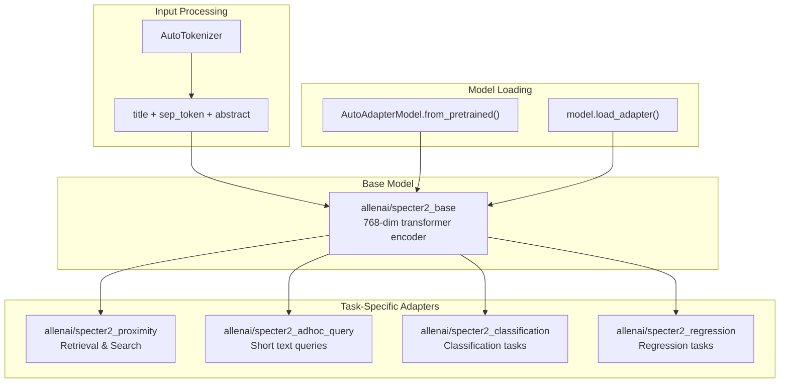
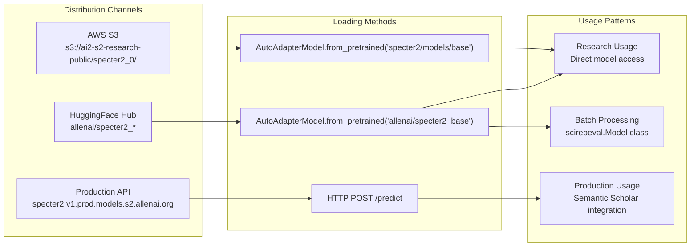
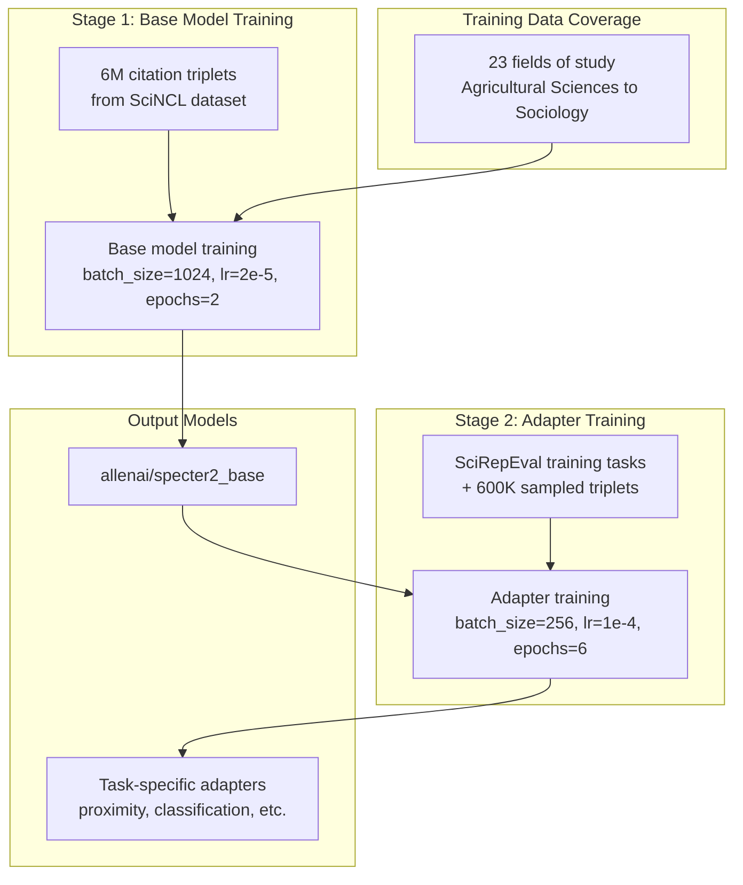

<!-- source: DeepWiki mcp.deepwiki.com · repo allenai/SPECTER2 · page 1 Overview · fetched 2026-10-26 -->

# Overview

Relevant source files

The following files were used as context for generating this wiki page:

- [README.md](README.md)

This document provides a high-level introduction to SPECTER2, explaining its purpose, architecture, and key capabilities for generating scientific document embeddings. For detailed usage instructions, see [Model Usage](#2). For production API documentation, see [Production API](#3). For installation instructions, see [Installation](#4).

## What is SPECTER2

SPECTER2 is a collection of document embedding models designed specifically for scientific tasks. It generates vector representations of scientific papers that can be used for various downstream applications including document retrieval, classification, regression, and similarity search.

The system builds upon the original SPECTER and SciRepEval frameworks, extending them with a modular adapter-based architecture that allows the same base model to be specialized for different task formats through task-specific adapters.

Sources: [README.md:18-21]()

## Core Architecture

SPECTER2 follows a two-tier architecture consisting of a base transformer model and task-specific adapters:

### System Architecture Overview

The base model (`allenai/specter2_base`) is a transformer encoder that processes scientific documents represented as concatenated title and abstract text. Task-specific adapters are loaded on top of the base model using the `AutoAdapterModel` class from the `adapters` library.

Sources: [README.md:56-77](), [README.md:43-50]()

### Model Distribution and Loading

The models are distributed through three primary channels: HuggingFace Hub for research use, AWS S3 for offline access, and a production HTTP API for integration with Semantic Scholar systems.

Sources: [README.md:79-86](), [README.md:115-123]()

## Task-Specific Capabilities

SPECTER2 supports four distinct task formats through specialized adapters:

| Task Format | Adapter Model | Primary Use Case |
|-------------|---------------|------------------|
| Retrieval | `allenai/specter2_proximity` | Link prediction, nearest neighbor search, candidate paper encoding |
| Adhoc Query | `allenai/specter2_adhoc_query` | Encoding short raw text queries for search tasks |
| Classification | `allenai/specter2_classification` | Feature extraction for linear classifiers |
| Regression | `allenai/specter2_regression` | Feature extraction for linear regressors |

The system processes scientific documents by concatenating their title and abstract using `tokenizer.sep_token` as a separator, then truncating to a maximum length of 512 tokens. The final embedding is extracted from the first token (`[:, 0, :]`) of the model's `last_hidden_state` output.

Sources: [README.md:43-50](), [README.md:69-76]()

## Training Methodology

SPECTER2 employs a two-stage training process:

### Training Data and Process Overview

The training data consists of citation triplets spanning 23 fields of study, representing a 10x increase over the original SPECTER training data. The base model learns general scientific document representations, while adapters specialize these representations for specific task formats.

Sources: [README.md:125-162](), [README.md:35-37]()

## Performance Benchmarks

SPECTER2 achieves state-of-the-art performance on scientific document embedding benchmarks:

| Model | SciRepEval Avg | MDCR (MAP, Recall@5) |
|-------|---------------|---------------------|
| SPECTER | 67.5 | (30.6, 25.5) |
| SciNCL | 68.8 | (32.6, 27.3) |
| SPECTER2 Base | 69.1 | (38.0, 32.4) |
| **SPECTER2-Adapters** | **71.1** | **(38.4, 33.0)** |

The model demonstrates significant improvements over previous approaches on both the SciRepEval benchmark (a comprehensive evaluation suite for scientific document representations) and MDCR (a large-scale citation recommendation benchmark).

Sources: [README.md:165-178]()

## System Integration

SPECTER2 integrates with multiple systems and frameworks:

- **Research Environment**: Direct access via `transformers` and `adapters` libraries
- **Batch Processing**: Integration with SciRepEval's `Model` class for multi-task evaluation
- **Production Service**: TIMO-based HTTP API for Semantic Scholar integration
- **Model Hosting**: HuggingFace Hub and AWS S3 for model distribution

For installation requirements and setup procedures, see [Installation](#4). For production API details, see [Production API](#3).

Sources: [README.md:23-33](), [README.md:115-123]()

---

