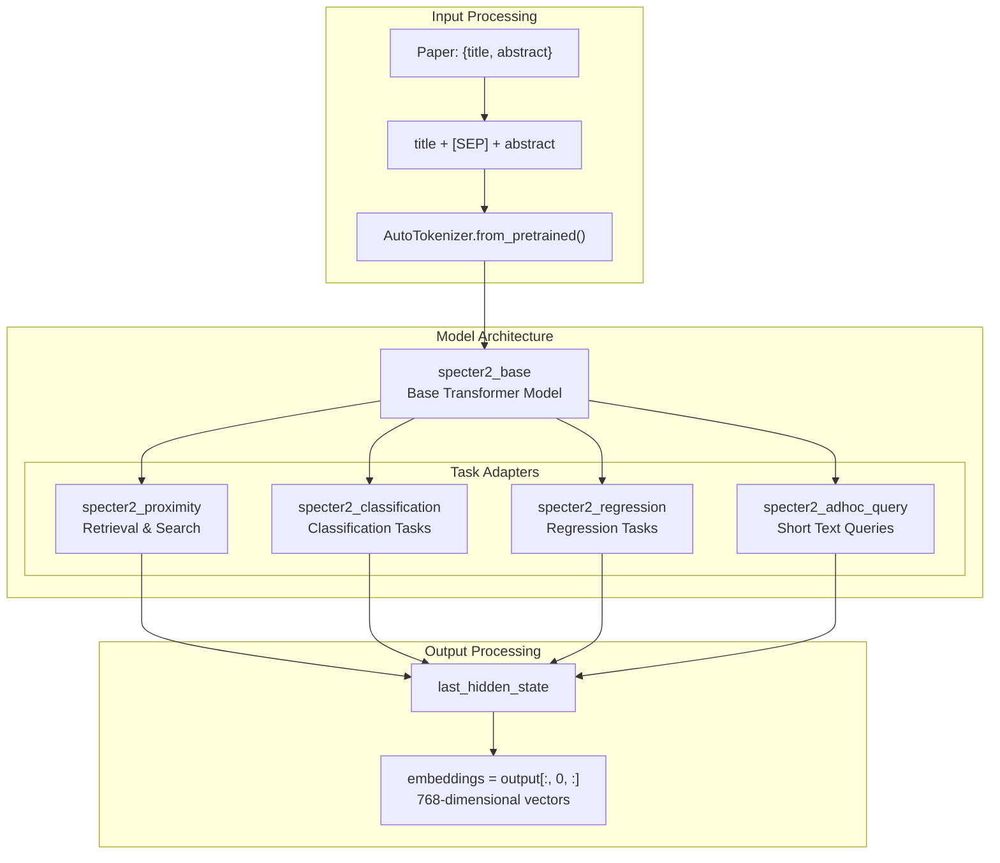
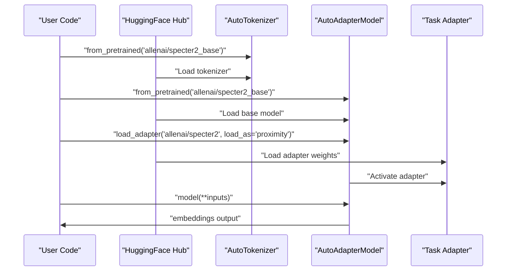
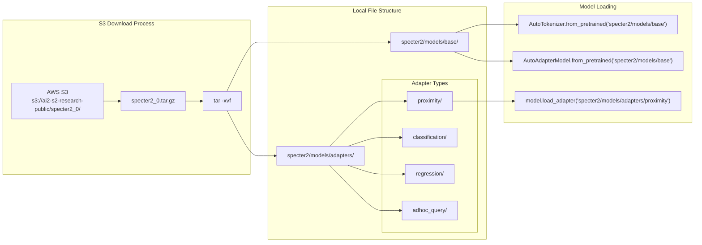
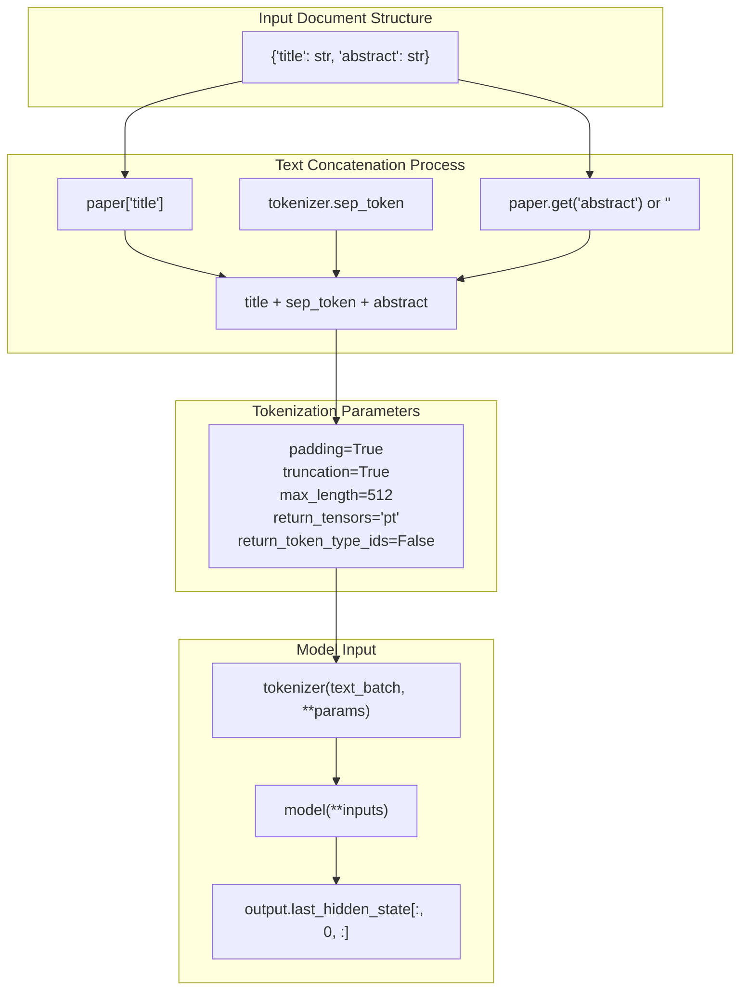
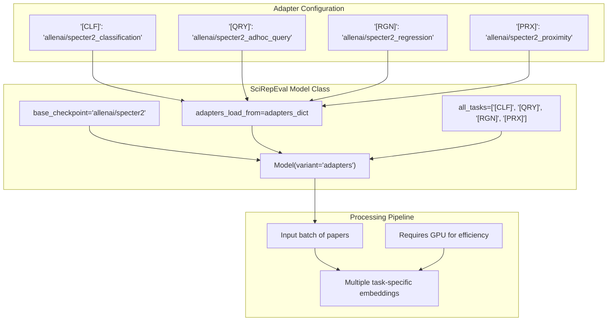

<!-- source: DeepWiki mcp.deepwiki.com · repo allenai/SPECTER2 · page 2 Model Usage · fetched 2026-10-26 -->

# Model Usage

<details>
<summary>Relevant source files</summary>

The following files were used as context for generating this wiki page:

- [README.md](README.md)

</details>


This document provides comprehensive guidance on using SPECTER2 models to generate scientific document embeddings. It covers the model architecture, loading methods, task-specific adapters, and practical implementation examples.

SPECTER2 is designed for generating embeddings from scientific papers represented as title-abstract pairs, with specialized adapters for different downstream tasks. For information about installing the system dependencies, see [Installation](#4). For details about the production API service, see [Production API](#3).

## Model Architecture Overview

SPECTER2 follows a modular architecture with a base transformer model and task-specific adapters trained for different embedding purposes.

### Base Model and Adapter System



The system uses `AutoAdapterModel.from_pretrained()` to load the base model and `model.load_adapter()` to activate task-specific functionality.

**Sources:** [README.md:19-21](), [README.md:52-77]()

### Task-Specific Adapter Selection

| Task Type | Adapter Model | Use Case | Input Format |
|-----------|---------------|----------|--------------|
| Retrieval/Search | `allenai/specter2_proximity` | Link prediction, nearest neighbor search, candidate paper encoding | Title + Abstract |
| Classification | `allenai/specter2_classification` | Features for linear classifiers | Title + Abstract |
| Regression | `allenai/specter2_regression` | Features for linear regressors | Title + Abstract |
| Adhoc Query | `allenai/specter2_adhoc_query` | Short text query encoding for search | Raw text queries |

**Sources:** [README.md:43-50]()

## Loading Methods

SPECTER2 models can be loaded through two primary methods: HuggingFace Hub and AWS S3 direct download.

### HuggingFace Hub Loading



The HuggingFace approach uses the `transformers` library with `AutoTokenizer` and the `adapters` library with `AutoAdapterModel` for dynamic adapter loading.

**Sources:** [README.md:52-77]()

### AWS S3 Direct Loading



**Sources:** [README.md:79-113]()

## Input Processing and Tokenization

### Document Format Requirements

SPECTER2 expects scientific papers as dictionaries with `title` and `abstract` fields. The preprocessing concatenates these fields with the tokenizer's separator token.



The system uses the first token (`[:, 0, :]`) of the last hidden state as the document embedding, producing 768-dimensional vectors.

**Sources:** [README.md:66-76](), [README.md:102-112]()

## Batch Processing for Multiple Tasks

For applications requiring multiple task-specific embeddings, SPECTER2 provides a batch processing interface through the SciRepEval Model class.

### Multi-Task Processing Architecture



The batch processing approach enables simultaneous generation of embeddings optimized for different downstream tasks from the same input documents.

**Sources:** [README.md:115-123]()

## Implementation Examples

### Basic Single-Task Usage

The most common usage pattern loads a single adapter for a specific task:

```python
# From HuggingFace
tokenizer = AutoTokenizer.from_pretrained('allenai/specter2_base')
model = AutoAdapterModel.from_pretrained('allenai/specter2_base')
model.load_adapter("allenai/specter2", source="hf", load_as="proximity", set_active=True)
```

### Local File Loading

For environments with limited internet access or custom model versions:

```python
# From local S3 download
tokenizer = AutoTokenizer.from_pretrained('specter2/models/base')
model = AutoAdapterModel.from_pretrained('specter2/models/base')
model.load_adapter("specter2/models/adapters/proximity", load_as="proximity", set_active=True)
```

### Multi-Task Configuration

For applications requiring multiple embedding types:

```python
adapters_dict = {
    "[CLF]": "allenai/specter2_classification",
    "[QRY]": "allenai/specter2_adhoc_query", 
    "[RGN]": "allenai/specter2_regression",
    "[PRX]": "allenai/specter2_proximity"
}
model = Model(
    variant="adapters",
    base_checkpoint="allenai/specter2",
    adapters_load_from=adapters_dict,
    all_tasks=["[CLF]", "[QRY]", "[RGN]", "[PRX]"]
)
```

**Sources:** [README.md:52-77](), [README.md:88-113](), [README.md:118-122]()

## Output Format and Dimensionality

SPECTER2 generates 768-dimensional dense vector embeddings suitable for various downstream scientific tasks. The embeddings are extracted from `output.last_hidden_state[:, 0, :]` representing the `[CLS]` token encoding.

These embeddings can be directly used for:
- Similarity computation between papers
- Input features for classification/regression models  
- Retrieval and search applications
- Citation recommendation systems

**Sources:** [README.md:75-76](), [README.md:111-112]()

---

