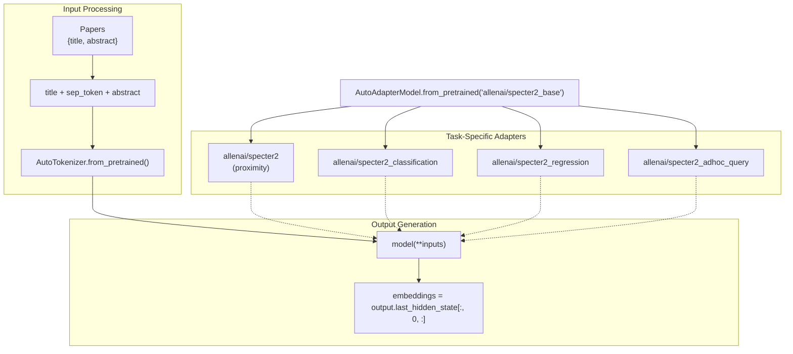
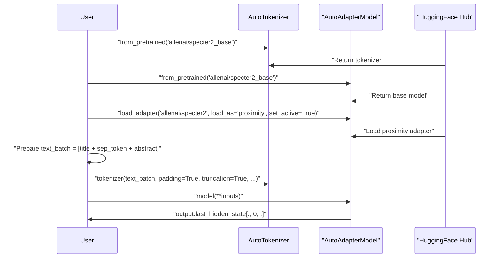
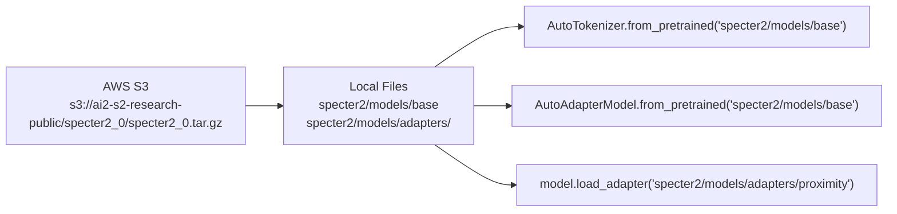

<!-- source: DeepWiki mcp.deepwiki.com · repo allenai/SPECTER2 · page 2.1 Getting Started · fetched 2026-10-26 -->

# Getting Started

<details>
<summary>Relevant source files</summary>

The following files were used as context for generating this wiki page:

- [README.md](README.md)

</details>


This document provides basic usage examples for generating scientific document embeddings using SPECTER2 models. It covers the fundamental workflow of loading the base model, selecting task-specific adapters, and processing scientific papers to generate embeddings. For comprehensive model architecture details, see [Architecture Details](#2.2). For production API usage, see [Production API](#3).

## Overview

SPECTER2 uses a modular architecture consisting of a base transformer model (`allenai/specter2_base`) combined with task-specific adapters that specialize the embeddings for different downstream applications. This getting started guide demonstrates the core usage patterns for loading models and generating embeddings.

## Core Architecture



**Sources:** [README.md:52-77](), [README.md:88-113]()

## Adapter Selection Guide

Different adapters are optimized for specific task formats:

| Adapter | HuggingFace Model | Use Case |
|---------|------------------|----------|
| Proximity (Retrieval) | `allenai/specter2` | Link prediction, nearest neighbor search, paper-to-paper similarity |
| Adhoc Query | `allenai/specter2_adhoc_query` | Short text queries for search tasks |
| Classification | `allenai/specter2_classification` | Features for linear classifiers |
| Regression | `allenai/specter2_regression` | Features for linear regressors |

**Sources:** [README.md:43-50]()

## Basic Usage Workflow

### HuggingFace Hub Method

The following workflow demonstrates loading models from HuggingFace Hub and generating embeddings:



**Sources:** [README.md:52-77]()

The code implementation follows this pattern from the README:

```python
# Key components from README.md:56-64
tokenizer = AutoTokenizer.from_pretrained('allenai/specter2_base')
model = AutoAdapterModel.from_pretrained('allenai/specter2_base')
model.load_adapter("allenai/specter2", source="hf", load_as="proximity", set_active=True)

# Text preprocessing from README.md:69-70  
text_batch = [d['title'] + tokenizer.sep_token + (d.get('abstract') or '') for d in papers]

# Inference from README.md:71-76
inputs = tokenizer(text_batch, padding=True, truncation=True, 
                   return_tensors="pt", return_token_type_ids=False, max_length=512)
output = model(**inputs)
embeddings = output.last_hidden_state[:, 0, :]
```

**Sources:** [README.md:52-77]()

### AWS S3 Method

For offline usage, models can be downloaded from S3 and loaded locally:



**Sources:** [README.md:79-113]()

The S3 workflow uses local paths instead of HuggingFace model names:

```bash
# Download commands from README.md:80-85
aws s3 --no-sign-request cp s3://ai2-s2-research-public/specter2_0/specter2_0.tar.gz .
tar -xvf specter2_0.tar.gz
```

```python  
# Local loading from README.md:92-99
tokenizer = AutoTokenizer.from_pretrained('specter2/models/base')
model = AutoAdapterModel.from_pretrained('specter2/models/base')  
model.load_adapter("specter2/models/adapters/proximity", load_as="proximity", set_active=True)
```

**Sources:** [README.md:88-113]()

## Input Data Format

SPECTER2 expects scientific papers in a specific dictionary format:

| Field | Type | Required | Description |
|-------|------|----------|-------------|
| `title` | str | Yes | Paper title |
| `abstract` | str | Optional | Paper abstract (empty string if missing) |

The text preprocessing concatenates title and abstract using `tokenizer.sep_token`:

```python
# From README.md:69-70
papers = [
    {'title': 'BERT', 'abstract': 'We introduce a new language representation model called BERT'},
    {'title': 'Attention is all you need', 'abstract': 'The dominant sequence transduction models...'}
]
text_batch = [d['title'] + tokenizer.sep_token + (d.get('abstract') or '') for d in papers]
```

**Sources:** [README.md:66-70](), [README.md:102-106]()

## Batch Processing

For GPU-based batch processing across multiple task types, SPECTER2 integrates with the SciRepEval framework using the `Model` class:

```python
# From README.md:120-122
adapters_dict = {
    "[CLF]": "allenai/specter2_classification", 
    "[QRY]": "allenai/specter2_adhoc_query", 
    "[RGN]": "allenai/specter2_regression", 
    "[PRX]": "allenai/specter2_proximity"
}
model = Model(variant="adapters", base_checkpoint="allenai/specter2", 
              adapters_load_from=adapters_dict, all_tasks=["[CLF]", "[QRY]", "[RGN]", "[PRX]"])
```

For detailed batch processing instructions, refer to the [SciRepEval INFERENCE.md](https://github.com/allenai/scirepeval/blob/main/evaluation/INFERENCE.md) documentation.

**Sources:** [README.md:115-123]()

## Next Steps

- For detailed model architecture information, see [Architecture Details](#2.2)
- For training methodology and performance benchmarks, see [Training Methodology](#2.3)  
- For production API usage, see [Production API](#3)
- For installation requirements, see [Installation](#4)

---

