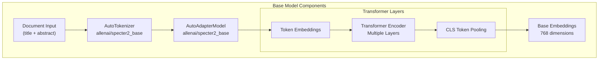
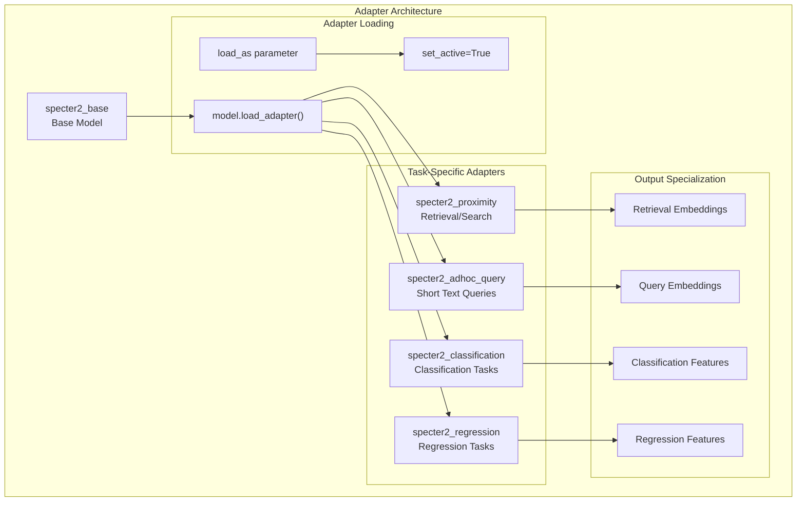
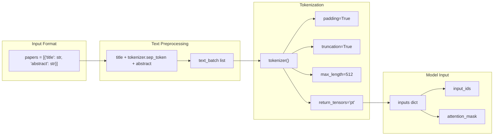
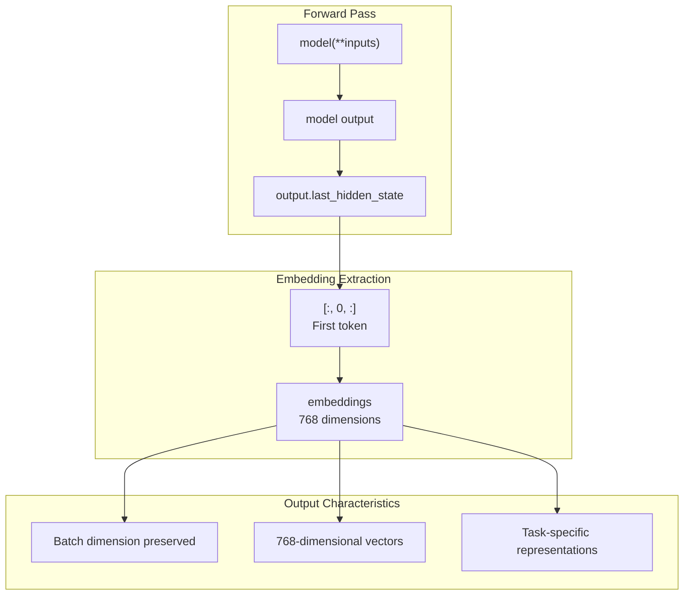
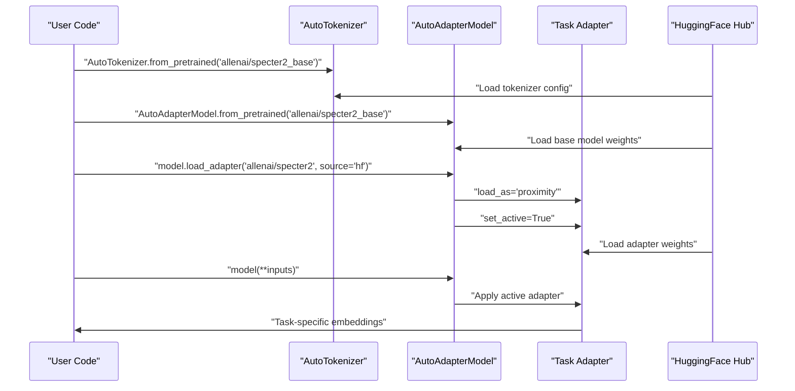

<!-- source: DeepWiki mcp.deepwiki.com · repo allenai/SPECTER2 · page 2.2 Architecture Details · fetched 2026-10-26 -->

# Architecture Details

Relevant source files

The following files were used as context for generating this wiki page:

- [README.md](README.md)

This document provides a technical deep dive into the SPECTER2 architecture, covering the base transformer model and adapter system design. It explains the modular architecture that enables task-specific specialization through adapters, the input processing pipeline, and the embedding generation mechanism.

For basic usage examples and getting started, see [Getting Started](#2.1). For information about the training process and datasets, see [Training Methodology](#2.3).

## Base Model Architecture

SPECTER2 is built on a transformer architecture with a specialized base model (`allenai/specter2_base`) that serves as the foundation for all task-specific adapters. The base model is a BERT-like encoder that processes scientific document text and generates contextualized representations.

The base model processes input through the following stages:

| Stage | Component | Function |
|-------|-----------|----------|
| Tokenization | `AutoTokenizer` | Converts text to token IDs with special tokens |
| Embedding | Token embeddings | Maps tokens to dense vectors |
| Encoding | Transformer layers | Contextual representation learning |
| Pooling | CLS token | Extracts document-level representation |

**Sources**: [README.md:57-60](), [README.md:93-96]()

## Adapter System Architecture

The adapter system enables task-specific specialization without retraining the entire base model. Each adapter modifies the base model's behavior for specific task formats through lightweight parameter additions.

### Adapter Specializations

| Adapter | HuggingFace ID | Use Case | Optimization |
|---------|----------------|----------|-------------|
| Proximity | `allenai/specter2` | Document retrieval, link prediction | Similarity-based ranking |
| Adhoc Query | `allenai/specter2_adhoc_query` | Short text search queries | Query-document matching |
| Classification | `allenai/specter2_classification` | Linear classifier features | Discriminative representations |
| Regression | `allenai/specter2_regression` | Linear regressor features | Continuous value prediction |

**Sources**: [README.md:43-48](), [README.md:62-64](), [README.md:98-100]()

## Input Processing Pipeline

The input processing pipeline standardizes document representation by concatenating title and abstract with special tokens, followed by tokenization and truncation.

### Processing Parameters

| Parameter | Value | Purpose |
|-----------|-------|---------|
| `max_length` | 512 | Maximum sequence length |
| `padding` | True | Batch-level padding |
| `truncation` | True | Handle long documents |
| `return_tensors` | "pt" | PyTorch tensor format |
| `return_token_type_ids` | False | Disable segment embeddings |

**Sources**: [README.md:69-73](), [README.md:105-109]()

## Output Generation

The model generates document embeddings by extracting the representation of the first token (CLS token) from the final hidden layer.

The embedding extraction process:
1. Forward pass through `model(**inputs)` returns output object
2. Access `output.last_hidden_state` for final layer representations
3. Extract first token embeddings with `[:, 0, :]` indexing
4. Result is batch of 768-dimensional task-specific embeddings

**Sources**: [README.md:74-76](), [README.md:110-112]()

## Model Loading and Activation Process

The system uses a two-step process for model initialization: loading the base model and then activating specific adapters.

### Loading Methods

| Method | Parameters | Function |
|--------|------------|----------|
| `AutoTokenizer.from_pretrained()` | model_path | Load tokenizer configuration |
| `AutoAdapterModel.from_pretrained()` | model_path | Load base transformer model |
| `model.load_adapter()` | source, load_as, set_active | Load and activate task adapter |

### Adapter Activation

The adapter system requires explicit activation through the `set_active=True` parameter. Only one adapter can be active at a time, determining the task-specific behavior of the model.

**Sources**: [README.md:57-64](), [README.md:93-100](), [README.md:119-122]()

---

