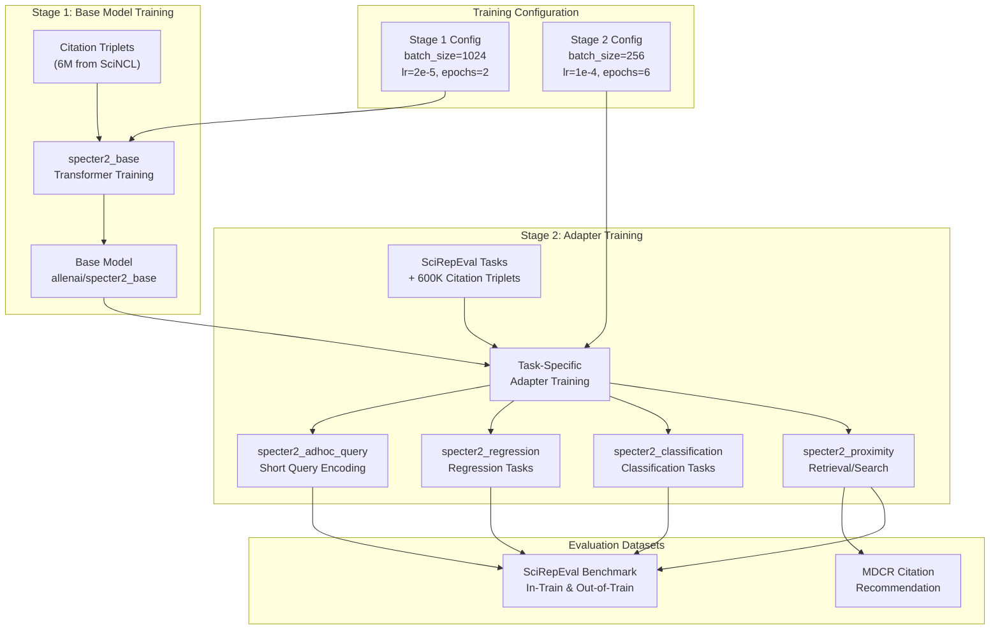
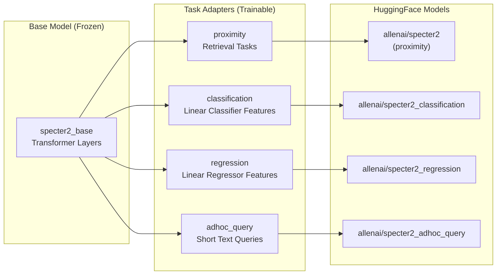

<!-- source: DeepWiki mcp.deepwiki.com · repo allenai/SPECTER2 · page 2.3 Training Methodology · fetched 2026-10-26 -->

# Training Methodology

<details>
<summary>Relevant source files</summary>

The following files were used as context for generating this wiki page:

- [README.md](README.md)

</details>


## Purpose and Scope

This document provides a detailed explanation of SPECTER2's two-stage training methodology, including the datasets used, training configurations, and performance benchmarks. It covers the complete training pipeline from base model pre-training through task-specific adapter fine-tuning.

For information about the model architecture and adapters, see [Architecture Details](#2.2). For basic usage examples of the trained models, see [Getting Started](#2.1).

## Training Overview

SPECTER2 follows a two-stage training approach that builds upon the original SPECTER methodology while introducing task-specific adaptation capabilities.

### Two-Stage Training Pipeline



**Sources:** [README.md:158-162]()

## Stage 1: Base Model Training

The first stage trains a transformer base model using citation relationships to learn general scientific document representations.

### Training Data

The base model is trained on 6 million citation triplets extracted from the SciNCL dataset, representing a 10x increase over the original SPECTER training data. These triplets span 23 distinct fields of study, providing broad coverage across scientific domains.

| Field of Study | Field of Study | Field of Study |
|---|---|---|
| Agricultural And Food Sciences | Art | Biology |
| Business | Chemistry | Computer Science |
| Economics | Education | Engineering |
| Environmental Science | Geography | Geology |
| History | Law | Linguistics |
| Materials Science | Mathematics | Medicine |
| Philosophy | Physics | Political Science |
| Psychology | Sociology | - |

### Training Configuration

The base model training uses the following hyperparameters:

| Parameter | Value |
|---|---|
| Batch Size | 1024 |
| Max Input Length | 512 tokens |
| Learning Rate | 2e-5 |
| Epochs | 2 |
| Model Output | `allenai/specter2_base` |

**Sources:** [README.md:36-37](), [README.md:128-129](), [README.md:159-160](), [README.md:130-157]()

## Stage 2: Adapter Training

The second stage trains task-specific adapters on top of the frozen base model to enable specialized embeddings for different scientific tasks.

### Task-Specific Adapter Architecture



### Training Data Sources

Adapter training combines:
- **SciRepEval Training Tasks**: Task-specific training data for each adapter type
- **Citation Triplets**: 600K additional triplets sampled from the Stage 1 dataset to maintain citation-based representation quality

### Training Configuration

| Parameter | Value |
|---|---|
| Batch Size | 256 |
| Max Input Length | 512 tokens |
| Learning Rate | 1e-4 |
| Epochs | 6 |
| Base Model | Frozen `specter2_base` |

**Sources:** [README.md:161-162]()

## Training Implementation

The training process is implemented using the SciRepEval framework, with specific model instantiation for batch processing:

```python
# Model setup for training/evaluation
adapters_dict = {
    "[CLF]": "allenai/specter2_classification", 
    "[QRY]": "allenai/specter2_adhoc_query", 
    "[RGN]": "allenai/specter2_regression", 
    "[PRX]": "allenai/specter2_proximity"
}
model = Model(
    variant="adapters", 
    base_checkpoint="allenai/specter2", 
    adapters_load_from=adapters_dict, 
    all_tasks=["[CLF]", "[QRY]", "[RGN]", "[PRX]"]
)
```

**Sources:** [README.md:120-122](), [README.md:32](), [README.md:158]()

## Performance Evaluation

SPECTER2 is evaluated on two primary benchmarks to assess its effectiveness across different scientific tasks.

### SciRepEval Benchmark Results

| Model | SciRepEval In-Train | SciRepEval Out-of-Train | SciRepEval Avg |
|---|---|---|---|
| BM-25 | n/a | n/a | n/a |
| SPECTER | 54.7 | 72.0 | 67.5 |
| SciNCL | 55.6 | 73.4 | 68.8 |
| SciRepEval-Adapters | 61.9 | 73.8 | 70.7 |
| SPECTER2 Base | 56.3 | 73.6 | 69.1 |
| **SPECTER2-Adapters** | **62.3** | **74.1** | **71.1** |

### MDCR Citation Recommendation Results

| Model | MAP | Recall@5 |
|---|---|---|
| BM-25 | 33.7 | 28.5 |
| SPECTER | 30.6 | 25.5 |
| SciNCL | 32.6 | 27.3 |
| SciRepEval-Adapters | 35.3 | 29.6 |
| SPECTER2 Base | 38.0 | 32.4 |
| **SPECTER2-Adapters** | **38.4** | **33.0** |

### Key Performance Insights

1. **Task-Specific Adaptation**: The adapter-based approach (SPECTER2-Adapters) consistently outperforms the base model across all metrics
2. **State-of-the-Art Results**: SPECTER2 establishes new SoTA performance on both SciRepEval and MDCR benchmarks
3. **Generalization**: Strong performance on both in-train and out-of-train evaluation sets demonstrates robust generalization

**Sources:** [README.md:165-177]()

## Training Data Access

The complete training and validation datasets are integrated into the SciRepEval benchmark and publicly available:

- **Citation Triplets**: Available via [SciRepEval dataset viewer](https://huggingface.co/datasets/allenai/scirepeval/viewer/cite_prediction_new/evaluation)
- **Source Data**: Derived from SciNCL dataset as documented in the training methodology

**Sources:** [README.md:127-129]()

---

