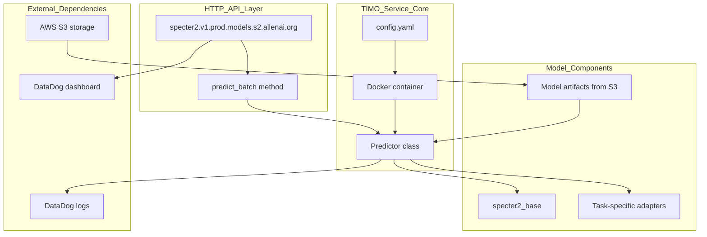
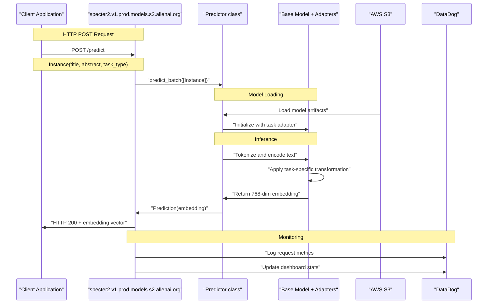

<!-- source: DeepWiki mcp.deepwiki.com · repo allenai/SPECTER2 · page 3 Production API · fetched 2026-10-26 -->

# Production API

<details>
<summary>Relevant source files</summary>

The following files were used as context for generating this wiki page:

- [specter2_0/timo/README.md](specter2_0/timo/README.md)

</details>


This document covers the production HTTP API service that provides access to SPECTER2 embeddings through the TIMO (The Infrastructure for ML Operations) platform. This service is designed for internal use by the Semantic Scholar product and external applications requiring real-time embedding generation.

For information about using SPECTER2 models directly in research or development environments, see [Model Usage](#2). For installation and setup instructions, see [Installation](#4).

## Service Architecture

The production API is built on the TIMO platform, which provides a standardized way to serve machine learning models at scale. The service exposes SPECTER2's embedding capabilities through a REST API endpoint.

### TIMO Service Components



Sources: [specter2_0/timo/README.md:1-52]()

## API Interface

The service exposes SPECTER2 functionality through a REST API that accepts document metadata and returns embedding vectors. The interface is defined using specific data models that correspond to the different task types supported by SPECTER2.

### Data Models

The API uses three primary data structures for communication:

| Model | Purpose | Fields |
|-------|---------|--------|
| `TaskType` | Enum defining supported embedding types | `DEFAULT`, `CLASSIFICATION`, `REGRESSION`, `PROXIMITY`, `ADHOC_QUERY` |
| `Instance` | Input document specification | `title: str`, `abstract: Union[str\|Optional]`, `task_type: TaskType` |
| `Prediction` | Output embedding result | `embedding: List[float]` |

The `TaskType` enum corresponds to the different SPECTER2 adapter models:
- `DEFAULT`: Uses base model without task-specific adaptation
- `CLASSIFICATION`: Optimized for document classification tasks
- `REGRESSION`: Optimized for regression tasks  
- `PROXIMITY`: Optimized for similarity and retrieval tasks
- `ADHOC_QUERY`: Optimized for short query text processing

Sources: [specter2_0/timo/README.md:26-44]()

### Request/Response Flow



Sources: [specter2_0/timo/README.md:26-44]()

## Configuration and Deployment

The production service is configured and deployed using TIMO's standard tooling and configuration management system.

### TIMO Configuration

The service configuration is managed through a `config.yaml` file that defines deployment parameters, model artifacts, and service settings. This configuration integrates with TIMO's deployment pipeline.

### Verification and Publishing

The service uses TIMO's verification and publishing workflow:

```bash
# Verify configuration and model integrity
tt verify -c specter2_0/timo/config.yaml

# Publish to production environment  
tt publish -c specter2_0/timo/config.yaml
```

The verification step ensures that model artifacts are accessible, configuration is valid, and the service can initialize properly. The publishing step deploys the verified configuration to the production environment.

Sources: [specter2_0/timo/README.md:7-18]()

## Monitoring and Operations

The production API includes comprehensive monitoring and observability features through DataDog integration, providing visibility into service health, performance metrics, and usage patterns.

### Logging and Metrics

The service automatically logs all requests and responses, including:
- Request processing times
- Model inference latencies  
- Error rates and exception details
- Resource utilization metrics

### Monitoring Dashboards

Two primary monitoring interfaces are available:

| Interface | Purpose | Access |
|-----------|---------|--------|
| DataDog Logs | Real-time log streaming and search | Service-specific log filtering |
| DataDog Dashboard | Performance metrics and alerts | Service health overview |

The monitoring system tracks key performance indicators including request throughput, response latencies, error rates, and resource consumption to ensure reliable service operation.

Sources: [specter2_0/timo/README.md:49-51]()

### Service Endpoint

The production API is accessible at:
```
http://specter2.v1.prod.models.s2.allenai.org/
```

This endpoint serves as the primary interface for generating SPECTER2 embeddings in production environments, particularly for integration with the Semantic Scholar product and other internal applications.

Sources: [specter2_0/timo/README.md:20-23]()

---

