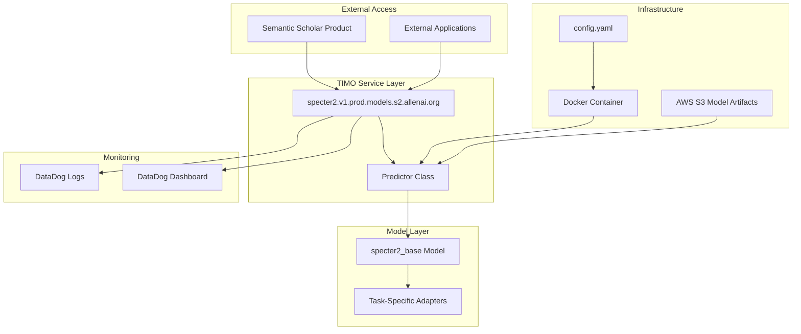
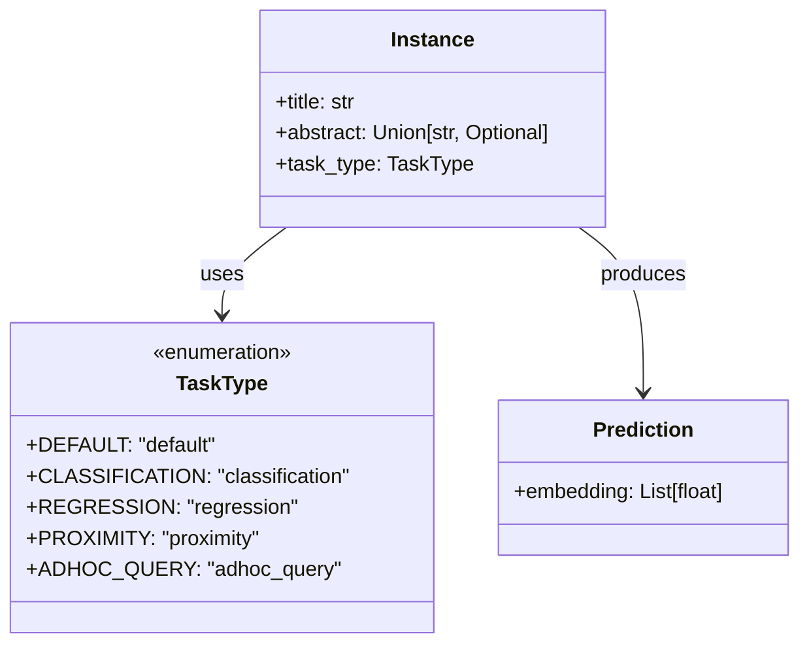
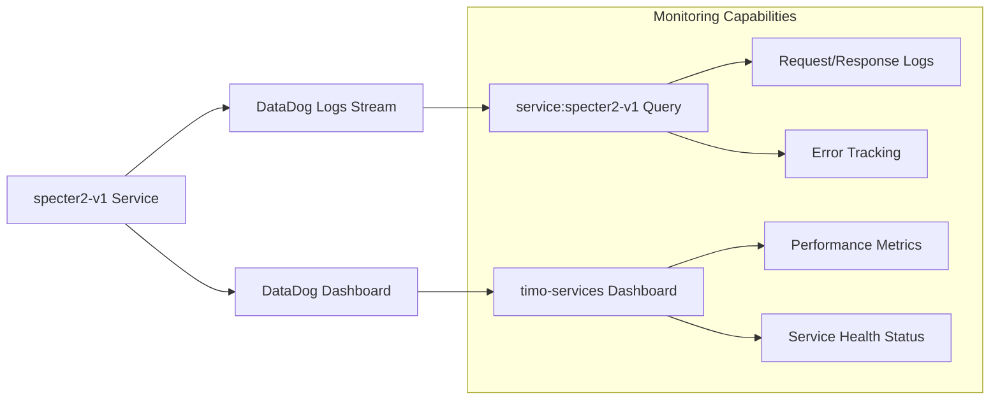

<!-- source: DeepWiki mcp.deepwiki.com · repo allenai/SPECTER2 · page 3.1 Service Overview · fetched 2026-10-26 -->

# Service Overview

Relevant source files

The following files were used as context for generating this wiki page:

- [specter2_0/timo/README.md](specter2_0/timo/README.md)

This page documents the TIMO production service that provides HTTP API access to SPECTER2 models for generating scientific document embeddings. The service is designed for internal use by the Semantic Scholar product and external applications requiring programmatic access to SPECTER2 capabilities.

For information about direct model usage and loading, see [Model Usage](#2). For detailed API specifications and data models, see [API Reference](#3.2).

## Purpose and Architecture

The TIMO service serves as a production-ready HTTP wrapper around SPECTER2 models, providing a RESTful interface for generating embeddings from scientific documents. The service is deployed within Allen Institute infrastructure and integrated with Semantic Scholar's production systems.

**Service Architecture Overview**

Sources: [specter2_0/timo/README.md:1-52]()

## Service Endpoint

The production service is accessible at:
- **Base URL**: `http://specter2.v1.prod.models.s2.allenai.org/`
- **Protocol**: HTTP REST API
- **Authentication**: Internal Allen Institute access

The service provides embedding generation capabilities through a standardized prediction interface that accepts document metadata and returns high-dimensional embeddings.

Sources: [specter2_0/timo/README.md:20-24]()

## Data Models

The service defines three core data structures for API interaction:

**Core API Data Models**

### TaskType Enumeration
The `TaskType` enum defines the available model variants:
- `DEFAULT`: Base model without task-specific adaptation
- `CLASSIFICATION`: Optimized for document classification tasks
- `REGRESSION`: Optimized for regression-based tasks  
- `PROXIMITY`: Optimized for document similarity and retrieval
- `ADHOC_QUERY`: Optimized for short query text processing

### Instance Class
Input data structure containing:
- `title`: Document title (required string)
- `abstract`: Document abstract (optional string)
- `task_type`: Specifies which model variant to use

### Prediction Class  
Output data structure containing:
- `embedding`: 768-dimensional vector representation as list of floats

Sources: [specter2_0/timo/README.md:25-44]()

## Deployment and Configuration

The service is deployed using TIMO (Allen Institute's model serving platform) with containerized deployment:

| Component | Purpose | Location |
|-----------|---------|----------|
| `config.yaml` | TIMO service configuration | `specter2_0/timo/config.yaml` |
| Docker Container | Containerized model serving | Built from repository |
| Model Artifacts | Pre-trained model weights | AWS S3 storage |

### TIMO Operations

Key operational commands:
- **Verification**: `tt verify -c specter2_0/timo/config.yaml`
- **Publishing**: `tt publish -c specter2_0/timo/config.yaml`

The deployment follows TIMO's standard model serving patterns with automated containerization and artifact management.

Sources: [specter2_0/timo/README.md:7-18]()

## Monitoring and Observability

The service includes comprehensive monitoring through DataDog integration:

**Service Monitoring Architecture**

### DataDog Integration
- **Service Logs**: Real-time log streaming with `service:specter2-v1` tag
- **Performance Dashboard**: Comprehensive service metrics and health monitoring
- **Alert Configuration**: Automated alerting for service issues

The monitoring setup enables operational visibility into request patterns, performance characteristics, and system health for production deployments.

Sources: [specter2_0/timo/README.md:47-52]()

## Internal Usage Context

This TIMO service is specifically designed for internal Allen Institute use cases and can be safely ignored by external consumers working directly with SPECTER2 models. External users should refer to [Getting Started](#2.1) for direct model usage patterns.

The service primarily supports:
- Semantic Scholar product integration
- Internal research and development workflows  
- Production embedding generation at scale

Sources: [specter2_0/timo/README.md:1-5]()

---

