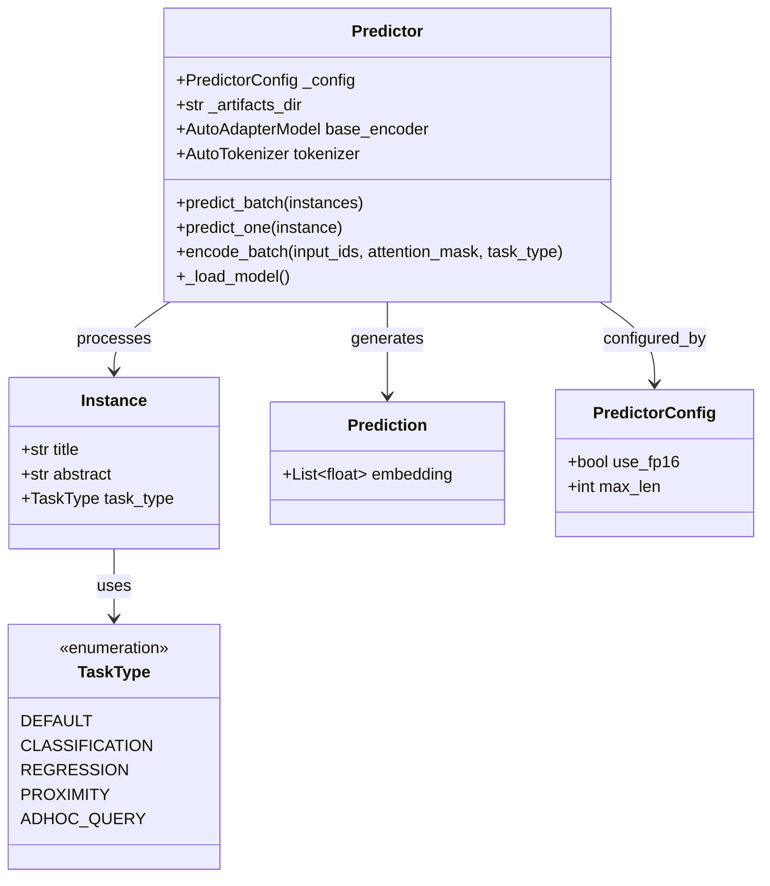
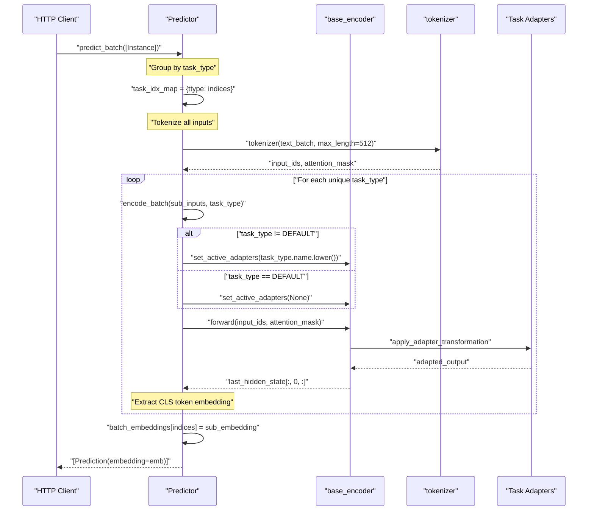
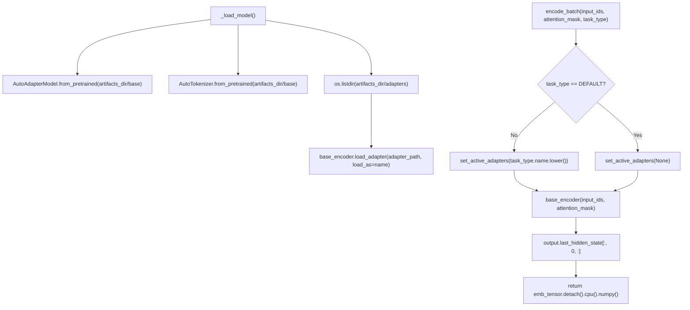

<!-- source: DeepWiki mcp.deepwiki.com · repo allenai/SPECTER2 · page 3.2 API Reference · fetched 2026-10-26 -->

# API Reference

<details>
<summary>Relevant source files</summary>

The following files were used as context for generating this wiki page:

- [specter2_0/timo/interface.py](specter2_0/timo/interface.py)

</details>


This page provides detailed technical documentation for the TIMO production service API interface, including data models, method signatures, and interaction patterns. The API is implemented through the `Predictor` class and associated data models that handle SPECTER2 embedding generation requests.

For general service information and endpoint details, see [Service Overview](#3.1). For deployment configuration and monitoring setup, see [Configuration](#3.3).

## Data Models

The API defines several core data models using Pydantic for request/response handling and configuration management.

### TaskType Enum

The `TaskType` enum defines the available task-specific adapters:

| Value | Description |
|-------|-------------|
| `DEFAULT` | Base model without task-specific adaptation |
| `CLASSIFICATION` | Classification task adapter |
| `REGRESSION` | Regression task adapter |
| `PROXIMITY` | Proximity/retrieval task adapter |
| `ADHOC_QUERY` | Ad-hoc query task adapter |

### Instance Model

The `Instance` class represents a single inference request:

| Field | Type | Required | Description |
|-------|------|----------|-------------|
| `title` | `str` | Yes | Title of the paper or raw text query |
| `abstract` | `str` | No | Abstract of the paper (optional) |
| `task_type` | `TaskType` | Yes | Task format for embedding generation |

### Prediction Model

The `Prediction` class represents the inference result:

| Field | Type | Description |
|-------|------|-------------|
| `embedding` | `List[float]` | 768-dimensional embedding vector |

### PredictorConfig Model

Configuration settings for the predictor:

| Field | Type | Default | Description |
|-------|------|---------|-------------|
| `use_fp16` | `bool` | `False` | Enable FP16 precision for inference |
| `max_len` | `int` | `512` | Maximum input sequence length |

**Data Model Relationships**


Sources: [specter2_0/timo/interface.py:19-76]()

## Predictor Interface

The `Predictor` class serves as the main inference interface, implementing model loading, batch processing, and task-specific adapter management.

### Initialization

The predictor initializes with configuration and artifact directory paths:

```python
def __init__(self, config: PredictorConfig, artifacts_dir: str)
```

The initialization process loads the base model and all available task adapters from the artifacts directory.

### Core Methods

#### predict_batch

Primary method for batch inference processing:

```python
def predict_batch(self, instances: List[Instance]) -> List[Prediction]
```

This method:
1. Groups instances by `task_type` for efficient processing
2. Tokenizes all input text in parallel
3. Processes each task type group with appropriate adapters
4. Returns embeddings in the same order as input instances

#### predict_one

Single instance inference method:

```python
def predict_one(self, instance: Instance) -> Prediction
```

Processes individual instances by formatting text, tokenizing, and generating embeddings through the appropriate adapter.

#### encode_batch

Low-level encoding method:

```python
def encode_batch(self, input_ids: torch.Tensor, attention_mask: torch.Tensor, task_type: TaskType) -> np.ndarray
```

Handles adapter activation and tensor processing to generate the final embeddings.

**Prediction Workflow**


Sources: [specter2_0/timo/interface.py:78-182]()

## Method Reference

### Text Processing Pipeline

The predictor processes input text using the following pattern:

1. **Text Concatenation**: `f"{title} {tokenizer.sep_token} {abstract}"` for papers with abstracts
2. **Tokenization**: Uses `AutoTokenizer` with padding, truncation, and max_length constraints
3. **Adapter Selection**: Activates task-specific adapters based on `TaskType`
4. **Embedding Extraction**: Extracts CLS token representation from `last_hidden_state[:, 0, :]`

**Task Adapter Management**


Sources: [specter2_0/timo/interface.py:101-130]()

### Batch Processing Optimization

The `predict_batch` method implements several optimizations:

- **Task Grouping**: Groups instances by `task_type` to minimize adapter switches
- **Vectorized Tokenization**: Processes all text inputs simultaneously
- **Memory Management**: Handles GPU/CPU tensor transfers and FP16 conversion
- **Index Mapping**: Maintains original input order while processing grouped data

Sources: [specter2_0/timo/interface.py:150-182]()

---

