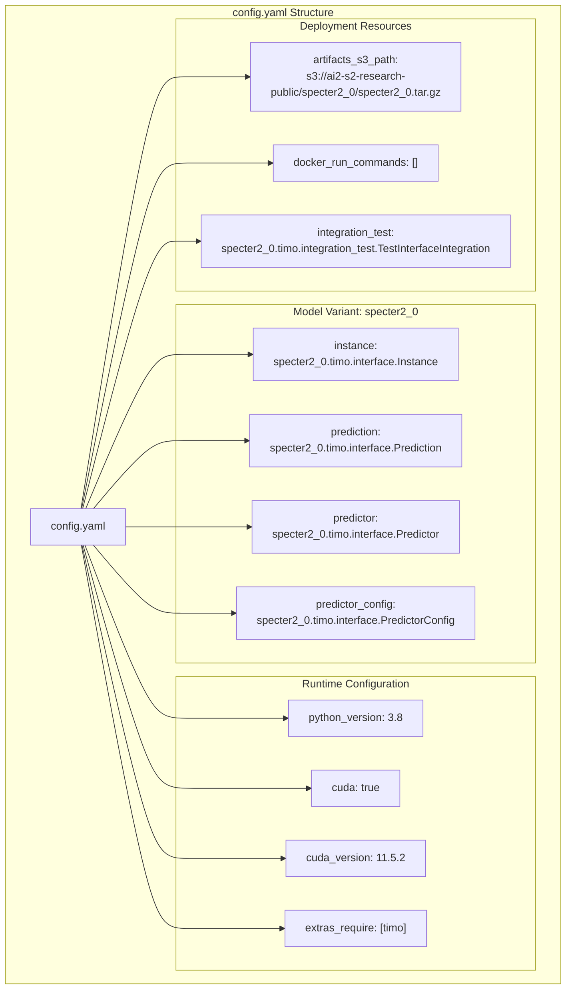
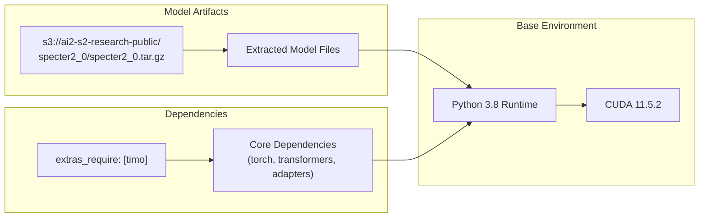
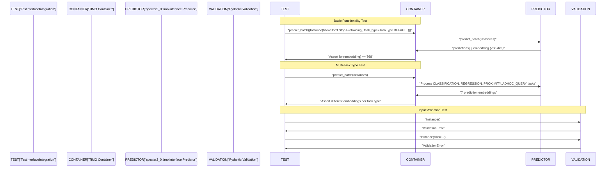
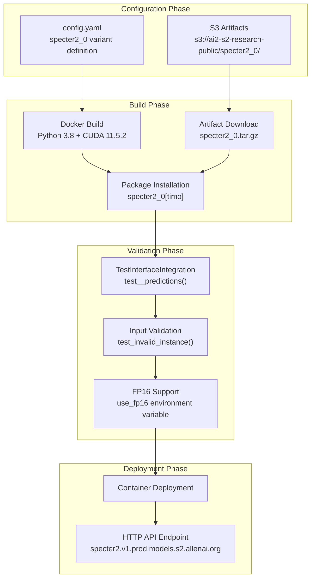

<!-- source: DeepWiki mcp.deepwiki.com · repo allenai/SPECTER2 · page 3.3 Configuration · fetched 2026-10-26 -->

# Configuration

Relevant source files

The following files were used as context for generating this wiki page:

- [specter2_0/timo/config.yaml](specter2_0/timo/config.yaml)
- [specter2_0/timo/integration_test.py](specter2_0/timo/integration_test.py)

This document covers the TIMO deployment configuration for the SPECTER2 production service, including configuration file structure, integration testing, and operational monitoring setup. For information about using the production API endpoints, see [API Reference](#3.2). For model installation and setup, see [Installation](#4).

## Configuration File Structure

The TIMO deployment is controlled by the `config.yaml` file, which defines model variants, runtime requirements, and deployment parameters for the production service.

### Model Variant Definition

The configuration defines a single model variant `specter2_0` that specifies the core interface classes and runtime environment:

| Configuration Key | Purpose | Value |
|-------------------|---------|-------|
| `instance` | Pydantic model for API input | `specter2_0.timo.interface.Instance` |
| `prediction` | Pydantic model for API output | `specter2_0.timo.interface.Prediction` |
| `predictor` | Main prediction logic class | `specter2_0.timo.interface.Predictor` |
| `predictor_config` | Configuration model | `specter2_0.timo.interface.PredictorConfig` |

**TIMO Configuration Structure**

*Sources: [specter2_0/timo/config.yaml:1-44]()*

### Runtime Environment Configuration

The deployment specifies Python 3.8 runtime with CUDA 11.5.2 GPU acceleration enabled. Model artifacts are retrieved from S3 at deployment time, and the `timo` extras requirement ensures TIMO-specific dependencies are installed.

**Runtime Environment Setup**

*Sources: [specter2_0/timo/config.yaml:22-36]()*

## Integration Testing

The `TestInterfaceIntegration` class validates the deployed model container against expected behavior for all supported task types and configurations.

### Test Coverage

The integration test validates:

- **Embedding dimensions**: Confirms 768-dimensional output vectors
- **Task type variants**: Tests all `TaskType` options (`DEFAULT`, `CLASSIFICATION`, `REGRESSION`, `PROXIMITY`, `ADHOC_QUERY`)
- **Input validation**: Ensures proper Pydantic validation for malformed inputs
- **FP16 support**: Tests half-precision floating-point inference

**Integration Test Flow**

*Sources: [specter2_0/timo/integration_test.py:47-96]()*

### Test Assertions

Key test validations include:

| Test Case | Assertion | Purpose |
|-----------|-----------|---------|
| Embedding dimensions | `len(predictions[0].embedding) == 768` | Verify output vector size |
| Task type differentiation | `assertNotEqual(predictions[i].embedding[0], predictions[j].embedding[0])` | Confirm task-specific embeddings |
| REGRESSION task consistency | `assertAlmostEqual(predictions[3].embedding[10], predictions[4].embedding[10])` | Validate consistent REGRESSION outputs |
| Input validation | `assertRaises(ValidationError, Instance)` | Ensure proper input validation |

*Sources: [specter2_0/timo/integration_test.py:49-96]()*

## Deployment Pipeline

The TIMO deployment process follows a structured pipeline that builds and validates the model container before production deployment.

**TIMO Deployment Pipeline** 

*Sources: [specter2_0/timo/config.yaml:1-44](), [specter2_0/timo/integration_test.py:85-89]()*

## Operational Configuration

### Environment Variables

The system supports runtime configuration through environment variables:

- `use_fp16`: Enables half-precision floating-point inference for memory optimization

### Container Interface

The deployed container exposes the standard TIMO interface:
- **Method**: `predict_batch(instances: List[Instance]) -> List[Prediction]`
- **Validation**: Automatic Pydantic validation on input/output models
- **Error handling**: ValidationError for malformed requests

*Sources: [specter2_0/timo/integration_test.py:6-26](), [specter2_0/timo/integration_test.py:85-89]()*

---

