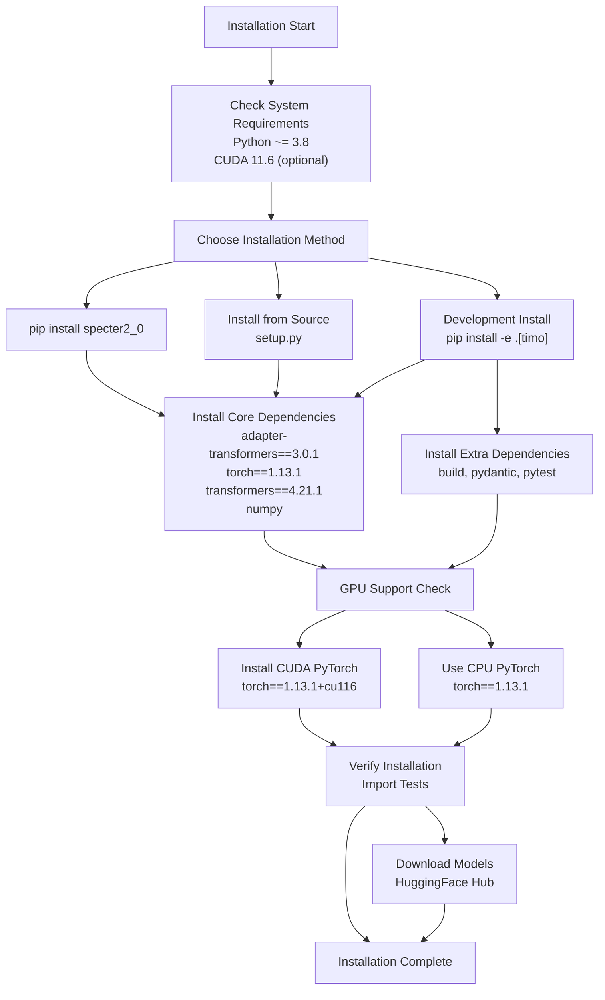

<!-- source: DeepWiki mcp.deepwiki.com · repo allenai/SPECTER2 · page 4 Installation · fetched 2026-10-26 -->

# Installation

<details>
<summary>Relevant source files</summary>

The following files were used as context for generating this wiki page:

- [requirements.txt](requirements.txt)
- [setup.py](setup.py)

</details>


This document provides comprehensive instructions for installing SPECTER2 and setting up the development environment. It covers package installation methods, system requirements, dependency management, and verification procedures for both research and production use cases.

For information about using the installed models, see [Model Usage](#2). For production API deployment configuration, see [Configuration](#3.3).

## Installation Overview

SPECTER2 can be installed through multiple pathways depending on your intended use case. The system consists of a core Python package with specific dependency requirements and optional components for different deployment scenarios.

### Installation Flow Diagram



Sources: [setup.py:1-28](), [requirements.txt:1-35]()

## System Requirements

SPECTER2 has specific system requirements that must be met before installation:

| Component | Requirement | Notes |
|-----------|-------------|-------|
| Python | ~= 3.8 | Exact version constraint from setup.py |
| Operating System | Linux, macOS, Windows | CUDA support varies by OS |
| Memory | 4GB+ RAM | For model loading and inference |
| Storage | 2GB+ free space | For models and dependencies |
| GPU (Optional) | CUDA 11.6 compatible | For accelerated inference |

### Python Version Compatibility

The package requires Python 3.8 as specified in [setup.py:26](). This constraint ensures compatibility with the specific versions of PyTorch and Transformers required by the system.

Sources: [setup.py:26]()

## Core Package Installation

### Standard Installation

Install the SPECTER2 package using pip:

```bash
pip install specter2_0
```

This installs the core package with all required dependencies as defined in [setup.py:5-9]():

- `adapter-transformers==3.0.1`
- `numpy`  
- `torch==1.13.1`
- `transformers==4.21.1`

### Development Installation

For development work or TIMO service deployment, install with extra dependencies:

```bash
pip install specter2_0[timo]
```

This includes additional packages for testing and service deployment:

- `build` - Package building utilities
- `pydantic` - Data validation for API models  
- `pytest` - Testing framework

Sources: [setup.py:19-25]()

## GPU Support Configuration

### CUDA Installation

For GPU acceleration, install the CUDA-enabled version of PyTorch. The system is tested with CUDA 11.6:

```bash
pip install torch==1.13.1+cu116 torchvision==0.14.1+cu116 torchaudio==0.13.1 -f https://download.pytorch.org/whl/cu116
```

### CPU-Only Installation  

For CPU-only usage, the standard PyTorch installation from PyPI is sufficient:

```bash
pip install torch==1.13.1
```

Sources: [requirements.txt:29]()

## Dependency Architecture

The following diagram illustrates the dependency structure and relationships:

```mermaid
graph TB
    subgraph "specter2_0_package" ["specter2_0 Package"]
        SETUP["setup.py<br/>Package Definition"]
        PKG_CORE["Core Package<br/>specter2_0"]
    end
    
    subgraph "core_deps" ["Core Dependencies"]  
        ADAPT_TRANS["adapter-transformers==3.0.1"]
        NUMPY["numpy"]
        TORCH["torch==1.13.1"] 
        TRANSFORMERS["transformers==4.21.1"]
    end
    
    subgraph "extra_deps" ["Extra Dependencies (timo)"]
        BUILD["build"]
        PYDANTIC["pydantic"] 
        PYTEST["pytest"]
    end
    
    subgraph "transitive_deps" ["Transitive Dependencies"]
        TOKENIZERS["tokenizers==0.12.1"]
        HF_HUB["huggingface-hub==0.12.1"]
        REQUESTS["requests==2.28.2"]
        YAML["PyYAML==6.0"]
        PILLOW["Pillow==9.4.0"]
    end
    
    subgraph "cuda_optional" ["CUDA Components (Optional)"]
        TORCH_CUDA["torch==1.13.1+cu116"]
        TORCHVISION["torchvision==0.14.1+cu116"] 
        TORCHAUDIO["torchaudio==0.13.1"]
    end
    
    SETUP --> PKG_CORE
    SETUP --> ADAPT_TRANS
    SETUP --> NUMPY
    SETUP --> TORCH
    SETUP --> TRANSFORMERS
    
    SETUP -.-> BUILD
    SETUP -.-> PYDANTIC
    SETUP -.-> PYTEST
    
    TRANSFORMERS --> TOKENIZERS
    TRANSFORMERS --> HF_HUB
    TRANSFORMERS --> REQUESTS
    
    ADAPT_TRANS --> HF_HUB
    
    HF_HUB --> REQUESTS
    HF_HUB --> YAML
    
    TORCH -.-> TORCH_CUDA
    TORCH_CUDA --> TORCHVISION
    TORCH_CUDA --> TORCHAUDIO
```

Sources: [setup.py:5-9](), [setup.py:19-25](), [requirements.txt:1-35]()

## Installation Methods

### Method 1: Package Manager Installation

The recommended approach for most users:

```bash
# Basic installation
pip install specter2_0

# With development tools  
pip install specter2_0[timo]
```

### Method 2: Source Installation

For development or customization needs:

```bash
# Clone repository (hypothetical)
git clone https://github.com/allenai/SPECTER2.git
cd SPECTER2

# Install in development mode
pip install -e .

# Install with extras
pip install -e .[timo]
```

### Method 3: Requirements File Installation

For reproducible environments using the full dependency specification:

```bash
pip install -r requirements.txt
```

This installs all dependencies with exact versions as specified in [requirements.txt:1-35]().

Sources: [setup.py:12-28](), [requirements.txt:1-35]()

## Installation Verification

### Basic Import Test

Verify the installation by importing core components:

```python
# Test core package import
import specter2_0

# Test dependency imports  
import torch
import transformers
from adapters import AutoAdapterModel

print("Installation successful!")
```

### Dependency Version Check

Verify that correct versions are installed:

```python
import torch
import transformers
import pkg_resources

# Check PyTorch version
print(f"PyTorch: {torch.__version__}")

# Check Transformers version  
print(f"Transformers: {transformers.__version__}")

# Check adapter-transformers version
adapters_version = pkg_resources.get_distribution("adapter-transformers").version
print(f"Adapter Transformers: {adapters_version}")
```

### GPU Availability Check

For CUDA installations, verify GPU availability:

```python
import torch

print(f"CUDA available: {torch.cuda.is_available()}")
if torch.cuda.is_available():
    print(f"CUDA version: {torch.version.cuda}")
    print(f"GPU device: {torch.cuda.get_device_name(0)}")
```

Sources: [setup.py:5-9](), [requirements.txt:29]()

## Troubleshooting

### Common Installation Issues

| Issue | Solution |
|-------|----------|
| Python version mismatch | Ensure Python ~= 3.8 is installed |
| CUDA version conflicts | Install specific CUDA 11.6 PyTorch build |
| Memory errors during install | Increase swap space or use `--no-cache-dir` |
| Network timeouts | Use `--timeout` flag or mirror repositories |

### Dependency Conflicts

If you encounter dependency conflicts:

1. Create a fresh virtual environment
2. Install exact versions from [requirements.txt:1-35]()
3. Use pip's dependency resolver: `pip install --use-feature=2020-resolver`

### CUDA Setup Issues

For GPU-related problems:

1. Verify CUDA 11.6 installation: `nvcc --version`
2. Check GPU compatibility: `nvidia-smi`
3. Install CUDA PyTorch build explicitly from the PyTorch index

Sources: [setup.py:26](), [requirements.txt:29]()

---

