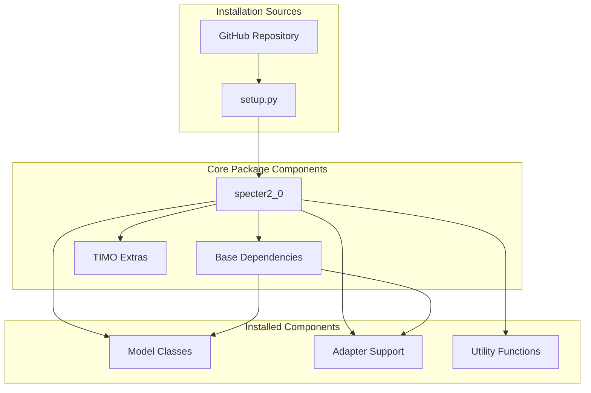
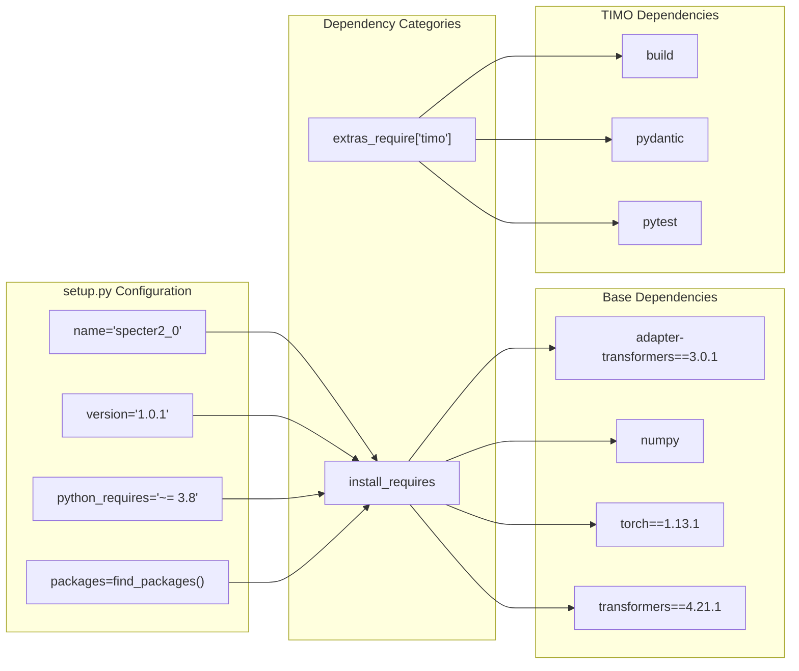

<!-- source: DeepWiki mcp.deepwiki.com · repo allenai/SPECTER2 · page 4.1 Package Installation · fetched 2026-10-26 -->

# Package Installation

<details>
<summary>Relevant source files</summary>

The following files were used as context for generating this wiki page:

- [setup.py](setup.py)

</details>


This document provides instructions for installing the `specter2_0` Python package, which contains the core SPECTER2 models and utilities for generating scientific document embeddings. This covers the basic package installation process and essential dependencies required to use SPECTER2 models locally.

For detailed information about system requirements and optional dependencies, see [Dependencies](#4.2). For usage examples after installation, see [Getting Started](#2.1).

## Installation Overview

The SPECTER2 system is distributed as a Python package named `specter2_0` that can be installed from source. The package provides access to the base transformer model and task-specific adapters for scientific document embedding tasks.



**Package Installation Flow**

Sources: [setup.py:1-28]()

## Installation Methods

### Standard Installation

Install the package directly from the source repository:

```bash
pip install git+https://github.com/allenai/SPECTER2.git
```

### Development Installation

For development work, clone the repository and install in editable mode:

```bash
git clone https://github.com/allenai/SPECTER2.git
cd SPECTER2
pip install -e .
```

### TIMO Production Installation

For production deployments requiring the TIMO service components, install with the `timo` extra:

```bash
pip install -e ".[timo]"
```

Sources: [setup.py:19-25]()

## Package Configuration

The package is configured through `setup.py` with the following key specifications:

| Configuration | Value | Purpose |
|---------------|-------|---------|
| Package Name | `specter2_0` | Python import name |
| Version | `1.0.1` | Package version identifier |
| Python Requirement | `~= 3.8` | Compatible Python versions |
| Description | "Embeddings for scientifiic papers" | Package description |



**Package Dependency Structure**

Sources: [setup.py:5-9](), [setup.py:12-27]()

## Core Dependencies

The package requires several critical dependencies for machine learning and text processing:

### Primary ML Dependencies

- **`torch==1.13.1`**: PyTorch deep learning framework for model execution
- **`transformers==4.21.1`**: Hugging Face transformers library for model loading
- **`adapter-transformers==3.0.1`**: Adapter framework for task-specific fine-tuning
- **`numpy`**: Numerical computing support

### Optional TIMO Dependencies

When installing with the `timo` extra, additional dependencies are included:

- **`build`**: Package building utilities
- **`pydantic`**: Data validation for API models  
- **`pytest`**: Testing framework for integration tests

Sources: [setup.py:5-9](), [setup.py:20-24]()

## Installation Verification

After installation, verify the package is correctly installed by importing core components:

```python
# Verify package installation
import specter2_0

# Test adapter-transformers integration
from transformers import AutoModel
from adapter_transformers import AutoAdapterModel

# Verify torch availability
import torch
print(f"PyTorch version: {torch.__version__}")
print(f"CUDA available: {torch.cuda.is_available()}")
```

### Expected Import Structure

The installed package should provide access to:

- Model loading utilities from `transformers` and `adapter-transformers`
- Tensor operations through `torch`
- Numerical processing via `numpy`
- TIMO service components (if installed with extras)

Sources: [setup.py:5-9](), [setup.py:17-18]()

## Common Installation Issues

### Python Version Compatibility

The package requires Python 3.8 or compatible versions. Ensure your Python version meets this requirement:

```bash
python --version  # Should show Python 3.8.x or compatible
```

### Dependency Conflicts

The package uses pinned versions for critical dependencies. If you encounter conflicts:

1. Create a fresh virtual environment
2. Install the package in isolation
3. Check for conflicting packages in your environment

### GPU Support

For CUDA GPU acceleration, ensure your system has:
- Compatible NVIDIA drivers
- CUDA 11.6 or compatible version
- Sufficient GPU memory for model loading

Sources: [setup.py:26](), [setup.py:7]()

---

