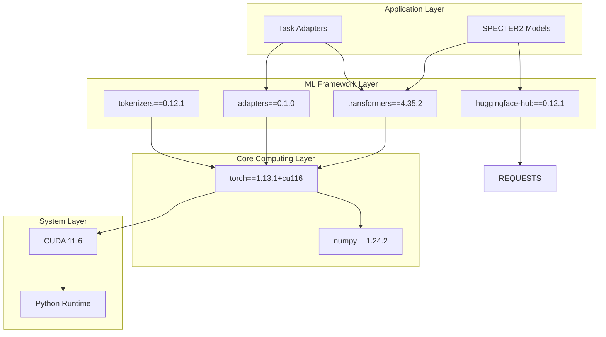
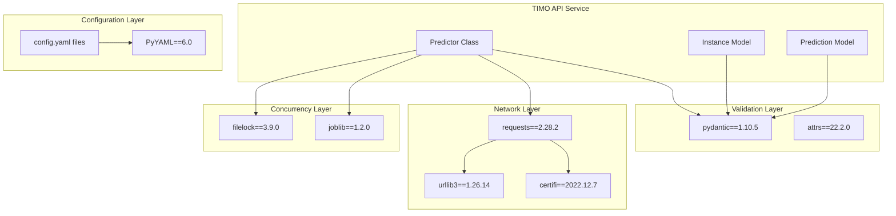

<!-- source: DeepWiki mcp.deepwiki.com · repo allenai/SPECTER2 · page 4.2 Dependencies · fetched 2026-10-26 -->

# Dependencies

Relevant source files

The following files were used as context for generating this wiki page:

- [requirements.txt](requirements.txt)

This document details the software dependencies required for SPECTER2 installation and operation. It covers the core ML framework requirements, data processing libraries, infrastructure dependencies, and development tools needed to run SPECTER2 models locally or in production environments. For package installation instructions, see [Package Installation](#4.1). For production deployment configuration, see [Configuration](#3.3).

## Core ML Framework Dependencies

SPECTER2 relies on several key machine learning libraries that form the foundation of its document embedding capabilities.

### PyTorch and CUDA Support

The system requires PyTorch with CUDA 11.6 support for GPU acceleration:

- `torch==1.13.1+cu116` - Deep learning framework with CUDA 11.6 support
- `torchvision==0.14.1+cu116` - Computer vision utilities (transitive dependency)  
- `torchaudio==0.13.1` - Audio processing utilities (transitive dependency)

The CUDA-enabled PyTorch installation is sourced from `https://download.pytorch.org/whl/cu116` to ensure compatibility with the specific CUDA version.

### HuggingFace Ecosystem

SPECTER2 integrates deeply with the HuggingFace ecosystem for model loading and inference:

- `transformers==4.35.2` - Core transformer model implementations and utilities
- `tokenizers==0.12.1` - Fast tokenization for text preprocessing
- `huggingface-hub==0.12.1` - Model repository integration and downloading

### Adapter Framework

Task-specific fine-tuning is handled through the adapter framework:

- `adapters==0.1.0` - Lightweight adapter modules for task specialization

Sources: [requirements.txt:1-34]()

## Data Processing Dependencies

Several libraries handle data manipulation, validation, and numerical computing:

### Core Data Processing
- `numpy==1.24.2` - Fundamental numerical computing operations
- `pydantic==1.10.5` - Data validation and serialization for API models
- `PyYAML==6.0` - YAML configuration file parsing

### Text Processing Utilities
- `regex==2022.10.31` - Advanced regular expression operations
- `sacremoses==0.0.53` - Tokenization and text normalization utilities

Sources: [requirements.txt:13,18,21,22,24]()

## Infrastructure Dependencies

These dependencies support HTTP communication, file operations, and system integration:

### Network and I/O
- `requests==2.28.2` - HTTP client for API communication
- `urllib3==1.26.14` - Low-level HTTP library (transitive dependency)
- `filelock==3.9.0` - File locking mechanisms for concurrent access
- `certifi==2022.12.7` - SSL certificate validation

### Utilities
- `tqdm==4.64.1` - Progress bar displays for long-running operations
- `click==8.1.3` - Command-line interface utilities
- `joblib==1.2.0` - Lightweight pipelining and caching

Sources: [requirements.txt:4,8,7,30,6,12,23,33]()

## Development Dependencies

Development and testing workflows require additional tooling:

### Testing Framework
- `pytest==7.2.1` - Test runner and framework
- `pluggy==1.0.0` - Plugin management for pytest
- `iniconfig==2.0.0` - Configuration file parsing
- `exceptiongroup==1.1.0` - Exception handling utilities

### Build System
- `build==0.10.0` - PEP 517 build backend
- `pyproject_hooks==1.0.0` - Build system hooks
- `tomli==2.0.1` - TOML file parsing for pyproject.toml

### Package Management
- `setuptools==65.6.3` - Package building and distribution
- `wheel==0.38.4` - Binary package format
- `pip==22.3.1` - Package installer

Sources: [requirements.txt:20,17,11,7,3,19,28,25,34,16]()

## Dependency Architecture

### ML Framework Stack

Sources: [requirements.txt:29,31,1,27,9]()

### Production Service Dependencies

Sources: [requirements.txt:18,2,21,23,33,4,8,12]()

## System Requirements

### Python Version
SPECTER2 requires Python 3.8 or higher, as indicated by the typing extensions and modern package versions used.

### GPU Requirements
The CUDA 11.6 requirement indicates that GPU acceleration is expected for optimal performance. CPU-only inference is possible but will be significantly slower for large-scale embedding generation.

### Memory Requirements
The transformer models and adapters require substantial memory:
- Base model: ~400MB
- Each adapter: ~50-100MB
- Runtime memory: 2-4GB GPU memory for inference

### Storage Requirements
- Model artifacts from HuggingFace Hub: ~1GB total
- Python environment: ~2-3GB including all dependencies

Sources: [requirements.txt:29,32]()

## Dependency Management

### Version Pinning Strategy
All dependencies use exact version pinning to ensure reproducible installations and avoid compatibility issues across different environments. This is critical for production deployments where model behavior must be consistent.

### CUDA Compatibility
The specific CUDA 11.6 requirement ensures compatibility with the pre-compiled PyTorch binaries and optimal GPU performance on supported hardware.

### HuggingFace Integration
The tight integration with HuggingFace Hub requires specific versions of `transformers`, `tokenizers`, and `huggingface-hub` to maintain compatibility with the published SPECTER2 models.

Sources: [requirements.txt:29,31,27,9]()

---

