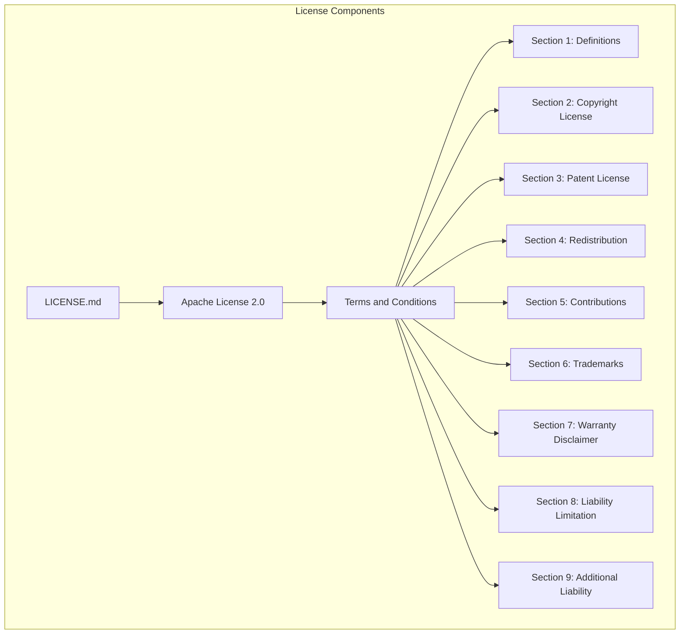
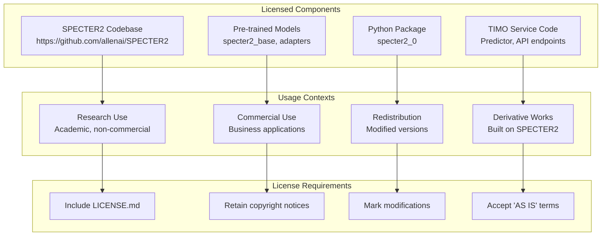

<!-- source: DeepWiki mcp.deepwiki.com · repo allenai/SPECTER2 · page 6 License · fetched 2026-10-26 -->

# License

Relevant source files

The following files were used as context for generating this wiki page:

- [LICENSE.md](LICENSE.md)

This document provides licensing information for the SPECTER2 software, including usage rights, redistribution terms, and compliance requirements for both research and commercial applications.

For information about installing SPECTER2, see [Installation](#4). For details about using SPECTER2 in production environments, see [Production API](#3).

## Overview

SPECTER2 is licensed under the Apache License, Version 2.0. The complete license text is located in [LICENSE.md:1-202](). This is a permissive open source license that allows broad usage rights while maintaining copyright attribution requirements.

**License Structure**

Sources: [LICENSE.md:1-202]()

## Key Permissions and Restrictions

The Apache License 2.0 grants the following permissions and includes these restrictions:

| Permission | Description |
|------------|-------------|
| **Use** | Freedom to use the software for any purpose |
| **Modify** | Right to modify and create derivative works |
| **Distribute** | Permission to distribute original and modified versions |
| **Sublicense** | Ability to sublicense under compatible terms |
| **Commercial Use** | Permitted for commercial applications |
| **Patent Grant** | Explicit patent license from contributors |

| Restriction | Requirement |
|-------------|-------------|
| **License Inclusion** | Must include copy of license with distributions |
| **Copyright Notice** | Must retain original copyright notices |
| **Modification Notice** | Must indicate changes made to original files |
| **Attribution** | Must preserve attribution notices from NOTICE file (if present) |

Sources: [LICENSE.md:66-71](), [LICENSE.md:73-87](), [LICENSE.md:89-128]()

## Usage Contexts

The Apache License 2.0 applies to all SPECTER2 components across different usage contexts:

**SPECTER2 License Application**

Sources: [LICENSE.md:1-202](), [LICENSE.md:89-128]()

## Compliance Requirements

### For Direct Usage

When using SPECTER2 models or code directly:

- No additional license compliance required beyond acknowledgment
- Models from HuggingFace Hub inherit the Apache 2.0 license
- API usage through production endpoints requires no special licensing actions

### For Redistribution

When redistributing SPECTER2 code or creating derivative works:

1. **Include License**: Must provide copy of [LICENSE.md:1-202]()
2. **Preserve Notices**: Retain copyright and attribution notices from [LICENSE.md:189-201]()
3. **Mark Changes**: Document modifications per [LICENSE.md:97-98]()
4. **Source Attribution**: Credit Allen Institute for AI as original author

### For Commercial Applications

Apache License 2.0 explicitly permits commercial use:

- No licensing fees or royalties required
- Can integrate into proprietary products
- Patent protection included per [LICENSE.md:73-87]()
- Must comply with redistribution requirements if sharing modified code

Sources: [LICENSE.md:89-128](), [LICENSE.md:130-136]()

## Warranty and Liability

The license includes important disclaimers:

### Warranty Disclaimer

SPECTER2 is provided "AS IS" without warranties of any kind as specified in [LICENSE.md:143-152](). This includes:

- No guarantee of fitness for particular purpose
- No warranty of merchantability
- No assurance of non-infringement
- Users assume all risks of usage

### Liability Limitation

Contributors have limited liability under [LICENSE.md:153-164]():

- No liability for damages arising from software use
- Covers direct, indirect, special, incidental, or consequential damages
- Applies even if contributors were advised of potential damages
- Users accept responsibility for determining appropriate usage

Sources: [LICENSE.md:143-152](), [LICENSE.md:153-164]()

## Full License Text

The complete Apache License, Version 2.0 text is available in [LICENSE.md:1-202](). Key sections include:

- **Definitions** [LICENSE.md:7-64](): Legal terminology and scope
- **Copyright Grant** [LICENSE.md:66-71](): Permissions for reproduction and distribution  
- **Patent Grant** [LICENSE.md:73-87](): Patent licensing terms and termination conditions
- **Redistribution Terms** [LICENSE.md:89-128](): Requirements for sharing modified versions
- **Contribution Guidelines** [LICENSE.md:130-136](): Terms for submitted contributions

For questions about licensing compliance or specific use cases, refer to the official Apache License documentation or consult with legal counsel.

Sources: [LICENSE.md:1-202]()