# Page: Overview

# Overview

<details>
<summary>Relevant source files</summary>

The following files were used as context for generating this wiki page:

- [README.md](README.md)

</details>


This document provides a high-level introduction to SPECTER2, explaining its purpose, architecture, and key capabilities for generating scientific document embeddings. For detailed usage instructions, see [Model Usage](#2). For production API documentation, see [Production API](#3). For installation instructions, see [Installation](#4).

## What is SPECTER2

SPECTER2 is a collection of document embedding models designed specifically for scientific tasks. It generates vector representations of scientific papers that can be used for various downstream applications including document retrieval, classification, regression, and similarity search.

The system builds upon the original SPECTER and SciRepEval frameworks, extending them with a modular adapter-based architecture that allows the same base model to be specialized for different task formats through task-specific adapters.

Sources: [README.md:18-21]()

## Core Architecture

SPECTER2 follows a two-tier architecture consisting of a base transformer model and task-specific adapters:

### System Architecture Overview

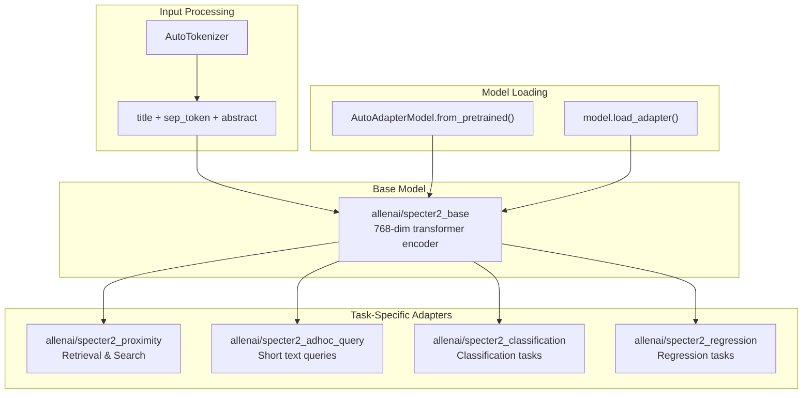

The base model (`allenai/specter2_base`) is a transformer encoder that processes scientific documents represented as concatenated title and abstract text. Task-specific adapters are loaded on top of the base model using the `AutoAdapterModel` class from the `adapters` library.

Sources: [README.md:56-77](), [README.md:43-50]()

### Model Distribution and Loading

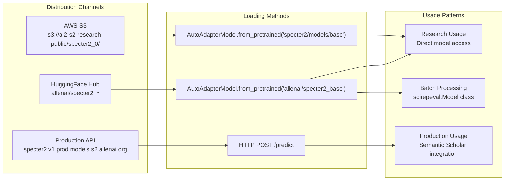

The models are distributed through three primary channels: HuggingFace Hub for research use, AWS S3 for offline access, and a production HTTP API for integration with Semantic Scholar systems.

Sources: [README.md:79-86](), [README.md:115-123]()

## Task-Specific Capabilities

SPECTER2 supports four distinct task formats through specialized adapters:

| Task Format | Adapter Model | Primary Use Case |
|-------------|---------------|------------------|
| Retrieval | `allenai/specter2_proximity` | Link prediction, nearest neighbor search, candidate paper encoding |
| Adhoc Query | `allenai/specter2_adhoc_query` | Encoding short raw text queries for search tasks |
| Classification | `allenai/specter2_classification` | Feature extraction for linear classifiers |
| Regression | `allenai/specter2_regression` | Feature extraction for linear regressors |

The system processes scientific documents by concatenating their title and abstract using `tokenizer.sep_token` as a separator, then truncating to a maximum length of 512 tokens. The final embedding is extracted from the first token (`[:, 0, :]`) of the model's `last_hidden_state` output.

Sources: [README.md:43-50](), [README.md:69-76]()

## Training Methodology

SPECTER2 employs a two-stage training process:

### Training Data and Process Overview

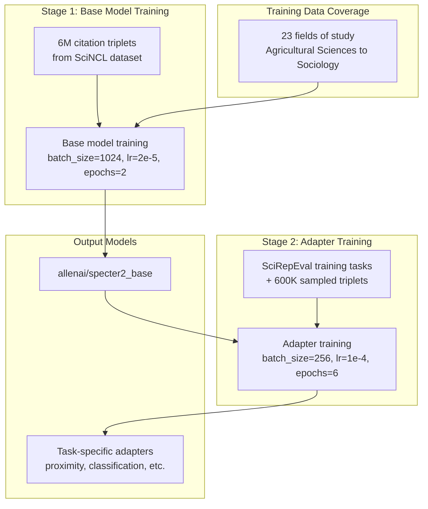

The training data consists of citation triplets spanning 23 fields of study, representing a 10x increase over the original SPECTER training data. The base model learns general scientific document representations, while adapters specialize these representations for specific task formats.

Sources: [README.md:125-162](), [README.md:35-37]()

## Performance Benchmarks

SPECTER2 achieves state-of-the-art performance on scientific document embedding benchmarks:

| Model | SciRepEval Avg | MDCR (MAP, Recall@5) |
|-------|---------------|---------------------|
| SPECTER | 67.5 | (30.6, 25.5) |
| SciNCL | 68.8 | (32.6, 27.3) |
| SPECTER2 Base | 69.1 | (38.0, 32.4) |
| **SPECTER2-Adapters** | **71.1** | **(38.4, 33.0)** |

The model demonstrates significant improvements over previous approaches on both the SciRepEval benchmark (a comprehensive evaluation suite for scientific document representations) and MDCR (a large-scale citation recommendation benchmark).

Sources: [README.md:165-178]()

## System Integration

SPECTER2 integrates with multiple systems and frameworks:

- **Research Environment**: Direct access via `transformers` and `adapters` libraries
- **Batch Processing**: Integration with SciRepEval's `Model` class for multi-task evaluation
- **Production Service**: TIMO-based HTTP API for Semantic Scholar integration
- **Model Hosting**: HuggingFace Hub and AWS S3 for model distribution

For installation requirements and setup procedures, see [Installation](#4). For production API details, see [Production API](#3).

Sources: [README.md:23-33](), [README.md:115-123]()

---

# Page: Model Usage

# Model Usage

<details>
<summary>Relevant source files</summary>

The following files were used as context for generating this wiki page:

- [README.md](README.md)

</details>


This document provides comprehensive guidance on using SPECTER2 models to generate scientific document embeddings. It covers the model architecture, loading methods, task-specific adapters, and practical implementation examples.

SPECTER2 is designed for generating embeddings from scientific papers represented as title-abstract pairs, with specialized adapters for different downstream tasks. For information about installing the system dependencies, see [Installation](#4). For details about the production API service, see [Production API](#3).

## Model Architecture Overview

SPECTER2 follows a modular architecture with a base transformer model and task-specific adapters trained for different embedding purposes.

### Base Model and Adapter System

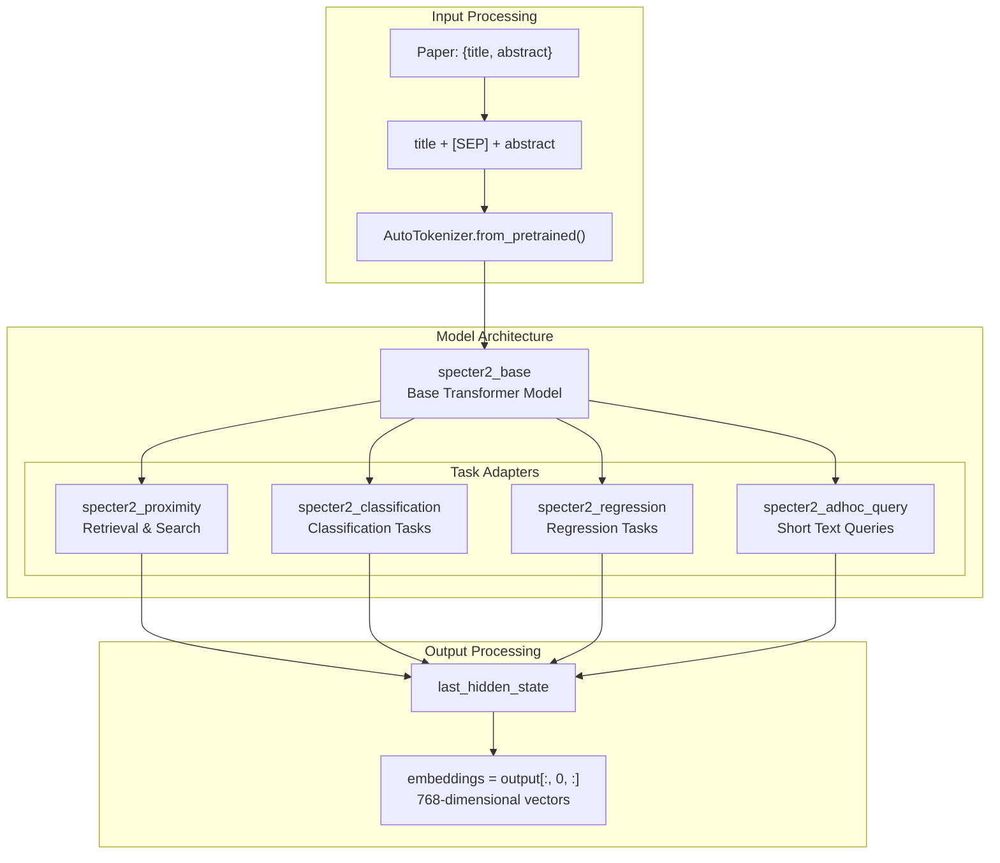

The system uses `AutoAdapterModel.from_pretrained()` to load the base model and `model.load_adapter()` to activate task-specific functionality.

**Sources:** [README.md:19-21](), [README.md:52-77]()

### Task-Specific Adapter Selection

| Task Type | Adapter Model | Use Case | Input Format |
|-----------|---------------|----------|--------------|
| Retrieval/Search | `allenai/specter2_proximity` | Link prediction, nearest neighbor search, candidate paper encoding | Title + Abstract |
| Classification | `allenai/specter2_classification` | Features for linear classifiers | Title + Abstract |
| Regression | `allenai/specter2_regression` | Features for linear regressors | Title + Abstract |
| Adhoc Query | `allenai/specter2_adhoc_query` | Short text query encoding for search | Raw text queries |

**Sources:** [README.md:43-50]()

## Loading Methods

SPECTER2 models can be loaded through two primary methods: HuggingFace Hub and AWS S3 direct download.

### HuggingFace Hub Loading

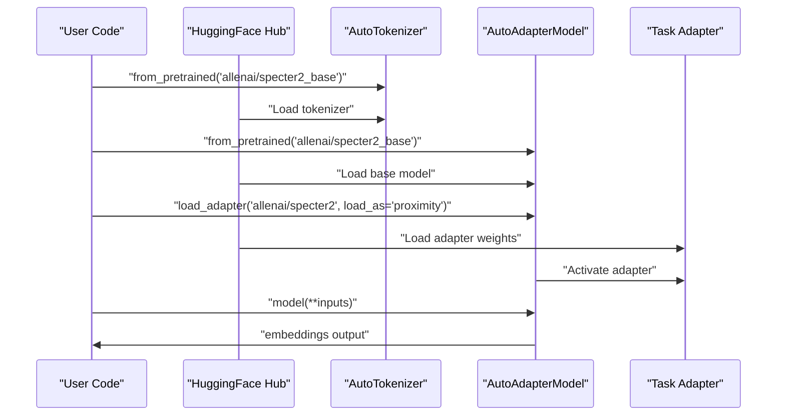

The HuggingFace approach uses the `transformers` library with `AutoTokenizer` and the `adapters` library with `AutoAdapterModel` for dynamic adapter loading.

**Sources:** [README.md:52-77]()

### AWS S3 Direct Loading

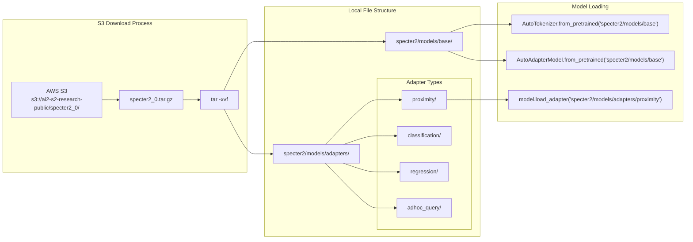

**Sources:** [README.md:79-113]()

## Input Processing and Tokenization

### Document Format Requirements

SPECTER2 expects scientific papers as dictionaries with `title` and `abstract` fields. The preprocessing concatenates these fields with the tokenizer's separator token.

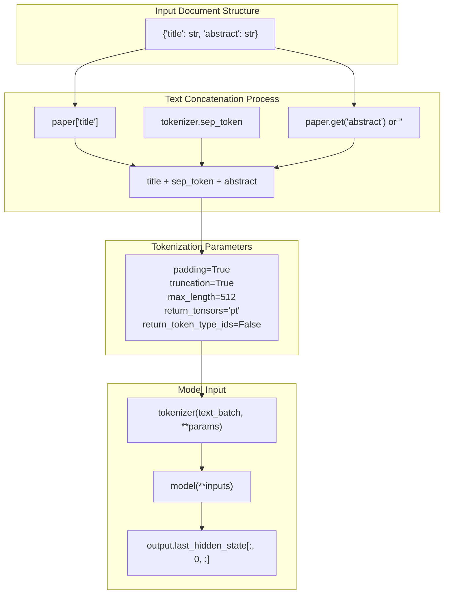

The system uses the first token (`[:, 0, :]`) of the last hidden state as the document embedding, producing 768-dimensional vectors.

**Sources:** [README.md:66-76](), [README.md:102-112]()

## Batch Processing for Multiple Tasks

For applications requiring multiple task-specific embeddings, SPECTER2 provides a batch processing interface through the SciRepEval Model class.

### Multi-Task Processing Architecture

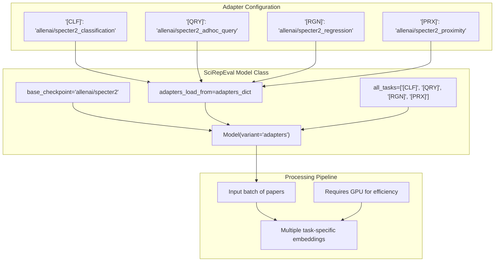

The batch processing approach enables simultaneous generation of embeddings optimized for different downstream tasks from the same input documents.

**Sources:** [README.md:115-123]()

## Implementation Examples

### Basic Single-Task Usage

The most common usage pattern loads a single adapter for a specific task:

```python
# From HuggingFace
tokenizer = AutoTokenizer.from_pretrained('allenai/specter2_base')
model = AutoAdapterModel.from_pretrained('allenai/specter2_base')
model.load_adapter("allenai/specter2", source="hf", load_as="proximity", set_active=True)
```

### Local File Loading

For environments with limited internet access or custom model versions:

```python
# From local S3 download
tokenizer = AutoTokenizer.from_pretrained('specter2/models/base')
model = AutoAdapterModel.from_pretrained('specter2/models/base')
model.load_adapter("specter2/models/adapters/proximity", load_as="proximity", set_active=True)
```

### Multi-Task Configuration

For applications requiring multiple embedding types:

```python
adapters_dict = {
    "[CLF]": "allenai/specter2_classification",
    "[QRY]": "allenai/specter2_adhoc_query", 
    "[RGN]": "allenai/specter2_regression",
    "[PRX]": "allenai/specter2_proximity"
}
model = Model(
    variant="adapters",
    base_checkpoint="allenai/specter2",
    adapters_load_from=adapters_dict,
    all_tasks=["[CLF]", "[QRY]", "[RGN]", "[PRX]"]
)
```

**Sources:** [README.md:52-77](), [README.md:88-113](), [README.md:118-122]()

## Output Format and Dimensionality

SPECTER2 generates 768-dimensional dense vector embeddings suitable for various downstream scientific tasks. The embeddings are extracted from `output.last_hidden_state[:, 0, :]` representing the `[CLS]` token encoding.

These embeddings can be directly used for:
- Similarity computation between papers
- Input features for classification/regression models  
- Retrieval and search applications
- Citation recommendation systems

**Sources:** [README.md:75-76](), [README.md:111-112]()

---

# Page: Getting Started

# Getting Started

<details>
<summary>Relevant source files</summary>

The following files were used as context for generating this wiki page:

- [README.md](README.md)

</details>


This document provides basic usage examples for generating scientific document embeddings using SPECTER2 models. It covers the fundamental workflow of loading the base model, selecting task-specific adapters, and processing scientific papers to generate embeddings. For comprehensive model architecture details, see [Architecture Details](#2.2). For production API usage, see [Production API](#3).

## Overview

SPECTER2 uses a modular architecture consisting of a base transformer model (`allenai/specter2_base`) combined with task-specific adapters that specialize the embeddings for different downstream applications. This getting started guide demonstrates the core usage patterns for loading models and generating embeddings.

## Core Architecture

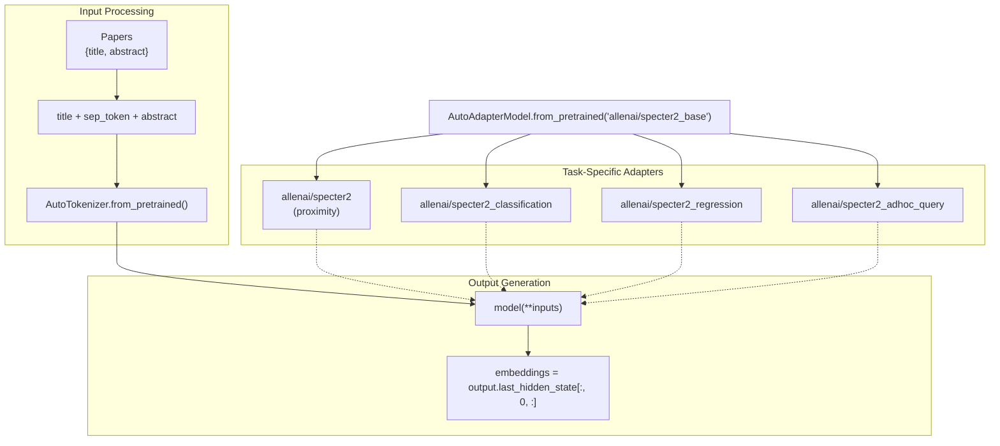

**Sources:** [README.md:52-77](), [README.md:88-113]()

## Adapter Selection Guide

Different adapters are optimized for specific task formats:

| Adapter | HuggingFace Model | Use Case |
|---------|------------------|----------|
| Proximity (Retrieval) | `allenai/specter2` | Link prediction, nearest neighbor search, paper-to-paper similarity |
| Adhoc Query | `allenai/specter2_adhoc_query` | Short text queries for search tasks |
| Classification | `allenai/specter2_classification` | Features for linear classifiers |
| Regression | `allenai/specter2_regression` | Features for linear regressors |

**Sources:** [README.md:43-50]()

## Basic Usage Workflow

### HuggingFace Hub Method

The following workflow demonstrates loading models from HuggingFace Hub and generating embeddings:

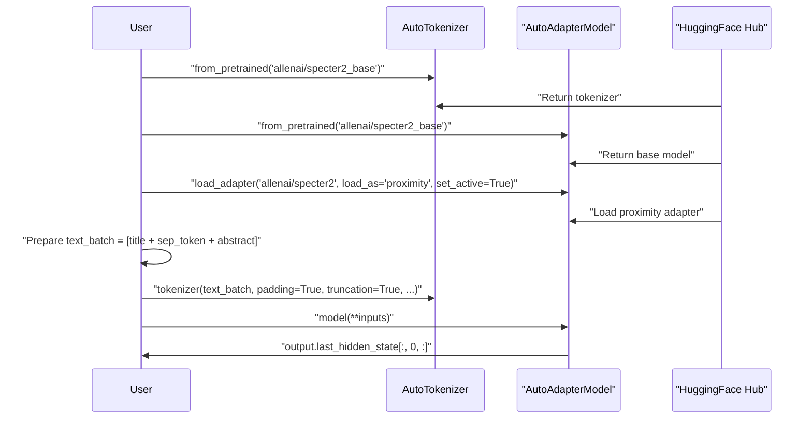

**Sources:** [README.md:52-77]()

The code implementation follows this pattern from the README:

```python
# Key components from README.md:56-64
tokenizer = AutoTokenizer.from_pretrained('allenai/specter2_base')
model = AutoAdapterModel.from_pretrained('allenai/specter2_base')
model.load_adapter("allenai/specter2", source="hf", load_as="proximity", set_active=True)

# Text preprocessing from README.md:69-70  
text_batch = [d['title'] + tokenizer.sep_token + (d.get('abstract') or '') for d in papers]

# Inference from README.md:71-76
inputs = tokenizer(text_batch, padding=True, truncation=True, 
                   return_tensors="pt", return_token_type_ids=False, max_length=512)
output = model(**inputs)
embeddings = output.last_hidden_state[:, 0, :]
```

**Sources:** [README.md:52-77]()

### AWS S3 Method

For offline usage, models can be downloaded from S3 and loaded locally:

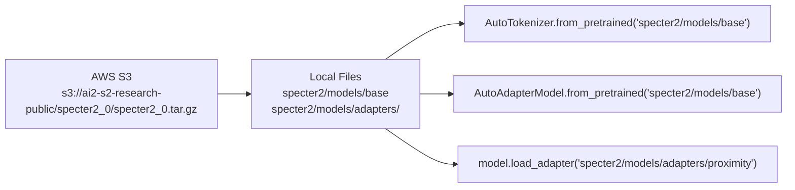

**Sources:** [README.md:79-113]()

The S3 workflow uses local paths instead of HuggingFace model names:

```bash
# Download commands from README.md:80-85
aws s3 --no-sign-request cp s3://ai2-s2-research-public/specter2_0/specter2_0.tar.gz .
tar -xvf specter2_0.tar.gz
```

```python  
# Local loading from README.md:92-99
tokenizer = AutoTokenizer.from_pretrained('specter2/models/base')
model = AutoAdapterModel.from_pretrained('specter2/models/base')  
model.load_adapter("specter2/models/adapters/proximity", load_as="proximity", set_active=True)
```

**Sources:** [README.md:88-113]()

## Input Data Format

SPECTER2 expects scientific papers in a specific dictionary format:

| Field | Type | Required | Description |
|-------|------|----------|-------------|
| `title` | str | Yes | Paper title |
| `abstract` | str | Optional | Paper abstract (empty string if missing) |

The text preprocessing concatenates title and abstract using `tokenizer.sep_token`:

```python
# From README.md:69-70
papers = [
    {'title': 'BERT', 'abstract': 'We introduce a new language representation model called BERT'},
    {'title': 'Attention is all you need', 'abstract': 'The dominant sequence transduction models...'}
]
text_batch = [d['title'] + tokenizer.sep_token + (d.get('abstract') or '') for d in papers]
```

**Sources:** [README.md:66-70](), [README.md:102-106]()

## Batch Processing

For GPU-based batch processing across multiple task types, SPECTER2 integrates with the SciRepEval framework using the `Model` class:

```python
# From README.md:120-122
adapters_dict = {
    "[CLF]": "allenai/specter2_classification", 
    "[QRY]": "allenai/specter2_adhoc_query", 
    "[RGN]": "allenai/specter2_regression", 
    "[PRX]": "allenai/specter2_proximity"
}
model = Model(variant="adapters", base_checkpoint="allenai/specter2", 
              adapters_load_from=adapters_dict, all_tasks=["[CLF]", "[QRY]", "[RGN]", "[PRX]"])
```

For detailed batch processing instructions, refer to the [SciRepEval INFERENCE.md](https://github.com/allenai/scirepeval/blob/main/evaluation/INFERENCE.md) documentation.

**Sources:** [README.md:115-123]()

## Next Steps

- For detailed model architecture information, see [Architecture Details](#2.2)
- For training methodology and performance benchmarks, see [Training Methodology](#2.3)  
- For production API usage, see [Production API](#3)
- For installation requirements, see [Installation](#4)

---

# Page: Architecture Details

# Architecture Details

<details>
<summary>Relevant source files</summary>

The following files were used as context for generating this wiki page:

- [README.md](README.md)

</details>


This document provides a technical deep dive into the SPECTER2 architecture, covering the base transformer model and adapter system design. It explains the modular architecture that enables task-specific specialization through adapters, the input processing pipeline, and the embedding generation mechanism.

For basic usage examples and getting started, see [Getting Started](#2.1). For information about the training process and datasets, see [Training Methodology](#2.3).

## Base Model Architecture

SPECTER2 is built on a transformer architecture with a specialized base model (`allenai/specter2_base`) that serves as the foundation for all task-specific adapters. The base model is a BERT-like encoder that processes scientific document text and generates contextualized representations.

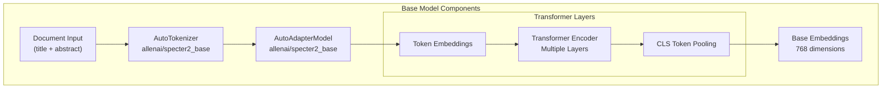

The base model processes input through the following stages:

| Stage | Component | Function |
|-------|-----------|----------|
| Tokenization | `AutoTokenizer` | Converts text to token IDs with special tokens |
| Embedding | Token embeddings | Maps tokens to dense vectors |
| Encoding | Transformer layers | Contextual representation learning |
| Pooling | CLS token | Extracts document-level representation |

**Sources**: [README.md:57-60](), [README.md:93-96]()

## Adapter System Architecture

The adapter system enables task-specific specialization without retraining the entire base model. Each adapter modifies the base model's behavior for specific task formats through lightweight parameter additions.

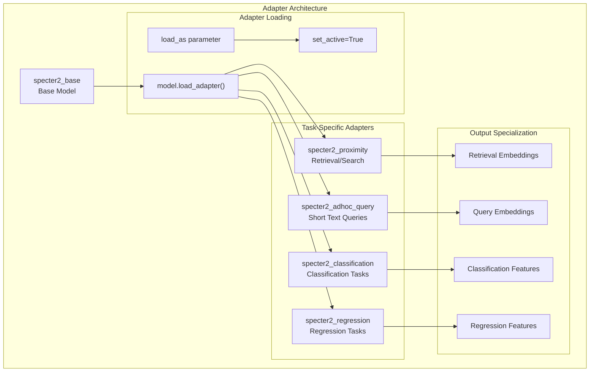

### Adapter Specializations

| Adapter | HuggingFace ID | Use Case | Optimization |
|---------|----------------|----------|-------------|
| Proximity | `allenai/specter2` | Document retrieval, link prediction | Similarity-based ranking |
| Adhoc Query | `allenai/specter2_adhoc_query` | Short text search queries | Query-document matching |
| Classification | `allenai/specter2_classification` | Linear classifier features | Discriminative representations |
| Regression | `allenai/specter2_regression` | Linear regressor features | Continuous value prediction |

**Sources**: [README.md:43-48](), [README.md:62-64](), [README.md:98-100]()

## Input Processing Pipeline

The input processing pipeline standardizes document representation by concatenating title and abstract with special tokens, followed by tokenization and truncation.

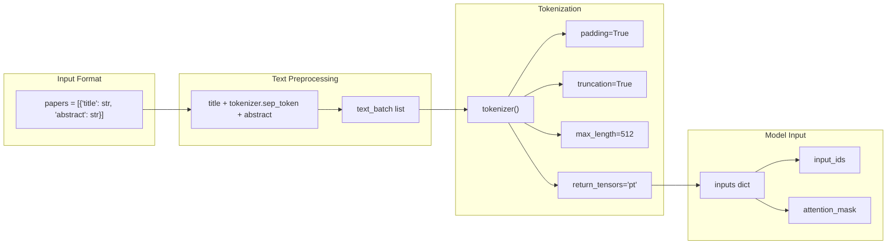

### Processing Parameters

| Parameter | Value | Purpose |
|-----------|-------|---------|
| `max_length` | 512 | Maximum sequence length |
| `padding` | True | Batch-level padding |
| `truncation` | True | Handle long documents |
| `return_tensors` | "pt" | PyTorch tensor format |
| `return_token_type_ids` | False | Disable segment embeddings |

**Sources**: [README.md:69-73](), [README.md:105-109]()

## Output Generation

The model generates document embeddings by extracting the representation of the first token (CLS token) from the final hidden layer.

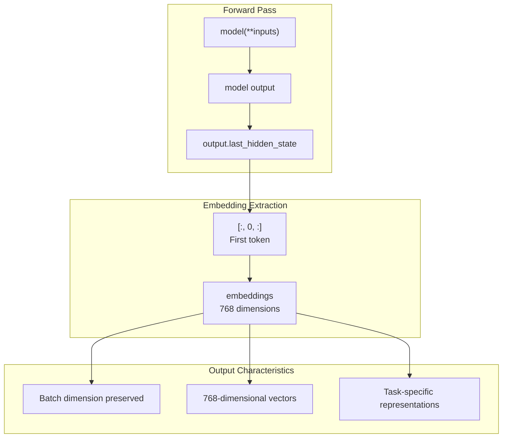

The embedding extraction process:
1. Forward pass through `model(**inputs)` returns output object
2. Access `output.last_hidden_state` for final layer representations
3. Extract first token embeddings with `[:, 0, :]` indexing
4. Result is batch of 768-dimensional task-specific embeddings

**Sources**: [README.md:74-76](), [README.md:110-112]()

## Model Loading and Activation Process

The system uses a two-step process for model initialization: loading the base model and then activating specific adapters.

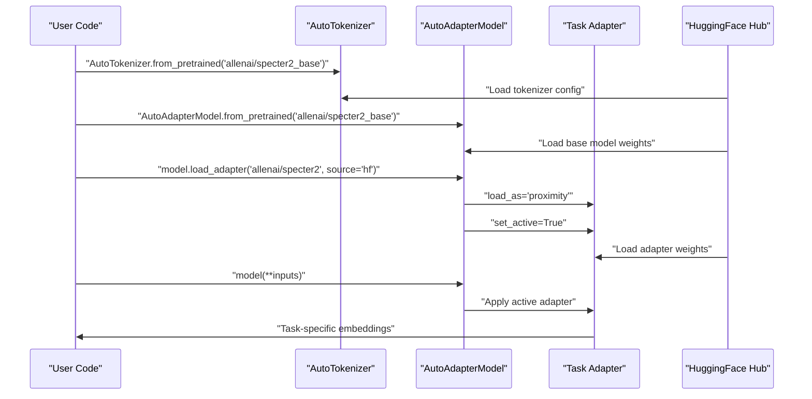

### Loading Methods

| Method | Parameters | Function |
|--------|------------|----------|
| `AutoTokenizer.from_pretrained()` | model_path | Load tokenizer configuration |
| `AutoAdapterModel.from_pretrained()` | model_path | Load base transformer model |
| `model.load_adapter()` | source, load_as, set_active | Load and activate task adapter |

### Adapter Activation

The adapter system requires explicit activation through the `set_active=True` parameter. Only one adapter can be active at a time, determining the task-specific behavior of the model.

**Sources**: [README.md:57-64](), [README.md:93-100](), [README.md:119-122]()

---

# Page: Training Methodology

# Training Methodology

<details>
<summary>Relevant source files</summary>

The following files were used as context for generating this wiki page:

- [README.md](README.md)

</details>


## Purpose and Scope

This document provides a detailed explanation of SPECTER2's two-stage training methodology, including the datasets used, training configurations, and performance benchmarks. It covers the complete training pipeline from base model pre-training through task-specific adapter fine-tuning.

For information about the model architecture and adapters, see [Architecture Details](#2.2). For basic usage examples of the trained models, see [Getting Started](#2.1).

## Training Overview

SPECTER2 follows a two-stage training approach that builds upon the original SPECTER methodology while introducing task-specific adaptation capabilities.

### Two-Stage Training Pipeline

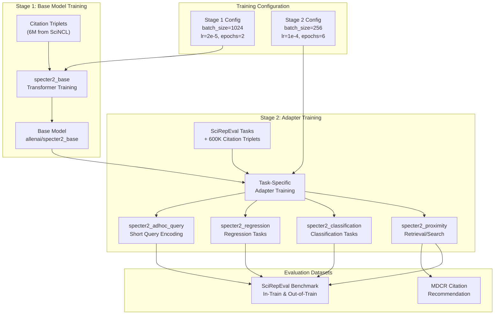

**Sources:** [README.md:158-162]()

## Stage 1: Base Model Training

The first stage trains a transformer base model using citation relationships to learn general scientific document representations.

### Training Data

The base model is trained on 6 million citation triplets extracted from the SciNCL dataset, representing a 10x increase over the original SPECTER training data. These triplets span 23 distinct fields of study, providing broad coverage across scientific domains.

| Field of Study | Field of Study | Field of Study |
|---|---|---|
| Agricultural And Food Sciences | Art | Biology |
| Business | Chemistry | Computer Science |
| Economics | Education | Engineering |
| Environmental Science | Geography | Geology |
| History | Law | Linguistics |
| Materials Science | Mathematics | Medicine |
| Philosophy | Physics | Political Science |
| Psychology | Sociology | - |

### Training Configuration

The base model training uses the following hyperparameters:

| Parameter | Value |
|---|---|
| Batch Size | 1024 |
| Max Input Length | 512 tokens |
| Learning Rate | 2e-5 |
| Epochs | 2 |
| Model Output | `allenai/specter2_base` |

**Sources:** [README.md:36-37](), [README.md:128-129](), [README.md:159-160](), [README.md:130-157]()

## Stage 2: Adapter Training

The second stage trains task-specific adapters on top of the frozen base model to enable specialized embeddings for different scientific tasks.

### Task-Specific Adapter Architecture

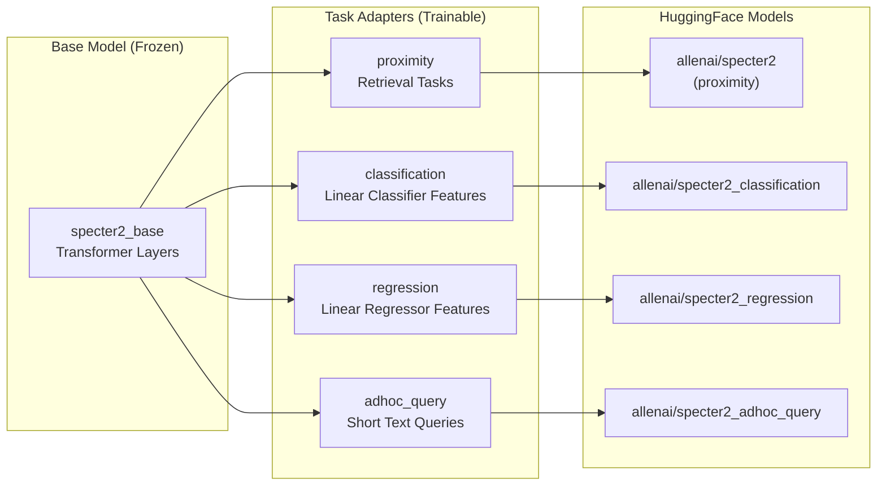

### Training Data Sources

Adapter training combines:
- **SciRepEval Training Tasks**: Task-specific training data for each adapter type
- **Citation Triplets**: 600K additional triplets sampled from the Stage 1 dataset to maintain citation-based representation quality

### Training Configuration

| Parameter | Value |
|---|---|
| Batch Size | 256 |
| Max Input Length | 512 tokens |
| Learning Rate | 1e-4 |
| Epochs | 6 |
| Base Model | Frozen `specter2_base` |

**Sources:** [README.md:161-162]()

## Training Implementation

The training process is implemented using the SciRepEval framework, with specific model instantiation for batch processing:

```python
# Model setup for training/evaluation
adapters_dict = {
    "[CLF]": "allenai/specter2_classification", 
    "[QRY]": "allenai/specter2_adhoc_query", 
    "[RGN]": "allenai/specter2_regression", 
    "[PRX]": "allenai/specter2_proximity"
}
model = Model(
    variant="adapters", 
    base_checkpoint="allenai/specter2", 
    adapters_load_from=adapters_dict, 
    all_tasks=["[CLF]", "[QRY]", "[RGN]", "[PRX]"]
)
```

**Sources:** [README.md:120-122](), [README.md:32](), [README.md:158]()

## Performance Evaluation

SPECTER2 is evaluated on two primary benchmarks to assess its effectiveness across different scientific tasks.

### SciRepEval Benchmark Results

| Model | SciRepEval In-Train | SciRepEval Out-of-Train | SciRepEval Avg |
|---|---|---|---|
| BM-25 | n/a | n/a | n/a |
| SPECTER | 54.7 | 72.0 | 67.5 |
| SciNCL | 55.6 | 73.4 | 68.8 |
| SciRepEval-Adapters | 61.9 | 73.8 | 70.7 |
| SPECTER2 Base | 56.3 | 73.6 | 69.1 |
| **SPECTER2-Adapters** | **62.3** | **74.1** | **71.1** |

### MDCR Citation Recommendation Results

| Model | MAP | Recall@5 |
|---|---|---|
| BM-25 | 33.7 | 28.5 |
| SPECTER | 30.6 | 25.5 |
| SciNCL | 32.6 | 27.3 |
| SciRepEval-Adapters | 35.3 | 29.6 |
| SPECTER2 Base | 38.0 | 32.4 |
| **SPECTER2-Adapters** | **38.4** | **33.0** |

### Key Performance Insights

1. **Task-Specific Adaptation**: The adapter-based approach (SPECTER2-Adapters) consistently outperforms the base model across all metrics
2. **State-of-the-Art Results**: SPECTER2 establishes new SoTA performance on both SciRepEval and MDCR benchmarks
3. **Generalization**: Strong performance on both in-train and out-of-train evaluation sets demonstrates robust generalization

**Sources:** [README.md:165-177]()

## Training Data Access

The complete training and validation datasets are integrated into the SciRepEval benchmark and publicly available:

- **Citation Triplets**: Available via [SciRepEval dataset viewer](https://huggingface.co/datasets/allenai/scirepeval/viewer/cite_prediction_new/evaluation)
- **Source Data**: Derived from SciNCL dataset as documented in the training methodology

**Sources:** [README.md:127-129]()

---

# Page: Production API

# Production API

<details>
<summary>Relevant source files</summary>

The following files were used as context for generating this wiki page:

- [specter2_0/timo/README.md](specter2_0/timo/README.md)

</details>


This document covers the production HTTP API service that provides access to SPECTER2 embeddings through the TIMO (The Infrastructure for ML Operations) platform. This service is designed for internal use by the Semantic Scholar product and external applications requiring real-time embedding generation.

For information about using SPECTER2 models directly in research or development environments, see [Model Usage](#2). For installation and setup instructions, see [Installation](#4).

## Service Architecture

The production API is built on the TIMO platform, which provides a standardized way to serve machine learning models at scale. The service exposes SPECTER2's embedding capabilities through a REST API endpoint.

### TIMO Service Components

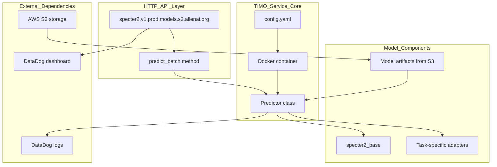

Sources: [specter2_0/timo/README.md:1-52]()

## API Interface

The service exposes SPECTER2 functionality through a REST API that accepts document metadata and returns embedding vectors. The interface is defined using specific data models that correspond to the different task types supported by SPECTER2.

### Data Models

The API uses three primary data structures for communication:

| Model | Purpose | Fields |
|-------|---------|--------|
| `TaskType` | Enum defining supported embedding types | `DEFAULT`, `CLASSIFICATION`, `REGRESSION`, `PROXIMITY`, `ADHOC_QUERY` |
| `Instance` | Input document specification | `title: str`, `abstract: Union[str\|Optional]`, `task_type: TaskType` |
| `Prediction` | Output embedding result | `embedding: List[float]` |

The `TaskType` enum corresponds to the different SPECTER2 adapter models:
- `DEFAULT`: Uses base model without task-specific adaptation
- `CLASSIFICATION`: Optimized for document classification tasks
- `REGRESSION`: Optimized for regression tasks  
- `PROXIMITY`: Optimized for similarity and retrieval tasks
- `ADHOC_QUERY`: Optimized for short query text processing

Sources: [specter2_0/timo/README.md:26-44]()

### Request/Response Flow

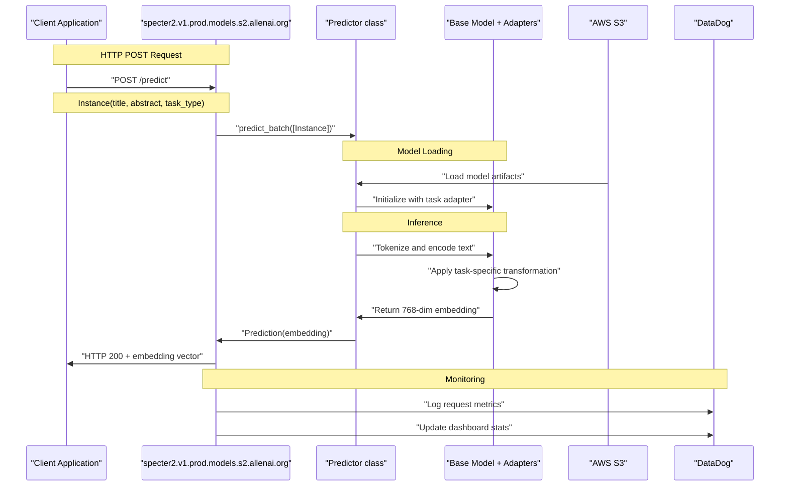

Sources: [specter2_0/timo/README.md:26-44]()

## Configuration and Deployment

The production service is configured and deployed using TIMO's standard tooling and configuration management system.

### TIMO Configuration

The service configuration is managed through a `config.yaml` file that defines deployment parameters, model artifacts, and service settings. This configuration integrates with TIMO's deployment pipeline.

### Verification and Publishing

The service uses TIMO's verification and publishing workflow:

```bash
# Verify configuration and model integrity
tt verify -c specter2_0/timo/config.yaml

# Publish to production environment  
tt publish -c specter2_0/timo/config.yaml
```

The verification step ensures that model artifacts are accessible, configuration is valid, and the service can initialize properly. The publishing step deploys the verified configuration to the production environment.

Sources: [specter2_0/timo/README.md:7-18]()

## Monitoring and Operations

The production API includes comprehensive monitoring and observability features through DataDog integration, providing visibility into service health, performance metrics, and usage patterns.

### Logging and Metrics

The service automatically logs all requests and responses, including:
- Request processing times
- Model inference latencies  
- Error rates and exception details
- Resource utilization metrics

### Monitoring Dashboards

Two primary monitoring interfaces are available:

| Interface | Purpose | Access |
|-----------|---------|--------|
| DataDog Logs | Real-time log streaming and search | Service-specific log filtering |
| DataDog Dashboard | Performance metrics and alerts | Service health overview |

The monitoring system tracks key performance indicators including request throughput, response latencies, error rates, and resource consumption to ensure reliable service operation.

Sources: [specter2_0/timo/README.md:49-51]()

### Service Endpoint

The production API is accessible at:
```
http://specter2.v1.prod.models.s2.allenai.org/
```

This endpoint serves as the primary interface for generating SPECTER2 embeddings in production environments, particularly for integration with the Semantic Scholar product and other internal applications.

Sources: [specter2_0/timo/README.md:20-23]()

---

# Page: Service Overview

# Service Overview

<details>
<summary>Relevant source files</summary>

The following files were used as context for generating this wiki page:

- [specter2_0/timo/README.md](specter2_0/timo/README.md)

</details>


This page documents the TIMO production service that provides HTTP API access to SPECTER2 models for generating scientific document embeddings. The service is designed for internal use by the Semantic Scholar product and external applications requiring programmatic access to SPECTER2 capabilities.

For information about direct model usage and loading, see [Model Usage](#2). For detailed API specifications and data models, see [API Reference](#3.2).

## Purpose and Architecture

The TIMO service serves as a production-ready HTTP wrapper around SPECTER2 models, providing a RESTful interface for generating embeddings from scientific documents. The service is deployed within Allen Institute infrastructure and integrated with Semantic Scholar's production systems.

```mermaid
graph TB
    subgraph "External Access"
        S2["Semantic Scholar Product"]
        EXT["External Applications"]
    end
    
    subgraph "TIMO Service Layer"
        API["specter2.v1.prod.models.s2.allenai.org"]
        PREDICTOR["Predictor Class"]
    end
    
    subgraph "Model Layer"
        BASE["specter2_base Model"]
        ADAPTERS["Task-Specific Adapters"]
    end
    
    subgraph "Infrastructure"
        CONTAINER["Docker Container"]
        TIMO_CONFIG["config.yaml"]
        S3_ARTIFACTS["AWS S3 Model Artifacts"]
    end
    
    subgraph "Monitoring"
        DATADOG_LOGS["DataDog Logs"]
        DATADOG_DASH["DataDog Dashboard"]
    end
    
    S2 --> API
    EXT --> API
    API --> PREDICTOR
    PREDICTOR --> BASE
    BASE --> ADAPTERS
    
    TIMO_CONFIG --> CONTAINER
    CONTAINER --> PREDICTOR
    S3_ARTIFACTS --> PREDICTOR
    
    API --> DATADOG_LOGS
    API --> DATADOG_DASH
```

**Service Architecture Overview**

Sources: [specter2_0/timo/README.md:1-52]()

## Service Endpoint

The production service is accessible at:
- **Base URL**: `http://specter2.v1.prod.models.s2.allenai.org/`
- **Protocol**: HTTP REST API
- **Authentication**: Internal Allen Institute access

The service provides embedding generation capabilities through a standardized prediction interface that accepts document metadata and returns high-dimensional embeddings.

Sources: [specter2_0/timo/README.md:20-24]()

## Data Models

The service defines three core data structures for API interaction:

```mermaid
classDiagram
    class TaskType {
        <<enumeration>>
        +DEFAULT: "default"
        +CLASSIFICATION: "classification" 
        +REGRESSION: "regression"
        +PROXIMITY: "proximity"
        +ADHOC_QUERY: "adhoc_query"
    }
    
    class Instance {
        +title: str
        +abstract: Union[str, Optional]
        +task_type: TaskType
    }
    
    class Prediction {
        +embedding: List[float]
    }
    
    Instance --> TaskType: uses
    Instance --> Prediction: produces
```

**Core API Data Models**

### TaskType Enumeration
The `TaskType` enum defines the available model variants:
- `DEFAULT`: Base model without task-specific adaptation
- `CLASSIFICATION`: Optimized for document classification tasks
- `REGRESSION`: Optimized for regression-based tasks  
- `PROXIMITY`: Optimized for document similarity and retrieval
- `ADHOC_QUERY`: Optimized for short query text processing

### Instance Class
Input data structure containing:
- `title`: Document title (required string)
- `abstract`: Document abstract (optional string)
- `task_type`: Specifies which model variant to use

### Prediction Class  
Output data structure containing:
- `embedding`: 768-dimensional vector representation as list of floats

Sources: [specter2_0/timo/README.md:25-44]()

## Deployment and Configuration

The service is deployed using TIMO (Allen Institute's model serving platform) with containerized deployment:

| Component | Purpose | Location |
|-----------|---------|----------|
| `config.yaml` | TIMO service configuration | `specter2_0/timo/config.yaml` |
| Docker Container | Containerized model serving | Built from repository |
| Model Artifacts | Pre-trained model weights | AWS S3 storage |

### TIMO Operations

Key operational commands:
- **Verification**: `tt verify -c specter2_0/timo/config.yaml`
- **Publishing**: `tt publish -c specter2_0/timo/config.yaml`

The deployment follows TIMO's standard model serving patterns with automated containerization and artifact management.

Sources: [specter2_0/timo/README.md:7-18]()

## Monitoring and Observability

The service includes comprehensive monitoring through DataDog integration:

```mermaid
graph LR
    SERVICE["specter2-v1 Service"] --> LOGS["DataDog Logs Stream"]
    SERVICE --> METRICS["DataDog Dashboard"]
    
    LOGS --> LOG_QUERY["service:specter2-v1 Query"]
    METRICS --> DASH_VIEW["timo-services Dashboard"]
    
    subgraph "Monitoring Capabilities"
        LOG_QUERY --> REQUEST_LOGS["Request/Response Logs"]
        LOG_QUERY --> ERROR_LOGS["Error Tracking"]
        DASH_VIEW --> PERF_METRICS["Performance Metrics"]
        DASH_VIEW --> HEALTH_STATUS["Service Health Status"]
    end
```

**Service Monitoring Architecture**

### DataDog Integration
- **Service Logs**: Real-time log streaming with `service:specter2-v1` tag
- **Performance Dashboard**: Comprehensive service metrics and health monitoring
- **Alert Configuration**: Automated alerting for service issues

The monitoring setup enables operational visibility into request patterns, performance characteristics, and system health for production deployments.

Sources: [specter2_0/timo/README.md:47-52]()

## Internal Usage Context

This TIMO service is specifically designed for internal Allen Institute use cases and can be safely ignored by external consumers working directly with SPECTER2 models. External users should refer to [Getting Started](#2.1) for direct model usage patterns.

The service primarily supports:
- Semantic Scholar product integration
- Internal research and development workflows  
- Production embedding generation at scale

Sources: [specter2_0/timo/README.md:1-5]()

---

# Page: API Reference

# API Reference

<details>
<summary>Relevant source files</summary>

The following files were used as context for generating this wiki page:

- [specter2_0/timo/interface.py](specter2_0/timo/interface.py)

</details>


This page provides detailed technical documentation for the TIMO production service API interface, including data models, method signatures, and interaction patterns. The API is implemented through the `Predictor` class and associated data models that handle SPECTER2 embedding generation requests.

For general service information and endpoint details, see [Service Overview](#3.1). For deployment configuration and monitoring setup, see [Configuration](#3.3).

## Data Models

The API defines several core data models using Pydantic for request/response handling and configuration management.

### TaskType Enum

The `TaskType` enum defines the available task-specific adapters:

| Value | Description |
|-------|-------------|
| `DEFAULT` | Base model without task-specific adaptation |
| `CLASSIFICATION` | Classification task adapter |
| `REGRESSION` | Regression task adapter |
| `PROXIMITY` | Proximity/retrieval task adapter |
| `ADHOC_QUERY` | Ad-hoc query task adapter |

### Instance Model

The `Instance` class represents a single inference request:

| Field | Type | Required | Description |
|-------|------|----------|-------------|
| `title` | `str` | Yes | Title of the paper or raw text query |
| `abstract` | `str` | No | Abstract of the paper (optional) |
| `task_type` | `TaskType` | Yes | Task format for embedding generation |

### Prediction Model

The `Prediction` class represents the inference result:

| Field | Type | Description |
|-------|------|-------------|
| `embedding` | `List[float]` | 768-dimensional embedding vector |

### PredictorConfig Model

Configuration settings for the predictor:

| Field | Type | Default | Description |
|-------|------|---------|-------------|
| `use_fp16` | `bool` | `False` | Enable FP16 precision for inference |
| `max_len` | `int` | `512` | Maximum input sequence length |

**Data Model Relationships**
```mermaid
classDiagram
    class Instance {
        +str title
        +str abstract
        +TaskType task_type
    }
    
    class Prediction {
        +List~float~ embedding
    }
    
    class TaskType {
        <<enumeration>>
        DEFAULT
        CLASSIFICATION
        REGRESSION
        PROXIMITY
        ADHOC_QUERY
    }
    
    class PredictorConfig {
        +bool use_fp16
        +int max_len
    }
    
    class Predictor {
        +PredictorConfig _config
        +str _artifacts_dir
        +AutoAdapterModel base_encoder
        +AutoTokenizer tokenizer
        +predict_batch(instances)
        +predict_one(instance)
        +encode_batch(input_ids, attention_mask, task_type)
        +_load_model()
    }
    
    Instance --> TaskType : uses
    Predictor --> PredictorConfig : configured_by
    Predictor --> Instance : processes
    Predictor --> Prediction : generates
```

Sources: [specter2_0/timo/interface.py:19-76]()

## Predictor Interface

The `Predictor` class serves as the main inference interface, implementing model loading, batch processing, and task-specific adapter management.

### Initialization

The predictor initializes with configuration and artifact directory paths:

```python
def __init__(self, config: PredictorConfig, artifacts_dir: str)
```

The initialization process loads the base model and all available task adapters from the artifacts directory.

### Core Methods

#### predict_batch

Primary method for batch inference processing:

```python
def predict_batch(self, instances: List[Instance]) -> List[Prediction]
```

This method:
1. Groups instances by `task_type` for efficient processing
2. Tokenizes all input text in parallel
3. Processes each task type group with appropriate adapters
4. Returns embeddings in the same order as input instances

#### predict_one

Single instance inference method:

```python
def predict_one(self, instance: Instance) -> Prediction
```

Processes individual instances by formatting text, tokenizing, and generating embeddings through the appropriate adapter.

#### encode_batch

Low-level encoding method:

```python
def encode_batch(self, input_ids: torch.Tensor, attention_mask: torch.Tensor, task_type: TaskType) -> np.ndarray
```

Handles adapter activation and tensor processing to generate the final embeddings.

**Prediction Workflow**
```mermaid
sequenceDiagram
    participant Client as "HTTP Client"
    participant Predictor as "Predictor"
    participant BaseModel as "base_encoder"
    participant Tokenizer as "tokenizer"
    participant Adapters as "Task Adapters"
    
    Client->>Predictor: "predict_batch([Instance])"
    
    Note over Predictor: "Group by task_type"
    Predictor->>Predictor: "task_idx_map = {ttype: indices}"
    
    Note over Predictor: "Tokenize all inputs"
    Predictor->>Tokenizer: "tokenizer(text_batch, max_length=512)"
    Tokenizer-->>Predictor: "input_ids, attention_mask"
    
    loop "For each unique task_type"
        Predictor->>Predictor: "encode_batch(sub_inputs, task_type)"
        
        alt "task_type != DEFAULT"
            Predictor->>BaseModel: "set_active_adapters(task_type.name.lower())"
        else "task_type == DEFAULT"
            Predictor->>BaseModel: "set_active_adapters(None)"
        end
        
        Predictor->>BaseModel: "forward(input_ids, attention_mask)"
        BaseModel->>Adapters: "apply_adapter_transformation"
        Adapters-->>BaseModel: "adapted_output"
        BaseModel-->>Predictor: "last_hidden_state[:, 0, :]"
        
        Note over Predictor: "Extract CLS token embedding"
    end
    
    Predictor->>Predictor: "batch_embeddings[indices] = sub_embedding"
    Predictor-->>Client: "[Prediction(embedding=emb)]"
```

Sources: [specter2_0/timo/interface.py:78-182]()

## Method Reference

### Text Processing Pipeline

The predictor processes input text using the following pattern:

1. **Text Concatenation**: `f"{title} {tokenizer.sep_token} {abstract}"` for papers with abstracts
2. **Tokenization**: Uses `AutoTokenizer` with padding, truncation, and max_length constraints
3. **Adapter Selection**: Activates task-specific adapters based on `TaskType`
4. **Embedding Extraction**: Extracts CLS token representation from `last_hidden_state[:, 0, :]`

**Task Adapter Management**
```mermaid
flowchart TD
    LoadModel["_load_model()"] --> LoadBase["AutoAdapterModel.from_pretrained(artifacts_dir/base)"]
    LoadModel --> LoadTokenizer["AutoTokenizer.from_pretrained(artifacts_dir/base)"]
    LoadModel --> ScanAdapters["os.listdir(artifacts_dir/adapters)"]
    
    ScanAdapters --> LoadAdapters["base_encoder.load_adapter(adapter_path, load_as=name)"]
    
    EncodeRequest["encode_batch(input_ids, attention_mask, task_type)"] --> CheckTaskType{"task_type == DEFAULT?"}
    
    CheckTaskType -->|No| SetAdapter["set_active_adapters(task_type.name.lower())"]
    CheckTaskType -->|Yes| ClearAdapter["set_active_adapters(None)"]
    
    SetAdapter --> Forward["base_encoder(input_ids, attention_mask)"]
    ClearAdapter --> Forward
    
    Forward --> ExtractCLS["output.last_hidden_state[:, 0, :]"]
    ExtractCLS --> ReturnEmbedding["return emb_tensor.detach().cpu().numpy()"]
```

Sources: [specter2_0/timo/interface.py:101-130]()

### Batch Processing Optimization

The `predict_batch` method implements several optimizations:

- **Task Grouping**: Groups instances by `task_type` to minimize adapter switches
- **Vectorized Tokenization**: Processes all text inputs simultaneously
- **Memory Management**: Handles GPU/CPU tensor transfers and FP16 conversion
- **Index Mapping**: Maintains original input order while processing grouped data

Sources: [specter2_0/timo/interface.py:150-182]()

---

# Page: Configuration

# Configuration

<details>
<summary>Relevant source files</summary>

The following files were used as context for generating this wiki page:

- [specter2_0/timo/config.yaml](specter2_0/timo/config.yaml)
- [specter2_0/timo/integration_test.py](specter2_0/timo/integration_test.py)

</details>


This document covers the TIMO deployment configuration for the SPECTER2 production service, including configuration file structure, integration testing, and operational monitoring setup. For information about using the production API endpoints, see [API Reference](#3.2). For model installation and setup, see [Installation](#4).

## Configuration File Structure

The TIMO deployment is controlled by the `config.yaml` file, which defines model variants, runtime requirements, and deployment parameters for the production service.

### Model Variant Definition

The configuration defines a single model variant `specter2_0` that specifies the core interface classes and runtime environment:

| Configuration Key | Purpose | Value |
|-------------------|---------|-------|
| `instance` | Pydantic model for API input | `specter2_0.timo.interface.Instance` |
| `prediction` | Pydantic model for API output | `specter2_0.timo.interface.Prediction` |
| `predictor` | Main prediction logic class | `specter2_0.timo.interface.Predictor` |
| `predictor_config` | Configuration model | `specter2_0.timo.interface.PredictorConfig` |

**TIMO Configuration Structure**
```mermaid
graph TB
    subgraph "config.yaml Structure"
        CONFIG["config.yaml"]
        
        subgraph "Model Variant: specter2_0"
            INSTANCE["instance:<br/>specter2_0.timo.interface.Instance"]
            PREDICTION["prediction:<br/>specter2_0.timo.interface.Prediction"]  
            PREDICTOR["predictor:<br/>specter2_0.timo.interface.Predictor"]
            PRED_CONFIG["predictor_config:<br/>specter2_0.timo.interface.PredictorConfig"]
        end
        
        subgraph "Runtime Configuration"
            PYTHON["python_version: 3.8"]
            CUDA_ENABLE["cuda: true"]
            CUDA_VER["cuda_version: 11.5.2"]
            EXTRAS["extras_require: [timo]"]
        end
        
        subgraph "Deployment Resources"
            S3_ARTIFACTS["artifacts_s3_path:<br/>s3://ai2-s2-research-public/specter2_0/specter2_0.tar.gz"]
            DOCKER_CMDS["docker_run_commands: []"]
            INTEGRATION_TEST["integration_test:<br/>specter2_0.timo.integration_test.TestInterfaceIntegration"]
        end
    end
    
    CONFIG --> INSTANCE
    CONFIG --> PREDICTION
    CONFIG --> PREDICTOR
    CONFIG --> PRED_CONFIG
    CONFIG --> PYTHON
    CONFIG --> CUDA_ENABLE
    CONFIG --> CUDA_VER
    CONFIG --> EXTRAS
    CONFIG --> S3_ARTIFACTS
    CONFIG --> DOCKER_CMDS
    CONFIG --> INTEGRATION_TEST
```

*Sources: [specter2_0/timo/config.yaml:1-44]()*

### Runtime Environment Configuration

The deployment specifies Python 3.8 runtime with CUDA 11.5.2 GPU acceleration enabled. Model artifacts are retrieved from S3 at deployment time, and the `timo` extras requirement ensures TIMO-specific dependencies are installed.

**Runtime Environment Setup**
```mermaid
graph LR
    subgraph "Base Environment"
        PYTHON38["Python 3.8 Runtime"]
        CUDA["CUDA 11.5.2"]
    end
    
    subgraph "Model Artifacts"
        S3_TAR["s3://ai2-s2-research-public/<br/>specter2_0/specter2_0.tar.gz"]
        LOCAL_EXTRACT["Extracted Model Files"]
    end
    
    subgraph "Dependencies"
        TIMO_EXTRAS["extras_require: [timo]"]
        CORE_DEPS["Core Dependencies<br/>(torch, transformers, adapters)"]
    end
    
    PYTHON38 --> CUDA
    S3_TAR --> LOCAL_EXTRACT
    TIMO_EXTRAS --> CORE_DEPS
    
    LOCAL_EXTRACT --> PYTHON38
    CORE_DEPS --> PYTHON38
```

*Sources: [specter2_0/timo/config.yaml:22-36]()*

## Integration Testing

The `TestInterfaceIntegration` class validates the deployed model container against expected behavior for all supported task types and configurations.

### Test Coverage

The integration test validates:

- **Embedding dimensions**: Confirms 768-dimensional output vectors
- **Task type variants**: Tests all `TaskType` options (`DEFAULT`, `CLASSIFICATION`, `REGRESSION`, `PROXIMITY`, `ADHOC_QUERY`)
- **Input validation**: Ensures proper Pydantic validation for malformed inputs
- **FP16 support**: Tests half-precision floating-point inference

**Integration Test Flow**
```mermaid
sequenceDiagram
    participant TEST["TestInterfaceIntegration"]
    participant CONTAINER["TIMO Container"]
    participant PREDICTOR["specter2_0.timo.interface.Predictor"]
    participant VALIDATION["Pydantic Validation"]
    
    Note over TEST,CONTAINER: Basic Functionality Test
    TEST->>CONTAINER: "predict_batch([Instance(title='Don't Stop Pretraining', task_type=TaskType.DEFAULT)])"
    CONTAINER->>PREDICTOR: "predict_batch(instances)"
    PREDICTOR->>CONTAINER: "predictions[0].embedding (768-dim)"
    CONTAINER->>TEST: "Assert len(embedding) == 768"
    
    Note over TEST,CONTAINER: Multi-Task Type Test  
    TEST->>CONTAINER: "predict_batch(instances) # 7 different task types"
    CONTAINER->>PREDICTOR: "Process CLASSIFICATION, REGRESSION, PROXIMITY, ADHOC_QUERY tasks"
    PREDICTOR->>CONTAINER: "7 prediction embeddings"
    CONTAINER->>TEST: "Assert different embeddings per task type"
    
    Note over TEST,VALIDATION: Input Validation Test
    TEST->>VALIDATION: "Instance() # No required fields"
    VALIDATION->>TEST: "ValidationError"
    TEST->>VALIDATION: "Instance(title='...') # Missing task_type"
    VALIDATION->>TEST: "ValidationError"
```

*Sources: [specter2_0/timo/integration_test.py:47-96]()*

### Test Assertions

Key test validations include:

| Test Case | Assertion | Purpose |
|-----------|-----------|---------|
| Embedding dimensions | `len(predictions[0].embedding) == 768` | Verify output vector size |
| Task type differentiation | `assertNotEqual(predictions[i].embedding[0], predictions[j].embedding[0])` | Confirm task-specific embeddings |
| REGRESSION task consistency | `assertAlmostEqual(predictions[3].embedding[10], predictions[4].embedding[10])` | Validate consistent REGRESSION outputs |
| Input validation | `assertRaises(ValidationError, Instance)` | Ensure proper input validation |

*Sources: [specter2_0/timo/integration_test.py:49-96]()*

## Deployment Pipeline

The TIMO deployment process follows a structured pipeline that builds and validates the model container before production deployment.

**TIMO Deployment Pipeline** 
```mermaid
flowchart TD
    subgraph "Configuration Phase"
        CONFIG_YAML["config.yaml<br/>specter2_0 variant definition"]
        S3_ARTIFACTS["S3 Artifacts<br/>s3://ai2-s2-research-public/specter2_0/"]
    end
    
    subgraph "Build Phase" 
        DOCKER_BUILD["Docker Build<br/>Python 3.8 + CUDA 11.5.2"]
        PKG_INSTALL["Package Installation<br/>specter2_0[timo]"]
        ARTIFACT_DOWNLOAD["Artifact Download<br/>specter2_0.tar.gz"]
    end
    
    subgraph "Validation Phase"
        INTEGRATION_TEST["TestInterfaceIntegration<br/>test__predictions()"]
        VALIDATION_CHECK["Input Validation<br/>test_invalid_instance()"]
        FP16_TEST["FP16 Support<br/>use_fp16 environment variable"]
    end
    
    subgraph "Deployment Phase"
        CONTAINER_DEPLOY["Container Deployment"]
        HTTP_ENDPOINT["HTTP API Endpoint<br/>specter2.v1.prod.models.s2.allenai.org"]
    end
    
    CONFIG_YAML --> DOCKER_BUILD
    S3_ARTIFACTS --> ARTIFACT_DOWNLOAD
    DOCKER_BUILD --> PKG_INSTALL
    ARTIFACT_DOWNLOAD --> PKG_INSTALL
    
    PKG_INSTALL --> INTEGRATION_TEST
    INTEGRATION_TEST --> VALIDATION_CHECK
    VALIDATION_CHECK --> FP16_TEST
    
    FP16_TEST --> CONTAINER_DEPLOY
    CONTAINER_DEPLOY --> HTTP_ENDPOINT
```

*Sources: [specter2_0/timo/config.yaml:1-44](), [specter2_0/timo/integration_test.py:85-89]()*

## Operational Configuration

### Environment Variables

The system supports runtime configuration through environment variables:

- `use_fp16`: Enables half-precision floating-point inference for memory optimization

### Container Interface

The deployed container exposes the standard TIMO interface:
- **Method**: `predict_batch(instances: List[Instance]) -> List[Prediction]`
- **Validation**: Automatic Pydantic validation on input/output models
- **Error handling**: ValidationError for malformed requests

*Sources: [specter2_0/timo/integration_test.py:6-26](), [specter2_0/timo/integration_test.py:85-89]()*

---

# Page: Installation

# Installation

<details>
<summary>Relevant source files</summary>

The following files were used as context for generating this wiki page:

- [requirements.txt](requirements.txt)
- [setup.py](setup.py)

</details>


This document provides comprehensive instructions for installing SPECTER2 and setting up the development environment. It covers package installation methods, system requirements, dependency management, and verification procedures for both research and production use cases.

For information about using the installed models, see [Model Usage](#2). For production API deployment configuration, see [Configuration](#3.3).

## Installation Overview

SPECTER2 can be installed through multiple pathways depending on your intended use case. The system consists of a core Python package with specific dependency requirements and optional components for different deployment scenarios.

### Installation Flow Diagram

```mermaid
flowchart TD
    START["Installation Start"] --> REQ_CHECK["Check System Requirements<br/>Python ~= 3.8<br/>CUDA 11.6 (optional)"]
    
    REQ_CHECK --> CHOOSE_METHOD["Choose Installation Method"]
    
    CHOOSE_METHOD --> PIP_INSTALL["pip install specter2_0"]
    CHOOSE_METHOD --> SOURCE_INSTALL["Install from Source<br/>setup.py"]
    CHOOSE_METHOD --> DEV_INSTALL["Development Install<br/>pip install -e .[timo]"]
    
    PIP_INSTALL --> CORE_DEPS["Install Core Dependencies<br/>adapter-transformers==3.0.1<br/>torch==1.13.1<br/>transformers==4.21.1<br/>numpy"]
    
    SOURCE_INSTALL --> CORE_DEPS
    
    DEV_INSTALL --> CORE_DEPS
    DEV_INSTALL --> EXTRA_DEPS["Install Extra Dependencies<br/>build, pydantic, pytest"]
    
    CORE_DEPS --> GPU_CHECK["GPU Support Check"]
    EXTRA_DEPS --> GPU_CHECK
    
    GPU_CHECK --> GPU_INSTALL["Install CUDA PyTorch<br/>torch==1.13.1+cu116"]
    GPU_CHECK --> CPU_INSTALL["Use CPU PyTorch<br/>torch==1.13.1"]
    
    GPU_INSTALL --> VERIFY["Verify Installation<br/>Import Tests"]
    CPU_INSTALL --> VERIFY
    
    VERIFY --> MODELS["Download Models<br/>HuggingFace Hub"]
    VERIFY --> READY["Installation Complete"]
    
    MODELS --> READY
```

Sources: [setup.py:1-28](), [requirements.txt:1-35]()

## System Requirements

SPECTER2 has specific system requirements that must be met before installation:

| Component | Requirement | Notes |
|-----------|-------------|-------|
| Python | ~= 3.8 | Exact version constraint from setup.py |
| Operating System | Linux, macOS, Windows | CUDA support varies by OS |
| Memory | 4GB+ RAM | For model loading and inference |
| Storage | 2GB+ free space | For models and dependencies |
| GPU (Optional) | CUDA 11.6 compatible | For accelerated inference |

### Python Version Compatibility

The package requires Python 3.8 as specified in [setup.py:26](). This constraint ensures compatibility with the specific versions of PyTorch and Transformers required by the system.

Sources: [setup.py:26]()

## Core Package Installation

### Standard Installation

Install the SPECTER2 package using pip:

```bash
pip install specter2_0
```

This installs the core package with all required dependencies as defined in [setup.py:5-9]():

- `adapter-transformers==3.0.1`
- `numpy`  
- `torch==1.13.1`
- `transformers==4.21.1`

### Development Installation

For development work or TIMO service deployment, install with extra dependencies:

```bash
pip install specter2_0[timo]
```

This includes additional packages for testing and service deployment:

- `build` - Package building utilities
- `pydantic` - Data validation for API models  
- `pytest` - Testing framework

Sources: [setup.py:19-25]()

## GPU Support Configuration

### CUDA Installation

For GPU acceleration, install the CUDA-enabled version of PyTorch. The system is tested with CUDA 11.6:

```bash
pip install torch==1.13.1+cu116 torchvision==0.14.1+cu116 torchaudio==0.13.1 -f https://download.pytorch.org/whl/cu116
```

### CPU-Only Installation  

For CPU-only usage, the standard PyTorch installation from PyPI is sufficient:

```bash
pip install torch==1.13.1
```

Sources: [requirements.txt:29]()

## Dependency Architecture

The following diagram illustrates the dependency structure and relationships:

```mermaid
graph TB
    subgraph "specter2_0_package" ["specter2_0 Package"]
        SETUP["setup.py<br/>Package Definition"]
        PKG_CORE["Core Package<br/>specter2_0"]
    end
    
    subgraph "core_deps" ["Core Dependencies"]  
        ADAPT_TRANS["adapter-transformers==3.0.1"]
        NUMPY["numpy"]
        TORCH["torch==1.13.1"] 
        TRANSFORMERS["transformers==4.21.1"]
    end
    
    subgraph "extra_deps" ["Extra Dependencies (timo)"]
        BUILD["build"]
        PYDANTIC["pydantic"] 
        PYTEST["pytest"]
    end
    
    subgraph "transitive_deps" ["Transitive Dependencies"]
        TOKENIZERS["tokenizers==0.12.1"]
        HF_HUB["huggingface-hub==0.12.1"]
        REQUESTS["requests==2.28.2"]
        YAML["PyYAML==6.0"]
        PILLOW["Pillow==9.4.0"]
    end
    
    subgraph "cuda_optional" ["CUDA Components (Optional)"]
        TORCH_CUDA["torch==1.13.1+cu116"]
        TORCHVISION["torchvision==0.14.1+cu116"] 
        TORCHAUDIO["torchaudio==0.13.1"]
    end
    
    SETUP --> PKG_CORE
    SETUP --> ADAPT_TRANS
    SETUP --> NUMPY
    SETUP --> TORCH
    SETUP --> TRANSFORMERS
    
    SETUP -.-> BUILD
    SETUP -.-> PYDANTIC
    SETUP -.-> PYTEST
    
    TRANSFORMERS --> TOKENIZERS
    TRANSFORMERS --> HF_HUB
    TRANSFORMERS --> REQUESTS
    
    ADAPT_TRANS --> HF_HUB
    
    HF_HUB --> REQUESTS
    HF_HUB --> YAML
    
    TORCH -.-> TORCH_CUDA
    TORCH_CUDA --> TORCHVISION
    TORCH_CUDA --> TORCHAUDIO
```

Sources: [setup.py:5-9](), [setup.py:19-25](), [requirements.txt:1-35]()

## Installation Methods

### Method 1: Package Manager Installation

The recommended approach for most users:

```bash
# Basic installation
pip install specter2_0

# With development tools  
pip install specter2_0[timo]
```

### Method 2: Source Installation

For development or customization needs:

```bash
# Clone repository (hypothetical)
git clone https://github.com/allenai/SPECTER2.git
cd SPECTER2

# Install in development mode
pip install -e .

# Install with extras
pip install -e .[timo]
```

### Method 3: Requirements File Installation

For reproducible environments using the full dependency specification:

```bash
pip install -r requirements.txt
```

This installs all dependencies with exact versions as specified in [requirements.txt:1-35]().

Sources: [setup.py:12-28](), [requirements.txt:1-35]()

## Installation Verification

### Basic Import Test

Verify the installation by importing core components:

```python
# Test core package import
import specter2_0

# Test dependency imports  
import torch
import transformers
from adapters import AutoAdapterModel

print("Installation successful!")
```

### Dependency Version Check

Verify that correct versions are installed:

```python
import torch
import transformers
import pkg_resources

# Check PyTorch version
print(f"PyTorch: {torch.__version__}")

# Check Transformers version  
print(f"Transformers: {transformers.__version__}")

# Check adapter-transformers version
adapters_version = pkg_resources.get_distribution("adapter-transformers").version
print(f"Adapter Transformers: {adapters_version}")
```

### GPU Availability Check

For CUDA installations, verify GPU availability:

```python
import torch

print(f"CUDA available: {torch.cuda.is_available()}")
if torch.cuda.is_available():
    print(f"CUDA version: {torch.version.cuda}")
    print(f"GPU device: {torch.cuda.get_device_name(0)}")
```

Sources: [setup.py:5-9](), [requirements.txt:29]()

## Troubleshooting

### Common Installation Issues

| Issue | Solution |
|-------|----------|
| Python version mismatch | Ensure Python ~= 3.8 is installed |
| CUDA version conflicts | Install specific CUDA 11.6 PyTorch build |
| Memory errors during install | Increase swap space or use `--no-cache-dir` |
| Network timeouts | Use `--timeout` flag or mirror repositories |

### Dependency Conflicts

If you encounter dependency conflicts:

1. Create a fresh virtual environment
2. Install exact versions from [requirements.txt:1-35]()
3. Use pip's dependency resolver: `pip install --use-feature=2020-resolver`

### CUDA Setup Issues

For GPU-related problems:

1. Verify CUDA 11.6 installation: `nvcc --version`
2. Check GPU compatibility: `nvidia-smi`
3. Install CUDA PyTorch build explicitly from the PyTorch index

Sources: [setup.py:26](), [requirements.txt:29]()

---

# Page: Package Installation

# Package Installation

<details>
<summary>Relevant source files</summary>

The following files were used as context for generating this wiki page:

- [setup.py](setup.py)

</details>


This document provides instructions for installing the `specter2_0` Python package, which contains the core SPECTER2 models and utilities for generating scientific document embeddings. This covers the basic package installation process and essential dependencies required to use SPECTER2 models locally.

For detailed information about system requirements and optional dependencies, see [Dependencies](#4.2). For usage examples after installation, see [Getting Started](#2.1).

## Installation Overview

The SPECTER2 system is distributed as a Python package named `specter2_0` that can be installed from source. The package provides access to the base transformer model and task-specific adapters for scientific document embedding tasks.

```mermaid
graph TB
    subgraph "Installation Sources"
        SETUP["setup.py"]
        REPO["GitHub Repository"]
    end
    
    subgraph "Core Package Components"
        PKG["specter2_0"]
        BASE_DEPS["Base Dependencies"]
        TIMO_EXTRAS["TIMO Extras"]
    end
    
    subgraph "Installed Components"
        MODELS["Model Classes"]
        ADAPTERS["Adapter Support"] 
        UTILS["Utility Functions"]
    end
    
    SETUP --> PKG
    REPO --> SETUP
    PKG --> BASE_DEPS
    PKG --> TIMO_EXTRAS
    PKG --> MODELS
    PKG --> ADAPTERS
    PKG --> UTILS
    
    BASE_DEPS --> MODELS
    BASE_DEPS --> ADAPTERS
```

**Package Installation Flow**

Sources: [setup.py:1-28]()

## Installation Methods

### Standard Installation

Install the package directly from the source repository:

```bash
pip install git+https://github.com/allenai/SPECTER2.git
```

### Development Installation

For development work, clone the repository and install in editable mode:

```bash
git clone https://github.com/allenai/SPECTER2.git
cd SPECTER2
pip install -e .
```

### TIMO Production Installation

For production deployments requiring the TIMO service components, install with the `timo` extra:

```bash
pip install -e ".[timo]"
```

Sources: [setup.py:19-25]()

## Package Configuration

The package is configured through `setup.py` with the following key specifications:

| Configuration | Value | Purpose |
|---------------|-------|---------|
| Package Name | `specter2_0` | Python import name |
| Version | `1.0.1` | Package version identifier |
| Python Requirement | `~= 3.8` | Compatible Python versions |
| Description | "Embeddings for scientifiic papers" | Package description |

```mermaid
graph LR
    subgraph "setup.py Configuration"
        NAME["name='specter2_0'"]
        VERSION["version='1.0.1'"]
        PYTHON["python_requires='~= 3.8'"]
        PACKAGES["packages=find_packages()"]
    end
    
    subgraph "Dependency Categories"
        BASE["install_requires"]
        EXTRAS["extras_require['timo']"]
    end
    
    subgraph "Base Dependencies"
        ADAPTER["adapter-transformers==3.0.1"]
        NUMPY["numpy"]
        TORCH["torch==1.13.1"] 
        TRANSFORMERS["transformers==4.21.1"]
    end
    
    subgraph "TIMO Dependencies"
        BUILD["build"]
        PYDANTIC["pydantic"]
        PYTEST["pytest"]
    end
    
    NAME --> BASE
    VERSION --> BASE
    PYTHON --> BASE
    PACKAGES --> BASE
    
    BASE --> ADAPTER
    BASE --> NUMPY
    BASE --> TORCH
    BASE --> TRANSFORMERS
    
    EXTRAS --> BUILD
    EXTRAS --> PYDANTIC
    EXTRAS --> PYTEST
```

**Package Dependency Structure**

Sources: [setup.py:5-9](), [setup.py:12-27]()

## Core Dependencies

The package requires several critical dependencies for machine learning and text processing:

### Primary ML Dependencies

- **`torch==1.13.1`**: PyTorch deep learning framework for model execution
- **`transformers==4.21.1`**: Hugging Face transformers library for model loading
- **`adapter-transformers==3.0.1`**: Adapter framework for task-specific fine-tuning
- **`numpy`**: Numerical computing support

### Optional TIMO Dependencies

When installing with the `timo` extra, additional dependencies are included:

- **`build`**: Package building utilities
- **`pydantic`**: Data validation for API models  
- **`pytest`**: Testing framework for integration tests

Sources: [setup.py:5-9](), [setup.py:20-24]()

## Installation Verification

After installation, verify the package is correctly installed by importing core components:

```python
# Verify package installation
import specter2_0

# Test adapter-transformers integration
from transformers import AutoModel
from adapter_transformers import AutoAdapterModel

# Verify torch availability
import torch
print(f"PyTorch version: {torch.__version__}")
print(f"CUDA available: {torch.cuda.is_available()}")
```

### Expected Import Structure

The installed package should provide access to:

- Model loading utilities from `transformers` and `adapter-transformers`
- Tensor operations through `torch`
- Numerical processing via `numpy`
- TIMO service components (if installed with extras)

Sources: [setup.py:5-9](), [setup.py:17-18]()

## Common Installation Issues

### Python Version Compatibility

The package requires Python 3.8 or compatible versions. Ensure your Python version meets this requirement:

```bash
python --version  # Should show Python 3.8.x or compatible
```

### Dependency Conflicts

The package uses pinned versions for critical dependencies. If you encounter conflicts:

1. Create a fresh virtual environment
2. Install the package in isolation
3. Check for conflicting packages in your environment

### GPU Support

For CUDA GPU acceleration, ensure your system has:
- Compatible NVIDIA drivers
- CUDA 11.6 or compatible version
- Sufficient GPU memory for model loading

Sources: [setup.py:26](), [setup.py:7]()

---

# Page: Dependencies

# Dependencies

<details>
<summary>Relevant source files</summary>

The following files were used as context for generating this wiki page:

- [requirements.txt](requirements.txt)

</details>


This document details the software dependencies required for SPECTER2 installation and operation. It covers the core ML framework requirements, data processing libraries, infrastructure dependencies, and development tools needed to run SPECTER2 models locally or in production environments. For package installation instructions, see [Package Installation](#4.1). For production deployment configuration, see [Configuration](#3.3).

## Core ML Framework Dependencies

SPECTER2 relies on several key machine learning libraries that form the foundation of its document embedding capabilities.

### PyTorch and CUDA Support

The system requires PyTorch with CUDA 11.6 support for GPU acceleration:

- `torch==1.13.1+cu116` - Deep learning framework with CUDA 11.6 support
- `torchvision==0.14.1+cu116` - Computer vision utilities (transitive dependency)  
- `torchaudio==0.13.1` - Audio processing utilities (transitive dependency)

The CUDA-enabled PyTorch installation is sourced from `https://download.pytorch.org/whl/cu116` to ensure compatibility with the specific CUDA version.

### HuggingFace Ecosystem

SPECTER2 integrates deeply with the HuggingFace ecosystem for model loading and inference:

- `transformers==4.35.2` - Core transformer model implementations and utilities
- `tokenizers==0.12.1` - Fast tokenization for text preprocessing
- `huggingface-hub==0.12.1` - Model repository integration and downloading

### Adapter Framework

Task-specific fine-tuning is handled through the adapter framework:

- `adapters==0.1.0` - Lightweight adapter modules for task specialization

Sources: [requirements.txt:1-34]()

## Data Processing Dependencies

Several libraries handle data manipulation, validation, and numerical computing:

### Core Data Processing
- `numpy==1.24.2` - Fundamental numerical computing operations
- `pydantic==1.10.5` - Data validation and serialization for API models
- `PyYAML==6.0` - YAML configuration file parsing

### Text Processing Utilities
- `regex==2022.10.31` - Advanced regular expression operations
- `sacremoses==0.0.53` - Tokenization and text normalization utilities

Sources: [requirements.txt:13,18,21,22,24]()

## Infrastructure Dependencies

These dependencies support HTTP communication, file operations, and system integration:

### Network and I/O
- `requests==2.28.2` - HTTP client for API communication
- `urllib3==1.26.14` - Low-level HTTP library (transitive dependency)
- `filelock==3.9.0` - File locking mechanisms for concurrent access
- `certifi==2022.12.7` - SSL certificate validation

### Utilities
- `tqdm==4.64.1` - Progress bar displays for long-running operations
- `click==8.1.3` - Command-line interface utilities
- `joblib==1.2.0` - Lightweight pipelining and caching

Sources: [requirements.txt:4,8,7,30,6,12,23,33]()

## Development Dependencies

Development and testing workflows require additional tooling:

### Testing Framework
- `pytest==7.2.1` - Test runner and framework
- `pluggy==1.0.0` - Plugin management for pytest
- `iniconfig==2.0.0` - Configuration file parsing
- `exceptiongroup==1.1.0` - Exception handling utilities

### Build System
- `build==0.10.0` - PEP 517 build backend
- `pyproject_hooks==1.0.0` - Build system hooks
- `tomli==2.0.1` - TOML file parsing for pyproject.toml

### Package Management
- `setuptools==65.6.3` - Package building and distribution
- `wheel==0.38.4` - Binary package format
- `pip==22.3.1` - Package installer

Sources: [requirements.txt:20,17,11,7,3,19,28,25,34,16]()

## Dependency Architecture

### ML Framework Stack
```mermaid
graph TD
    subgraph "Application Layer"
        SPECTER2["SPECTER2 Models"]
        ADAPTERS_CODE["Task Adapters"]
    end
    
    subgraph "ML Framework Layer"
        TRANSFORMERS["transformers==4.35.2"]
        ADAPTERS_LIB["adapters==0.1.0"]
        TOKENIZERS["tokenizers==0.12.1"]
        HF_HUB["huggingface-hub==0.12.1"]
    end
    
    subgraph "Core Computing Layer"
        TORCH["torch==1.13.1+cu116"]
        NUMPY["numpy==1.24.2"]
    end
    
    subgraph "System Layer"
        CUDA["CUDA 11.6"]
        PYTHON["Python Runtime"]
    end
    
    SPECTER2 --> TRANSFORMERS
    SPECTER2 --> HF_HUB
    ADAPTERS_CODE --> ADAPTERS_LIB
    ADAPTERS_CODE --> TRANSFORMERS
    
    TRANSFORMERS --> TORCH
    ADAPTERS_LIB --> TORCH
    TOKENIZERS --> TORCH
    HF_HUB --> REQUESTS
    
    TORCH --> NUMPY
    TORCH --> CUDA
    CUDA --> PYTHON
```

Sources: [requirements.txt:29,31,1,27,9]()

### Production Service Dependencies
```mermaid
graph TD
    subgraph "TIMO API Service"
        PREDICTOR["Predictor Class"]
        INSTANCE["Instance Model"]
        PREDICTION["Prediction Model"]
    end
    
    subgraph "Validation Layer"
        PYDANTIC["pydantic==1.10.5"]
        ATTRS["attrs==22.2.0"]
    end
    
    subgraph "Configuration Layer"
        YAML["PyYAML==6.0"]
        CONFIG_FILES["config.yaml files"]
    end
    
    subgraph "Network Layer"
        REQUESTS["requests==2.28.2"]
        URLLIB3["urllib3==1.26.14"]
        CERTIFI["certifi==2022.12.7"]
    end
    
    subgraph "Concurrency Layer"
        FILELOCK["filelock==3.9.0"]
        JOBLIB["joblib==1.2.0"]
    end
    
    PREDICTOR --> PYDANTIC
    INSTANCE --> PYDANTIC
    PREDICTION --> PYDANTIC
    CONFIG_FILES --> YAML
    
    PREDICTOR --> REQUESTS
    REQUESTS --> URLLIB3
    REQUESTS --> CERTIFI
    
    PREDICTOR --> FILELOCK
    PREDICTOR --> JOBLIB
```

Sources: [requirements.txt:18,2,21,23,33,4,8,12]()

## System Requirements

### Python Version
SPECTER2 requires Python 3.8 or higher, as indicated by the typing extensions and modern package versions used.

### GPU Requirements
The CUDA 11.6 requirement indicates that GPU acceleration is expected for optimal performance. CPU-only inference is possible but will be significantly slower for large-scale embedding generation.

### Memory Requirements
The transformer models and adapters require substantial memory:
- Base model: ~400MB
- Each adapter: ~50-100MB
- Runtime memory: 2-4GB GPU memory for inference

### Storage Requirements
- Model artifacts from HuggingFace Hub: ~1GB total
- Python environment: ~2-3GB including all dependencies

Sources: [requirements.txt:29,32]()

## Dependency Management

### Version Pinning Strategy
All dependencies use exact version pinning to ensure reproducible installations and avoid compatibility issues across different environments. This is critical for production deployments where model behavior must be consistent.

### CUDA Compatibility
The specific CUDA 11.6 requirement ensures compatibility with the pre-compiled PyTorch binaries and optimal GPU performance on supported hardware.

### HuggingFace Integration
The tight integration with HuggingFace Hub requires specific versions of `transformers`, `tokenizers`, and `huggingface-hub` to maintain compatibility with the published SPECTER2 models.

Sources: [requirements.txt:29,31,27,9]()

---

# Page: Development

# Development

<details>
<summary>Relevant source files</summary>

The following files were used as context for generating this wiki page:

- [.gitignore](.gitignore)
- [pyproject.toml](pyproject.toml)
- [specter2_0/__init__.py](specter2_0/__init__.py)
- [specter2_0/model.py](specter2_0/model.py)
- [specter2_0/timo/__init__.py](specter2_0/timo/__init__.py)

</details>


This page provides comprehensive information for developers working with the SPECTER2 codebase, including environment setup, code organization, development workflows, and contribution guidelines. This covers the technical aspects of maintaining and extending the SPECTER2 system.

For information about using the models, see [Model Usage](#2). For production API details, see [Production API](#3). For installation instructions for end users, see [Installation](#4).

## Development Environment Setup

The SPECTER2 project follows standard Python packaging conventions with a modular structure supporting both local development and production deployment.

### Environment Configuration

The development environment is configured through standard Python tooling:

| Component | Configuration File | Purpose |
|-----------|-------------------|---------|
| Build System | `pyproject.toml` | Defines build backend and requirements |
| Package Structure | `specter2_0/` | Main package directory |
| Dependency Management | `setup.py` | Runtime and development dependencies |
| Version Control | `.gitignore` | Excludes build artifacts and temporary files |

### Development Setup Flow

```mermaid
flowchart TD
    START["Developer Environment Setup"] --> CLONE["git clone repository"]
    CLONE --> VENV["python -m venv venv"]
    VENV --> ACTIVATE["source venv/bin/activate"]
    ACTIVATE --> INSTALL["pip install -e ."]
    
    INSTALL --> DEV_DEPS["Install development dependencies"]
    DEV_DEPS --> TORCH["torch 1.13.1 + CUDA 11.6"]
    DEV_DEPS --> TRANSFORMERS["transformers 4.21.1"]
    DEV_DEPS --> ADAPTERS["adapter-transformers 3.0.1"]
    
    TORCH --> TEST_ENV["Run test suite"]
    TRANSFORMERS --> TEST_ENV
    ADAPTERS --> TEST_ENV
    
    TEST_ENV --> READY["Development environment ready"]
    
    subgraph "Optional Components"
        DOCKER["Docker for TIMO testing"]
        CUDA_DEV["CUDA development tools"]
        HF_CLI["huggingface-hub CLI"]
    end
    
    READY -.-> DOCKER
    READY -.-> CUDA_DEV
    READY -.-> HF_CLI
```

**Sources:** [pyproject.toml:1-4](), [.gitignore:111-118]()

## Code Organization

The codebase follows a hierarchical module structure that separates core functionality, production services, and development utilities.

### Package Structure

```mermaid
graph TB
    ROOT["specter2_0/"] --> INIT["__init__.py"]
    ROOT --> MODEL["model.py"]
    ROOT --> TIMO_DIR["timo/"]
    
    TIMO_DIR --> TIMO_INIT["__init__.py"]
    
    subgraph "Core Components"
        MODEL --> PLACEHOLDER["Model implementation placeholder"]
    end
    
    subgraph "Production Service"
        TIMO_INIT --> PREDICTOR_CLASS["Predictor class implementation"]
        TIMO_INIT --> API_HANDLERS["HTTP API handlers"]
    end
    
    subgraph "Build System"
        BUILD["pyproject.toml"] --> SETUPTOOLS["setuptools backend"]
        BUILD --> WHEEL["wheel building"]
    end
    
    subgraph "Version Control"
        GITIGNORE[".gitignore"] --> PYTHON_ARTIFACTS["Python build artifacts"]
        GITIGNORE --> DEV_TOOLS["IDE and tool configurations"]
        GITIGNORE --> ENV_FILES["Environment and cache files"]
    end
```

**Sources:** [specter2_0/__init__.py:1](), [specter2_0/model.py:1-4](), [specter2_0/timo/__init__.py:1]()

### Module Responsibilities

| Module Path | Primary Responsibility | Development Notes |
|-------------|----------------------|-------------------|
| `specter2_0/` | Main package namespace | Contains core model implementations |
| `specter2_0/model.py` | Model interface definitions | Currently contains placeholder for implementation |
| `specter2_0/timo/` | Production service components | TIMO API predictor and handlers |

## Development Workflow

The development process integrates model training, package building, and production deployment through a structured pipeline.

### Development Lifecycle

```mermaid
sequenceDiagram
    participant DEV as "Developer"
    participant LOCAL as "Local Environment"
    participant BUILD as "Build System"
    participant TEST as "Test Suite"
    participant DIST as "Distribution"
    participant PROD as "Production"
    
    DEV->>LOCAL: "Code changes"
    LOCAL->>BUILD: "python setup.py build"
    BUILD->>TEST: "Run integration tests"
    
    alt Tests Pass
        TEST->>DIST: "Create distribution package"
        DIST->>BUILD: "setuptools + wheel backend"
        BUILD->>DIST: "specter2_0.tar.gz"
        DIST->>PROD: "Deploy to TIMO service"
    else Tests Fail
        TEST->>DEV: "Test failure feedback"
        DEV->>LOCAL: "Fix issues"
    end
    
    PROD->>DEV: "Production metrics & feedback"
```

**Sources:** [pyproject.toml:2-3](), [specter2_0/model.py:2-3]()

## Build and Distribution Process

The project uses modern Python packaging standards with setuptools and wheel for distribution.

### Build Configuration

The build system is configured through `pyproject.toml` using the setuptools backend:

```mermaid
flowchart LR
    SOURCE["Source Code"] --> PYPROJECT["pyproject.toml"]
    PYPROJECT --> SETUPTOOLS["setuptools backend"]
    SETUPTOOLS --> WHEEL["wheel package"]
    
    subgraph "Build Artifacts"
        WHEEL --> DIST_PKG["specter2_0.tar.gz"]
        WHEEL --> WHEEL_FILE["specter2_0.whl"]
    end
    
    subgraph "Distribution Channels"
        DIST_PKG --> S3_DIST["AWS S3 distribution"]
        DIST_PKG --> LOCAL_INSTALL["Local pip install"]
    end
    
    subgraph "Ignored by Git"
        BUILD_DIR["build/"]
        DIST_DIR["dist/"]
        EGG_INFO["*.egg-info/"]
    end
    
    SETUPTOOLS -.-> BUILD_DIR
    SETUPTOOLS -.-> DIST_DIR
    SETUPTOOLS -.-> EGG_INFO
```

**Sources:** [pyproject.toml:1-4](), [.gitignore:15-31]()

### Artifact Management

The `.gitignore` configuration excludes standard Python build artifacts and development files:

| Category | Excluded Files | Purpose |
|----------|----------------|---------|
| Build Artifacts | `build/`, `dist/`, `*.egg-info/` | Generated during package building |
| Python Runtime | `__pycache__/`, `*.py[cod]` | Bytecode and compiled files |
| Development Tools | `.idea/`, `.pytest_cache/` | IDE and testing tool files |
| Virtual Environments | `venv/`, `.env` | Local development environments |

**Sources:** [.gitignore:5-8](), [.gitignore:13-31](), [.gitignore:111-118]()

## Testing and Validation

The development workflow incorporates testing at multiple levels to ensure code quality and production readiness.

### Test Infrastructure

```mermaid
graph TD
    subgraph "Test Categories"
        UNIT["Unit Tests"] --> LOCAL_MODELS["Model component tests"]
        INTEGRATION["Integration Tests"] --> TIMO_TESTS["TIMO service tests"]
        E2E["End-to-End Tests"] --> API_TESTS["HTTP API validation"]
    end
    
    subgraph "Test Execution"
        PYTEST["pytest framework"] --> TEST_DISCOVERY["Automatic test discovery"]
        TEST_DISCOVERY --> TEST_RESULTS["Test results and coverage"]
    end
    
    subgraph "Continuous Integration"
        GIT_HOOKS["Pre-commit hooks"] --> LINTING["Code quality checks"]
        BUILD_TESTS["Build validation"] --> PACKAGE_TESTS["Package installation tests"]
    end
    
    LOCAL_MODELS --> PYTEST
    TIMO_TESTS --> PYTEST
    API_TESTS --> PYTEST
    
    TEST_RESULTS --> GIT_HOOKS
    PACKAGE_TESTS --> BUILD_TESTS
```

**Sources:** [.gitignore:44-56]()

## Development Tools Integration

The project integrates with standard Python development tools and IDE configurations.

### Tool Configuration

```mermaid
flowchart TB
    subgraph "Development Tools"
        IDE["IDEs (.idea/)"] --> PYCHARM["PyCharm configuration"]
        LINTING["Code Quality"] --> MYPY[".mypy_cache/"]
        LINTING --> PYTEST[".pytest_cache/"]
        
        JUPYTER["Jupyter Notebooks"] --> CHECKPOINTS[".ipynb_checkpoints"]
        
        VENV_TOOLS["Environment Management"] --> VENV_DIRS["venv/, .venv"]
        VENV_TOOLS --> PYTHON_VER[".python-version"]
    end
    
    subgraph "Excluded from Version Control"
        BUILD_CACHE["Build caches and temp files"]
        USER_CONFIGS["User-specific configurations"]
        RUNTIME_DATA["Runtime generated data"]
    end
    
    IDE -.-> BUILD_CACHE
    LINTING -.-> BUILD_CACHE
    JUPYTER -.-> RUNTIME_DATA
    VENV_TOOLS -.-> USER_CONFIGS
```

**Sources:** [.gitignore:1-143]()

---

# Page: License

# License

<details>
<summary>Relevant source files</summary>

The following files were used as context for generating this wiki page:

- [LICENSE.md](LICENSE.md)

</details>


This document provides licensing information for the SPECTER2 software, including usage rights, redistribution terms, and compliance requirements for both research and commercial applications.

For information about installing SPECTER2, see [Installation](#4). For details about using SPECTER2 in production environments, see [Production API](#3).

## Overview

SPECTER2 is licensed under the Apache License, Version 2.0. The complete license text is located in [LICENSE.md:1-202](). This is a permissive open source license that allows broad usage rights while maintaining copyright attribution requirements.

**License Structure**

```mermaid
graph TB
    subgraph "License Components"
        LICENSE_FILE["LICENSE.md"]
        APACHE_2_0["Apache License 2.0"]
        TERMS["Terms and Conditions"]
        DEFINITIONS["Section 1: Definitions"]
        COPYRIGHT["Section 2: Copyright License"]
        PATENT["Section 3: Patent License"] 
        REDISTRIBUTION["Section 4: Redistribution"]
        CONTRIBUTIONS["Section 5: Contributions"]
        TRADEMARKS["Section 6: Trademarks"]
        WARRANTY["Section 7: Warranty Disclaimer"]
        LIABILITY["Section 8: Liability Limitation"]
        ADDITIONAL["Section 9: Additional Liability"]
    end
    
    LICENSE_FILE --> APACHE_2_0
    APACHE_2_0 --> TERMS
    TERMS --> DEFINITIONS
    TERMS --> COPYRIGHT
    TERMS --> PATENT
    TERMS --> REDISTRIBUTION
    TERMS --> CONTRIBUTIONS
    TERMS --> TRADEMARKS
    TERMS --> WARRANTY
    TERMS --> LIABILITY
    TERMS --> ADDITIONAL
```

Sources: [LICENSE.md:1-202]()

## Key Permissions and Restrictions

The Apache License 2.0 grants the following permissions and includes these restrictions:

| Permission | Description |
|------------|-------------|
| **Use** | Freedom to use the software for any purpose |
| **Modify** | Right to modify and create derivative works |
| **Distribute** | Permission to distribute original and modified versions |
| **Sublicense** | Ability to sublicense under compatible terms |
| **Commercial Use** | Permitted for commercial applications |
| **Patent Grant** | Explicit patent license from contributors |

| Restriction | Requirement |
|-------------|-------------|
| **License Inclusion** | Must include copy of license with distributions |
| **Copyright Notice** | Must retain original copyright notices |
| **Modification Notice** | Must indicate changes made to original files |
| **Attribution** | Must preserve attribution notices from NOTICE file (if present) |

Sources: [LICENSE.md:66-71](), [LICENSE.md:73-87](), [LICENSE.md:89-128]()

## Usage Contexts

The Apache License 2.0 applies to all SPECTER2 components across different usage contexts:

**SPECTER2 License Application**

```mermaid
flowchart TD
    subgraph "Licensed Components"
        CODEBASE["SPECTER2 Codebase<br/>https://github.com/allenai/SPECTER2"]
        MODELS["Pre-trained Models<br/>specter2_base, adapters"]
        PACKAGE["Python Package<br/>specter2_0"]
        API_CODE["TIMO Service Code<br/>Predictor, API endpoints"]
    end
    
    subgraph "Usage Contexts"
        RESEARCH["Research Use<br/>Academic, non-commercial"]
        COMMERCIAL["Commercial Use<br/>Business applications"]
        REDISTRIBUTION["Redistribution<br/>Modified versions"]
        DERIVATIVE["Derivative Works<br/>Built on SPECTER2"]
    end
    
    subgraph "License Requirements"
        INCLUDE_LICENSE["Include LICENSE.md"]
        RETAIN_COPYRIGHT["Retain copyright notices"]
        MARK_CHANGES["Mark modifications"]
        NO_WARRANTY["Accept 'AS IS' terms"]
    end
    
    CODEBASE --> RESEARCH
    MODELS --> COMMERCIAL  
    PACKAGE --> REDISTRIBUTION
    API_CODE --> DERIVATIVE
    
    RESEARCH --> INCLUDE_LICENSE
    COMMERCIAL --> RETAIN_COPYRIGHT
    REDISTRIBUTION --> MARK_CHANGES
    DERIVATIVE --> NO_WARRANTY
```

Sources: [LICENSE.md:1-202](), [LICENSE.md:89-128]()

## Compliance Requirements

### For Direct Usage

When using SPECTER2 models or code directly:

- No additional license compliance required beyond acknowledgment
- Models from HuggingFace Hub inherit the Apache 2.0 license
- API usage through production endpoints requires no special licensing actions

### For Redistribution

When redistributing SPECTER2 code or creating derivative works:

1. **Include License**: Must provide copy of [LICENSE.md:1-202]()
2. **Preserve Notices**: Retain copyright and attribution notices from [LICENSE.md:189-201]()
3. **Mark Changes**: Document modifications per [LICENSE.md:97-98]()
4. **Source Attribution**: Credit Allen Institute for AI as original author

### For Commercial Applications

Apache License 2.0 explicitly permits commercial use:

- No licensing fees or royalties required
- Can integrate into proprietary products
- Patent protection included per [LICENSE.md:73-87]()
- Must comply with redistribution requirements if sharing modified code

Sources: [LICENSE.md:89-128](), [LICENSE.md:130-136]()

## Warranty and Liability

The license includes important disclaimers:

### Warranty Disclaimer

SPECTER2 is provided "AS IS" without warranties of any kind as specified in [LICENSE.md:143-152](). This includes:

- No guarantee of fitness for particular purpose
- No warranty of merchantability
- No assurance of non-infringement
- Users assume all risks of usage

### Liability Limitation

Contributors have limited liability under [LICENSE.md:153-164]():

- No liability for damages arising from software use
- Covers direct, indirect, special, incidental, or consequential damages
- Applies even if contributors were advised of potential damages
- Users accept responsibility for determining appropriate usage

Sources: [LICENSE.md:143-152](), [LICENSE.md:153-164]()

## Full License Text

The complete Apache License, Version 2.0 text is available in [LICENSE.md:1-202](). Key sections include:

- **Definitions** [LICENSE.md:7-64](): Legal terminology and scope
- **Copyright Grant** [LICENSE.md:66-71](): Permissions for reproduction and distribution  
- **Patent Grant** [LICENSE.md:73-87](): Patent licensing terms and termination conditions
- **Redistribution Terms** [LICENSE.md:89-128](): Requirements for sharing modified versions
- **Contribution Guidelines** [LICENSE.md:130-136](): Terms for submitted contributions

For questions about licensing compliance or specific use cases, refer to the official Apache License documentation or consult with legal counsel.

Sources: [LICENSE.md:1-202]()