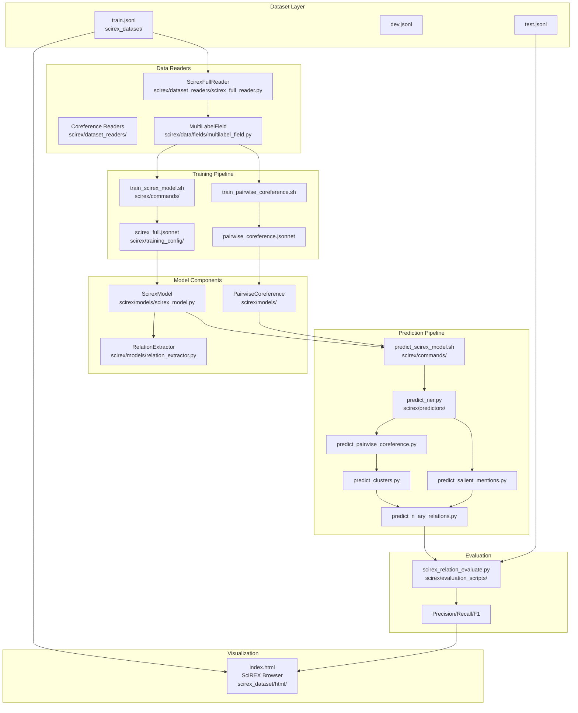
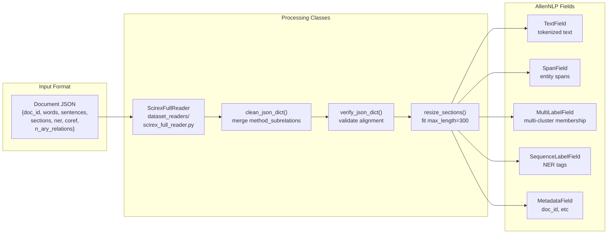
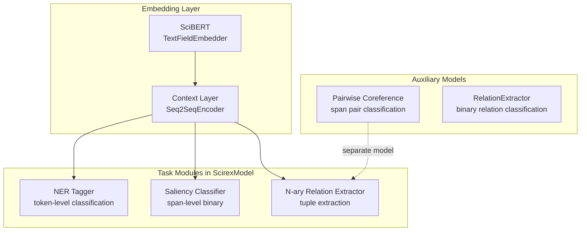
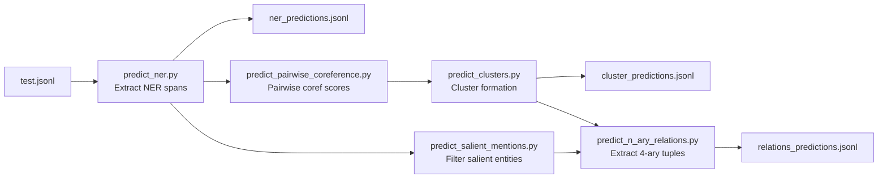
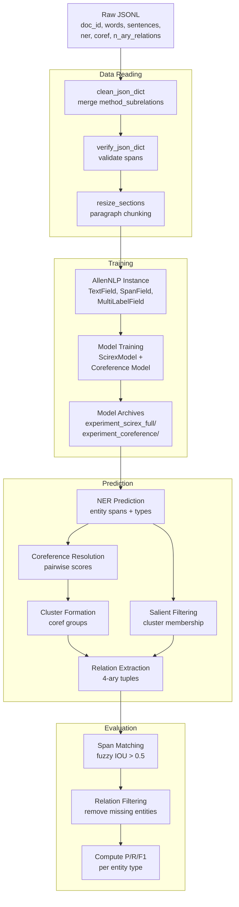

<!-- source: DeepWiki mcp.deepwiki.com · repo allenai/SciREX · page 1 Overview · fetched 2026-10-26 -->

# Overview

<details>
<summary>Relevant source files</summary>

The following files were used as context for generating this wiki page:

- [README.md](README.md)
- [requirements.txt](requirements.txt)

</details>


## Purpose and Scope

This document provides a high-level introduction to the SciREX system, its architecture, and the structure of the codebase. SciREX is a document-level information extraction challenge dataset designed for extracting structured information from scientific papers, including named entities, coreference clusters, and N-ary relations between entities.

For detailed information about specific subsystems:
- Dataset format and schemas: see [Data Format Specification](#2.1)
- Model architectures: see [Model Architecture](#3)
- Training procedures: see [Training](#4)
- Prediction and evaluation: see [Prediction and Evaluation](#5)

---

## What is SciREX?

SciREX (Scientific Information Extraction) is both a dataset and a system for document-level information extraction from scientific papers. The system extracts four types of salient entities (**Method**, **Metric**, **Task**, **Material**) along with their mentions, coreference clusters, and N-ary relations (typically 4-ary tuples connecting Method-Metric-Task-Material entities with an optional Score).

### Key Characteristics

| Aspect | Description |
|--------|-------------|
| **Task Type** | Document-level multi-task information extraction |
| **Input** | Full scientific paper text (sentences and sections) |
| **Output** | NER mentions, salient entity clusters, N-ary relations |
| **Dataset Size** | train/dev/test splits in JSONL format |
| **Base Model** | SciBERT (domain-adapted BERT for scientific text) |
| **Framework** | AllenNLP for training infrastructure |

**Sources:** [README.md:1-28]()

---

## System Architecture

The SciREX system follows a modular pipeline architecture with two parallel training workflows and a sequential prediction workflow.



**Sources:** [README.md:40-57]()

---

## Key Components and Code Mapping

### Data Layer

The dataset consists of three JSONL files containing document-level annotations:

| File | Location | Contents |
|------|----------|----------|
| `train.jsonl` | [scirex_dataset/release_data.tar.gz]() | Training documents with full annotations |
| `dev.jsonl` | [scirex_dataset/release_data.tar.gz]() | Development set for validation |
| `test.jsonl` | [scirex_dataset/release_data.tar.gz]() | Test set for final evaluation |

Each document contains: `doc_id`, `words`, `sentences`, `sections`, `ner`, `coref`, `n_ary_relations`, `method_subrelations`.

**Sources:** [README.md:3-26]()

### Data Processing Components



**Sources:** [README.md:8-26]()

### Training Workflow

The system uses a two-phase training approach:

1. **Main Model Training**: Executed via [scirex/commands/train_scirex_model.sh]()
   - Trains `ScirexModel` for multi-task NER, saliency detection, and relation extraction
   - Configuration: [scirex/training_config/scirex_full.jsonnet]()
   - Requires `BERT_BASE_FOLDER` environment variable pointing to SciBERT weights

2. **Coreference Model Training**: Executed via [scirex/commands/train_pairwise_coreference.sh]()
   - Trains pairwise coreference classifier
   - Configuration: [scirex/training_config/pairwise_coreference.jsonnet]()
   - Uses same SciBERT base model

**Sources:** [README.md:40-46]()

### Model Architecture Components



The `ScirexModel` class implements multi-task learning with three parallel objectives, each with configurable loss weights (`nw`, `lw`, `rw`).

**Sources:** [README.md:40-46]()

### Prediction Pipeline

The prediction system follows a strict sequential dependency chain:



All five prediction steps are orchestrated by [scirex/commands/predict_scirex_model.sh:1-57]().

**Sources:** [README.md:48-57]()

### Evaluation System

The evaluation script [scirex/evaluation_scripts/scirex_relation_evaluate.py]() performs:

1. **Span Mapping**: Fuzzy matching of predicted spans to gold spans (>0.5 IOU)
2. **Cluster Mapping**: Mapping spans to coreference clusters
3. **Relation Filtering**: Removing relations with entities missing textual mentions (noted at [README.md:28]() as affecting ~50% of relations)
4. **Metric Calculation**: Computing precision, recall, and F1 per entity type

**Sources:** [README.md:28]()

---

## Data Flow Through the System

The following diagram illustrates how data transforms through the complete pipeline:



**Sources:** [README.md:1-57]()

---

## Repository Structure

The repository is organized into the following main directories:

| Directory | Purpose |
|-----------|---------|
| `scirex/dataset_readers/` | Data loading and preprocessing classes |
| `scirex/models/` | Neural network model implementations |
| `scirex/predictors/` | Prediction scripts for each task |
| `scirex/evaluation_scripts/` | Evaluation and metric calculation |
| `scirex/training_config/` | Jsonnet configuration files |
| `scirex/commands/` | Shell scripts for training and prediction |
| `scirex/data/fields/` | Custom AllenNLP field types |
| `scirex_dataset/` | Dataset files and browser visualization |

**Sources:** [README.md:1-74]()

---

## Installation and Setup

The system requires Python 3.7 and AllenNLP 0.9.0. Key dependencies:

| Dependency | Version | Purpose |
|------------|---------|---------|
| `allennlp` | 0.9.0 | Training framework |
| `spacy` | 2.1.6 | Text processing |
| `fuzzywuzzy` | 0.17.0 | Entity string matching |
| `scikit-learn` | 0.21.3 | Evaluation metrics |

Setup steps:
1. Create conda environment: `conda create -n scirex python=3.7`
2. Install dependencies: `pip install -r requirements.txt`
3. Download spaCy model: `python -m spacy download en`
4. Set `PYTHONPATH` to repository root
5. Extract dataset: `tar -xvzf scirex_dataset/release_data.tar.gz --directory scirex_dataset`
6. Set `BERT_BASE_FOLDER` environment variable pointing to SciBERT weights

For detailed installation instructions, see [Installation and Setup](#8.2).

**Sources:** [README.md:31-44](), [requirements.txt:1-18]()

---

## External Integrations

The system integrates with:

- **AllenNLP**: Core training and data processing framework
- **SciBERT**: Pre-trained BERT model for scientific text (download from [README.md:44]())
- **DyGIE++**: Alternative information extraction framework with format converters (see [DyGIE++ Integration](#7.1))
- **Semantic Scholar**: Papers referenced via `doc_id` field
- **SciREX Browser**: Web-based visualization at https://allenai.github.io/SciREX/

**Sources:** [README.md:4](), [README.md:44]()

---

## Important Notes

### Relation Evaluation Caveat

Approximately 50% of relations in the dataset contain at least one entity with no textual mentions (they appear only in tables, which are excluded from the dataset). During evaluation, these relations are filtered out at [scirex/evaluation_scripts/scirex_relation_evaluate.py:110](), which artificially reduces precision metrics. This is a known limitation documented in [README.md:28]().

### Citation

For academic use, cite the following paper:
```bibtex
@inproceedings{jain-etal-2020-scirex,
  title={SciREX: A Challenge Dataset for Document-Level Information Extraction},
  author={Sarthak Jain and Madeleine van Zuylen and Hannaneh Hajishirzi and Iz Beltagy},
  booktitle = "Proceedings of the 58th Annual Meeting of the Association for Computational Linguistics",
  month={jul},
  year={2020},
  eprint={2005.00512},
  archivePrefix={arXiv},
  primaryClass={cs.CL}
}
```

**Sources:** [README.md:59-73]()

---

