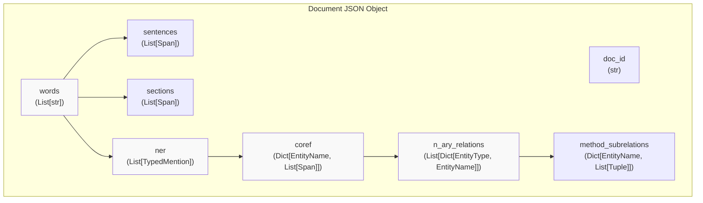
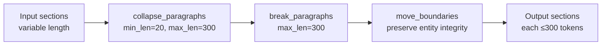
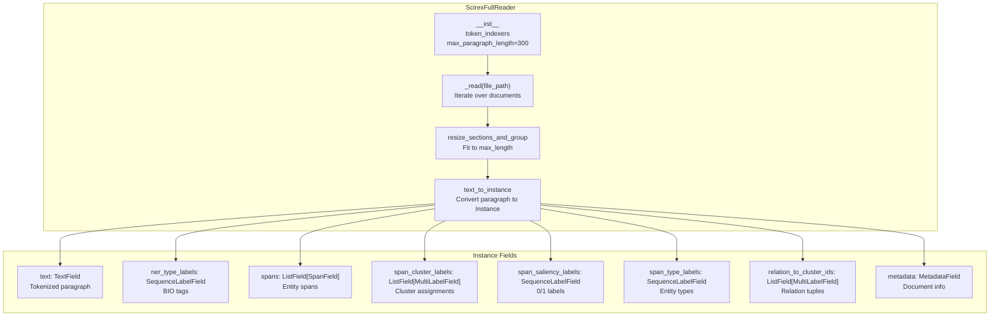
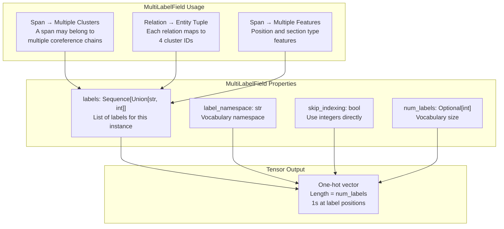

<!-- source: DeepWiki mcp.deepwiki.com · repo allenai/SciREX · page 2 Dataset and Data Format · fetched 2026-10-26 -->

# Dataset and Data Format

<details>
<summary>Relevant source files</summary>

The following files were used as context for generating this wiki page:

- [README.md](README.md)
- [requirements.txt](requirements.txt)
- [scirex/data/dataset_readers/coreference_eval_reader.py](scirex/data/dataset_readers/coreference_eval_reader.py)
- [scirex/data/dataset_readers/coreference_train_reader.py](scirex/data/dataset_readers/coreference_train_reader.py)
- [scirex/data/dataset_readers/multi_label_field.py](scirex/data/dataset_readers/multi_label_field.py)
- [scirex/data/dataset_readers/scirex_full_reader.py](scirex/data/dataset_readers/scirex_full_reader.py)
- [scirex/models/gelu.py](scirex/models/gelu.py)

</details>


## Purpose and Scope

This document provides an overview of the SciREX dataset structure, file organization, and data formats used throughout the system. It covers the raw dataset format, how data is organized, and the high-level data processing pipeline. For detailed field specifications and type definitions, see [Data Format Specification](#2.1). For implementation details of data readers and preprocessing steps, see [Data Readers and Preprocessing](#2.2). For information about the annotation process and dataset statistics, see [Annotation Guidelines and Statistics](#2.3).

## Dataset Overview

The SciREX dataset is a document-level information extraction challenge dataset designed for extracting structured information from scientific papers. The dataset consists of annotated scientific documents with entity mentions, coreference chains, and n-ary relations.

### Dataset Location and Structure

The dataset is distributed as a compressed archive located at:
- Repository path: `scirex_dataset/release_data.tar.gz`
- Public access: https://github.com/allenai/SciREX/blob/master/scirex_dataset/release_data.tar.gz
- Interactive browser: https://allenai.github.io/SciREX/

After extraction using `tar -xvzf scirex_dataset/release_data.tar.gz --directory scirex_dataset`, the dataset contains three files:

| File | Purpose | Format |
|------|---------|--------|
| `train.jsonl` | Training data | One document per line (JSONL) |
| `dev.jsonl` | Development/validation data | One document per line (JSONL) |
| `test.jsonl` | Test data | One document per line (JSONL) |

**Sources:** [README.md:1-8]()

### Dataset Scope and Document-Level Annotations

Each document in the dataset represents a complete scientific paper with rich document-level annotations including:
- **Words**: Tokenized text of the entire document
- **Structural elements**: Sentence and section boundaries
- **Named entities**: Typed mentions (Method, Metric, Task, Material)
- **Coreference**: Salient entity clusters with their mentions
- **Relations**: N-ary relations connecting multiple entities

**Sources:** [README.md:10-26]()

## Data Format Overview

### Basic Document Structure

Each line in a `.jsonl` file contains a single JSON document with the following top-level fields:



**Diagram: Document JSON Structure - Top-level fields and their relationships**

**Sources:** [README.md:10-26]()

### Key Type Definitions

The data format uses several fundamental types defined as follows:

| Type | Definition | Example |
|------|------------|---------|
| `Span` | `Tuple[int, int]` | `(0, 10)` - inclusive start, exclusive end |
| `TypedMention` | `Tuple[int, int, EntityType]` | `(5, 8, "Method")` |
| `EntityType` | `Union["Method", "Metric", "Task", "Material"]` | `"Method"` |
| `EntityName` | `str` | `"BERT"` |
| `ClusterName` | `str` | Unique identifier for an entity cluster |

The `Span` type is particularly important as it represents a range indexing into the `words` array. All span-based annotations use this convention throughout the system.

**Sources:** [README.md:22-25](), [scirex/data/dataset_readers/scirex_full_reader.py:26-29]()

### N-ary Relations Structure

Relations in SciREX are n-ary (specifically 4-ary), connecting entities of four different types. Each relation is a dictionary with exactly four keys:

```python
{
    "Method": "BERT",
    "Metric": "F1 Score", 
    "Task": "Named Entity Recognition",
    "Material": "CoNLL-2003"
}
```

These relations represent experimental results reported in scientific papers, capturing which method was applied to which task and dataset, achieving a particular metric score.

**Important Constraint**: Approximately 50% of relations in the dataset contain at least one entity with no textual mentions (these entities appear only in tables, which are excluded from the text). This affects evaluation methodology, as discussed in the note at [README.md:28]().

**Sources:** [README.md:18-28]()

## Data Flow and Transformation Pipeline

The following diagram illustrates how raw dataset files are transformed through various processing stages to become model-ready instances:

```mermaid
flowchart LR
    subgraph "Raw Data Layer"
        JSONL["train.jsonl<br/>dev.jsonl<br/>test.jsonl"]
    end
    
    subgraph "Preprocessing: clean_json_dict"
        MergeSub["Merge method_subrelations<br/>into main entities"]
        GroupSent["Group sentences<br/>into sections"]
        VerifyAlign["Verify alignment<br/>via verify_json_dict"]
        
        MergeSub --> GroupSent
        GroupSent --> VerifyAlign
    end
    
    subgraph "Resizing: resize_sections_and_group"
        Collapse["Collapse short paragraphs<br/>min_len=20"]
        Break["Break long paragraphs<br/>max_len=300"]
        MoveBound["Move boundaries<br/>to avoid splitting entities"]
        
        Collapse --> Break
        Break --> MoveBound
    end
    
    subgraph "Instance Creation: text_to_instance"
        TextField["TextField<br/>(BERT tokens)"]
        SpanField["SpanField<br/>(entity spans)"]
        MultiLabel["MultiLabelField<br/>(cluster assignments)"]
        SeqLabel["SequenceLabelField<br/>(NER labels)"]
        
        TextField --> SpanField
        SpanField --> MultiLabel
        TextField --> SeqLabel
    end
    
    subgraph "AllenNLP Instance"
        Instance["Instance object<br/>with all fields"]
    end
    
    JSONL --> MergeSub
    VerifyAlign --> Collapse
    MoveBound --> TextField
    SeqLabel --> Instance
    MultiLabel --> Instance
```



**Diagram: Data Transformation Pipeline - From raw JSONL to AllenNLP Instance**

**Sources:** [scirex/data/dataset_readers/scirex_full_reader.py:32-102](), [scirex/data/dataset_readers/scirex_full_reader.py:243-300](), [scirex/data/dataset_readers/scirex_full_reader.py:302-421]()

### Data Processing Steps

#### 1. JSON Cleaning (`clean_json_dict`)

The `clean_json_dict` function at [scirex/data/dataset_readers/scirex_full_reader.py:32-102]() performs several critical preprocessing steps:

- **Method subrelation merging**: Combines submethod entities (e.g., "DLDL+VGG-Face" split into "DLDL" and "VGG-Face") back into their parent method clusters
- **Entity type enrichment**: Augments entity spans with both their type and saliency flag (whether they belong to any coreference cluster)
- **Sentence grouping**: Groups sentences into their containing sections using `group_sentences_to_sections`
- **Cross-sentence entity handling**: Merges adjacent sentences when entities span sentence boundaries

#### 2. Validation (`verify_json_dict`)

The `verify_json_dict` function at [scirex/data/dataset_readers/scirex_full_reader.py:105-119]() ensures data consistency by asserting:
- Each entity belongs to exactly one section
- Each entity belongs to exactly one grouped sentence
- Section and sentence boundaries align correctly
- All coreference spans exist in the entity list

#### 3. Paragraph Resizing (`resize_sections_and_group`)

To accommodate BERT's maximum sequence length constraint (300 tokens), the `resize_sections_and_group` method at [scirex/data/dataset_readers/scirex_full_reader.py:243-300]() performs paragraph-level operations:



**Diagram: Paragraph Resizing Pipeline**

This ensures no entity is split across paragraph boundaries while keeping paragraphs within BERT's length constraints.

**Sources:** [scirex/data/dataset_readers/scirex_full_reader.py:243-300]()

## Data Readers

The SciREX system uses several specialized dataset readers to convert raw data into model-ready formats:

### ScirexFullReader

The primary reader for the main information extraction task, registered as `"scirex_full_reader"` at [scirex/data/dataset_readers/scirex_full_reader.py:121]().



**Diagram: ScirexFullReader Architecture - Converting documents to AllenNLP Instances**

Key parameters:
- `token_indexers`: Configures how tokens are converted to indices (typically BERT tokenizer)
- `max_paragraph_length`: Maximum tokens per paragraph (default: 300)
- `lazy`: Whether to load data lazily
- `to_scirex_converter`: Flag for format conversion mode

The reader yields one `Instance` per paragraph, not per document. This allows processing long documents that exceed BERT's maximum length.

**Sources:** [scirex/data/dataset_readers/scirex_full_reader.py:121-241]()

### Coreference Readers

Two specialized readers handle pairwise coreference training and evaluation:

#### ScirexCoreferenceTrainReader

Registered as `"scirex_coreference_train_reader"` at [scirex/data/dataset_readers/coreference_train_reader.py:17](), this reader:

- Generates all pairwise combinations of entities with matching types
- Creates binary classification instances (coreferent=1, not coreferent=0)
- Balances positive/negative examples during training via sampling
- Formats entity pairs as: `"EntityType entity_text_1" [SEP] "EntityType entity_text_2"`

**Sources:** [scirex/data/dataset_readers/coreference_train_reader.py:1-113]()

#### ScirexCoreferenceEvalReader

Located at [scirex/data/dataset_readers/coreference_eval_reader.py:17-90](), this reader:

- Similar to the training reader but without downsampling
- Used for evaluation to ensure all pairs are considered
- Includes metadata for mapping predictions back to document spans

**Sources:** [scirex/data/dataset_readers/coreference_eval_reader.py:1-90]()

## Custom Field Types

### MultiLabelField

The `MultiLabelField` class at [scirex/data/dataset_readers/multi_label_field.py:14-144]() is a crucial custom AllenNLP field that extends the standard `LabelField` to support multiple labels per instance.



**Diagram: MultiLabelField - Supporting multi-label classification**

Key features:
- **Multi-label support**: Unlike standard `LabelField`, allows multiple active labels per instance
- **Skip indexing**: Can use integer labels directly without vocabulary lookup
- **One-hot encoding**: Converts to a binary vector with 1s at positions corresponding to active labels
- **Validation**: Ensures all labels are valid (either all strings or all integers)

This field is used extensively in SciREX for:
1. **Span cluster assignments** (`span_cluster_labels` field): A span may belong to multiple coreference clusters
2. **Relation cluster IDs** (`relation_to_cluster_ids` field): Each relation is a tuple of cluster IDs
3. **Section features** (`span_features` field): Spans have multiple structural features

**Sources:** [scirex/data/dataset_readers/multi_label_field.py:14-144](), [scirex/data/dataset_readers/scirex_full_reader.py:362-373]()

## Instance Field Mapping

The following table shows how raw JSON fields map to AllenNLP Instance fields in `ScirexFullReader`:

| JSON Field | Instance Field(s) | Field Type | Purpose |
|------------|------------------|------------|---------|
| `words` | `text` | `TextField` | Tokenized paragraph text |
| `ner` | `ner_type_labels` | `SequenceLabelField` | BIO-tagged sequence labels |
| `ner` | `spans` | `ListField[SpanField]` | Entity span boundaries |
| `ner` + `coref` | `span_saliency_labels` | `SequenceLabelField` | Binary salient/non-salient |
| `ner` | `span_type_labels` | `SequenceLabelField` | Entity types (Method/Metric/Task/Material) |
| `coref` | `span_cluster_labels` | `ListField[MultiLabelField]` | Cluster memberships for each span |
| `n_ary_relations` | `relation_to_cluster_ids` | `ListField[MultiLabelField]` | Relations as cluster ID tuples |
| `sentences`, `sections` | `metadata.sentence_indices` | `MetadataField` | Structural boundaries |
| `doc_id` | `metadata.doc_id` | `MetadataField` | Document identifier |

**Sources:** [scirex/data/dataset_readers/scirex_full_reader.py:324-421]()

## Data Format Constraints and Special Cases

### Entity-Cluster Consistency

All entity spans in the `ner` field must be consistent with coreference clusters:
- Every span in a coreference cluster must exist in the `ner` field
- Entity types are inferred from cluster memberships in relations
- The `clean_json_dict` function ensures this consistency at [scirex/data/dataset_readers/scirex_full_reader.py:69-77]()

### Method Subrelations

The `method_subrelations` field allows methods to be hierarchically decomposed (e.g., "DLDL+VGG-Face" into "DLDL" and "VGG-Face"). During preprocessing:
- Submethods are merged into the parent method's cluster
- This prevents submethods from being treated as independent entities
- The merging logic is at [scirex/data/dataset_readers/scirex_full_reader.py:54-67]()

### Cross-Sentence Entities

When entities span multiple sentences:
- Adjacent sentences are merged into a single sentence span
- This maintains the constraint that each entity belongs to exactly one sentence
- Handled at [scirex/data/dataset_readers/scirex_full_reader.py:83-96]()

### Empty Paragraphs

Some paragraphs after resizing may contain no entities:
- Empty field instances are created to maintain consistency
- Uses `.empty_field()` method on field types
- Handled at [scirex/data/dataset_readers/scirex_full_reader.py:386-406]()

**Sources:** [scirex/data/dataset_readers/scirex_full_reader.py:32-102]()

## Summary

The SciREX dataset provides rich document-level information extraction annotations in a structured JSONL format. The data processing pipeline transforms raw documents through multiple stages:

1. **Cleaning**: Merges subrelations, groups sentences, enriches entity types
2. **Validation**: Ensures structural consistency and alignment
3. **Resizing**: Adapts paragraph lengths to BERT constraints while preserving entity integrity
4. **Field Creation**: Converts to specialized AllenNLP fields including custom `MultiLabelField` for multi-label scenarios

The modular reader architecture supports both the main IE task (`ScirexFullReader`) and specialized coreference modeling, enabling flexible training and evaluation workflows. For detailed field specifications, see [Data Format Specification](#2.1), and for implementation details, see [Data Readers and Preprocessing](#2.2).

---

