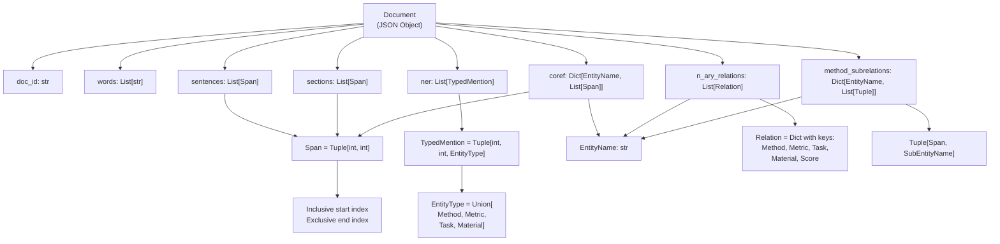
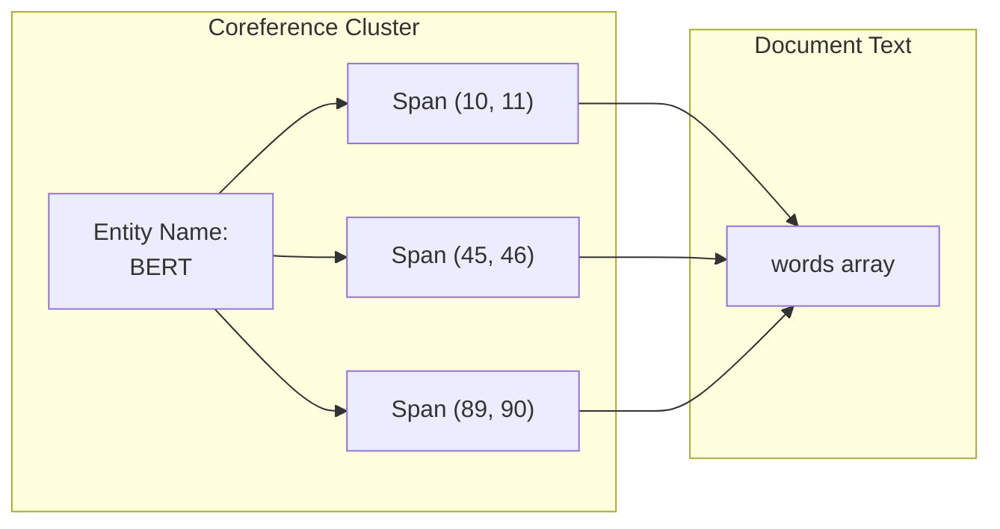
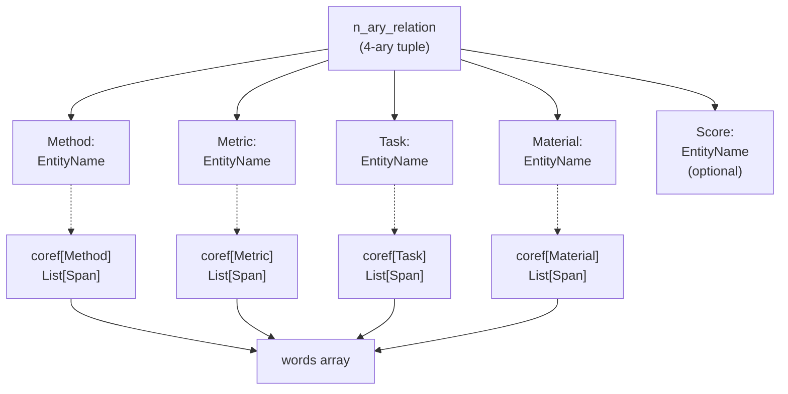
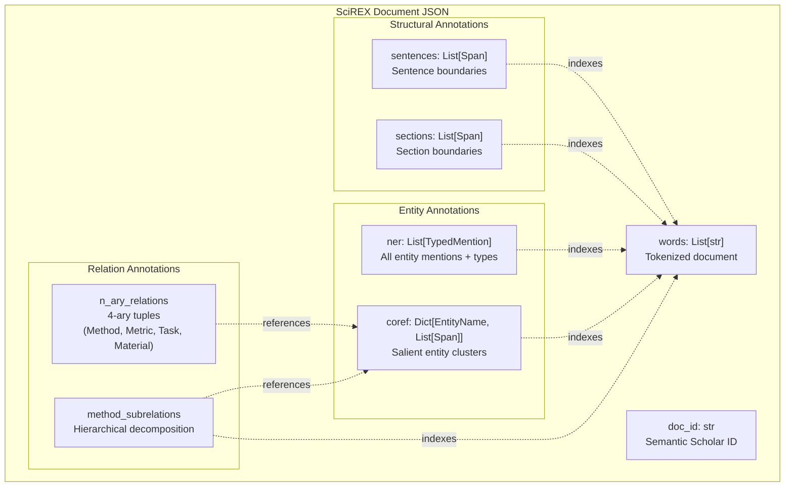
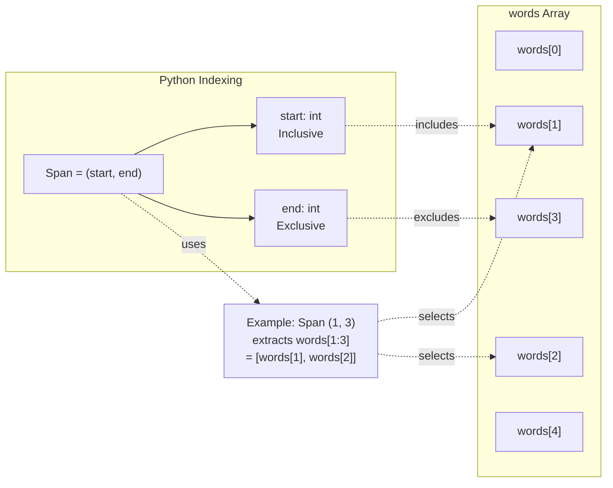

<!-- source: DeepWiki mcp.deepwiki.com · repo allenai/SciREX · page 2.1 Data Format Specification · fetched 2026-10-26 -->

# Data Format Specification

<details>
<summary>Relevant source files</summary>

The following files were used as context for generating this wiki page:

- [README.md](README.md)
- [requirements.txt](requirements.txt)

</details>


## Purpose and Scope

This document provides the complete technical specification for the SciREX dataset format. It defines the JSON/JSONL schema used for storing document-level information extraction annotations, including all field types, data structures, and constraints.

For information about how this data is read and processed by the system, see [Data Readers and Preprocessing](#2.2). For evaluation-specific format transformations, see [Evaluation Metrics and Scripts](#5.2).

## File Format Overview

The SciREX dataset consists of three JSONL (JSON Lines) files located in the dataset directory:
- `train.jsonl` - Training set
- `dev.jsonl` - Development/validation set  
- `test.jsonl` - Test set

Each file contains **one document per line**, where each line is a complete, valid JSON object representing a single scientific paper with its annotations.

**Sources:** [README.md:3-6]()

## Document Schema

### Top-Level Structure

Each document is a JSON object with the following top-level fields:

| Field Name | Type | Description |
|------------|------|-------------|
| `doc_id` | `str` | Document identifier used by Semantic Scholar |
| `words` | `List[str]` | Ordered list of all words in the document |
| `sentences` | `List[Span]` | Sentence boundaries as spans into `words` |
| `sections` | `List[Span]` | Section boundaries as spans into `words` |
| `ner` | `List[TypedMention]` | Named entity mentions with types |
| `coref` | `Dict[EntityName, List[Span]]` | Coreference clusters for salient entities |
| `n_ary_relations` | `List[Dict[EntityType, EntityName]]` | 4-ary relations between entities |
| `method_subrelations` | `Dict[EntityName, List[Tuple[Span, SubEntityName]]]` | Hierarchical method decomposition |

**Sources:** [README.md:8-20]()

### Type Definitions



**Type Definitions:**

```python
Span = Tuple[int, int]  # [start, end) - Inclusive start, Exclusive end
TypedMention = Tuple[int, int, EntityType]  # [start, end, type]
EntityType = Union["Method", "Metric", "Task", "Material"]
EntityName = str
SubEntityName = str
```

**Sources:** [README.md:22-25]()

## Field Specifications

### `doc_id` - Document Identifier

- **Type:** `str`
- **Description:** Unique identifier corresponding to the Semantic Scholar paper ID
- **Purpose:** Links the document to its source paper in the Semantic Scholar corpus
- **Example:** `"123456789"`

### `words` - Document Tokenization

- **Type:** `List[str]`
- **Description:** Complete tokenized representation of the document
- **Indexing:** All other span-based annotations (sentences, sections, ner, coref) index into this array
- **Notes:** 
  - Words are in document order
  - Represents the canonical token sequence for all annotations
  - Does not include table content (tables are excluded from the dataset)

### `sentences` - Sentence Boundaries

- **Type:** `List[Span]` where `Span = Tuple[int, int]`
- **Description:** Defines sentence boundaries within the document
- **Indexing:** Each span `(start, end)` indexes into the `words` array
- **Semantics:** `words[start:end]` gives the tokens for that sentence
- **Coverage:** Non-overlapping spans that partition the document

**Example:**
```python
# If words = ["The", "method", "works", ".", "Results", "show", "..."]
# Then sentences might be:
[(0, 4), (4, 7), ...]  # Sentence 1: words[0:4], Sentence 2: words[4:7]
```

### `sections` - Section Boundaries

- **Type:** `List[Span]` where `Span = Tuple[int, int]`
- **Description:** Defines section boundaries (e.g., Abstract, Introduction, Methods)
- **Indexing:** Each span `(start, end)` indexes into the `words` array
- **Coverage:** May be non-contiguous or overlapping depending on document structure

### `ner` - Named Entity Recognition

- **Type:** `List[TypedMention]` where `TypedMention = Tuple[int, int, EntityType]`
- **Description:** All entity mentions in the document with their types
- **Structure:** Each mention is `(start_idx, end_idx, entity_type)`
- **Entity Types:** One of `"Method"`, `"Metric"`, `"Task"`, `"Material"`

**Entity Type Definitions:**

| EntityType | Description | Examples |
|------------|-------------|----------|
| `Method` | Computational methods, algorithms, models | "BERT", "ResNet", "attention mechanism" |
| `Metric` | Evaluation metrics and measurements | "F1 score", "accuracy", "BLEU" |
| `Task` | Research tasks and problems | "machine translation", "image classification" |
| `Material` | Datasets, corpora, resources | "ImageNet", "Penn Treebank", "WMT14" |

**Example:**
```python
# If words = ["We", "use", "BERT", "on", "GLUE", "dataset"]
# Then ner might contain:
[(2, 3, "Method"),    # "BERT"
 (4, 5, "Material")]  # "GLUE"
```

**Sources:** [README.md:16,23-24]()

### `coref` - Coreference Clusters

- **Type:** `Dict[EntityName, List[Span]]`
- **Description:** Maps salient entity names to all their mentions in the document
- **Structure:** 
  - **Key:** Canonical entity name (string)
  - **Value:** List of spans where this entity is mentioned
- **Salient Entities:** Only entities that participate in relations are included
- **Purpose:** Enables entity-level relation extraction by grouping mentions

**Example:**
```python
{
    "BERT": [(10, 11), (45, 46), (89, 90)],  # Entity "BERT" mentioned at 3 locations
    "ImageNet": [(23, 24), (67, 68)],         # Entity "ImageNet" mentioned at 2 locations
    "accuracy": [(34, 35)]                    # Entity "accuracy" mentioned once
}
```

**Sources:** [README.md:17]()



### `n_ary_relations` - 4-ary Relations

- **Type:** `List[Dict[EntityType, EntityName]]`
- **Description:** List of 4-ary relations connecting Method, Metric, Task, and Material entities
- **Structure:** Each relation is a dictionary with up to 5 keys:
  - `"Method"` - The method/model being evaluated
  - `"Metric"` - The evaluation metric used
  - `"Task"` - The task being performed
  - `"Material"` - The dataset/corpus used
  - `"Score"` (optional) - The numeric score achieved

**Relation Schema:**
```python
Relation = {
    "Method": EntityName,    # Required
    "Metric": EntityName,    # Required
    "Task": EntityName,      # Required
    "Material": EntityName,  # Required
    "Score": EntityName      # Optional - may be present
}
```

**Example:**
```python
[
    {
        "Method": "BERT",
        "Metric": "accuracy",
        "Task": "text classification",
        "Material": "GLUE",
        "Score": "92.3"
    },
    {
        "Method": "ResNet-50",
        "Metric": "top-1 accuracy",
        "Task": "image classification",
        "Material": "ImageNet"
    }
]
```

**Semantic Interpretation:** A relation captures the statement: "Method X achieves Metric Y on Task Z using Material W (with Score S)"

**Sources:** [README.md:18]()



**Sources:** [README.md:18]()

### `method_subrelations` - Hierarchical Method Decomposition

- **Type:** `Dict[EntityName, List[Tuple[Span, SubEntityName]]]`
- **Description:** Decomposes complex methods into constituent sub-methods
- **Structure:**
  - **Key:** Parent method entity name
  - **Value:** List of (span, sub-method name) tuples
- **Purpose:** Captures hierarchical relationships when a method is composed of multiple sub-components

**Example:**
```python
{
    "DLDL+VGG-Face": [
        ((45, 46), "DLDL"),      # Sub-method 1
        ((47, 48), "VGG-Face")   # Sub-method 2
    ]
}
```

This indicates that the method "DLDL+VGG-Face" is composed of two sub-methods: "DLDL" and "VGG-Face", which are mentioned at the specified spans in the document.

**Sources:** [README.md:19]()

## Data Format Visualization

### Complete Document Structure



**Sources:** [README.md:8-20]()

### Span Indexing Semantics



**Indexing Convention:** All spans use Python slice semantics `[start:end)` where `start` is inclusive and `end` is exclusive.

**Sources:** [README.md:22]()

## Example Document Fragment

Here is a simplified example showing how the different annotation layers relate to each other:

```json
{
    "doc_id": "12345",
    "words": [
        "We", "evaluate", "BERT", "on", "the", "GLUE", "benchmark",
        ".", "The", "model", "achieves", "92.3", "accuracy", "."
    ],
    "sentences": [
        [0, 8],
        [8, 14]
    ],
    "sections": [
        [0, 14]
    ],
    "ner": [
        [2, 3, "Method"],      
        [5, 7, "Material"],    
        [9, 10, "Method"],     
        [12, 13, "Metric"]     
    ],
    "coref": {
        "BERT": [[2, 3], [9, 10]],
        "GLUE": [[5, 7]],
        "accuracy": [[12, 13]]
    },
    "n_ary_relations": [
        {
            "Method": "BERT",
            "Material": "GLUE",
            "Metric": "accuracy",
            "Task": "natural language understanding",
            "Score": "92.3"
        }
    ],
    "method_subrelations": {}
}
```

**Annotation Breakdown:**
- **Words 2-3 ("BERT")**: Method entity, part of "BERT" coreference cluster
- **Words 5-7 ("GLUE benchmark")**: Material entity  
- **Words 9-10 ("model")**: Also refers to "BERT" (coreference)
- **Words 12-13 ("accuracy")**: Metric entity
- **Relation**: Links BERT (method) + GLUE (material) + accuracy (metric) + task + score

**Sources:** [README.md:10-26]()

## Data Considerations and Limitations

### Missing Entity Mentions in Relations

A critical characteristic of the dataset is that **approximately 50% of relations contain at least one entity that has no textual mentions** in the document. This occurs because:

1. Entities are sometimes mentioned only in **tables**, which are excluded from the dataset
2. Some entity values (especially scores) are **implicit or derived**

**Impact on Evaluation:**

The evaluation scripts handle this by **filtering out relations with missing entity mentions** during end-to-end evaluation. Specifically:
- Relations where any constituent entity lacks mentions in the `coref` dictionary are removed
- This filtering is implemented in the evaluation pipeline
- **Note:** This artificially reduces the system's precision, as the model cannot predict relations for entities it has never seen

**Evaluation Filtering:** The relation evaluation script removes these problematic relations to enable fair evaluation of the end-to-end extraction task.

**Sources:** [README.md:28](), [scirex/evaluation_scripts/scirex_relation_evaluate.py:110]()

### Table Content Exclusion

The dataset **does not include table content**, only the main text of scientific papers. This design decision means:
- Entities mentioned exclusively in tables have no text spans
- Numeric scores from tables may not appear in the text
- Relations extracted from tables are present but lack supporting text evidence

This limitation is documented as a known issue in the evaluation methodology.

**Sources:** [README.md:28]()

## Data Files Location

The dataset files are distributed as a compressed archive:

**Location:** `scirex_dataset/release_data.tar.gz`

**Extraction:**
```bash
tar -xvzf scirex_dataset/release_data.tar.gz --directory scirex_dataset
```

**Resulting Files:**
- `scirex_dataset/train.jsonl`
- `scirex_dataset/dev.jsonl`
- `scirex_dataset/test.jsonl`

**Public URL:** https://github.com/allenai/SciREX/blob/master/scirex_dataset/release_data.tar.gz

**Sources:** [README.md:3,43]()

---

