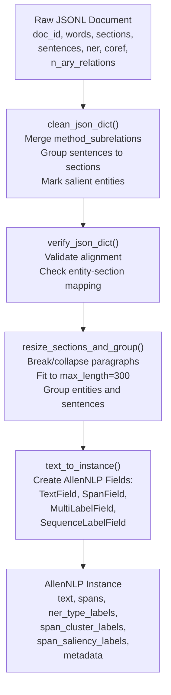
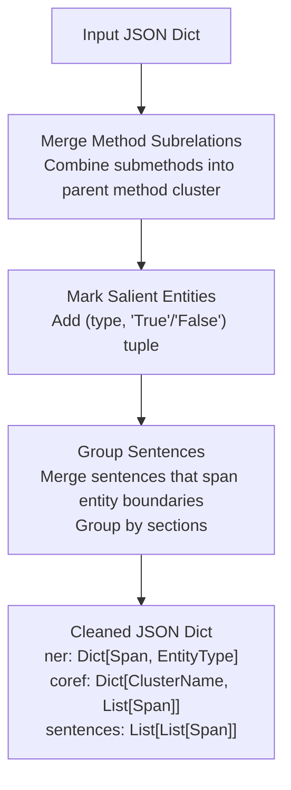
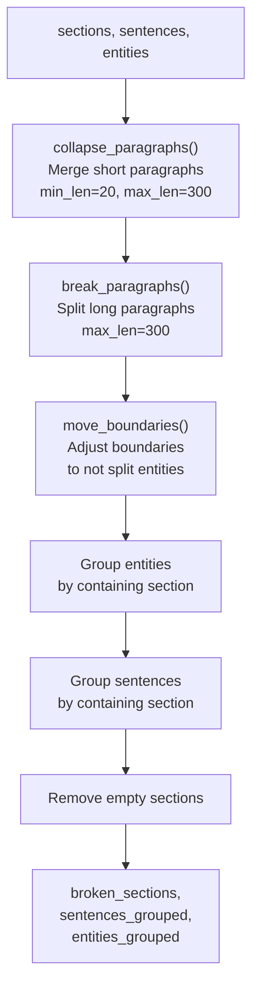
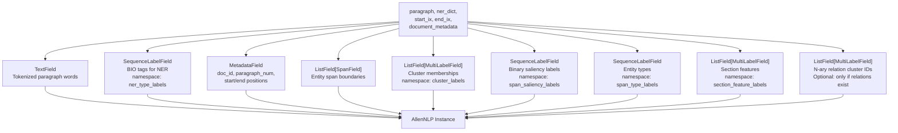
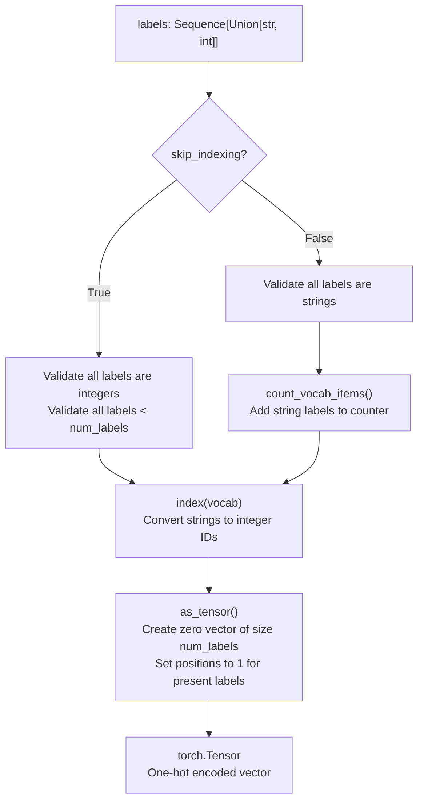
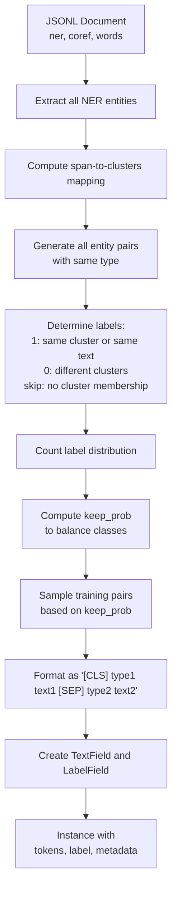
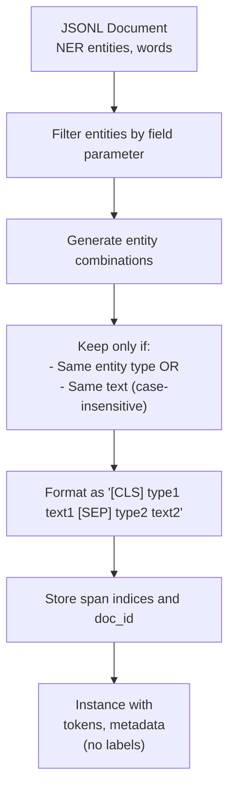
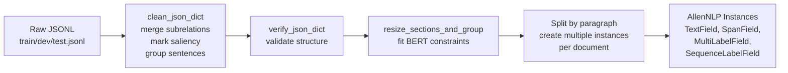

<!-- source: DeepWiki mcp.deepwiki.com · repo allenai/SciREX · page 2.2 Data Readers and Preprocessing · fetched 2026-10-26 -->

# Data Readers and Preprocessing

Relevant source files

The following files were used as context for generating this wiki page:

- [scirex/data/dataset_readers/coreference_eval_reader.py](scirex/data/dataset_readers/coreference_eval_reader.py)
- [scirex/data/dataset_readers/coreference_train_reader.py](scirex/data/dataset_readers/coreference_train_reader.py)
- [scirex/data/dataset_readers/multi_label_field.py](scirex/data/dataset_readers/multi_label_field.py)
- [scirex/data/dataset_readers/scirex_full_reader.py](scirex/data/dataset_readers/scirex_full_reader.py)
- [scirex/models/gelu.py](scirex/models/gelu.py)

This page documents the data reading and preprocessing pipeline that transforms raw SciREX JSON/JSONL files into AllenNLP `Instance` objects suitable for model training and inference. This includes the main `ScirexFullReader`, preprocessing utilities for data cleaning and validation, the custom `MultiLabelField` for multi-label classification, and specialized coreference readers.

For the specification of the raw data format being read, see [Data Format Specification](#2.1). For information about model architecture that consumes these instances, see [Model Architecture](#3).

## Overview of Data Reading Pipeline

The data reading process transforms raw JSON documents through several stages:

**Sources:** [scirex/data/dataset_readers/scirex_full_reader.py:32-422]()

## ScirexFullReader

The `ScirexFullReader` is the primary dataset reader registered as `"scirex_full_reader"` in the AllenNLP framework. It handles document-level information extraction data and produces instances for multi-task learning.

### Configuration Parameters

| Parameter | Type | Default | Description |
|-----------|------|---------|-------------|
| `token_indexers` | `Dict[str, TokenIndexer]` | None | Tokenizers for converting tokens to indices |
| `max_paragraph_length` | `int` | 300 | Maximum tokens per paragraph (BERT constraint) |
| `lazy` | `bool` | False | Whether to lazily load instances |
| `to_scirex_converter` | `bool` | False | Hack for format conversion to SciERC |

**Sources:** [scirex/data/dataset_readers/scirex_full_reader.py:123-129]()

### Preprocessing Functions

#### clean_json_dict

The `clean_json_dict` function performs critical data transformations before instance creation:

Key operations:

1. **Convert NER to dictionary format**: Transforms `List[Tuple[int, int, BaseEntityType]]` to `Dict[Span, BaseEntityType]` for efficient lookup [scirex/data/dataset_readers/scirex_full_reader.py:34-37]()

2. **Merge method subrelations**: Under the current model, method subrelations are not treated as separate components. Submethod spans are merged into the parent method cluster [scirex/data/dataset_readers/scirex_full_reader.py:54-67]()

3. **Mark salient entities**: Each entity span is augmented with a saliency flag indicating whether it belongs to any coreference cluster: `entities[span] = (entity_type, "True"/"False")` [scirex/data/dataset_readers/scirex_full_reader.py:76-77]()

4. **Handle sentence-entity misalignment**: If an entity spans multiple sentences, those sentences are merged into a single sentence [scirex/data/dataset_readers/scirex_full_reader.py:82-96]()

5. **Group sentences by sections**: Sentences are grouped into their containing sections using `group_sentences_to_sections()` [scirex/data/dataset_readers/scirex_full_reader.py:98-100]()

**Sources:** [scirex/data/dataset_readers/scirex_full_reader.py:32-102]()

#### verify_json_dict

The `verify_json_dict` function validates that the cleaned data satisfies structural constraints:

| Assertion | Description |
|-----------|-------------|
| Entities in sections | Each entity must be contained in exactly one section |
| Entities in sentences | Each entity must be contained in exactly one sentence |
| Section-sentence alignment | Section boundaries must align with sentence boundaries |
| Coreference validity | All spans in coreference clusters must exist in the entity dictionary |

These assertions catch data quality issues early and use `breakpoint()` for debugging when violated [scirex/data/dataset_readers/scirex_full_reader.py:105-119]()

**Sources:** [scirex/data/dataset_readers/scirex_full_reader.py:105-119]()

#### resize_sections_and_group

This critical function handles BERT's 512-token length constraints by dynamically resizing paragraphs:

The resizing pipeline:

1. **Collapse short paragraphs**: Paragraphs shorter than 20 tokens are merged with neighbors [scirex/data/dataset_readers/scirex_full_reader.py:248]()

2. **Break long paragraphs**: Paragraphs exceeding 300 tokens are split [scirex/data/dataset_readers/scirex_full_reader.py:247-249]()

3. **Move boundaries**: Boundaries are adjusted to ensure no entity is split across paragraphs [scirex/data/dataset_readers/scirex_full_reader.py:246-251]()

4. **Group entities and sentences**: Each entity and sentence is assigned to exactly one section. Assertions verify that each entity belongs to exactly one paragraph [scirex/data/dataset_readers/scirex_full_reader.py:259-285]()

5. **Remove empty sections**: Sections with zero length are discarded [scirex/data/dataset_readers/scirex_full_reader.py:289-298]()

**Sources:** [scirex/data/dataset_readers/scirex_full_reader.py:243-300]()

### Instance Construction

The `text_to_instance` method converts a paragraph of text into an AllenNLP `Instance` with multiple field types:

Key aspects of instance construction:

1. **TextField**: Created from paragraph tokens using the provided token indexers [scirex/data/dataset_readers/scirex_full_reader.py:324]()

2. **NER Labels**: Converted to BIO tags using `spans_to_bio_tags()` with offsets adjusted to paragraph-relative positions [scirex/data/dataset_readers/scirex_full_reader.py:340-344]()

3. **Span fields**: Each entity span gets multiple associated fields:
   - `SpanField`: Boundary indices (start, end-1) relative to paragraph [scirex/data/dataset_readers/scirex_full_reader.py:361]()
   - `MultiLabelField` for cluster membership: An entity can belong to multiple clusters [scirex/data/dataset_readers/scirex_full_reader.py:362-368]()
   - Saliency label: Binary indicator (1 if in any cluster, 0 otherwise) [scirex/data/dataset_readers/scirex_full_reader.py:370]()
   - Type label: Entity type (Method, Material, Task, Metric) [scirex/data/dataset_readers/scirex_full_reader.py:371]()
   - Section features: Document structure features from `extract_sentence_features()` [scirex/data/dataset_readers/scirex_full_reader.py:372-374]()

4. **Empty field handling**: Paragraphs without entities receive empty field placeholders to maintain consistent batch shapes [scirex/data/dataset_readers/scirex_full_reader.py:386-406]()

5. **Relation fields**: Only added if n-ary relations exist in the document [scirex/data/dataset_readers/scirex_full_reader.py:408-419]()

**Sources:** [scirex/data/dataset_readers/scirex_full_reader.py:302-421]()

### Document-Level Metadata

The reader maintains document-level information in the metadata field:

| Metadata Key | Type | Description |
|--------------|------|-------------|
| `cluster_name_to_id` | `Dict[ClusterName, int]` | Maps cluster names to integer IDs (0 to num_clusters-1) |
| `span_to_cluster_ids` | `Dict[Span, List[int]]` | Maps each span to list of cluster IDs it belongs to |
| `relation_to_cluster_ids` | `Dict[int, List[int]]` | Maps relation index to tuple of cluster IDs |
| `type_to_cluster_ids` | `Dict[BaseEntityType, List[int]]` | Maps entity types to their cluster IDs |
| `doc_id` | `str` | Document identifier |
| `doc_length` | `int` | Total document word count |
| `entities_to_features_map` | `Dict[Span, List[str]]` | Document structure features per entity |

This metadata enables document-level reasoning across multiple paragraph instances during training and prediction [scirex/data/dataset_readers/scirex_full_reader.py:214-222]()

**Sources:** [scirex/data/dataset_readers/scirex_full_reader.py:166-222]()

## MultiLabelField

The `MultiLabelField` is a custom AllenNLP field type that extends `LabelField` to support multi-label classification where a single instance can have multiple correct labels.

### Design and Operation

### Key Features

1. **Dual mode operation**: 
   - String mode (`skip_indexing=False`): Labels are strings that need vocabulary indexing [scirex/data/dataset_readers/multi_label_field.py:82-87]()
   - Integer mode (`skip_indexing=True`): Labels are pre-computed integer indices [scirex/data/dataset_readers/multi_label_field.py:66-81]()

2. **One-hot encoding**: The `as_tensor()` method creates a vector of zeros with size `num_labels`, then uses `scatter_()` to set positions corresponding to the labels to 1 [scirex/data/dataset_readers/multi_label_field.py:122-130]()

3. **Namespace warnings**: The field logs warnings if the namespace doesn't end with "labels" or "tags", as these namespaces avoid UNK/PAD tokens [scirex/data/dataset_readers/multi_label_field.py:89-99]()

4. **Empty field support**: Can create empty fields with no labels for consistent batch shapes [scirex/data/dataset_readers/multi_label_field.py:133-136]()

### Usage in SciREX

`MultiLabelField` is used for three purposes in the SciREX reader:

1. **Cluster labels**: Entities can belong to multiple coreference clusters simultaneously [scirex/data/dataset_readers/scirex_full_reader.py:362-368]()

2. **Section features**: Multiple document structure features per entity [scirex/data/dataset_readers/scirex_full_reader.py:372-374]()

3. **Relation cluster IDs**: Representing n-ary relations as tuples of cluster IDs [scirex/data/dataset_readers/scirex_full_reader.py:409-418]()

**Sources:** [scirex/data/dataset_readers/multi_label_field.py:1-145]()

## Coreference Readers

The system includes two specialized readers for training and evaluating pairwise coreference models.

### ScirexCoreferenceTrainReader

Registered as `"scirex_coreference_train_reader"`, this reader generates pairwise training examples for coreference resolution:

Key aspects:

1. **Pair generation**: Creates all combinations of entity pairs with matching types [scirex/data/dataset_readers/coreference_train_reader.py:64-67]()

2. **Label assignment**:
   - Label 1: Same cluster membership or exact text match (lowercased) [scirex/data/dataset_readers/coreference_train_reader.py:78-79]()
   - Label 0: Disjoint cluster memberships [scirex/data/dataset_readers/coreference_train_reader.py:82-83]()
   - Skip: Neither entity belongs to any cluster [scirex/data/dataset_readers/coreference_train_reader.py:80-81]()

3. **Class balancing**: Computes sampling probabilities to equalize class distribution during training [scirex/data/dataset_readers/coreference_train_reader.py:37-39]()

4. **Input format**: Pairs are formatted as `"[CLS] {type} {text1} [SEP] {type} {text2}"` for BERT-based models [scirex/data/dataset_readers/coreference_train_reader.py:100-101]()

**Sources:** [scirex/data/dataset_readers/coreference_train_reader.py:1-114]()

### ScirexCoreferenceEvalReader

Used for evaluation, this reader generates pairs based on specific criteria:

Differences from training reader:

1. **Field-specific**: Can filter to specific entity types via the `field` parameter [scirex/data/dataset_readers/coreference_eval_reader.py:20]()

2. **Selection criteria**: Includes pairs with same type OR same text [scirex/data/dataset_readers/coreference_eval_reader.py:52]()

3. **No labels**: Does not assign gold labels (for prediction-only use) [scirex/data/dataset_readers/coreference_eval_reader.py:66-90]()

4. **Metadata storage**: Stores span indices and document ID for result aggregation [scirex/data/dataset_readers/coreference_eval_reader.py:53-58]()

**Sources:** [scirex/data/dataset_readers/coreference_eval_reader.py:1-91]()

## Data Processing Utilities

The readers depend on several utility modules imported at the top of `scirex_full_reader.py`:

| Utility Module | Key Functions | Purpose |
|----------------|---------------|---------|
| `paragraph_alignment` | `group_sentences_to_sections()`, `collapse_paragraphs()`, `break_paragraphs()`, `move_boundaries()` | Paragraph resizing and alignment [scirex/data/dataset_readers/scirex_full_reader.py:19]() |
| `section_feature_extraction` | `extract_sentence_features()` | Extract document structure features [scirex/data/dataset_readers/scirex_full_reader.py:20]() |
| `span_utils` | `does_overlap()`, `is_x_in_y()`, `spans_to_bio_tags()` | Span manipulation and validation [scirex/data/dataset_readers/scirex_full_reader.py:21]() |
| `entity_utils` | `used_entities` | List of valid entity types [scirex/data/dataset_readers/scirex_full_reader.py:22]() |

These utilities are documented in their respective modules under `scirex/data/utils/`.

**Sources:** [scirex/data/dataset_readers/scirex_full_reader.py:19-22]()

## Reading Pipeline Summary

The complete data reading pipeline can be summarized as:

Each document may produce multiple instances (one per paragraph), with document-level metadata maintained across all instances from the same document. This design allows BERT-based models to process long scientific papers while maintaining document-level context through metadata.

**Sources:** [scirex/data/dataset_readers/scirex_full_reader.py:140-241]()

---

