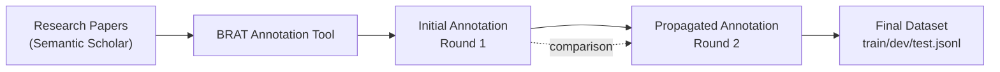
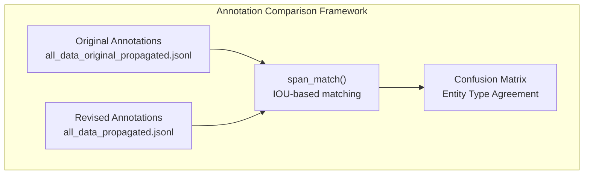
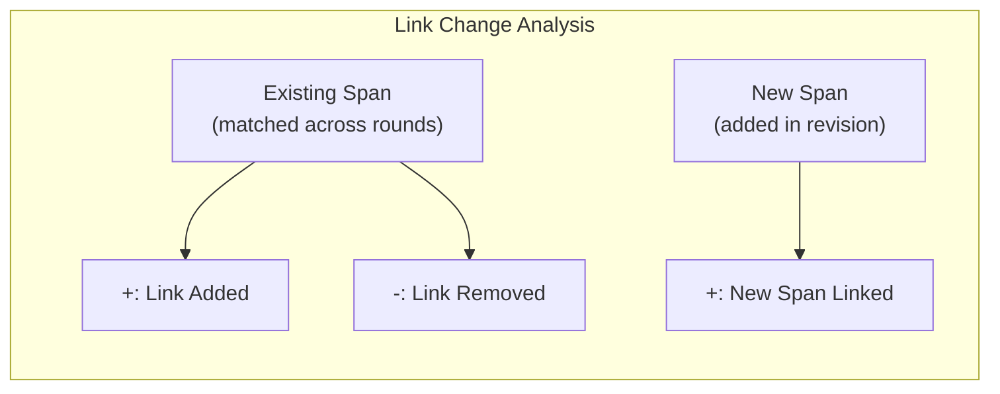
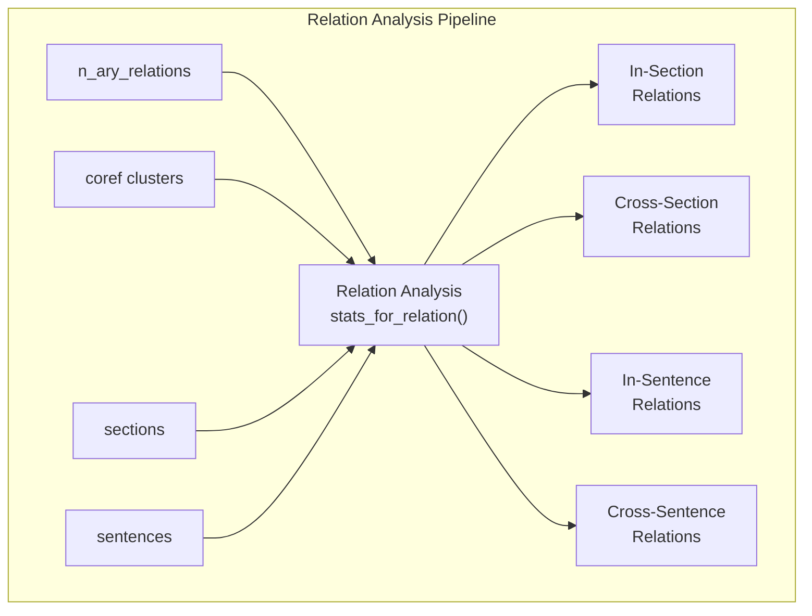

<!-- source: DeepWiki mcp.deepwiki.com · repo allenai/SciREX · page 2.3 Annotation Guidelines and Statistics · fetched 2026-10-26 -->

# Annotation Guidelines and Statistics

<details>
<summary>Relevant source files</summary>

The following files were used as context for generating this wiki page:

- [Annotation Guidelines.pdf](Annotation Guidelines.pdf)
- [notebooks/Annotation Statistics.ipynb](notebooks/Annotation Statistics.ipynb)
- [notebooks/Fuzzy Matching Threshold.ipynb](notebooks/Fuzzy Matching Threshold.ipynb)

</details>


## Purpose and Scope

This page documents the annotation process used to create the SciREX dataset, including the guidelines provided to annotators and statistical analyses of annotation quality and inter-annotator agreement. This complements the data format specification covered in [2.1](#2.1) and focuses on the human annotation process and quality metrics.

For information about how the annotated data is loaded and processed by the system, see [2.2](#2.2).

## Annotation Guidelines

The annotation process for SciREX is documented in the `Annotation Guidelines.pdf` file, which provides detailed instructions for annotators on how to identify and label scientific entities and their relationships in research papers.

### Annotation Workflow



**Diagram: Annotation Workflow Pipeline**

The annotation process involves multiple rounds:
1. **Initial annotation**: Annotators identify entities and relations in research papers
2. **Propagation**: Annotations are propagated across coreference clusters
3. **Review round**: A second round compares and refines annotations
4. **Final dataset**: Consolidated annotations are exported to JSONL format

**Sources:** [Annotation Guidelines.pdf:1-200](), [notebooks/Annotation Statistics.ipynb:32-34]()

### Entity Types

Annotators label four primary entity types as defined in the `used_entities` list:

| Entity Type | Description | Example |
|------------|-------------|---------|
| **Method** | Techniques, algorithms, or approaches | "BERT", "attention mechanism" |
| **Task** | Research problems or objectives | "machine translation", "sentiment analysis" |
| **Material** | Datasets, corpora, or resources | "ImageNet", "WMT14 dataset" |
| **Metric** | Evaluation measures | "BLEU score", "F1 measure" |

**Sources:** [notebooks/Annotation Statistics.ipynb:23]()

### Coreference and Relation Annotation

Beyond entity identification, annotators:
- Link coreferent mentions into clusters (e.g., "our model", "the proposed approach", "it")
- Annotate n-ary relations between entity clusters
- Include method subrelations for compositional methods

**Sources:** [notebooks/Annotation Statistics.ipynb:43-59]()

## Inter-Annotator Agreement Statistics

### Entity Type Agreement

The following confusion matrix shows agreement between original and revised annotations across 440 documents, measuring how entity type assignments changed between annotation rounds:



**Diagram: Inter-Annotator Agreement Analysis Pipeline**

**Sources:** [notebooks/Annotation Statistics.ipynb:10-14](), [notebooks/Annotation Statistics.ipynb:68-99]()

#### Entity Type Confusion Matrix

The following table shows the percentage of entity mentions by type in original annotations (rows) and how they were classified in revised annotations (columns):

| Original | Material | Metric | Task | Method | None |
|----------|----------|--------|------|--------|------|
| **Material** | 3.55% | 0.01% | 0.07% | 0.16% | 0.03% |
| **Metric** | 0.02% | 7.95% | 0.00% | 0.03% | 0.00% |
| **Task** | 0.32% | 0.07% | 17.92% | 0.44% | 0.01% |
| **Method** | 0.65% | 0.21% | 0.24% | 53.27% | 0.02% |
| **None** | 2.40% | 1.30% | 2.82% | 8.50% | 0.00% |

**Key observations:**
- **High agreement on main types**: Material (3.55%), Metric (7.95%), Task (17.92%), Method (53.27%)
- **Method dominance**: Method entities comprise 62.4% of all annotations
- **Low disagreement**: "None" row shows entities added in revision (15.02% total new entities)
- **Strong diagonal**: Most entities retain their original type assignment

**Sources:** [notebooks/Annotation Statistics.ipynb:117-135](), [notebooks/Annotation Statistics.ipynb:158-188]()

### Coreference Link Changes

The analysis tracks how coreference cluster assignments changed between annotation rounds:



**Diagram: Coreference Link Change Categories**

**Sources:** [notebooks/Annotation Statistics.ipynb:196-226]()

#### Coreference Modification Statistics

| Entity Type | Exist (+) | Exist (-) | New (+) | New (-) |
|-------------|-----------|-----------|---------|---------|
| **Material** | 1.2% | 0.8% | 6.8% | 0.0% |
| **Metric** | 0.4% | 1.2% | 2.8% | 0.0% |
| **Task** | 0.9% | 1.6% | 5.4% | 0.0% |
| **Method** | 1.7% | 14.0% | 8.0% | 0.0% |

**Legend:**
- **Exist (+)**: Existing spans with new coreference links added
- **Exist (-)**: Existing spans with coreference links removed
- **New (+)**: Newly annotated spans that were linked to clusters
- **New (-)**: Newly annotated spans without links (always 0%)

**Key findings:**
- Average of **12.4% of spans modified** per document (1,968 total changes / 440 docs / 360 avg spans)
- Method entities show highest modification rate (23.7% of changes)
- Link removal most common for Methods (14.0%), indicating refinement of over-connected clusters
- New span linking (22.0%) indicates annotation completeness improvements

**Sources:** [notebooks/Annotation Statistics.ipynb:243-252](), [notebooks/Annotation Statistics.ipynb:256-301]()

## Relation Statistics

### N-ary Relation Distribution

The dataset contains relations of varying cardinality (2-ary, 3-ary, and 4-ary):



**Diagram: N-ary Relation Scope Analysis**

The function `map_to_section_and_sentence()` maps each entity mention to its containing section and sentence, enabling analysis of relation scope.

**Sources:** [notebooks/Annotation Statistics.ipynb:305-358](), [notebooks/Annotation Statistics.ipynb:386-418]()

### Relation Scope Statistics

Average number of relations per document by cardinality and scope:

| n-ary | In Section | In Sentence | Out Section | Out Sentence |
|-------|------------|-------------|-------------|--------------|
| **2-ary** | 12.380 | 6.630 | 16.980 | 22.730 |
| **3-ary** | 4.955 | 0.591 | 14.618 | 18.982 |
| **4-ary** | 0.707 | 0.011 | 4.186 | 4.882 |

**Key insights:**
- **2-ary relations**: 29.36 per document (most common)
- **3-ary relations**: 19.57 per document  
- **4-ary relations**: 5.59 per document (least common)
- **Cross-sentence relations dominate**: 77.5% of 2-ary, 97.0% of 3-ary, 99.3% of 4-ary relations span multiple sentences
- **Section-level scope**: Higher cardinality relations are increasingly distributed across sections

This distribution reflects the complexity of scientific discourse, where multi-hop reasoning across sentences and sections is necessary to extract complete research findings.

**Sources:** [notebooks/Annotation Statistics.ipynb:436-463](), [notebooks/Annotation Statistics.ipynb:488-491]()

### Unique Relation Extraction

To compute distinct relations (avoiding double-counting from entity type combinations):

```python
# From notebook cell [26-28]
def stats_for_relation(data):
    n_ary_relations = data['n_ary_relations']
    for card in range(2, 5):
        rels = []
        for elist in combinations(used_entities, card):
            for rel in n_ary_relations:
                rel = [rel[k] for k in elist]
                rels.append(tuple(rel))
        rels = set(rels)  # Deduplicate
        stats[card] = len(rels)
```

This deduplication ensures each unique cluster tuple is counted once, regardless of which entity type combinations it appears in.

**Sources:** [notebooks/Annotation Statistics.ipynb:540-557](), [notebooks/Annotation Statistics.ipynb:572-577]()

## Statistical Code Implementations

### Entity Span Matching

The `span_match()` function computes Intersection over Union (IoU) between spans:

```python
def span_match(span_1, span_2):
    sa, ea = span_1
    sb, eb = span_2
    iou = (min(ea, eb) - max(sa, sb)) / (max(eb, ea) - min(sa, sb))
    return iou
```

Spans are considered matching if `iou > 0.5`, allowing for minor boundary differences while requiring substantial overlap.

**Sources:** [notebooks/Annotation Statistics.ipynb:10-14]()

### Confusion Matrix Computation

The `matching()` function computes entity type agreement:

```python
def matching(spans_1, spans_2):
    match = np.zeros((len(spans_1), len(spans_2)))
    match_types = {k + '_1':{l + '_2':0 for l in ents} for k in ents}
    
    # Exact span matching
    for i, s1 in enumerate(spans_1):
        for j, s2 in enumerate(spans_2):
            if (s1[0], s1[1]) == (s2[0], s2[1]):
                match[i, j] = 1
    
    # Aggregate type agreements
    # ... (counting logic)
    return match_types
```

This strict exact-match approach ensures only identical span boundaries are compared for type agreement.

**Sources:** [notebooks/Annotation Statistics.ipynb:68-99]()

### Coreference Link Analysis

The `matching_links()` function tracks coreference changes:

```python
def matching_links(spans_1, spans_2, links_1, links_2):
    # Match spans with IoU > 0.5
    for i, s1 in enumerate(spans_1):
        for j, s2 in enumerate(spans_2):
            if span_match((s1[0], s1[1]), (s2[0], s2[1])) > 0.5:
                match[i, j] = 1
    
    # Compare cluster membership
    for matched_span:
        new_links = links_2.get(span, set())
        old_links = links_1.get(span, set())
        match_types[type]['Exist']['+'] += len(new_links - old_links) > 0
        match_types[type]['Exist']['-'] += len(old_links - new_links) > 0
```

This uses fuzzy matching (IoU > 0.5) to handle minor span boundary variations while tracking precise cluster membership changes.

**Sources:** [notebooks/Annotation Statistics.ipynb:196-226]()

## Summary

The SciREX annotation process produced a high-quality dataset with:
- **Strong entity type agreement**: 82.7% of entities retained original types
- **Controlled coreference refinement**: 12.4% modification rate shows iterative improvement
- **Complex relation structure**: Average of 54.5 relations per document across 2-4 entity clusters
- **Cross-sentence reasoning**: 77-99% of relations require multi-sentence inference
- **Rigorous guidelines**: Documented in `Annotation Guidelines.pdf` for reproducibility

These statistics demonstrate the dataset's suitability for document-level information extraction research, with substantial inter-annotator agreement and rich relational structure that captures scientific discourse complexity.

**Sources:** [Annotation Guidelines.pdf:1-200](), [notebooks/Annotation Statistics.ipynb:1-577]()

---

