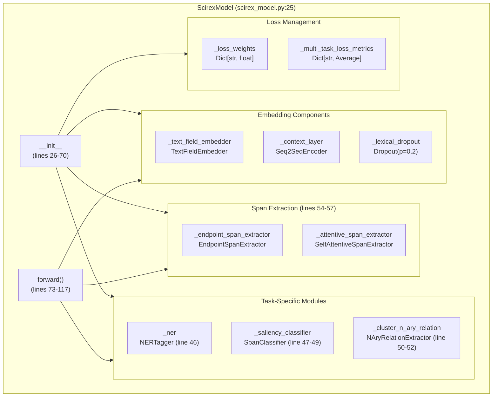
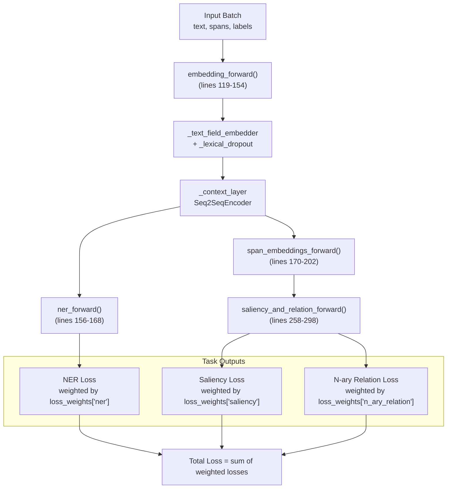
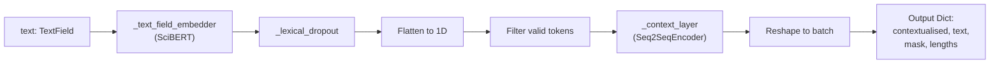
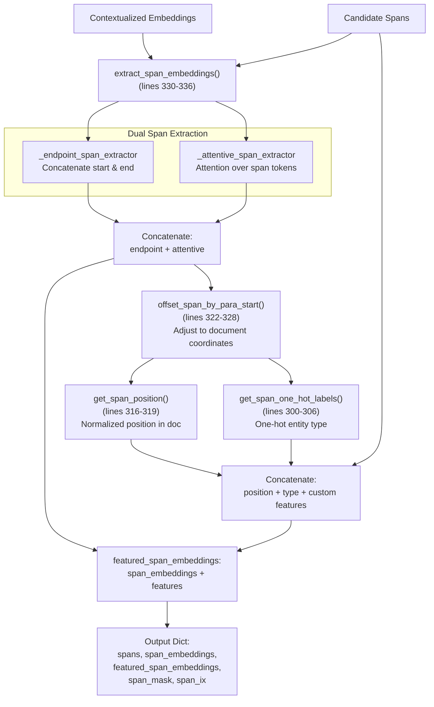
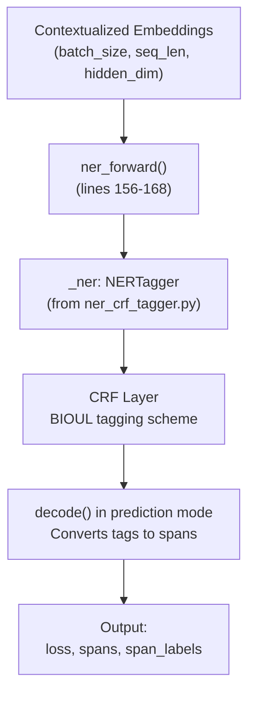
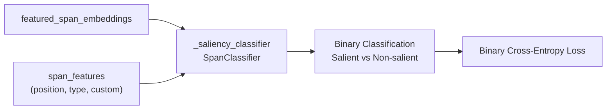
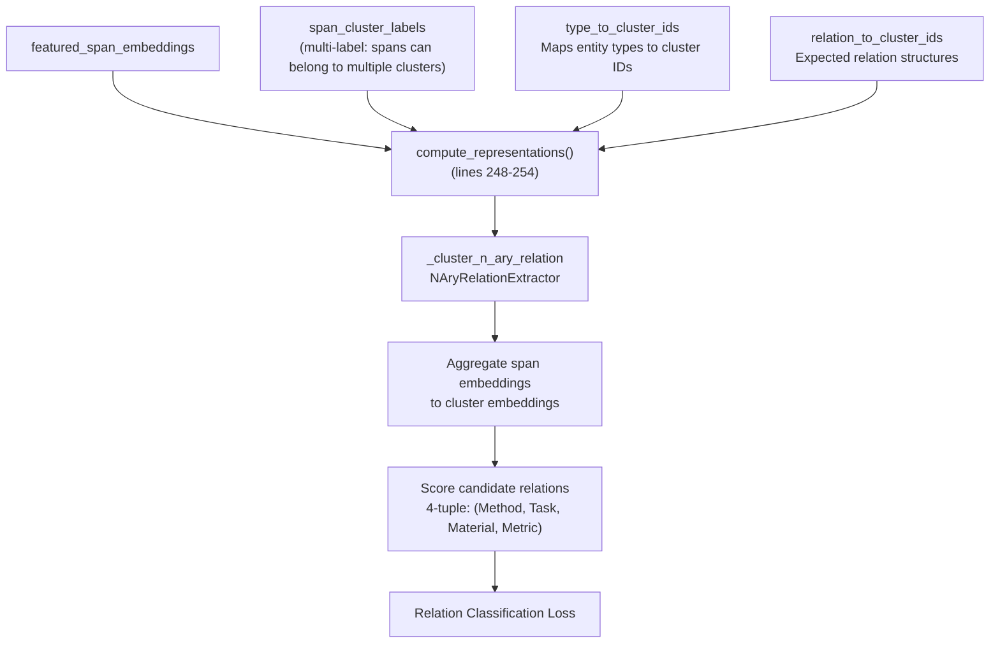
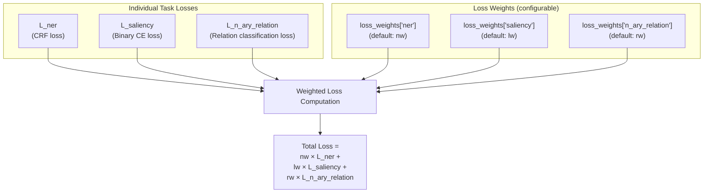
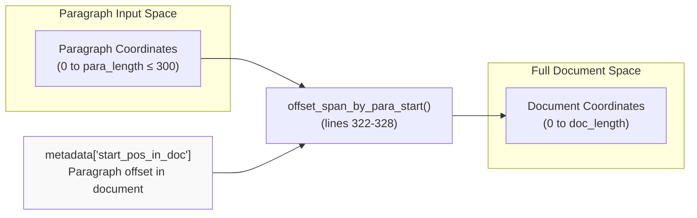
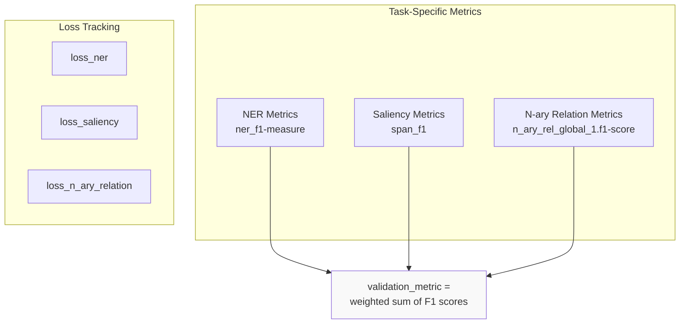

<!-- source: DeepWiki mcp.deepwiki.com · repo allenai/SciREX · page 3 Model Architecture · fetched 2026-10-26 -->

# Model Architecture

<details>
<summary>Relevant source files</summary>

The following files were used as context for generating this wiki page:

- [README.md](README.md)
- [dygiepp/dygie/models/dygie.py](dygiepp/dygie/models/dygie.py)
- [dygiepp/scripts/train/train_pwc.sh](dygiepp/scripts/train/train_pwc.sh)
- [requirements.txt](requirements.txt)
- [scirex/data/utils/scirex_to_scierc_format.py](scirex/data/utils/scirex_to_scierc_format.py)
- [scirex/models/scirex_model.py](scirex/models/scirex_model.py)
- [scirex/predictors/utils.py](scirex/predictors/utils.py)

</details>


This document provides a technical overview of the neural network architectures used in the SciREX system for document-level information extraction. It covers the primary `ScirexModel` multi-task architecture, its component modules, and the data flow through the model during training and inference.

For details on training procedures and configuration parameters, see [Training](#4). For information on how models generate predictions, see [Prediction Pipeline](#5.1). For detailed documentation of individual component models, see [Component Models](#3.2).

## Overview

The SciREX system employs a multi-task learning architecture that jointly learns three information extraction tasks:

| Task | Purpose | Output |
|------|---------|--------|
| **Named Entity Recognition (NER)** | Identify typed entity mentions at the token level | Span boundaries and entity types (Method, Task, Material, Metric) |
| **Saliency Classification** | Identify which entity mentions are salient to the document | Binary classification per span |
| **N-ary Relation Extraction** | Predict relations between entity clusters | 4-ary tuples of entity clusters |

The architecture is implemented primarily in the `ScirexModel` class ([scirex/models/scirex_model.py:25-442]()), which extends AllenNLP's `Model` base class. The model processes entire document paragraphs (up to 300 words) and produces predictions for all three tasks simultaneously.

**Sources:** [scirex/models/scirex_model.py](), [README.md:40-46]()

## Core Architecture Components

### ScirexModel Class Structure

The following diagram maps the main components of `ScirexModel` to their code locations:



**Sources:** [scirex/models/scirex_model.py:25-70]()

### Initialization Parameters

The `ScirexModel.__init__()` method accepts the following key parameters:

| Parameter | Type | Purpose |
|-----------|------|---------|
| `vocab` | `Vocabulary` | AllenNLP vocabulary for label indexing |
| `text_field_embedder` | `TextFieldEmbedder` | Typically SciBERT embeddings |
| `context_layer` | `Seq2SeqEncoder` | Contextual encoder (LSTM/Transformer) |
| `modules` | `Params` | Configuration for NER, saliency, and relation modules |
| `loss_weights` | `Dict[str, int]` | Weights for multi-task loss: `{"ner": nw, "saliency": lw, "n_ary_relation": rw}` |
| `lexical_dropout` | `float` | Dropout rate applied to embeddings (default: 0.2) |

**Sources:** [scirex/models/scirex_model.py:26-37]()

## Data Flow Through the Model

### Forward Pass Architecture

The `forward()` method orchestrates the multi-task learning process. The following diagram shows the data flow:



**Sources:** [scirex/models/scirex_model.py:73-117]()

### Embedding Forward Pass

The `embedding_forward()` method ([scirex/models/scirex_model.py:119-154]()) processes raw text into contextualized embeddings:



The output dictionary contains:
- `"contextualised"`: Contextualized embeddings with shape `(batch_size, max_length, encoding_dim)`
- `"text"`: Original text embeddings
- `"mask"`: Attention mask indicating valid positions
- `"lengths"`: Sentence lengths for each batch element

**Sources:** [scirex/models/scirex_model.py:119-154]()

### Span Embedding Extraction

The `span_embeddings_forward()` method ([scirex/models/scirex_model.py:170-202]()) extracts and enriches span representations:



The span extraction uses two complementary methods:
- **EndpointSpanExtractor** ([scirex/models/scirex_model.py:54-56]()): Concatenates the embeddings at span boundaries with `combination="x,y"`
- **SelfAttentiveSpanExtractor** ([scirex/models/scirex_model.py:57]()): Applies attention mechanism over tokens within the span

**Sources:** [scirex/models/scirex_model.py:170-202](), [scirex/models/scirex_model.py:330-336]()

## Task-Specific Modules

### NER Module

The NER module is implemented via the `NERTagger` class and processes token sequences:



During training, the NER module computes a CRF loss. During prediction (`prediction_mode=True`), it decodes the tag sequence into spans with entity types ([scirex/models/scirex_model.py:163-166]()).

**Sources:** [scirex/models/scirex_model.py:156-168](), [scirex/models/scirex_model.py:46]()

### Saliency Classifier

The saliency classifier determines which entity mentions are salient (important) to the document:



The saliency classifier is a `SpanClassifier` instance ([scirex/models/scirex_model.py:47-49]()) that performs binary classification on each span. The output is used by the relation extractor to focus on salient entities.

**Sources:** [scirex/models/scirex_model.py:204-229](), [scirex/models/scirex_model.py:47-49]()

### N-ary Relation Extractor

The relation extractor predicts 4-ary relations between entity clusters:



The relation extractor operates on **cluster-level** rather than span-level representations. It aggregates span embeddings within each coreference cluster and scores candidate 4-ary relations between clusters ([scirex/models/scirex_model.py:248-254]()).

**Sources:** [scirex/models/scirex_model.py:231-256](), [scirex/models/scirex_model.py:50-52]()

## Multi-Task Loss Computation

The total loss is a weighted sum of task-specific losses:



The loss computation occurs in the `forward()` method ([scirex/models/scirex_model.py:92-109]()):

```python
loss = 0.0
if self._loss_weights["ner"] > 0.0:
    loss += self._loss_weights["ner"] * output_dict["ner"]["loss"]
if self._loss_weights["saliency"] > 0.0:
    loss += self._loss_weights["saliency"] * output_dict["saliency"]["loss"]
if self._loss_weights["n_ary_relation"] > 0.0:
    loss += self._loss_weights["n_ary_relation"] * output_dict["n_ary_relation"]["loss"]
```

Loss weights can be set to 0 to disable specific tasks during training, enabling task-specific training or ablation studies.

**Sources:** [scirex/models/scirex_model.py:92-109](), [scirex/models/scirex_model.py:59-62]()

## Coordinate Systems and Offset Handling

The model operates on paragraph-level inputs but maintains document-level coordinate systems for evaluation:



The `offset_span_by_para_start()` method ([scirex/models/scirex_model.py:322-328]()) converts paragraph-relative span coordinates to document-relative coordinates by adding the paragraph's start position. This is critical for maintaining alignment between predictions across different paragraphs of the same document.

**Sources:** [scirex/models/scirex_model.py:322-328](), [scirex/models/scirex_model.py:179]()

## Prediction Mode vs Training Mode

The model has two operational modes controlled by boolean flags:

| Mode | Flag | Behavior |
|------|------|----------|
| **Training** | `training_mode = True` | Computes losses, updates metrics |
| **Prediction** | `prediction_mode = True` | Decodes outputs to human-readable formats, skips loss computation |

In prediction mode ([scirex/models/scirex_model.py:163-166]()):
- NER predictions are decoded from BIOUL tags to spans
- Saliency scores are thresholded to produce binary labels
- Relation predictions are converted from cluster IDs to entity names

**Sources:** [scirex/models/scirex_model.py:67-68](), [scirex/models/scirex_model.py:163-166]()

## Metrics and Validation

The model tracks metrics for each task via the `get_metrics()` method ([scirex/models/scirex_model.py:389-434]()):



The validation metric ([scirex/models/scirex_model.py:415-420]()) combines weighted F1 scores from all tasks:

```python
all_metrics["validation_metric"] = (
    self._loss_weights["ner"] * nan_to_zero(metrics_ner.get("ner_f1-measure", 0))
    + self._loss_weights["saliency"] * nan_to_zero(metrics_saliency.get("span_f1", 0))
    + self._loss_weights["n_ary_relation"] * nan_to_zero(metrics_n_ary.get("n_ary_rel_global_1.f1-score", 0))
)
```

**Sources:** [scirex/models/scirex_model.py:389-434]()

## Alternative Model: DyGIE++

The repository also integrates with the DyGIE++ framework as an alternative modeling approach. The `DyGIE` model ([dygiepp/dygie/models/dygie.py:28-405]()) implements a joint information extraction architecture with:

- **CorefResolver**: Coreference resolution module with propagation
- **NERTagger**: Named entity recognition
- **RelationExtractor**: Binary relation extraction (different from SciREX's N-ary relations)
- **EventExtractor**: Event extraction (not used in SciREX)

The key architectural difference is that DyGIE++ uses **graph propagation** to share information between spans, whereas SciREX uses a more traditional multi-task architecture without propagation layers.

For details on how to use DyGIE++ with SciREX data, see [DyGIE++ Integration](#7.1).

**Sources:** [dygiepp/dygie/models/dygie.py:28-405](), [dygiepp/scripts/train/train_pwc.sh]()

## Architecture Summary Table

| Component | Implementation | Input | Output | Role |
|-----------|----------------|-------|--------|------|
| **Text Embedder** | `TextFieldEmbedder` (SciBERT) | Token IDs | Token embeddings | Contextual word representations |
| **Context Layer** | `Seq2SeqEncoder` | Token embeddings | Contextualized embeddings | Encode sequential context |
| **Span Extractor** | `EndpointSpanExtractor` + `SelfAttentiveSpanExtractor` | Contextualized embeddings + spans | Span embeddings | Extract fixed-length span representations |
| **NER Tagger** | `NERTagger` (CRF) | Contextualized embeddings | Entity spans + types | Token-level entity recognition |
| **Saliency Classifier** | `SpanClassifier` | Featured span embeddings | Binary labels | Identify important mentions |
| **Relation Extractor** | `NAryRelationExtractor` | Cluster embeddings | 4-ary relations | Cluster-level relation prediction |

**Sources:** [scirex/models/scirex_model.py:26-70]()

---

