<!-- source: DeepWiki mcp.deepwiki.com · repo allenai/SciREX · page 3.1 ScirexModel: Multi-Task Information Extraction · fetched 2026-10-26 -->

# ScirexModel: Multi-Task Information Extraction

<details>
<summary>Relevant source files</summary>

The following files were used as context for generating this wiki page:

- [dygiepp/dygie/models/dygie.py](dygiepp/dygie/models/dygie.py)
- [dygiepp/scripts/train/train_pwc.sh](dygiepp/scripts/train/train_pwc.sh)
- [scirex/data/utils/scirex_to_scierc_format.py](scirex/data/utils/scirex_to_scierc_format.py)
- [scirex/models/scirex_model.py](scirex/models/scirex_model.py)
- [scirex/predictors/utils.py](scirex/predictors/utils.py)

</details>


## Purpose and Scope

This document provides detailed technical documentation for the `ScirexModel` class, the primary multi-task neural network architecture in the SciREX system. The `ScirexModel` jointly performs three information extraction tasks: Named Entity Recognition (NER), salient mention classification, and N-ary relation extraction. 

For information about training this model, see [Training Scripts and Workflows](#4.1). For details on the prediction pipeline that uses this model, see [Prediction Pipeline](#5.1). For configuration parameters, see [Model Configuration](#3.3). For component models like the standalone relation extractor and coreference models, see [Component Models](#3.2).

---

## Architecture Overview

The `ScirexModel` is registered as `"scirex_model"` in AllenNLP and is defined in [scirex/models/scirex_model.py:24-442](). It implements a multi-task learning framework where shared contextualized representations feed into three parallel task-specific modules.

### High-Level Architecture

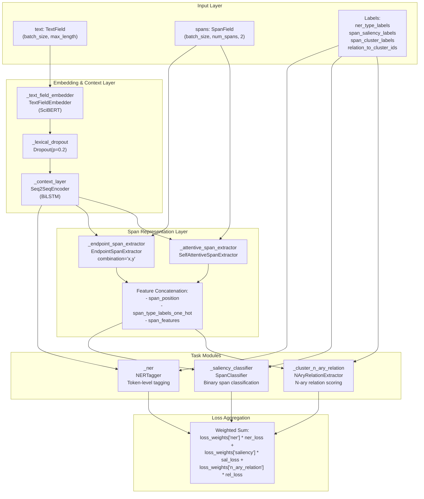

**Sources:** [scirex/models/scirex_model.py:26-70]()

---

## Model Initialization

The `ScirexModel.__init__` method [scirex/models/scirex_model.py:26-70]() initializes all components:

### Key Parameters

| Parameter | Type | Purpose |
|-----------|------|---------|
| `vocab` | `Vocabulary` | AllenNLP vocabulary for token/label indexing |
| `text_field_embedder` | `TextFieldEmbedder` | Typically SciBERT for domain-specific embeddings |
| `context_layer` | `Seq2SeqEncoder` | Typically BiLSTM for contextualizing embeddings |
| `modules` | `Params` | Nested parameters for NER, saliency, and relation modules |
| `loss_weights` | `Dict[str, int]` | Weights for each task: `"ner"`, `"saliency"`, `"n_ary_relation"` |
| `lexical_dropout` | `float` | Dropout probability for embeddings (default: 0.2) |

### Component Instantiation

The model instantiates three task-specific modules from the provided `modules` parameter:

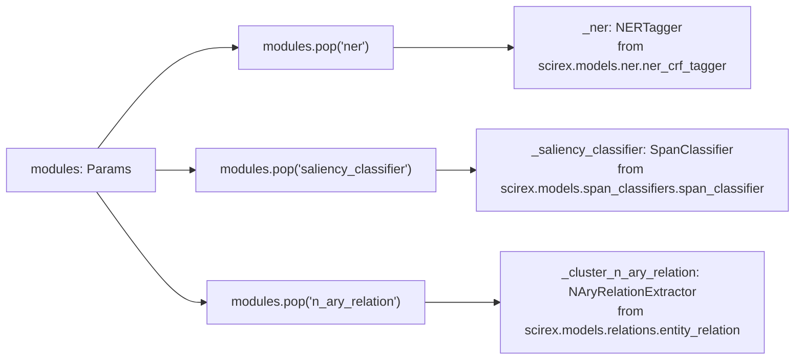

**Sources:** [scirex/models/scirex_model.py:44-52]()

### Span Extractors

Two span extractors are initialized to capture different aspects of span representations:

- **`_endpoint_span_extractor`**: [scirex/models/scirex_model.py:54-56]() - Concatenates start and end token embeddings using `combination="x,y"`
- **`_attentive_span_extractor`**: [scirex/models/scirex_model.py:57]() - Uses self-attention over span tokens

**Sources:** [scirex/models/scirex_model.py:54-57]()

---

## Forward Pass: Main Pipeline

The `forward` method [scirex/models/scirex_model.py:72-117]() orchestrates the entire multi-task forward pass.

### Forward Pass Flow

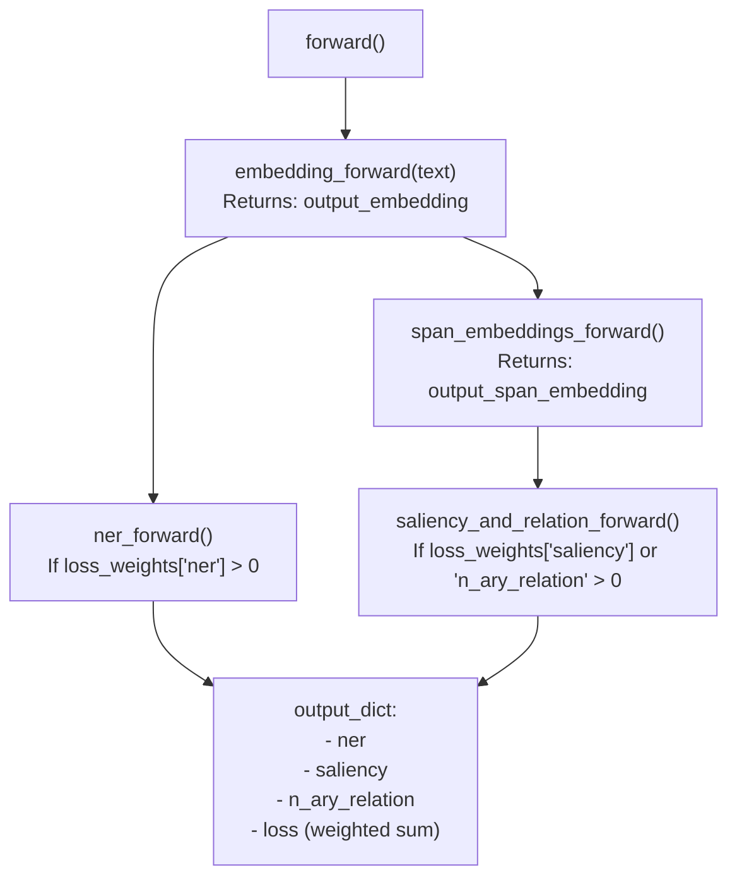

### Method Signatures

**Input Parameters:**
- `text`: TextField containing tokenized input
- `ner_type_labels`: Token-level NER labels
- `spans`: SpanField with candidate span indices
- `span_cluster_labels`: Multi-label cluster assignments (MultiLabelField)
- `span_saliency_labels`: Binary saliency labels
- `span_type_labels`: Predicted entity types for spans
- `span_features`: Additional span features
- `relation_to_cluster_ids`: Ground truth N-ary relations
- `metadata`: Document metadata including cluster information

**Sources:** [scirex/models/scirex_model.py:72-117]()

---

## Embedding Forward: Text Encoding

The `embedding_forward` method [scirex/models/scirex_model.py:119-154]() transforms raw text into contextualized embeddings.

### Embedding Pipeline

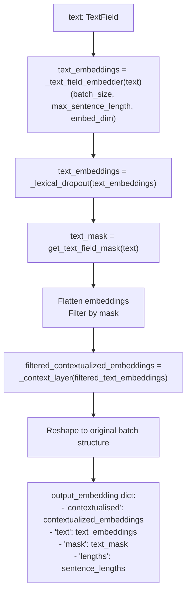

### Key Operations

1. **Embedding**: [scirex/models/scirex_model.py:121]() - Apply text field embedder (SciBERT)
2. **Dropout**: [scirex/models/scirex_model.py:121]() - Apply lexical dropout
3. **Masking**: [scirex/models/scirex_model.py:122-123]() - Extract valid token positions
4. **Flattening**: [scirex/models/scirex_model.py:126-129]() - Flatten batch for efficient encoding
5. **Contextualization**: [scirex/models/scirex_model.py:130-133]() - Apply BiLSTM context layer
6. **Reshaping**: [scirex/models/scirex_model.py:135-146]() - Restore batch structure

**Sources:** [scirex/models/scirex_model.py:119-154]()

---

## NER Forward: Token-Level Tagging

The `ner_forward` method [scirex/models/scirex_model.py:156-168]() handles named entity recognition at the token level.

### NER Processing

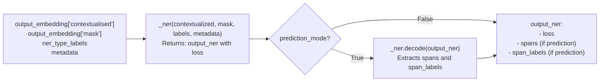

**Prediction Mode:** When `self.prediction_mode` is True [scirex/models/scirex_model.py:163-166](), the method decodes predictions to extract span boundaries and labels, which are then used by downstream tasks.

**Sources:** [scirex/models/scirex_model.py:156-168]()

---

## Span Embeddings Forward: Feature-Rich Span Representations

The `span_embeddings_forward` method [scirex/models/scirex_model.py:170-202]() creates enriched span representations by combining span extractors with positional and type features.

### Span Embedding Pipeline

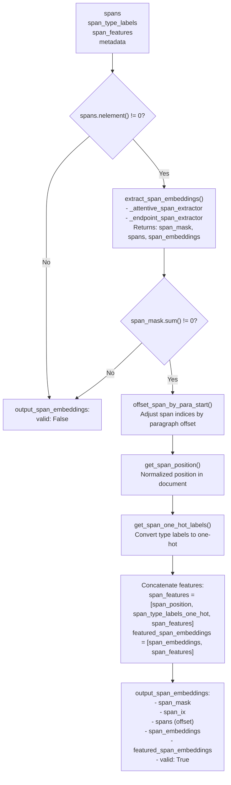

### Feature Engineering

The method constructs rich span representations through:

1. **Span Extraction** [scirex/models/scirex_model.py:174-176]():
   - Endpoint embeddings: concatenate start and end token representations
   - Attentive embeddings: weighted sum over span tokens

2. **Offset Adjustment** [scirex/models/scirex_model.py:179]():
   - Adjusts paragraph-relative spans to document-level offsets using `start_pos_in_doc` from metadata

3. **Position Features** [scirex/models/scirex_model.py:180]():
   - Normalized span position: `span_offset.mean() / doc_length`

4. **Type Features** [scirex/models/scirex_model.py:181-183]():
   - One-hot encoding of predicted entity types

5. **Custom Features** [scirex/models/scirex_model.py:185-186]():
   - Additional features passed via `span_features` parameter

**Sources:** [scirex/models/scirex_model.py:170-202]()

### Extract Span Embeddings Implementation

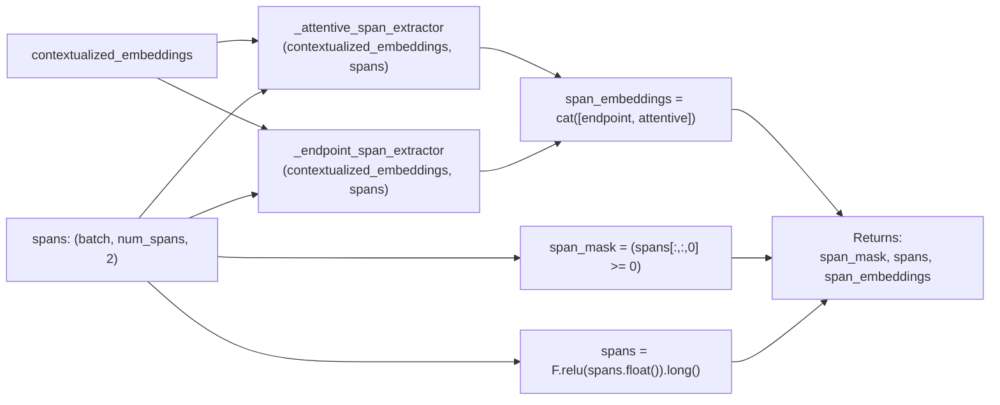

**Sources:** [scirex/models/scirex_model.py:330-336]()

---

## Saliency and Relation Forward: Span-Level Tasks

The `saliency_and_relation_forward` method [scirex/models/scirex_model.py:258-298]() jointly processes saliency classification and N-ary relation extraction.

### Task Execution Flow

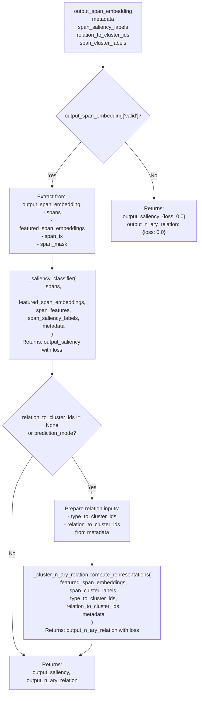

### Saliency Classification

The saliency classifier [scirex/models/scirex_model.py:278-284]() determines which spans are "salient" (i.e., worth including in downstream relation extraction). This is a binary classification task operating on the `featured_span_embeddings`.

### N-ary Relation Extraction

The relation extractor [scirex/models/scirex_model.py:286-296]() requires:
- **Span embeddings**: Rich representations from the span embedding layer
- **Coreference labels**: Multi-label cluster assignments (`span_cluster_labels`)
- **Type-to-cluster mapping**: Maps entity types to cluster IDs
- **Relation templates**: Expected N-ary relation structures from metadata

**Sources:** [scirex/models/scirex_model.py:258-298]()

---

## Loss Computation and Weighting

The model aggregates losses from all tasks using configurable weights [scirex/models/scirex_model.py:92-109]().

### Loss Aggregation

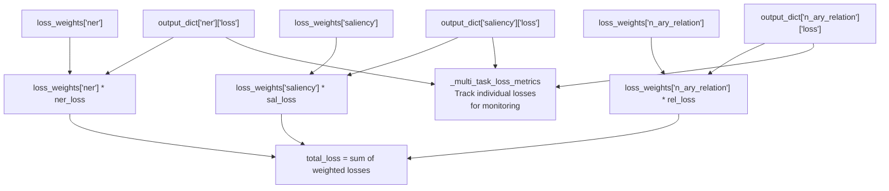

### Loss Weight Configuration

Loss weights are specified in the configuration file (see [Model Configuration](#3.3)) and control:
- **Task importance**: Higher weights prioritize specific tasks during training
- **Task enabling**: Setting weight to 0.0 disables a task entirely
- **Validation metric**: Weighted combination used for model selection [scirex/models/scirex_model.py:415-420]()

The `_permanent_loss_weights` [scirex/models/scirex_model.py:62]() preserves original weights, allowing dynamic adjustments during training.

**Sources:** [scirex/models/scirex_model.py:59-65](), [scirex/models/scirex_model.py:92-109]()

---

## Prediction and Decoding

The model supports specialized decoding methods for different use cases.

### Decode Methods

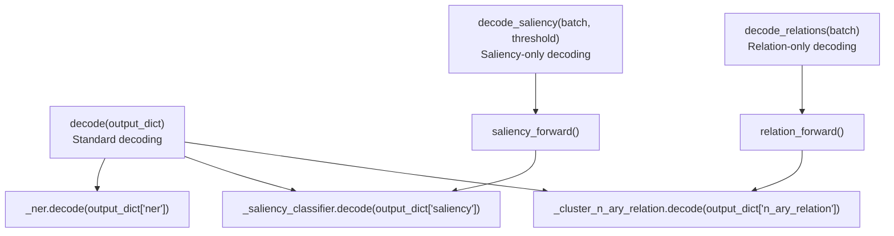

### Main Decode Method

The `decode` method [scirex/models/scirex_model.py:339-345]() converts raw model outputs to interpretable predictions by calling each submodule's decoder.

### Specialized Decode Methods

1. **`decode_saliency`** [scirex/models/scirex_model.py:347-365]():
   - Performs full forward pass through embedding and span layers
   - Applies saliency classification with optional threshold
   - Used by the salient mention predictor

2. **`decode_relations`** [scirex/models/scirex_model.py:367-387]():
   - Performs forward pass through embedding and span layers
   - Extracts N-ary relations using predicted clusters
   - Used by the relation prediction pipeline

**Sources:** [scirex/models/scirex_model.py:339-387]()

---

## Metrics and Monitoring

The `get_metrics` method [scirex/models/scirex_model.py:389-434]() aggregates metrics from all submodules.

### Metrics Collection

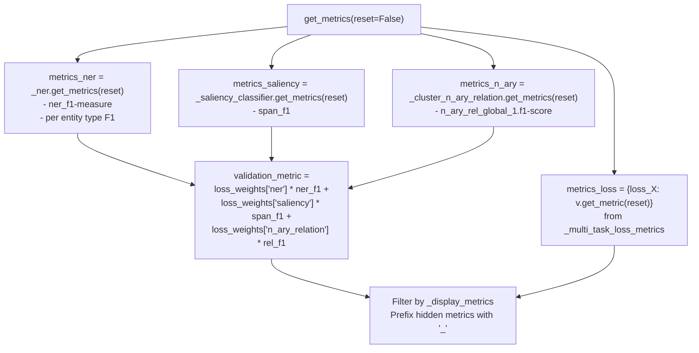

### Validation Metric

The composite `validation_metric` [scirex/models/scirex_model.py:415-420]() combines task-specific F1 scores weighted by their loss weights. This metric is used by AllenNLP for:
- Model checkpointing (saving best model)
- Early stopping
- Learning rate scheduling

The `nan_to_zero` helper function [scirex/models/scirex_model.py:437-441]() handles cases where metrics are undefined (e.g., no predictions for a class).

**Sources:** [scirex/models/scirex_model.py:389-434]()

---

## Training and Prediction Modes

The model maintains state flags to control behavior:

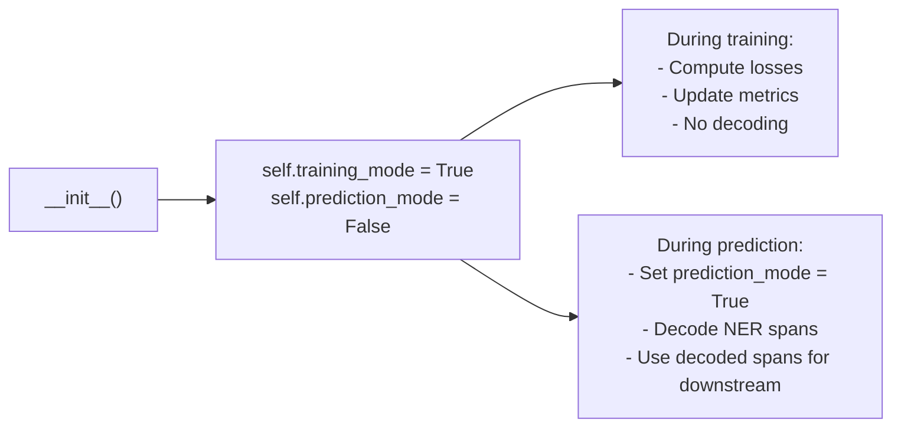

### Mode Differences

| Aspect | Training Mode | Prediction Mode |
|--------|---------------|-----------------|
| `training_mode` | `True` (default) | `True` or `False` |
| `prediction_mode` | `False` (default) | `True` (set by predictor) |
| NER output | Loss and logits | Decoded spans [scirex/models/scirex_model.py:163-166]() |
| Relation input | Gold clusters | Predicted clusters |
| Loss computation | All enabled tasks | May skip some tasks |

**Sources:** [scirex/models/scirex_model.py:67-68](), [scirex/models/scirex_model.py:163-166]()

---

## Helper Methods

### Offset Span by Paragraph Start

```python
@staticmethod
def offset_span_by_para_start(metadata, spans, span_mask)
```

**Purpose:** Converts paragraph-relative span indices to document-level indices by adding the paragraph's starting position.

**Implementation:** [scirex/models/scirex_model.py:322-328]()
- Extracts `start_pos_in_doc` from metadata
- Broadcasts offset to all spans
- Masks invalid spans

### Get Span Position

```python
@staticmethod
def get_span_position(metadata, span_offset)
```

**Purpose:** Computes normalized position feature (0.0 to 1.0) based on span location in document.

**Implementation:** [scirex/models/scirex_model.py:316-319]()
- Takes mean of start and end indices
- Divides by document length from metadata

### Get Span One Hot Labels

```python
def get_span_one_hot_labels(self, label_namespace, span_labels, spans)
```

**Purpose:** Converts integer span labels to one-hot encoded vectors.

**Implementation:** [scirex/models/scirex_model.py:300-306]()
- Determines number of labels from vocabulary
- Creates zero tensor and scatters labels

**Sources:** [scirex/models/scirex_model.py:300-328]()

---

## Comparison with DyGIE++

The SciREX system also supports the DyGIE++ model as an alternative architecture. Key differences:

| Aspect | ScirexModel | DyGIE++ Model |
|--------|-------------|---------------|
| Class name | `ScirexModel` | `DyGIE` |
| Registration | `"scirex_model"` | `"dygie"` |
| File location | [scirex/models/scirex_model.py]() | [dygiepp/dygie/models/dygie.py]() |
| Coreference | Separate pairwise model | Integrated coref module |
| Relation type | N-ary (4-ary) relations | Binary relations |
| Span features | Position + type + custom | Width embeddings + endpoint |
| Propagation | None | Coref/relation propagation |

### Architecture Comparison

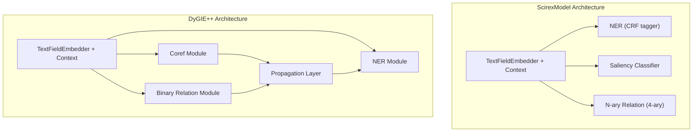

**Sources:** [scirex/models/scirex_model.py](), [dygiepp/dygie/models/dygie.py]()

---

## Usage in Prediction Pipeline

The ScirexModel is used by multiple prediction scripts in sequence:

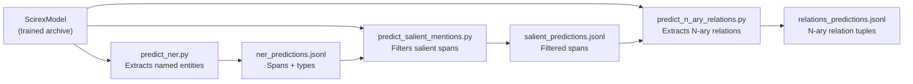

The model's `decode_saliency` and `decode_relations` methods enable modular prediction where each component can be run independently. For details on the full prediction pipeline, see [Prediction Pipeline](#5.1).

**Sources:** [scirex/models/scirex_model.py:347-387]()

---

## Configuration Example

A typical configuration snippet for ScirexModel in Jsonnet:

```json
{
  "model": {
    "type": "scirex_model",
    "text_field_embedder": {
      "token_embedders": {
        "bert": {
          "type": "pretrained_transformer",
          "model_name": "allenai/scibert_scivocab_uncased"
        }
      }
    },
    "context_layer": {
      "type": "lstm",
      "input_size": 768,
      "hidden_size": 200,
      "num_layers": 2,
      "bidirectional": true
    },
    "modules": {
      "ner": { /* NER configuration */ },
      "saliency_classifier": { /* Saliency configuration */ },
      "n_ary_relation": { /* Relation configuration */ }
    },
    "loss_weights": {
      "ner": 1.0,
      "saliency": 1.0,
      "n_ary_relation": 1.0
    },
    "lexical_dropout": 0.2
  }
}
```

For complete configuration details, see [Model Configuration](#3.3).

**Sources:** Based on configuration patterns in [scirex/models/scirex_model.py:26-70]()

---

