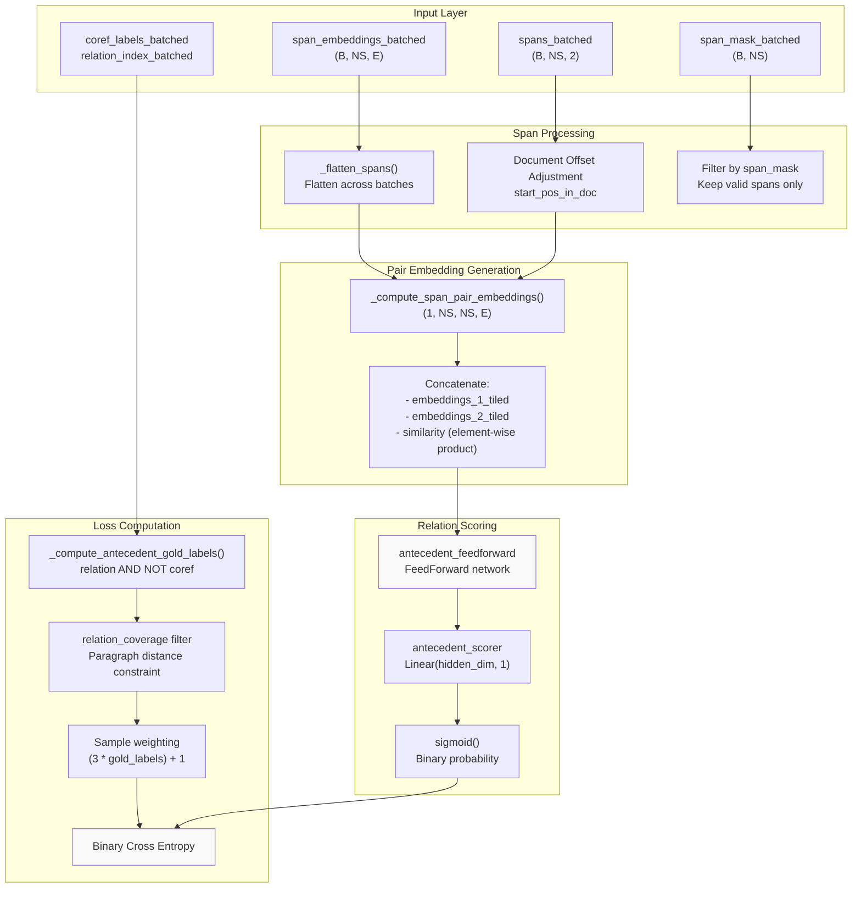
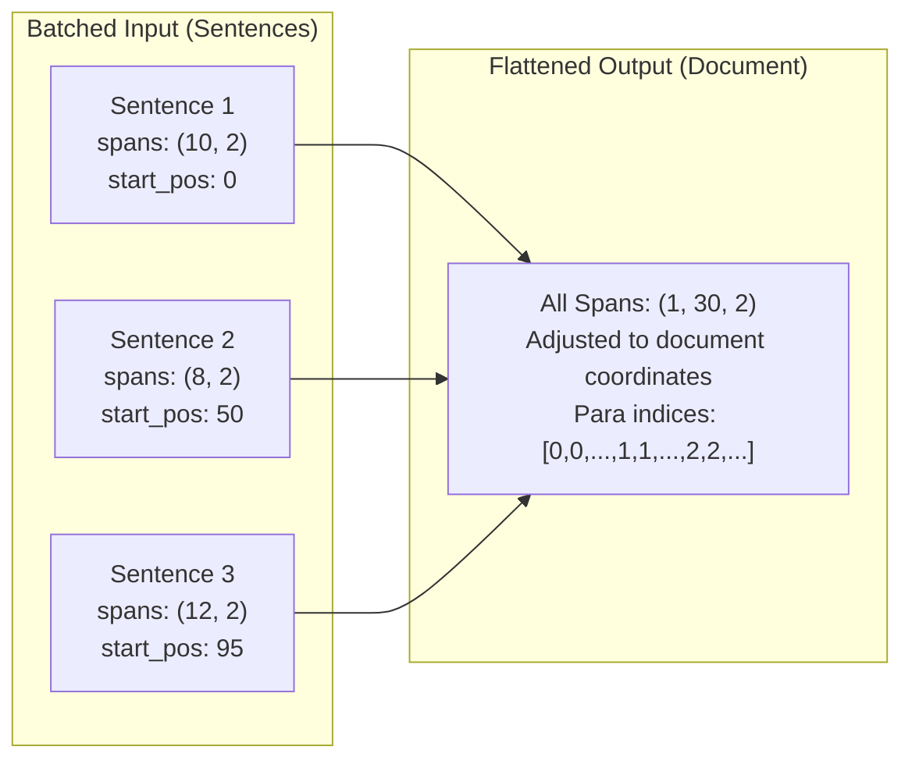
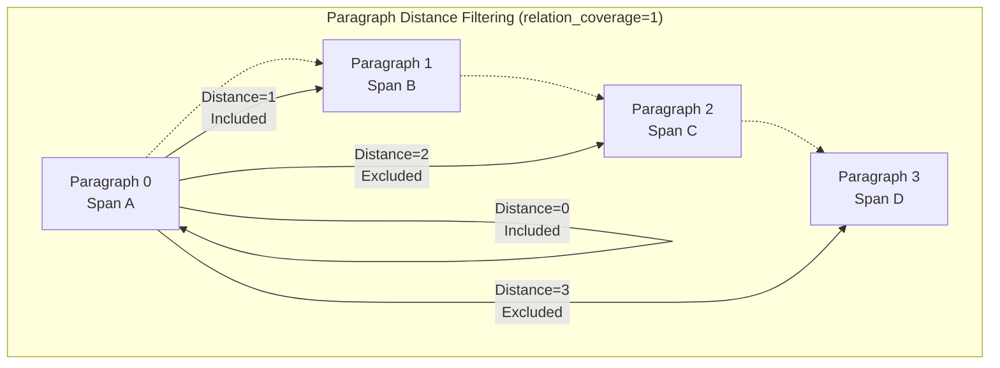
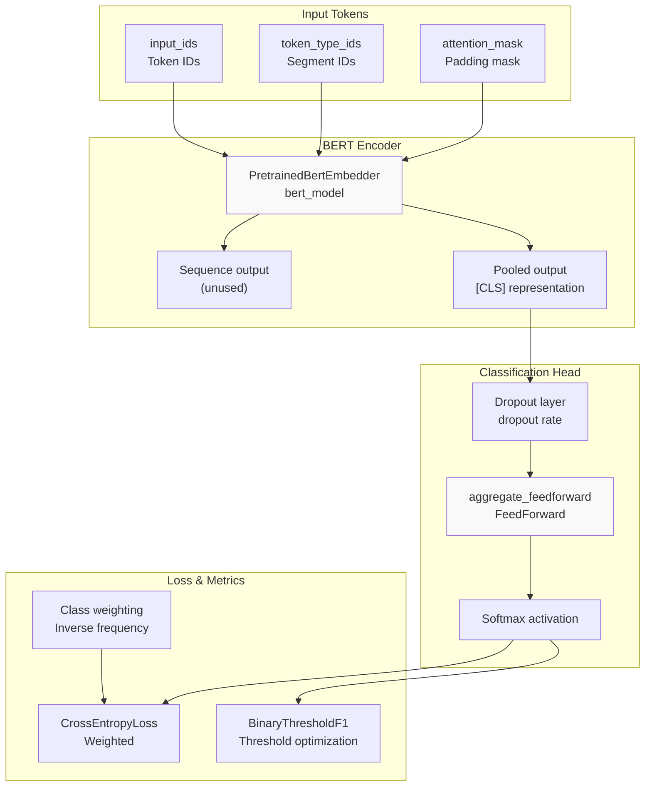
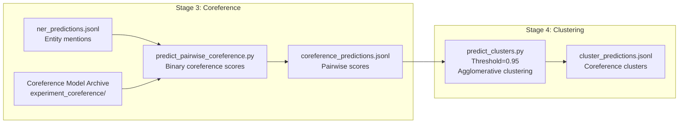
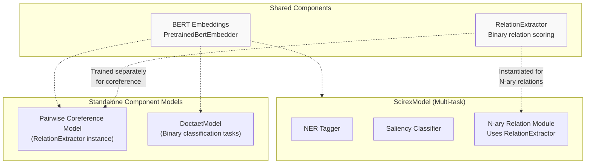
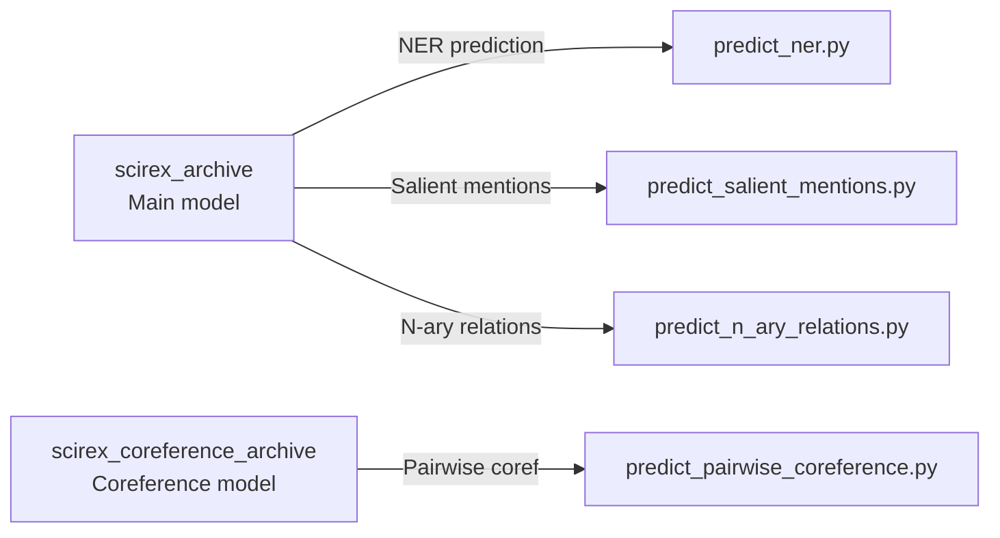

<!-- source: DeepWiki mcp.deepwiki.com · repo allenai/SciREX · page 3.2 Component Models · fetched 2026-10-26 -->

# Component Models

<details>
<summary>Relevant source files</summary>

The following files were used as context for generating this wiki page:

- [.gitignore](.gitignore)
- [scirex/commands/predict_scirex_model.sh](scirex/commands/predict_scirex_model.sh)
- [scirex/evaluation_scripts/scirex_relation_evaluate.py](scirex/evaluation_scripts/scirex_relation_evaluate.py)
- [scirex/models/doctaet.py](scirex/models/doctaet.py)
- [scirex/models/relations/mention_binary_relation.py](scirex/models/relations/mention_binary_relation.py)
- [scirex/predictors/predict_n_ary_relations.py](scirex/predictors/predict_n_ary_relations.py)

</details>


## Purpose and Scope

This page documents the specialized component models used within the SciREX system. These are distinct from the main multi-task `ScirexModel` (see [3.1](#3.1)) and serve specific purposes in the information extraction pipeline:

- **RelationExtractor**: Binary relation classification between span pairs
- **DoctaetModel**: Document-level binary classification using BERT
- **Pairwise Coreference Model**: Binary coreference resolution between mention pairs

For configuration of these models, see [Model Configuration](#3.3). For their integration into the prediction pipeline, see [Prediction Pipeline](#5.1).

---

## RelationExtractor: Binary Relation Classification

The `RelationExtractor` model performs pairwise classification to determine if two spans are related. This component is used both within the main `ScirexModel` for N-ary relation extraction and as a standalone model for pairwise coreference resolution.

### Architecture Overview



**Sources:** [scirex/models/relations/mention_binary_relation.py:17-213]()

### Key Components

#### Span Pair Embeddings

The model creates all pairwise combinations of span embeddings using `_compute_span_pair_embeddings()`:

| Component | Dimension | Description |
|-----------|-----------|-------------|
| `embeddings_1_tiled` | (B, NS, NS, E) | First span embedding repeated for all pairs |
| `embeddings_2_tiled` | (B, NS, NS, E) | Second span embedding repeated for all pairs |
| `similarity_embeddings` | (B, NS, NS, E) | Element-wise product of span embeddings |
| **Final pair embedding** | (B, NS, NS, 3E) | Concatenation of all three components |

**Sources:** [scirex/models/relations/mention_binary_relation.py:156-174]()

#### Document-Level Span Flattening



The `_flatten_spans()` method converts sentence-batched spans into a single document-level representation by:
1. Adding `start_pos_in_doc` offsets to convert sentence-relative positions to document-relative positions
2. Filtering out invalid spans based on `span_mask`
3. Tracking paragraph indices for each span

**Sources:** [scirex/models/relations/mention_binary_relation.py:54-62,193-204]()

#### Relation vs Coreference Label Computation

The model distinguishes between relations and coreference using the formula in `_compute_antecedent_gold_labels()`:

```
relation_label = relation_indicator × (relation_indicator - coref_indicator)
```

This ensures that:
- Spans in the same coreference cluster are **not** labeled as relations
- Only spans that share a relation type but are **not** coreferent are labeled as positive

**Sources:** [scirex/models/relations/mention_binary_relation.py:177-190]()

#### Paragraph Coverage Constraint

The model applies a distance constraint through `relation_coverage`:



Only span pairs within `relation_coverage` paragraphs of each other are considered for training and evaluation.

**Sources:** [scirex/models/relations/mention_binary_relation.py:110-122]()

### Training Methodology

The loss computation includes:

1. **Sample Weighting**: Positive examples receive 3× weight: `sample_weight = (3 * gold_labels) + 1`
2. **Paragraph Filtering**: Only pairs within coverage distance contribute to loss
3. **Binary Cross Entropy**: Standard BCE loss with custom weighting

```python
loss = BCE(relation_scores_filtered, gold_labels_filtered) * sample_weight_filtered
```

**Sources:** [scirex/models/relations/mention_binary_relation.py:107-136]()

### Metrics

The model uses `BinaryThresholdF1` which computes precision, recall, and F1 at multiple thresholds to find the optimal classification threshold. Metrics are prefixed with `rel_` when reported.

**Sources:** [scirex/models/relations/mention_binary_relation.py:31,134,152-154]()

---

## DoctaetModel: BERT-based Binary Classification

The `DoctaetModel` is a document-level binary classifier built on BERT. It is used for various classification tasks in the SciREX pipeline.

### Architecture



**Sources:** [scirex/models/doctaet.py:14-92]()

### Key Features

#### Class Weighting

The model automatically computes class weights based on label distribution:

```
class_weight[i] = total_samples / count(label_i)
```

This balances the loss computation for imbalanced datasets. Weights are extracted from `vocab._retained_counter["labels"]`.

**Sources:** [scirex/models/doctaet.py:34-42]()

#### BERT Integration

The model uses `PretrainedBertEmbedder` and extracts:
- **Sequence output**: Token-level representations (unused in this model)
- **Pooled output**: `[CLS]` token representation used for classification

The BERT model is accessed via `self.bert_model.bert_model` from the embedder.

**Sources:** [scirex/models/doctaet.py:29,67]()

#### Output Format

Forward pass returns:
- `label_probs`: Probability of the positive class (index obtained from vocab)
- `loss`: Weighted cross-entropy loss (only during training)
- `metadata`: Document metadata passed through

**Sources:** [scirex/models/doctaet.py:56-82]()

### Configuration Parameters

| Parameter | Type | Purpose |
|-----------|------|---------|
| `bert_model` | PretrainedBertEmbedder | BERT encoder |
| `aggregate_feedforward` | FeedForward | Classification head |
| `dropout` | float | Dropout rate (default: 0.0) |
| `index` | str | Token field name (default: "bert") |
| `label_namespace` | str | Vocabulary namespace for labels |

**Sources:** [scirex/models/doctaet.py:16-26]()

---

## Pairwise Coreference Model

The pairwise coreference model is a specialized instance of `RelationExtractor` trained to identify coreferent mentions. Unlike the relation extraction task, this model predicts whether two mentions refer to the same entity.

### Integration in Prediction Pipeline



**Sources:** [scirex/commands/predict_scirex_model.sh:18-29]()

### Training Separation

The coreference model is trained separately from the main `ScirexModel`:

| Aspect | Main Model | Coreference Model |
|--------|-----------|-------------------|
| Training script | `train_scirex_model.sh` | `train_pairwise_coreference.sh` |
| Output directory | `experiment_scirex_full/` | `experiment_coreference/` |
| Base architecture | `ScirexModel` (multi-task) | `RelationExtractor` (binary) |
| Task | NER + Saliency + Relations | Coreference only |

This separation allows independent optimization and prevents task interference during training.

**Sources:** [scirex/commands/predict_scirex_model.sh:6,20]()

### Clustering from Pairwise Scores

The clustering step (`predict_clusters.py`) converts pairwise coreference scores into clusters:

1. **Thresholding**: Filter pairs with score > 0.95
2. **Graph construction**: Build graph with spans as nodes, edges where score exceeds threshold
3. **Clustering**: Apply agglomerative clustering or connected components
4. **Output**: Map each span to a cluster ID

**Sources:** [scirex/commands/predict_scirex_model.sh:25-29]()

---

## Model Integration Summary



### Component Reuse

The modular design allows:
- `RelationExtractor` serves dual purposes: N-ary relation extraction (within `ScirexModel`) and binary coreference resolution (standalone)
- BERT embeddings are shared across all models
- Independent training prevents negative transfer between tasks
- Each component can be evaluated and optimized separately

**Sources:** [scirex/models/relations/mention_binary_relation.py](), [scirex/models/doctaet.py](), [scirex/commands/predict_scirex_model.sh]()

### Prediction Pipeline Dependencies



The prediction pipeline requires two separate model archives because the coreference model is trained independently with its own optimization objectives.

**Sources:** [scirex/commands/predict_scirex_model.sh:1-66](), [scirex/predictors/predict_n_ary_relations.py:44-106]()

---

