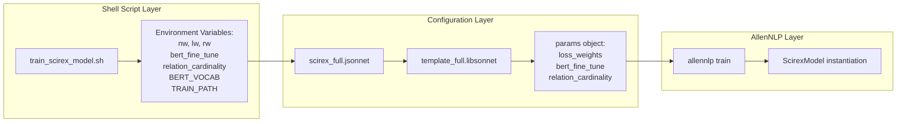
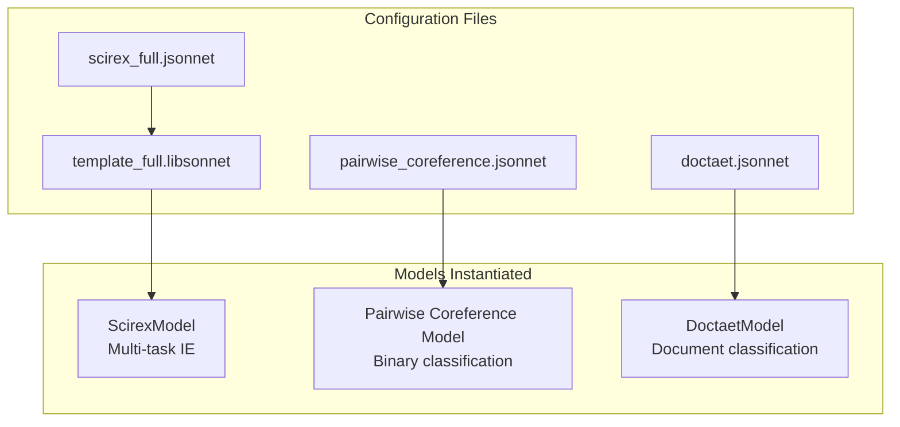
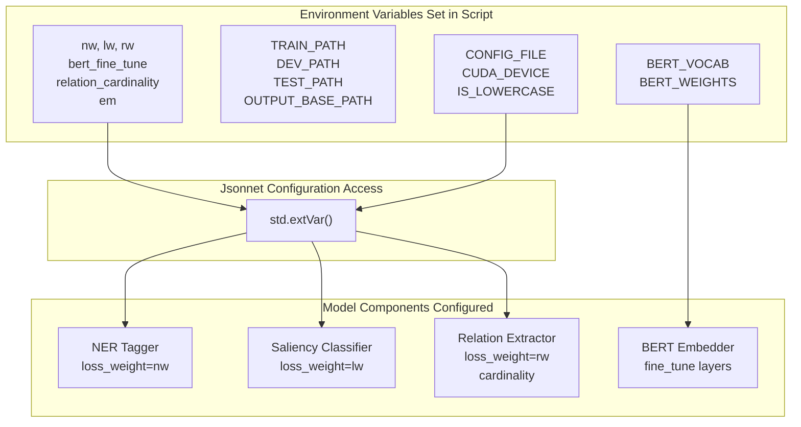
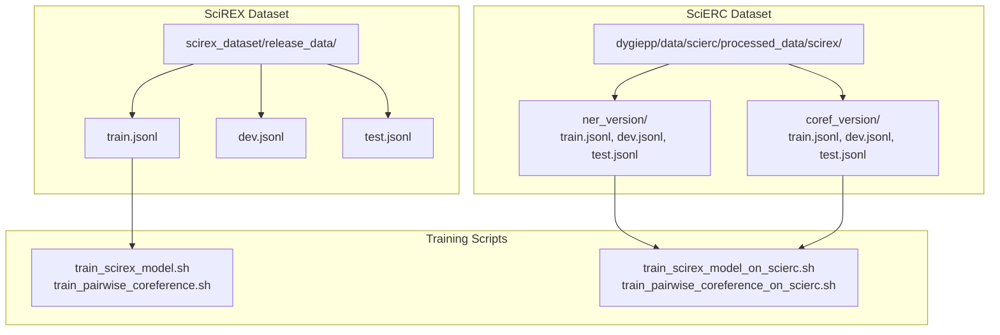

<!-- source: DeepWiki mcp.deepwiki.com · repo allenai/SciREX · page 3.3 Model Configuration · fetched 2026-10-26 -->

# Model Configuration

<details>
<summary>Relevant source files</summary>

The following files were used as context for generating this wiki page:

- [scirex/commands/train_doctaet.sh](scirex/commands/train_doctaet.sh)
- [scirex/commands/train_pairwise_coreference.sh](scirex/commands/train_pairwise_coreference.sh)
- [scirex/commands/train_pairwise_coreference_on_scierc.sh](scirex/commands/train_pairwise_coreference_on_scierc.sh)
- [scirex/commands/train_scirex_model.sh](scirex/commands/train_scirex_model.sh)
- [scirex/commands/train_scirex_model_on_scierc.sh](scirex/commands/train_scirex_model_on_scierc.sh)
- [scirex/training_config/scirex_full.jsonnet](scirex/training_config/scirex_full.jsonnet)

</details>


## Purpose and Scope

This page documents the configuration system used to customize and train SciREX models. It covers the Jsonnet-based configuration files, training script parameters, environment variables, and how to adjust key hyperparameters such as loss weights, BERT fine-tuning layers, and relation cardinality.

For information about the actual model architectures, see [ScirexModel: Multi-Task Information Extraction](#3.1) and [Component Models](#3.2). For information about the training process and workflows, see [Training Scripts and Workflows](#4.1).

---

## Configuration System Overview

SciREX uses AllenNLP's Jsonnet-based configuration system to define model architectures and training parameters. The configuration workflow involves three layers:

1. **Environment variables** set in shell scripts
2. **Jsonnet configuration files** that read environment variables and define model structure
3. **AllenNLP training commands** that consume the configuration



**Diagram: Configuration Flow from Shell Scripts to Model Instantiation**

Sources: [scirex/commands/train_scirex_model.sh:1-29](), [scirex/training_config/scirex_full.jsonnet:1-19]()

---

## Configuration Files

### Main Configuration File Structure

The primary configuration file is `scirex_full.jsonnet`, which imports a template and sets model-specific parameters:

[scirex/training_config/scirex_full.jsonnet:1-19]()

```jsonnet
local template = import "template_full.libsonnet";

local params = {
  use_lstm: true,
  bert_fine_tune: std.extVar("bert_fine_tune"),
  loss_weights: {
    ner: std.extVar('nw'),
    saliency: std.extVar('lw'),
    n_ary_relation: std.extVar('rw')
  },
  relation_cardinality: std.parseInt(std.extVar('relation_cardinality')),
  exact_match: std.extVar('em')
};

template(params)
```

### Configuration File Hierarchy

| Configuration File | Model Type | Purpose |
|-------------------|------------|---------|
| `scirex_full.jsonnet` | ScirexModel | Main multi-task IE model with NER, saliency, and relation extraction |
| `pairwise_coreference.jsonnet` | Pairwise Coreference | Binary classifier for entity pair coreference |
| `doctaet.jsonnet` | DoctaetModel | Document classification model |
| `template_full.libsonnet` | Template | Reusable template imported by configuration files |



**Diagram: Configuration File to Model Mapping**

Sources: [scirex/training_config/scirex_full.jsonnet:1-19](), [scirex/commands/train_pairwise_coreference.sh:10](), [scirex/commands/train_doctaet.sh:10]()

---

## Training Scripts and Environment Variables

### Script Structure

Training scripts set environment variables and invoke AllenNLP's training command. The main script for training ScirexModel is `train_scirex_model.sh`:

[scirex/commands/train_scirex_model.sh:1-29]()

### Environment Variables

The training scripts use environment variables to parameterize model training:

| Environment Variable | Purpose | Default/Example Value | Used By |
|---------------------|---------|----------------------|---------|
| `BERT_VOCAB` | Path to SciBERT vocabulary | `$BERT_BASE_FOLDER/vocab.txt` | All models |
| `BERT_WEIGHTS` | Path to SciBERT weights | `$BERT_BASE_FOLDER/weights.tar.gz` | All models |
| `CONFIG_FILE` | Jsonnet configuration file | `scirex/training_config/scirex_full.jsonnet` | AllenNLP |
| `CUDA_DEVICE` | GPU device ID | Set externally | AllenNLP |
| `IS_LOWERCASE` | Whether to lowercase text | `true` | Text processing |
| `DATA_BASE_PATH` | Base path for data | `scirex_dataset/release_data` | Data loading |
| `TRAIN_PATH` | Training data path | `$DATA_BASE_PATH/train.jsonl` | DatasetReader |
| `DEV_PATH` | Development data path | `$DATA_BASE_PATH/dev.jsonl` | DatasetReader |
| `TEST_PATH` | Test data path | `$DATA_BASE_PATH/test.jsonl` | DatasetReader |
| `OUTPUT_BASE_PATH` | Model output directory | `outputs/pwc_outputs/experiment_scirex_full/$1` | AllenNLP |
| `nw` | NER loss weight | `1` | ScirexModel |
| `lw` | Saliency loss weight | `1` | ScirexModel |
| `rw` | Relation extraction loss weight | `1` | ScirexModel |
| `bert_fine_tune` | BERT layers to fine-tune | `10,11,pooler` | ScirexModel |
| `relation_cardinality` | N-ary relation size | `4` | RelationExtractor |
| `em` | Exact match mode | `false` | ScirexModel |



**Diagram: Environment Variable Flow to Model Components**

Sources: [scirex/commands/train_scirex_model.sh:7-28](), [scirex/training_config/scirex_full.jsonnet:9-16]()

### Training Command Invocation

The training script invokes AllenNLP training with inline parameter assignment:

[scirex/commands/train_scirex_model.sh:26-28]()

```bash
nw=1 lw=1 rw=1 em=false \
relation_cardinality=4 \
allennlp train -s $OUTPUT_BASE_PATH --include-package scirex $RECOVER $CONFIG_FILE
```

The parameters `nw`, `lw`, `rw`, `em`, and `relation_cardinality` are set inline and accessed in the Jsonnet file via `std.extVar()`.

Sources: [scirex/commands/train_scirex_model.sh:26-28]()

---

## Key Configuration Parameters

### Loss Weights

The ScirexModel uses weighted multi-task learning with three separate loss components:

- **`nw` (NER weight)**: Weight for the named entity recognition loss [scirex/commands/train_scirex_model.sh:26]()
- **`lw` (Saliency weight)**: Weight for the salient mention classification loss [scirex/commands/train_scirex_model.sh:26]()
- **`rw` (Relation weight)**: Weight for the N-ary relation extraction loss [scirex/commands/train_scirex_model.sh:26]()

Default configuration sets all weights to `1`, but these can be adjusted to prioritize specific tasks during training. The weights are passed to the Jsonnet configuration:

[scirex/training_config/scirex_full.jsonnet:10-14]()

```jsonnet
loss_weights: {
  ner: std.extVar('nw'),
  saliency: std.extVar('lw'),
  n_ary_relation: std.extVar('rw')
}
```

### BERT Fine-Tuning Configuration

The `bert_fine_tune` parameter specifies which BERT layers should be fine-tuned during training:

[scirex/commands/train_scirex_model.sh:24]()

```bash
export bert_fine_tune=10,11,pooler
```

This configuration fine-tunes:
- Layer 10 of BERT
- Layer 11 of BERT
- The pooler layer

This selective fine-tuning allows for domain adaptation of the pretrained SciBERT model while keeping earlier layers frozen to prevent catastrophic forgetting.

[scirex/training_config/scirex_full.jsonnet:9]()

### Relation Cardinality

The `relation_cardinality` parameter defines the arity of relations to extract:

[scirex/commands/train_scirex_model.sh:27]()

```bash
relation_cardinality=4
```

This value is set to `4` for 4-ary relations in SciREX (Method-Task-Metric-Result tuples). The parameter is parsed as an integer in the configuration:

[scirex/training_config/scirex_full.jsonnet:15]()

```jsonnet
relation_cardinality: std.parseInt(std.extVar('relation_cardinality'))
```

### Exact Match Mode

The `em` (exact match) parameter controls matching behavior:

[scirex/commands/train_scirex_model.sh:26]()

```bash
em=false
```

[scirex/training_config/scirex_full.jsonnet:16]()

### LSTM Usage

The configuration also controls whether to use an LSTM context layer:

[scirex/training_config/scirex_full.jsonnet:8]()

```jsonnet
use_lstm: true
```

This parameter determines whether contextualized embeddings from BERT are further processed through a bidirectional LSTM before being used for downstream tasks.

Sources: [scirex/training_config/scirex_full.jsonnet:8-16](), [scirex/commands/train_scirex_model.sh:24-27]()

---

## Configuration for Different Models

### ScirexModel Configuration

The main multi-task model is configured via `train_scirex_model.sh` and `scirex_full.jsonnet`:

**Key Parameters:**
- Multi-task loss weights: `nw=1`, `lw=1`, `rw=1`
- BERT fine-tuning: `bert_fine_tune=10,11,pooler`
- Relation cardinality: `relation_cardinality=4`
- LSTM context: `use_lstm: true`

**Output Directory:** `outputs/pwc_outputs/experiment_scirex_full/$1` where `$1` is the experiment name provided as a command-line argument.

Sources: [scirex/commands/train_scirex_model.sh:1-29](), [scirex/training_config/scirex_full.jsonnet:1-19]()

### Pairwise Coreference Configuration

The coreference model is configured via `train_pairwise_coreference.sh` and `pairwise_coreference.jsonnet`:

[scirex/commands/train_pairwise_coreference.sh:1-24]()

**Key Differences from ScirexModel:**
- Uses separate configuration file: `pairwise_coreference.jsonnet`
- No loss weight parameters (single-task model)
- No relation cardinality (not applicable)
- Output directory: `outputs/pwc_outputs/experiment_coreference/$1/`

Sources: [scirex/commands/train_pairwise_coreference.sh:1-24]()

### DoctaetModel Configuration

The document classification model is configured via `train_doctaet.sh` and `doctaet.jsonnet`:

[scirex/commands/train_doctaet.sh:1-25]()

**Key Differences:**
- Uses configuration file: `doctaet.jsonnet`
- Simpler architecture for document-level classification
- Output directory: `outputs/pwc_outputs/experiment_doctaet/$1`

Sources: [scirex/commands/train_doctaet.sh:1-25]()

---

## Configuration for Different Datasets

### SciREX Dataset Configuration

Default configuration for the SciREX dataset:

[scirex/commands/train_scirex_model.sh:16-20]()

```bash
export DATA_BASE_PATH=scirex_dataset/release_data
export TRAIN_PATH=$DATA_BASE_PATH/train.jsonl
export DEV_PATH=$DATA_BASE_PATH/dev.jsonl
export TEST_PATH=$DATA_BASE_PATH/test.jsonl
```

### SciERC Dataset Configuration

For training on the SciERC dataset, use the alternative training scripts that point to converted SciERC data:

**For ScirexModel on SciERC:**

[scirex/commands/train_scirex_model_on_scierc.sh:16-20]()

```bash
export DATA_BASE_PATH=dygiepp/data/scierc/processed_data/scirex/ner_version
export TRAIN_PATH=$DATA_BASE_PATH/train.jsonl
export DEV_PATH=$DATA_BASE_PATH/dev.jsonl
export TEST_PATH=$DATA_BASE_PATH/test.jsonl
```

**For Pairwise Coreference on SciERC:**

[scirex/commands/train_pairwise_coreference_on_scierc.sh:16-19]()

```bash
export ERC_DATA_BASE_PATH=dygiepp/data/scierc/processed_data/scirex/coref_version
export TRAIN_PATH=$ERC_DATA_BASE_PATH/train.jsonl
export DEV_PATH=$ERC_DATA_BASE_PATH/dev.jsonl
export TEST_PATH=$ERC_DATA_BASE_PATH/test.jsonl
```



**Diagram: Dataset Path Configuration for SciREX vs SciERC**

Sources: [scirex/commands/train_scirex_model.sh:16-20](), [scirex/commands/train_scirex_model_on_scierc.sh:16-20](), [scirex/commands/train_pairwise_coreference_on_scierc.sh:16-19]()

---

## Customizing Model Configuration

### Adjusting Loss Weights

To prioritize specific tasks during training, modify the loss weights in the training command:

```bash
# Prioritize relation extraction over NER
nw=1 lw=1 rw=2 em=false relation_cardinality=4 \
allennlp train -s $OUTPUT_BASE_PATH --include-package scirex $RECOVER $CONFIG_FILE
```

### Modifying BERT Fine-Tuning

To fine-tune different BERT layers:

```bash
# Fine-tune only the last layer and pooler
export bert_fine_tune=11,pooler

# Fine-tune all layers
export bert_fine_tune=0,1,2,3,4,5,6,7,8,9,10,11,pooler
```

### Changing Relation Cardinality

To extract binary relations instead of 4-ary relations:

```bash
relation_cardinality=2
```

This would be useful for datasets with pairwise relations rather than complex N-ary tuples.

### Using Recovery Mode

The `$RECOVER` variable can be set to continue training from a checkpoint:

```bash
export RECOVER="--recover"
```

This variable is used in the training command at [scirex/commands/train_scirex_model.sh:28]().

Sources: [scirex/commands/train_scirex_model.sh:24-28]()

---

## Configuration Parameter Summary

| Parameter | Type | Default | Description | Configured In |
|-----------|------|---------|-------------|---------------|
| `nw` | float | 1 | NER loss weight | Shell script inline |
| `lw` | float | 1 | Saliency loss weight | Shell script inline |
| `rw` | float | 1 | Relation extraction loss weight | Shell script inline |
| `bert_fine_tune` | string | "10,11,pooler" | Comma-separated BERT layers to fine-tune | Shell script export |
| `relation_cardinality` | int | 4 | Arity of relations (2, 4, etc.) | Shell script inline |
| `em` | bool | false | Exact match mode | Shell script inline |
| `use_lstm` | bool | true | Use LSTM context layer | Jsonnet config |
| `CUDA_DEVICE` | int | - | GPU device ID | Shell script export |
| `BERT_VOCAB` | path | - | Path to SciBERT vocabulary | Shell script export |
| `BERT_WEIGHTS` | path | - | Path to SciBERT weights | Shell script export |
| `CONFIG_FILE` | path | - | Path to Jsonnet configuration | Shell script export |
| `DATA_BASE_PATH` | path | - | Base directory for data | Shell script export |
| `OUTPUT_BASE_PATH` | path | - | Directory for model outputs | Shell script export |

Sources: [scirex/commands/train_scirex_model.sh:1-29](), [scirex/training_config/scirex_full.jsonnet:1-19]()

---

