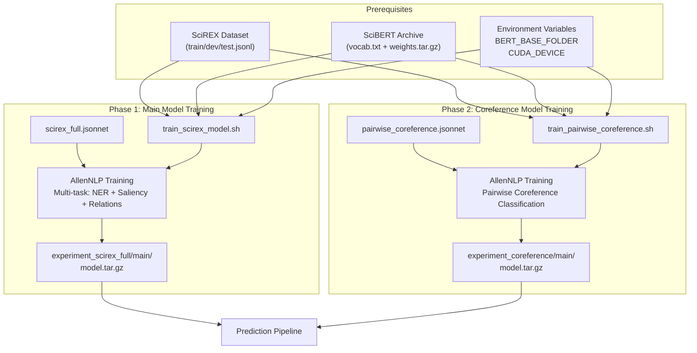
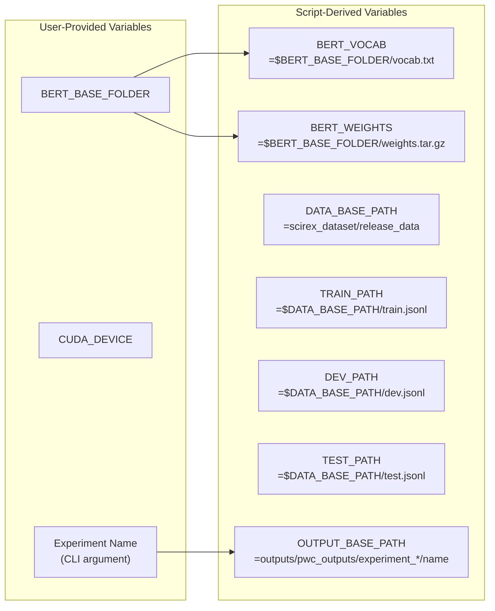
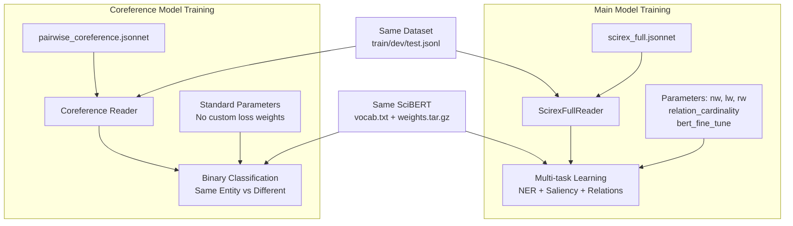
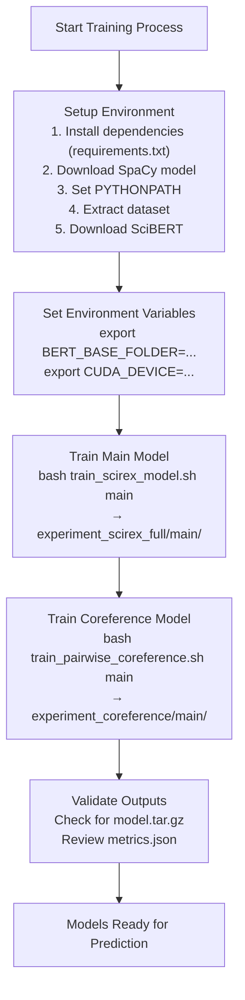

<!-- source: DeepWiki mcp.deepwiki.com · repo allenai/SciREX · page 4 Training · fetched 2026-10-26 -->

# Training

<details>
<summary>Relevant source files</summary>

The following files were used as context for generating this wiki page:

- [README.md](README.md)
- [requirements.txt](requirements.txt)
- [scirex/commands/train_doctaet.sh](scirex/commands/train_doctaet.sh)
- [scirex/commands/train_pairwise_coreference.sh](scirex/commands/train_pairwise_coreference.sh)
- [scirex/commands/train_pairwise_coreference_on_scierc.sh](scirex/commands/train_pairwise_coreference_on_scierc.sh)
- [scirex/commands/train_scirex_model.sh](scirex/commands/train_scirex_model.sh)
- [scirex/commands/train_scirex_model_on_scierc.sh](scirex/commands/train_scirex_model_on_scierc.sh)

</details>


This page provides a comprehensive guide to training SciREX models, covering environment setup, required dependencies, and the execution of training scripts. The SciREX system requires training two separate models: the main multi-task information extraction model and a secondary pairwise coreference resolution model.

For detailed information about individual training scripts and workflows, see [Training Scripts and Workflows](#4.1). For guidance on training with alternative datasets like SciERC, see [Training on Different Datasets](#4.2). For configuration details, see [Model Configuration](#3.3).

## Prerequisites

Before training SciREX models, several prerequisites must be satisfied:

### Environment Setup

1. **Python Environment**: Create a conda environment with Python 3.7
2. **Dependencies**: Install required packages from [requirements.txt:1-18]()
3. **SpaCy Model**: Download the English language model via `python -m spacy download en`
4. **PYTHONPATH**: Set the `PYTHONPATH` environment variable to the repository root

### Required Resources

| Resource | Description | Source |
|----------|-------------|--------|
| **SciREX Dataset** | Training, development, and test splits in JSONL format | `scirex_dataset/release_data.tar.gz` |
| **SciBERT** | Pre-trained BERT model for scientific text | Download from S3 (see below) |
| **Vocabulary File** | SciBERT vocabulary (`vocab.txt`) | Included in SciBERT archive |
| **Model Weights** | SciBERT pre-trained weights (`weights.tar.gz`) | Included in SciBERT archive |

The SciBERT model can be downloaded from `https://s3-us-west-2.amazonaws.com/ai2-s2-research/scibert/pytorch_models/scibert_scivocab_uncased.tar` and must be extracted to a location accessible during training.

**Dataset Extraction**: Extract the dataset files using:
```bash
tar -xvzf scirex_dataset/release_data.tar.gz --directory scirex_dataset
```

This creates three files in `scirex_dataset/release_data/`:
- `train.jsonl` - Training data
- `dev.jsonl` - Development/validation data  
- `test.jsonl` - Test data

Sources: [README.md:32-44]()

## Training Overview



**Training Overview Diagram**: The two-phase training process for SciREX models

SciREX employs a **two-phase training strategy** where each model is trained independently:

1. **Main Model** (`ScirexModel`): Multi-task model that jointly learns NER tagging, salient mention classification, and N-ary relation extraction
2. **Coreference Model**: Pairwise classification model that determines if two entity mentions refer to the same entity

These models are trained separately because they use different architectural components and training objectives, but both are required for the complete information extraction pipeline.

Sources: [README.md:40-46](), [scirex/commands/train_scirex_model.sh:1-28](), [scirex/commands/train_pairwise_coreference.sh:1-23]()

## Environment Variables

Both training scripts rely on a consistent set of environment variables that configure paths and training parameters:

### Required Environment Variables



**Environment Variable Flow**: How user-provided variables are transformed into script configuration

| Variable | Purpose | Example Value | Set By |
|----------|---------|---------------|--------|
| `BERT_BASE_FOLDER` | Path to SciBERT directory | `/path/to/scibert_scivocab_uncased/` | User (export) |
| `CUDA_DEVICE` | GPU device ID for training | `0` or `1` | User (export or inline) |
| `BERT_VOCAB` | Path to BERT vocabulary file | `$BERT_BASE_FOLDER/vocab.txt` | Script |
| `BERT_WEIGHTS` | Path to BERT weights archive | `$BERT_BASE_FOLDER/weights.tar.gz` | Script |
| `CONFIG_FILE` | Path to Jsonnet configuration | `scirex/training_config/*.jsonnet` | Script |
| `IS_LOWERCASE` | Whether to lowercase text | `true` | Script |
| `DATA_BASE_PATH` | Base directory for data files | `scirex_dataset/release_data` | Script |
| `TRAIN_PATH` | Training data path | `$DATA_BASE_PATH/train.jsonl` | Script |
| `DEV_PATH` | Development data path | `$DATA_BASE_PATH/dev.jsonl` | Script |
| `TEST_PATH` | Test data path | `$DATA_BASE_PATH/test.jsonl` | Script |
| `OUTPUT_BASE_PATH` | Output directory for model artifacts | `outputs/pwc_outputs/experiment_*/name` | Script |

Sources: [scirex/commands/train_scirex_model.sh:7-22](), [scirex/commands/train_pairwise_coreference.sh:7-21]()

## Training the Main Model

The main SciREX model is trained using the `train_scirex_model.sh` script, which configures and invokes AllenNLP's training command with the `scirex_full.jsonnet` configuration.

### Script Execution

```bash
CUDA_DEVICE=<cuda-device-num> bash scirex/commands/train_scirex_model.sh main
```

The script accepts one required argument: the experiment name (e.g., `main`), which is used to create a unique output directory for model artifacts.

### Training Parameters

The script sets several inline training parameters that are passed as environment variables to the Jsonnet configuration [scirex/commands/train_scirex_model.sh:24-28]():

| Parameter | Value | Purpose |
|-----------|-------|---------|
| `nw` | `1` | Loss weight for NER task |
| `lw` | `1` | Loss weight for saliency (lexicon) classification |
| `rw` | `1` | Loss weight for relation extraction |
| `em` | `false` | Whether to use exact match for relation evaluation |
| `relation_cardinality` | `4` | Number of entity types in relations (4-ary) |
| `bert_fine_tune` | `10,11,pooler` | Which BERT layers to fine-tune |

The `bert_fine_tune` parameter specifies that layers 10, 11, and the pooler layer will be updated during training, while earlier layers remain frozen.

### Output Structure

Training produces a directory structure at `$OUTPUT_BASE_PATH` (default: `outputs/pwc_outputs/experiment_scirex_full/main/`):

```
experiment_scirex_full/main/
├── model.tar.gz              # Serialized trained model
├── config.json               # Resolved configuration
├── vocabulary/               # Vocabulary mappings
├── metrics_epoch_*.json      # Per-epoch metrics
├── training_state_epoch_*.th # Training checkpoints
└── metrics.json              # Final evaluation metrics
```

Sources: [README.md:45](), [scirex/commands/train_scirex_model.sh:1-28]()

## Training the Coreference Model

The pairwise coreference model is trained separately using the `train_pairwise_coreference.sh` script with the `pairwise_coreference.jsonnet` configuration.

### Script Execution

```bash
CUDA_DEVICE=<cuda-device-num> bash scirex/commands/train_pairwise_coreference.sh main
```

Like the main model script, this accepts an experiment name as a required argument.

### Key Differences from Main Model Training



**Model Training Comparison**: Differences between main model and coreference model training

The coreference training script differs in several ways:

1. **Configuration File**: Uses `pairwise_coreference.jsonnet` instead of `scirex_full.jsonnet` [scirex/commands/train_pairwise_coreference.sh:10]()
2. **No Custom Parameters**: Does not set inline loss weights or relation cardinality [scirex/commands/train_pairwise_coreference.sh:23]()
3. **Force Flag**: Uses `--force` flag to overwrite existing output directory [scirex/commands/train_pairwise_coreference.sh:23]()
4. **Python Module Invocation**: Calls `python -m allennlp.run train` instead of direct `allennlp train` [scirex/commands/train_pairwise_coreference.sh:23]()

### Output Structure

Training produces artifacts at `$OUTPUT_BASE_PATH` (default: `outputs/pwc_outputs/experiment_coreference/main/`):

```
experiment_coreference/main/
├── model.tar.gz              # Serialized coreference model
├── config.json               # Resolved configuration
├── vocabulary/               # Vocabulary mappings
├── metrics_epoch_*.json      # Per-epoch metrics
└── metrics.json              # Final evaluation metrics
```

Sources: [README.md:46](), [scirex/commands/train_pairwise_coreference.sh:1-23]()

## AllenNLP Training Command

Both training scripts ultimately invoke AllenNLP's training infrastructure:

```bash
# Main model
allennlp train -s $OUTPUT_BASE_PATH --include-package scirex $RECOVER $CONFIG_FILE

# Coreference model  
python -m allennlp.run train -s $OUTPUT_BASE_PATH --include-package scirex --force $CONFIG_FILE
```

### Command Line Arguments

| Argument | Purpose |
|----------|---------|
| `train` | AllenNLP subcommand for training models |
| `-s $OUTPUT_BASE_PATH` | Serialization directory for model outputs |
| `--include-package scirex` | Import custom SciREX modules (models, readers, etc.) |
| `$CONFIG_FILE` | Path to Jsonnet configuration file |
| `--force` | (Coreference only) Overwrite existing output directory |
| `$RECOVER` | (Optional) Resume training from checkpoint |

The `--include-package scirex` flag is critical as it ensures AllenNLP can locate and import custom SciREX components like `ScirexFullReader`, `ScirexModel`, and custom field types.

Sources: [scirex/commands/train_scirex_model.sh:28](), [scirex/commands/train_pairwise_coreference.sh:23]()

## Additional Training Scripts

Beyond the main SciREX model and coreference model, the repository includes training scripts for additional models:

### DoctaetModel Training

The `train_doctaet.sh` script trains a simpler binary classification model:

```bash
CUDA_DEVICE=<cuda-device-num> bash scirex/commands/train_doctaet.sh experiment_name
```

This script uses the `doctaet.jsonnet` configuration and follows the same environment variable pattern as the main training scripts [scirex/commands/train_doctaet.sh:1-24]().

### Dataset-Specific Training Scripts

For training on the SciERC dataset instead of SciREX, alternative scripts are provided:

1. **Main Model on SciERC**: `train_scirex_model_on_scierc.sh` [scirex/commands/train_scirex_model_on_scierc.sh:1-24]()
   - Uses data from `dygiepp/data/scierc/processed_data/scirex/ner_version/`
   - Output: `experiment_scirex_full_on_scierc/`

2. **Coreference on SciERC**: `train_pairwise_coreference_on_scierc.sh` [scirex/commands/train_pairwise_coreference_on_scierc.sh:1-23]()
   - Uses data from `dygiepp/data/scierc/processed_data/scirex/coref_version/`
   - Output: `experiment_coreference_on_scierc/`

These scripts are documented in detail in [Training on Different Datasets](#4.2).

Sources: [scirex/commands/train_doctaet.sh:1-24](), [scirex/commands/train_pairwise_coreference_on_scierc.sh:1-23](), [scirex/commands/train_scirex_model_on_scierc.sh:1-24]()

## Training Workflow Summary



**Complete Training Workflow**: End-to-end process for training SciREX models

The complete training workflow involves:

1. **Environment Setup**: Install dependencies and download required resources
2. **Variable Configuration**: Export paths to SciBERT and specify GPU device
3. **Main Model Training**: Train the multi-task information extraction model
4. **Coreference Training**: Train the pairwise coreference resolution model
5. **Validation**: Verify that both model archives are created successfully
6. **Prediction**: Use trained models in the prediction pipeline (see [Prediction Pipeline](#5.1))

Both model archives (`model.tar.gz` files) are required for the complete SciREX prediction pipeline, as the main model handles NER and relation extraction while the coreference model handles entity clustering.

Sources: [README.md:40-46](), [scirex/commands/train_scirex_model.sh:1-28](), [scirex/commands/train_pairwise_coreference.sh:1-23]()

---

