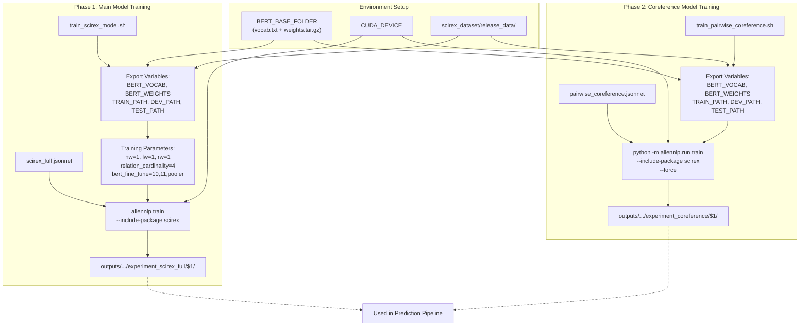
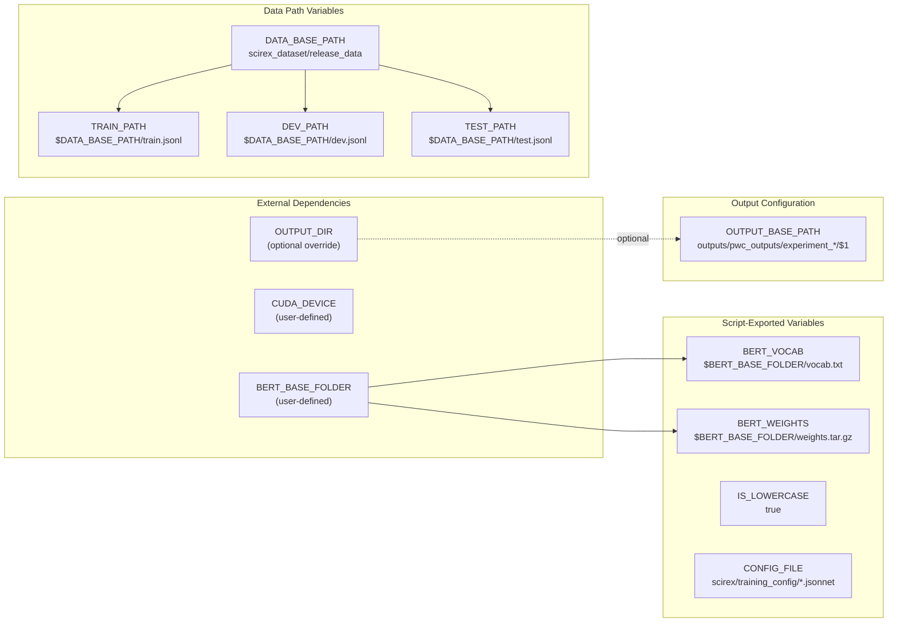
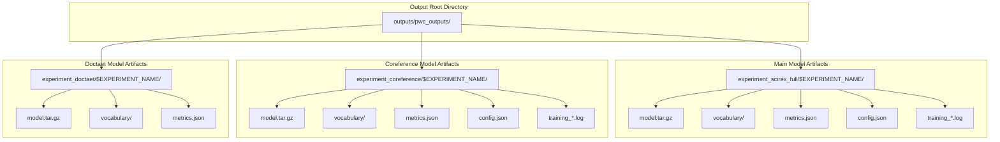

<!-- source: DeepWiki mcp.deepwiki.com · repo allenai/SciREX · page 4.1 Training Scripts and Workflows · fetched 2026-10-26 -->

# Training Scripts and Workflows

<details>
<summary>Relevant source files</summary>

The following files were used as context for generating this wiki page:

- [scirex/commands/train_doctaet.sh](scirex/commands/train_doctaet.sh)
- [scirex/commands/train_pairwise_coreference.sh](scirex/commands/train_pairwise_coreference.sh)
- [scirex/commands/train_pairwise_coreference_on_scierc.sh](scirex/commands/train_pairwise_coreference_on_scierc.sh)
- [scirex/commands/train_scirex_model.sh](scirex/commands/train_scirex_model.sh)
- [scirex/commands/train_scirex_model_on_scierc.sh](scirex/commands/train_scirex_model_on_scierc.sh)

</details>


## Purpose and Scope

This page documents the shell scripts and workflows used to train SciREX models. It covers environment setup, script execution, training parameters, and the two-phase training approach required for the full system. For details about model architectures and configurations, see [Model Architecture](#3) and [Model Configuration](#3.3). For information about training on different datasets (SciREX vs SciERC), see [Training on Different Datasets](#4.2).

## Training Scripts Overview

The SciREX repository provides five primary training scripts located in `scirex/commands/`:

| Script | Purpose | Primary Use Case |
|--------|---------|------------------|
| `train_scirex_model.sh` | Trains the main multi-task ScirexModel | Full information extraction on SciREX dataset |
| `train_pairwise_coreference.sh` | Trains the pairwise coreference model | Coreference resolution on SciREX dataset |
| `train_doctaet.sh` | Trains the DoctaetModel | Binary classification tasks |
| `train_scirex_model_on_scierc.sh` | Trains ScirexModel on SciERC data | Cross-dataset training |
| `train_pairwise_coreference_on_scierc.sh` | Trains coreference on SciERC data | Cross-dataset coreference |

Sources: [scirex/commands/train_scirex_model.sh:1-29](), [scirex/commands/train_pairwise_coreference.sh:1-24](), [scirex/commands/train_doctaet.sh:1-25]()

## Two-Phase Training Workflow

Training a complete SciREX system requires executing two independent training scripts in sequence. The main model handles NER, saliency detection, and relation extraction, while the coreference model is trained separately.

### Training Workflow Diagram



Sources: [scirex/commands/train_scirex_model.sh:1-29](), [scirex/commands/train_pairwise_coreference.sh:1-24]()

## Environment Variables

Both training scripts require setting multiple environment variables before execution. These variables configure paths to pretrained models, datasets, and training hyperparameters.

### Required Environment Variables



| Variable | Purpose | Example Value |
|----------|---------|---------------|
| `BERT_BASE_FOLDER` | Base directory containing SciBERT files | `/path/to/scibert_scivocab_uncased` |
| `BERT_VOCAB` | Path to BERT vocabulary file | `$BERT_BASE_FOLDER/vocab.txt` |
| `BERT_WEIGHTS` | Path to pretrained BERT weights | `$BERT_BASE_FOLDER/weights.tar.gz` |
| `CUDA_DEVICE` | GPU device ID for training | `0`, `1`, or `-1` (CPU) |
| `IS_LOWERCASE` | Whether to lowercase text | `true` |
| `CONFIG_FILE` | Jsonnet configuration file | `scirex/training_config/scirex_full.jsonnet` |
| `DATA_BASE_PATH` | Base directory for dataset | `scirex_dataset/release_data` |
| `OUTPUT_BASE_PATH` | Directory for model artifacts | `outputs/pwc_outputs/experiment_scirex_full/run1` |

Sources: [scirex/commands/train_scirex_model.sh:7-22](), [scirex/commands/train_pairwise_coreference.sh:7-21]()

## Training the Main Model

The `train_scirex_model.sh` script trains the multi-task ScirexModel for NER, saliency detection, and N-ary relation extraction. This model is detailed in [ScirexModel: Multi-Task Information Extraction](#3.1).

### Script Invocation

```bash
export BERT_BASE_FOLDER=/path/to/scibert_scivocab_uncased
export CUDA_DEVICE=0
bash scirex/commands/train_scirex_model.sh experiment_name
```

The script requires one positional argument: an experiment name used to create the output directory [scirex/commands/train_scirex_model.sh:1-5]().

### Configuration and Parameters

The script sets inline training parameters before invoking AllenNLP:

```bash
nw=1 lw=1 rw=1 em=false \
relation_cardinality=4 \
allennlp train -s $OUTPUT_BASE_PATH --include-package scirex $RECOVER $CONFIG_FILE
```

[scirex/commands/train_scirex_model.sh:26-28]()

| Parameter | Purpose | Default Value |
|-----------|---------|---------------|
| `nw` | NER task loss weight | `1` |
| `lw` | Saliency (label) task loss weight | `1` |
| `rw` | Relation extraction task loss weight | `1` |
| `em` | Exact match mode | `false` |
| `relation_cardinality` | Number of entities in relations | `4` |
| `bert_fine_tune` | BERT layers to fine-tune | `10,11,pooler` |

These parameters are passed as environment variables and consumed by the Jsonnet configuration file (see [Model Configuration](#3.3) for details).

### BERT Fine-Tuning Configuration

The script configures which BERT layers are trainable:

```bash
export bert_fine_tune=10,11,pooler
```

[scirex/commands/train_scirex_model.sh:24]()

This trains only the top two transformer layers (10, 11) and the pooler layer, keeping earlier layers frozen. This reduces memory requirements and prevents overfitting on small datasets.

Sources: [scirex/commands/train_scirex_model.sh:1-29]()

## Training the Coreference Model

The `train_pairwise_coreference.sh` script trains a separate model for pairwise coreference resolution. This model is used in the prediction pipeline to cluster entity mentions (see [Prediction Pipeline](#5.1)).

### Script Invocation

```bash
export BERT_BASE_FOLDER=/path/to/scibert_scivocab_uncased
export CUDA_DEVICE=0
bash scirex/commands/train_pairwise_coreference.sh experiment_name
```

### Key Differences from Main Model Training

The coreference training script differs in several ways:

1. **Configuration File**: Uses `pairwise_coreference.jsonnet` instead of `scirex_full.jsonnet` [scirex/commands/train_pairwise_coreference.sh:10]()

2. **AllenNLP Invocation**: Uses `python -m allennlp.run train` with `--force` flag instead of the `allennlp` command [scirex/commands/train_pairwise_coreference.sh:23]()

3. **No Inline Parameters**: Does not set inline loss weights or relation cardinality

4. **Output Path**: Writes to `experiment_coreference/$1/` instead of `experiment_scirex_full/$1/` [scirex/commands/train_pairwise_coreference.sh:21]()

### Data Path Configuration

The coreference model uses the same dataset but with a different variable naming convention:

```bash
export ERC_DATA_BASE_PATH=scirex_dataset/release_data
export TRAIN_PATH=$ERC_DATA_BASE_PATH/train.jsonl
export DEV_PATH=$ERC_DATA_BASE_PATH/dev.jsonl
export TEST_PATH=$ERC_DATA_BASE_PATH/test.jsonl
```

[scirex/commands/train_pairwise_coreference.sh:16-19]()

Sources: [scirex/commands/train_pairwise_coreference.sh:1-24]()

## Training the DoctaetModel

The `train_doctaet.sh` script trains the DoctaetModel for binary classification tasks. This model is documented in [Component Models](#3.2).

### Script Execution

```bash
export BERT_BASE_FOLDER=/path/to/scibert_scivocab_uncased
export CUDA_DEVICE=0
bash scirex/commands/train_doctaet.sh experiment_name
```

The script follows the same environment variable pattern as the main model but uses the `doctaet.jsonnet` configuration file [scirex/commands/train_doctaet.sh:10]() and writes output to `experiment_doctaet/$1/` [scirex/commands/train_doctaet.sh:22]().

Sources: [scirex/commands/train_doctaet.sh:1-25]()

## Output Directory Structure

Both training scripts create structured output directories containing model artifacts, training logs, and metrics.

### Directory Layout



### Key Output Files

| File | Description |
|------|-------------|
| `model.tar.gz` | Serialized trained model (weights + configuration) |
| `vocabulary/` | Vocabulary files for tokens, labels, and entity types |
| `metrics.json` | Training and validation metrics per epoch |
| `config.json` | Resolved configuration used for training |
| `training_*.log` | AllenNLP training logs |

These artifacts are consumed by the prediction pipeline as documented in [Prediction Pipeline](#5.1).

Sources: [scirex/commands/train_scirex_model.sh:22](), [scirex/commands/train_pairwise_coreference.sh:21](), [scirex/commands/train_doctaet.sh:22]()

## Training Parameters and Loss Weights

The main training script accepts several inline parameters that control multi-task learning behavior.

### Loss Weight Parameters

The three loss weight parameters (`nw`, `lw`, `rw`) balance the contribution of each task to the total loss:

```bash
nw=1 lw=1 rw=1 em=false \
relation_cardinality=4 \
allennlp train ...
```

[scirex/commands/train_scirex_model.sh:26-28]()

- **`nw` (NER weight)**: Controls the contribution of named entity recognition loss
- **`lw` (Label/Saliency weight)**: Controls the contribution of salient mention detection loss
- **`rw` (Relation weight)**: Controls the contribution of N-ary relation extraction loss

The total loss is computed as: `total_loss = nw * ner_loss + lw * saliency_loss + rw * relation_loss`

### Relation Cardinality

The `relation_cardinality` parameter specifies the number of entities in extracted relations:

- `relation_cardinality=4`: Extracts 4-ary relations (Method, Task, Metric, Dataset)
- `relation_cardinality=2`: Extracts 2-ary relations (binary relations)

This parameter is consumed by the Jsonnet configuration to instantiate the appropriate relation extractor (see [Model Configuration](#3.3)).

Sources: [scirex/commands/train_scirex_model.sh:26-28]()

## Cross-Dataset Training Scripts

Two additional scripts enable training on the SciERC dataset instead of SciREX. These scripts are documented in detail in [Training on Different Datasets](#4.2).

### SciERC Training Scripts

| Script | Data Path | Purpose |
|--------|-----------|---------|
| `train_scirex_model_on_scierc.sh` | `dygiepp/data/scierc/.../ner_version/` | Train main model on SciERC |
| `train_pairwise_coreference_on_scierc.sh` | `dygiepp/data/scierc/.../coref_version/` | Train coreference on SciERC |

The primary difference is the `DATA_BASE_PATH` variable pointing to processed SciERC data [scirex/commands/train_scirex_model_on_scierc.sh:16](), [scirex/commands/train_pairwise_coreference_on_scierc.sh:16]().

Sources: [scirex/commands/train_scirex_model_on_scierc.sh:1-25](), [scirex/commands/train_pairwise_coreference_on_scierc.sh:1-24]()

## Script Execution Flow

The following diagram shows the complete execution flow from script invocation to model artifact generation.

```mermaid
flowchart TD
    Start["User invokes:<br/>bash train_scirex_model.sh exp_name"]
    
    ArgCheck["Check argument count<br/>[lines 1-5]"]
    SetBERT["Export BERT paths:<br/>BERT_VOCAB, BERT_WEIGHTS<br/>[lines 7-8]"]
    SetConfig["Export CONFIG_FILE:<br/>scirex_full.jsonnet<br/>[line 10]"]
    SetCUDA["Export CUDA_DEVICE<br/>[line 12]"]
    SetLowercase["Export IS_LOWERCASE=true<br/>[line 14]"]
    SetDataPaths["Export data paths:<br/>TRAIN_PATH, DEV_PATH, TEST_PATH<br/>[lines 16-20]"]
    SetOutput["Export OUTPUT_BASE_PATH<br/>[line 22]"]
    SetFineTune["Export bert_fine_tune=10,11,pooler<br/>[line 24]"]
    
    SetParams["Set inline parameters:<br/>nw=1 lw=1 rw=1 em=false<br/>relation_cardinality=4<br/>[lines 26-27]"]
    
    AllenNLP["Execute: allennlp train<br/>-s $OUTPUT_BASE_PATH<br/>--include-package scirex<br/>$RECOVER<br/>$CONFIG_FILE<br/>[line 28]"]
    
    LoadData["AllenNLP loads dataset<br/>using ScirexFullReader"]
    BuildVocab["Build vocabulary from<br/>training data"]
    InitModel["Initialize ScirexModel<br/>from config.jsonnet"]
    LoadBERT["Load pretrained BERT<br/>weights from BERT_WEIGHTS"]
    
    TrainLoop["Training loop:<br/>- Forward pass<br/>- Compute losses<br/>- Backward pass<br/>- Update parameters"]
    
    Validate["Validation on dev set<br/>after each epoch"]
    
    SaveCheckpoint["Save checkpoint:<br/>model.tar.gz<br/>metrics.json<br/>config.json"]
    
    End["Training complete<br/>Model ready for prediction"]
    
    Start --> ArgCheck
    ArgCheck -->|"Argument missing"| Error["Exit with error<br/>[lines 3-5]"]
    ArgCheck -->|"Argument provided"| SetBERT
    SetBERT --> SetConfig
    SetConfig --> SetCUDA
    SetCUDA --> SetLowercase
    SetLowercase --> SetDataPaths
    SetDataPaths --> SetOutput
    SetOutput --> SetFineTune
    SetFineTune --> SetParams
    SetParams --> AllenNLP
    
    AllenNLP --> LoadData
    LoadData --> BuildVocab
    BuildVocab --> InitModel
    InitModel --> LoadBERT
    LoadBERT --> TrainLoop
    TrainLoop --> Validate
    Validate --> SaveCheckpoint
    SaveCheckpoint -->|"Continue training"| TrainLoop
    SaveCheckpoint -->|"Training finished"| End
```



Sources: [scirex/commands/train_scirex_model.sh:1-29]()

## AllenNLP Command Variants

The training scripts use two different methods to invoke AllenNLP training:

### Standard Command

Used by `train_scirex_model.sh` and `train_doctaet.sh`:

```bash
allennlp train -s $OUTPUT_BASE_PATH --include-package scirex $RECOVER $CONFIG_FILE
```

[scirex/commands/train_scirex_model.sh:28]()

- Uses the `allennlp` command directly
- `$RECOVER` is an optional variable (not set in the scripts) that can be used to resume training

### Python Module Command

Used by `train_pairwise_coreference.sh` and `train_pairwise_coreference_on_scierc.sh`:

```bash
python -m allennlp.run train -s $OUTPUT_BASE_PATH --include-package scirex --force $CONFIG_FILE
```

[scirex/commands/train_pairwise_coreference.sh:23]()

- Uses `python -m allennlp.run` to invoke AllenNLP as a module
- Includes `--force` flag to overwrite existing output directory

Both methods are functionally equivalent for training, but the module invocation provides more explicit control over the Python environment.

Sources: [scirex/commands/train_scirex_model.sh:28](), [scirex/commands/train_pairwise_coreference.sh:23]()

## Error Handling

All training scripts include basic argument validation at the beginning:

```bash
if [ $# -eq  0 ]
  then
    echo "No argument supplied for experiment name"
    exit 1
fi
```

[scirex/commands/train_scirex_model.sh:1-5]()

This ensures an experiment name is provided for organizing output directories. Without this argument, the script exits immediately with an error message.

Sources: [scirex/commands/train_scirex_model.sh:1-5](), [scirex/commands/train_pairwise_coreference.sh:1-5](), [scirex/commands/train_doctaet.sh:1-5]()

---

