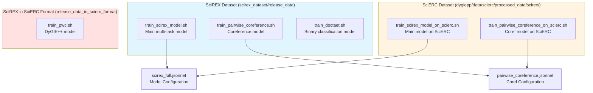
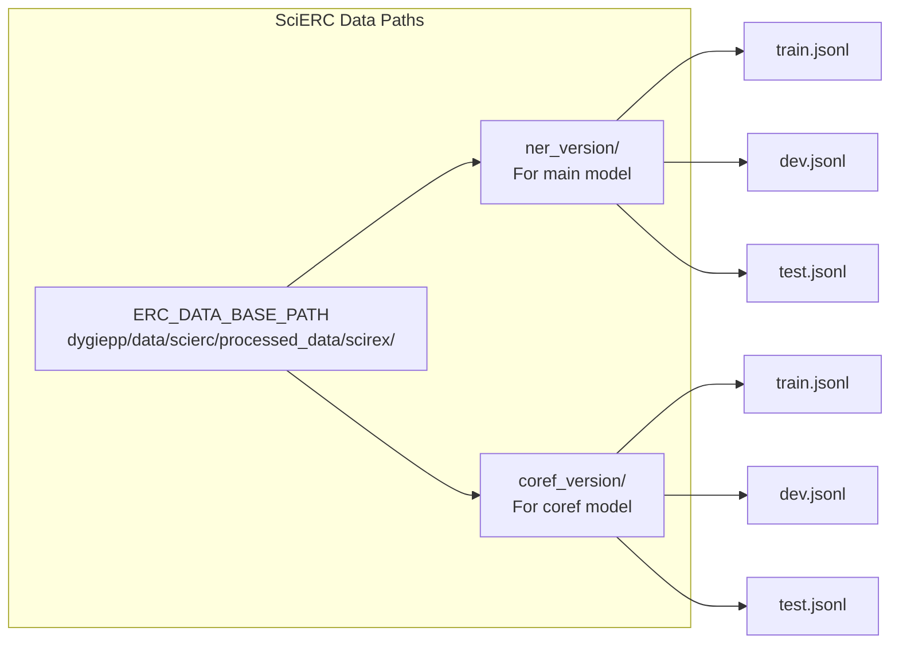
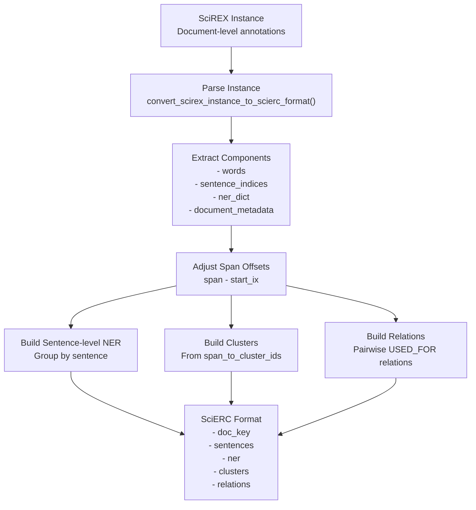
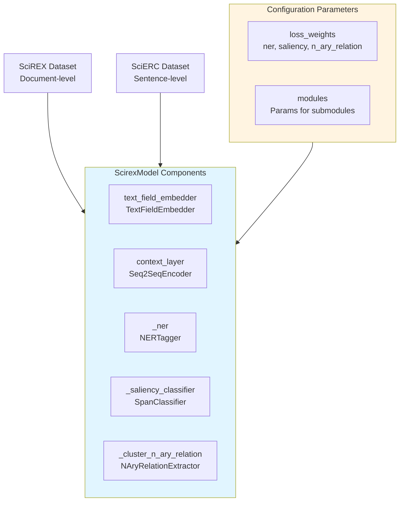
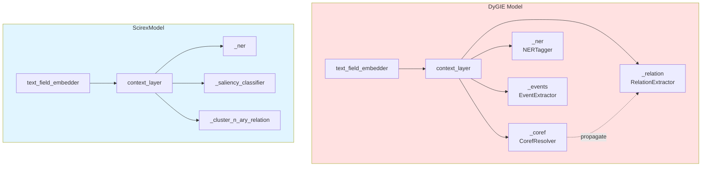
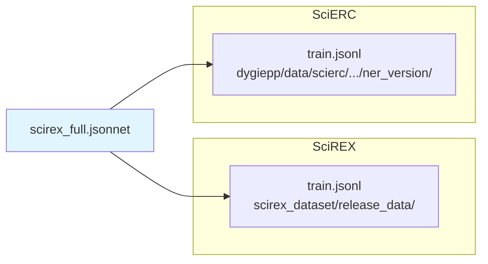

<!-- source: DeepWiki mcp.deepwiki.com · repo allenai/SciREX · page 4.2 Training on Different Datasets · fetched 2026-10-26 -->

# Training on Different Datasets

<details>
<summary>Relevant source files</summary>

The following files were used as context for generating this wiki page:

- [dygiepp/dygie/models/dygie.py](dygiepp/dygie/models/dygie.py)
- [dygiepp/scripts/train/train_pwc.sh](dygiepp/scripts/train/train_pwc.sh)
- [scirex/commands/train_doctaet.sh](scirex/commands/train_doctaet.sh)
- [scirex/commands/train_pairwise_coreference.sh](scirex/commands/train_pairwise_coreference.sh)
- [scirex/commands/train_pairwise_coreference_on_scierc.sh](scirex/commands/train_pairwise_coreference_on_scierc.sh)
- [scirex/commands/train_scirex_model.sh](scirex/commands/train_scirex_model.sh)
- [scirex/commands/train_scirex_model_on_scierc.sh](scirex/commands/train_scirex_model_on_scierc.sh)
- [scirex/data/utils/scirex_to_scierc_format.py](scirex/data/utils/scirex_to_scierc_format.py)
- [scirex/models/scirex_model.py](scirex/models/scirex_model.py)
- [scirex/predictors/utils.py](scirex/predictors/utils.py)

</details>


## Purpose and Scope

This page documents how to train SciREX models on different datasets, specifically the SciREX dataset and the SciERC dataset. It covers the differences in data paths, format conversions, training scripts, and configuration considerations when working with multiple datasets.

For general training workflow and environment setup, see [Training Scripts and Workflows](#4.1). For dataset format specifications, see [Data Format Specification](#2.1). For DyGIE++ integration details, see [DyGIE++ Integration](#7.1).

---

## Dataset Overview

The SciREX system supports training on two primary datasets with different characteristics and formats:

| Dataset | Path Pattern | Format | Use Case |
|---------|-------------|--------|----------|
| **SciREX** | `scirex_dataset/release_data/` | Document-level JSONL with full annotations | Primary dataset for multi-task IE |
| **SciERC** | `dygiepp/data/scierc/processed_data/scirex/` | Sentence-level format with entity relations | Cross-dataset training and DyGIE++ integration |

**Sources:** [scirex/commands/train_scirex_model.sh:16](), [scirex/commands/train_scirex_model_on_scierc.sh:16]()

---

## Training Script Mapping

### Available Training Scripts by Dataset



**Sources:** [scirex/commands/train_scirex_model.sh](), [scirex/commands/train_scirex_model_on_scierc.sh](), [scirex/commands/train_pairwise_coreference_on_scierc.sh](), [dygiepp/scripts/train/train_pwc.sh]()

---

## Training on SciREX Dataset

### Environment Variables

The SciREX dataset training scripts use the following environment variables:

```bash
export DATA_BASE_PATH=scirex_dataset/release_data
export TRAIN_PATH=$DATA_BASE_PATH/train.jsonl
export DEV_PATH=$DATA_BASE_PATH/dev.jsonl
export TEST_PATH=$DATA_BASE_PATH/test.jsonl
```

**Sources:** [scirex/commands/train_scirex_model.sh:16-20]()

### Main Model Training

To train the main `ScirexModel` on the SciREX dataset:

```bash
bash scirex/commands/train_scirex_model.sh experiment_name
```

This script:
- Uses configuration from `scirex/training_config/scirex_full.jsonnet`
- Loads BERT weights from `$BERT_BASE_FOLDER`
- Sets loss weights: `nw=1 lw=1 rw=1` for NER, saliency, and relations
- Configures `relation_cardinality=4` for 4-ary relations
- Fine-tunes BERT layers: `bert_fine_tune=10,11,pooler`

**Sources:** [scirex/commands/train_scirex_model.sh:10-28]()

### Coreference Model Training

To train the pairwise coreference model on SciREX:

```bash
bash scirex/commands/train_pairwise_coreference.sh experiment_name
```

Key differences:
- Uses `pairwise_coreference.jsonnet` configuration
- Outputs to `outputs/pwc_outputs/experiment_coreference/`
- Uses same data paths as main model

**Sources:** [scirex/commands/train_pairwise_coreference.sh:10-23]()

---

## Training on SciERC Dataset

### Data Path Configuration

The SciERC training scripts point to converted data in a different location:



**Sources:** [scirex/commands/train_scirex_model_on_scierc.sh:16](), [scirex/commands/train_pairwise_coreference_on_scierc.sh:16]()

### Main Model on SciERC

```bash
bash scirex/commands/train_scirex_model_on_scierc.sh experiment_name
```

This script:
- Points to `dygiepp/data/scierc/processed_data/scirex/ner_version`
- Uses the same `scirex_full.jsonnet` configuration
- Outputs to `experiment_scirex_full_on_scierc/`

**Sources:** [scirex/commands/train_scirex_model_on_scierc.sh:16-24]()

### Coreference Model on SciERC

```bash
bash scirex/commands/train_pairwise_coreference_on_scierc.sh experiment_name
```

This script:
- Points to `dygiepp/data/scierc/processed_data/scirex/coref_version`
- Uses the same `pairwise_coreference.jsonnet` configuration
- Outputs to `experiment_coreference_on_scierc/`

**Sources:** [scirex/commands/train_pairwise_coreference_on_scierc.sh:16-23]()

---

## Data Format Conversion

### SciREX to SciERC Format Conversion

The `convert_scirex_instance_to_scierc_format` function transforms SciREX format to SciERC format:



**Sources:** [scirex/data/utils/scirex_to_scierc_format.py:17-66]()

### Key Transformation Details

| Component | SciREX Format | SciERC Format |
|-----------|---------------|---------------|
| **Spans** | Document-level offsets | Sentence-relative offsets (end_ix - 1) |
| **NER** | Dict of `{(start, end): [type]}` | List per sentence: `[(start, end-1, type)]` |
| **Clusters** | Dict mapping spans to cluster IDs | List of lists: `[[(start, end-1), ...], ...]` |
| **Relations** | N-ary relations between clusters | Pairwise `(s1, e1-1, s2, e2-1, 'USED_FOR')` |

**Sources:** [scirex/data/utils/scirex_to_scierc_format.py:25-59]()

### Conversion Script Usage

```bash
python scirex/data/utils/scirex_to_scierc_format.py \
    --input_dir scirex_dataset/release_data \
    --output_dir dygiepp/data/scierc/processed_data/scirex/ner_version \
    [--abstract]  # Optional: only use abstract paragraphs
```

The script processes all splits (train, dev, test) and generates:
- Sentence-level NER annotations
- Cluster assignments
- Pairwise coreference relations based on cluster membership

**Sources:** [scirex/data/utils/scirex_to_scierc_format.py:90-98]()

### Relation Extraction from Clusters

The conversion creates pairwise relations between mentions in the same sentence that belong to the same cluster:

```python
# For each pair of mentions in a sentence
for span_1, span_2 in combinations(sentence_mentions, 2):
    # Check if they share cluster membership
    if len(set(ids_1) & set(ids_2)) > 0:
        # Create USED_FOR relation
        relations[idx].append((span_1[0], span_1[1], span_2[0], span_2[1], 'USED_FOR'))
```

**Sources:** [scirex/data/utils/scirex_to_scierc_format.py:47-55]()

---

## Model Architecture Compatibility

### ScirexModel on Different Datasets

The `ScirexModel` class is dataset-agnostic at the architecture level. Both SciREX and SciERC training use the same model class registered as `"scirex_model"`:



**Sources:** [scirex/models/scirex_model.py:24-70]()

### Data Reader Compatibility

The `ScirexFullReader` handles both formats through the same reading logic:

```python
class ScirexFullReader:
    def _read(self, file_path: str):
        # Reads JSONL format
        # Processes paragraphs/sentences
        # Generates AllenNLP instances
```

The reader automatically adapts to:
- Different document structures
- Paragraph vs. sentence granularity
- Various annotation schemas

**Sources:** [scirex/data/utils/scirex_to_scierc_format.py:70]()

---

## DyGIE++ Training on SciREX Data

### Configuration for DyGIE++

DyGIE++ training requires data in SciERC format:

```bash
# Convert to SciERC format first
python scirex/data/utils/scirex_to_scierc_format.py \
    --input_dir scirex_dataset/release_data \
    --output_dir scirex_dataset/release_data_in_scierc_format

# Train DyGIE++
bash dygiepp/scripts/train/train_pwc.sh 0
```

**Sources:** [dygiepp/scripts/train/train_pwc.sh:1-18]()

### DyGIE++ Environment Variables

```bash
experiment_name="scirex_data"
data_root="../scirex_dataset/release_data_in_scierc_format/"
config_file="./training_config/scirex_working_example.jsonnet"
cuda_device=$1

ie_train_data_path=$data_root/train.jsonl
ie_dev_data_path=$data_root/dev.jsonl
ie_test_data_path=$data_root/test.jsonl
```

**Sources:** [dygiepp/scripts/train/train_pwc.sh:5-13]()

### DyGIE Model Architecture Differences

The `DyGIE` model differs from `ScirexModel` in several ways:



**Sources:** [dygiepp/dygie/models/dygie.py:54-124](), [scirex/models/scirex_model.py:26-70]()

---

## Configuration Considerations

### Shared Configuration Parameters

Both SciREX and SciERC training use the same configuration files but with different data paths:

| Parameter | Value | Description |
|-----------|-------|-------------|
| `BERT_VOCAB` | `$BERT_BASE_FOLDER/vocab.txt` | BERT vocabulary file |
| `BERT_WEIGHTS` | `$BERT_BASE_FOLDER/weights.tar.gz` | Pre-trained BERT weights |
| `IS_LOWERCASE` | `true` | Case-sensitive processing |
| `CONFIG_FILE` | `scirex_full.jsonnet` | Model configuration |
| `bert_fine_tune` | `10,11,pooler` | BERT layers to fine-tune |
| `nw, lw, rw` | `1, 1, 1` | Loss weights for NER, saliency, relations |
| `relation_cardinality` | `4` | N-ary relation cardinality |

**Sources:** [scirex/commands/train_scirex_model.sh:7-27](), [scirex/commands/train_scirex_model_on_scierc.sh:7-24]()

### Dataset-Specific Adjustments

When training on different datasets, only the data paths change:



**Sources:** [scirex/commands/train_scirex_model.sh:18](), [scirex/commands/train_scirex_model_on_scierc.sh:18]()

---

## Common Issues and Solutions

### Span Offset Misalignment

When converting between formats, span offsets must be adjusted:

```python
# Adjust to paragraph-relative offsets
mentions = {(span[0] - start_ix, span[1] - start_ix): label 
            for span, label in mentions.items()}

# Adjust sentence indices
sentence_indices = [(sent[0] - start_ix, sent[1] - start_ix) 
                   for sent in sentence_indices]
```

**Sources:** [scirex/data/utils/scirex_to_scierc_format.py:25-26]()

### End Index Convention

SciERC uses inclusive end indices (end - 1), while SciREX uses exclusive:

```python
# Convert to inclusive end index
ner = [[(int(s), int(e - 1), v) for (s, e, v) in sentence] 
       for sentence in ner]
```

**Sources:** [scirex/data/utils/scirex_to_scierc_format.py:57]()

### Cluster Filtering

Empty clusters should be filtered during conversion:

```python
clusters = [[(int(s), int(e-1)) for (s, e) in cluster] 
            for cluster in clusters if len(cluster) > 0]
```

**Sources:** [scirex/data/utils/scirex_to_scierc_format.py:58]()

---

