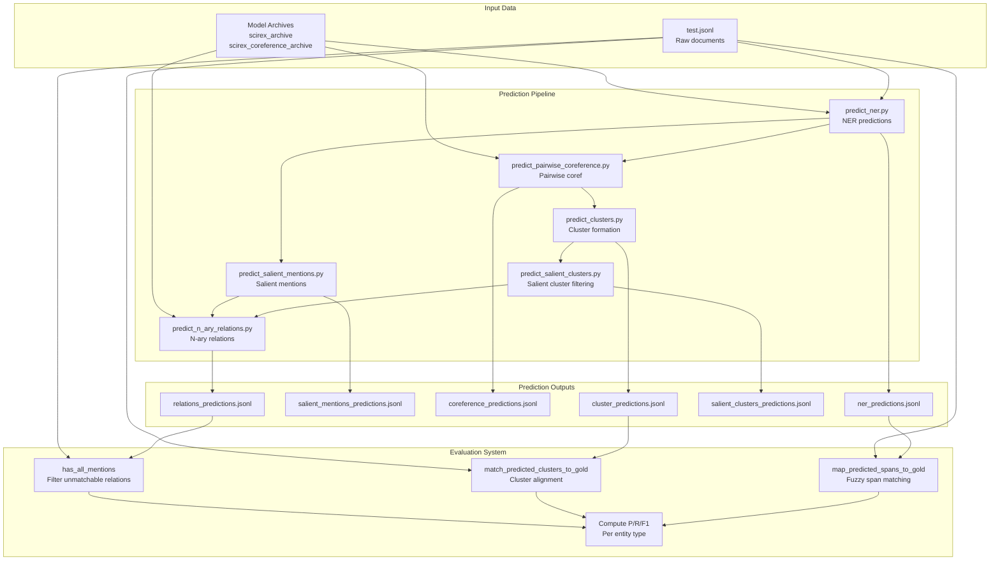
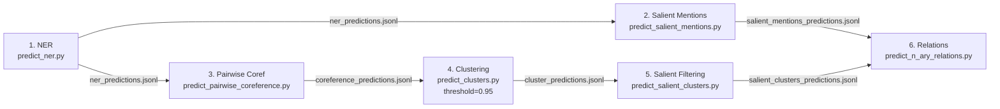
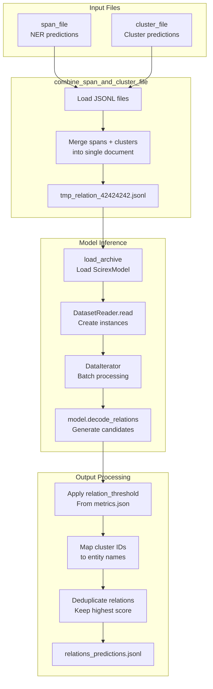
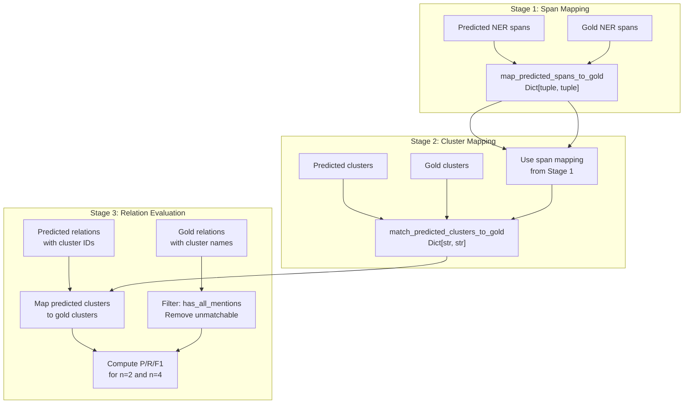
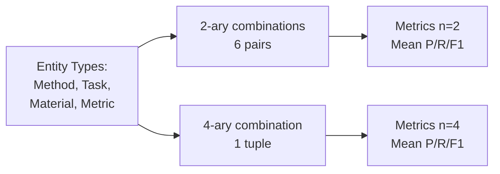

<!-- source: DeepWiki mcp.deepwiki.com · repo allenai/SciREX · page 5 Prediction and Evaluation · fetched 2026-10-26 -->

# Prediction and Evaluation

<details>
<summary>Relevant source files</summary>

The following files were used as context for generating this wiki page:

- [.gitignore](.gitignore)
- [README.md](README.md)
- [requirements.txt](requirements.txt)
- [scirex/commands/predict_scirex_model.sh](scirex/commands/predict_scirex_model.sh)
- [scirex/evaluation_scripts/scirex_relation_evaluate.py](scirex/evaluation_scripts/scirex_relation_evaluate.py)
- [scirex/models/doctaet.py](scirex/models/doctaet.py)
- [scirex/predictors/predict_n_ary_relations.py](scirex/predictors/predict_n_ary_relations.py)

</details>


## Purpose and Scope

This page documents the prediction and evaluation systems in SciREX, which enable generating predictions on new documents and measuring model performance. The prediction system orchestrates a sequential pipeline of specialized predictors to extract entities, resolve coreference, and identify n-ary relations. The evaluation system performs sophisticated span matching and cluster mapping to compute precision, recall, and F1 scores.

For detailed documentation on the sequential prediction process, see [Prediction Pipeline](#5.1). For information about evaluation metrics and scoring methodology, see [Evaluation Metrics and Scripts](#5.2). For details on entity matching algorithms, see [Entity Matching and Thresholding](#5.3).

**Sources:** [README.md:48-81](), [scirex/commands/predict_scirex_model.sh:1-81]()

## System Overview

The SciREX prediction and evaluation system consists of two main components that work together to assess model performance on document-level information extraction:

1. **Prediction Pipeline**: A sequential orchestration of specialized predictors that transform raw documents into structured relation predictions
2. **Evaluation Framework**: A sophisticated matching and scoring system that handles the challenges of document-level IE evaluation



**Diagram: End-to-End Prediction and Evaluation Flow**

**Sources:** [scirex/commands/predict_scirex_model.sh:1-81](), [scirex/evaluation_scripts/scirex_relation_evaluate.py:1-131]()

## Prediction Orchestration

The main prediction script `predict_scirex_model.sh` orchestrates the entire prediction pipeline. It requires two trained model archives and produces multiple intermediate and final prediction files.

### Required Environment Variables

| Variable | Purpose | Example |
|----------|---------|---------|
| `scirex_archive` | Path to main ScirexModel archive | `outputs/pwc_outputs/experiment_scirex_full/main` |
| `scirex_coreference_archive` | Path to coreference model archive | `outputs/pwc_outputs/experiment_coreference/main` |
| `cuda_device` | GPU device ID | `0` or `-1` for CPU |

**Sources:** [README.md:52-57](), [scirex/commands/predict_scirex_model.sh:1-10]()

### Prediction Pipeline Sequence

The prediction pipeline follows a strict sequential dependency where each step consumes outputs from previous steps:



**Diagram: Sequential Prediction Dependencies**

**Sources:** [scirex/commands/predict_scirex_model.sh:4-49]()

### Prediction Output Formats

Each predictor generates a JSONL file where each line contains predictions for one document:

**NER Predictions Format:**
- `doc_id`: Document identifier
- `ner`: List of `[start, end, entity_type]` triples

**Cluster Predictions Format:**
- `doc_id`: Document identifier
- `clusters`: Dictionary mapping cluster names to lists of spans `[[start, end], ...]`

**Relations Predictions Format:**
- `doc_id`: Document identifier
- `predicted_relations`: List of tuples `(relation, score, label)` where:
  - `relation`: Tuple of cluster names in order `(Method, Task, Material, Metric)`
  - `score`: Float confidence score
  - `label`: Binary prediction (0 or 1) based on threshold

**Sources:** [scirex/predictors/predict_n_ary_relations.py:72-105]()

## Relation Prediction Process

The relation prediction module (`predict_n_ary_relations.py`) deserves special attention as it demonstrates the integration between prediction components:



**Diagram: Relation Prediction Implementation**

The relation predictor loads the best threshold value from the model's `metrics.json` file and applies it to generate binary predictions:

```python
relation_threshold = json.load(open(archive_folder + '/metrics.json'))['best_validation__n_ary_rel_global_threshold']
```

**Sources:** [scirex/predictors/predict_n_ary_relations.py:23-106]()

## Evaluation Framework

The evaluation script `scirex_relation_evaluate.py` implements a sophisticated multi-stage evaluation process that handles the complexities of document-level information extraction.

### Evaluation Stages



**Diagram: Three-Stage Evaluation Process**

**Sources:** [scirex/evaluation_scripts/scirex_relation_evaluate.py:27-125]()

### Key Evaluation Functions

The evaluation script defines several critical functions:

**`ner_metrics(gold_data, predicted_data)`** [scirex/evaluation_scripts/scirex_relation_evaluate.py:27-36]()
- Maps predicted NER spans to gold spans using fuzzy matching
- Returns a dictionary: `{doc_id: {predicted_span: gold_span}}`

**`clustering_metrics(gold_data, predicted_clusters, span_map)`** [scirex/evaluation_scripts/scirex_relation_evaluate.py:39-54]()
- Matches predicted clusters to gold clusters
- Uses the span mapping from NER evaluation
- Computes and prints mean precision, recall, and F1 for clustering
- Returns cluster mapping: `{doc_id: {predicted_cluster: gold_cluster}}`

**`has_all_mentions(doc, relation)`** [scirex/evaluation_scripts/scirex_relation_evaluate.py:18-20]()
- Checks if all entities in a relation have textual mentions
- Critical for filtering unmatchable gold relations (see below)

**Sources:** [scirex/evaluation_scripts/scirex_relation_evaluate.py:18-54]()

## Critical Design Decision: Relation Filtering

A significant challenge in SciREX evaluation is that approximately 50% of gold relations contain at least one entity with no textual mentions (these entities appear only in tables, which were excluded from the dataset). This creates an evaluation problem: no predicted cluster can match a gold cluster with zero mentions.

The evaluation script addresses this by filtering out unmatchable relations:

```python
gold_relations = [tuple((t, x[t]) for t in types) for x in doc['n_ary_relations']]
gold_relations = set([x for x in gold_relations if has_all_mentions(doc, x)])
```

**Impact on Metrics:**
- Only gold relations with all entities having mentions are considered
- This prevents unfair penalization of the model for unpredictable cases
- According to the README, this "artificially reduces the precision of our model" because some predicted relations that match table-only gold entities are counted as false positives

**Sources:** [README.md:28](), [scirex/evaluation_scripts/scirex_relation_evaluate.py:109-110]()

## Evaluation Variants

The prediction script generates three different relation prediction files to support ablation studies:

| Prediction File | Cluster Source | Purpose |
|----------------|----------------|---------|
| `relations_predictions.jsonl` | Predicted salient clusters | End-to-end evaluation |
| `relations_predictions_gold_salient_clusters.jsonl` | Gold clusters filtered to predicted salient | Isolates relation extraction from clustering |
| `relations_predictions_gold_clusters.jsonl` | Pure gold clusters | Upper bound: relation extraction only |

Each variant is evaluated separately to understand error propagation through the pipeline:

```bash
# End-to-end evaluation
python scirex/evaluation_scripts/scirex_relation_evaluate.py \
  --gold-file $test_file \
  --ner-file $test_output_folder/ner_predictions.jsonl \
  --clusters-file $test_output_folder/salient_clusters_predictions.jsonl \
  --relations-file $test_output_folder/relations_predictions.jsonl

# Evaluation with gold cluster filtering
python scirex/evaluation_scripts/scirex_relation_evaluate.py \
  --gold-file $test_file \
  --ner-file $test_output_folder/ner_predictions.jsonl \
  --clusters-file $test_output_folder/salient_clusters_predictions_using_gold.jsonl \
  --relations-file $test_output_folder/relations_predictions_gold_salient_clusters.jsonl
```

**Sources:** [scirex/commands/predict_scirex_model.sh:43-80]()

## Relation Cardinality Evaluation

The evaluation script computes separate metrics for 2-ary and 4-ary relations by iterating over combinations of entity types:



The evaluation iterates over `n ∈ [2, 4]` and uses `combinations(used_entities, n)` to generate all possible entity type subsets. For each subset, it projects both predicted and gold relations onto those types and computes precision, recall, and F1.

**Sources:** [scirex/evaluation_scripts/scirex_relation_evaluate.py:93-125]()

## Metric Aggregation

The evaluation script uses pandas DataFrames to aggregate metrics across documents:

```python
all_metrics = []
for doc in gold_data:
    # ... compute metrics for this document ...
    all_metrics.append(metrics)

all_metrics = pd.DataFrame(all_metrics)
print(all_metrics.describe().loc['mean'][['p', 'r', 'f1']])
```

This approach computes mean precision, recall, and F1 across all documents, providing document-level macro-averaged metrics rather than micro-averaged metrics.

**Sources:** [scirex/evaluation_scripts/scirex_relation_evaluate.py:50-52](), [scirex/evaluation_scripts/scirex_relation_evaluate.py:123-125]()

## Prediction Mode Configuration

Both the main model and the dataset reader support a `prediction_mode` flag that modifies their behavior:

```python
model.prediction_mode = True
dataset_reader.prediction_mode = True
```

This flag typically:
- Disables loss computation
- Enables generation of additional output fields
- Modifies data preprocessing for prediction-time documents

The `DoctaetModel` class demonstrates this pattern with its binary threshold F1 metric implementation.

**Sources:** [scirex/predictors/predict_n_ary_relations.py:58-62](), [scirex/models/doctaet.py:52-53]()

## Command-Line Interface

The prediction system is designed to be executed via shell scripts that set up the environment and call Python modules sequentially. The main prediction script structure:

```bash
export test_file=scirex_dataset/release_data/test.jsonl
export test_output_folder=test_outputs/

echo "Predicting NER"
python scirex/predictors/predict_ner.py $scirex_archive $test_file $test_output_folder/ner_predictions.jsonl $cuda_device

echo "Predicting Salient Mentions"
python scirex/predictors/predict_salient_mentions.py $scirex_archive $test_output_folder/ner_predictions.jsonl ...

# ... additional prediction steps ...

echo "Evaluating on all Predicted steps"
python scirex/evaluation_scripts/scirex_relation_evaluate.py --gold-file $test_file --ner-file ...
```

Each predictor follows a consistent argument pattern: `(model_archive, input_file, output_file, cuda_device)`.

**Sources:** [scirex/commands/predict_scirex_model.sh:1-81]()

## Integration with Model Training

The prediction pipeline depends on artifacts produced during training:

1. **Model Archives**: Serialized models with vocabulary and weights (`model.tar.gz`)
2. **Metrics Files**: JSON files containing optimal thresholds (`metrics.json`)
3. **Configuration**: Dataset reader and iterator configurations embedded in the archive

The relation predictor demonstrates how these artifacts are loaded and used:

```python
archive_file = os.path.join(archive_folder, "model.tar.gz")
archive = load_archive(archive_file, cuda_device)
model = archive.model

relation_threshold = json.load(open(archive_folder + '/metrics.json'))['best_validation__n_ary_rel_global_threshold']

config = archive.config.duplicate()
dataset_reader_params = config["dataset_reader"]
dataset_reader = DatasetReader.from_params(dataset_reader_params)
```

**Sources:** [scirex/predictors/predict_n_ary_relations.py:48-62]()

## Summary

The SciREX prediction and evaluation system implements a modular, sequential pipeline that:

1. **Decomposes complex IE tasks** into manageable steps (NER → saliency → coreference → clustering → relations)
2. **Produces interpretable intermediate outputs** that support error analysis and ablation studies
3. **Handles document-level evaluation challenges** through sophisticated span and cluster mapping
4. **Addresses dataset limitations** by filtering unmatchable gold relations
5. **Supports multiple evaluation variants** to isolate error sources in the pipeline

For detailed information on specific components, see:
- [Prediction Pipeline](#5.1) for step-by-step prediction process documentation
- [Evaluation Metrics and Scripts](#5.2) for detailed evaluation methodology
- [Entity Matching and Thresholding](#5.3) for fuzzy matching algorithms

**Sources:** [README.md:1-74](), [scirex/commands/predict_scirex_model.sh:1-81](), [scirex/evaluation_scripts/scirex_relation_evaluate.py:1-131]()

---

