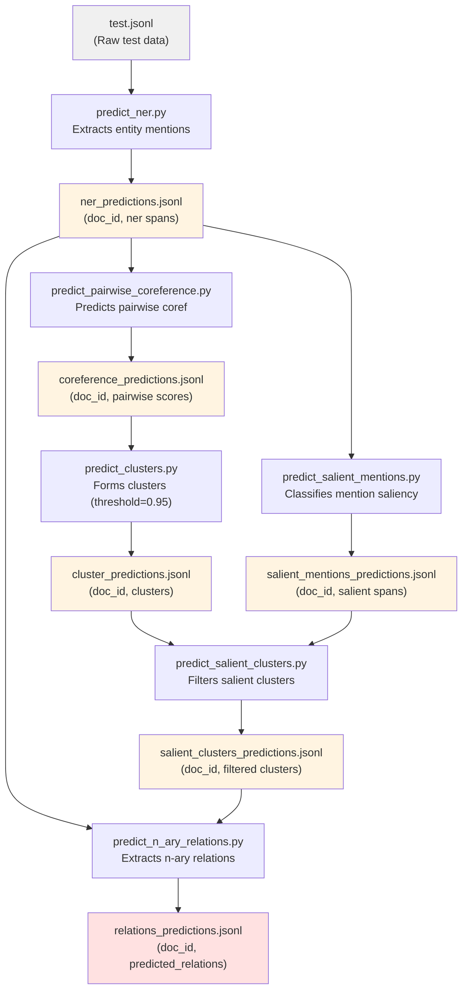
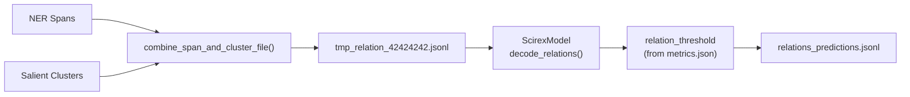
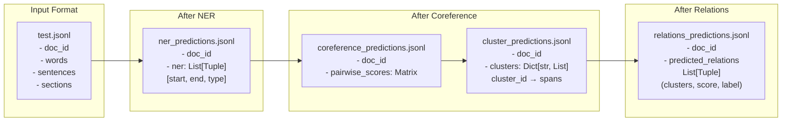
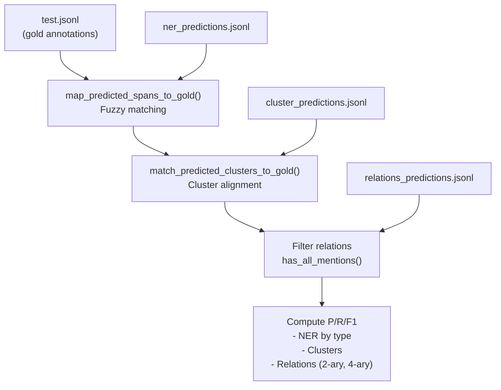

<!-- source: DeepWiki mcp.deepwiki.com · repo allenai/SciREX · page 5.1 Prediction Pipeline · fetched 2026-10-26 -->

# Prediction Pipeline

<details>
<summary>Relevant source files</summary>

The following files were used as context for generating this wiki page:

- [.gitignore](.gitignore)
- [scirex/commands/predict_scirex_model.sh](scirex/commands/predict_scirex_model.sh)
- [scirex/evaluation_scripts/scirex_relation_evaluate.py](scirex/evaluation_scripts/scirex_relation_evaluate.py)
- [scirex/models/doctaet.py](scirex/models/doctaet.py)
- [scirex/predictors/predict_n_ary_relations.py](scirex/predictors/predict_n_ary_relations.py)

</details>


## Purpose and Scope

This document describes the prediction pipeline used to generate information extraction outputs from trained SciREX models. The pipeline orchestrates a sequence of predictor modules that progressively build up structured predictions: Named Entity Recognition (NER), salient mention identification, coreference resolution, cluster formation, and N-ary relation extraction.

For information about training the models used in this pipeline, see [Training Scripts and Workflows](#4.1). For details on how predictions are evaluated, see [Evaluation Metrics and Scripts](#5.2).

---

## Pipeline Overview

The prediction pipeline is implemented as a sequential execution of Python scripts, orchestrated by the shell script [scirex/commands/predict_scirex_model.sh](). The pipeline takes two trained model archives (`$scirex_archive` and `$scirex_coreference_archive`) and a test file as input, producing multiple intermediate and final prediction files.

The pipeline follows a strict dependency order where each stage consumes outputs from previous stages:

```
Test Data → NER → Salient Mentions → Coreference → Clustering → Relations
                                    ↓
                                (also to Coreference)
```

This modular design allows for:
- **Ablation studies**: Test the impact of individual components by swapping predicted outputs with gold annotations
- **Error analysis**: Inspect intermediate outputs to identify failure modes
- **Flexible evaluation**: Evaluate end-to-end performance or oracle performance with gold inputs

**Sources:** [scirex/commands/predict_scirex_model.sh:1-81]()

---

## Sequential Prediction Stages

The following diagram maps the execution flow through specific Python scripts and their input/output files:



**Sources:** [scirex/commands/predict_scirex_model.sh:4-49]()

---

## Stage 1: Named Entity Recognition

The first stage extracts typed entity mentions from the document text.

### Execution Command

```bash
python scirex/predictors/predict_ner.py \
  $scirex_archive \
  $test_file \
  $test_output_folder/ner_predictions.jsonl \
  $cuda_device
```

### Input/Output Format

| Field | Description |
|-------|-------------|
| **Input** | `test.jsonl` with document text and metadata |
| **Output** | `ner_predictions.jsonl` with extracted spans |
| **Span Format** | `[start_index, end_index, entity_type]` |
| **Entity Types** | `Material`, `Method`, `Task`, `Metric` |

The NER predictor loads the trained ScirexModel from `$scirex_archive` and runs inference on each document, producing span-level entity predictions with their types.

**Sources:** [scirex/commands/predict_scirex_model.sh:4-9]()

---

## Stage 2: Salient Mention Identification

This stage classifies which entity mentions are salient (i.e., represent key contributions of the paper).

### Execution Command

```bash
python scirex/predictors/predict_salient_mentions.py \
  $scirex_archive \
  $test_output_folder/ner_predictions.jsonl \
  $test_output_folder/salient_mentions_predictions.jsonl \
  $cuda_device
```

### Functionality

The salient mention predictor:
1. Loads NER predictions from Stage 1
2. Applies the saliency classifier component of ScirexModel
3. Outputs binary saliency labels for each mention

This component uses the same model archive as NER but accesses a different prediction head within the multi-task ScirexModel.

**Sources:** [scirex/commands/predict_scirex_model.sh:11-16]()

---

## Stage 3: Pairwise Coreference Resolution

This stage predicts which entity mentions refer to the same real-world entity.

### Execution Command

```bash
python scirex/predictors/predict_pairwise_coreference.py \
  $scirex_coreference_archive \
  $test_output_folder/ner_predictions.jsonl \
  $test_output_folder/coreference_predictions.jsonl \
  $cuda_device
```

### Model Architecture

Unlike the previous stages, this uses a separate model archive (`$scirex_coreference_archive`) trained specifically for coreference resolution. The predictor:
- Takes all pairs of NER mentions within a document
- Computes pairwise coreference scores
- Outputs a matrix of similarity scores between mentions

**Sources:** [scirex/commands/predict_scirex_model.sh:18-23]()

---

## Stage 4: Cluster Formation

This stage converts pairwise coreference scores into discrete entity clusters.

### Execution Command

```bash
python scirex/predictors/predict_clusters.py \
  $test_output_folder/coreference_predictions.jsonl \
  $test_output_folder/cluster_predictions.jsonl \
  0.95
```

### Clustering Algorithm

The script accepts a threshold parameter (0.95) and:
1. Reads pairwise coreference scores
2. Forms connected components where edges exist between mention pairs with scores above the threshold
3. Assigns cluster IDs to groups of coreferent mentions

The threshold of 0.95 is a hyperparameter that controls the precision-recall tradeoff in clustering.

**Sources:** [scirex/commands/predict_scirex_model.sh:25-29]()

---

## Stage 5: Salient Cluster Filtering

This stage combines saliency predictions with cluster assignments to identify salient entity clusters.

### Execution Command

```bash
python scirex/predictors/predict_salient_clusters.py \
  $test_output_folder/cluster_predictions.jsonl \
  $test_output_folder/salient_mentions_predictions.jsonl \
  $test_output_folder/salient_clusters_predictions.jsonl
```

### Filtering Logic

A cluster is considered salient if it contains at least one salient mention. This produces a filtered set of clusters that will be used for relation extraction.

**Sources:** [scirex/commands/predict_scirex_model.sh:31-35]()

---

## Stage 6: N-ary Relation Extraction

The final stage predicts relationships between entity clusters.

### Execution Command

```bash
python scirex/predictors/predict_n_ary_relations.py \
  $scirex_archive \
  $test_output_folder/ner_predictions.jsonl \
  $test_output_folder/salient_clusters_predictions.jsonl \
  $test_output_folder/relations_predictions.jsonl \
  $cuda_device
```

### Implementation Details

The relation predictor implements the following workflow:



The predictor:
1. **Combines inputs**: Merges NER spans with cluster information using `combine_span_and_cluster_file()` [scirex/predictors/predict_n_ary_relations.py:23-42]()
2. **Loads threshold**: Retrieves the optimal relation threshold from `metrics.json` [scirex/predictors/predict_n_ary_relations.py:48]()
3. **Generates candidates**: Creates all possible n-tuples of entity clusters from the specified entity types
4. **Scores relations**: Uses the ScirexModel's relation extraction component to score each candidate
5. **Applies threshold**: Filters predictions using the learned threshold

### Output Format

Each relation prediction is a tuple:
```python
(cluster_tuple, score, binary_label)
```

Where:
- `cluster_tuple`: IDs of participating entity clusters (e.g., Material, Method, Task, Metric)
- `score`: Confidence score (0-1)
- `binary_label`: 1 if score > threshold, else 0

**Sources:** [scirex/predictors/predict_n_ary_relations.py:1-109](), [scirex/commands/predict_scirex_model.sh:43-49]()

---

## Alternative Prediction Modes

The pipeline supports multiple execution modes for ablation studies and oracle experiments.

### Prediction Mode Comparison

| Mode | NER Source | Cluster Source | Purpose |
|------|-----------|----------------|---------|
| **End-to-End** | Predicted | Predicted (filtered) | Realistic full pipeline evaluation |
| **Gold Cluster Filter** | Predicted | Predicted (gold-filtered) | Test relation extraction with better clusters |
| **Gold Clusters** | Gold | Gold | Oracle performance upper bound |

### Gold Cluster Filtering Mode

```bash
python scirex/predictors/predict_salient_clusters_using_gold.py \
  $test_output_folder/cluster_predictions.jsonl \
  $test_file \
  $test_output_folder/salient_clusters_predictions_using_gold.jsonl
```

This mode uses gold cluster information to filter predicted clusters, removing false positive clusters while retaining true positives. It helps isolate relation extraction errors from clustering errors.

**Sources:** [scirex/commands/predict_scirex_model.sh:37-57]()

### Gold Clusters Mode

```bash
python scirex/predictors/predict_n_ary_relations.py \
  $scirex_archive \
  $test_file \
  $test_file \
  $test_output_folder/relations_predictions_gold_clusters.jsonl \
  $cuda_device
```

By passing `$test_file` as both the span file and cluster file, the predictor uses gold annotations for both NER and clustering. This provides an upper bound on relation extraction performance.

**Sources:** [scirex/commands/predict_scirex_model.sh:59-65]()

---

## Data Flow and File Formats

The following diagram shows how data structures evolve through the pipeline:



### JSONL Format Details

All intermediate files use JSONL format (one JSON object per line). Each prediction file contains:
- **`doc_id`**: Document identifier matching the input test file
- **Task-specific fields**: Vary by prediction stage
- **Metadata** (optional): Document-level information

**Sources:** [scirex/predictors/predict_n_ary_relations.py:23-42](), [scirex/evaluation_scripts/scirex_relation_evaluate.py:23-24]()

---

## Cluster Metadata and Mapping

The relation prediction stage maintains bidirectional mappings between cluster names and IDs.

### Mapping Structure

```python
# From metadata in decode_relations output
cluster_name_to_id = metadata['document_metadata']['cluster_name_to_id']
# Example: {'Material-1': 0, 'Method-1': 1, ...}

# Inverted for prediction output
coref_key_map = {k:i for i, k in cluster_name_to_id.items()}
# Example: {0: 'Material-1', 1: 'Method-1', ...}
```

The predictor uses `coref_key_map` to convert internal cluster indices to human-readable cluster names in the output file [scirex/predictors/predict_n_ary_relations.py:84-87]().

**Sources:** [scirex/predictors/predict_n_ary_relations.py:82-94]()

---

## Prediction-Evaluation Integration

The prediction pipeline outputs are designed to integrate seamlessly with the evaluation system.

### Evaluation Invocation

```bash
python scirex/evaluation_scripts/scirex_relation_evaluate.py \
  --gold-file $test_file \
  --ner-file $test_output_folder/ner_predictions.jsonl \
  --clusters-file $test_output_folder/salient_clusters_predictions.jsonl \
  --relations-file $test_output_folder/relations_predictions.jsonl
```

### Evaluation Data Flow



The evaluation script:
1. Maps predicted spans to gold spans using fuzzy matching
2. Maps predicted clusters to gold clusters 
3. Filters relations that lack textual mentions
4. Computes precision, recall, and F1 for each task

**Sources:** [scirex/evaluation_scripts/scirex_relation_evaluate.py:1-131](), [scirex/commands/predict_scirex_model.sh:67-81]()

---

## Environment Variables and Configuration

The prediction script relies on environment variables defined before execution:

| Variable | Description | Example |
|----------|-------------|---------|
| `$scirex_archive` | Path to trained ScirexModel | `experiment_scirex_full/` |
| `$scirex_coreference_archive` | Path to trained coreference model | `experiment_coreference/` |
| `$test_file` | Input test data | `scirex_dataset/release_data/test.jsonl` |
| `$test_output_folder` | Output directory | `test_outputs/` |
| `$cuda_device` | GPU device ID | `0` for first GPU, `-1` for CPU |

These variables must be set in the shell environment before executing [scirex/commands/predict_scirex_model.sh]().

**Sources:** [scirex/commands/predict_scirex_model.sh:1-9]()

---

## Temporary Files and Cleanup

The relation predictor creates a temporary file during execution:

```python
annotations_to_jsonl(spans, 'tmp_relation_42424242.jsonl')
```

This temporary file combines span and cluster information into a single document for relation extraction. The file uses a unique name (`tmp_relation_42424242.jsonl`) to avoid conflicts [scirex/predictors/predict_n_ary_relations.py:41]().

**Note**: This file is not automatically deleted and may accumulate in the working directory during repeated predictions.

**Sources:** [scirex/predictors/predict_n_ary_relations.py:41](), [scirex/predictors/predict_n_ary_relations.py:47]()

---

