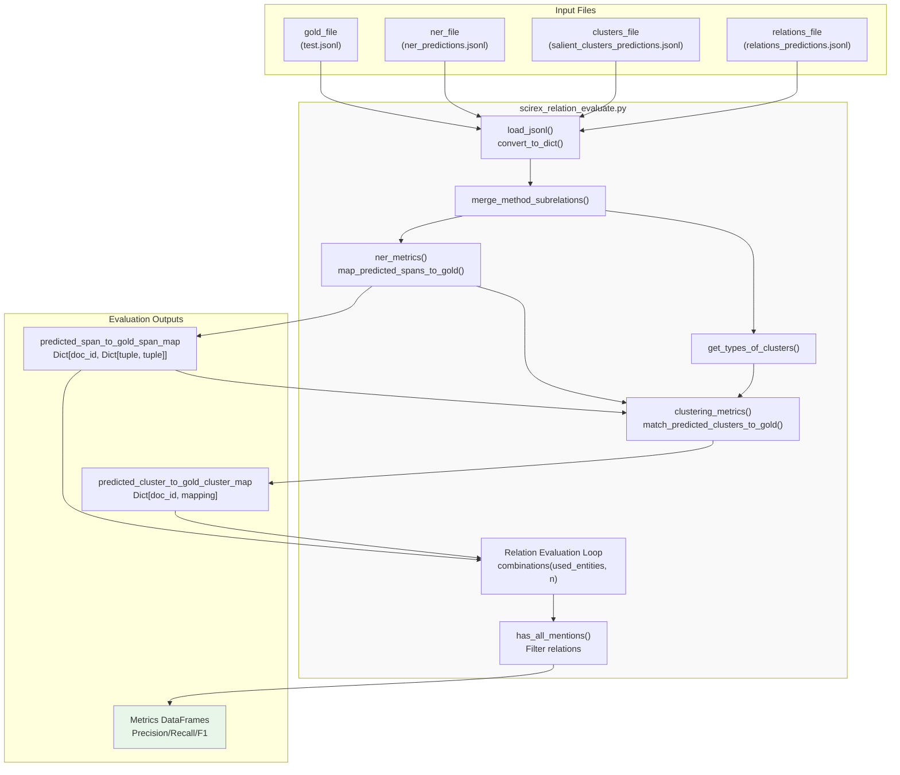
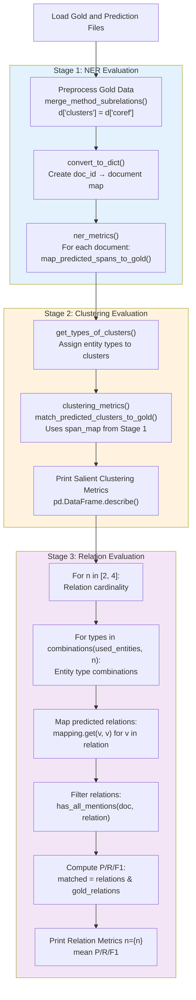
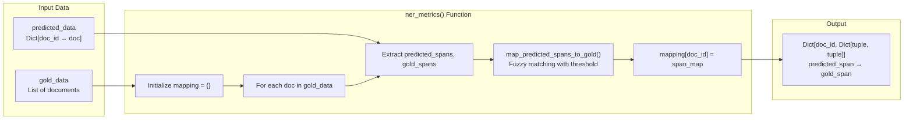
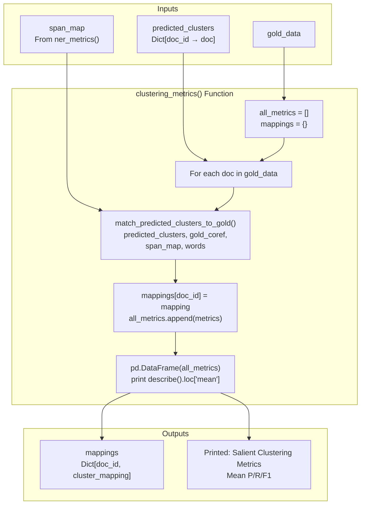
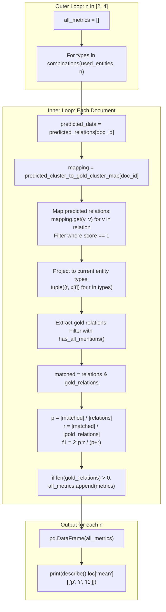
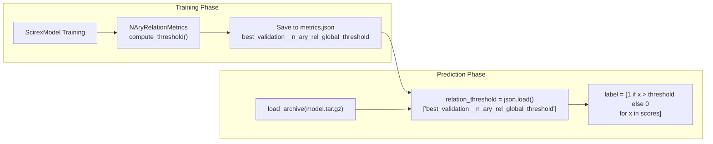

<!-- source: DeepWiki mcp.deepwiki.com · repo allenai/SciREX · page 5.2 Evaluation Metrics and Scripts · fetched 2026-10-26 -->

# Evaluation Metrics and Scripts

<details>
<summary>Relevant source files</summary>

The following files were used as context for generating this wiki page:

- [.gitignore](.gitignore)
- [scirex/commands/predict_scirex_model.sh](scirex/commands/predict_scirex_model.sh)
- [scirex/evaluation_scripts/scirex_relation_evaluate.py](scirex/evaluation_scripts/scirex_relation_evaluate.py)
- [scirex/metrics/n_ary_relation_metrics.py](scirex/metrics/n_ary_relation_metrics.py)
- [scirex/models/doctaet.py](scirex/models/doctaet.py)
- [scirex/predictors/predict_n_ary_relations.py](scirex/predictors/predict_n_ary_relations.py)

</details>


## Purpose and Scope

This document describes the evaluation methodology and scripts used to measure the performance of SciREX models on information extraction tasks. The evaluation system computes precision, recall, and F1 scores for Named Entity Recognition (NER), coreference clustering, and N-ary relation extraction. The evaluation process handles span-to-span mapping, cluster alignment, and relation filtering to account for imperfect predictions and coreference resolution.

For information about the prediction pipeline that generates the outputs being evaluated, see [Prediction Pipeline](#5.1). For details on the fuzzy matching algorithms used during evaluation, see [Entity Matching and Thresholding](#5.3).

## Evaluation Architecture

The evaluation system processes prediction outputs from multiple stages of the pipeline and compares them against gold annotations. The main evaluation script coordinates span mapping, cluster matching, and relation scoring.



**Sources:** [scirex/evaluation_scripts/scirex_relation_evaluate.py:1-130]()

## Main Evaluation Script

The primary evaluation script is `scirex_relation_evaluate.py`, which orchestrates the entire evaluation process. It accepts four command-line arguments specifying paths to the gold annotations and three prediction files.

### Command-Line Arguments

| Argument | Description | Example |
|----------|-------------|---------|
| `--gold-file` | Gold annotations (test.jsonl) | `scirex_dataset/release_data/test.jsonl` |
| `--ner-file` | Predicted NER spans | `test_outputs/ner_predictions.jsonl` |
| `--clusters-file` | Predicted salient clusters | `test_outputs/salient_clusters_predictions.jsonl` |
| `--relations-file` | Predicted N-ary relations | `test_outputs/relations_predictions.jsonl` |

**Sources:** [scirex/evaluation_scripts/scirex_relation_evaluate.py:12-16](), [scirex/commands/predict_scirex_model.sh:67-80]()

## Evaluation Workflow

The evaluation process follows a three-stage pipeline: span mapping, cluster mapping, and relation evaluation. Each stage builds upon the previous mappings to align predictions with gold annotations.



**Sources:** [scirex/evaluation_scripts/scirex_relation_evaluate.py:71-126]()

## NER Evaluation

The `ner_metrics()` function evaluates Named Entity Recognition performance by mapping predicted spans to gold spans. This mapping is used in subsequent stages to align clusters and relations.

### NER Metrics Implementation



The `map_predicted_spans_to_gold()` function (from `scirex.predictors.utils`) performs fuzzy matching between predicted and gold spans. It uses string similarity metrics and overlap ratios to find the best alignment. See [Entity Matching and Thresholding](#5.3) for details on the matching algorithms.

**Sources:** [scirex/evaluation_scripts/scirex_relation_evaluate.py:27-36]()

## Clustering Evaluation

The `clustering_metrics()` function evaluates coreference clustering by matching predicted clusters to gold clusters. It uses the span mapping from NER evaluation to align cluster members.

### Clustering Metrics Implementation

The function calls `match_predicted_clusters_to_gold()` from `scirex.metrics.clustering_metrics`, which computes cluster-level precision, recall, and F1 scores. Metrics are aggregated across all documents and reported using pandas.



**Sources:** [scirex/evaluation_scripts/scirex_relation_evaluate.py:39-54]()

### Cluster Type Assignment

Before clustering evaluation, the `get_types_of_clusters()` function assigns entity types to each cluster based on the NER types of its constituent spans. If a cluster has spans of multiple types, it takes the first type. Empty clusters are labeled as "Empty".

**Sources:** [scirex/evaluation_scripts/scirex_relation_evaluate.py:57-69]()

## Relation Evaluation

Relation evaluation is performed for both 2-ary and 4-ary relations. The evaluation loops over all combinations of entity types and computes precision, recall, and F1 for each relation cardinality.

### Relation Filtering: has_all_mentions()

A critical filtering step removes relations where constituent entities lack textual mentions. This is necessary because some entities (particularly those extracted from tables or figures) may not have corresponding text spans.

```python
def has_all_mentions(doc, relation):
    has_mentions = all(len(doc["clusters"][x[1]]) > 0 for x in relation)
    return has_mentions
```

This function checks that each entity cluster in the relation has at least one span mention. According to the codebase documentation, approximately 50% of relations are filtered out due to missing mentions.

**Sources:** [scirex/evaluation_scripts/scirex_relation_evaluate.py:18-21]()

### Relation Evaluation Loop

The relation evaluation process iterates over relation cardinalities (n=2, n=4) and entity type combinations. For each document, it:

1. Maps predicted cluster IDs to gold cluster IDs using the cluster mapping
2. Converts relations to dictionaries keyed by entity types
3. Projects relations to the current entity type combination
4. Filters gold relations to only include those with all mentions
5. Computes set intersection to find matched relations
6. Calculates precision, recall, and F1



**Sources:** [scirex/evaluation_scripts/scirex_relation_evaluate.py:93-126]()

### Entity Type Combinations

The evaluation uses the `used_entities` set (from `scirex_utilities.entity_utils`) which contains the four entity types: Material, Method, Task, and Metric. For 2-ary relations, all pairs are evaluated (e.g., Material-Method, Method-Task). For 4-ary relations, all 4-tuples are evaluated.

**Sources:** [scirex/evaluation_scripts/scirex_relation_evaluate.py:9]()

## Training-Time Metrics

During model training, metrics are computed using specialized metric classes that track predictions and compute thresholds.

### NAryRelationMetrics

The `NAryRelationMetrics` class accumulates relation predictions and gold labels across batches. It computes optimal classification thresholds using the `compute_threshold()` function and generates a classification report.

Key methods:
- `__call__()`: Accumulates candidate relations, labels, and scores. Keeps the highest score for each unique relation.
- `get_metric()`: Computes the optimal threshold, applies it to predictions, and returns precision/recall/F1 metrics using sklearn's `classification_report()`.
- `reset()`: Clears accumulated data at the end of each epoch.

The class stores relations as `(doc_id, tuple(relation))` keys to handle the same relation appearing in multiple paragraphs within a document.

**Sources:** [scirex/metrics/n_ary_relation_metrics.py:10-76]()

### BinaryThresholdF1

The `DoctaetModel` uses the `BinaryThresholdF1` metric for binary classification tasks. This metric (referenced in the model but defined elsewhere) computes threshold-optimized F1 scores for binary predictions.

**Sources:** [scirex/models/doctaet.py:52-53]()

## Threshold Selection for Predictions

When generating predictions, the relation extractor uses a threshold from the trained model's metrics to determine which candidate relations to include. This threshold is stored in `metrics.json` and loaded during prediction.



**Sources:** [scirex/predictors/predict_n_ary_relations.py:48-49](), [scirex/predictors/predict_n_ary_relations.py:92]()

## Integration with Prediction Pipeline

The evaluation script is invoked at the end of the prediction pipeline script. Multiple evaluation runs are performed to assess different experimental conditions:

1. **End-to-End Evaluation**: All predicted components (NER, clusters, relations)
2. **Gold Cluster Filtering**: Uses gold salient clusters to filter predicted relations
3. **Gold Cluster Evaluation**: Evaluates relation extraction given gold clusters

These multiple evaluation modes enable ablation studies to understand the contribution of each pipeline component.

**Sources:** [scirex/commands/predict_scirex_model.sh:67-81]()

## Metric Output Format

The evaluation script prints metrics to stdout in a structured format:

1. **Salient Clustering Metrics**: Mean precision, recall, F1 across all documents
2. **Relation Metrics n=2**: Mean precision, recall, F1 for 2-ary relations
3. **Relation Metrics n=4**: Mean precision, recall, F1 for 4-ary relations

All metrics are computed using pandas DataFrames, which are aggregated using `describe().loc['mean']` to compute mean values across documents. The epsilon value `1e-7` is added to denominators to prevent division by zero.

**Sources:** [scirex/evaluation_scripts/scirex_relation_evaluate.py:50-52](), [scirex/evaluation_scripts/scirex_relation_evaluate.py:115-125]()

---

