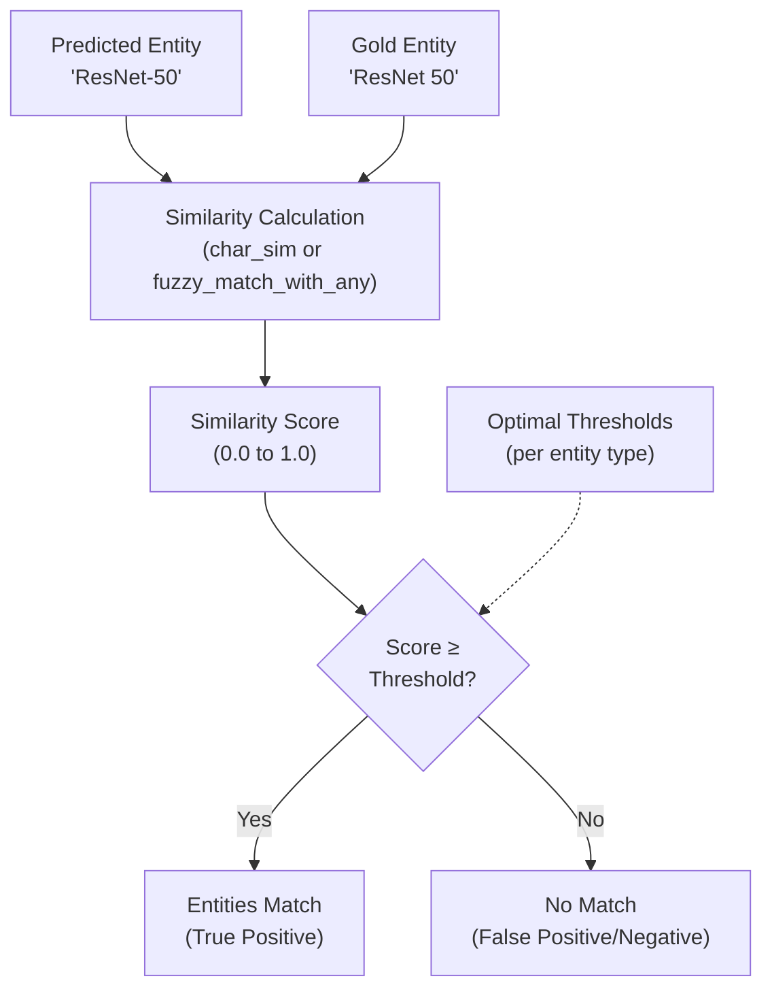
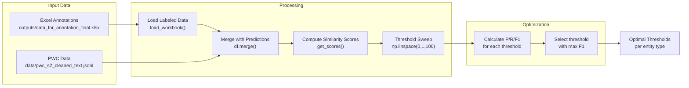
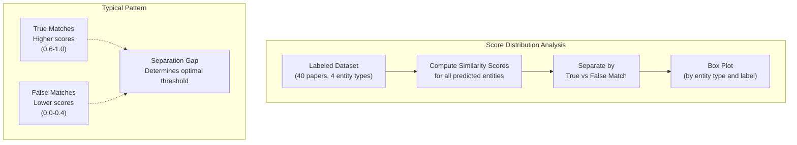
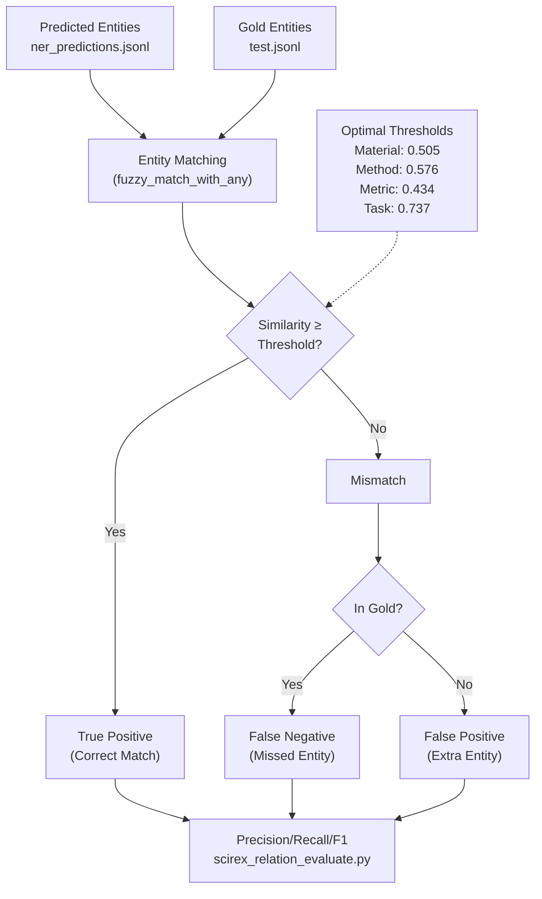

<!-- source: DeepWiki mcp.deepwiki.com · repo allenai/SciREX · page 5.3 Entity Matching and Thresholding · fetched 2026-10-26 -->

# Entity Matching and Thresholding

<details>
<summary>Relevant source files</summary>

The following files were used as context for generating this wiki page:

- [notebooks/Fuzzy Matching Threshold.ipynb](notebooks/Fuzzy Matching Threshold.ipynb)

</details>


## Purpose and Scope

This page documents the fuzzy matching algorithms and threshold optimization techniques used in SciREX for entity matching during evaluation. When evaluating predicted entities against gold annotations, exact string matching is insufficient due to variations in how entities are expressed (e.g., "ResNet-50" vs "ResNet 50", "LSTM" vs "Long Short-Term Memory"). This page covers:

- Similarity metrics for comparing entity mentions (`char_sim`, `fuzzy_match_with_any`)
- Threshold optimization methodology for determining match thresholds
- Optimal thresholds per entity type (Material, Method, Metric, Task)

For the broader evaluation pipeline that uses these algorithms, see [Evaluation Metrics and Scripts](#5.2). For the prediction pipeline that generates the entities being evaluated, see [Prediction Pipeline](#5.1).

---

## Entity Matching Problem

Entity matching in SciREX involves comparing predicted entity mentions against gold standard annotations where exact string matching would be too strict. Consider these challenges:

| Challenge | Example |
|-----------|---------|
| Case variations | "lstm" vs "LSTM" |
| Punctuation differences | "ResNet-50" vs "ResNet 50" |
| Whitespace | "ImageNet" vs "Image Net" |
| Abbreviations | "CNN" vs "Convolutional Neural Network" |
| Special characters | "V-Ne + Di Lo" vs "VNe DiLo" |

The solution uses similarity metrics with optimized thresholds to determine when two entity strings should be considered matches.



**Sources:** [notebooks/Fuzzy Matching Threshold.ipynb:115-149]()

---

## Similarity Metrics

### Character N-gram Similarity (char_sim)

The `char_sim` function computes similarity based on character n-grams using Jaccard similarity. It can optionally consider abbreviation patterns.

**Implementation:**

```python
def char_sim(w1: str, w2: str, ng: int = 3, with_abbr: bool = False):
    # Clean text and split into words
    w1, w2 = clean_text(w1), clean_text(w2)
    
    # Compute n-gram overlap
    ng = min(min([len(x) for x in w1 + w2]), ng)
    score_1 = jaccard_similarity(get_n_grams(w1, ng), get_n_grams(w2, ng))
    
    # Optional abbreviation matching
    score_2 = jaccard_similarity(get_abbr_n_grams(w1, ng), get_n_grams(w2, ng)) if with_abbr else 0
    score_3 = jaccard_similarity(get_n_grams(w1, ng), get_abbr_n_grams(w2, ng)) if with_abbr else 0
    
    return max(score_1, score_2, score_3)
```

**Key components:**

- `clean_text`: Removes special characters and normalizes whitespace [notebooks/Fuzzy Matching Threshold.ipynb:122]()
- `get_n_grams`: Extracts character n-grams from words [notebooks/Fuzzy Matching Threshold.ipynb:123]()
- `get_abbr_n_grams`: Extracts first letters for abbreviation matching [notebooks/Fuzzy Matching Threshold.ipynb:124]()
- `jaccard_similarity`: Computes Jaccard index between two sets [notebooks/Fuzzy Matching Threshold.ipynb:117-120]()

**Example:**
- "ResNet-50" → words: ["resnet", "50"]
- Character 3-grams: ["res", "esn", "sne", "net", "50"]
- Abbreviation patterns enable matching "CNN" with "Convolutional Neural Network"

**Sources:** [notebooks/Fuzzy Matching Threshold.ipynb:115-132]()

---

### FuzzyWuzzy Token Sort Ratio (fuzzy_match_with_any)

The `fuzzy_match_with_any` function uses the FuzzyWuzzy library's `token_sort_ratio`, which:
1. Tokenizes both strings
2. Sorts tokens alphabetically
3. Computes Levenshtein distance on sorted tokens
4. Returns normalized score (0-100, converted to 0-1)

```python
def fuzzy_match_with_any(w1: str, w2: str):
    from fuzzywuzzy import fuzz
    return fuzz.token_sort_ratio(" ".join(clean_text(w1)), 
                                  " ".join(clean_text(w2))) / 100
```

This approach is robust to:
- Word order variations
- Typographical errors
- Missing/extra tokens

**Sources:** [notebooks/Fuzzy Matching Threshold.ipynb:134-136]()

---

## Threshold Optimization Methodology

The optimal threshold for each entity type is determined empirically using labeled data where human annotators marked which predicted entities match gold entities.



**Process:**

1. **Data Loading**: Human-annotated matches loaded from Excel [notebooks/Fuzzy Matching Threshold.ipynb:66-88]()
   - Column 4: True entities (comma-separated)
   - Columns 6-218: Predicted entities (highlighted if matches)

2. **Similarity Computation**: For each predicted entity, compute similarity with all true entities [notebooks/Fuzzy Matching Threshold.ipynb:145-149]()
   ```python
   def compare_true_and_predicted_labels(l1, l2, similarity_function):
       scores = []
       for w, b in l2:  # l2: (predicted_entity, is_true_match)
           scores.append((w, b, max([similarity_function(w, x) for x in l1])))
       return scores
   ```

3. **Threshold Sweep**: Test 100 thresholds from 0 to 1 [notebooks/Fuzzy Matching Threshold.ipynb:184]()

4. **Metric Calculation**: For each threshold, compute:
   - **n_true**: Number of human-marked true matches
   - **n_pred**: Number of predictions above threshold
   - **true_pred**: Number of correct predictions above threshold
   - **Precision**: true_pred / n_pred
   - **Recall**: true_pred / n_true
   - **F1**: Harmonic mean of precision and recall

5. **Optimal Selection**: Choose threshold with highest F1 per entity type [notebooks/Fuzzy Matching Threshold.ipynb:197]()

**Sources:** [notebooks/Fuzzy Matching Threshold.ipynb:66-198]()

---

## Optimal Thresholds by Entity Type

### Using char_sim (with abbreviations)

Results from running `char_sim` with 3-grams and abbreviation matching enabled:

| Entity Type | Threshold | Precision | Recall | F1 |
|-------------|-----------|-----------|--------|-----|
| Material | 0.202 | 0.676 | 0.821 | 0.742 |
| Method | 0.354 | 0.586 | 0.773 | 0.667 |
| Metric | 0.111 | 0.745 | 0.946 | 0.833 |
| Task | 0.364 | 0.735 | 0.893 | 0.806 |

**Observations:**
- **Metric** entities benefit from very low threshold (0.111) with high recall (0.946)
- **Task** entities require higher threshold (0.364) for good precision
- Abbreviation matching helps across all types

**Sources:** [notebooks/Fuzzy Matching Threshold.ipynb:333-336]()

---

### Using char_sim (without abbreviations)

Results without abbreviation matching:

| Entity Type | Threshold | Precision | Recall | F1 |
|-------------|-----------|-----------|--------|-----|
| Material | 0.202 | 0.676 | 0.821 | 0.742 |
| Method | 0.374 | 0.660 | 0.750 | 0.702 |
| Metric | 0.111 | 0.795 | 0.946 | 0.864 |
| Task | 0.364 | 0.766 | 0.875 | 0.817 |

**Changes vs. with abbreviations:**
- **Method** precision improves (+7.4%) but recall decreases
- **Metric** precision increases significantly (+5%)
- Overall F1 scores slightly higher without abbreviations

**Sources:** [notebooks/Fuzzy Matching Threshold.ipynb:459-462]()

---

### Using fuzzy_match_with_any

Results using FuzzyWuzzy token sort ratio:

| Entity Type | Threshold | Precision | Recall | F1 |
|-------------|-----------|-----------|--------|-----|
| Material | 0.505 | 0.870 | 0.714 | 0.784 |
| Method | 0.576 | 0.537 | 0.659 | 0.592 |
| Metric | 0.434 | 0.750 | 0.730 | 0.740 |
| Task | 0.737 | 0.878 | 0.768 | 0.819 |

**Observations:**
- Much higher optimal thresholds (0.4-0.7 vs 0.1-0.4)
- **Material** and **Task** achieve highest precision with this method
- **Method** entities have lowest F1 (0.592)
- Trade-off: Higher precision but lower recall for Metric

**Sources:** [notebooks/Fuzzy Matching Threshold.ipynb:585-587]()

---

## Similarity Score Distributions

Visualizing how similarity scores differ between true and false matches helps understand threshold selection:



The notebook generates box plots showing score distributions grouped by entity type and whether they are true matches, enabling visual validation of threshold choices [notebooks/Fuzzy Matching Threshold.ipynb:200-209]().

**Sources:** [notebooks/Fuzzy Matching Threshold.ipynb:182-210]()

---

## Integration with Evaluation Pipeline

Entity matching is a critical component of the evaluation system described in section 5.2. The workflow is:



**Key implementation details:**

1. **Default thresholds**: Based on `fuzzy_match_with_any` results (shown above)
2. **Per-entity type**: Different thresholds for Material/Method/Metric/Task
3. **Evaluation scripts**: Thresholds configured in evaluation code
4. **IOU backup**: For span-level matching, >0.5 intersection-over-union is also used [See high-level Diagram 5]

**Sources:** [notebooks/Fuzzy Matching Threshold.ipynb:1-783](), High-level system diagram 5

---

## Usage Example

Example workflow from the notebook [notebooks/Fuzzy Matching Threshold.ipynb:606-634]():

```python
# Load entity matching algorithms
from scripts.entity_matching_algorithms import entity_similarity_metric

# Example comparison
predicted = "V-Ne + Di Lo"
gold = "objective function"

# Use Method entity type matching
similarity = entity_similarity_metric['Method'][0](predicted, gold)
# Returns: 0.0 (no match)

# With threshold
threshold = 0.576  # Optimal for Method
if similarity >= threshold:
    print("Match found!")
else:
    print("No match")
```

The `entity_similarity_metric` dictionary provides optimized functions per entity type that encapsulate both the similarity function and appropriate threshold.

**Sources:** [notebooks/Fuzzy Matching Threshold.ipynb:606-635]()

---

## Limitations and Considerations

1. **Data size**: Thresholds optimized on 40 papers may not generalize perfectly to all scientific domains

2. **Entity type differences**: 
   - **Metric** entities (e.g., "F1 score", "accuracy") are more standardized → low threshold works
   - **Method** entities have high variation → requires higher threshold

3. **Abbreviation trade-offs**: Including abbreviation matching helps some cases but can introduce false positives

4. **Computational cost**: Character n-gram approach is faster than FuzzyWuzzy but may be less accurate for complex variations

5. **Threshold sensitivity**: Small changes in threshold can significantly impact precision/recall balance

**Sources:** [notebooks/Fuzzy Matching Threshold.ipynb:1-783]()

---

