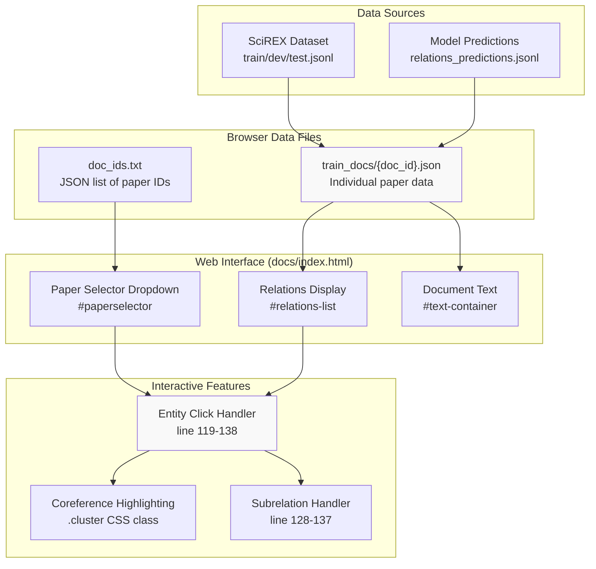
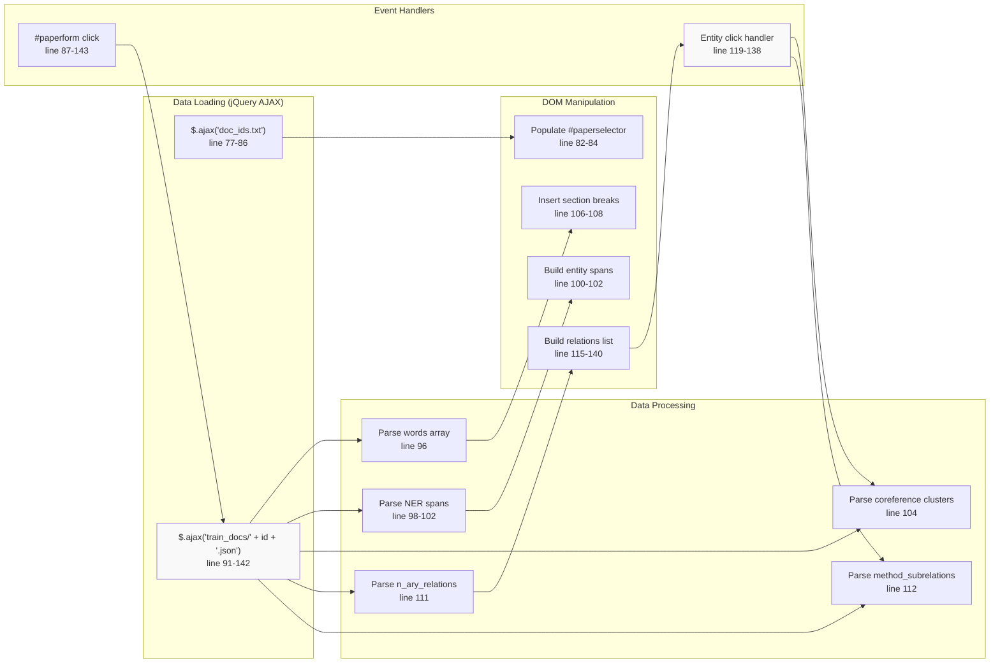
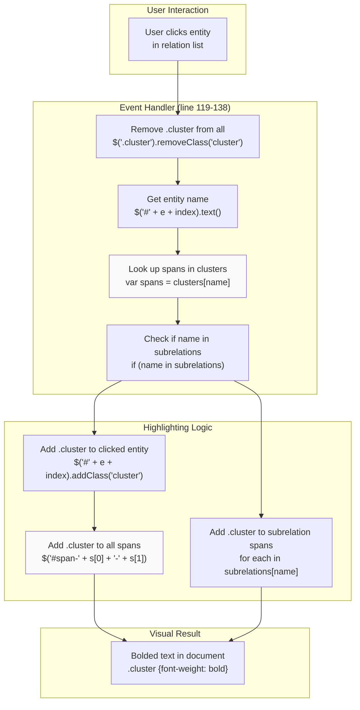

<!-- source: DeepWiki mcp.deepwiki.com · repo allenai/SciREX · page 6 Visualization and Interactive Tools · fetched 2026-10-26 -->

# Visualization and Interactive Tools

<details>
<summary>Relevant source files</summary>

The following files were used as context for generating this wiki page:

- [docs/doc_ids.txt](docs/doc_ids.txt)
- [docs/index.html](docs/index.html)

</details>


This page documents the visualization and interactive tools provided by the SciREX system for exploring annotated scientific papers and model predictions. The primary tool is the **SciREX Browser**, a web-based interface for viewing documents with entity annotations, coreference chains, and n-ary relations.

For detailed information about the prediction outputs that feed into these tools, see [Prediction and Evaluation](#5). For data format specifications, see [Data Format Specification](#2.1).

---

## Overview

The SciREX visualization system consists of a client-side web application that displays annotated scientific papers with interactive features. The browser allows users to:

- Browse through documents in the SciREX dataset
- View color-coded entity mentions (Material, Method, Task, Metric)
- Explore n-ary relations between entities
- Interactively highlight coreference chains by clicking entities
- Navigate document sections and sentences

The system is designed to support both qualitative analysis of annotations and error analysis of model predictions.



**Sources:** [docs/index.html:1-150]()

---

## File Structure

The visualization system uses the following file structure:

| File/Directory | Purpose | Format |
|----------------|---------|--------|
| `docs/index.html` | Main browser interface | HTML + CSS + JavaScript |
| `docs/doc_ids.txt` | List of available papers | JSON with `doc_ids` array |
| `docs/train_docs/{doc_id}.json` | Individual paper data | SciREX JSON format |

The `train_docs/` directory contains one JSON file per paper, where each file follows the standard SciREX data format with fields: `words`, `sections`, `sentences`, `ner`, `coref`, `n_ary_relations`, and `method_subrelations`.

**Sources:** [docs/index.html:78-142](), [docs/doc_ids.txt:1]()

---

## Browser Architecture



**Sources:** [docs/index.html:75-145]()

---

## Entity Type Styling

The browser uses CSS classes to color-code entity types. Each entity type has a distinct background color for easy visual identification:

| Entity Type | CSS Class | Background Color | Definition |
|-------------|-----------|------------------|------------|
| Material | `.Material` | `#9fc5e8` (light blue) | Datasets, corpora |
| Method | `.Method` | `#d5a6bd` (light purple) | Models, algorithms |
| Task | `.Task` | `#ffe599` (light yellow) | Research tasks |
| Metric | `.Metric` | `#b6d7a8` (light green) | Evaluation metrics |

Additionally, the `.cluster` class applies bold font weight to highlight entities in the currently selected coreference chain.

**Sources:** [docs/index.html:15-34]()

---

## Data Format and Rendering

The browser processes data in the following sequence:

### 1. Document Loading

When a user selects a paper from the dropdown and clicks "Submit", the browser fetches `train_docs/{doc_id}.json` via AJAX [docs/index.html:87-95]().

### 2. Entity Annotation

NER spans are converted to inline HTML annotations by wrapping text with `<span>` elements:

- Opening tag: `<span class='{entity_type}' id='span-{start}-{end}'>`
- Closing tag: `</span>` appended to the end token

This transformation occurs at [docs/index.html:99-102]():

```javascript
ner.forEach(element => {
    words[element[0]] = "<span class='" + element[2] + "' id='span-" + element[0] + "-" + element[1] + "'>" + words[element[0]]
    words[element[1] - 1] = words[element[1] - 1] + '</span>'
});
```

Each span is assigned a unique ID based on its character offsets, enabling precise selection during coreference highlighting.

### 3. Section Breaks

Section boundaries are marked by inserting `<br/><br/>` before the first token of each section [docs/index.html:106-108]().

### 4. Relation Display

N-ary relations are rendered as horizontal lists with color-coded entity names [docs/index.html:115-140](). Each relation is assigned a unique ID (`relation-{index}`) and contains list items for each entity type.

**Sources:** [docs/index.html:95-142]()

---

## Interactive Coreference Visualization



The interactive coreference system works as follows:

1. **Click Detection**: Each entity name in the relations list has a click handler attached [docs/index.html:119]()

2. **Cluster Lookup**: The handler retrieves the entity name and looks it up in the `clusters` (coreference) dictionary [docs/index.html:121-122]()

3. **Highlighting**: All spans belonging to that cluster are highlighted by adding the `.cluster` CSS class [docs/index.html:124-126]()

4. **Subrelation Support**: If the entity has method subrelations, those are also highlighted [docs/index.html:128-137]()

This allows users to trace how entities are mentioned throughout the document and understand coreference chains.

**Sources:** [docs/index.html:119-138](), [docs/index.html:32-34]()

---

## Method Subrelations

Method subrelations represent hierarchical relationships where a method entity has associated sub-components (e.g., a neural architecture with specific layers). When a method entity with subrelations is clicked, the browser:

1. Checks if the entity name exists in `method_subrelations` [docs/index.html:128]()
2. Iterates through each subrelation tuple `[relation_type, subentity_name]` [docs/index.html:130]()
3. Looks up the subentity's spans in the coreference clusters [docs/index.html:132]()
4. Highlights all subentity spans alongside the main entity [docs/index.html:133-135]()

This feature enables users to see the full scope of a method's components in the document.

**Sources:** [docs/index.html:128-137]()

---

## Document ID Registry

The `doc_ids.txt` file contains a JSON object with a single key `doc_ids` mapping to an array of Semantic Scholar paper IDs. This file is loaded on page initialization to populate the paper selector dropdown [docs/index.html:77-86]().

Each ID corresponds to a JSON file in `train_docs/` with the naming pattern `{doc_id}.json`. The file contains 438 document IDs from the training set.

**Sources:** [docs/doc_ids.txt:1]()

---

## Technical Dependencies

The browser requires the following external libraries, loaded via CDN:

| Library | Version | Purpose | Line Reference |
|---------|---------|---------|----------------|
| Bootstrap CSS | 4.4.1 | UI styling | [docs/index.html:5-6]() |
| jQuery | 3.4.1 | DOM manipulation & AJAX | [docs/index.html:7]() |
| Popper.js | 1.16.0 | Bootstrap tooltips | [docs/index.html:8-10]() |
| Bootstrap JS | 4.4.1 | UI components | [docs/index.html:11-13]() |

All dependencies are loaded from public CDNs and do not require local installation.

**Sources:** [docs/index.html:5-13]()

---

## Extending the Browser

To add new papers to the browser:

1. Place the paper's JSON file in `docs/train_docs/{doc_id}.json` following the SciREX format
2. Add the `doc_id` to the `doc_ids` array in `docs/doc_ids.txt`
3. Ensure the JSON includes all required fields: `words`, `sections`, `sentences`, `ner`, `coref`, `n_ary_relations`

To modify entity type styling, edit the CSS classes in [docs/index.html:15-30](). To add new entity types, define a new CSS class with the entity type name and add it to the `entity_types` array in [docs/index.html:90]().

**Sources:** [docs/index.html:15-30](), [docs/index.html:90]()

---

