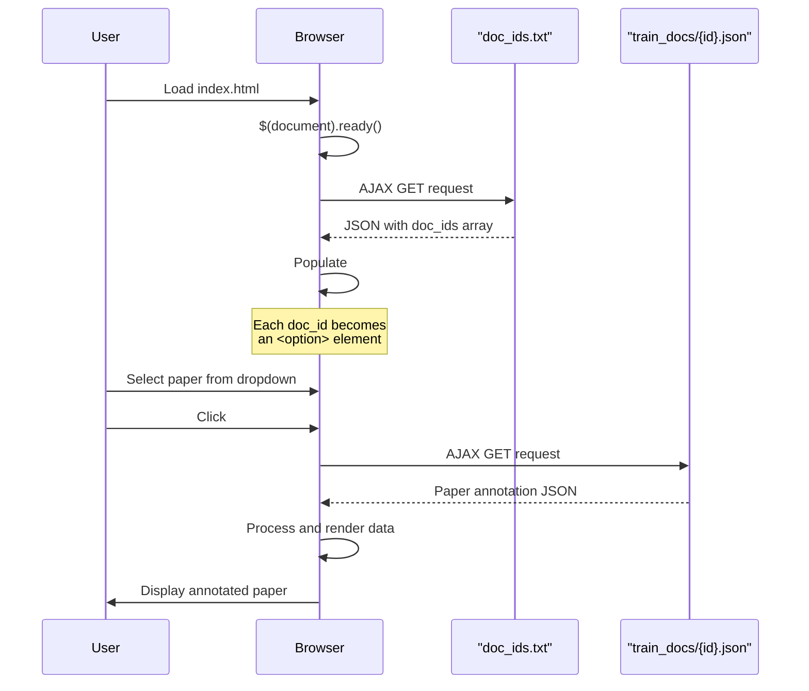
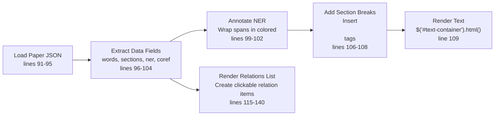
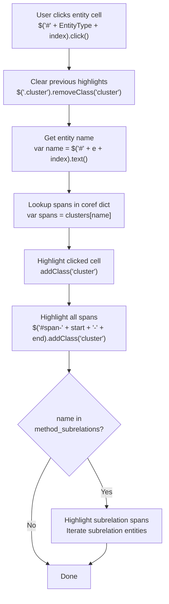
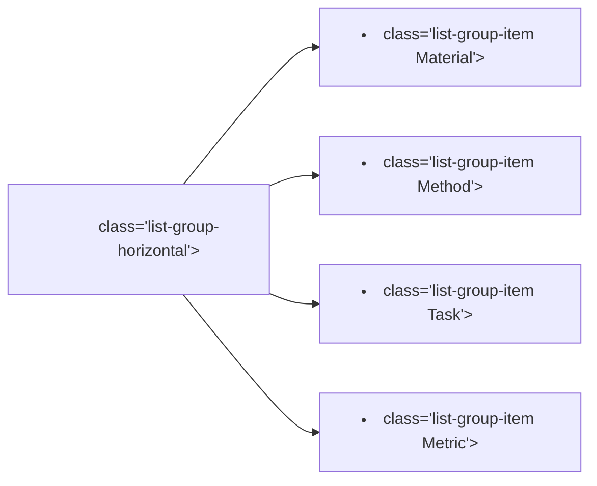
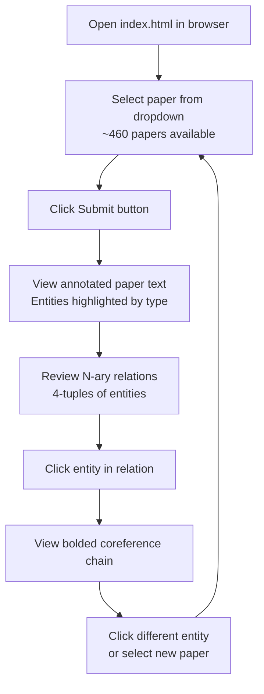

<!-- source: DeepWiki mcp.deepwiki.com · repo allenai/SciREX · page 6.1 SciREX Browser · fetched 2026-10-26 -->

# SciREX Browser

<details>
<summary>Relevant source files</summary>

The following files were used as context for generating this wiki page:

- [docs/doc_ids.txt](docs/doc_ids.txt)
- [docs/index.html](docs/index.html)

</details>


## Purpose and Scope

The SciREX Browser is a standalone web-based visualization tool for interactively exploring annotated scientific documents in the SciREX dataset. It provides a user interface for viewing papers with highlighted entity mentions, displaying extracted N-ary relations, and interactively highlighting coreference chains. This document covers the browser's architecture, data format, UI components, and interaction model.

For information about the evaluation metrics and prediction formats that feed into the browser, see [Evaluation Metrics and Scripts](#5.2). For details about the underlying dataset format, see [Data Format Specification](#2.1).

---

## System Overview

The SciREX Browser is implemented as a single-page HTML application with embedded JavaScript and CSS. It operates entirely client-side, loading JSON data files via AJAX requests to display annotated documents.

### Architecture Diagram

```mermaid
graph TB
    subgraph "Browser UI [index.html]"
        PaperSelect["Paper Selector<br/>#paperselector dropdown"]
        SubmitBtn["Submit Button<br/>#paperform"]
        RelationList["Relations List<br/>#relations-list"]
        TextContainer["Text Container<br/>#text-container"]
    end
    
    subgraph "Data Files"
        DocIDs["doc_ids.txt<br/>JSON list of paper IDs"]
        PaperJSON["train_docs/{doc_id}.json<br/>Paper annotations"]
    end
    
    subgraph "Data Structure in JSON"
        Words["words: List[str]"]
        Sections["sections: List[Span]"]
        NER["ner: List[TypedMention]"]
        Coref["coref: Dict[name→spans]"]
        Relations["n_ary_relations: List[Relation]"]
        Subrelations["method_subrelations: Dict"]
    end
    
    DocIDs -->|AJAX Load| PaperSelect
    SubmitBtn -->|Trigger Load| PaperJSON
    
    PaperJSON --> Words
    PaperJSON --> Sections
    PaperJSON --> NER
    PaperJSON --> Coref
    PaperJSON --> Relations
    PaperJSON --> Subrelations
    
    Words -->|Inject spans| TextContainer
    NER -->|Add highlights| TextContainer
    Sections -->|Add breaks| TextContainer
    Relations -->|Render list| RelationList
    
    RelationList -.Click Event.-> Coref
    Coref -.Apply .cluster class.-> TextContainer
    Subrelations -.Expand entities.-> Coref
```

**Sources**: [docs/index.html:1-150]()

---

## Data Files and Format

### Document Index File

The browser loads available paper IDs from `docs/doc_ids.txt`, which contains a JSON object with a single key:

| Field | Type | Description |
|-------|------|-------------|
| `doc_ids` | `List[str]` | Array of document IDs (SHA hashes) |

**Example**:
```json
{
  "doc_ids": [
    "000f90380d768a85e2316225854fc377c079b5c4",
    "0012de6bec1f25599e4f02517637e531a71909b9",
    ...
  ]
}
```

**Sources**: [docs/doc_ids.txt:1]()

### Paper Data Files

Individual paper annotations are stored in `docs/train_docs/{doc_id}.json`. Each file contains:

| Field | Type | Description |
|-------|------|-------------|
| `words` | `List[str]` | Tokenized words of the paper |
| `sections` | `List[Span]` | Section boundary spans `[start, end]` |
| `ner` | `List[TypedMention]` | NER annotations `[start, end, type]` |
| `coref` | `Dict[str, List[Span]]` | Coreference clusters: entity name → spans |
| `n_ary_relations` | `List[Relation]` | Extracted relations with entity names |
| `method_subrelations` | `Dict[str, List]` | Method entity subrelations |

**Sources**: [docs/index.html:96-112]()

---

## User Interface Components

### Component Hierarchy

```mermaid
graph TB
    Container[".container<br/>Bootstrap container"]
    
    Header1["Header Row: Title<br/><h1>SciREX browser</h1>"]
    Header2["Header Row: Paper Selector<br/>Form with dropdown + submit"]
    RelationShower["#relation-shower<br/>Relations display area"]
    TextRow["Text Display Row<br/>#text-container"]
    
    Container --> Header1
    Container --> Header2
    Container --> RelationShower
    Container --> TextRow
    
    Header2 --> Dropdown["#paperselector<br/><select> dropdown"]
    Header2 --> Submit["#paperform<br/>Submit button"]
    
    RelationShower --> RelTitle["<h4> Relations title"]
    RelationShower --> Key["<h5> Entity type key"]
    RelationShower --> RelList["#relations-list<br/><ul> list of relations"]
    
    RelList --> RelItems["Relation Items<br/>Horizontal list groups"]
    RelItems --> EntityCells["Entity Cells<br/>.Material .Method .Task .Metric"]
```



**Sources**: [docs/index.html:39-71]()

### Entity Type Styling

The browser uses CSS classes to color-code entity types:

| Entity Type | CSS Class | Background Color |
|-------------|-----------|-----------------|
| Material (Dataset) | `.Material` | `#9fc5e8` (Light blue) |
| Method | `.Method` | `#d5a6bd` (Light purple) |
| Task | `.Task` | `#ffe599` (Light yellow) |
| Metric | `.Metric` | `#b6d7a8` (Light green) |

The `.cluster` class is applied dynamically to bolded selected entities:

```css
.cluster {
    font-weight: bold;
}
```

**Sources**: [docs/index.html:15-34]()

---

## Interaction Flow

### Page Load and Initialization



**Sources**: [docs/index.html:76-86]()

### Data Processing Pipeline



**Sources**: [docs/index.html:87-143]()

### Entity Span Annotation

The NER annotation process modifies the `words` array in-place:

1. **Iterate through NER annotations**: Each annotation is a tuple `[start, end, type]` ([docs/index.html:99]())
2. **Wrap start word**: Prepend opening `<span>` tag with class and id: `<span class='{type}' id='span-{start}-{end}'>` ([docs/index.html:100]())
3. **Wrap end word**: Append closing `</span>` tag ([docs/index.html:101]())

**Example transformation**:
```javascript
// Before: words = ["The", "MNIST", "dataset", ...]
// NER annotation: [1, 3, "Material"]
// After: words = ["The", "<span class='Material' id='span-1-3'>MNIST", "dataset</span>", ...]
```

**Sources**: [docs/index.html:99-102]()

---

## Interactive Coreference Highlighting

### Click Event Handling

When a user clicks on an entity in a relation, the browser highlights all coreferent mentions:



**Sources**: [docs/index.html:119-138]()

### Method Subrelations Support

If the clicked entity is a method with subrelations, the browser also highlights all subrelation entity mentions:

```javascript
if (name in subrelations) {
    subrelations[name].forEach(element => {
        var subname = element[1];  // Get subrelation entity name
        var spans = clusters[subname];  // Lookup its spans
        spans.forEach(element => {
            $("#span-" + element[0] + "-" + element[1]).addClass('cluster');
        });
    })
}
```

This allows users to see not just the main method mentions, but also all component mentions (e.g., individual layers of a neural network).

**Sources**: [docs/index.html:128-137]()

---

## Rendering Relations

### Relation Display Structure

Each N-ary relation is rendered as a horizontal Bootstrap list group:



Each cell displays the entity name from the relation and is clickable for coreference highlighting.

**Sources**: [docs/index.html:115-140]()

### Entity Types Processing

The browser iterates through four entity types in order:

```javascript
var entity_types = ["Material", "Task", "Method", "Metric"];
```

For each relation, it creates a list item for each entity type, displaying the value from `element[entity_type]` where `element` is a relation object.

**Sources**: [docs/index.html:90, 117-118]()

---

## Key Implementation Details

### jQuery Selectors and DOM Manipulation

The browser uses jQuery extensively for DOM manipulation:

| Selector | Purpose |
|----------|---------|
| `$("#paperselector")` | Access the paper dropdown |
| `$("#paperform")` | Access the submit button |
| `$("#text-container")` | Access the main text display area |
| `$("#relations-list")` | Access the relations list container |
| `$("#span-{start}-{end}")` | Access specific entity span elements |
| `$(".cluster")` | Access all currently highlighted elements |

**Sources**: [docs/index.html:76-144]()

### AJAX Data Loading

The browser loads data asynchronously using jQuery AJAX:

```javascript
$.ajax({
    url: 'doc_ids.txt',  // or 'train_docs/' + paper + '.json'
    dataType: "json",
    mimeType: "application/json",
    success: function (data) {
        // Process data
    }
});
```

**Sources**: [docs/index.html:77-86, 91-142]()

### Text Assembly Strategy

The browser assembles the final HTML text by:

1. Modifying the `words` array in-place with HTML tags
2. Joining all words with spaces: `words.join(" ")`
3. Setting innerHTML of text container: `$("#text-container").html(words.join(" "))`

This approach preserves word tokenization while injecting styling and structure.

**Sources**: [docs/index.html:99-109]()

---

## Usage Workflow

### Typical User Session



**Sources**: [docs/index.html:1-150]()

### Key User Interactions

1. **Selecting a Paper**: Choose from dropdown populated from `doc_ids.txt`
2. **Viewing Entities**: Colored spans indicate entity types (Material, Method, Task, Metric)
3. **Exploring Relations**: Horizontal cards show 4-ary relations at top of page
4. **Interactive Coreference**: Click any entity name in a relation to bold all its mentions in text
5. **Section Navigation**: Section breaks (double line breaks) separate paper sections

**Sources**: [docs/index.html:44-71]()

---

## File Structure

```
docs/
├── index.html           # Main browser application
├── doc_ids.txt          # List of available document IDs
└── train_docs/          # Directory containing paper JSONs
    ├── {doc_id_1}.json
    ├── {doc_id_2}.json
    └── ...
```

**Sources**: [docs/index.html:1](), [docs/doc_ids.txt:1]()

---

## Dependencies

The SciREX Browser uses the following external libraries via CDN:

| Library | Version | Purpose |
|---------|---------|---------|
| Bootstrap CSS | 4.4.1 | UI styling and components |
| jQuery | 3.4.1 | DOM manipulation and AJAX |
| Popper.js | 1.16.0 | Bootstrap tooltip support |
| Bootstrap JS | 4.4.1 | Bootstrap interactive components |

**Sources**: [docs/index.html:5-13]()

---

## Extension Points

### Adding New Entity Types

To add a new entity type:

1. Add CSS color class in `<style>` section ([docs/index.html:15-34]())
2. Add entity type to `entity_types` array ([docs/index.html:90]())
3. Ensure paper JSON includes the entity type in NER and relations

### Customizing Visualization

Key customization points:

- **Colors**: Modify CSS classes `.Material`, `.Method`, `.Task`, `.Metric` ([docs/index.html:16-30]())
- **Layout**: Modify Bootstrap grid classes in HTML structure ([docs/index.html:39-71]())
- **Interaction**: Modify click event handlers ([docs/index.html:119-138]())

**Sources**: [docs/index.html:1-150]()

---

