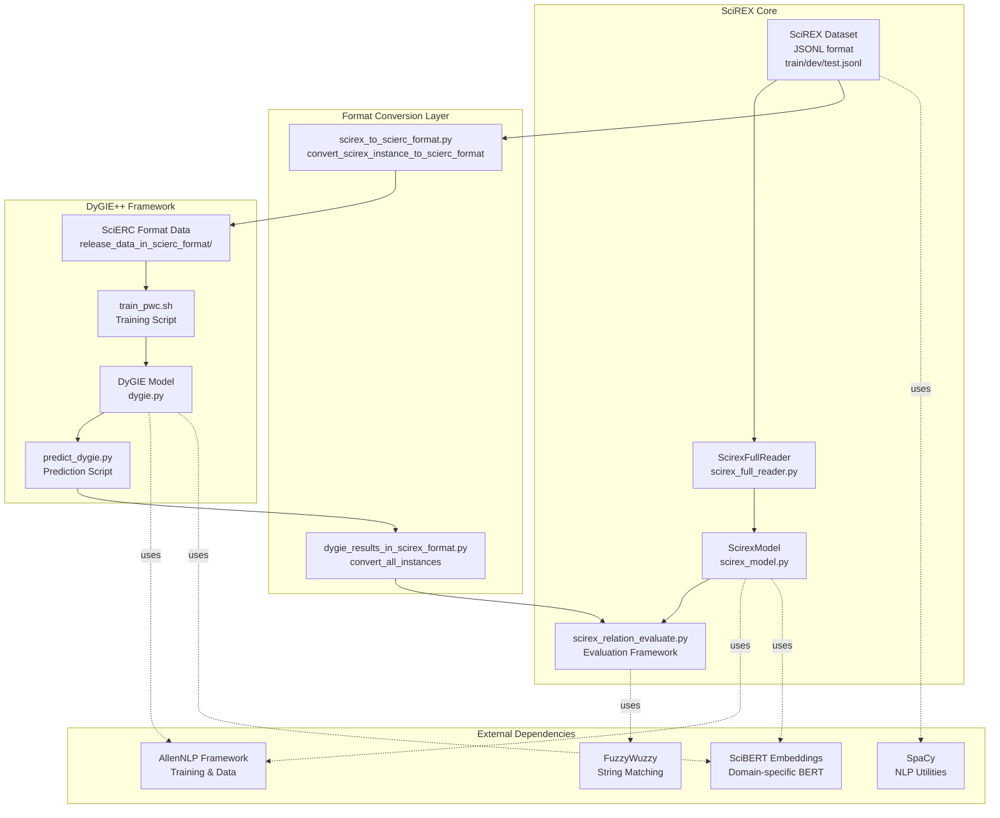
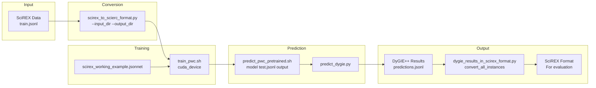
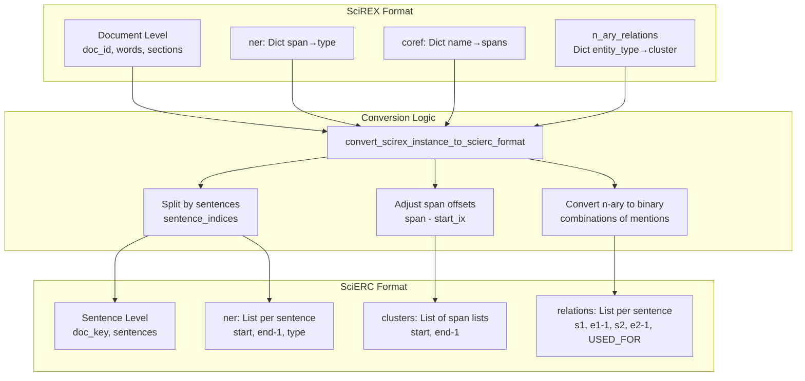
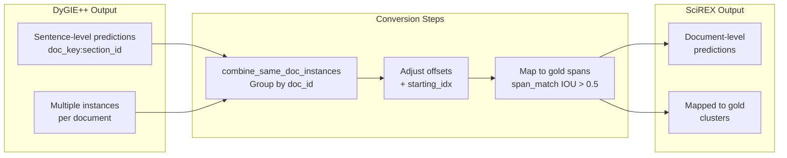
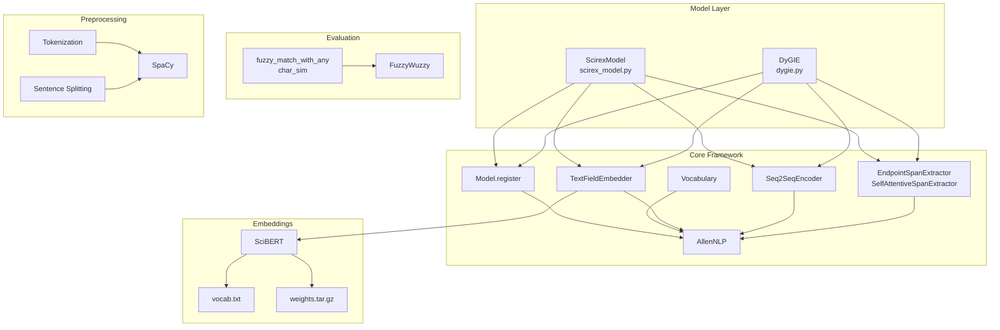

<!-- source: DeepWiki mcp.deepwiki.com · repo allenai/SciREX · page 7 External Integrations · fetched 2026-10-26 -->

# External Integrations

<details>
<summary>Relevant source files</summary>

The following files were used as context for generating this wiki page:

- [dygiepp/dygie/commands/__init__.py](dygiepp/dygie/commands/__init__.py)
- [dygiepp/dygie/models/dygie.py](dygiepp/dygie/models/dygie.py)
- [dygiepp/scripts/dygie_results_in_scirex_format.py](dygiepp/scripts/dygie_results_in_scirex_format.py)
- [dygiepp/scripts/predict/predict_pwc_pretrained.sh](dygiepp/scripts/predict/predict_pwc_pretrained.sh)
- [dygiepp/scripts/train/train_pwc.sh](dygiepp/scripts/train/train_pwc.sh)
- [dygiepp/scripts/train/train_pwc_abstract.sh](dygiepp/scripts/train/train_pwc_abstract.sh)
- [scirex/data/utils/scirex_to_scierc_format.py](scirex/data/utils/scirex_to_scierc_format.py)
- [scirex/models/scirex_model.py](scirex/models/scirex_model.py)
- [scirex/predictors/utils.py](scirex/predictors/utils.py)

</details>


## Purpose and Scope

This document describes how the SciREX system integrates with external frameworks and libraries. SciREX is designed as both a standalone information extraction system and a dataset that can be used with alternative modeling approaches. The integration architecture enables:

- Training and evaluation using the **DyGIE++** joint information extraction framework as an alternative to the native `ScirexModel`
- Data format conversion between SciREX and SciERC schemas
- Leveraging external libraries for core functionality (AllenNLP, SciBERT, etc.)

For detailed documentation of the DyGIE++ integration workflow, see [DyGIE++ Integration](#7.1). For comprehensive information about external dependencies and their usage, see [Dependencies and External Libraries](#7.2).

## Integration Architecture Overview

The SciREX system maintains a modular architecture that separates its core dataset and evaluation framework from specific model implementations. This design allows researchers to experiment with different modeling approaches while maintaining consistent evaluation.



**Integration Architecture Diagram**

Sources: [scirex/data/utils/scirex_to_scierc_format.py](), [dygiepp/scripts/dygie_results_in_scirex_format.py](), [scirex/models/scirex_model.py]()

## DyGIE++ as an Alternative Model

DyGIE++ (Dynamic Graph Information Extraction) is an external framework that provides an alternative approach to joint information extraction. Unlike the native `ScirexModel` which uses a multi-task architecture with separate modules, DyGIE++ employs joint modeling with information propagation between tasks.

### Key Differences

| Aspect | ScirexModel | DyGIE++ Model |
|--------|-------------|---------------|
| Architecture | Multi-task with independent modules | Joint model with propagation |
| Model Class | `scirex_model.ScirexModel` | `dygie.models.dygie.DyGIE` |
| Data Format | SciREX JSONL | SciERC JSONL |
| Coreference | Pairwise separate model | Integrated coref resolution |
| Relation Extraction | N-ary cluster-based | Binary span-based |

### Integration Workflow



**DyGIE++ Integration Workflow**

Sources: [dygiepp/scripts/train/train_pwc.sh](), [dygiepp/scripts/predict/predict_pwc_pretrained.sh](), [dygiepp/scripts/dygie_results_in_scirex_format.py]()

The integration is bidirectional—data flows from SciREX format to SciERC format for training, and predictions flow back from DyGIE++ format to SciREX format for evaluation. This allows direct comparison of different modeling approaches using the same evaluation framework.

For detailed information on training DyGIE++ models, data format specifications, and prediction workflows, see [DyGIE++ Integration](#7.1).

## Data Format Conversion

The integration between SciREX and DyGIE++ relies on format conversion at both the input and output stages. The conversion process handles structural differences in how the two systems represent annotations.

### SciREX to SciERC Conversion

The `scirex_to_scierc_format.py` script transforms SciREX document-level annotations into SciERC sentence-level format:



**Format Conversion Process**

Sources: [scirex/data/utils/scirex_to_scierc_format.py:17-66]()

Key conversion operations performed by `convert_scirex_instance_to_scierc_format`:

1. **Paragraph to Sentence Splitting**: Each SciREX paragraph becomes a SciERC document with multiple sentences
2. **Span Offset Adjustment**: Converts document-level spans to paragraph-relative positions [scirex/data/utils/scirex_to_scierc_format.py:25-26]()
3. **NER Assignment**: Maps entity mentions to specific sentences using `is_x_in_y` containment checks [scirex/data/utils/scirex_to_scierc_format.py:29-32]()
4. **Cluster Mapping**: Converts coreference chains to SciERC cluster format [scirex/data/utils/scirex_to_scierc_format.py:39-42]()
5. **Binary Relations**: Creates pairwise USED_FOR relations from mentions in the same cluster [scirex/data/utils/scirex_to_scierc_format.py:46-55]()
6. **Indexing Convention**: Adjusts from inclusive end indices to exclusive (end-1) [scirex/data/utils/scirex_to_scierc_format.py:57-59]()

### DyGIE++ Results Back-Conversion

The `dygie_results_in_scirex_format.py` script converts DyGIE++ predictions back to SciREX format for evaluation:



**Back-Conversion Process**

Sources: [dygiepp/scripts/dygie_results_in_scirex_format.py:12-41]()

The back-conversion process [dygiepp/scripts/dygie_results_in_scirex_format.py:17-27]():

1. **Document Reconstruction**: Combines sentence-level predictions grouped by `doc_id` extracted from `doc_key`
2. **Offset Restoration**: Adjusts span indices back to document-level positions
3. **Span Matching**: Uses fuzzy matching (IOU > 0.5) to map predicted spans to gold spans [dygiepp/scripts/dygie_results_in_scirex_format.py:76-83]()
4. **Cluster Assignment**: Maps matched spans to gold coreference clusters for relation evaluation

## Core External Dependencies

SciREX relies on several external libraries that provide foundational functionality. These dependencies are shared between the native `ScirexModel` and the `DyGIE` model implementations.

### Dependency Usage Map



**External Dependency Usage**

Sources: [scirex/models/scirex_model.py:1-21](), [dygiepp/dygie/models/dygie.py:1-24]()

### Key Dependencies

| Library | Purpose | Usage Location |
|---------|---------|----------------|
| **AllenNLP** | ML framework for NLP | Model registration, training, data processing |
| **SciBERT** | Scientific domain embeddings | Text field embedder in both models |
| **FuzzyWuzzy** | String similarity | Entity matching in evaluation (importance: 4.10) |
| **SpaCy** | NLP preprocessing | Text tokenization and sentence splitting |
| **PyTorch** | Deep learning backend | Underlying framework for AllenNLP |

Both `ScirexModel` [scirex/models/scirex_model.py:24]() and `DyGIE` [dygiepp/dygie/models/dygie.py:27]() are registered as AllenNLP models using the `@Model.register` decorator, enabling them to be instantiated from configuration files and trained using the `allennlp train` command.

For detailed information about how each external library is used, configuration requirements, and version specifications, see [Dependencies and External Libraries](#7.2).

## Training Configuration Integration

Both model implementations share similar configuration patterns through AllenNLP's Jsonnet configuration system. The configuration files specify:

- **Model architecture**: Which registered model class to use (`scirex_model` vs `dygie`)
- **Data paths**: Training, validation, and test data locations
- **Embeddings**: SciBERT model paths and parameters
- **Loss weights**: Task-specific loss weighting for multi-task learning
- **Training parameters**: Learning rate, batch size, optimization settings

The training scripts [dygiepp/scripts/train/train_pwc.sh:5-18]() set environment variables that override configuration values:

```bash
ie_train_data_path=$data_root/train.jsonl \
    ie_dev_data_path=$data_root/dev.jsonl \
    ie_test_data_path=$data_root/test.jsonl \
    cuda_device=$cuda_device \
    allennlp train $config_file \
    --serialization-dir ./models/$experiment_name \
    --include-package dygie
```

This pattern allows the same configuration template to be used with different data locations and GPU assignments.

Sources: [dygiepp/scripts/train/train_pwc.sh](), [dygiepp/scripts/train/train_pwc_abstract.sh]()

## Evaluation Integration

Both modeling approaches produce predictions that can be evaluated using the same evaluation framework. The evaluation system handles format differences through the conversion pipeline described above.

The shared evaluation metrics include:
- **NER**: Precision, recall, F1 per entity type (Material, Method, Task, Metric)
- **Coreference**: Cluster-based metrics
- **Relations**: Binary and 4-ary relation extraction metrics

The `dygie_results_in_scirex_format.py` script [dygiepp/scripts/dygie_results_in_scirex_format.py:43-117]() implements evaluation that:

1. Converts DyGIE++ predictions to document-level format
2. Merges method subrelations using `merge_method_subrelations` [dygiepp/scripts/dygie_results_in_scirex_format.py:51]()
3. Maps predicted spans to gold spans using fuzzy matching [dygiepp/scripts/dygie_results_in_scirex_format.py:76-83]()
4. Filters relations based on entity mention availability using `has_all_mentions` [dygiepp/scripts/dygie_results_in_scirex_format.py:87]()
5. Computes precision, recall, and F1 scores aggregated across all documents

This unified evaluation approach enables direct comparison of model performance across different architectures.

Sources: [dygiepp/scripts/dygie_results_in_scirex_format.py](), [scirex/predictors/utils.py:71-86]()

---

