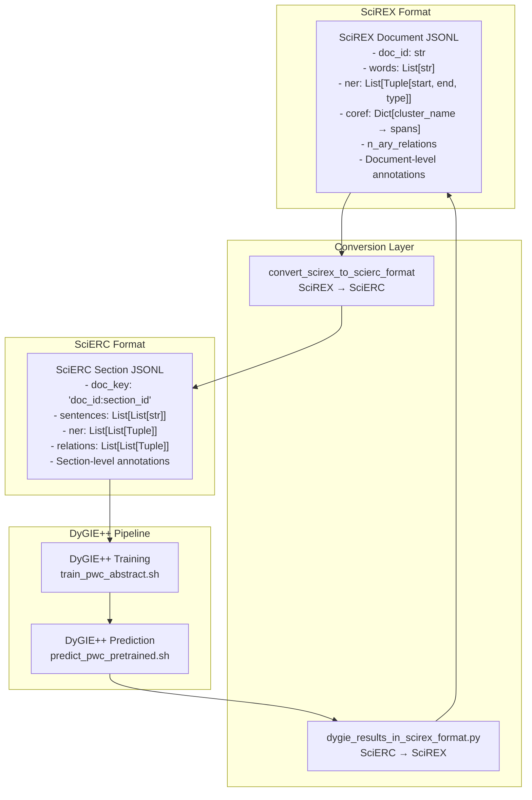
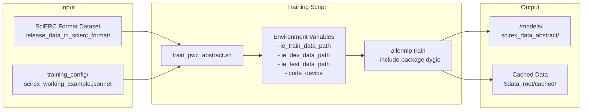
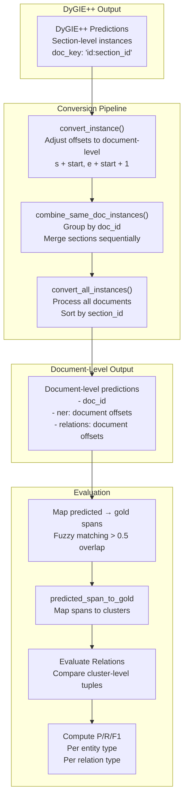
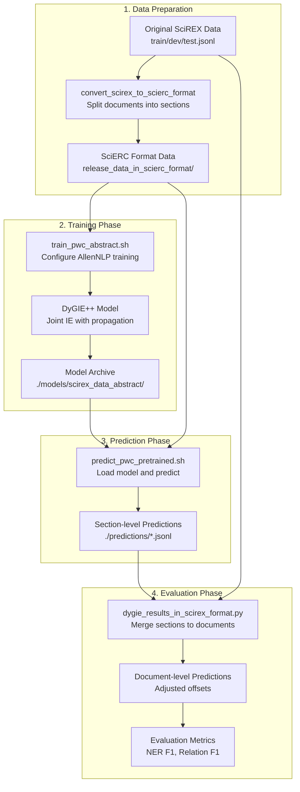

<!-- source: DeepWiki mcp.deepwiki.com · repo allenai/SciREX · page 7.1 DyGIE++ Integration · fetched 2026-10-26 -->

# DyGIE++ Integration

<details>
<summary>Relevant source files</summary>

The following files were used as context for generating this wiki page:

- [dygiepp/dygie/commands/__init__.py](dygiepp/dygie/commands/__init__.py)
- [dygiepp/scripts/dygie_results_in_scirex_format.py](dygiepp/scripts/dygie_results_in_scirex_format.py)
- [dygiepp/scripts/predict/predict_pwc_pretrained.sh](dygiepp/scripts/predict/predict_pwc_pretrained.sh)
- [dygiepp/scripts/train/train_pwc_abstract.sh](dygiepp/scripts/train/train_pwc_abstract.sh)

</details>


## Purpose and Scope

This document describes how the SciREX system integrates with the DyGIE++ framework, an alternative information extraction model. It covers data format conversion between SciREX and SciERC formats, training DyGIE++ models on SciREX data, making predictions, and converting results back for evaluation. For information about the core SciREX model architecture, see [3.1](#3.1). For details on the native SciREX prediction pipeline, see [5.1](#5.1).

---

## Overview of DyGIE++

DyGIE++ is an external information extraction framework that performs joint entity, relation, and event extraction with cross-task propagation. Unlike the SciREX multi-task model which processes document-level annotations with paragraph-level encoding, DyGIE++ operates on sentence-level instances and uses a joint inference approach where predictions from one task inform others.

The integration allows researchers to:
- Compare alternative modeling approaches on the same dataset
- Leverage DyGIE++'s strengths in joint inference
- Evaluate cross-model performance on SciREX's document-level IE tasks

**Key Differences**

| Aspect | SciREX Model | DyGIE++ Model |
|--------|-------------|---------------|
| Granularity | Document/paragraph-level | Sentence-level sections |
| Training | Multi-task with weighted losses | Joint training with propagation |
| Data Format | SciREX JSONL | SciERC JSONL |
| Prediction Flow | Sequential pipeline (NER → Coref → Relations) | Joint prediction |
| Coreference | Separate pairwise model | Integrated coref resolution |

Sources: [dygiepp/scripts/dygie_results_in_scirex_format.py:1-122]()

---

## Data Format Conversion Architecture

The integration requires bidirectional format conversion between SciREX and SciERC data formats.



**Format Conversion Details**

The conversion process involves:

1. **Document Splitting**: SciREX documents are split into multiple section-level instances, each with a unique `doc_key` in format `{doc_id}:{section_id}`
2. **Span Offsets**: Global document offsets are converted to sentence-relative offsets
3. **Relation Conversion**: N-ary relations (4-ary tuples in SciREX) are converted to binary relations (2-ary) for DyGIE++
4. **Coreference Format**: SciREX's named cluster format (`coref: {cluster_name → spans}`) is converted to SciERC's cluster list format

Sources: [dygiepp/scripts/dygie_results_in_scirex_format.py:12-41]()

---

## Training DyGIE++ on SciREX Data

### Training Script Configuration

The training process uses shell scripts that configure AllenNLP training with SciERC-formatted data.



### Training on Full Documents

[dygiepp/scripts/train/train_pwc_abstract.sh:1-19]() configures training on abstract-only sections:

```bash
experiment_name="scirex_data_abstract"
data_root="../scirex_dataset/release_data_in_scierc_format_abstracts_only/"
config_file="./training_config/scirex_working_example.jsonnet"
```

**Key Training Parameters**:
- `experiment_name`: Identifies the model output directory
- `data_root`: Path to SciERC-formatted SciREX data
- `config_file`: Jsonnet configuration for DyGIE++ model architecture
- `cuda_device`: GPU device ID or -1 for CPU training
- `--include-package dygie`: Registers DyGIE++ components with AllenNLP

The script exports environment variables for data paths:
- `ie_train_data_path`: Training set JSONL
- `ie_dev_data_path`: Development set JSONL  
- `ie_test_data_path`: Test set JSONL

Sources: [dygiepp/scripts/train/train_pwc_abstract.sh:1-19]()

---

## Prediction Workflow

### Prediction Script

The prediction script loads a trained DyGIE++ model and generates predictions on test data.

[dygiepp/scripts/predict/predict_pwc_pretrained.sh:1-16]() executes prediction:

```bash
data_root="../scirex_dataset/release_data_in_scierc_format/"

python ./dygie/commands/predict_dygie.py \
    $model \
    ./$data_root/test.jsonl \
    ./predictions/$2 \
    $1
```

**Arguments**:
- `$model`: Path to trained model archive
- `test.jsonl`: Input data in SciERC format
- `./predictions/$2`: Output file for predictions
- `$1`: Additional prediction parameters

The script creates a `./predictions/` directory if it doesn't exist and outputs predictions in SciERC format with document keys, predicted NER spans, and predicted relations per sentence.

Sources: [dygiepp/scripts/predict/predict_pwc_pretrained.sh:1-16]()

---

## Result Conversion and Evaluation

### Converting DyGIE++ Predictions to SciREX Format

The [dygiepp/scripts/dygie_results_in_scirex_format.py:1-122]() script converts DyGIE++ predictions back to document-level SciREX format and performs evaluation.



### Offset Adjustment

[dygiepp/scripts/dygie_results_in_scirex_format.py:12-15]() adjusts sentence-relative offsets to document-level:

The `convert_instance` function takes:
- `instance`: A single section's predictions
- `start`: The starting word offset for this section in the document

It converts:
- NER predictions: `(s, e, t)` → `(s + start, e + start + 1, t)`
- Relations: `(s1, e1, s2, e2, t)` → `((s1 + start, e1 + start + 1), (s2 + start, e2 + start + 1))`

### Section Merging

[dygiepp/scripts/dygie_results_in_scirex_format.py:17-27]() combines sections from the same document:

The `combine_same_doc_instances` function:
1. Sorts sections by `section_id` extracted from `doc_key`
2. Maintains a `starting_idx` accumulator
3. Converts each section's offsets using cumulative word counts
4. Aggregates all NER predictions and relations into a single document

[dygiepp/scripts/dygie_results_in_scirex_format.py:29-41]() groups all instances by document:

```python
documents = defaultdict(list)
for instance in instances:
    doc_id = instance['doc_key'].split(':')[0]
    instance['section_id'] = int(instance['doc_key'].split(':')[1])
    documents[doc_id].append(instance)
```

### Evaluation Methodology

The evaluation process in [dygiepp/scripts/dygie_results_in_scirex_format.py:43-117]() follows these steps:

**1. Span-Level Evaluation**

[dygiepp/scripts/dygie_results_in_scirex_format.py:54-67]()
- Extracts gold and predicted NER spans
- Computes exact match metrics per entity type
- Averages across all entity types and documents

**2. Span-to-Cluster Mapping**

[dygiepp/scripts/dygie_results_in_scirex_format.py:69-83]()

Creates `predicted_span_to_gold` dictionary:
- Maps each predicted span to `(entity_type, gold_span, cluster_id)`
- Uses `span_match()` function with 0.5 IOU threshold
- Falls back to unique span ID if no gold match found

**3. Relation Evaluation**

[dygiepp/scripts/dygie_results_in_scirex_format.py:85-109]()

For each entity type pair:
1. Extract gold N-ary relations and filter using `has_all_mentions()`
2. Convert binary predicted relations to cluster-level tuples
3. Match predicted and gold relations at cluster level
4. Compute precision, recall, F1 per relation type

The evaluation uses `combinations(used_entities, 2)` to iterate over all binary relation types (Method-Task, Method-Metric, etc.).

**Relation Filtering**: Only gold relations with all entity mentions present in text are evaluated, using `has_all_mentions()` from [scirex.evaluation_scripts.scirex_relation_evaluate]().

### Output Metrics

The script outputs:
- Overall NER precision, recall, F1 (averaged across entity types)
- Relation metrics for n=2 (binary relations)
- Mean metrics computed using pandas DataFrame aggregation

Sources: [dygiepp/scripts/dygie_results_in_scirex_format.py:43-122]()

---

## Integration Workflow Summary



This complete workflow enables:
1. Training DyGIE++ models on SciREX data with format conversion
2. Generating predictions using trained DyGIE++ models
3. Converting predictions back to document-level for evaluation
4. Fair comparison between DyGIE++ and native SciREX model performance

Sources: [dygiepp/scripts/train/train_pwc_abstract.sh:1-19](), [dygiepp/scripts/predict/predict_pwc_pretrained.sh:1-16](), [dygiepp/scripts/dygie_results_in_scirex_format.py:1-122]()

---

