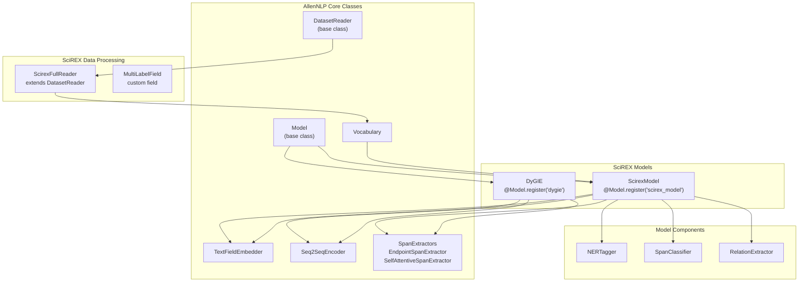
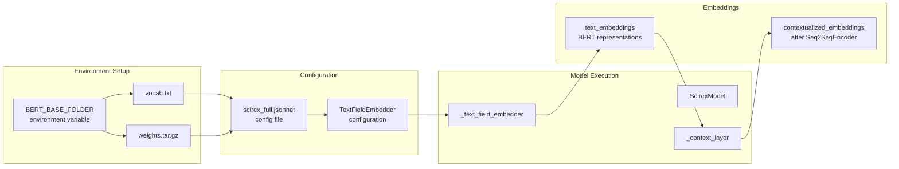
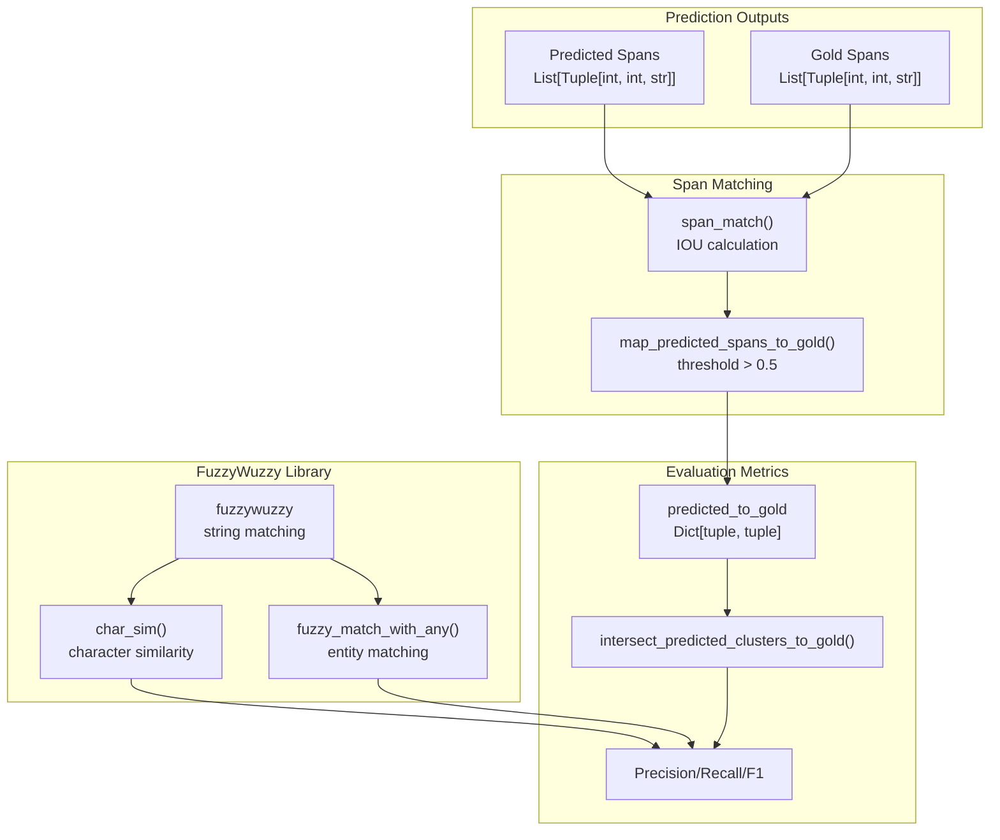
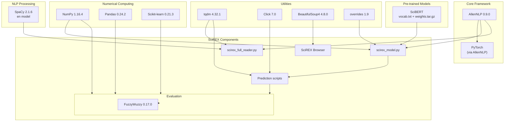

<!-- source: DeepWiki mcp.deepwiki.com · repo allenai/SciREX · page 7.2 Dependencies and External Libraries · fetched 2026-10-26 -->

# Dependencies and External Libraries

<details>
<summary>Relevant source files</summary>

The following files were used as context for generating this wiki page:

- [README.md](README.md)
- [dygiepp/dygie/models/dygie.py](dygiepp/dygie/models/dygie.py)
- [dygiepp/scripts/train/train_pwc.sh](dygiepp/scripts/train/train_pwc.sh)
- [requirements.txt](requirements.txt)
- [scirex/data/utils/scirex_to_scierc_format.py](scirex/data/utils/scirex_to_scierc_format.py)
- [scirex/models/scirex_model.py](scirex/models/scirex_model.py)
- [scirex/predictors/utils.py](scirex/predictors/utils.py)

</details>


This page documents the external libraries and frameworks that SciREX depends on, their specific versions, how they are used throughout the system, and the installation process. For information about training workflows and configuration, see [Training](#4). For details about the DyGIE++ framework integration, see [DyGIE++ Integration](#7.1).

## Overview of Dependencies

SciREX relies on several major external systems:

- **AllenNLP 0.9.0**: Core deep learning framework for NLP tasks
- **SciBERT**: Domain-specific pre-trained language model
- **SpaCy 2.1.6**: Text processing and tokenization
- **FuzzyWuzzy 0.17.0**: String matching for entity evaluation
- **PyTorch**: Neural network backend (via AllenNLP)

Sources: [requirements.txt:1-18](), [README.md:32-47]()

## Core Framework: AllenNLP

### Role and Integration

AllenNLP serves as the foundational framework for SciREX, providing:

- Model registration and configuration system via Jsonnet
- Dataset reading and batching infrastructure
- Training loop and optimization
- Vocabulary management
- Custom field types and data structures

**Mermaid Diagram: AllenNLP Integration Points**



Sources: [scirex/models/scirex_model.py:1-23](), [dygiepp/dygie/models/dygie.py:1-24]()

### Key AllenNLP Components Used

| Component | Usage in SciREX | File Reference |
|-----------|-----------------|----------------|
| `Model` | Base class for `ScirexModel` and `DyGIE` | [scirex/models/scirex_model.py:24-25]() |
| `DatasetReader` | Base for `ScirexFullReader` | Referenced in data readers |
| `TextFieldEmbedder` | Embeds tokenized text (SciBERT) | [scirex/models/scirex_model.py:29,40]() |
| `Seq2SeqEncoder` | Contextual encoding layer | [scirex/models/scirex_model.py:30,41]() |
| `EndpointSpanExtractor` | Extracts span representations | [scirex/models/scirex_model.py:54-56]() |
| `SelfAttentiveSpanExtractor` | Attention-based span extraction | [scirex/models/scirex_model.py:57]() |
| `Vocabulary` | Token/label vocabulary management | [scirex/models/scirex_model.py:28]() |
| `InitializerApplicator` | Model parameter initialization | [scirex/models/scirex_model.py:34]() |
| `RegularizerApplicator` | Model regularization | [scirex/models/scirex_model.py:35]() |
| `util.get_text_field_mask` | Text masking utilities | [scirex/models/scirex_model.py:122]() |

Sources: [scirex/models/scirex_model.py:1-71](), [dygiepp/dygie/models/dygie.py:10-15]()

### Training Infrastructure

AllenNLP provides the training command used throughout the system:

```bash
allennlp train $config_file \
    --cache-directory $data_root/cached \
    --serialization-dir ./models/$experiment_name \
    --include-package dygie
```

The `allennlp train` command handles:
- Configuration parsing from Jsonnet files
- Dataset loading and caching
- Model instantiation via registration decorators
- Training loop execution
- Metric tracking and checkpointing

Sources: [dygiepp/scripts/train/train_pwc.sh:10-18](), [README.md:45-46]()

## Pre-trained Language Model: SciBERT

### Overview

SciBERT is a BERT model pre-trained on scientific text (papers from Semantic Scholar). SciREX uses the uncased SciBERT variant with a scientific vocabulary.

**Download Location**: `https://s3-us-west-2.amazonaws.com/ai2-s2-research/scibert/pytorch_models/scibert_scivocab_uncased.tar`

### Required Files

SciBERT must contain two files:
- `vocab.txt`: SciBERT vocabulary (scientific domain tokens)
- `weights.tar.gz`: Pre-trained model weights

These files are referenced via the `BERT_BASE_FOLDER` environment variable.

Sources: [README.md:44]()

### Integration Points

**Mermaid Diagram: SciBERT Usage Flow**



Sources: [scirex/models/scirex_model.py:119-154](), [README.md:44]()

The SciBERT embeddings are applied in the `embedding_forward` method:

1. Text is embedded via `_text_field_embedder` [scirex/models/scirex_model.py:121]()
2. Lexical dropout is applied [scirex/models/scirex_model.py:121]()
3. Embeddings are flattened and filtered by mask [scirex/models/scirex_model.py:125-129]()
4. Context layer (LSTM) produces contextualized embeddings [scirex/models/scirex_model.py:130-133]()

Sources: [scirex/models/scirex_model.py:119-154]()

## Text Processing: SpaCy

### Version and Setup

**Version**: `spacy==2.1.6`

SpaCy must be downloaded separately after pip installation:

```bash
python -m spacy download en
```

Sources: [requirements.txt:12](), [README.md:37]()

### Usage in SciREX

SpaCy is used for text processing tasks including:
- Sentence segmentation
- Tokenization (preprocessing)
- Text normalization

While not explicitly imported in the provided model files, SpaCy is a required dependency for the data processing pipeline.

Sources: [requirements.txt:12](), [README.md:33-38]()

## Evaluation Library: FuzzyWuzzy

### Purpose

FuzzyWuzzy (version 0.17.0) provides string matching functionality critical for entity evaluation in SciREX. It enables fuzzy matching between predicted and gold entity spans.

### Integration in Evaluation

**Mermaid Diagram: FuzzyWuzzy in Evaluation Pipeline**



Sources: [scirex/predictors/utils.py:1-87]()

### Key Functions Using String Matching

The `span_match` function computes intersection-over-union (IOU) for span alignment:

```python
def span_match(span_1, span_2):
    sa, ea = span_1
    sb, eb = span_2
    iou = (min(ea, eb) - max(sa, sb)) / (max(eb, ea) - min(sa, sb))
    return iou
```

Predicted spans are mapped to gold spans when IOU > 0.5 in `map_predicted_spans_to_gold`:

Sources: [scirex/predictors/utils.py:4-24]()

For more details on entity matching and thresholding, see [Entity Matching and Thresholding](#5.3).

## Numerical and Data Processing Libraries

### NumPy

**Version**: `numpy==1.16.4`

NumPy provides array operations used throughout the system for tensor manipulation before PyTorch operations and for data preprocessing.

### Pandas

**Version**: `pandas==0.24.2`

Pandas is used for data analysis, statistics computation, and structured data manipulation in evaluation scripts.

### Scikit-learn

**Version**: `scikit_learn==0.21.3`

Scikit-learn provides machine learning utilities including:
- Evaluation metrics
- Data splitting utilities
- Statistical functions

Sources: [requirements.txt:3-6]()

## Utility Libraries

### Progress and Logging

| Library | Version | Purpose | Example Usage |
|---------|---------|---------|---------------|
| `tqdm` | 4.32.1 | Progress bars for iteration | Data conversion loops |
| `p_tqdm` | 1.2 | Parallel progress bars | Batch processing |
| `Click` | 7.0 | CLI argument parsing | Command-line scripts |

**Example from data conversion**:

The `tqdm` library wraps iterators to display progress:

```python
for instance in tqdm(scirex_reader):
    if abstract and instance['paragraph_num'] not in [0, 1]:
        continue
    scierc_data.append(convert_scirex_instance_to_scierc_format(instance))
```

Sources: [scirex/data/utils/scirex_to_scierc_format.py:73-76](), [requirements.txt:10-13]()

### Web and Data Parsing

| Library | Version | Purpose |
|---------|---------|---------|
| `beautifulsoup4` | 4.8.0 | HTML parsing for browser visualization |
| `elasticsearch` | 7.0.2 | Document search/retrieval (optional) |
| `python-intervals` | Latest | Interval operations for span processing |

Sources: [requirements.txt:14-17]()

### Development Tools

| Library | Purpose |
|---------|---------|
| `ipdb` | Interactive debugging |
| `overrides` (1.9) | Method override decorators for type safety |
| `typing` (3.7.4) | Type hint support |

Sources: [requirements.txt:8,16](), [scirex/models/scirex_model.py:14]()

## Dependency Architecture

**Mermaid Diagram: Complete Dependency Graph**



Sources: [requirements.txt:1-18](), [scirex/models/scirex_model.py:1-23](), [scirex/data/utils/scirex_to_scierc_format.py:1-11]()

## Installation and Environment Setup

### Step-by-Step Installation

**1. Create Conda Environment**

```bash
conda create -n scirex python=3.7
conda activate scirex
```

**2. Install Python Dependencies**

```bash
pip install -r requirements.txt
```

This installs all packages listed in [requirements.txt:1-18]().

**3. Download SpaCy Model**

```bash
python -m spacy download en
```

**4. Download and Setup SciBERT**

```bash
# Download SciBERT
wget https://s3-us-west-2.amazonaws.com/ai2-s2-research/scibert/pytorch_models/scibert_scivocab_uncased.tar

# Extract to a directory
tar -xvf scibert_scivocab_uncased.tar -C /path/to/scibert/

# Set environment variable
export BERT_BASE_FOLDER=/path/to/scibert/
```

The `BERT_BASE_FOLDER` must contain:
- `vocab.txt`
- `weights.tar.gz`

**5. Set PYTHONPATH**

```bash
export PYTHONPATH=/path/to/SciREX:$PYTHONPATH
```

This ensures Python can import the `scirex` package.

Sources: [README.md:32-44]()

### Environment Variables

| Variable | Purpose | Example |
|----------|---------|---------|
| `BERT_BASE_FOLDER` | Path to SciBERT files | `/home/user/scibert/` |
| `PYTHONPATH` | Python module search path | `/home/user/SciREX` |
| `CUDA_DEVICE` | GPU device ID for training | `0` (or `-1` for CPU) |

Sources: [README.md:44-46](), [dygiepp/scripts/train/train_pwc.sh:8]()

### Verification

After installation, verify dependencies:

```bash
# Check AllenNLP
python -c "import allennlp; print(allennlp.__version__)"

# Check SpaCy model
python -c "import spacy; nlp = spacy.load('en'); print('SpaCy OK')"

# Check SciBERT path
ls $BERT_BASE_FOLDER/vocab.txt $BERT_BASE_FOLDER/weights.tar.gz
```

Sources: [README.md:32-44]()

## Version Compatibility Notes

### Critical Version Requirements

- **AllenNLP 0.9.0**: This specific version is required. Newer versions have breaking API changes.
- **Python 3.7**: The codebase targets Python 3.7 specifically.
- **NumPy 1.16.4**: Version pinned for compatibility with AllenNLP 0.9.0.

### Known Issues

1. **AllenNLP Caching**: The `--cache-directory` flag in training scripts prevents re-processing datasets on each run [dygiepp/scripts/train/train_pwc.sh:16]().

2. **CUDA Compatibility**: Ensure PyTorch (installed via AllenNLP) is compatible with your CUDA version.

3. **SpaCy Model**: The `en` model must be downloaded separately; it's not included in the pip package.

Sources: [requirements.txt:1-18](), [dygiepp/scripts/train/train_pwc.sh:15-16]()

## Dependencies by System Component

| Component | Key Dependencies | Purpose |
|-----------|------------------|---------|
| **Models** | AllenNLP, PyTorch, SciBERT | Neural architecture, training |
| **Data Readers** | AllenNLP, SpaCy, tqdm | Dataset loading, preprocessing |
| **Evaluation** | FuzzyWuzzy, scikit-learn, NumPy, Pandas | Metric computation, string matching |
| **Prediction** | AllenNLP, Click, tqdm | Inference pipeline, CLI |
| **Browser** | BeautifulSoup4 | HTML rendering, visualization |
| **DyGIE++ Integration** | AllenNLP | Alternative modeling framework |

Sources: [requirements.txt:1-18](), [scirex/models/scirex_model.py:1-23](), [scirex/data/utils/scirex_to_scierc_format.py:1-11](), [scirex/predictors/utils.py:1-3]()

---

