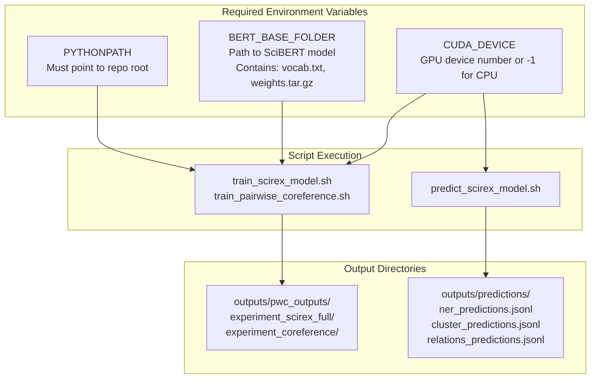
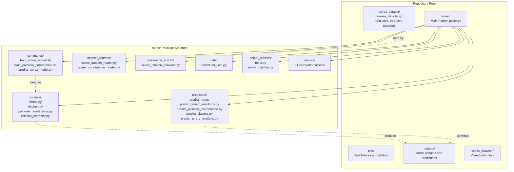
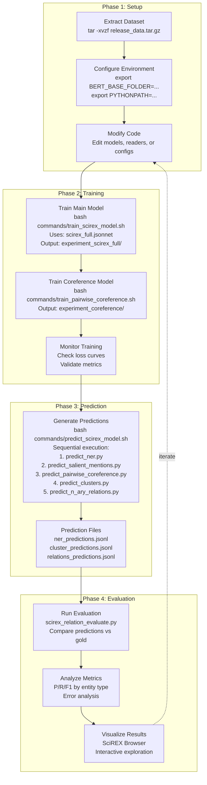
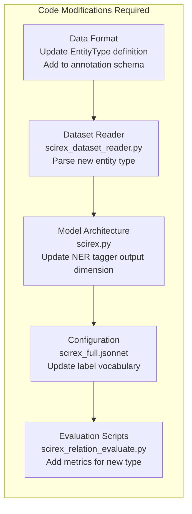
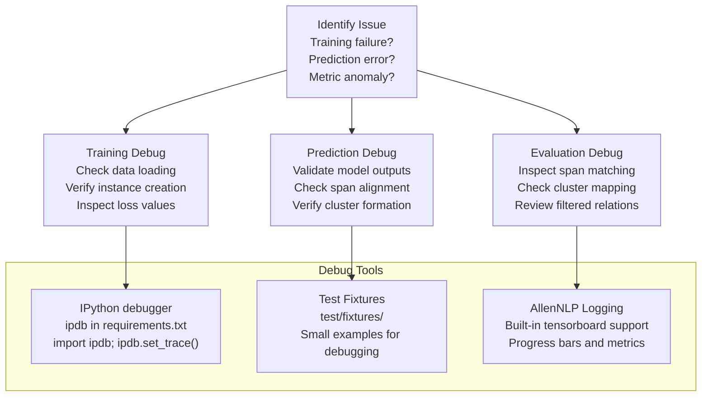
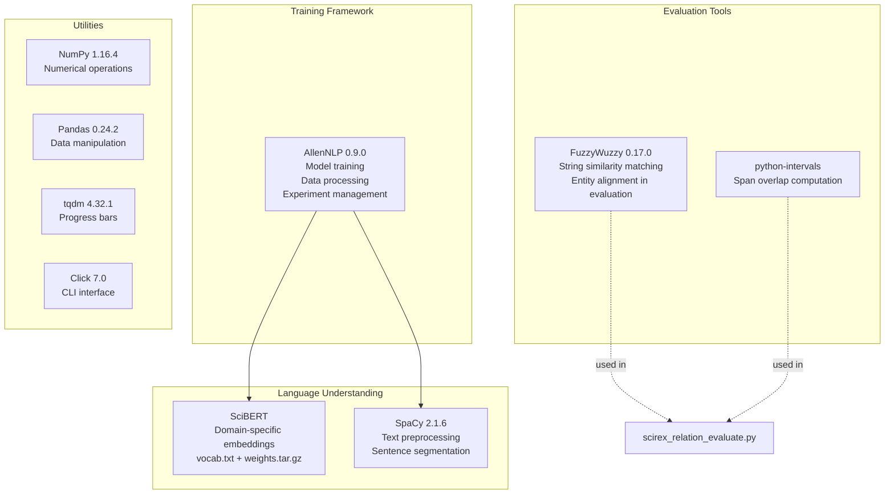

<!-- source: DeepWiki mcp.deepwiki.com · repo allenai/SciREX · page 8 Development Guide · fetched 2026-10-26 -->

# Development Guide

<details>
<summary>Relevant source files</summary>

The following files were used as context for generating this wiki page:

- [README.md](README.md)
- [requirements.txt](requirements.txt)
- [test/fixtures/bioul_to_span.json](test/fixtures/bioul_to_span.json)

</details>


## Purpose and Scope

This guide provides technical documentation for developers working on or extending the SciREX codebase. It covers development environment setup, code organization, common development workflows, and best practices for contributing to the project.

For detailed installation instructions, see [Installation and Setup](#8.2). For testing procedures and utilities, see [Testing](#8.1). For information about training models, see [Training](#4). For prediction workflows, see [Prediction Pipeline](#5.1).

---

## Development Environment Overview

The SciREX development environment consists of several key components that must be properly configured before beginning development work.

### Core Requirements

| Component | Version | Purpose |
|-----------|---------|---------|
| Python | 3.7 | Runtime environment |
| AllenNLP | 0.9.0 | Training and modeling framework |
| SciBERT | - | Pre-trained language model |
| SpaCy | 2.1.6 | Text processing |
| CUDA | Optional | GPU acceleration |

### Environment Variables

The system relies on several environment variables that must be configured:



**Sources:** [README.md:35-46]()

---

## Code Organization

The codebase follows a modular structure organized by functionality. Understanding this organization is essential for efficient development.

### Directory Structure



**Sources:** [README.md:1-74](), Directory structure inferred from system architecture diagrams

### Key Module Purposes

| Module | Primary Classes/Functions | Purpose |
|--------|--------------------------|---------|
| `scirex/models/` | `ScirexModel`, `RelationExtractor`, `DoctaetModel` | Neural network model definitions |
| `scirex/dataset_readers/` | `ScirexFullReader`, `ScirexCoreferencePairwiseReader` | Data loading and preprocessing |
| `scirex/predictors/` | `predict_ner.py`, `predict_n_ary_relations.py` | Inference pipeline components |
| `scirex/data/` | `MultiLabelField` | Custom AllenNLP field types |
| `scirex/helper_classes/` | `bioul.py`, `entity_matcher.py` | Utility functions for tagging and matching |
| `scirex/evaluation_scripts/` | `scirex_relation_evaluate.py` | Evaluation and metric calculation |
| `scirex/commands/` | Shell scripts | Orchestration of training and prediction |

---

## Development Workflow

The typical development workflow involves iterating through training, prediction, and evaluation phases.

### Standard Development Cycle



**Sources:** [README.md:40-57](), Workflow diagrams from architecture overview

### Script Execution Reference

The command-line interface for development tasks:

| Task | Command | Key Parameters |
|------|---------|---------------|
| Train main model | `CUDA_DEVICE=0 bash scirex/commands/train_scirex_model.sh main` | `BERT_BASE_FOLDER` required |
| Train coreference | `CUDA_DEVICE=0 bash scirex/commands/train_pairwise_coreference.sh main` | Uses separate config |
| Generate predictions | `scirex_archive=<path> scirex_coreference_archive=<path> cuda_device=0 bash scirex/commands/predict_scirex_model.sh` | Requires both model archives |
| Evaluate results | Run evaluation scripts from `scirex/evaluation_scripts/` | Compare predictions to gold data |

**Sources:** [README.md:40-57]()

---

## Common Development Tasks

### Extending the Model Architecture

To add new model components or modify existing ones:

1. **Locate Model Definitions**: Primary model implementations are in `scirex/models/`
   - `scirex.py`: Main multi-task model (`ScirexModel` class)
   - `relation_extractor.py`: Relation extraction module (`RelationExtractor` class)
   - `pairwise_coreference.py`: Coreference resolution

2. **Modify Configuration**: Update corresponding `.jsonnet` files to specify new parameters
   - Loss weights for multi-task learning (nw, lw, rw)
   - Model architecture hyperparameters
   - Training regime settings

3. **Update Data Processing**: If adding new annotation types, modify:
   - Dataset readers in `scirex/dataset_readers/`
   - Field definitions in `scirex/data/`
   - Preprocessing utilities

### Adding New Entity Types



**Sources:** Architecture diagrams, [README.md:22-25]()

### Modifying Data Preprocessing

Key preprocessing operations are implemented in dataset readers:

1. **JSON Cleaning**: `clean_json_dict` function merges method subrelations and groups sentences
2. **Validation**: `verify_json_dict` ensures alignment between annotations and text
3. **Section Resizing**: `resize_sections` accommodates BERT's max_length constraint (300 tokens)
4. **Instance Creation**: Conversion from JSON to AllenNLP `Instance` objects with specialized fields

**Sources:** Data Format Evolution diagram, [README.md:8-26]()

### Debugging Workflow



**Sources:** [requirements.txt:16](), [test/fixtures/bioul_to_span.json:1-2]()

---

## Configuration Management

The system uses Jsonnet configuration files for flexible model specification. Understanding the configuration system is critical for development.

### Configuration File Structure

Key configuration files are located in `scirex/config/`:

- `scirex_full.jsonnet`: Main multi-task model configuration
- Coreference model configurations
- Dataset-specific configurations (SciREX vs SciERC)

Configuration parameters control:
- Model architecture (embedding dimensions, encoder layers)
- Training hyperparameters (learning rate, batch size, epochs)
- Loss weighting for multi-task learning
- Data processing settings (max_length, span width limits)

**Sources:** Architecture diagrams mentioning configuration with importance 2.87

---

## Testing Approach

For comprehensive testing documentation, see [Testing](#8.1).

The codebase includes test fixtures and utilities for validating core functionality:

- **BIOUL Tagging Tests**: Fixtures in `test/fixtures/bioul_to_span.json` validate sequence labeling conversion
- **Entity Matching Tests**: Validate fuzzy matching algorithms used in evaluation
- **Data Processing Tests**: Ensure correct JSON parsing and instance creation

**Sources:** [test/fixtures/bioul_to_span.json:1-2]()

---

## Dependency Management

### Core Dependencies

The system relies on several external libraries that developers should be familiar with:



**Sources:** [requirements.txt:1-17]()

### Installing Dependencies

```bash
# Create conda environment
conda create -n scirex python=3.7

# Install Python packages
pip install -r requirements.txt

# Download SpaCy model
python -m spacy download en

# Set PYTHONPATH
export PYTHONPATH=/path/to/SciREX
```

**Sources:** [README.md:35-38]()

---

## Best Practices for Development

### Code Modification Guidelines

1. **Preserve Data Format Compatibility**: Changes to data structures should maintain backward compatibility with existing datasets
2. **Update Configuration Files**: Always update corresponding `.jsonnet` files when modifying model architecture
3. **Maintain Sequential Prediction Pipeline**: The prediction workflow has strict dependencies (NER → Salient → Coref → Cluster → Relations)
4. **Document Evaluation Changes**: Modifications to evaluation logic (span matching, filtering) should be clearly documented
5. **Test with Small Datasets**: Use dev set for quick iteration before full training runs

### Git Workflow Recommendations

1. Work on feature branches for new functionality
2. Ensure all tests pass before committing changes
3. Update documentation when modifying public interfaces
4. Include sample commands in commit messages for reproducibility

### Performance Considerations

- **Memory Management**: BERT-based models require significant GPU memory; adjust batch size accordingly
- **Preprocessing Cache**: AllenNLP caches preprocessed data; clear cache when modifying readers
- **Span Extraction Efficiency**: Large documents with many candidate spans can be slow; consider span width limits

---

## Additional Resources

### External Framework Documentation

- **AllenNLP Guide**: https://guide.allennlp.org/ - Comprehensive documentation for the underlying framework
- **SciBERT**: Pre-trained model specifically for scientific text
- **DyGIE++ Integration**: See [DyGIE++ Integration](#7.1) for alternative modeling approach

### Dataset and Evaluation

- **SciREX Browser**: Interactive visualization tool at https://allenai.github.io/SciREX/
- **Evaluation Methodology**: See [Evaluation Metrics and Scripts](#5.2) for detailed metric definitions
- **Entity Matching**: See [Entity Matching and Thresholding](#5.3) for fuzzy matching algorithms

**Sources:** [README.md:4](), External integrations diagram

---

