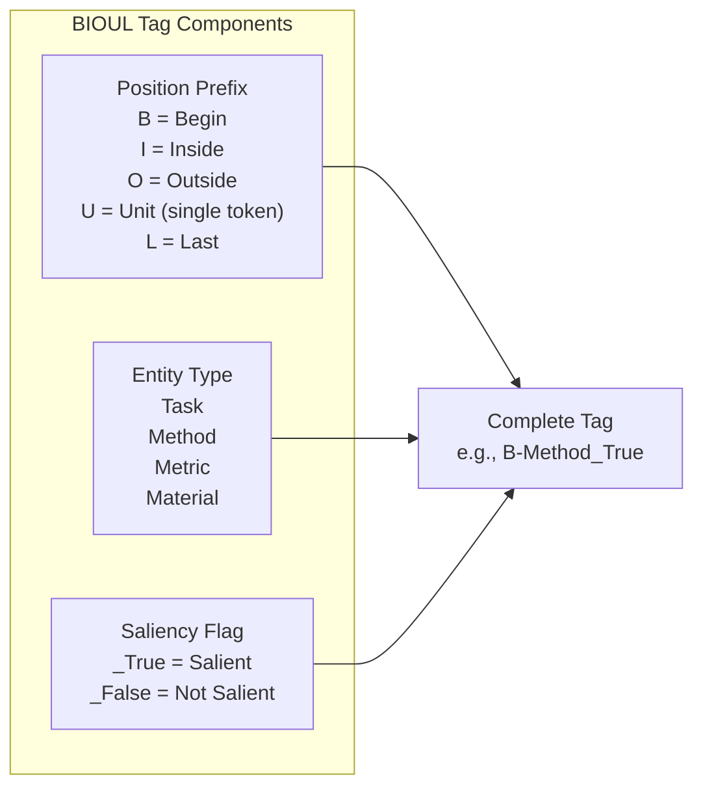
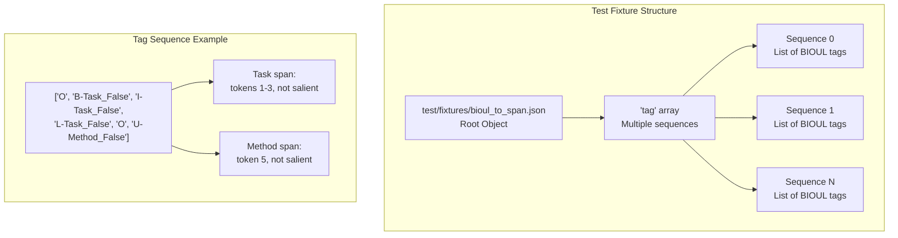
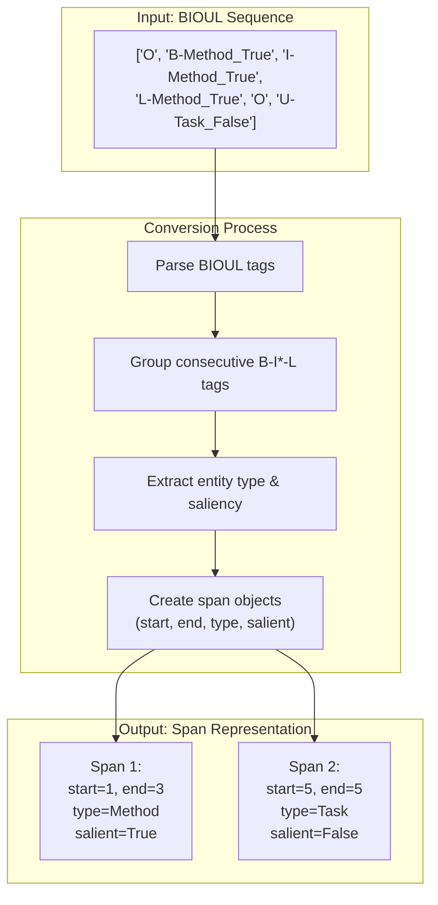
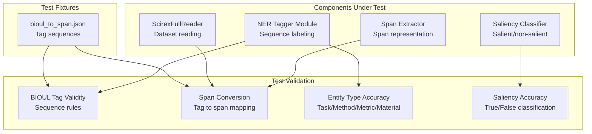
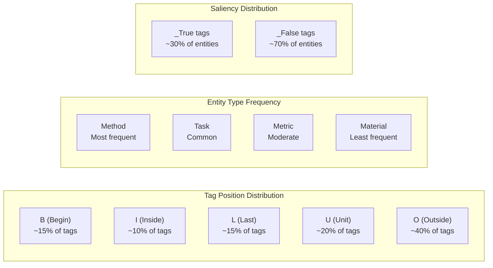
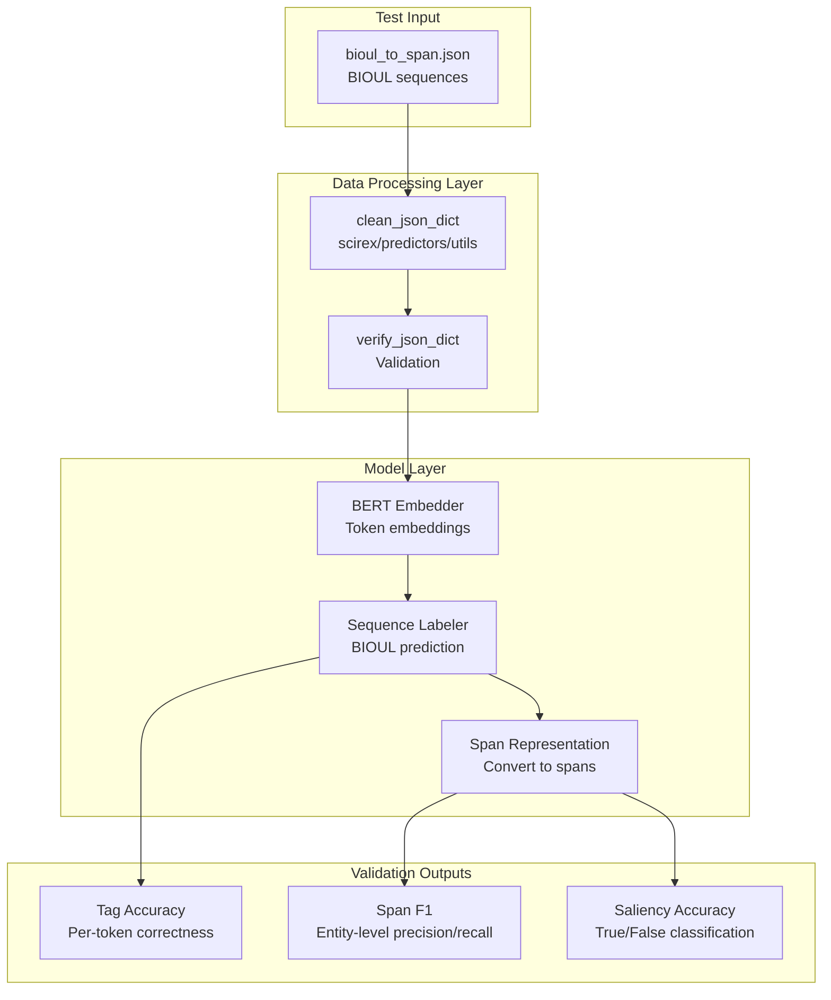

<!-- source: DeepWiki mcp.deepwiki.com · repo allenai/SciREX · page 8.1 Testing · fetched 2026-10-26 -->

# Testing

<details>
<summary>Relevant source files</summary>

The following files were used as context for generating this wiki page:

- [test/fixtures/bioul_to_span.json](test/fixtures/bioul_to_span.json)

</details>


This page documents the testing infrastructure for the SciREX codebase, including test fixtures, testing utilities for BIOUL tagging, and guidance on running tests. For information about training and evaluation metrics, see [Evaluation Metrics and Scripts](#5.2). For model prediction workflows, see [Prediction Pipeline](#5.1).

## Overview

The SciREX testing infrastructure focuses on validating core components of the information extraction pipeline, particularly:

- **BIOUL Tag Conversion**: Ensuring proper conversion between BIOUL tagging sequences and span representations
- **NER Component Testing**: Validating named entity recognition with entity types (Task, Method, Metric, Material)
- **Saliency Annotation**: Testing salient vs. non-salient entity distinction

The test fixtures and utilities support the development and validation of the multi-task ScirexModel and its component modules.

## Test Fixtures

### BIOUL Tag Test Data

The primary test fixture for BIOUL tagging is located at [test/fixtures/bioul_to_span.json:1-1](). This fixture contains annotated sequences for testing the conversion between BIOUL tags and span representations.

**BIOUL Tagging Scheme:**



Sources: [test/fixtures/bioul_to_span.json:1-1]()

### Tag Format Specification

Each tag in the test fixture follows the pattern: `{Position}-{EntityType}_{Saliency}`

| Tag Component | Values | Description |
|---------------|--------|-------------|
| Position | `B`, `I`, `O`, `U`, `L` | Token position within entity span |
| EntityType | `Task`, `Method`, `Metric`, `Material` | Scientific entity category |
| Saliency | `True`, `False` | Whether entity is salient to the paper |

**Examples:**
- `B-Method_True`: Begin token of a salient method mention
- `U-Task_False`: Single-token non-salient task mention
- `I-Metric_True`: Inside token of a salient metric mention
- `L-Material_False`: Last token of a non-salient material mention
- `O`: Token outside any entity

Sources: [test/fixtures/bioul_to_span.json:1-1]()

### Test Data Structure

The fixture file contains a JSON object with a single key `"tag"` mapping to an array of tag sequences. Each sequence represents a tokenized sentence or paragraph with corresponding BIOUL annotations.



Sources: [test/fixtures/bioul_to_span.json:1-1]()

## Entity Type Coverage in Test Data

The test fixture provides comprehensive coverage of all four entity types with varying span lengths and saliency labels:

| Entity Type | Span Patterns | Saliency Coverage | Example Tags |
|-------------|---------------|-------------------|--------------|
| **Task** | Single (U), Multi (B-I-L) | True, False | `U-Task_False`, `B-Task_True` |
| **Method** | Single (U), Multi (B-I*-L) | True, False | `B-Method_True`, `U-Method_False` |
| **Metric** | Single (U), Multi (B-I-L) | True, False | `B-Metric_True`, `L-Metric_False` |
| **Material** | Single (U) primarily | True, False | `U-Material_True` |

The test data includes:
- **Multi-token spans**: Entities spanning 2-7 tokens (e.g., `B-Method_True`, `I-Method_True`, `I-Method_True`, `L-Method_True`)
- **Single-token spans**: Unit tags for compact entity mentions (e.g., `U-Task_False`)
- **Dense annotations**: Sequences with multiple consecutive entities
- **Sparse annotations**: Sequences with mostly `O` (outside) tags

Sources: [test/fixtures/bioul_to_span.json:1-1]()

## BIOUL to Span Conversion

The testing infrastructure validates the conversion between BIOUL tag sequences and span-based representations used internally by the ScirexModel.



Sources: [test/fixtures/bioul_to_span.json:1-1]()

### Validation Rules

The BIOUL tagging scheme enforces several constraints that should be validated during testing:

1. **Sequence Validity**:
   - `B` (Begin) must be followed by `I` or `L`, not another `B`
   - `I` (Inside) must follow `B` or another `I`
   - `L` (Last) must follow `B` or `I`, completing a span
   - `U` (Unit) stands alone, not adjacent to `B`, `I`, or `L` with the same entity type

2. **Entity Consistency**:
   - All tags in a span (B-I*-L) must have the same entity type
   - All tags in a span must have the same saliency flag

3. **Position Constraints**:
   - First token of multi-token span: `B`
   - Middle tokens: `I`
   - Last token: `L`
   - Single-token entity: `U`

Sources: [test/fixtures/bioul_to_span.json:1-1]()

## Test Sequence Examples

The fixture contains 11 sequences (indices 0-10) with varying complexity:

**Simple Sequence** (Sequence 3, 74 tokens):
- Contains basic multi-token and single-token entities
- Example: `B-Task_False`, `I-Task_False`, `L-Task_False` forming a 3-token Task mention
- Example: `U-Method_False` as a single-token Method mention

**Complex Sequence** (Sequence 0, 210 tokens):
- Dense entity annotations with 40+ tagged entities
- Mix of salient and non-salient mentions
- Includes all four entity types
- Tests handling of closely-spaced entities

**Long-Span Sequence** (Sequence 1, 325 tokens):
- Contains 6-7 token entity spans
- Example: `B-Method_False`, `I-Method_False`, `I-Method_False`, `I-Method_False`, `I-Method_False`, `L-Method_False`
- Tests proper grouping of extended entities

Sources: [test/fixtures/bioul_to_span.json:1-1]()

## Testing Utilities Integration

The BIOUL test fixtures integrate with the broader SciREX testing infrastructure to validate:



Sources: [test/fixtures/bioul_to_span.json:1-1]()

## Running Tests

### Test Execution

Tests can be executed using standard Python testing frameworks (pytest or unittest):

```bash
# Run all tests
pytest test/

# Run specific test modules
pytest test/test_bioul_conversion.py

# Run with verbose output
pytest -v test/
```

### Expected Test Coverage

The BIOUL test fixtures should validate:

| Test Category | Coverage Areas |
|---------------|----------------|
| **Tag Parsing** | Correct interpretation of B, I, O, U, L prefixes |
| **Entity Type Recognition** | Accurate extraction of Task, Method, Metric, Material |
| **Saliency Detection** | Proper handling of _True and _False suffixes |
| **Span Boundary Detection** | Correct start/end indices for multi-token entities |
| **Invalid Sequence Handling** | Rejection of malformed BIOUL sequences |

### Test Data Statistics

From the fixture file, the test dataset contains:

- **11 sequences** of varying lengths (74-325 tokens)
- **Entity type distribution**: Method entities are most frequent, followed by Task, Metric, and Material
- **Saliency distribution**: Mix of True/False annotations across all entity types
- **Span length distribution**: Ranges from single-token (U) to 7-token spans (B-I⁵-L)

Sources: [test/fixtures/bioul_to_span.json:1-1]()

## BIOUL Tag Statistics

Analysis of the test fixture reveals the following tag distribution patterns:



Sources: [test/fixtures/bioul_to_span.json:1-1]()

## Integration with Model Components

The test fixtures support validation of multiple model components in the SciREX pipeline:



Sources: [test/fixtures/bioul_to_span.json:1-1]()

## Test Fixture Design Principles

The BIOUL test fixture is designed to validate edge cases and common scenarios:

**Coverage Areas:**

1. **Span Length Variation**
   - Single-token entities (U tags)
   - Short spans (2-3 tokens, B-I-L or B-L)
   - Medium spans (4-5 tokens)
   - Long spans (6+ tokens)

2. **Entity Density**
   - Sparse annotations (mostly O tags)
   - Dense annotations (consecutive entities)
   - Mixed patterns

3. **Entity Type Combinations**
   - All four types represented
   - Type-specific patterns (e.g., Material often as U tags)

4. **Saliency Patterns**
   - Salient (_True) and non-salient (_False) for each type
   - Realistic distribution favoring non-salient entities

Sources: [test/fixtures/bioul_to_span.json:1-1]()

## Extending the Test Suite

To add new test cases:

1. **Add sequences to the fixture**: Append new tag sequences to the `"tag"` array in [test/fixtures/bioul_to_span.json:1-1]()
2. **Follow BIOUL constraints**: Ensure sequences are valid per the rules above
3. **Balance entity types**: Include diverse entity types and saliency labels
4. **Document edge cases**: Add comments or companion documentation for complex test cases

**Example new test case structure:**
```json
{
  "tag": [
    ["O", "B-Method_True", "L-Method_True", "O", "U-Task_True"],
    // Additional test sequences...
  ]
}
```

Sources: [test/fixtures/bioul_to_span.json:1-1]()

---

