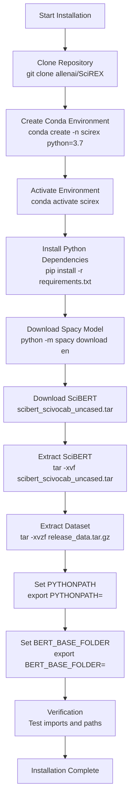
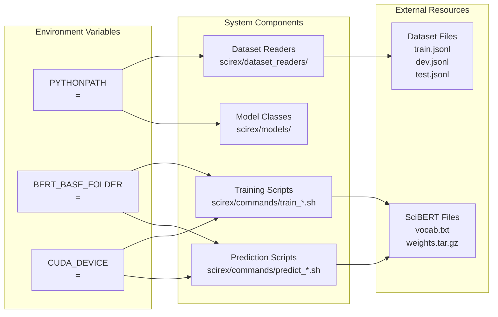
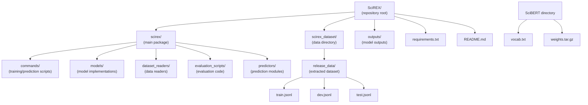

<!-- source: DeepWiki mcp.deepwiki.com · repo allenai/SciREX · page 8.2 Installation and Setup · fetched 2026-10-26 -->

# Installation and Setup

<details>
<summary>Relevant source files</summary>

The following files were used as context for generating this wiki page:

- [README.md](README.md)
- [requirements.txt](requirements.txt)

</details>


This document provides detailed instructions for installing the SciREX system, configuring the development environment, and preparing all necessary dependencies for training and inference. It covers environment creation, dependency installation, external model setup (SciBERT), and environment variable configuration.

For information about training models after setup, see [Training](#4). For details on external library usage, see [Dependencies and External Libraries](#7.2).

---

## Prerequisites

Before beginning installation, ensure the following software is available on your system:

| Requirement | Version | Purpose |
|-------------|---------|---------|
| Python | 3.7 | Runtime environment |
| Conda | Any recent version | Virtual environment management |
| CUDA | Compatible with PyTorch | GPU acceleration (optional but recommended) |
| Git | Any recent version | Repository cloning |
| tar | Standard Unix utility | Dataset extraction |

---

## Installation Workflow

The following diagram illustrates the complete installation process from initial environment creation through verification.



**Sources:** [README.md:35-46]()

---

## Step-by-Step Installation Instructions

### Step 1: Environment Creation

Create a dedicated conda environment with Python 3.7:

```bash
conda create -n scirex python=3.7
conda activate scirex
```

The system requires Python 3.7 specifically due to AllenNLP 0.9.0 compatibility requirements.

**Sources:** [README.md:35]()

### Step 2: Install Python Dependencies

Install all required Python packages from the requirements file:

```bash
pip install -r requirements.txt
```

This installs the following key dependencies:

| Package | Version | Purpose |
|---------|---------|---------|
| `allennlp` | 0.9.0 | Deep learning framework for NLP |
| `spacy` | 2.1.6 | Text processing and tokenization |
| `fuzzywuzzy` | 0.17.0 | String matching for entity evaluation |
| `numpy` | 1.16.4 | Numerical computing |
| `pandas` | 0.24.2 | Data manipulation |
| `scikit_learn` | 0.21.3 | Machine learning utilities |
| `tqdm` | 4.32.1 | Progress bars |
| `beautifulsoup4` | 4.8.0 | HTML parsing for browser |
| `Click` | 7.0 | Command-line interface |
| `python-intervals` | Latest | Span interval operations |

**Sources:** [requirements.txt:1-18]()

### Step 3: Download Spacy Language Model

Download the English language model for spacy:

```bash
python -m spacy download en
```

This model is used for text processing operations throughout the codebase, including tokenization and sentence segmentation during data preprocessing.

**Sources:** [README.md:37]()

### Step 4: Download and Configure SciBERT

SciREX requires SciBERT as the base embedding model. Download and extract the SciBERT model:

```bash
# Download SciBERT
wget https://s3-us-west-2.amazonaws.com/ai2-s2-research/scibert/pytorch_models/scibert_scivocab_uncased.tar

# Extract the archive
tar -xvf scibert_scivocab_uncased.tar -C /path/to/scibert/

# Verify the extracted directory contains required files
ls /path/to/scibert/
# Expected: vocab.txt, weights.tar.gz
```

The SciBERT directory must contain at minimum:
- `vocab.txt` - The vocabulary file
- `weights.tar.gz` - The pretrained model weights

**Sources:** [README.md:44]()

### Step 5: Extract Dataset

Extract the SciREX dataset files:

```bash
tar -xvzf scirex_dataset/release_data.tar.gz --directory scirex_dataset
```

This extracts three files into `scirex_dataset/release_data/`:
- `train.jsonl` - Training set
- `dev.jsonl` - Development/validation set  
- `test.jsonl` - Test set

**Sources:** [README.md:43]()

---

## Environment Variable Configuration

The following diagram shows the required environment variables and their relationships to system components.



**Sources:** [README.md:38,44-46]()

### PYTHONPATH Configuration

Set the `PYTHONPATH` environment variable to the repository root:

```bash
export PYTHONPATH=/path/to/SciREX
```

This is critical because the codebase uses absolute imports like:
- `from scirex.dataset_readers import ScirexFullReader`
- `from scirex.models.scirex_model import ScirexModel`
- `from scirex.evaluation_scripts import scirex_relation_evaluate`

Without proper `PYTHONPATH` configuration, these imports will fail.

**Recommendation:** Add this export to your shell configuration file (`~/.bashrc` or `~/.zshrc`):

```bash
echo 'export PYTHONPATH=/path/to/SciREX:$PYTHONPATH' >> ~/.bashrc
source ~/.bashrc
```

**Sources:** [README.md:38]()

### BERT_BASE_FOLDER Configuration

Set the `BERT_BASE_FOLDER` environment variable to point to the extracted SciBERT directory:

```bash
export BERT_BASE_FOLDER=/path/to/scibert
```

This variable is referenced in:
- Training configuration files (`.jsonnet` files)
- Training scripts in `scirex/commands/train_*.sh`
- Model initialization code that loads pretrained embeddings

The directory must contain:
- `vocab.txt` - SciBERT vocabulary
- `weights.tar.gz` - Pretrained model weights

**Sources:** [README.md:44]()

### CUDA_DEVICE Configuration

Specify which GPU to use for training and inference:

```bash
export CUDA_DEVICE=0  # Use GPU 0
# or
export CUDA_DEVICE=-1  # Use CPU only
```

This variable is used by training and prediction scripts to configure device placement. For multi-GPU systems, specify the device ID (0, 1, 2, etc.). Use `-1` for CPU-only execution.

**Sources:** [README.md:45-46,56]()

---

## Directory Structure After Installation

The following diagram shows the expected directory layout after completing all installation steps.



**Sources:** [README.md:1-74]()

---

## Installation Verification

After completing installation, verify the setup with the following checks:

### Verify Python Imports

Test that all key modules can be imported:

```python
# Test core imports
from scirex.dataset_readers.scirex_reader import ScirexFullReader
from scirex.models.scirex_model import ScirexModel
from scirex.evaluation_scripts.scirex_relation_evaluate import main as evaluate_relations

# Test external dependencies
import allennlp
import spacy
import fuzzywuzzy
import pandas
import numpy

print("All imports successful!")
```

### Verify Dataset Files

Check that dataset files are present and readable:

```bash
ls -lh scirex_dataset/release_data/
# Expected output:
# train.jsonl
# dev.jsonl  
# test.jsonl

# Verify file format
head -n 1 scirex_dataset/release_data/train.jsonl | python -m json.tool
```

### Verify SciBERT Configuration

Verify that the `BERT_BASE_FOLDER` points to a valid directory:

```bash
echo $BERT_BASE_FOLDER
ls -lh $BERT_BASE_FOLDER
# Expected output:
# vocab.txt
# weights.tar.gz
```

### Verify Spacy Model

Test that the spacy model is installed:

```python
import spacy
nlp = spacy.load("en")
doc = nlp("This is a test sentence.")
print(f"Spacy model loaded: {len(doc)} tokens")
```

**Sources:** [README.md:35-46]()

---

## Common Installation Issues

### Issue 1: PYTHONPATH Not Set

**Symptom:** `ModuleNotFoundError: No module named 'scirex'`

**Solution:** Ensure `PYTHONPATH` is set to the repository root:
```bash
export PYTHONPATH=/path/to/SciREX:$PYTHONPATH
```

### Issue 2: SciBERT Files Not Found

**Symptom:** Error during training about missing `vocab.txt` or `weights.tar.gz`

**Solution:** Verify `BERT_BASE_FOLDER` is set correctly and contains required files:
```bash
ls $BERT_BASE_FOLDER
# Must show: vocab.txt, weights.tar.gz
```

### Issue 3: AllenNLP Version Conflicts

**Symptom:** Import errors or unexpected behavior with AllenNLP

**Solution:** Ensure AllenNLP 0.9.0 is installed (not a newer version):
```bash
pip install allennlp==0.9.0 --force-reinstall
```

### Issue 4: CUDA/GPU Not Available

**Symptom:** CUDA errors or slow training on CPU

**Solution:** 
- For GPU training, ensure CUDA is installed and compatible with PyTorch
- For CPU-only, set `CUDA_DEVICE=-1`
- Check PyTorch CUDA availability:
```python
import torch
print(f"CUDA available: {torch.cuda.is_available()}")
print(f"CUDA device count: {torch.cuda.device_count()}")
```

### Issue 5: Dataset Extraction Fails

**Symptom:** Cannot find `train.jsonl`, `dev.jsonl`, or `test.jsonl`

**Solution:** Re-extract the dataset with the correct path:
```bash
tar -xvzf scirex_dataset/release_data.tar.gz --directory scirex_dataset
```

**Sources:** [README.md:1-74](), [requirements.txt:1-18]()

---

## Next Steps After Installation

After completing installation and verification:

1. **Training Models** - See [Training](#4) for instructions on training the SciREX baseline model and coreference model using [train_scirex_model.sh]() and [train_pairwise_coreference.sh]()

2. **Generating Predictions** - See [Prediction Pipeline](#5.1) for running inference with [predict_scirex_model.sh]()

3. **Data Exploration** - See [SciREX Browser](#6.1) for visualizing the dataset interactively

4. **Model Configuration** - See [Model Configuration](#3.3) to customize training parameters in `.jsonnet` files

**Sources:** [README.md:40-57]()

---

## Advanced Configuration Options

### Virtual Environment Persistence

For persistent environment configuration, create a script `setup_env.sh`:

```bash
#!/bin/bash
# setup_env.sh - SciREX environment configuration

export PYTHONPATH=/path/to/SciREX:$PYTHONPATH
export BERT_BASE_FOLDER=/path/to/scibert
export CUDA_DEVICE=0

# Optional: Set output directories
export SCIREX_OUTPUT_DIR=/path/to/outputs
export SCIREX_DATA_DIR=/path/to/scirex_dataset/release_data

echo "SciREX environment configured"
echo "PYTHONPATH: $PYTHONPATH"
echo "BERT_BASE_FOLDER: $BERT_BASE_FOLDER"
echo "CUDA_DEVICE: $CUDA_DEVICE"
```

Source this script before working with SciREX:
```bash
source setup_env.sh
```

### Docker Installation (Alternative)

For reproducible environments, consider creating a Dockerfile:

```dockerfile
FROM python:3.7

# Install system dependencies
RUN apt-get update && apt-get install -y \
    wget \
    tar \
    git

# Set working directory
WORKDIR /workspace

# Clone repository
RUN git clone https://github.com/allenai/SciREX.git

# Install Python dependencies
WORKDIR /workspace/SciREX
RUN pip install -r requirements.txt
RUN python -m spacy download en

# Set environment variables
ENV PYTHONPATH=/workspace/SciREX:$PYTHONPATH
ENV BERT_BASE_FOLDER=/workspace/scibert

# Download and extract SciBERT (if automating)
# RUN wget https://s3-us-west-2.amazonaws.com/ai2-s2-research/scibert/pytorch_models/scibert_scivocab_uncased.tar
# RUN mkdir -p /workspace/scibert && tar -xvf scibert_scivocab_uncased.tar -C /workspace/scibert

CMD ["/bin/bash"]
```

**Sources:** [README.md:35-46](), [requirements.txt:1-18]()