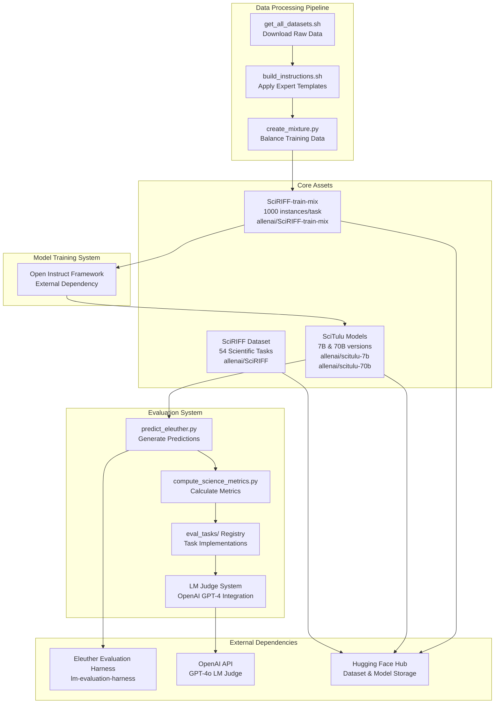
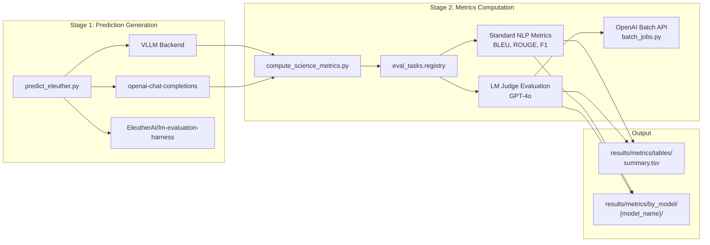
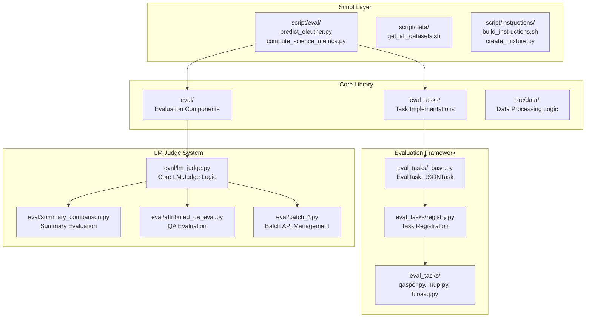

<!-- source: DeepWiki mcp.deepwiki.com · repo allenai/SciRIFF · page 1 Overview · fetched 2026-10-26 -->

# Overview

Relevant source files

The following files were used as context for generating this wiki page:

- [LICENSE](LICENSE)
- [README.md](README.md)

This document provides a high-level overview of the SciRIFF system, a comprehensive framework for scientific instruction-following evaluation and model training. SciRIFF encompasses a 54-task scientific dataset, the SciTulu model family, and associated evaluation infrastructure for assessing language model performance on scientific literature tasks.

For detailed setup instructions, see [Installation and Setup](#1.1). For immediate usage examples, see [Quick Start](#1.2). For evaluation-specific details, see [Evaluation System](#3). For model training information, see [Model Training](#5).

## System Architecture

The SciRIFF system consists of four primary subsystems that work together to create a complete scientific instruction-following pipeline:

Sources: [README.md:22-27](), [README.md:129](), [README.md:167-182]()

## Core Components

### SciRIFF Dataset and SciTulu Models

The system centers around two main artifacts available on Hugging Face:

| Asset | Description | Hugging Face Path |
|-------|-------------|-------------------|
| **SciRIFF Dataset** | 54 scientific instruction-following tasks | `allenai/SciRIFF` |
| **SciTulu 7B Model** | 7B parameter instruction-tuned model | `allenai/scitulu-7b` |
| **SciTulu 70B Model** | 70B parameter instruction-tuned model | `allenai/scitulu-70b` |
| **Training Mix** | Balanced training data (1000 instances/task) | `allenai/SciRIFF-train-mix` |

The dataset creation process transforms raw scientific datasets into instruction-following format using expert-written templates, with the final dataset supporting evaluation across diverse scientific domains.

Sources: [README.md:24-27]()

### Evaluation Pipeline

The evaluation system operates through a two-stage process managed by key scripts:

The system supports multiple inference backends including VLLM for local models and OpenAI API for cloud-based evaluation. Advanced tasks use GPT-4 as an LM judge with OpenAI Batch API integration for cost-effective large-scale evaluation.

Sources: [README.md:81-106](), [README.md:110-125]()

### Data Processing Pipeline

Raw scientific datasets undergo transformation through a structured pipeline:

1. **Data Acquisition**: The `get_all_datasets.sh` script downloads datasets not available on Hugging Face
2. **Instruction Generation**: The `build_instructions.sh` script applies expert-written templates to convert datasets into instruction-following format
3. **Mixture Creation**: The `create_mixture.py` script balances training data by sampling instances across tasks

The processed data supports both model training and evaluation, with configurable context lengths and instance limits per task.

Sources: [README.md:167-182]()

### Model Training Integration

SciRIFF integrates with the Open Instruct framework for model training. The training process uses the `SciRIFF-train-mix` dataset, which combines 1000 instances per scientific task with matching data from the Tulu-V2 instruction mix.

Training configurations support both 7B and 70B parameter models using the Llama 2 architecture as base models, with specialized hyperparameters optimized for scientific instruction-following performance.

Sources: [README.md:128-161]()

## Key Code Organization

The codebase follows a modular structure with clear separation of concerns:

This architecture enables extensibility through the task registry system and provides clear interfaces for adding new evaluation tasks or modifying existing ones.

Sources: [README.md:77](), [README.md:110](), [README.md:119]()

## System Integration Points

The SciRIFF system integrates with several external services and frameworks:

- **Eleuther AI Harness**: Provides standardized inference and evaluation infrastructure
- **OpenAI API**: Enables LM judge evaluations with GPT-4 and cost optimization through Batch API
- **Hugging Face Hub**: Hosts datasets and models with seamless integration for training and evaluation
- **VLLM**: Supports efficient local model inference with GPU optimization
- **Open Instruct**: Facilitates model training with proven instruction-tuning methodologies

These integrations ensure the system can handle both research and production use cases while maintaining compatibility with the broader machine learning ecosystem.

Sources: [README.md:44-51](), [README.md:67-71](), [README.md:119]()

---

