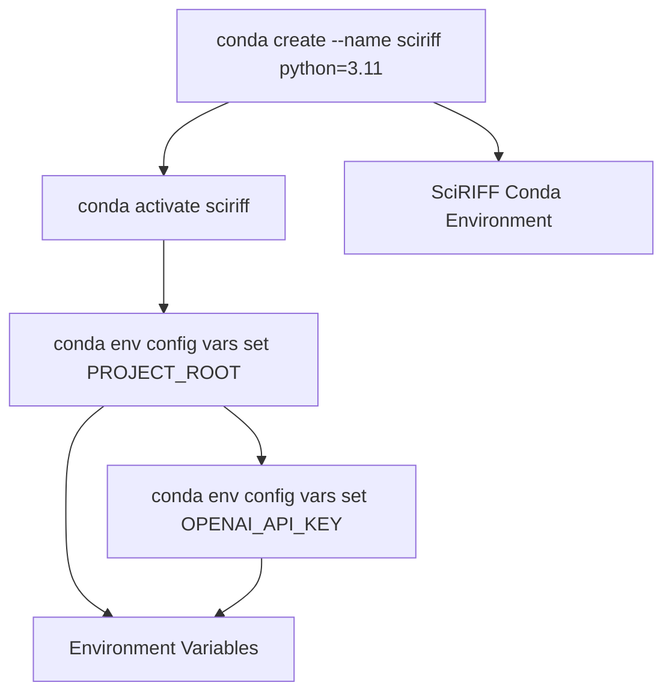
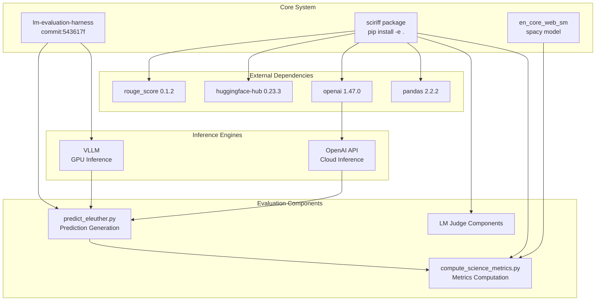
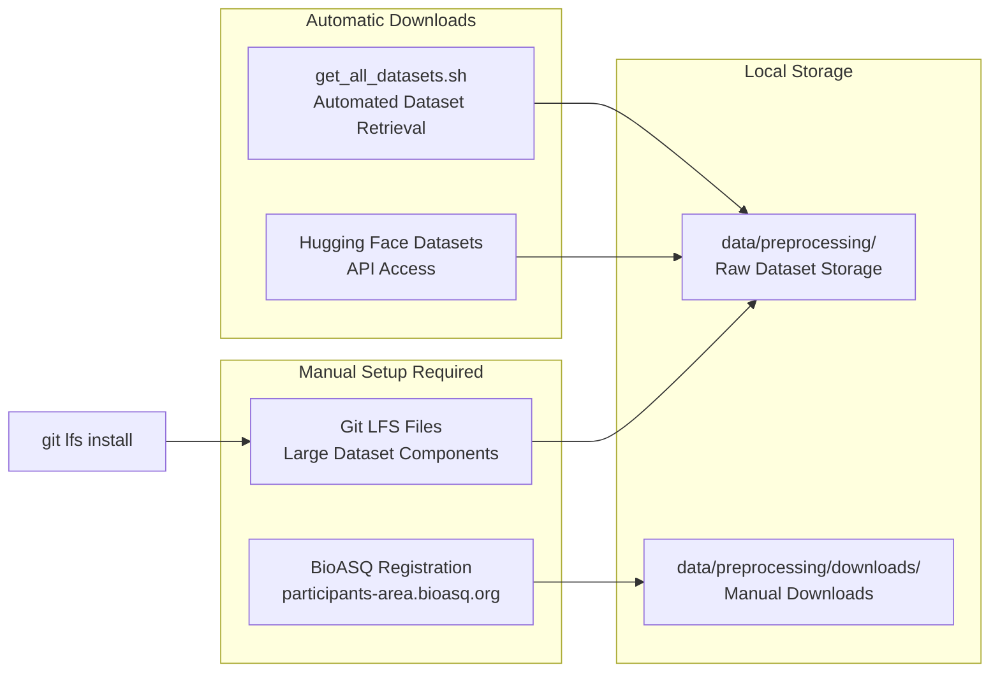
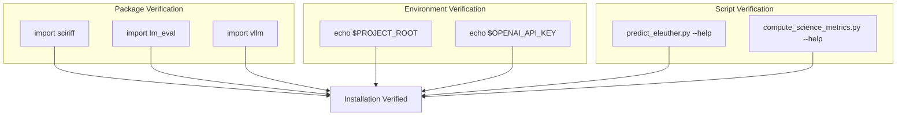

<!-- source: DeepWiki mcp.deepwiki.com · repo allenai/SciRIFF · page 1.1 Installation and Setup · fetched 2026-10-26 -->

# Installation and Setup

<details>
<summary>Relevant source files</summary>

The following files were used as context for generating this wiki page:

- [LICENSE](LICENSE)
- [README.md](README.md)
- [setup.py](setup.py)

</details>


This document provides step-by-step instructions for setting up the SciRIFF environment, including all dependencies required for model evaluation, training, and dataset processing. The setup process involves installing the Eleuther evaluation harness, the SciRIFF package, and configuring external services for LM judge evaluations.

For information about using the system after installation, see [Quick Start](#1.2). For details about the evaluation pipeline, see [Evaluation System](#3).

## Prerequisites

Before beginning installation, ensure you have the following:

- Python 3.11 or compatible version
- Conda package manager
- Git with Git LFS support
- CUDA-compatible GPU (recommended for local model inference)
- OpenAI API key (required for LM judge evaluations)

## Environment Setup

### Creating the Conda Environment

The SciRIFF system requires a dedicated conda environment to manage dependencies and avoid conflicts:

```bash
conda create --name sciriff python=3.11
conda activate sciriff
```

### Setting Environment Variables

Configure the `PROJECT_ROOT` environment variable to point to your SciRIFF installation directory:

```bash
conda env config vars set PROJECT_ROOT=[path-to-sciriff-code]
```

For LM judge evaluations using OpenAI models, configure your API key:

```bash
conda env config vars set OPENAI_API_KEY=[your_openai_key]
```

**Setup Environment Flow**


Sources: [README.md:31-42](), [README.md:67-71]()

## Core Dependencies Installation

### Eleuther Evaluation Harness

The system uses the Eleuther harness for model inference and evaluation. Install a specific commit for stability:

```bash
git clone https://github.com/EleutherAI/lm-evaluation-harness.git
cd lm-evaluation-harness
git checkout 543617f
pip install -e .[vllm]
```

The `[vllm]` extra installs VLLM support for efficient GPU inference with large models.

### SciRIFF Package

Install the SciRIFF package in development mode from the project directory:

```bash
cd [path-to-sciriff-code]
pip install -e .
```

This installs the package dependencies defined in [setup.py:8-24](), including:

| Package | Version | Purpose |
|---------|---------|---------|
| `pandas` | 2.2.2 | Data manipulation for metrics computation |
| `openai` | 1.47.0 | OpenAI API client for LM judge evaluations |
| `spacy` | 3.7.4 | NLP processing for text evaluation |
| `rouge_score` | 0.1.2 | ROUGE metrics computation |
| `huggingface-hub` | 0.23.3 | Model and dataset access |

### Additional Language Model

Install the Spacy English model required for text processing:

```bash
python -m spacy download en_core_web_sm
```

**Dependencies Architecture**


Sources: [README.md:44-57](), [README.md:61-65](), [setup.py:8-24]()

## Dataset Support Setup

### Git LFS Configuration

Some datasets in the SciRIFF collection require Git LFS for large file storage. Install Git LFS if not already available:

```bash
# Installation varies by system
# Ubuntu/Debian: apt install git-lfs
# macOS: brew install git-lfs
# Or download from https://git-lfs.com/

git lfs install
```

### Dataset Access Requirements

Certain datasets require manual registration and download:

- **BioASQ**: Register at http://participants-area.bioasq.org/datasets/ and download Task 11B files to `data/preprocessing/downloads/bioasq_task11b/`

**Dataset Setup Flow**


Sources: [README.md:73-74](), [README.md:167-169]()

## Installation Verification

### Verify Core Installation

Test that the main components are properly installed:

```bash
# Test SciRIFF package import
python -c "import sciriff; print('SciRIFF package installed successfully')"

# Test Eleuther harness
python -c "import lm_eval; print('LM Eval harness available')"

# Test VLLM availability
python -c "import vllm; print('VLLM available for GPU inference')"
```

### Verify Environment Variables

Confirm that environment variables are properly set:

```bash
echo $PROJECT_ROOT
echo $OPENAI_API_KEY  # Should show your API key
```

### Test Prediction Script

Verify the evaluation pipeline with a minimal test:

```bash
python script/eval/predict_eleuther.py --help
```

This should display the help message for the prediction script, confirming that the Eleuther harness integration is working.

**Verification Workflow**


Sources: [README.md:54-57](), [README.md:86-94](), [README.md:113-117]()

## Common Installation Issues

### Typer Version Warnings

During installation, you may see warnings about incompatible versions of the `typer` package. These warnings can be safely ignored and do not affect functionality.

### VLLM GPU Requirements

For VLLM inference:
- **7B models**: Single A6000 GPU or equivalent
- **70B models**: 4x 80GB A100 GPUs or equivalent memory capacity

### API Rate Limits

The OpenAI API key is required for:
- MUP single document summarization evaluation (via LM judge)
- Qasper abstractive QA evaluation (via LM judge)

Configure rate limits and billing limits appropriately in your OpenAI account.

Sources: [README.md:59-60](), [README.md:83-84](), [README.md:67-68]()

---

