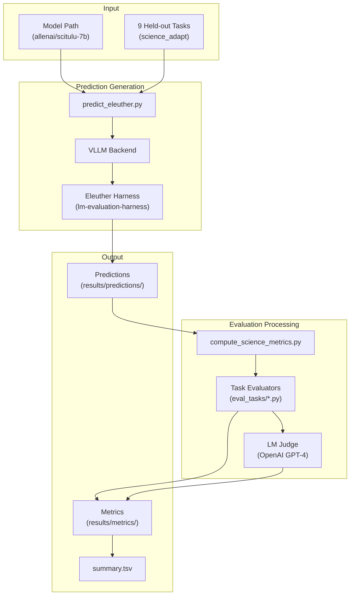
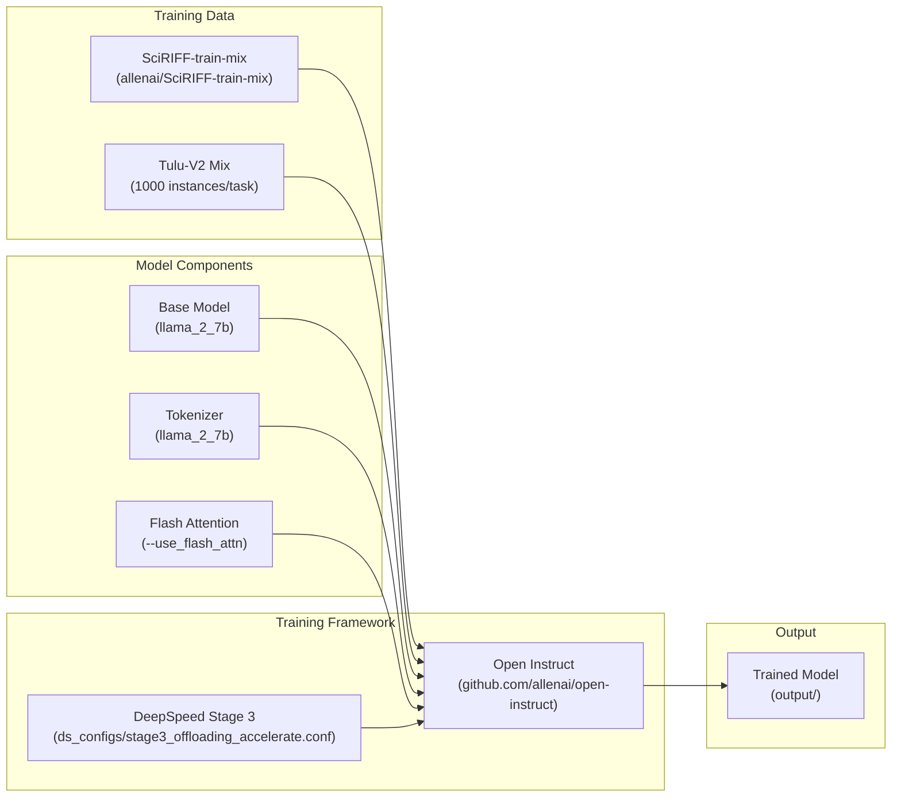
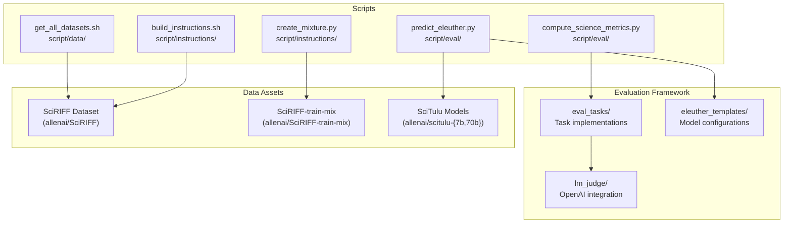

<!-- source: DeepWiki mcp.deepwiki.com · repo allenai/SciRIFF · page 1.2 Quick Start · fetched 2026-10-26 -->

# Quick Start

<details>
<summary>Relevant source files</summary>

The following files were used as context for generating this wiki page:

- [LICENSE](LICENSE)
- [README.md](README.md)

</details>


This guide provides essential usage examples for the two primary SciRIFF workflows: evaluating models on scientific tasks and training new models with SciRIFF data. For detailed installation instructions, see [Installation and Setup](#1.1). For comprehensive evaluation details, see [Evaluation System](#3).

## Basic Evaluation Workflow

The evaluation workflow consists of two main steps: generating predictions and computing metrics. This process evaluates any language model on the 9 held-out SciRIFF tasks.

### Quick Evaluation Example

Here's the minimal workflow to evaluate a model:

```bash
# Step 1: Generate predictions
python script/eval/predict_eleuther.py \
  --model vllm \
  --model_name allenai/scitulu-7b \
  --chat_template tulu \
  --gpus 1 \
  --tasks science_adapt \
  --result_base results/predictions

# Step 2: Compute metrics
python script/eval/compute_science_metrics.py \
  --pred_dir results/predictions \
  --metrics_dir results/metrics
```

**Evaluation Workflow Architecture**



Sources: [README.md:75-126](), [script/eval/predict_eleuther.py](), [script/eval/compute_science_metrics.py]()

### Prediction Generation Options

The `predict_eleuther.py` script supports multiple inference backends:

| Backend | Usage | Requirements |
|---------|--------|-------------|
| `vllm` | Local GPU inference | GPU with sufficient VRAM |
| `openai-chat-completions` | OpenAI API | `OPENAI_API_KEY` environment variable |
| `anthropic-chat-completions` | Anthropic API | API credentials |

**Example: API-based Evaluation**

```bash
python script/eval/predict_eleuther.py \
  --model openai-chat-completions \
  --model_name gpt-3.5-turbo-1106 \
  --chat_template general \
  --tasks science_adapt \
  --result_base results/predictions \
  --limit 50
```

Sources: [README.md:96-106]()

### Metrics Computation

The `compute_science_metrics.py` script processes predictions through task-specific evaluators and generates comprehensive metrics:

- **Standard metrics**: BLEU, ROUGE, F1 scores for most tasks
- **LM Judge evaluation**: GPT-4 assessment for `qasper_abstractive_qa` and `mup_single_document_summarization`
- **Batch API support**: Cost-effective evaluation using OpenAI's batch API

Sources: [README.md:108-126]()

## Basic Training Workflow

Training new models uses the SciRIFF training mixture with the Open Instruct framework.

**Training Data Pipeline**



Sources: [README.md:127-162]()

### Quick Training Example

```bash
accelerate launch \
  --mixed_precision bf16 \
  --num_machines 1 \
  --num_processes 8 \
  --use_deepspeed \
  --deepspeed_config_file ds_configs/stage3_offloading_accelerate.conf \
  open_instruct/finetune.py \
  --model_name_or_path llama_2_7b \
  --use_flash_attn \
  --tokenizer_name llama_2_7b \
  --dataset_name allenai/SciRIFF-train-mix \
  --use_slow_tokenizer \
  --max_seq_length 4096 \
  --preprocessing_num_workers 16 \
  --per_device_train_batch_size 2 \
  --gradient_accumulation_steps 8 \
  --learning_rate 2e-5 \
  --lr_scheduler_type linear \
  --warmup_ratio 0.03 \
  --weight_decay 0. \
  --num_train_epochs 2 \
  --output_dir output/ \
  --with_tracking \
  --report_to tensorboard \
  --logging_steps 1
```

Sources: [README.md:133-159]()

## Key Entry Points and File Structure

The following table maps common tasks to their corresponding entry points:

| Task | Script | Key Parameters |
|------|--------|----------------|
| Model evaluation | `script/eval/predict_eleuther.py` | `--model`, `--model_name`, `--tasks` |
| Metrics computation | `script/eval/compute_science_metrics.py` | `--pred_dir`, `--metrics_dir` |
| Dataset creation | `script/data/get_all_datasets.sh` | Downloads raw datasets |
| Instruction formatting | `script/instructions/build_instructions.sh` | Applies templates |
| Training mixture | `script/instructions/create_mixture.py` | `--instances_per_task`, `--tulu` |

**Core System Components**



Sources: [README.md:11-187](), [script/eval/](), [script/data/](), [script/instructions/](), [eval_tasks/](), [lm_judge/](), [eleuther_templates/]()

## Resource Requirements

| Component | Memory | Notes |
|-----------|---------|-------|
| SciTulu-7B evaluation | 1x A6000 (48GB) | Single GPU sufficient |
| SciTulu-70B evaluation | 4x A100 (80GB each) | May work with less |
| Training (7B model) | 8x GPU + DeepSpeed | Stage 3 offloading required |

**Evaluation Time Estimates**
- Full evaluation suite: Several hours
- Use `--limit` flag to cap instances per task for testing
- LM Judge tasks (Qasper, MUP) require additional time for API calls

Sources: [README.md:82-84](), [README.md:133-159]()

---

