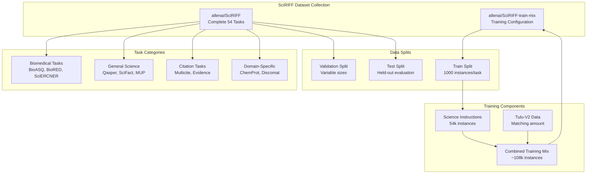
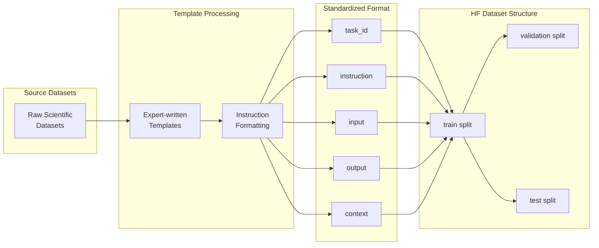
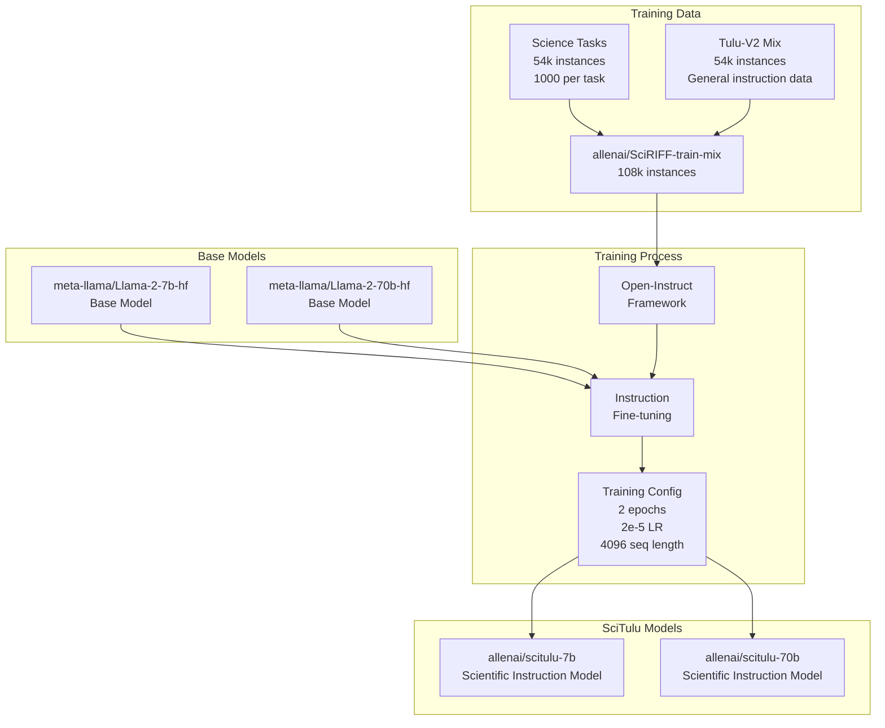
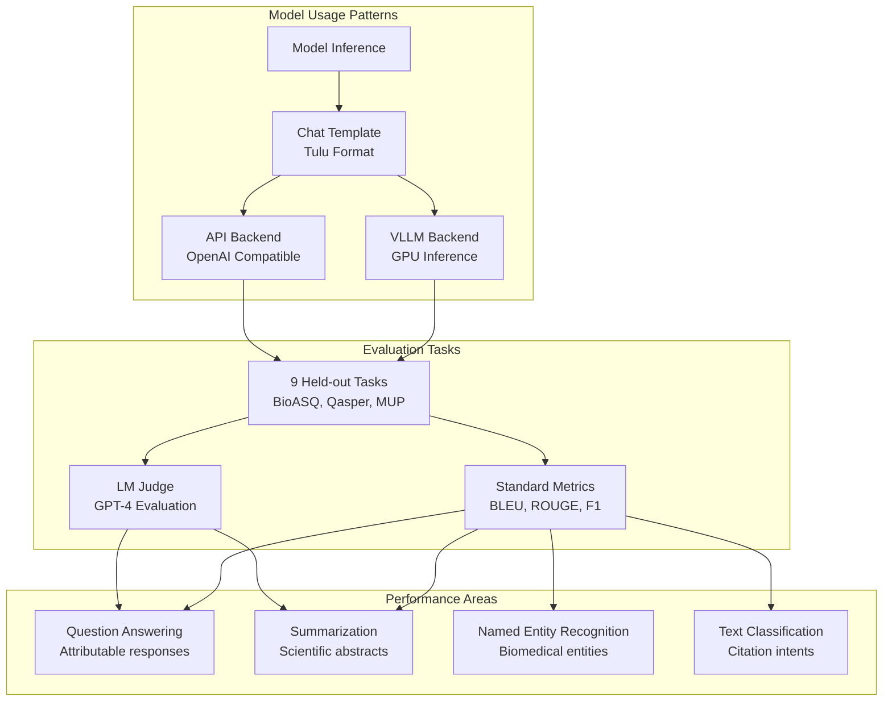

<!-- source: DeepWiki mcp.deepwiki.com · repo allenai/SciRIFF · page 2 Dataset and Models · fetched 2026-10-26 -->

# Dataset and Models

Relevant source files

The following files were used as context for generating this wiki page:

- [LICENSE](LICENSE)
- [README.md](README.md)

This document describes the core SciRIFF dataset collection and the SciTulu model family. The SciRIFF dataset consists of 54 scientific tasks converted to instruction-following format, while SciTulu models are fine-tuned language models trained on this data. For information about evaluation procedures, see [Evaluation System](#3). For details on data processing workflows, see [Data Processing Pipeline](#4). For model training procedures, see [Model Training](#5).

## SciRIFF Dataset Collection

The SciRIFF dataset collection provides scientific instruction-following data in two primary configurations hosted on Hugging Face. The collection transforms existing scientific datasets into a unified instruction-following format using expert-written templates.

### Dataset Structure

**Full SciRIFF Dataset**
The complete `allenai/SciRIFF` dataset contains all 54 scientific tasks across multiple domain areas. Each task maintains separate train/validation/test splits where available from the source datasets.

**Training Mixture**
The `allenai/SciRIFF-train-mix` dataset provides the specific training configuration used for SciTulu models, combining 1000 instances per scientific task with matching data from the Tulu-V2 instruction dataset.

### Task Categories and Distribution

The 54 tasks span multiple scientific domains and task types:

| Domain | Task Types | Example Tasks |
|--------|------------|---------------|
| Biomedical | QA, NER, Text Classification | BioASQ, BioRED, SciERCNER |
| General Science | Summarization, QA, Entailment | Qasper, SciFact, MUP |
| Citation Analysis | Intent Classification, Evidence | Multicite, Evidence Inference |
| Domain-Specific | Relation Extraction, Classification | Discomat, ChemProt |

Sources: [README.md:22-28]()

### Dataset Format and Structure

Each task in the SciRIFF collection follows a consistent instruction-following format with standardized fields:

Sources: [README.md:3](), [README.md:169-179]()

## SciTulu Model Family

The SciTulu models are instruction-tuned language models fine-tuned specifically on the SciRIFF training mixture to enhance performance on scientific instruction-following tasks.

### Model Variants

| Model | Parameters | Base Model | Training Data | HF Repository |
|-------|------------|------------|---------------|---------------|
| SciTulu-7B | 7 billion | Llama 2 7B | SciRIFF-train-mix | `allenai/scitulu-7b` |
| SciTulu-70B | 70 billion | Llama 2 70B | SciRIFF-train-mix | `allenai/scitulu-70b` |

### Model Architecture and Training

Sources: [README.md:26-27](), [README.md:128-159]()

### Model Capabilities and Performance

The SciTulu models demonstrate enhanced performance on scientific instruction-following tasks compared to their base models and general instruction-following models. Key capabilities include:

**Scientific Task Proficiency:**
- Biomedical question answering and information extraction
- Scientific literature summarization and analysis  
- Citation intent classification and evidence assessment
- Domain-specific named entity recognition and relation extraction

**Technical Specifications:**
- Maximum sequence length: 4096 tokens
- Chat template compatibility: Tulu format
- Inference backend support: VLLM, transformers, OpenAI-compatible APIs
- Hardware requirements: 7B model runs on single A6000, 70B model requires 4x A100 80GB

Sources: [README.md:81-106](), [README.md:141-142]()

### Model Access and Integration

Both SciTulu models are available through the Hugging Face Hub and can be integrated into evaluation and inference workflows using standard tooling:

**Direct Model Loading:**
- Compatible with `transformers` library
- Supports VLLM for high-throughput inference
- Available through OpenAI-compatible API servers

**Evaluation Integration:**
- Compatible with Eleuther AI evaluation harness
- Integrated with SciRIFF evaluation pipeline via `predict_eleuther.py`
- Supports both chat template and completion-style inference

Sources: [README.md:86-94](), [README.md:99-106]()

---

