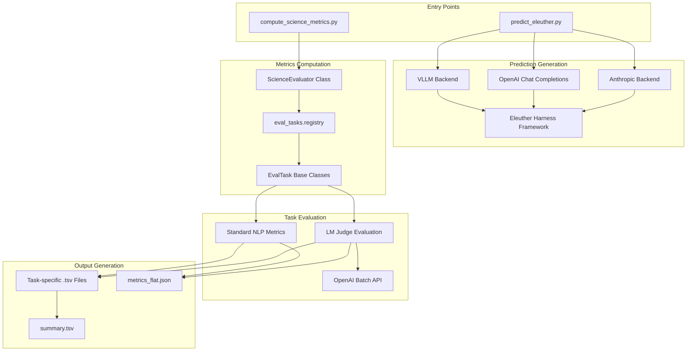
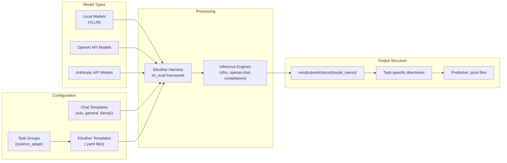
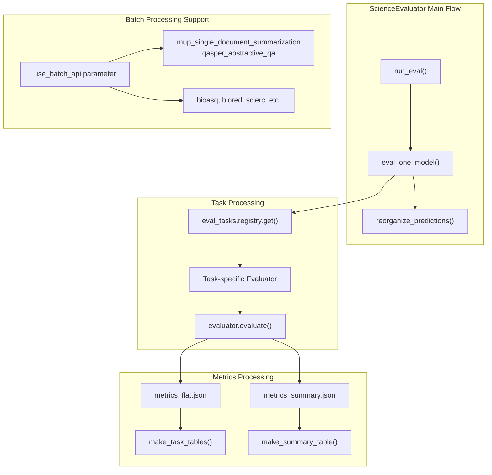
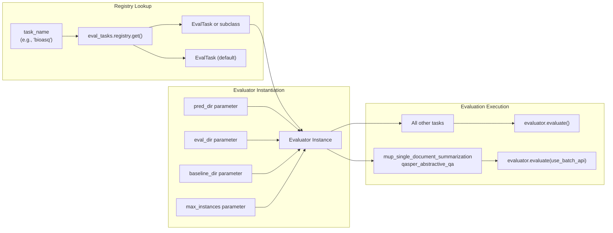

<!-- source: DeepWiki mcp.deepwiki.com · repo allenai/SciRIFF · page 3 Evaluation System · fetched 2026-10-26 -->

# Evaluation System

<details>
<summary>Relevant source files</summary>

The following files were used as context for generating this wiki page:

- [LICENSE](LICENSE)
- [README.md](README.md)
- [script/eval/compute_science_metrics.py](script/eval/compute_science_metrics.py)

</details>


The evaluation system provides a comprehensive framework for assessing model performance on scientific instruction-following tasks. It handles the complete pipeline from generating model predictions to computing final metrics across 9 held-out evaluation tasks. The system supports multiple inference backends (VLLM, OpenAI API, Anthropic) and advanced evaluation methods including LM judge assessment for tasks requiring nuanced evaluation.

For information about the specific evaluation tasks and their implementations, see [Evaluation Tasks](#3.3). For details on generating training data and model training workflows, see [Data Processing Pipeline](#4) and [Model Training](#5).

## Architecture Overview

The evaluation system consists of two main entry points that orchestrate a multi-stage pipeline:



**Sources:** [README.md:75-126](), [script/eval/compute_science_metrics.py:29-47]()

## Prediction Generation Pipeline

The `predict_eleuther.py` script serves as the main entry point for generating model predictions across all evaluation tasks. It leverages the Eleuther evaluation harness framework to handle different model types and inference backends:



**Sources:** [README.md:79-106]()

## Metrics Computation Framework

The `ScienceEvaluator` class in [script/eval/compute_science_metrics.py]() orchestrates the evaluation process by loading predictions, applying task-specific evaluators, and generating comprehensive results:



**Sources:** [script/eval/compute_science_metrics.py:135-197](), [script/eval/compute_science_metrics.py:198-220]()

## Task Evaluation Registry System

The evaluation framework uses a registry pattern to dynamically dispatch to appropriate evaluators based on task names. The registry system maps task identifiers to their corresponding evaluation classes:



**Sources:** [script/eval/compute_science_metrics.py:156-167]()

## Summary Metrics Generation

The system generates comprehensive summary tables that aggregate performance across all tasks using predefined metrics combinations. The `make_summary_table` method computes cross-task performance scores:

| Task | Primary Metric | Description |
|------|----------------|-------------|
| bioasq | f1 | List-based QA F1 score |
| biored | f1 | Named Entity Recognition F1 |
| discomat | bleu | Text classification BLEU score |
| evidence_inference | f1_overlap | Evidence inference F1 with overlap |
| multicite | f1 | Citation intent classification F1 |
| mup | lm_judge_reference | LM judge reference-based evaluation |
| qasper | lm_judge_answer | LM judge answer quality evaluation |
| qasper | f1_evidence | Evidence extraction F1 score |
| scierc | f1 | Scientific entity relation classification F1 |
| scifact | f1_label | Scientific fact verification label F1 |
| scifact | f1_evidence_token | Evidence token-level F1 |

The summary computation includes both mean and median aggregation across all task metrics, with results sorted by model name and saved as tab-separated values in `summary.tsv`.

**Sources:** [script/eval/compute_science_metrics.py:48-84]()

## File Organization and Output Structure

The evaluation system maintains a structured directory hierarchy for organizing predictions, metrics, and results:

```
results/
├── predictions/
│   └── {model_name}/
│       ├── {task_name}/
│       │   ├── eleuther.jsonl
│       │   └── prediction_files...
├── metrics/
│   ├── by_model/
│   │   └── {model_name}/
│   │       └── {task_name}/
│   │           ├── metrics_flat.json
│   │           ├── metrics_summary.json
│   │           └── task_specific_outputs...
│   └── tables/
│       ├── summary.tsv
│       └── {task_name}.tsv
```

The `reorganize_predictions` method handles the transformation from the initial Eleuther harness output format (single `science_adapt` directory) to task-specific directories for easier processing.

**Sources:** [script/eval/compute_science_metrics.py:97-134]()

---

