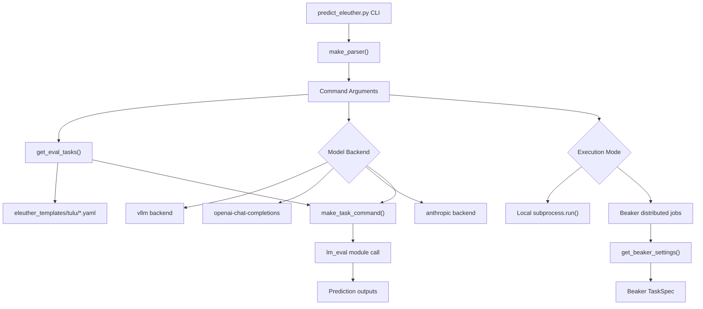
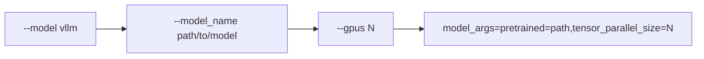
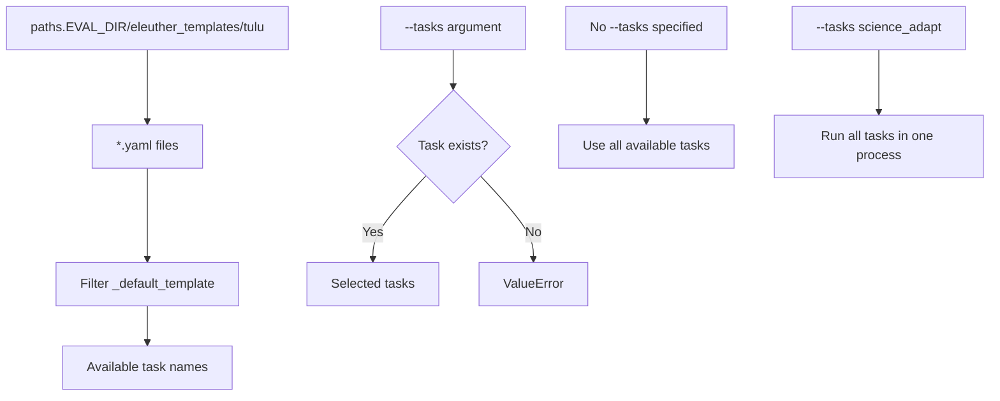
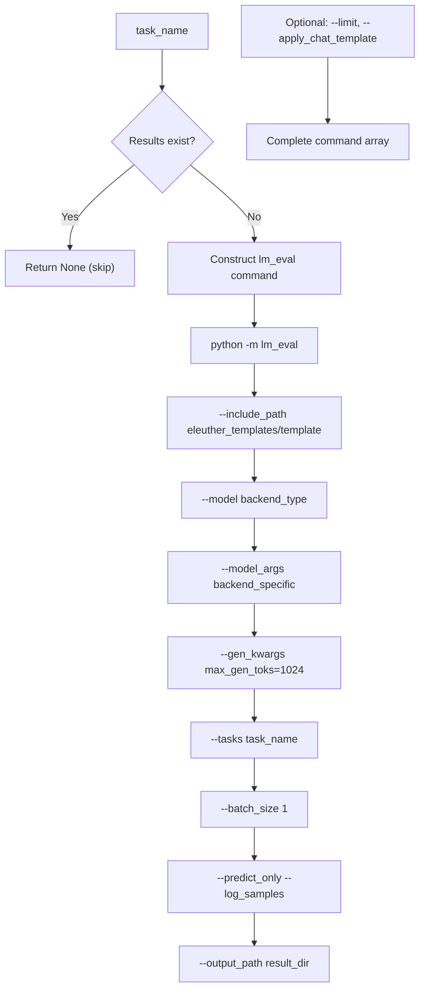
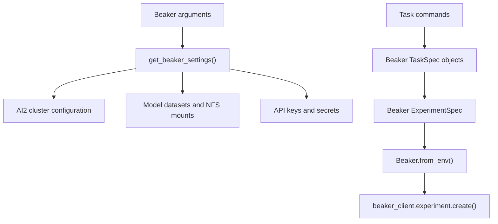

<!-- source: DeepWiki mcp.deepwiki.com · repo allenai/SciRIFF · page 3.1 Generating Predictions · fetched 2026-10-26 -->

# Generating Predictions

<details>
<summary>Relevant source files</summary>

The following files were used as context for generating this wiki page:

- [script/eval/predict_eleuther.py](script/eval/predict_eleuther.py)

</details>


This document covers the prediction generation system in SciRIFF, which is responsible for running inference on scientific evaluation tasks using various model backends. The system uses the Eleuther evaluation harness to generate model predictions that are subsequently evaluated by the metrics computation pipeline.

For information about computing metrics from these predictions, see [Computing Metrics](#3.2). For details about the underlying evaluation tasks, see [Evaluation Tasks](#3.3).

## Overview

The prediction generation system is implemented in [script/eval/predict_eleuther.py:1-291]() and serves as a wrapper around the Eleuther evaluation harness. It supports multiple model backends and can run either locally or on AI2's Beaker cluster system for large-scale evaluations.



Sources: [script/eval/predict_eleuther.py:1-291]()

## Model Backend Configuration

The system supports three primary model backends, each with different configuration requirements:

### VLLM Backend
For local or self-hosted models using VLLM for efficient inference:



The VLLM backend constructs model arguments as [script/eval/predict_eleuther.py:194]():
```
model_args = f"pretrained={args.model_name},tensor_parallel_size={args.gpus},dtype=float16"
```

### OpenAI and Anthropic APIs
For API-based models, the configuration is simpler:

| Backend | Model Argument Example |
|---------|----------------------|
| `openai-chat-completions` | `gpt-4-turbo` |
| `anthropic` | `claude-3-opus-20240229` |

Both API backends use the same model argument pattern [script/eval/predict_eleuther.py:196]():
```
model_args = f"model={args.model_name}"
```

Sources: [script/eval/predict_eleuther.py:18-19](), [script/eval/predict_eleuther.py:193-196]()

## Task Selection and Templates

The system automatically discovers evaluation tasks from YAML template files:



The task discovery process is implemented in [script/eval/predict_eleuther.py:115-131]():

```python
def get_eval_tasks(args):
    eval_task_dir = paths.EVAL_DIR / "eleuther_templates/tulu"
    names = [p.stem for p in eval_task_dir.glob("*.yaml")]
    names = [name for name in names if name != "_default_template"]
```

Sources: [script/eval/predict_eleuther.py:115-131]()

## Chat Template System

The system supports different chat templates through the `--chat_template` argument:

- **Default**: `general` template
- **Template Path**: `eleuther_templates/{chat_template}/`
- **Special Handling**: When `--apply_chat_template` is used with non-`general` templates, validation prevents double-templating [script/eval/predict_eleuther.py:222-226]()

Sources: [script/eval/predict_eleuther.py:37-41](), [script/eval/predict_eleuther.py:190](), [script/eval/predict_eleuther.py:222-227]()

## Command Generation

The core of the system is the `make_task_command()` function that constructs Eleuther evaluation harness commands:



The command structure [script/eval/predict_eleuther.py:198-228]():

```python
command = [
    "python", "-m", "lm_eval",
    "--include_path", include_path,
    "--model", args.model,
    "--model_args", model_args,
    "--gen_kwargs", "max_gen_toks=1024",
    "--tasks", task_name,
    "--batch_size", "1",
    "--predict_only", "--log_samples",
    "--output_path", result_file,
]
```

Sources: [script/eval/predict_eleuther.py:178-228]()

## Execution Modes

### Local Execution
When `--beaker` is not specified, tasks run sequentially in the current process:

```python
for task_spec in experiment_tasks:
    print(f"Running {task_spec.name}.")
    subprocess.run(task_spec.command)
```

### Beaker Distributed Execution  
For large-scale evaluations, the system creates Beaker experiments with parallel task execution:



Beaker configuration includes [script/eval/predict_eleuther.py:134-175]():
- Cluster selection (s2-cirrascale variants)
- Environment variables for API keys
- Dataset mounts including NFS and model datasets
- Resource allocation (GPU count)

Sources: [script/eval/predict_eleuther.py:259-280](), [script/eval/predict_eleuther.py:134-175]()

## Output Structure

Predictions are organized by model and task:

```
results/by_model/
├── {model_display_name}/
│   ├── bioasq/
│   │   └── eleuther prediction files
│   ├── qasper/
│   │   └── eleuther prediction files
│   └── [other_tasks]/
```

The output directory structure is determined by [script/eval/predict_eleuther.py:232-241]():

```python
if args.model_display_name is not None:
    model_stem = args.model_display_name
else:
    if args.model == "vllm":
        model_stem = Path(args.model_name).name
    else:
        model_stem = args.model_name

result_dir = Path(args.result_base) / model_stem
```

Sources: [script/eval/predict_eleuther.py:180-187](), [script/eval/predict_eleuther.py:232-241]()

---

