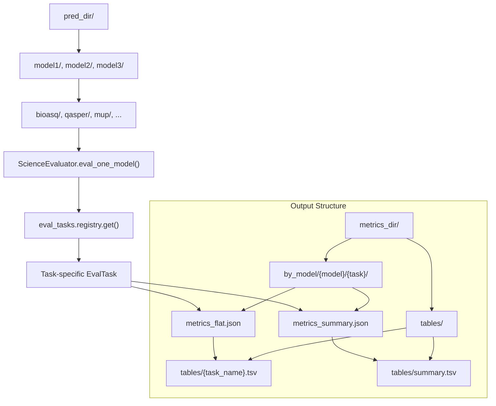
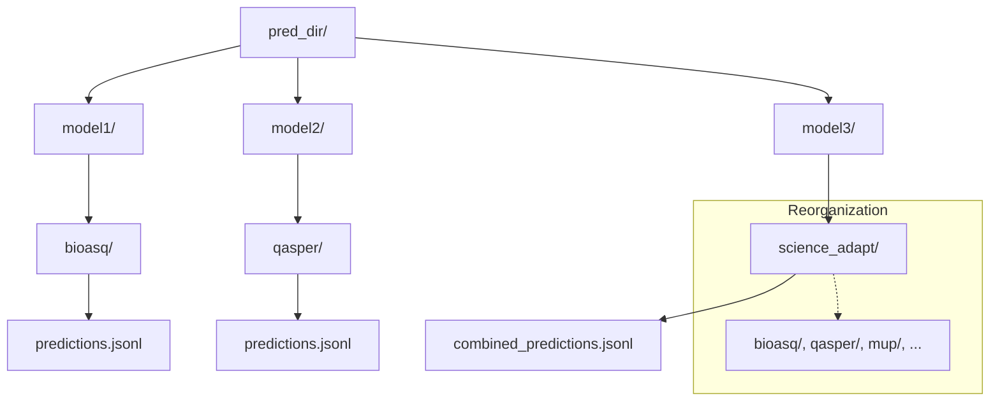
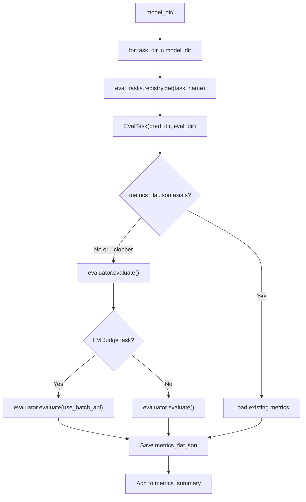
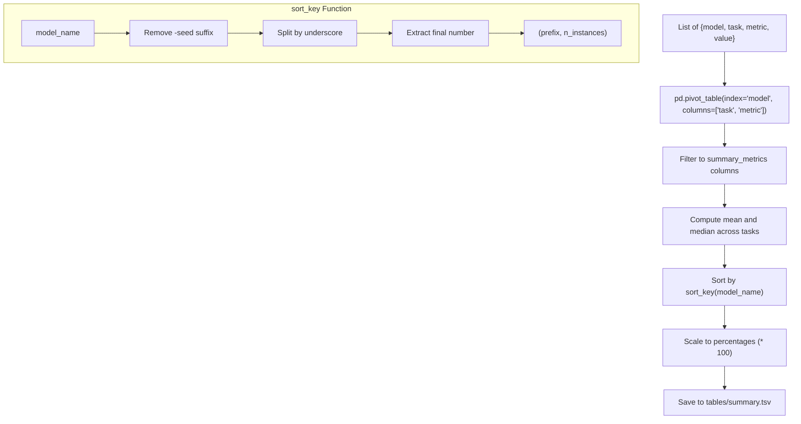

<!-- source: DeepWiki mcp.deepwiki.com · repo allenai/SciRIFF · page 3.2 Computing Metrics · fetched 2026-10-26 -->

# Computing Metrics

<details>
<summary>Relevant source files</summary>

The following files were used as context for generating this wiki page:

- [script/eval/compute_science_metrics.py](script/eval/compute_science_metrics.py)

</details>


This document describes the metrics computation system used to evaluate model predictions in SciRIFF. The `compute_science_metrics.py` script processes prediction files generated by the evaluation pipeline and computes both task-specific and cross-task summary metrics.

For information about generating predictions, see [Generating Predictions](#3.1). For details about individual evaluation task implementations, see [Evaluation Tasks](#3.3).

## Overview

The metrics computation system takes prediction files from multiple models and tasks, runs evaluation using task-specific evaluators, and produces both detailed metrics and summary tables. The system is implemented in the `ScienceEvaluator` class which orchestrates the evaluation of all models across all tasks.

**Metrics Computation Flow**



Sources: [script/eval/compute_science_metrics.py:29-220]()

## Input and Output Structure

The metrics computation system expects a specific directory structure for inputs and produces organized outputs for analysis.

**Directory Structure**

| Component | Path | Description |
|-----------|------|-------------|
| Prediction Directory | `pred_dir/{model_name}/{task_name}/` | Contains prediction files from models |
| Metrics Directory | `metrics_dir/by_model/{model_name}/{task_name}/` | Detailed metrics for each model-task pair |
| Summary Tables | `metrics_dir/tables/` | Cross-model comparison tables |

**Input Requirements**

The prediction directory must contain subdirectories for each model, with task-specific prediction files. The system can handle both reorganized predictions (one directory per task) and legacy formats where predictions are in a single `science_adapt` directory.



Sources: [script/eval/compute_science_metrics.py:97-134]()

## ScienceEvaluator Class

The `ScienceEvaluator` class is the main orchestrator for metrics computation. It manages the evaluation process across multiple models and tasks, handling both standard metrics and LM judge evaluations.

**Class Architecture**

```mermaid
classDiagram
    class ScienceEvaluator {
        +pred_dir: Path
        +metrics_dir: Path
        +max_instances: int
        +clobber: bool
        +model_pattern: regex
        +use_batch_api: bool
        
        +__init__(args)
        +run_eval()
        +eval_one_model(model_dir, use_batch_api)
        +reorganize_predictions(model_dir)
        +make_summary_table(metrics_summary)
        +make_task_tables(metrics_flat)
    }
    
    ScienceEvaluator --> EvalTask : "uses"
    ScienceEvaluator --> "eval_tasks.registry" : "queries"
```

**Key Methods**

- `run_eval()`: Main entry point that processes all models and generates final tables
- `eval_one_model()`: Evaluates a single model across all its tasks
- `reorganize_predictions()`: Converts legacy prediction format to task-organized structure
- `make_summary_table()`: Creates cross-task comparison table
- `make_task_tables()`: Creates per-task comparison tables

Sources: [script/eval/compute_science_metrics.py:29-47](), [script/eval/compute_science_metrics.py:198-220]()

## Task Evaluation Process

For each model-task combination, the system loads the appropriate evaluator from the task registry and runs evaluation. Tasks requiring LM judge evaluation are handled specially with batch API support.

**Task Evaluation Flow**



The system identifies LM judge tasks by name: `mup_single_document_summarization` and `qasper_abstractive_qa` are evaluated using the batch API option for cost-effective OpenAI API usage.

Sources: [script/eval/compute_science_metrics.py:135-197]()

## Summary Metrics and Tables

The system generates comprehensive summary tables that aggregate metrics across tasks and models, enabling easy comparison of model performance.

**Summary Metrics Configuration**

The summary table uses a predefined set of representative metrics for each task:

| Task | Metric | Description |
|------|--------|-------------|
| bioasq | f1 | F1 score for list question answering |
| biored | f1 | F1 score for named entity recognition |
| discomat | bleu | BLEU score for discourse marker prediction |
| evidence_inference | f1_overlap | F1 score with overlap matching |
| multicite | f1 | F1 score for citation intent classification |
| mup | lm_judge_reference | LM judge score vs reference |
| qasper | lm_judge_answer | LM judge score for answer quality |
| qasper | f1_evidence | F1 score for evidence selection |
| scierc | f1 | F1 score for named entity recognition |
| scifact | f1_label | F1 score for claim verification |
| scifact | f1_evidence_token | F1 score for evidence selection |

**Table Generation Process**



The `sort_key` function ensures models are ordered logically, grouping by base name and sorting by number of training instances.

Sources: [script/eval/compute_science_metrics.py:48-96](), [script/eval/compute_science_metrics.py:17-26]()

## Command Line Interface

The script provides comprehensive command-line options for flexible metrics computation across different evaluation scenarios.

**Usage Pattern**

```bash
python script/eval/compute_science_metrics.py \
    --pred_dir /path/to/predictions \
    --metrics_dir /path/to/output \
    [additional options]
```

**Key Arguments**

| Argument | Type | Description |
|----------|------|-------------|
| `--pred_dir` | str | Directory containing prediction files from all models |
| `--metrics_dir` | str | Output directory for computed metrics |
| `--max_instances` | int | Limit evaluation to N instances per task (debugging) |
| `--clobber` | flag | Recompute metrics even if files exist |
| `--model_pattern` | str | Regex to filter models for evaluation |
| `--model_name` | str | Evaluate only specified model (no summary table) |
| `--use_batch_api` | flag | Use OpenAI batch API for LM judge evaluations |

**Batch API Integration**

For tasks requiring LM judge evaluation (`mup_single_document_summarization` and `qasper_abstractive_qa`), the `--use_batch_api` flag enables cost-effective batch processing through OpenAI's batch API, significantly reducing evaluation costs for large-scale experiments.

Sources: [script/eval/compute_science_metrics.py:222-263]()

---

