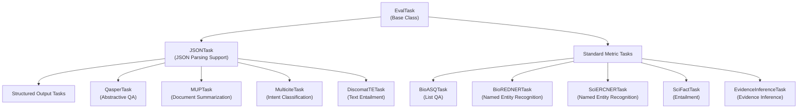
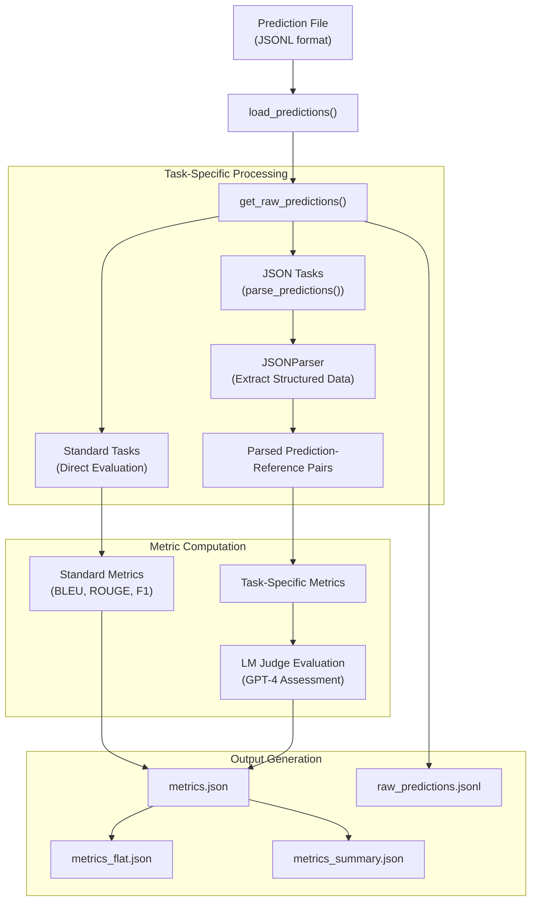
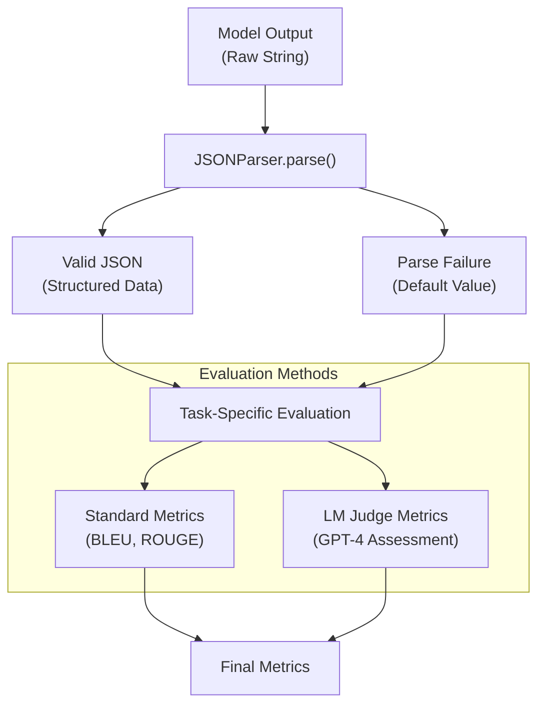
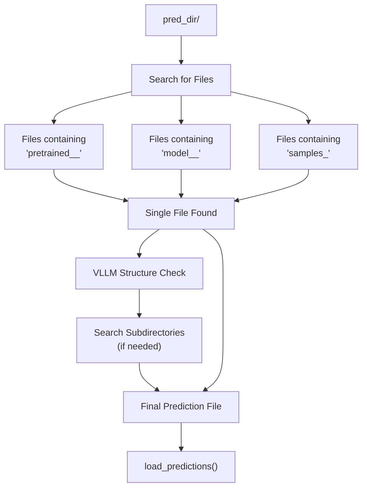

<!-- source: DeepWiki mcp.deepwiki.com · repo allenai/SciRIFF · page 3.3 Evaluation Tasks · fetched 2026-10-26 -->

# Evaluation Tasks

<details>
<summary>Relevant source files</summary>

The following files were used as context for generating this wiki page:

- [sciriff/eval/tasks/_base.py](sciriff/eval/tasks/_base.py)

</details>


This page documents the architecture and implementation of individual evaluation tasks within the SciRIFF evaluation framework. Evaluation tasks are responsible for processing model predictions, computing task-specific metrics, and outputting standardized results. For information about generating predictions, see [Generating Predictions](#3.1). For information about the overall metrics computation pipeline, see [Computing Metrics](#3.2). For details about LM judge evaluation methods, see [LM Judge System](#3.4).

## Purpose and Architecture

The evaluation task system provides a standardized framework for evaluating model performance across the 9 held-out scientific tasks in SciRIFF. Each task inherits from base classes that handle common functionality like prediction loading, result formatting, and file I/O, while implementing task-specific evaluation logic.

### Task Class Hierarchy



Sources: [sciriff/eval/tasks/_base.py:13-125](), [sciriff/eval/tasks/_base.py:126-180]()

### Task Processing Pipeline



Sources: [sciriff/eval/tasks/_base.py:46-61](), [sciriff/eval/tasks/_base.py:98-109](), [sciriff/eval/tasks/_base.py:158-179]()

## Task Types and Implementation

The evaluation system supports two primary categories of tasks, each with different processing requirements and evaluation methodologies.

### Standard Metric Tasks

Standard metric tasks evaluate predictions using traditional NLP metrics such as BLEU, ROUGE, and F1 scores. These tasks inherit directly from the `EvalTask` base class and work with string-based predictions.

| Task | Dataset | Evaluation Type | Primary Metrics |
|------|---------|-----------------|-----------------|
| BioASQ | Biomedical QA | List Question Answering | F1, Exact Match |
| BioRED NER | Biomedical Text | Named Entity Recognition | Precision, Recall, F1 |
| SciERC NER | Scientific Text | Named Entity Recognition | Precision, Recall, F1 |
| SciFact | Scientific Claims | Textual Entailment | Accuracy, F1 |
| Evidence Inference | Medical Evidence | Evidence Assessment | Macro-F1, Accuracy |

### Structured Output Tasks (JSONTask)

Structured output tasks require models to generate JSON-formatted responses, which are then parsed and validated before evaluation. These tasks inherit from `JSONTask`, which extends `EvalTask` with JSON parsing capabilities.



Sources: [sciriff/eval/tasks/_base.py:126-180](), [sciriff/eval/metrics/json_parser.py]()

## Task Initialization and Configuration

Each evaluation task is initialized with a standardized set of parameters that define input sources, output destinations, and processing constraints.

### Initialization Parameters

```python
# Base initialization signature for all tasks
EvalTask(pred_dir, eval_dir, baseline_dir, max_instances=None)
```

| Parameter | Purpose | Example Value |
|-----------|---------|---------------|
| `pred_dir` | Directory containing model predictions | `/path/to/predictions/qasper/` |
| `eval_dir` | Output directory for evaluation results | `/path/to/evaluation/qasper/` |
| `baseline_dir` | Directory containing baseline predictions | `/path/to/baselines/` |
| `max_instances` | Limit on number of instances to evaluate | `1000` |

### Prediction File Discovery

The task framework automatically discovers prediction files using a standardized naming convention:



Sources: [sciriff/eval/tasks/_base.py:24-44]()

## Evaluation Workflow

The evaluation process follows a standardized workflow across all task types, with task-specific customizations at key stages.

### Core Evaluation Steps

1. **Prediction Loading**: Load model outputs from JSONL files
2. **Data Processing**: Extract and format prediction-reference pairs
3. **Metric Computation**: Apply task-appropriate evaluation metrics
4. **Result Formatting**: Generate standardized output files

### Output File Structure

Each task generates a consistent set of output files in its designated evaluation directory:

| File | Purpose | Format |
|------|---------|--------|
| `metrics.json` | Complete evaluation results | Hierarchical JSON |
| `metrics_flat.json` | Flattened metrics for tabular analysis | Flat JSON |
| `metrics_summary.json` | Summary statistics | Condensed JSON |
| `raw_predictions.jsonl` | Processed prediction-reference pairs | JSONL |

Sources: [sciriff/eval/tasks/_base.py:87-96](), [sciriff/eval/tasks/_base.py:111-124]()

## Integration with Evaluation Pipeline

Evaluation tasks integrate with the broader SciRIFF evaluation system through a registry-based architecture that enables dynamic task discovery and execution.

### Task Registration and Discovery


The evaluation system dynamically instantiates and executes tasks based on the directory structure of prediction files, allowing for flexible evaluation of different model outputs against multiple scientific tasks.

Sources: [sciriff/eval/tasks/_base.py](), [sciriff/eval/compute_science_metrics.py]()

---

